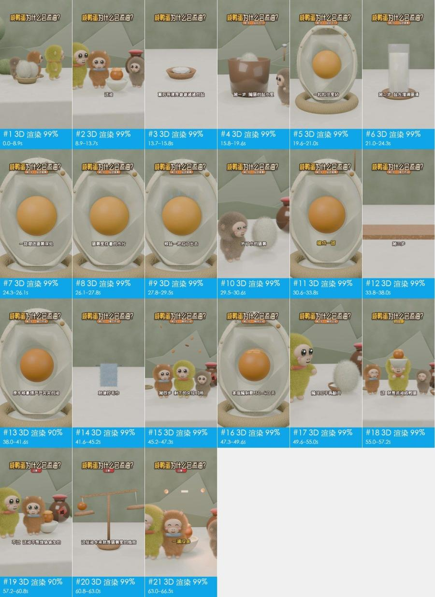
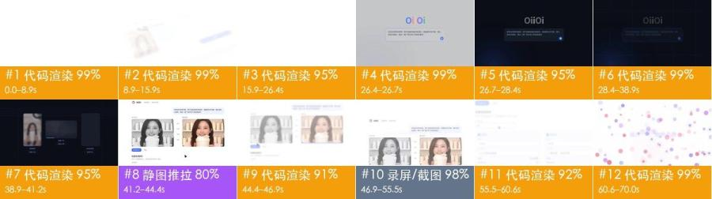
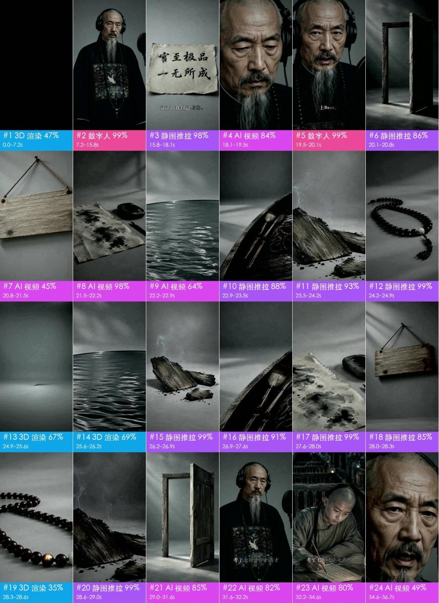

<div align="center">

# rea-video

あらゆる動画をリバースエンジニアリングします。

実写のトーク動画、卓上撮影、AI 動画、3D、モーショングラフィックス、ミックス編集など、どんな動画を渡しても、<br>
映像、装飾テキスト、編集、音声がどのように作られたかをショットごとに説明し、自分で同じものを作るためのプランを提示します。

[中文](README.md) | [English](README_en.md) | 日本語

[](https://github.com/JuneYaooo/rea-video/stargazers)


左：スマートフォンで撮影された TikTok の広告。右：別の商品に差し替えて作られた、誰かの AI リメイク。<br>
rea-video の判定：左はすべて実写で、1 つのセットと 2 つのカメラ位置で撮影されています。右はすべて AI 生成で、その 8 ショットは 3 回の生成で作成できます。

</div>

> レポートと詳細なドキュメントは、現在中国語のみです。エージェントがそれらを読み、英語で回答できます。

## 分析できるもの

| 動画の種類 | 例 | 得られるもの |
|---|---|---|
| 実写 | トーク動画、卓上撮影、手持ちの商品デモ、Vlog、店舗訪問 | セットアップとカメラ位置、構図、カメラワーク、照明（機材リスト付きの 12 のセットアップ）、カラーグレーディング |
| AI 動画 | テキスト/画像からの動画生成、AI ショートドラマ、AI ミュージックビデオ | 根拠、ショットごとにリバースエンジニアリングしたプロンプト、生成をどうまとめるか、どのモデルを使うか |
| アバター | 音声で動かすポートレート、リップシンク | どのショットがアバターのショットか、どんなポートレートと音声が必要か |
| 3D / アニメーション | Blender / C4D の解説動画、商品アニメーション、2D アニメーション、ストップモーション | 動画モデルで生成するか、3D のコードからレンダリングするか |
| コード / テンプレート | キネティックタイポグラフィ、UI デモ、グラフ、スライド風のカード | テキスト、レイアウト、モーションのタイミング。Remotion プロジェクトとしてそのまま再構築できます |
| 画面録画 | ソフトウェアのチュートリアル、Web のデモ | 自分で録画する必要がある実素材の部分 |
| ミックス / 編集 | AI キャラクター + コードの UI + 実際の画面キャプチャ、AI 編集を加えた実写 | ショットごとに個別に判定し、元のタイムライン上で組み立て直します |

映像がどのように作られたかに加えて、どの動画についても次の情報が得られます：

- キャプションと装飾テキスト：各行の開始と終了（SRT / ASS にエクスポート可能）、色、縁取り、テキストの登場の仕方
- ステッカー、絵文字、ピクチャーインピクチャー：どこに配置され、どれだけ表示されるか
- 編集：カットの位置、テンポ、ビートに合っているかどうか
- 音声：人の声か AI の声か、AI の音楽かライブラリの音楽か、その BPM、各効果音の位置
- 自分で用意する素材：画面録画、スクリーンショット、商品写真

## クイックスタート

rea-video は AI エージェント向けに作られています。Claude Code、Codex、またはコマンドを実行できる任意のエージェントで、次のように伝えてください：

```text
Install https://github.com/JuneYaooo/rea-video, then break down this video: /path/to/video.mp4
```

エージェントが CLI をインストールし、ワークフローを学んで、すべてを実行します。ffmpeg と Python 3.10+ が必要です。

得られるもの：

- 1 行の要約。例："41% AI video + 59% code UI, 8 s of real screen recording, library music at 122 BPM"
- 撮影するもの、生成するもの、コードで作るものに分けたリメイクプラン
- ショットごとのフレーム、根拠、プロンプト、カメラと照明のメモ、音声の分析を含む完全な `report.html`

動画を扱えるモデルを追加してください。Gemini と Doubao のどちらでも使えます。エージェントにエンドポイントとキーを渡してください。実写/AI/3D の判定がより正確になり、すべてのショットについてリバースエンジニアリングしたプロンプトを作成します。モデルがなくても動作します。エージェントが画像を見られる場合は、判定が不確かなショットをエージェント自身が確認します。

## 例

<table>
<tr>
<td width="50%" valign="top">
<a href="docs/cases.md#2-混合片ai-人物对话--代码界面--真实录屏"></a><br>
<b>ミックスメディアのクリップ</b> · 19 秒 · 10 ショット<br>
AI キャラクターの会話 + コードで作った UI + 8 秒の実際の画面録画。5 つの会話ショットは UI のセグメントで分断されていますが、同じセットを共有しているので、1 回の生成でまかなえます。<br>
<a href="docs/cases/videos/dual_role.mp4">動画</a> · <a href="docs/cases/dual_role/report.md">レポート</a>
</td>
<td width="50%" valign="top">
<a href="docs/cases.md#3-3d-科普片咸鸭蛋为什么会流油"></a><br>
<b>3D の解説動画</b> · 67 秒 · 21 ショット<br>
すべて 3D で、ナレーションは AI です。10 回の動画生成で作れるほか、LLM に Blender / Three.js のコードを書かせることもできます。<br>
<a href="docs/cases/videos/salted_egg.mp4">動画</a> · <a href="docs/cases/salted_egg/report.md">レポート</a>
</td>
</tr>
<tr>
<td width="50%" valign="top">
<a href="docs/cases.md#4-代码-ui-动效产品宣传片"></a><br>
<b>商品のプロモーション動画</b> · 70 秒 · 12 ショット<br>
83% がコードで動かすモーショングラフィックス、12% が画面録画です。動画モデルは不要で、1 つの Remotion プロジェクトで作れます。<br>
<a href="docs/cases/videos/v10_oiioii_gen_coding_first.mp4">動画</a> · <a href="docs/cases/v10/report.md">レポート</a>
</td>
<td width="50%" valign="top">
<a href="docs/cases.md#5-ai-音乐-mv歌是-ai-写的还是曲库的"></a><br>
<b>AI ミュージックビデオ</b> · 165 秒 · 86 ショット<br>
曲が AI 生成であること（Suno で作られたもの）を正しく判定しています。ビジョンモデルは一部のショットを「実写のドラマ」と判定しましたが、エージェントが巻物の上の偽の漢字に気づき、AI と判定しました。<br>
<a href="docs/cases/videos/qing_mv.mp4">動画</a> · <a href="docs/cases/qing_mv/report.md">レポート</a>
</td>
</tr>
</table>

## リメイク

rea-video で動画を分析したあと、[cheap-claude-video](https://github.com/JuneYaooo/cheap-claude-video) のリメイクレシピで新しいバージョンを生成します。カメラ、動き、テンポ、トランジションはオリジナルに従い、選んだ要素だけが差し替えられます。
これらの結果は、セルフホストの MiniMax H3 で生成しました。オリジナルのショットを動きの参照とし、要素を差し替えたキーフレーム（gpt-image-2）で見た目を決めています。
以下は、OiiOii が WeChat の記事で紹介した 3 つのリメイクです。それぞれについて 2 つのバージョンを作りました。OiiOii と同じ差し替えのバージョンと、被写体、舞台、小道具も差し替えたバージョンです。
各 GIF では、オリジナル、OiiOii のリメイク、私たちのリメイク、要素を差し替えたバージョンの 4 つを同期して再生しています。

<table>
<tr><td>
<b>俯瞰での着替え</b> · 12 秒<br>
同じ差し替え：女性 → 男性、3 着の服 → 対応する紳士服。要素の差し替え：中国風の書斎で 3 着の歴史的な漢服を着る少女。リモコンは丸い団扇になります。<br>
<br>
<a href="docs/cases/remake/outfit_compare.mp4">HD の比較動画（音声付き）</a> · <a href="docs/cases/remake/outfit_sheet.jpg">同じ瞬間の静止画</a>
</td></tr>
<tr><td>
<b>ペーパークラフト / 水彩アニメーション</b> · 30 秒<br>
同じ差し替え：主役を新しい粘土の少女に。要素の差し替え：キツネ。森 → サンゴ礁、雲 → 星空、夕焼け → オーロラ。<br>
<br>
<a href="docs/cases/remake/paper_compare.mp4">HD の比較動画（音声付き）</a> · <a href="docs/cases/remake/paper_sheet.jpg">同じ瞬間の静止画</a>
</td></tr>
<tr><td>
<b>手持ちの商品動画</b> · 21 秒 · 11 ショット<br>
同じ差し替え：オリジナルの新商品、英語のステッカー → 中国語のキャプション。要素の差し替え：ピンクの商品、キッチン → キャンプのテーブル、新しい食材。<br>
<br>
<a href="docs/cases/remake/juicer_compare.mp4">HD の比較動画（音声付き）</a> · <a href="docs/cases/remake/juicer_sheet.jpg">同じ瞬間の静止画</a>
</td></tr>
</table>

HD の比較動画では、オリジナルの音声を使っています。オリジナルと OiiOii のバージョンは記事から引用したもので、比較のためだけに掲載しています。

## 精度

ショットの長さで重み付けした、制作方法の判定精度：

| | チューニングセット (15) | ホールドアウト (16) | 再エンコードされた WeChat の動画 (10) |
|---|---|---|---|
| ツールのみ（オフライン、無料） | 98.3% | 99.6% / 98.9% | 88.6% |
| + ビジョンモデル (Gemini) | — | 99.6% / 99.8% | 99.6% |
| + エージェントによる目視確認 | — | 99.6% / 99.8% | 100% |

オリジナルのファイルであれば、ほとんどの場合ツールだけで十分です。プラットフォームからダウンロードした動画は再圧縮されていてノイズの根拠が失われているため、99% 以上に戻すにはビジョンによる確認が必要です。実素材の検出精度は 97〜99% で、ショットの境界はすべて正しく検出されています。数値と再現方法：[eval/RESULTS.md](eval/RESULTS.md)。

## 仕組み


1. 分割：動画をショットに分け、音声を声、音楽、効果音に分離します。
2. 根拠の収集：フレームを計測し（フレームの間隔、センサーノイズ、画像全体が 1 つの平面としてパンしているか、メタデータ内の AIGC タグ）、画像を見て（手、文字、物理）、音を聴きます（BPM、キー、歌か話し声か）。
3. 判定：AIGC タグやフレームの間隔のような確かな根拠は、「そう見える」よりも優先されます。矛盾がある場合は、エージェントが目視で確認できるようにフラグを立てます。
4. リメイクの計画：最大クリップ長、マルチショットへの対応、受け付ける参照画像の枚数など、対象の動画モデルが実際にできることに合わせて、ショットをまとめます。

## よくある質問

<details>
<summary>Hypit のようなワンクリックのリメイクツールと何が違うのですか？</summary>

[Hypit](https://github.com/hypit-ai/hypit) は参照動画を受け取って新しい動画を作ります。エージェントがフレームのグリッドを読んでオリジナルを理解し、対応しているモデル（Seedance、PixVerse、MiniMax、Wan など）で映像を生成し、キャプションやモーショングラフィックスを HTML でレンダリングします。

Hypit はオリジナルがどのように作られたかは問いません。実写の素材も同じパイプラインを通るため、何台のカメラが使われたか、どのように照明されたかは教えてくれません。どの AI 動画に合わせられるかは、使えるモデル次第です。Kling や Veo はなく、アバターや 3D の専用の手段もなく、AI 音楽もないため、自分で用意する必要があります。台本に沿ったトーク動画、ポッドキャスト、インタビュー動画には最も強く、音楽主導の編集、商品のモーショングラフィックス、映画的なショート動画には弱い傾向があります。

rea-video は動画をレンダリングしません。ショットごとに、撮影されたものか、AI 生成か、コードで作られたものかを判定し、それぞれについて撮影プラン、プロンプト、コードでのアプローチを提示します。手早く似たものを作るなら Hypit のほうが速いです。オリジナルがどのように作られたかを理解し、低コストでリメイクしたいなら rea-video を使ってください。両者は問題なく併用できます。

</details>

<details>
<summary>動画を扱えるモデルは必要ですか？費用はどれくらいかかりますか？</summary>

不要です。ツールのみのモードはオフラインかつ無料で、オリジナルのファイルであればすでに高い精度が出ます。再圧縮されたプラットフォームからのダウンロード動画には、動画を扱えるモデル（Gemini と Doubao のどちらでも使えます）を追加するか、画像を見られるエージェントを使ってください。費用はそのサービスの料金次第です。動画の自動生成（capsule-cinema）では、まず無料のドライランを行い、確認したあとにだけ有料のモデルを呼び出します。

</details>

<details>
<summary>動画全体を自動でリメイクできますか？</summary>

一部は可能です。[capsule-cinema](https://github.com/JuneYaooo/cheap-claude-video) をインストールすると、AI のショットが生成され、元のタイムライン上に自動で配置されます。実写のショットは撮影プランに従って撮影し、コードのショットはエージェントが Remotion プロジェクトとして作成します。[docs/replicate.md](docs/replicate.md) をご覧ください。

</details>

<details>
<summary>他人の動画をそのまま転載してもよいですか？</summary>

いいえ。rea-video は、動画の構成、テンポ、テクニックを学び、権利を持つ素材でリメイクするためのものです。他人の映像、音楽、キャラクター、肖像を再利用しないでください。公開する際は、プラットフォームのルールと、地域の AI コンテンツの表示に関する要件に従ってください。

</details>

## ドキュメント

- [docs/what-it-detects.md](docs/what-it-detects.md)：検出するすべての項目（10 種類の映像、カメラ、照明、グレーディング、音声）
- [docs/replicate.md](docs/replicate.md)：レポートからのリメイク
- [docs/cases.md](docs/cases.md)：事例の詳細
- [docs/decompose.md](docs/decompose.md)：検出ルール
- [docs/cli.md](docs/cli.md)：CLI の使い方と capsule-cinema との連携
- [rea_video/capabilities/](rea_video/capabilities/README.md)：動画 / 画像 / 音声モデルの能力表。リメイクプランでモデルを選ぶために使います
- [eval/RESULTS.md](eval/RESULTS.md)：評価結果

ドキュメントは現在中国語のみです。

## コミュニティ

[linux.do](https://linux.do/)（中国語のコミュニティ）で、分析結果やリメイクのアイデアを共有してください。

## クレジット

[REA (Reverse Engineer Anything)](https://github.com/morluto/rea) に着想を得ています：目に見えるものからそれがどのように作られたかをたどり、すべての主張を根拠で裏付け、計測によって検証します。
