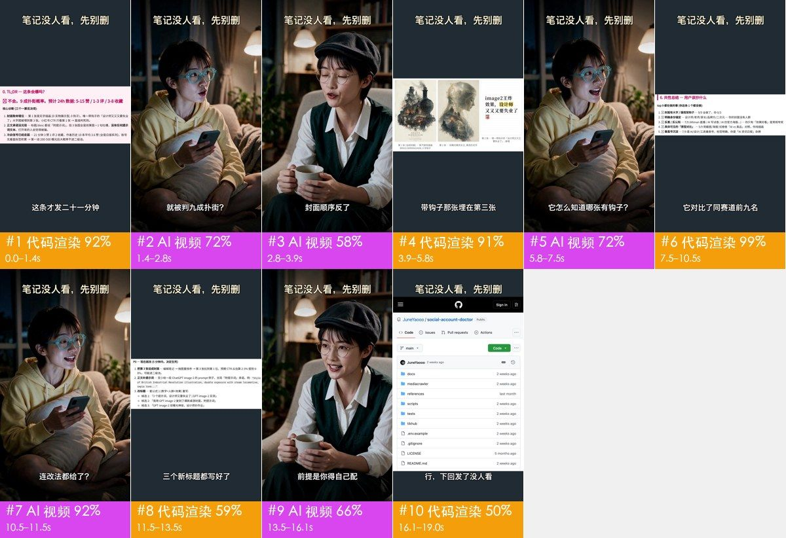
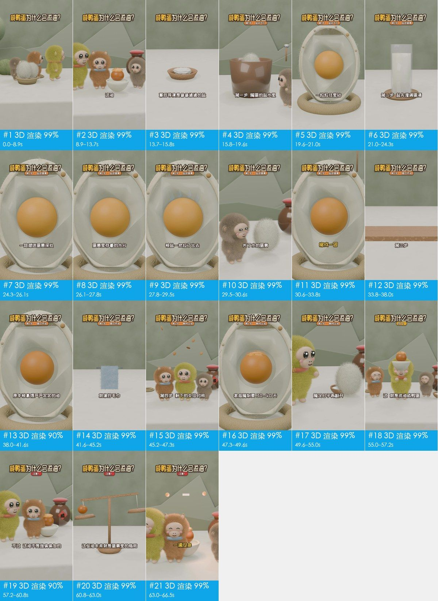
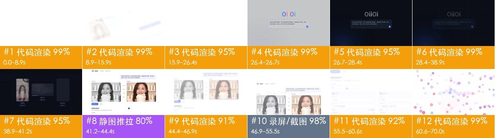
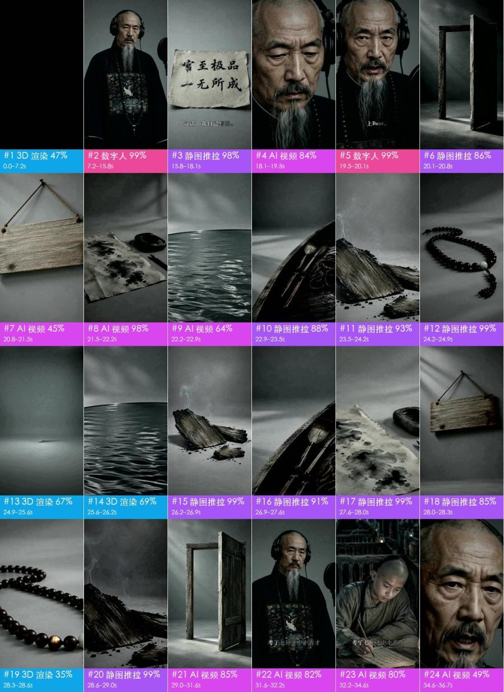
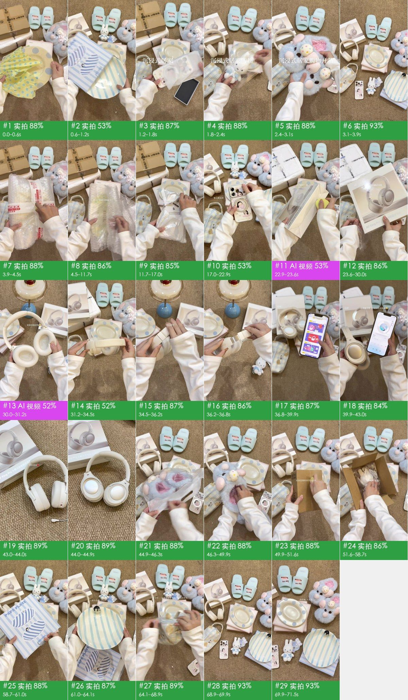
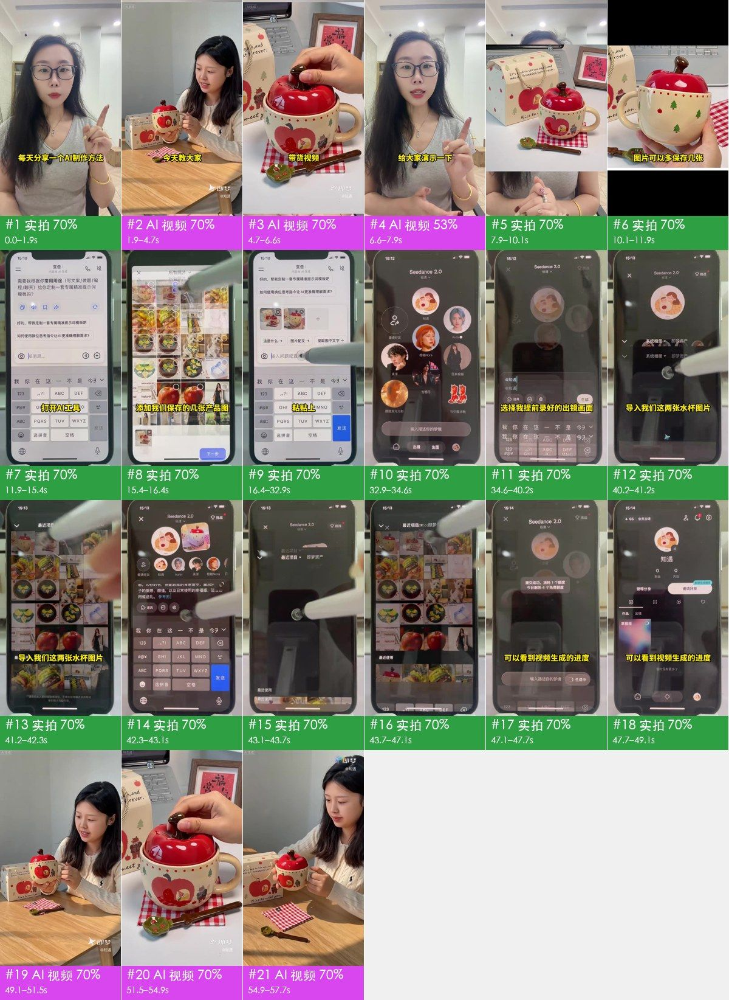

# 案例

下面 8 条报告都是这一版生成的：工具测量之后，由 AI 助手逐镜看图复核（没有开看图模型），再生成报告和拆片包。拼帧图里每格是一个镜头，色条写着制作方式、把握程度和时间；完整报告里有核心看点、叙事线、分镜表、照着复刻的步骤，以及每个镜头的证据和提示词。

`docs/cases/videos/` 里的样片为了减小仓库体积重新压缩过，平台标记（抖音 / TikTok / 微信）没有保留，还多了一层压缩痕迹。自己拿它们跑，结果会和报告有出入，只用工具、不做看图复核时更明显。要复现报告，请用平台下载的原文件。

## 1. 原片 vs AI 复刻：TikTok 实拍 → 换产品重做

20 秒 · 原片 14 镜 / 复刻版 21 秒 8 镜

▶ [TikTok 原片](cases/videos/v11_tiktok_original.mp4) · [AI 复刻版](cases/videos/v12_oiioii_juicer_remake.mp4) · 完整报告：[原片](cases/v11/report.md) · [复刻版](cases/v12/report.md)

| | 原片 | AI 复刻版 |
|---|---|---|
| 怎么做的 | 全部手机第一视角实拍，真人口播 | 全部 AI 生成 |
| 怎么重做 | 1 个场景、2 个机位 | 8 个镜头合并成 3 次 Seedance 2.0 生成 |
| 要准备什么 | 产品实物 | 产品参考图（杯身 Logo 要清楚） |

- 原片：一开头就下结论（标题「This bottle is a GAME CHANGER」），然后一步一刀演示到能喝。手、台面上的瓶罐和背景在每一镜里都一致，有自然的手持晃动。
- 复刻版：放料、合盖、打、倒杯，一镜一步。杯身品牌字每一镜都是乱码；整块水果半秒内变成奶昔、没有搅打过程；玻璃杯两秒里变了三次形状，这些都是生成画面的破绽。
- 复刻版按生成来组织：8 个镜头分 3 次生成，每次用参考图保住产品长相。报告里写明每次要喂哪些输入、从哪来，以及完整的中英文提示词。

## 2. 混合片：AI 人物对话 + 代码界面 + 真实截图

19 秒 · 10 镜

▶ [原视频](cases/videos/dual_role.mp4) · [完整报告](cases/dual_role/report.md)

怎么做的：代码 / 模板渲染 59% + AI 生成视频 41%。两个 AI 角色一问一答（5 镜，两个夜晚的房间），中间穿插 5 段深灰模板画面，里面是诊断报告、笔记配图和 GitHub 页面的截图，每段都在推近。没有配乐，也没有后期音效。

怎么重做：5 个对话镜头分 4 次生成，用两张角色参考图锁定长相；5 段模板画面写成 1 个代码工程，截图换成你自己的。

## 3. 3D 科普片：咸鸭蛋为什么会流油

66 秒 · 29 镜

▶ [原视频](cases/videos/salted_egg.mp4) · [完整报告](cases/salted_egg/report.md)

怎么做的：29 个镜头全是 3D 渲染。毛绒小猴负责留人，鸭蛋剖面模型分 4 步讲原理：每个看不见的过程都做成一个看得见的比喻动画。同一个剖面模型在 8 个镜头里重复出现，毛发和材质跨帧稳定。旁白配曲库配乐，有 6 处后期音效，卡在盐粒弹出、油滴落下这些动画节点上。

怎么重做，有两条路：

- 交给视频模型：29 个镜头分 14 次生成。
- 让大模型写 Blender 或 Three.js 代码：角色和剖面模型只建一次，每个镜头设好机位渲染，多角度一致性最好，改文案也只是改代码。

## 4. 代码 UI 动效：产品宣传片

70 秒 · 9 镜

▶ [原视频](cases/videos/v10_oiioii_gen_coding_first.mp4) · [完整报告](cases/v10/report.md)

怎么做的：OiiOii「视频复刻」功能的宣传片，全部是代码做的界面动画，没有旁白，用「上传爆款 → 一句话改写 → 批量出片」把流程演示一遍。画面里的 AI 人物和商品是嵌在界面卡片里的静态图，不是整屏 AI 视频。结尾粒子散开时有一处后期音效。

怎么重做：不需要视频模型。写成 1 个 Remotion 代码工程，文字和界面完全可控，改文案只改数据，可以直接让大模型写；报告里有逐镜的动效时间轴。

## 5. AI 音乐 MV：古人进录音棚

164 秒 · 118 镜

（图为旧版切分的前 24 镜）▶ [原视频](cases/videos/qing_mv.mp4) · [完整报告（118 镜）](cases/qing_mv/report.md)

怎么做的：AI 生成视频 53% + 数字人对口型 32% + 静图推拉 13% + 代码渲染的片名 3%。曾国藩戴着耳机在录音棚里唱自己的一生，每句歌词都配上对应的历史画面。片头字幕写明作词 Claude、作曲 Suno。有 5 镜是同一段成片在片中用了两次，复刻时只生成一次。

怎么重做：

- 先按风格和节奏用 Suno 生成歌。
- 录音棚里对口型的镜头，用人像加歌声驱动数字人。
- 其余 AI 镜头分 33 次生成。
- 静图推拉镜头在本地用一张图做，不用调模型。

报告的「声音」一节在这条上不准：它把人声判成 TTS 旁白、音乐判成曲库配乐，实际是 AI 生成的歌。看图复核只看画面，判断声音要能听音频的模型。

## 6. 实拍带货：沉浸式开箱

71 秒 · 69 镜

▶ [原视频](cases/videos/unboxing.mp4)（抖音 阿咪🍓，720p 转码） · [完整报告](cases/unboxing/report.md)

怎么做的：实拍 99%。手机固定在头顶的俯拍支架上，一双手在地毯上逐件拆 7 样奶油色居家好物；没有口播，靠拆包装的同期声和一句一句的小字幕撑住节奏，平均 1 秒一镜。拆包装的声音都是同期录的，不算后期音效。

怎么重做：不需要模型。一部手机加俯拍支架，商品平铺在浅色地毯上，拆包时手从画面下方伸入；后期配一首轻快的曲库配乐，字幕用小字写在商品旁边。

## 7. AI 与真人混合：用自己的出镜视频生成带货片

57 秒 · 28 镜

▶ [原视频](cases/videos/ai_daihuo.mp4)（抖音 晨曦的好物铺子，720p 转码） · [完整报告](cases/ai_daihuo/report.md)

怎么做的：实拍 77% + AI 生成视频 23%。

- 实拍部分：主播口播、口播上叠商品照片的拼版，以及 37 秒相机俯拍真手机的操作演示（不是录屏，能看到手机边框、触控笔和屏幕反光）。
- AI 部分：即梦 Seedance 2.0 生成的「真人带货」片段，开头先放一段当预告，结尾完整放。视频里作者自己讲了流程：豆包写提示词 → 即梦里选「提前录好的出镜画面」做主体，再传两张水杯图做商品参考 → 生成。
- 核心看点：先给结果再教方法；每一步都是真手机实操、配一句大字，照着就能做。

工具和看图复核的分歧：只用工具时，相机拍手机屏幕的画面在转码后被判成 3D 或代码渲染；AI 助手逐镜看图后改判，结论和作者自述一致。

怎么重做：口播和手机演示照拍。带货片段按作者的路线：Seedance 2.0 生成一次，用多参考模式喂出镜人物和水杯图，开头的预告从成片里剪。报告里有这一次生成的中英文提示词。注意生成的包装上不要有要读的文字，乱码是最容易露馅的地方。
