# 这条视频是怎么做的：ai_daihuo.mp4

**一句话**：AI 工具教程类带货口播：主播现场演示用豆包写提示词、用即梦 Seedance 2.0 拿提前录好的出镜画面和两张水杯图，生成一条真人感的水杯带货视频
**怎么做的**：混合制作：实拍 77% + AI 生成视频 23% + 静帧停留 1%

- 0:57 · 竖屏 9:16 · 28 个镜头，平均 2.1 秒一个
- 判断可靠度 72%，依据：工具测量 + AI 助手看图复核 28 镜
- ⚠️ 有 2 处拿不准，见「不确定点」

<!--mix-->

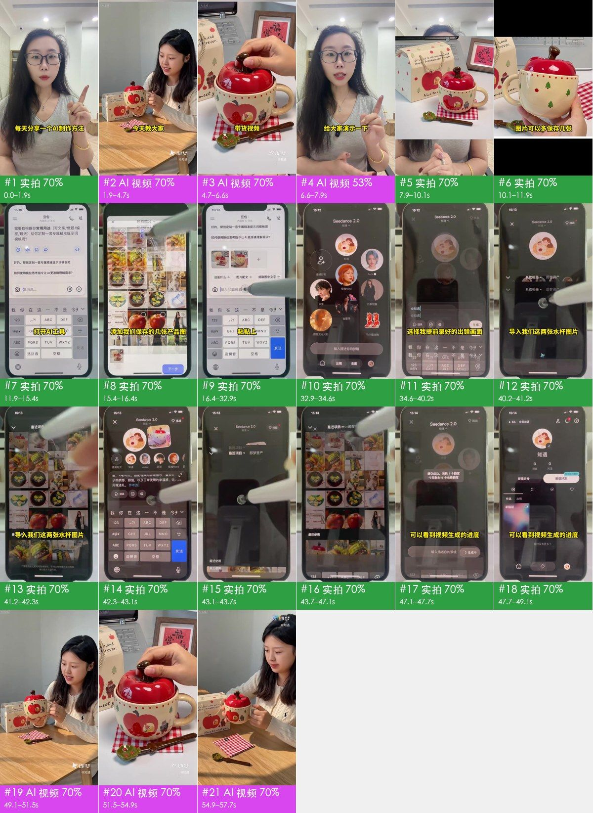

## 核心看点

- **开头怎么抓人**：0–1.9 秒主播竖起食指自报栏目「每天分享一个 AI 制作方法」，紧接着 1.9–6.6 秒放 AI 成片预告，字幕「今天教大家 制作真人出镜的日用品带货视频」
- 先给结果再教方法：开头预告、结尾 49.1–57.7 秒完整揭晓，中间 37 秒讲步骤，想做出同样效果的人会看到最后
- 步骤是真手机实操：11.9–49.1 秒俯拍真手机、触控笔逐步点按，每一步配一句大字（打开 AI 工具 → 粘贴提示词 → 导入水杯图片 → 生成），照着就能做
- 门槛看起来很低：两个 App（豆包写提示词、即梦生成）+ 几张商品图 + 一段提前录好的出镜画面，配合「每天分享一个 AI 制作方法」的栏目口播，适合连更涨粉
- 成片动作选得准：捧杯展示、揭开苹果盖、叶子勺搅拌、捧到脸边，四个动作把外观、细节和使用场景都交代了

## 一眼看懂：画面、包装、声音三层

短视频都可以拆成三层：底下是画面本身，上面叠字幕、花字、贴纸，再配上声音。复刻时一层一层做。

| 层 | 这条视频里是什么 | 怎么做 | 细节 |
|---|---|---|---|
| **画面**（底层） | 实拍 21 镜、AI 生成视频 6 镜、静帧停留 1 镜 | 分 2 个场景拍；AI 分 1 次生成，重复出现的片段从成片里剪；一张图做静帧或推拉 | 「自己复刻」 |
| **包装**（叠在画面上） | 字幕、文字、图形贴片、花字 | 剪辑软件里加：字幕、花字、贴纸照时间轴摆 | 「剪辑包装层」 |
| **声音** | 人声（真人录音）、背景音乐（115 BPM、待确认）、音效 3 种（共 4 处） | 人声：自己录；配乐：按节奏和情绪找同类曲；音效：按时间点从音效库加 | 「声音」 |

## 内容与结构

- 下面的叙事线来自逐镜看图；台词没有单独整理，字幕原文见「剪辑包装层」

**叙事线**

复刻时保留这条线：每一步的顺序和作用照搬，讲的那一点换成自己的案例、数据和素材，就不只是换个主角。

| 时间 | 镜头 | 作用 | 在讲什么 |
|---|---|---|---|
| 0.0–6.6s | #1–#3 | 抓注意 | 主播自报栏目：每天分享一个 AI 制作方法 → 先放 AI 成片预告：真人感的带货画面 → 预告特写：商品细节 |
| 6.6–7.9s | #4 | 交代背景 | 说明接下来要现场演示 |
| 7.9–47.1s | #5–#22 | 补信息 | 第一步：先保存好要带货的商品图 → 展示要用的商品图 → 提醒商品图多存几张，生成时当参考图 → 打开 AI 工具写提示词 → 把商品图发给 AI →（共 15 点，逐镜见「分镜表」） |
| 47.1–49.1s | #23、#24 | 给证据 | 提交成功 → 等待生成 |
| 49.1–57.7s | #25–#28 | 给结论 | 揭晓生成出来的带货视频 → 成片：特写展示杯盖设计 → 成片：使用场景 → 成片：情绪收尾 |

## 分镜表

「画面」「运镜」「叠加层」是画面里看得到的；「制作方式」「素材来源」是工具推断的，依据见附录逐镜取证。

| # | 截图 | 时间 | 时长 | 在讲什么 | 画面 | 运镜 | 叠加层 | 制作方式（推断） | 素材来源（推断） | 复刻 |
|---|---|---|---|---|---|---|---|---|---|---|
| 1 | 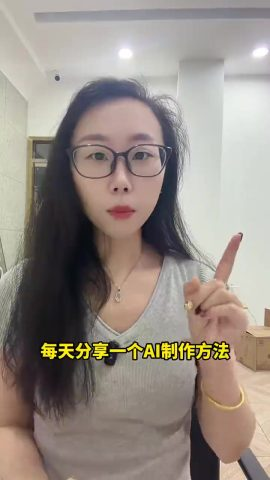 | 0:00.0 | 1.9s | 抓注意：主播自报栏目：每天分享一个 AI 制作方法 | 戴黑框眼镜的长发女主播，灰色 V 领 T 恤，坐在办公室里对着手机前置镜头口播，… | 平滑运镜 | 字幕 | 实拍 77% | 实拍视频素材 | 实拍 · S1 |
| 2 | 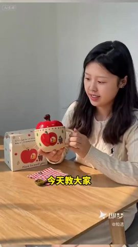 | 0:01.9 | 2.8s | 抓注意：先放 AI 成片预告：真人感的带货画面 | AI 生成的女生「知遇」坐在木桌前，双手捧起苹果杯向镜头展示，看着杯子讲解；暖阳… | 平滑运镜 | 字幕 | AI 生成视频 75% | AI 生成 | AI 生成 · G1（剪自 #25） |
| 3 | 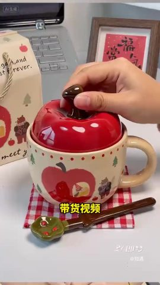 | 0:04.7 | 1.9s | 抓注意：预告特写：商品细节 | AI 生成的苹果杯特写：一只手揭开红色苹果盖，杯身印苹果和小熊图案；暖阳下的木桌… | 平滑运镜 | 字幕 | AI 生成视频 74% | AI 生成 | AI 生成 · G1（剪自 #26） |
| 4 | 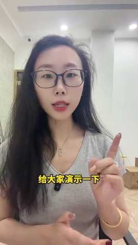 | 0:06.6 | 1.3s | 交代背景：说明接下来要现场演示 | 戴黑框眼镜的长发女主播，灰色 V 领 T 恤，坐在办公室里对着手机前置镜头口播，… | 平滑运镜 | 文字、图形贴片 | 实拍 76% | 实拍视频素材 | 实拍 · S1 |
| 5 | 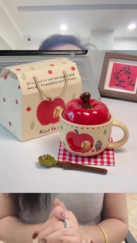 | 0:07.9 | 2.1s | 补信息：第一步：先保存好要带货的商品图 | 上下拼版：上半是苹果杯商品实拍图，下半是口播主播双手交握 | 固定 | 字幕 | 实拍 80% | 实拍视频素材；复刻参考：商品参考图 | 实拍 · S1 |
| 6 | 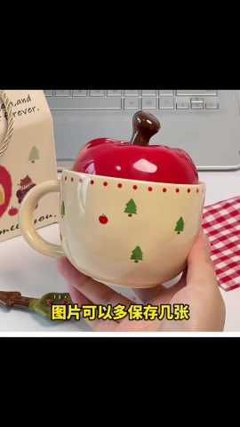 | 0:10.1 | 0.3s | 补信息：展示要用的商品图 | 商品实拍照片整屏停留（手举苹果杯），上下有黑边 | 固定 | 文字、字幕 | 静帧停留 86% | 真实照片、商品实拍图 | 静帧 |
| 7 | 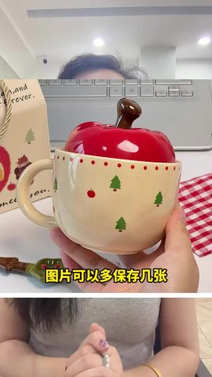 | 0:10.4 | 1.6s | 补信息：提醒商品图多存几张，生成时当参考图 | 上下拼版：上半是手举苹果杯的商品照片，下半是口播主播 | 固定 | 文字 | 实拍 80% | 实拍视频素材；复刻参考：商品参考图 | 实拍 · S1 |
| 8 | 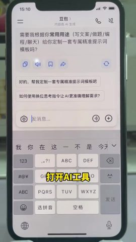 | 0:11.9 | 3.5s | 补信息：打开 AI 工具写提示词 | 桌面俯拍一台真手机，打开豆包 App，对话里让它定制提示词 | 固定 | 字幕 | 实拍 75% | 实拍视频素材 | 实拍 · S2 |
| 9 | 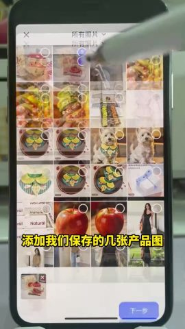 | 0:15.4 | 1.1s | 补信息：把商品图发给 AI | 桌面俯拍一台真手机，在豆包里从相册选中几张水杯商品图 | 固定 | 字幕 | 实拍 77% | 实拍视频素材 | 实拍 · S2 |
| 10 | 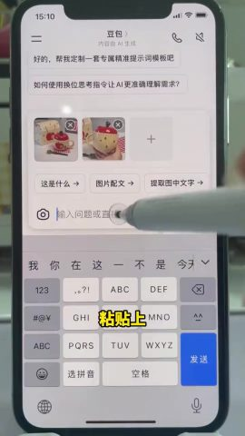 | 0:16.5 | 15.1s | 补信息：让 AI 按商品写视频提示词 | 桌面俯拍一台真手机，在豆包里粘贴「这是一个陶瓷杯，给我生成一段 AI 可以生成带… | 固定 | 字幕 | 实拍 63% | 实拍视频素材 | 实拍 · S2 |
| 11 | 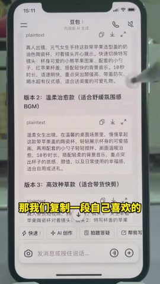 | 0:31.6 | 1.4s | 补信息：挑一段喜欢的提示词复制 | 桌面俯拍一台真手机，豆包回答里的版本 3 提示词，准备复制 | 固定 | — | 实拍 70% | 实拍视频素材 | 实拍 · S2 |
| 12 | 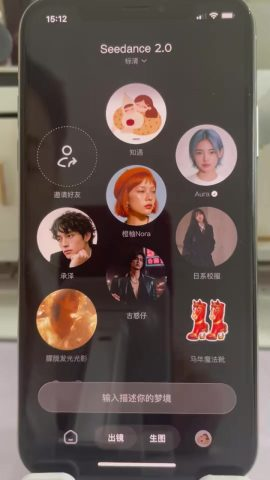 | 0:32.9 | 1.7s | 补信息：切到视频生成工具 | 桌面俯拍一台真手机，切到即梦 Seedance 2.0，主体列表里有「知遇」等人… | 固定 | 字幕 | 实拍 75% | 实拍视频素材 | 实拍 · S2 |
| 13 | 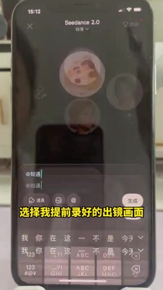 | 0:34.6 | 4.5s | 补信息：选好出镜人物主体并粘贴提示词 | 桌面俯拍一台真手机，在即梦里选中「@知遇」（提前录好的出镜主体），粘贴提示词 | 固定 | 字幕 | 实拍 74% | 实拍视频素材 | 实拍 · S2 |
| 14 | 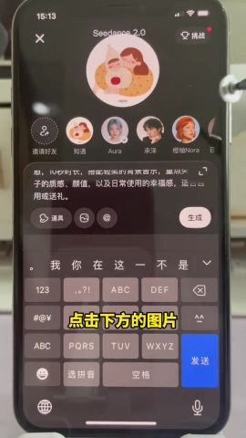 | 0:39.1 | 1.0s | 补信息：准备加参考图 | 桌面俯拍一台真手机，点输入框下方的图片按钮 | 固定 | 字幕 | 实拍 75% | 实拍视频素材 | 实拍 · S2 |
| 15 | 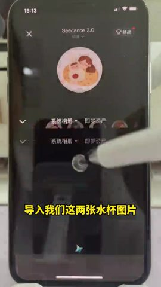 | 0:40.2 | 0.3s | 补信息：过渡 | 桌面俯拍一台真手机，即梦相册页面一闪 | 固定（主体在动） | — | 实拍 72% | 实拍视频素材 | 实拍 · S2 |
| 16 | 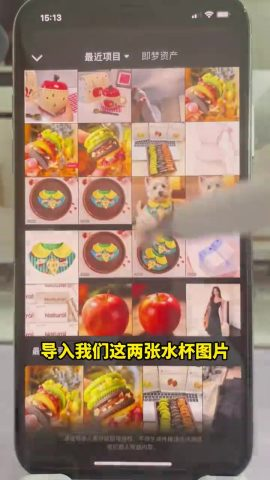 | 0:40.4 | 0.8s | 补信息：导入商品参考图 | 桌面俯拍一台真手机，即梦最近项目里选两张水杯图片 | 固定 | 文字 | 实拍 79% | 实拍视频素材 | 实拍 · S2 |
| 17 | 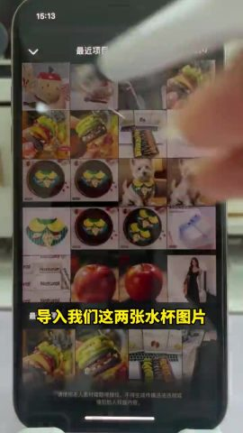 | 0:41.2 | 0.6s | 补信息：导入商品参考图 | 桌面俯拍一台真手机，相册里继续勾选水杯图片 | 平滑运镜 | — | 实拍 76% | 实拍视频素材 | 实拍 · S2 |
| 18 | 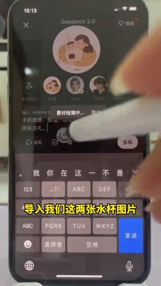 | 0:41.8 | 0.5s | 补信息：参考图就位 | 桌面俯拍一台真手机，两张水杯图片已加到输入框 | 固定 | — | 实拍 75% | 实拍视频素材 | 实拍 · S2 |
| 19 | 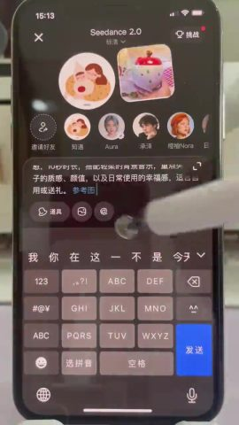 | 0:42.3 | 0.9s | 补信息：在提示词里引用参考图 | 桌面俯拍一台真手机，提示词里出现参考图 1、参考图 2 | 固定 | — | 实拍 76% | 实拍视频素材 | 实拍 · S2 |
| 20 | 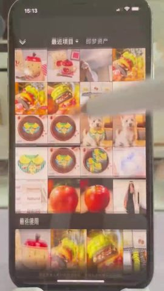 | 0:43.2 | 0.6s | 补信息：过渡 | 桌面俯拍一台真手机，相册界面一闪 | 平滑运镜 | — | 实拍 79% | 实拍视频素材 | 实拍 · S2 |
| 21 | 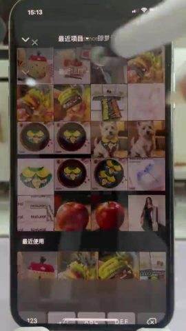 | 0:43.7 | 0.7s | 补信息：过渡 | 桌面俯拍一台真手机，最近使用的图片列表 | 平滑运镜 | — | 实拍 75% | 实拍视频素材 | 实拍 · S2 |
| 22 | 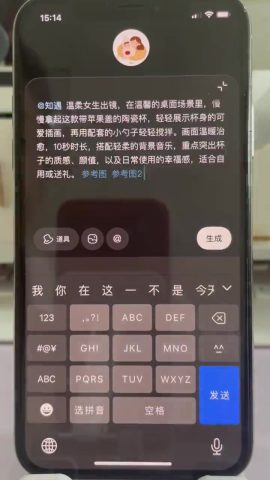 | 0:44.4 | 2.7s | 补信息：提交生成 | 桌面俯拍一台真手机，完整提示词显示，触控笔点「生成」 | 固定 | 字幕 | 实拍 70% | 实拍视频素材 | 实拍 · S2 |
| 23 | 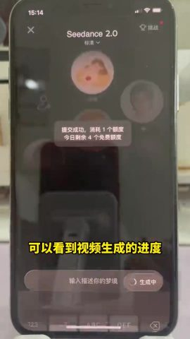 | 0:47.1 | 0.7s | 给证据：提交成功 | 桌面俯拍一台真手机，弹出「提交成功，消耗 1 个额度」 | 固定 | — | 实拍 76% | 实拍视频素材 | 实拍 · S2 |
| 24 | 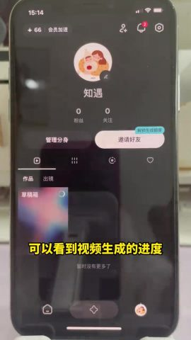 | 0:47.7 | 1.4s | 给证据：等待生成 | 桌面俯拍一台真手机，即梦个人主页作品栏里看到生成中的视频进度 | 固定 | 字幕、花字 | 实拍 71% | 实拍视频素材 | 实拍 · S2 |
| 25 | 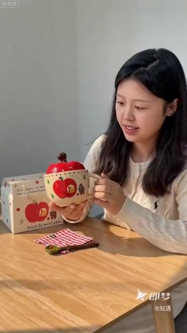 | 0:49.1 | 2.4s | 给结论：揭晓生成出来的带货视频 | 生成结果：AI 女生「知遇」坐在木桌前，捧起苹果杯展示后放下，暖阳下的木桌，浅灰… | 平滑运镜 | 花字 | AI 生成视频 74% | AI 生成 | AI 生成 · G1 |
| 26 | 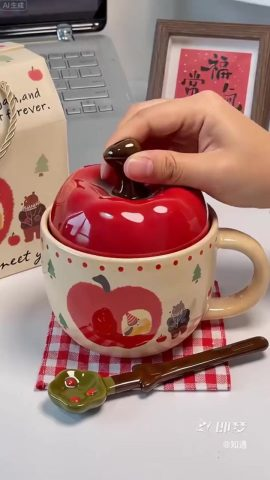 | 0:51.5 | 1.6s | 给结论：成片：特写展示杯盖设计 | 生成结果：苹果杯特写，手捏苹果盖的梗揭开盖子 | 平滑运镜 | 花字 | AI 生成视频 74% | AI 生成 | AI 生成 · G1 |
| 27 | 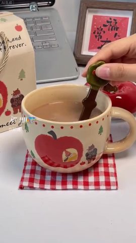 | 0:53.1 | 1.8s | 给结论：成片：使用场景 | 生成结果：手拿叶子小勺在装奶茶的苹果杯里搅拌 | 平滑运镜 | — | AI 生成视频 73% | AI 生成 | AI 生成 · G1 |
| 28 | 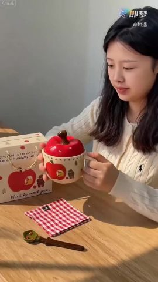 | 0:54.9 | 2.8s | 给结论：成片：情绪收尾 | 生成结果：女生双手捧杯靠近脸边，闭眼享受 | 平滑运镜 | — | AI 生成视频 74% | AI 生成 | AI 生成 · G1 |

## 自己复刻：按这个顺序做

复刻的是做法和节奏，不是照抄画面。

1. **定内容**：照「内容与结构」的叙事线写自己的脚本
2. **备素材**：见下方「要准备的素材」
3. **拍摄**：2 个场景、4 个机位，见下方「拍摄」
4. **AI 生成**：1 次生成，见下方「AI 生成」
5. **静帧 / 推拉**：见下方「本地重建」
6. **剪辑**：见下方「剪辑」
7. **包装**：字幕文件 `packaging/subtitles.srt` 可以直接导入剪辑软件；样式和时间轴见「剪辑包装层」
8. **声音**：见「声音」，每处音效都能先试听
9. **对照检查**：成片和原片并排看一遍：镜头长短、字幕位置、音乐起落对不对得上

### 要准备的素材

- `@图片1` 产品实拍图（正面 + 带 Logo 面），用户提供
- `@图片2` 人物参考图（每个角色一张正脸 + 半身），保证跨镜头长相一致：知遇（AI 主体）
- 画面里直接用的真实文件（截图、照片、录屏，要拿到原文件）：
  - **真实照片**（整个画面）：镜头 #6，共 0.3s
  - **商品实拍图**（画面局部），手举苹果杯的商品照：镜头 #6，共 0.3s

### 拍摄

同一场景的镜头集中拍完再换场景；场景内先拍大景别再拍特写，不用重新布光。每条前后多留约 1s 余量。

**S1**：镜头 #1、#4、#5、#7（成片 6.93s）；办公室，白墙、筒灯、走廊
- 布光：办公室顶灯直接照明，无额外布光
- 机位 中景 · 固定机位（三脚架/支架/放在桌上） · 固定：镜头 #5、#7，成片 3.7s，建议拍 7.7s
- 机位 特写 · 移动机位（稳定器/手持平移） · 拉/摇/移：镜头 #1、#4，成片 3.23s，建议拍 7.2s

**S2**：镜头 #8–#24（成片 37.2s）；桌面俯拍手机，深色桌面上的手机屏幕
- 布光：不打光，靠屏幕亮度；注意避开顶灯反光
- 机位 特写 · 固定机位（三脚架/支架/放在桌上） · 固定：镜头 #8–#16、#18、#19、#22–#24，成片 35.4s，建议拍 63.4s
- 机位 特写 · 移动机位（稳定器/手持平移） · 固定/摇/移：镜头 #17、#20、#21，成片 1.8s，建议拍 7.8s

### AI 生成

**AI 视频 4 镜 → 1 个生成单元、1 次 Seedance 2.0（含 Mini / Fast） 调用（另有 2 镜是同一段成片重复使用，直接剪）**

- 分组规则：同场景、硬切相连的 AI 镜头合并为一次生成；单次 ≤15s；单元内连续硬切尽量 ≤8s、最多 10s；在叠化/淡入淡出和换场景处切开
- 声音：模型可以同时生成动作音效和环境声；口播是真人录的：单独录好再混进去，不让视频模型生成，方便改文案和卡时间

AI 视频模型能吃这几种输入，每个生成单元下面写了要喂哪些、从哪来：
- **文字提示词**：必需，描述画面、动作、运镜
- **首帧图**：锁住第一帧的构图和主体。不给就是纯文生，构图每次都不一样
- **尾帧图**：再锁住最后一帧，模型只补中间过程。适合单个有运镜或动作的镜头
- **参考图**：商品、人物的样子，让多个镜头里长得一样（提示词里用 `@图片1` 指代）
- **参考视频**：照着学动作、运镜和节奏，不复制画面（`@视频1`）；不是每个模型都支持

每个单元一次生成。表里是要喂给模型的东西，展开单元看来源和提示词。

| 单元 | 镜头 | 时间 | 时长 | 方式 | 要喂的 | 衔接 |
|---|---|---|---|---|---|---|
| G1 | #25–#28 | 49.1–57.7s | 8.5s | 一次多镜头 | 首帧图 + 参考图 + 参考视频 | — |

同一段成片用了不止一次（看图认出的）：只生成一次，剪辑时再放到每一处。
- #2 和 #25 是同一段画面：从 G1 的成片里剪出来
- #3 和 #26 是同一段画面：从 G1 的成片里剪出来

<details><summary>G1 · 镜头 #25–#28 · 8.5s · 多参考生成</summary>

| 输入 | 要不要 | 从哪来 | 为什么 |
|---|---|---|---|
| 文字提示词 | 要 | 见下面的提示词 | 描述画面、动作和运镜；其他输入都只是约束它 |
| 首帧图 | 建议 | 原片 `shots/shot_025_first.jpg`（换产品、人物或画风时，用图像模型照下面的首帧提示词重画）。这个模型首帧和参考图不能同时传：作为第 3 张参考图传入，提示词写「@图片3 作为首帧」（即梦全能参考支持，API 多半不支持） | 构图、景别、主体位置一次锁定；只给文字，每次生成的构图都不一样 |
| 尾帧图 | 不用 | — | 一次出多个镜头，尾帧只能约束最后一镜，不用 |
| 参考图 | 要 | `@图片1` 产品实拍图（正面 + 带 Logo 面），用户提供；`@图片2` 人物参考图（每个角色一张正脸 + 半身），保证跨镜头长相一致 | 首帧只管第一帧，后面画面里的商品和人靠参考图保持一致 |
| 参考视频 | 建议 | `@视频1` 原片 49.1–57.7s 片段 | 照着学动作、运镜和剪辑节奏；只作参考，不会复制画面 |

- 首帧图像提示词：竖屏中景平视，年轻长发女生坐在木桌后，米白麻花毛衣，捧苹果造型红盖陶瓷杯，左侧礼盒，暖阳从右侧照进，桌面有窗格投影

```text
竖屏 9:16；正面柔光（平光），柔光（几乎没有明暗分界），偏暖（约 3000–4000K），背景清晰。产品外观以 @图片1 为准，Logo 和细节保持一致。人物以 @图片2 为准。参考 @视频1 的动作、运镜和剪辑节奏。镜头之间硬切。
镜头1（0.0–2.4s）：竖屏中景，女生捧着苹果杯给镜头看，再把杯子放回桌上，微笑，镜头缓慢推近
镜头2（2.4–3.9s）：竖屏特写，手从上方捏住苹果盖的梗慢慢揭开，露出杯口
镜头3（3.9–5.8s）：竖屏特写，一只手捏着绿色叶子小勺在杯里缓慢搅拌奶茶，固定机位
镜头4（5.8–8.5s）：竖屏中景，女生双手捧着苹果杯靠到脸边，轻轻歪头微笑，镜头缓慢拉远
```

英文提示词：

```text
Shot 1 (0.0-2.4s): Vertical medium shot, the woman shows the apple mug to camera then puts it down, slow push-in
Shot 2 (2.4-3.9s): Vertical close-up, a hand lifts the apple lid off the mug by its stem
Shot 3 (3.9-5.8s): Vertical close-up, a hand slowly stirs milk tea in the mug with a green leaf spoon, locked-off
Shot 4 (5.8-8.5s): Vertical medium shot, the woman holds the mug near her cheek and smiles, slow pull-out
```

</details>

### 本地重建

- #6 静帧停留 0.3s：一张图 + 测得的缩放/平移参数，ffmpeg 直接出

### 剪辑

- 按「分镜表」的顺序和时长剪
- 手法：口播开头先放 AI 成片预告，再拼版讲步骤，俯拍录操作，最后揭晓成片；全程大字幕
- 节奏：每分钟 28.1 刀，实拍镜头平均 2.1s；机位/场景 4 个；同机位跳切 3 处、推近切 3 处；插入画面（截图/录屏/卡片/素材）占 24%；44% 的切点落在说话停顿处；转场 硬切×18、闪亮切×2、跳剪×7

## 角色、场景与道具

| 编号 | 称呼 | 类型 | 外观 | 作用 | 声音 | 出场 |
|---|---|---|---|---|---|---|
| A | 主播 | 真人 | 长直黑发、黑框眼镜、灰色 V 领 T 恤、金手镯、领口夹无线麦 | 讲解人 | 女声，语速快 | #1、#4、#5、#7 |
| B | 知遇（AI 主体） | 数字人 | 二十出头的长直黑发女生，米白麻花毛衣，温柔微笑 | AI 生成的带货出镜人 | 无 | #2、#25、#28 |

**场景**

| 场景 | 地点 | 时间 | 布景 / 光线 | 镜头 |
|---|---|---|---|---|
| S1 | 办公室 | 白天 | 白墙、筒灯、走廊 | #1、#4、#5、#7 |
| S2 | 桌面俯拍手机 | 白天 | 深色桌面上的手机屏幕 | #8–#24 |
| S3 | AI 生成的木桌窗边 | 白天暖阳 | 木桌、浅灰墙、窗格投影 | #2、#3、#25–#28 |

**道具 / 商品 / Logo**

- 苹果造型红盖陶瓷杯（镜头 #2、#3、#5–#7、#25–#28）：带货商品，杯身苹果与小熊插画
- 苹果图案礼盒、红白格餐布、叶子小勺（镜头 #2、#3、#25–#27）：商品配套

## 拍法与打光

- 视觉风格：前半是手机自拍口播和桌面俯拍手机教程，自然光、无调色；后半是即梦生成的暖阳生活感商品片
- 取景：景别 特写 92%、中景 8%；机位角度 顶拍（正上方俯拍桌面）；主体是画面清晰区域（没有人脸，景别为估算）
- 机位：固定机位（三脚架/支架/放在桌上） 89%、移动机位（稳定器/手持平移） 11%；常见运镜 摇/移
- 打光：不打光，办公室顶灯和屏幕自发光（看图判断；像素测量见下方折叠）
- 调色：自然（接近原色）；饱和度正常、对比正常、黑位正常、整体中性
- 形式：桌面/物品拍摄（桌拍）（人脸为主体 7%、物品/手为主体 93%、手持 11%）；看图判断：AI 工具教程类带货口播

<details class="ref"><summary>逐项测量与看图结果（22 项）</summary>

| 维度 | 项目 | 结论 | 来源 |
|---|---|---|---|
| 取景 | 景别 | 特写 | 测量；看图 |
| 取景 | 机位角度 | 顶拍（正上方俯拍桌面） | 看图 |
| 取景 | 构图 | 手机居中占满竖屏 | 看图 |
| 机位 | 拍摄方式 | 桌面俯拍支架 | 测量：固定机位（三脚架/支架/放在桌上）；看图 |
| 机位 | 镜头 | 手机后置主摄 | 看图 |
| 机位 | 速度 | 正常 | 看图 |
| 机位 | 机位/场景 | 口播：手机前置固定机位；教程：手机后置俯拍另一台手机 | 看图 |
| 机位 | 推测设备 | 两部手机 + 桌面支架 + 无线领夹麦 | 看图 |
| 打光 | 场景 | 室内；桌面 | 看图 |
| 打光 | 主光 | 屏幕自发光 + 室内顶灯 | 看图 |
| 打光 | 软硬 | 硬光（明暗分界清楚） | 测量；看图：柔光 |
| 打光 | 补光 | 无 | 看图 |
| 打光 | 轮廓光 | 无 | 看图 |
| 打光 | 眼神光 | 点状（顶灯） | 看图 |
| 打光 | 可见光源 | 手机屏幕 | 看图 |
| 打光 | 色温 | 中性（约 5000K） | 测量；看图：中性 |
| 打光 | 布光方案 | 不打光，靠屏幕亮度；注意避开顶灯反光 | 看图 |
| 打光 | 整体布光 | 不打光，办公室顶灯和屏幕自发光 | 看图 |
| 调色 | 调色风格 | 自然（接近原色） | 测量；看图：自然 |
| 调色 | 整体调色 | 自然 | 看图 |
| 剪辑 | 剪辑手法 | 口播开头先放 AI 成片预告，再拼版讲步骤，俯拍录操作，最后揭晓成片；全程大字幕 | 看图 |
| 形式 | 视频形式 | AI 工具教程类带货口播 | 测量：桌面/物品拍摄（桌拍）；看图 |

</details>

- 说明：光比、软硬、色温、景别由主体像素测得（有人脸用人脸，没有用画面清晰区域，后者是估算）；平台转码会压暗部，软硬和补光偏保守；机位角度、光源种类、眼神光、轮廓光以看图结果为准。测量和看图不一致时两者都列出。

## 剪辑包装层（字幕 / 花字 / 贴纸 / 音效卡点）

- 字幕 23 句（底部，最多 1 行）：黄字、黑描边、字高 4.0%；入场：直接出现×7、淡入×1
- 文字标注 1 处：「发送」
- 音效卡点：字幕出现 2 处、切镜 1 处
- 按台词定位 1 处（换文案时跟着这句话走，不按原秒数放）：文字标注「发送」 → 「点击发送」开始前 0.5s，对上「发送」
- 导出：`packaging/subtitles.srt`、`packaging/overlays.ass`、`packaging/timeline.json`（SRT 是字幕时间轴；ASS 带颜色、描边、位置和入场动画，字体需要换成原片字体；timeline.json 是完整时间轴）

<details class="ref"><summary>文字时间轴（24 条）</summary>

| 时间 | 类型 | 文字 | 样式 | 入场 / 出场 | 音效 |
|---|---|---|---|---|---|
| 0.00–1.90s | 字幕 | 每天分享一个A制作方法 | 黄字、黑描边、黑底框、字高 3.8%（约 49px） | — | — |
| 1.90–2.90s | 字幕 | 今天教大家 | 黄字、黑描边、字高 4.3%（约 55px） | 直接出现 | — |
| 3.00–4.20s | 字幕 | 制作真人出镜的日用品 | 黄字、黑描边、字高 3.8%（约 48px） | 淡入 / 直接消失 | pop |
| 4.50–5.20s | 字幕 | 带货视频 | 黄字、黑描边、字高 4.1%（约 52px） | — | — |
| 5.50–6.20s | 字幕 | 那我用这个水杯 | 黄字、黑描边、字高 3.6%（约 46px） | — | click |
| 6.50–7.90s | 字幕 | 给大家演示一下 | 黄字、黑描边、字高 4.1%（约 52px） | 直接消失 | — |
| 8.00–10.00s | 字幕 | 保存好要带货的水杯图片 | 黄字、黑描边、字高 3.8%（约 49px） | 直接出现 | — |
| 10.00–11.80s | 字幕 | 图片可以多保存几张 | 黄字、黑描边、橙底框、字高 3.6%（约 46px） | 直接消失 | — |
| 11.90–13.30s | 字幕 | 打开AI工具 | 黄字、黑描边、字高 4.1%（约 53px） | 直接出现 | — |
| 13.30–15.60s | 字幕 | 添加我们保存的几张产品图 | 黄字、黑描边、字高 3.8%（约 48px） | 淡出 | — |
| 16.00–16.40s | 字幕 | 粘贴上 | 黄字、黑描边、黑底框、字高 4.4%（约 56px） | 直接出现 / 直接消失 | — |
| 16.50–18.10s | 字幕 | 刚准备好的这个提示词 | 黄字、黑描边、灰底框、字高 4.0%（约 51px） | 直接出现 / 滑出 | — |
| 25.00–25.10s | 字幕 | 提示词呢 | 黄字、黑描边、字高 4.2%（约 54px） | 直接出现 / 直接消失 | — |
| 25.50–26.90s | 字幕 | 也可以按照自己的需求 | 黄字、黑描边、灰底框、字高 3.8%（约 48px） | 直接消失 | — |
| 26.90–27.50s | 字幕 | 来修改 | 黄字、黑描边、字高 4.8%（约 62px） | 直接出现 | — |
| 27.00–28.20s | 文字标注 | 发送 | 蓝字、蓝描边、字高 2.6%（约 33px） | 直接消失 | — |
| 27.50–28.10s | 字幕 | 点击发送 | 黄字、黑描边、字高 4.4%（约 57px） | 缩小消失 | — |
| 28.00–29.60s | 字幕 | 提示词接着就出来了 | 黄字、黑描边、字高 4.0%（约 51px） | （中途有弹跳/变色） | — |
| 30.00–31.60s | 字幕 | 那我们复制一段自己喜欢的 | 黄字、黑描边、字高 3.8%（约 48px） | 淡出 | — |
| 32.50–33.60s | 字幕 | 我们来到这个界面 | 黄字、黑描边、关键词灰色高亮、字高 4.0%（约 51px） | 直接消失（中途有弹跳/变色） | — |
| 34.00–36.50s | 字幕 | 选择我提前录好的出镜画面 | 黄字、黑描边、灰底框、字高 3.8%（约 48px） | 缩小消失 | — |
| 36.50–38.10s | 字幕 | 粘贴上刚才复制的提示词 | 黄字、黑描边、灰底框、字高 3.8%（约 48px） | 直接消失 | — |
| 38.50–40.00s | 字幕 | 点击下方的图片 | 黄字、黑描边、字高 4.0%（约 51px） | 直接消失 | — |
| 40.00–41.60s | 字幕 | 导入我们这两张水杯图片 | 黄字、黑描边、字高 3.8%（约 48px） | 淡出 | — |

</details>

| 时间 | 元素 | 跟哪句台词 |
|---|---|---|
| 27.00s | 文字标注「发送」 | 「点击发送」开始前 0.5s，对上「发送」 |

复刻：字幕和花字用 `packaging/overlays.ass` 直接压制（ffmpeg -vf ass=overlays.ass），或按 timeline.json 在剪映 / Remotion 里重建；贴纸和动图要找同款素材（表情包库 / GIF 库），截图在 packaging/ 下。

## 声音

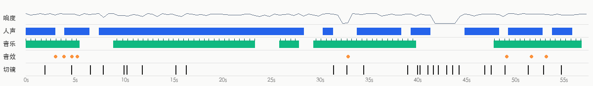

- 响度 -17.3 dBFS，峰值 -0.2 dBFS；声音跨切点连续，是后期整体铺的（切点处背景声变化 10.0dB，镜头内 8.8dB）
- 来源判断：视频类型：实拍（同期声 + 后期配乐） → 人声真人录音；音乐现成曲库配乐（倾向，待确认）；音效实拍同期声

**人声**

- 占 74% 时长；基频约 215.1Hz（偏女声）
- 来源：真人录音（真人录音 73%，TTS 配音 20%，AI 视频原生对白（随画面生成） 7%）
  - 77% 的画面是实拍：人声多为同期录音或真人配音
- 复刻：自己录：手机或领夹麦贴近嘴，安静房间里录；台词照「内容与结构」的脚本表改写

**背景音乐**

- 节奏：114.8 BPM（也可能是 57.4/229.7）；调性 F major（置信 0.763）；占 72% 时长（0.0–57.0s）；段落变化点 41.0s, 45.0s；片尾硬切断
- 剪辑与节拍：15% 的切点落在节拍上（随机约 20%）
- 来源：待确认（现成曲库配乐 63%，现成知名歌曲 23%，AI 生成音乐 13%）
  - 音乐是给画面垫底的配乐：普通视频的配乐大概率来自现成曲库（先验）
  - 人声是说话/旁白而不是唱歌（持续音高占比 0.25）：属于「旁白 + BGM」的普通视频形式
  - 片尾音乐被硬切断（还在满音量时视频就结束了）：常见于截取现成曲目
  - 除了视频形式的先验和片尾形状这类弱证据，没有关于这段音乐本身的证据（没听出来源、没有平台音乐信息）：来源待确认，AI 生成的配乐在这里和曲库配乐分不开
  - 确认方法：在抖音/小红书原视频页面看音乐标签：显示歌名 → 现成曲目；显示「@作者创作的原声」→ 作者自己上传（MV 类多为 AI 歌）
  - 确认方法：用汽水音乐/QQ 音乐「听歌识曲」或 ACRCloud 识别：识别得到就是现成歌曲
- 复刻：原曲倾向现成曲库配乐：按 BPM/情绪/调性在曲库检索同类曲，或用 AI 生成相近风格的免版权曲

**音效**（4 处，3 种声音）

| 声音 | 试听 | 类型 | 次数 | 出现在 | 对应画面 |
|---|---|---|---|---|---|
| F1 | [试听](sfx/sfx_01.wav) | pop | 2 | 3.1s、3.9s | 字幕「制作真人出镜的日用品」出现 |
| F2 | [试听](sfx/sfx_02.wav) | click | 1 | 5.3s | 字幕「那我用这个水杯」出现 |
| F3 | [试听](sfx/sfx_03.wav) | ding | 1 | 33.0s | 切镜 |

- 复刻：每种声音先点「试听」听一下（已单独分离出来，听不到人声和配乐），到剪辑软件的音效库里找一个同类的，按「出现在」的时间点放到每一处

- 分离出的音轨：`stems/original.wav`（原声）、`stems/vocals.wav`（人声干声）、`stems/music.wav`（配乐 + 环境声）、`stems/effects.wav`（音效轨）
<!--stems-->

## 不确定点

- 声音没有 AI 听过（复核只看了画面）：人声是真人还是 TTS 是按波形推断的；音效是从单独分离出的音效轨里找的，类型是按声音特征估的。可以在「声音」里试听分轨和每处音效核对
- 背景音乐来源待确认：更像现成曲库配乐（63%），确认方法见「声音」

## 附录

### 逐镜取证

每个镜头分两块：画面里看得到的，和工具推断的制作方式（附判断依据）；最后是复刻提示词。默认折叠，点开看。

<details class="ref"><summary>#1 00:00.000–00:01.933 · 实拍 + 代码/剪辑叠加（字幕）；引入真实素材（实拍视频素材）</summary>

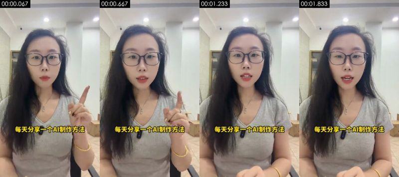

**画面里看得到的**（可以对照截图核实）
- 画面：戴黑框眼镜的长发女主播，灰色 V 领 T 恤，坐在办公室里对着手机前置镜头口播，抬手竖食指强调；背景是白墙、筒灯和走廊
- 拍法/打光：特写；平视；三脚架/支架固定；逆光/背景比主体亮；主光正面（光从镜头方向来，主体两侧亮度接近）；光比约 1.1:1（相差 0.1 档）；柔光（几乎没有明暗分界）
- 文字轨（字幕/bottom）：每天分享一个A制作方法 / 每天分享一个AI制作方法
- [AI 助手 看图] 真人口播：头发丝和手指动作自然、领口夹着无线麦克风、办公室顶灯和走廊透视稳定
- [AI 助手 看图] 无 AI 平台水印

**工具推断的制作方式**（是推断，不是看到的）
- 推断：实拍 69%，AI 生成视频 12%，影视片段 5%（fused_agent）
- 素材来源：用户真实素材：实拍视频素材
- 判断依据（工具测量，肉眼不一定看得出）：
  - 纹理呈照片/视频特征：噪声 σ=0.25、用色 121 种、平坦块 10%
  - 经过平台二次转码（Douyin/TikTok），传感器噪声被压没了：噪声类证据失效，实拍还是 AI 主要看帧率和画面内容

- 复刻：原片为实拍：按拍摄方案（景别/机位/打光）重新拍摄；没有拍摄条件时才用 AI 图生视频近似（以首帧为参考）；需要用户提供真实素材：实拍视频素材（整个画面）
  - 首帧图像提示词：特写，人物居中。竖屏近景，平视，戴黑框眼镜的长发女生居中，灰色 V 领 T 恤，背景是明亮办公室白墙和筒灯，柔和顶光，自然色
  - 视频提示词：特写，人物居中，镜头摇/移。竖屏近景平视，女生居中对镜头说话，抬手竖起食指强调，头部轻微晃动，固定机位

</details>

<details class="ref"><summary>#2 00:01.933–00:04.700 · AI 生成视频 + 代码/剪辑叠加（字幕）</summary>

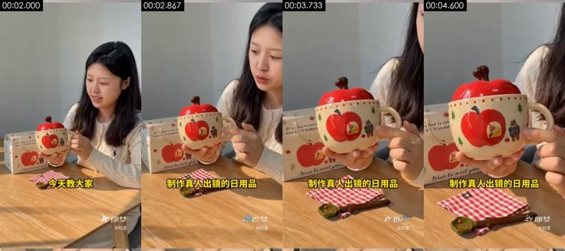

**画面里看得到的**（可以对照截图核实）
- 画面：AI 生成的女生「知遇」坐在木桌前，双手捧起苹果杯向镜头展示，看着杯子讲解；暖阳下的木桌，浅灰墙，桌上苹果造型红盖陶瓷杯、印苹果图案的礼盒、红白格餐布和绿色叶子小勺
- 拍法/打光：近景；移动机位（稳定器/手持平移）；正面柔光（平光）；主光正面（光从镜头方向来，主体两侧亮度接近）；光比约 1.2:1（相差 0.2 档）；柔光（几乎没有明暗分界）
- 画面里物体上的字（不是后期字幕）：带货视频、即梦、@知遇、@知造、Nice to nkut geu、Nice to mattyou
- 文字轨（字幕/bottom）：今天教大家 / 制作真人出镜的日用品
- [AI 助手 看图] 右下角有即梦水印和「@知遇」主体名
- [AI 助手 看图] 同一角色在后面演示里就是在即梦里选的「知遇」主体
- [AI 助手 看图] 光线过于均匀干净、动作缓慢

**工具推断的制作方式**（是推断，不是看到的）
- 推断：AI 生成视频 72%，实拍 10%，3D 渲染 4%（fused_agent）
- 素材来源：AI 生成
- 判断依据（工具测量，肉眼不一定看得出）：
  - 纹理呈照片/视频特征：噪声 σ=0.22、用色 222 种、平坦块 19%
  - 经过平台二次转码（Douyin/TikTok），传感器噪声被压没了：噪声类证据失效，实拍还是 AI 主要看帧率和画面内容

- 复刻：原片为 AI 生成：取原镜头首尾帧做首尾帧生成，可高度还原构图与动作；换主体时先用图像模型改首帧
  - 首帧图像提示词：主体在画面上部右侧。竖屏中近景平视，年轻长发女生坐在木桌后偏右，米白麻花毛衣，双手捧苹果造型红盖陶瓷杯，左侧是苹果图案礼盒，暖阳侧光，浅灰墙
  - 视频提示词：主体在画面上部右侧，镜头推。竖屏中近景，女生坐在桌后，捧起苹果杯举到胸前展示，低头看杯子微笑，镜头缓慢推近到杯子

</details>

<details class="ref"><summary>#3 00:04.700–00:06.633 · AI 生成视频 + 代码/剪辑叠加（字幕）</summary>

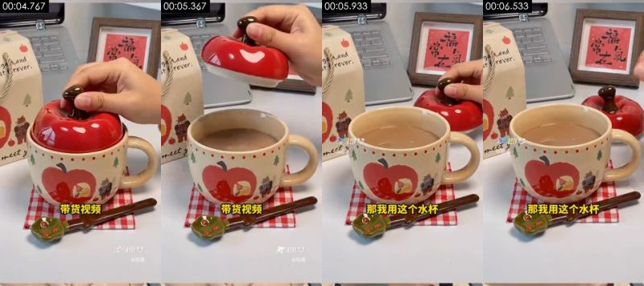

**画面里看得到的**（可以对照截图核实）
- 画面：AI 生成的苹果杯特写：一只手揭开红色苹果盖，杯身印苹果和小熊图案；暖阳下的木桌，浅灰墙，桌上苹果造型红盖陶瓷杯、印苹果图案的礼盒、红白格餐布和绿色叶子小勺
- 拍法/打光：中景；移动机位（稳定器/手持平移）；逆光/背景比主体亮；主光正面（光从镜头方向来，主体两侧亮度接近）；光比约 1.3:1（相差 0.4 档）；硬光（明暗分界清楚）
- 画面里物体上的字（不是后期字幕）：给大家演示一下、即梦、@知遇、stfrever.、st、meet
- 文字轨（字幕/bottom）：带货视频 / 那我用这个水杯
- [AI 助手 看图] 右下角有即梦水印和「@知遇」主体名
- [AI 助手 看图] 同一角色在后面演示里就是在即梦里选的「知遇」主体
- [AI 助手 看图] 光线过于均匀干净、动作缓慢

**工具推断的制作方式**（是推断，不是看到的）
- 推断：AI 生成视频 72%，实拍 10%，3D 渲染 4%（fused_agent）
- 素材来源：AI 生成
- 判断依据（工具测量，肉眼不一定看得出）：
  - 纹理呈照片/视频特征：噪声 σ=0.20、用色 262 种、平坦块 19%
  - 经过平台二次转码（Douyin/TikTok），传感器噪声被压没了：噪声类证据失效，实拍还是 AI 主要看帧率和画面内容

- 复刻：原片为 AI 生成：取原镜头首尾帧做首尾帧生成，可高度还原构图与动作；换主体时先用图像模型改首帧
  - 首帧图像提示词：中景，主体在画面下部正中。竖屏特写，苹果造型红盖陶瓷杯居中，杯身苹果与小熊插画，后面是礼盒和装裱福字，红白格餐布，柔和日光
  - 视频提示词：中景，主体在画面下部正中，镜头摇/移。竖屏特写，手从上方捏住苹果盖的梗慢慢揭开，镜头轻微平移

</details>

<details class="ref"><summary>#4 00:06.633–00:07.933 · 实拍 + 代码/剪辑叠加（文字标注、图形贴片）；引入真实素材（实拍视频素材）</summary>

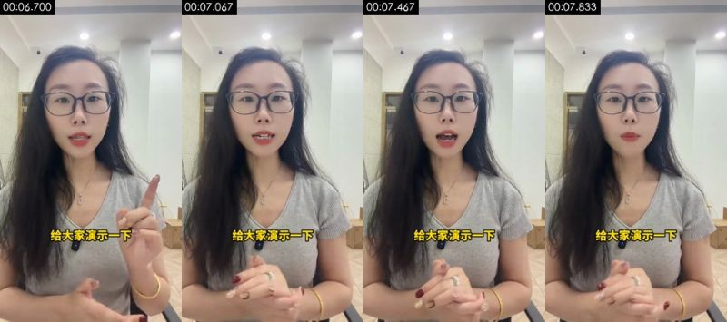

**画面里看得到的**（可以对照截图核实）
- 画面：戴黑框眼镜的长发女主播，灰色 V 领 T 恤，坐在办公室里对着手机前置镜头口播，抬手竖食指强调；背景是白墙、筒灯和走廊
- 拍法/打光：特写；平视；三脚架/支架固定；逆光/背景比主体亮；主光正面（光从镜头方向来，主体两侧亮度接近）；光比约 1.0:1（相差 0.1 档）；柔光（几乎没有明暗分界）
- 文字轨（文字/bottom）：给大家演示一下
- [AI 助手 看图] 真人口播：头发丝和手指动作自然、领口夹着无线麦克风、办公室顶灯和走廊透视稳定
- [AI 助手 看图] 无 AI 平台水印

**工具推断的制作方式**（是推断，不是看到的）
- 推断：实拍 69%，AI 生成视频 12%，影视片段 5%（fused_agent）
- 素材来源：用户真实素材：实拍视频素材
- 判断依据（工具测量，肉眼不一定看得出）：
  - 纹理呈照片/视频特征：噪声 σ=0.27、用色 121 种、平坦块 11%
  - 经过平台二次转码（Douyin/TikTok），传感器噪声被压没了：噪声类证据失效，实拍还是 AI 主要看帧率和画面内容

- 复刻：原片为实拍：按拍摄方案（景别/机位/打光）重新拍摄；没有拍摄条件时才用 AI 图生视频近似（以首帧为参考）；需要用户提供真实素材：实拍视频素材（整个画面）
  - 首帧图像提示词：特写，人物居中。竖屏近景，平视，戴黑框眼镜的长发女生居中，灰色 V 领 T 恤，背景是明亮办公室白墙和筒灯，柔和顶光，自然色
  - 视频提示词：特写，人物居中，镜头拉。竖屏近景平视，女生居中对镜头说话，抬手竖起食指强调，头部轻微晃动，固定机位

</details>

<details class="ref"><summary>#5 00:07.933–00:10.067 · 实拍 + 代码/剪辑叠加（字幕）；引入真实素材（实拍视频素材）</summary>

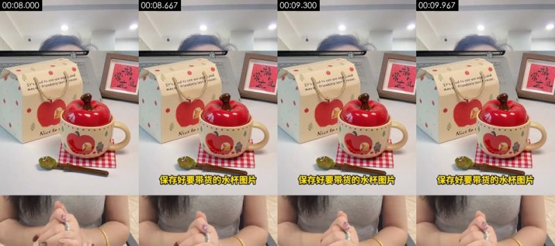

**画面里看得到的**（可以对照截图核实）
- 画面：上下拼版：上半是苹果杯商品实拍图，下半是口播主播双手交握
- 拍法/打光：中景；固定机位（三脚架/支架/放在桌上）；正面柔光（平光）；主光正面（光从镜头方向来，主体两侧亮度接近）；光比约 1.2:1（相差 0.3 档）；柔光（几乎没有明暗分界）
- 画面里物体上的字（不是后期字幕）：图片可以多保存几张、福、It's aodto see you aga.and、may ou/friendship las+frever.
- 文字轨（字幕/bottom）：保存好要带货的水杯图片
- [AI 助手 看图] 上半屏是一张静止的商品实拍照片，下半屏是口播主播的手在动
- [AI 助手 看图] 画面分上下两块，属剪辑拼版

**工具推断的制作方式**（是推断，不是看到的）
- 推断：实拍 72%，影视片段 6%，AI 生成视频 5%（fused_agent）
- 素材来源：用户真实素材：实拍视频素材；复刻参考：商品参考图
- 判断依据（工具测量，肉眼不一定看得出）：
  - 纹理呈照片/视频特征：噪声 σ=0.25、用色 256 种、平坦块 14%
  - 经过平台二次转码（Douyin/TikTok），传感器噪声被压没了：噪声类证据失效，实拍还是 AI 主要看帧率和画面内容

- 复刻：原片为实拍：按拍摄方案（景别/机位/打光）重新拍摄；没有拍摄条件时才用 AI 图生视频近似（以首帧为参考）；需要用户提供真实素材：实拍视频素材（整个画面）；生成时作参考：商品参考图
  - 视频提示词：中景，主体在画面下部正中。上下拼版：上半是苹果杯商品实拍图，下半是口播主播双手交握

</details>

<details class="ref"><summary>#6 00:10.067–00:10.367 · 静帧停留（真实照片） + 代码/剪辑叠加（文字标注、字幕）；引入真实素材（真实照片、商品实拍图）</summary>

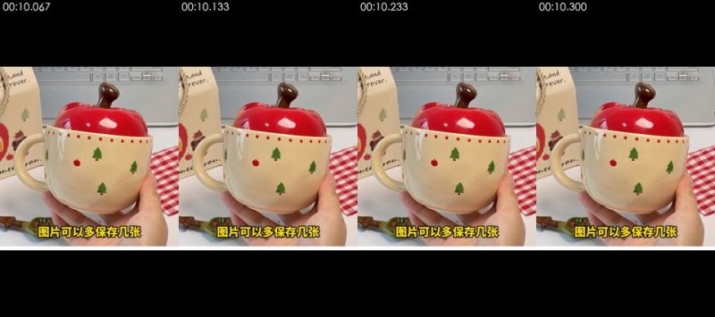

**画面里看得到的**（可以对照截图核实）
- 画面：商品实拍照片整屏停留（手举苹果杯），上下有黑边
- [AI 助手 看图] 0.3 秒的整屏商品照片，上下黑边，画面不动

**工具推断的制作方式**（是推断，不是看到的）
- 推断：静帧停留 86%，代码/模板渲染 9%，屏幕录制/截图 4%（fused_agent）
- 静帧来源：photo
- 素材来源：用户真实素材：真实照片、商品实拍图
- 判断依据（工具测量，肉眼不一定看得出）：
  - 画面几乎完全静止：100% 的相邻帧逐像素重复，首尾帧差 0.01
  - 经过平台二次转码（Douyin/TikTok），传感器噪声被压没了：噪声类证据失效，实拍还是 AI 主要看帧率和画面内容

- 复刻：静帧：一张图定格即可；需要用户提供真实素材：真实照片（整个画面）、商品实拍图（画面局部）

</details>

<details class="ref"><summary>#7 00:10.367–00:11.933 · 实拍 + 代码/剪辑叠加（文字标注）；引入真实素材（实拍视频素材）</summary>

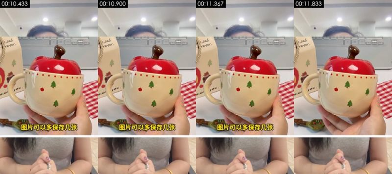

**画面里看得到的**（可以对照截图核实）
- 画面：上下拼版：上半是手举苹果杯的商品照片，下半是口播主播
- 拍法/打光：中景；固定机位（三脚架/支架/放在桌上）；侧前方主光 + 补光（标准布光）；主光画面右侧偏前方；光比约 1.4:1（相差 0.5 档）；无法判断
- 画面里物体上的字（不是后期字幕）：h,and、orever.
- 文字轨（文字/bottom）：图片可以多保存几张
- [AI 助手 看图] 上半屏是一张静止的商品实拍照片，下半屏是口播主播的手在动
- [AI 助手 看图] 画面分上下两块，属剪辑拼版

**工具推断的制作方式**（是推断，不是看到的）
- 推断：实拍 72%，影视片段 6%，AI 生成视频 5%（fused_agent）
- 素材来源：用户真实素材：实拍视频素材；复刻参考：商品参考图
- 判断依据（工具测量，肉眼不一定看得出）：
  - 纹理呈照片/视频特征：噪声 σ=0.26、用色 240 种、平坦块 12%
  - 经过平台二次转码（Douyin/TikTok），传感器噪声被压没了：噪声类证据失效，实拍还是 AI 主要看帧率和画面内容

- 复刻：原片为实拍：按拍摄方案（景别/机位/打光）重新拍摄；没有拍摄条件时才用 AI 图生视频近似（以首帧为参考）；需要用户提供真实素材：实拍视频素材（整个画面）；生成时作参考：商品参考图
  - 视频提示词：中景，主体在画面下部正中。上下拼版：上半是手举苹果杯的商品照片，下半是口播主播

</details>

<details class="ref"><summary>#8 00:11.933–00:15.400 · 实拍 + 代码/剪辑叠加（字幕）；引入真实素材（实拍视频素材）</summary>

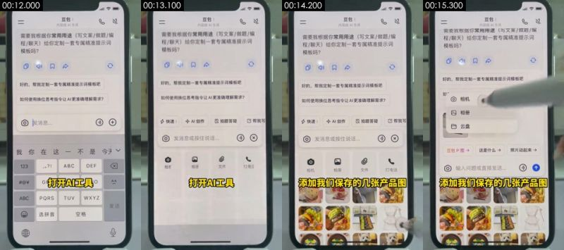

**画面里看得到的**（可以对照截图核实）
- 画面：桌面俯拍一台真手机，打开豆包 App，对话里让它定制提示词
- 拍法/打光：特写；顶拍（正上方俯拍桌面）；桌面俯拍支架；正面柔光（平光）；主光正面（光从镜头方向来，主体两侧亮度接近）；光比约 1.0:1（相差 0.0 档）；硬光（明暗分界清楚）
- 画面里物体上的字（不是后期字幕）：G、TUV、WXYZ、ABC、PQRS、选拼音
- 文字轨（字幕/bottom）：打开AI工具 / 添加我们保存的几张产品图
- [AI 助手 看图] 拍的是一台真手机：能看到机身黑边、屏幕反光和摩尔纹
- [AI 助手 看图] 触控笔/手指在屏幕上点按，有运动模糊
- [AI 助手 看图] 不是录屏：没有系统录屏的锐利像素

**工具推断的制作方式**（是推断，不是看到的）
- 推断：实拍 67%，3D 渲染 6%，影视片段 5%（fused_agent）
- 素材来源：用户真实素材：实拍视频素材
- 判断依据（工具测量，肉眼不一定看得出）：
  - 经过平台二次转码（Douyin/TikTok），传感器噪声被压没了：噪声类证据失效，实拍还是 AI 主要看帧率和画面内容

- 复刻：原片为实拍：按拍摄方案（景别/机位/打光）重新拍摄；没有拍摄条件时才用 AI 图生视频近似（以首帧为参考）；需要用户提供真实素材：实拍视频素材（整个画面）
  - 视频提示词：特写，顶拍（正上方俯拍桌面），手机居中占满竖屏。桌面俯拍一台真手机，打开豆包 App，对话里让它定制提示词

</details>

<details class="ref"><summary>#9 00:15.400–00:16.467 · 实拍 + 代码/剪辑叠加（字幕）；引入真实素材（实拍视频素材）</summary>

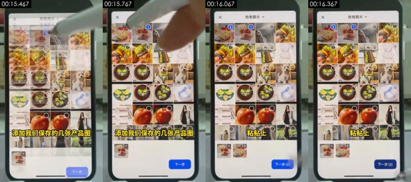

**画面里看得到的**（可以对照截图核实）
- 画面：桌面俯拍一台真手机，在豆包里从相册选中几张水杯商品图
- 拍法/打光：特写；顶拍（正上方俯拍桌面）；桌面俯拍支架；正面柔光（平光）；主光正面（光从镜头方向来，主体两侧亮度接近）；光比约 1.0:1（相差 0.0 档）；柔光（几乎没有明暗分界）
- 画面里物体上的字（不是后期字幕）：添加我们保存的几张产品图、下一步、下一步价、Norurat:、ral、Naturc
- 文字轨（字幕/bottom）：粘贴上
- [AI 助手 看图] 拍的是一台真手机：能看到机身黑边、屏幕反光和摩尔纹
- [AI 助手 看图] 触控笔/手指在屏幕上点按，有运动模糊
- [AI 助手 看图] 不是录屏：没有系统录屏的锐利像素

**工具推断的制作方式**（是推断，不是看到的）
- 推断：实拍 69%，影视片段 5%，3D 渲染 5%（fused_agent）
- 素材来源：用户真实素材：实拍视频素材
- 判断依据（工具测量，肉眼不一定看得出）：
  - 纹理呈照片/视频特征：噪声 σ=0.30、用色 407 种、平坦块 15%
  - 经过平台二次转码（Douyin/TikTok），传感器噪声被压没了：噪声类证据失效，实拍还是 AI 主要看帧率和画面内容

- 复刻：原片为实拍：按拍摄方案（景别/机位/打光）重新拍摄；没有拍摄条件时才用 AI 图生视频近似（以首帧为参考）；需要用户提供真实素材：实拍视频素材（整个画面）
  - 视频提示词：特写，顶拍（正上方俯拍桌面），手机居中占满竖屏。桌面俯拍一台真手机，在豆包里从相册选中几张水杯商品图

</details>

<details class="ref"><summary>#10 00:16.467–00:31.567 · 实拍 + 代码/剪辑叠加（字幕）；引入真实素材（实拍视频素材）</summary>

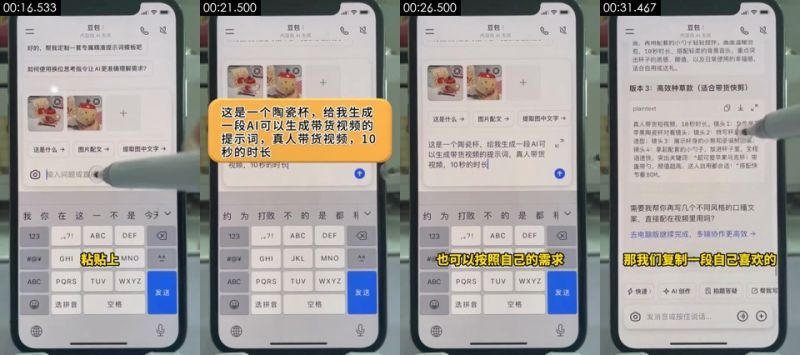

**画面里看得到的**（可以对照截图核实）
- 画面：桌面俯拍一台真手机，在豆包里粘贴「这是一个陶瓷杯，给我生成一段 AI 可以生成带货视频的提示词，真人带货视频，10 秒」，豆包返回三个版本的提示词，触控笔滚动
- 拍法/打光：特写；顶拍（正上方俯拍桌面）；桌面俯拍支架；正面柔光（平光）；主光正面（光从镜头方向来，主体两侧亮度接近）；光比约 1.1:1（相差 0.1 档）；柔光（几乎没有明暗分界）
- 画面里物体上的字（不是后期字幕）：GHI、JKL、MNO、ABC、PQRS、TUV
- 文字轨（字幕/bottom）：刚准备好的这个提示词 / 提示词呢 / 也可以按照自己的需求 / 来修改
- 文字轨（字幕/bottom）：发送
- 文字轨（字幕/bottom）：发送
- 镜头内动效节拍：17.17s、25.07s、27.63s
- [AI 助手 看图] 拍的是一台真手机：能看到机身黑边、屏幕反光和摩尔纹
- [AI 助手 看图] 触控笔/手指在屏幕上点按，有运动模糊
- [AI 助手 看图] 不是录屏：没有系统录屏的锐利像素

**工具推断的制作方式**（是推断，不是看到的）
- 推断：实拍 53%，代码/模板渲染 8%，屏幕录制/截图 7%（fused_agent）
- 素材来源：用户真实素材：实拍视频素材
- 判断依据（工具测量，肉眼不一定看得出）：
  - 51% 的相邻帧完全重复，只有局部元素在动（典型的模板/MG 动画或定格后局部动效）
  - 经过平台二次转码（Douyin/TikTok），传感器噪声被压没了：噪声类证据失效，实拍还是 AI 主要看帧率和画面内容

- 复刻：原片为实拍：按拍摄方案（景别/机位/打光）重新拍摄；没有拍摄条件时才用 AI 图生视频近似（以首帧为参考）；需要用户提供真实素材：实拍视频素材（整个画面）
  - 视频提示词：特写，顶拍（正上方俯拍桌面），手机居中占满竖屏。桌面俯拍一台真手机，在豆包里粘贴「这是一个陶瓷杯，给我生成一段 AI 可以生成带货视频的提示词，真人带货视频，10 秒」，豆包返回三个版本的提示词，触控笔滚动

</details>

<details class="ref"><summary>#11 00:31.567–00:32.933 · 实拍；引入真实素材（实拍视频素材）</summary>

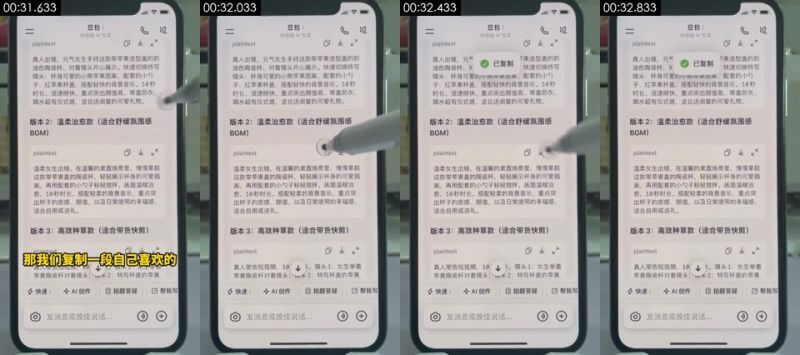

**画面里看得到的**（可以对照截图核实）
- 画面：桌面俯拍一台真手机，豆包回答里的版本 3 提示词，准备复制
- 拍法/打光：特写；顶拍（正上方俯拍桌面）；桌面俯拍支架；正面柔光（平光）；主光正面（光从镜头方向来，主体两侧亮度接近）；光比约 1.0:1（相差 0.0 档）；柔光（几乎没有明暗分界）
- 画面里物体上的字（不是后期字幕）：plaintext、不、真人带货短视频，10√。镜头1：女生举着、苹果陶瓷杯对着镜头；说大2：特写杯盖的苹果、快速、AI创作
- [AI 助手 看图] 拍的是一台真手机：能看到机身黑边、屏幕反光和摩尔纹
- [AI 助手 看图] 触控笔/手指在屏幕上点按，有运动模糊
- [AI 助手 看图] 不是录屏：没有系统录屏的锐利像素

**工具推断的制作方式**（是推断，不是看到的）
- 推断：实拍 61%，3D 渲染 8%，屏幕录制/截图 6%（fused_agent）
- 素材来源：用户真实素材：实拍视频素材
- 判断依据（工具测量，肉眼不一定看得出）：
  - 纹理呈渲染特征：平坦色块 22%、95% 像素仅用 40 种颜色、横竖直边 33%
  - 经过平台二次转码（Douyin/TikTok），传感器噪声被压没了：噪声类证据失效，实拍还是 AI 主要看帧率和画面内容

- 复刻：原片为实拍：按拍摄方案（景别/机位/打光）重新拍摄；没有拍摄条件时才用 AI 图生视频近似（以首帧为参考）；需要用户提供真实素材：实拍视频素材（整个画面）
  - 视频提示词：特写，顶拍（正上方俯拍桌面），手机居中占满竖屏。桌面俯拍一台真手机，豆包回答里的版本 3 提示词，准备复制

</details>

<details class="ref"><summary>#12 00:32.933–00:34.633 · 实拍 + 代码/剪辑叠加（字幕）；引入真实素材（实拍视频素材）</summary>

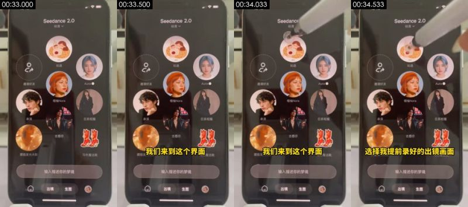

**画面里看得到的**（可以对照截图核实）
- 画面：桌面俯拍一台真手机，切到即梦 Seedance 2.0，主体列表里有「知遇」等人物头像
- 拍法/打光：特写；顶拍（正上方俯拍桌面）；桌面俯拍支架；正面柔光（平光）；主光正面（光从镜头方向来，主体两侧亮度接近）；光比约 1.1:1（相差 0.2 档）；柔光（几乎没有明暗分界）
- 画面里物体上的字（不是后期字幕）：朦胧发、魔法靴、选择我提前录好的出镜画面、输入描述你的梦境、123、ABC
- 文字轨（字幕/bottom）：我们来到这个界面
- [AI 助手 看图] 拍的是一台真手机：能看到机身黑边、屏幕反光和摩尔纹
- [AI 助手 看图] 触控笔/手指在屏幕上点按，有运动模糊
- [AI 助手 看图] 不是录屏：没有系统录屏的锐利像素

**工具推断的制作方式**（是推断，不是看到的）
- 推断：实拍 66%，3D 渲染 6%，屏幕录制/截图 5%（fused_agent）
- 素材来源：用户真实素材：实拍视频素材
- 判断依据（工具测量，肉眼不一定看得出）：
  - 经过平台二次转码（Douyin/TikTok），传感器噪声被压没了：噪声类证据失效，实拍还是 AI 主要看帧率和画面内容

- 复刻：原片为实拍：按拍摄方案（景别/机位/打光）重新拍摄；没有拍摄条件时才用 AI 图生视频近似（以首帧为参考）；需要用户提供真实素材：实拍视频素材（整个画面）
  - 视频提示词：特写，顶拍（正上方俯拍桌面），手机居中占满竖屏。桌面俯拍一台真手机，切到即梦 Seedance 2.0，主体列表里有「知遇」等人物头像

</details>

<details class="ref"><summary>#13 00:34.633–00:39.133 · 实拍 + 代码/剪辑叠加（字幕）；引入真实素材（实拍视频素材）</summary>

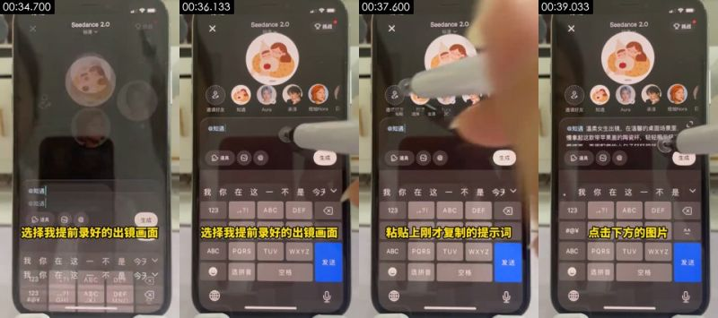

**画面里看得到的**（可以对照截图核实）
- 画面：桌面俯拍一台真手机，在即梦里选中「@知遇」（提前录好的出镜主体），粘贴提示词
- 拍法/打光：特写；顶拍（正上方俯拍桌面）；桌面俯拍支架；正面柔光（平光）；主光正面（光从镜头方向来，主体两侧亮度接近）；光比约 1.1:1（相差 0.1 档）；柔光（几乎没有明暗分界）
- 画面里物体上的字（不是后期字幕）：ABC、PQRS、TUV、WXYZ、发送、选拼音
- 文字轨（字幕/bottom）：选择我提前录好的出镜画面 / 粘贴上刚才复制的提示词
- [AI 助手 看图] 拍的是一台真手机：能看到机身黑边、屏幕反光和摩尔纹
- [AI 助手 看图] 触控笔/手指在屏幕上点按，有运动模糊
- [AI 助手 看图] 不是录屏：没有系统录屏的锐利像素

**工具推断的制作方式**（是推断，不是看到的）
- 推断：实拍 65%，3D 渲染 7%，影视片段 5%（fused_agent）
- 素材来源：用户真实素材：实拍视频素材
- 判断依据（工具测量，肉眼不一定看得出）：
  - 经过平台二次转码（Douyin/TikTok），传感器噪声被压没了：噪声类证据失效，实拍还是 AI 主要看帧率和画面内容

- 复刻：原片为实拍：按拍摄方案（景别/机位/打光）重新拍摄；没有拍摄条件时才用 AI 图生视频近似（以首帧为参考）；需要用户提供真实素材：实拍视频素材（整个画面）
  - 视频提示词：特写，顶拍（正上方俯拍桌面），手机居中占满竖屏。桌面俯拍一台真手机，在即梦里选中「@知遇」（提前录好的出镜主体），粘贴提示词

</details>

<details class="ref"><summary>#14 00:39.133–00:40.167 · 实拍 + 代码/剪辑叠加（字幕）；引入真实素材（实拍视频素材）</summary>

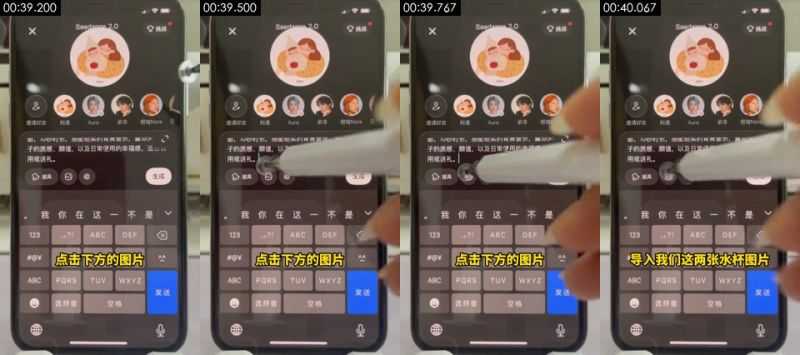

**画面里看得到的**（可以对照截图核实）
- 画面：桌面俯拍一台真手机，点输入框下方的图片按钮
- 拍法/打光：特写；顶拍（正上方俯拍桌面）；桌面俯拍支架；正面柔光（平光）；主光正面（光从镜头方向来，主体两侧亮度接近）；光比约 1.0:1（相差 0.1 档）；柔光（几乎没有明暗分界）
- 画面里物体上的字（不是后期字幕）：vV、ABC、PQRS、WXYZ、发送、选拼音
- 文字轨（字幕/bottom）：点击下方的图片
- [AI 助手 看图] 拍的是一台真手机：能看到机身黑边、屏幕反光和摩尔纹
- [AI 助手 看图] 触控笔/手指在屏幕上点按，有运动模糊
- [AI 助手 看图] 不是录屏：没有系统录屏的锐利像素

**工具推断的制作方式**（是推断，不是看到的）
- 推断：实拍 67%，3D 渲染 6%，影视片段 5%（fused_agent）
- 素材来源：用户真实素材：实拍视频素材
- 判断依据（工具测量，肉眼不一定看得出）：
  - 经过平台二次转码（Douyin/TikTok），传感器噪声被压没了：噪声类证据失效，实拍还是 AI 主要看帧率和画面内容

- 复刻：原片为实拍：按拍摄方案（景别/机位/打光）重新拍摄；没有拍摄条件时才用 AI 图生视频近似（以首帧为参考）；需要用户提供真实素材：实拍视频素材（整个画面）
  - 视频提示词：特写，顶拍（正上方俯拍桌面），手机居中占满竖屏。桌面俯拍一台真手机，点输入框下方的图片按钮

</details>

<details class="ref"><summary>#15 00:40.167–00:40.433 · 实拍；引入真实素材（实拍视频素材）</summary>

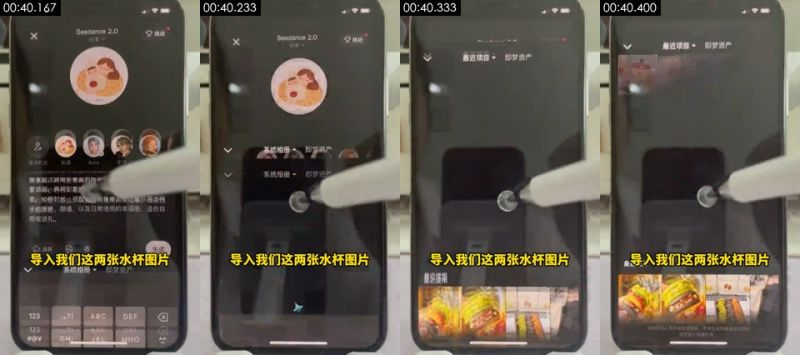

**画面里看得到的**（可以对照截图核实）
- 画面：桌面俯拍一台真手机，即梦相册页面一闪
- 拍法/打光：特写；顶拍（正上方俯拍桌面）；桌面俯拍支架；正面柔光（平光）；主光正面（光从镜头方向来，主体两侧亮度接近）；光比约 1.2:1（相差 0.2 档）；柔光（明暗过渡宽）
- 画面里物体上的字（不是后期字幕）：道具、生成、导入我们这两张水杯图片、123、ABC、DEF
- [AI 助手 看图] 拍的是一台真手机：能看到机身黑边、屏幕反光和摩尔纹
- [AI 助手 看图] 触控笔/手指在屏幕上点按，有运动模糊
- [AI 助手 看图] 不是录屏：没有系统录屏的锐利像素

**工具推断的制作方式**（是推断，不是看到的）
- 推断：实拍 63%，3D 渲染 8%，影视片段 5%（fused_agent）
- 素材来源：用户真实素材：实拍视频素材
- 判断依据（工具测量，肉眼不一定看得出）：
  - 经过平台二次转码（Douyin/TikTok），传感器噪声被压没了：噪声类证据失效，实拍还是 AI 主要看帧率和画面内容

- 复刻：原片为实拍：按拍摄方案（景别/机位/打光）重新拍摄；没有拍摄条件时才用 AI 图生视频近似（以首帧为参考）；需要用户提供真实素材：实拍视频素材（整个画面）
  - 视频提示词：特写，顶拍（正上方俯拍桌面），手机居中占满竖屏。桌面俯拍一台真手机，即梦相册页面一闪

</details>

<details class="ref"><summary>#16 00:40.433–00:41.200 · 实拍 + 代码/剪辑叠加（文字标注）；引入真实素材（实拍视频素材）</summary>

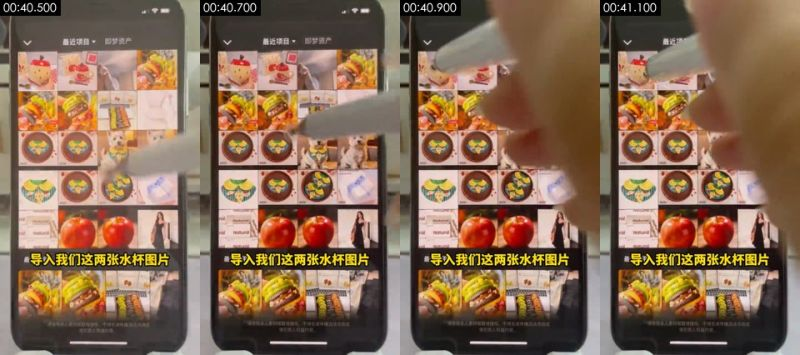

**画面里看得到的**（可以对照截图核实）
- 画面：桌面俯拍一台真手机，即梦最近项目里选两张水杯图片
- 拍法/打光：特写；顶拍（正上方俯拍桌面）；桌面俯拍支架；正面柔光（平光）；主光正面（光从镜头方向来，主体两侧亮度接近）；光比约 1.0:1（相差 0.0 档）；柔光（几乎没有明暗分界）
- 画面里物体上的字（不是后期字幕）：请便用本人重材网取得授权，不得生成传福违法违规或、遵把他人权登内容、使用本人需材毁取得模校，不得生成传插违法违规或、Naturat、ral、Natural
- 文字轨（文字/bottom）：导入我们这两张水杯图片
- [AI 助手 看图] 拍的是一台真手机：能看到机身黑边、屏幕反光和摩尔纹
- [AI 助手 看图] 触控笔/手指在屏幕上点按，有运动模糊
- [AI 助手 看图] 不是录屏：没有系统录屏的锐利像素

**工具推断的制作方式**（是推断，不是看到的）
- 推断：实拍 71%，影视片段 5%，AI 生成视频 5%（fused_agent）
- 素材来源：用户真实素材：实拍视频素材
- 判断依据（工具测量，肉眼不一定看得出）：
  - 纹理呈照片/视频特征：噪声 σ=0.25、用色 410 种、平坦块 10%
  - 经过平台二次转码（Douyin/TikTok），传感器噪声被压没了：噪声类证据失效，实拍还是 AI 主要看帧率和画面内容

- 复刻：原片为实拍：按拍摄方案（景别/机位/打光）重新拍摄；没有拍摄条件时才用 AI 图生视频近似（以首帧为参考）；需要用户提供真实素材：实拍视频素材（整个画面）
  - 视频提示词：特写，顶拍（正上方俯拍桌面），手机居中占满竖屏。桌面俯拍一台真手机，即梦最近项目里选两张水杯图片

</details>

<details class="ref"><summary>#17 00:41.200–00:41.767 · 实拍；引入真实素材（实拍视频素材）</summary>

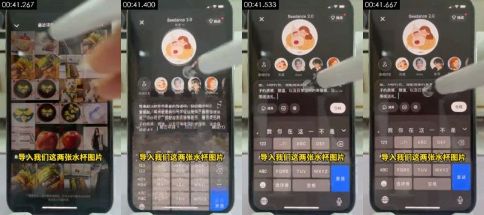

**画面里看得到的**（可以对照截图核实）
- 画面：桌面俯拍一台真手机，相册里继续勾选水杯图片
- 拍法/打光：特写；顶拍（正上方俯拍桌面）；桌面俯拍支架；正面柔光（平光）；主光正面（光从镜头方向来，主体两侧亮度接近）；光比约 1.1:1（相差 0.1 档）；柔光（几乎没有明暗分界）
- 画面里物体上的字（不是后期字幕）：导入我们这两张水杯图片、ABC、PQRS、发送、选拼音、空格
- [AI 助手 看图] 拍的是一台真手机：能看到机身黑边、屏幕反光和摩尔纹
- [AI 助手 看图] 触控笔/手指在屏幕上点按，有运动模糊
- [AI 助手 看图] 不是录屏：没有系统录屏的锐利像素

**工具推断的制作方式**（是推断，不是看到的）
- 推断：实拍 67%，3D 渲染 6%，影视片段 5%（fused_agent）
- 素材来源：用户真实素材：实拍视频素材
- 判断依据（工具测量，肉眼不一定看得出）：
  - 纹理呈照片/视频特征：噪声 σ=0.17、用色 105 种、平坦块 16%
  - 经过平台二次转码（Douyin/TikTok），传感器噪声被压没了：噪声类证据失效，实拍还是 AI 主要看帧率和画面内容

- 复刻：原片为实拍：按拍摄方案（景别/机位/打光）重新拍摄；没有拍摄条件时才用 AI 图生视频近似（以首帧为参考）；需要用户提供真实素材：实拍视频素材（整个画面）
  - 视频提示词：特写，顶拍（正上方俯拍桌面），手机居中占满竖屏，镜头摇/移。桌面俯拍一台真手机，相册里继续勾选水杯图片

</details>

<details class="ref"><summary>#18 00:41.767–00:42.267 · 实拍；引入真实素材（实拍视频素材）</summary>

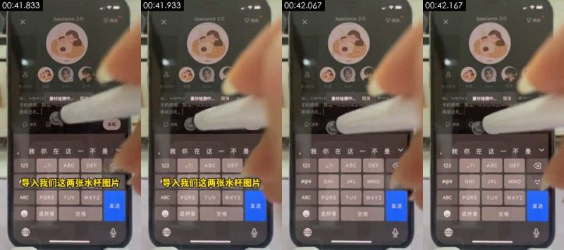

**画面里看得到的**（可以对照截图核实）
- 画面：桌面俯拍一台真手机，两张水杯图片已加到输入框
- 拍法/打光：特写；顶拍（正上方俯拍桌面）；桌面俯拍支架；正面柔光（平光）；主光正面（光从镜头方向来，主体两侧亮度接近）；光比约 1.0:1（相差 0.0 档）；柔光（几乎没有明暗分界）
- 画面里物体上的字（不是后期字幕）：GHI、JKL、MNO、ABC、PQRS、TUV
- [AI 助手 看图] 拍的是一台真手机：能看到机身黑边、屏幕反光和摩尔纹
- [AI 助手 看图] 触控笔/手指在屏幕上点按，有运动模糊
- [AI 助手 看图] 不是录屏：没有系统录屏的锐利像素

**工具推断的制作方式**（是推断，不是看到的）
- 推断：实拍 66%，3D 渲染 6%，影视片段 5%（fused_agent）
- 素材来源：用户真实素材：实拍视频素材
- 判断依据（工具测量，肉眼不一定看得出）：
  - 经过平台二次转码（Douyin/TikTok），传感器噪声被压没了：噪声类证据失效，实拍还是 AI 主要看帧率和画面内容

- 复刻：原片为实拍：按拍摄方案（景别/机位/打光）重新拍摄；没有拍摄条件时才用 AI 图生视频近似（以首帧为参考）；需要用户提供真实素材：实拍视频素材（整个画面）
  - 视频提示词：特写，顶拍（正上方俯拍桌面），手机居中占满竖屏。桌面俯拍一台真手机，两张水杯图片已加到输入框

</details>

<details class="ref"><summary>#19 00:42.267–00:43.167 · 实拍；引入真实素材（实拍视频素材）</summary>

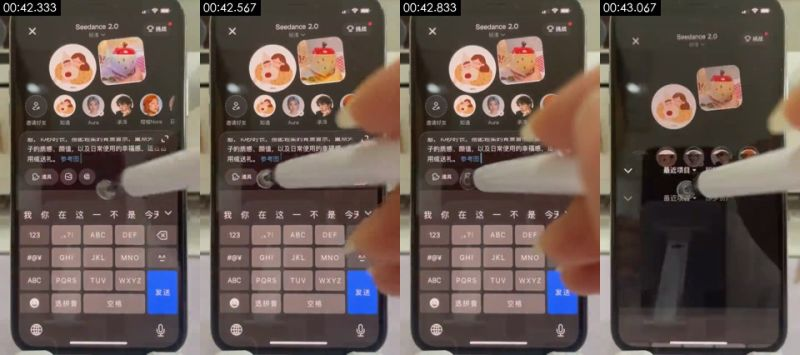

**画面里看得到的**（可以对照截图核实）
- 画面：桌面俯拍一台真手机，提示词里出现参考图 1、参考图 2
- 拍法/打光：特写；顶拍（正上方俯拍桌面）；桌面俯拍支架；侧前方主光 + 补光（标准布光）；主光画面右侧偏前方；光比约 1.5:1（相差 0.6 档）；硬光（明暗分界清楚）
- 画面里物体上的字（不是后期字幕）：GHI、JKL、MNO、ABC、PQRS、TUV
- [AI 助手 看图] 拍的是一台真手机：能看到机身黑边、屏幕反光和摩尔纹
- [AI 助手 看图] 触控笔/手指在屏幕上点按，有运动模糊
- [AI 助手 看图] 不是录屏：没有系统录屏的锐利像素

**工具推断的制作方式**（是推断，不是看到的）
- 推断：实拍 68%，3D 渲染 6%，影视片段 5%（fused_agent）
- 素材来源：用户真实素材：实拍视频素材
- 判断依据（工具测量，肉眼不一定看得出）：
  - 纹理呈照片/视频特征：噪声 σ=0.14、用色 123 种、平坦块 17%
  - 经过平台二次转码（Douyin/TikTok），传感器噪声被压没了：噪声类证据失效，实拍还是 AI 主要看帧率和画面内容

- 复刻：原片为实拍：按拍摄方案（景别/机位/打光）重新拍摄；没有拍摄条件时才用 AI 图生视频近似（以首帧为参考）；需要用户提供真实素材：实拍视频素材（整个画面）
  - 视频提示词：特写，顶拍（正上方俯拍桌面），手机居中占满竖屏。桌面俯拍一台真手机，提示词里出现参考图 1、参考图 2

</details>

<details class="ref"><summary>#20 00:43.167–00:43.733 · 实拍；引入真实素材（实拍视频素材）</summary>

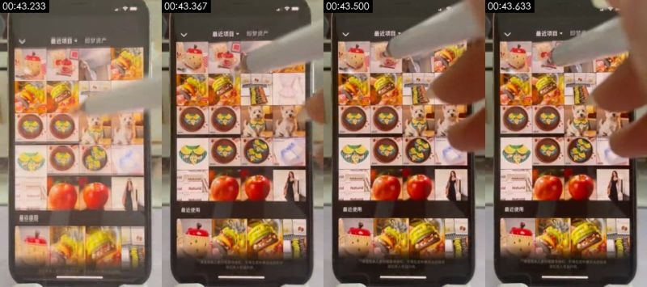

**画面里看得到的**（可以对照截图核实）
- 画面：桌面俯拍一台真手机，相册界面一闪
- 拍法/打光：特写；顶拍（正上方俯拍桌面）；桌面俯拍支架；正面柔光（平光）；主光正面（光从镜头方向来，主体两侧亮度接近）；光比约 1.3:1（相差 0.4 档）；柔光（几乎没有明暗分界）
- 画面里物体上的字（不是后期字幕）：最近使用、Haturol、15:13、最近项目
- [AI 助手 看图] 拍的是一台真手机：能看到机身黑边、屏幕反光和摩尔纹
- [AI 助手 看图] 触控笔/手指在屏幕上点按，有运动模糊
- [AI 助手 看图] 不是录屏：没有系统录屏的锐利像素

**工具推断的制作方式**（是推断，不是看到的）
- 推断：实拍 71%，AI 生成视频 5%，影视片段 5%（fused_agent）
- 素材来源：用户真实素材：实拍视频素材
- 判断依据（工具测量，肉眼不一定看得出）：
  - 纹理呈照片/视频特征：噪声 σ=0.27、用色 388 种、平坦块 10%
  - 经过平台二次转码（Douyin/TikTok），传感器噪声被压没了：噪声类证据失效，实拍还是 AI 主要看帧率和画面内容

- 复刻：原片为实拍：按拍摄方案（景别/机位/打光）重新拍摄；没有拍摄条件时才用 AI 图生视频近似（以首帧为参考）；需要用户提供真实素材：实拍视频素材（整个画面）
  - 视频提示词：特写，顶拍（正上方俯拍桌面），手机居中占满竖屏，镜头摇/移。桌面俯拍一台真手机，相册界面一闪

</details>

<details class="ref"><summary>#21 00:43.733–00:44.400 · 实拍；引入真实素材（实拍视频素材）</summary>


**画面里看得到的**（可以对照截图核实）
- 画面：桌面俯拍一台真手机，最近使用的图片列表
- 拍法/打光：特写；顶拍（正上方俯拍桌面）；桌面俯拍支架；正面柔光（平光）；主光正面（光从镜头方向来，主体两侧亮度接近）；光比约 1.1:1（相差 0.1 档）；柔光（几乎没有明暗分界）
- 画面里物体上的字（不是后期字幕）：GHI、JKL、MNO、ABC、PQRS、TUV
- [AI 助手 看图] 拍的是一台真手机：能看到机身黑边、屏幕反光和摩尔纹
- [AI 助手 看图] 触控笔/手指在屏幕上点按，有运动模糊
- [AI 助手 看图] 不是录屏：没有系统录屏的锐利像素

**工具推断的制作方式**（是推断，不是看到的）
- 推断：实拍 67%，3D 渲染 6%，影视片段 5%（fused_agent）
- 素材来源：用户真实素材：实拍视频素材
- 判断依据（工具测量，肉眼不一定看得出）：
  - 经过平台二次转码（Douyin/TikTok），传感器噪声被压没了：噪声类证据失效，实拍还是 AI 主要看帧率和画面内容

- 复刻：原片为实拍：按拍摄方案（景别/机位/打光）重新拍摄；没有拍摄条件时才用 AI 图生视频近似（以首帧为参考）；需要用户提供真实素材：实拍视频素材（整个画面）
  - 视频提示词：特写，顶拍（正上方俯拍桌面），手机居中占满竖屏。桌面俯拍一台真手机，最近使用的图片列表

</details>

<details class="ref"><summary>#22 00:44.400–00:47.067 · 实拍 + 代码/剪辑叠加（字幕）；引入真实素材（实拍视频素材）</summary>


**画面里看得到的**（可以对照截图核实）
- 画面：桌面俯拍一台真手机，完整提示词显示，触控笔点「生成」
- 拍法/打光：特写；顶拍（正上方俯拍桌面）；桌面俯拍支架；正面柔光（平光）；主光正面（光从镜头方向来，主体两侧亮度接近）；光比约 1.0:1（相差 0.0 档）；柔光（几乎没有明暗分界）
- 画面里物体上的字（不是后期字幕）：ABC、PQRS、TUV、选拼音、空格、输入描述你的梦境
- 文字轨（字幕/bottom）：然后我们点击发送 / 在草稿箱里
- 文字轨（字幕/bottom）：发送
- [AI 助手 看图] 拍的是一台真手机：能看到机身黑边、屏幕反光和摩尔纹
- [AI 助手 看图] 触控笔/手指在屏幕上点按，有运动模糊
- [AI 助手 看图] 不是录屏：没有系统录屏的锐利像素

**工具推断的制作方式**（是推断，不是看到的）
- 推断：实拍 62%，3D 渲染 8%，屏幕录制/截图 6%（fused_agent）
- 素材来源：用户真实素材：实拍视频素材
- 判断依据（工具测量，肉眼不一定看得出）：
  - 纹理呈渲染特征：平坦色块 24%、95% 像素仅用 73 种颜色、横竖直边 40%
  - 经过平台二次转码（Douyin/TikTok），传感器噪声被压没了：噪声类证据失效，实拍还是 AI 主要看帧率和画面内容

- 复刻：原片为实拍：按拍摄方案（景别/机位/打光）重新拍摄；没有拍摄条件时才用 AI 图生视频近似（以首帧为参考）；需要用户提供真实素材：实拍视频素材（整个画面）
  - 视频提示词：特写，顶拍（正上方俯拍桌面），手机居中占满竖屏。桌面俯拍一台真手机，完整提示词显示，触控笔点「生成」

</details>

<details class="ref"><summary>#23 00:47.067–00:47.733 · 实拍；引入真实素材（实拍视频素材）</summary>


**画面里看得到的**（可以对照截图核实）
- 画面：桌面俯拍一台真手机，弹出「提交成功，消耗 1 个额度」
- 拍法/打光：特写；顶拍（正上方俯拍桌面）；桌面俯拍支架；正面柔光（平光）；主光正面（光从镜头方向来，主体两侧亮度接近）；光比约 1.2:1（相差 0.3 档）；柔光（几乎没有明暗分界）
- 画面里物体上的字（不是后期字幕）：可以看到视频生成的进度、暂时没有更多了、内梦境、出镜、生图、知遇
- [AI 助手 看图] 拍的是一台真手机：能看到机身黑边、屏幕反光和摩尔纹
- [AI 助手 看图] 触控笔/手指在屏幕上点按，有运动模糊
- [AI 助手 看图] 不是录屏：没有系统录屏的锐利像素

**工具推断的制作方式**（是推断，不是看到的）
- 推断：实拍 67%，3D 渲染 6%，影视片段 5%（fused_agent）
- 素材来源：用户真实素材：实拍视频素材
- 判断依据（工具测量，肉眼不一定看得出）：
  - 经过平台二次转码（Douyin/TikTok），传感器噪声被压没了：噪声类证据失效，实拍还是 AI 主要看帧率和画面内容

- 复刻：原片为实拍：按拍摄方案（景别/机位/打光）重新拍摄；没有拍摄条件时才用 AI 图生视频近似（以首帧为参考）；需要用户提供真实素材：实拍视频素材（整个画面）
  - 视频提示词：特写，顶拍（正上方俯拍桌面），手机居中占满竖屏。桌面俯拍一台真手机，弹出「提交成功，消耗 1 个额度」

</details>

<details class="ref"><summary>#24 00:47.733–00:49.133 · 实拍 + 代码/剪辑叠加（字幕、花字）；引入真实素材（实拍视频素材）</summary>


**画面里看得到的**（可以对照截图核实）
- 画面：桌面俯拍一台真手机，即梦个人主页作品栏里看到生成中的视频进度
- 拍法/打光：特写；顶拍（正上方俯拍桌面）；桌面俯拍支架；侧前方主光 + 补光（标准布光）；主光画面左侧偏前方；光比约 1.5:1（相差 0.5 档）；柔光（明暗过渡宽）
- 画面里物体上的字（不是后期字幕）：暂时没有更多了、即梦、@知遇、知遇、粉丝、关注
- 文字轨（字幕/bottom）：可以看到视频生成的进度
- [AI 助手 看图] 拍的是一台真手机：能看到机身黑边、屏幕反光和摩尔纹
- [AI 助手 看图] 触控笔/手指在屏幕上点按，有运动模糊
- [AI 助手 看图] 不是录屏：没有系统录屏的锐利像素

**工具推断的制作方式**（是推断，不是看到的）
- 推断：实拍 62%，3D 渲染 8%，影视片段 5%（fused_agent）
- 素材来源：用户真实素材：实拍视频素材
- 判断依据（工具测量，肉眼不一定看得出）：
  - 纹理呈渲染特征：平坦色块 29%、95% 像素仅用 100 种颜色、横竖直边 45%
  - 经过平台二次转码（Douyin/TikTok），传感器噪声被压没了：噪声类证据失效，实拍还是 AI 主要看帧率和画面内容

- 复刻：原片为实拍：按拍摄方案（景别/机位/打光）重新拍摄；没有拍摄条件时才用 AI 图生视频近似（以首帧为参考）；需要用户提供真实素材：实拍视频素材（整个画面）
  - 视频提示词：特写，顶拍（正上方俯拍桌面），手机居中占满竖屏。桌面俯拍一台真手机，即梦个人主页作品栏里看到生成中的视频进度

</details>

<details class="ref"><summary>#25 00:49.133–00:51.500 · AI 生成视频 + 代码/剪辑叠加（花字）</summary>


**画面里看得到的**（可以对照截图核实）
- 画面：生成结果：AI 女生「知遇」坐在木桌前，捧起苹果杯展示后放下，暖阳下的木桌，浅灰墙，桌上苹果造型红盖陶瓷杯、印苹果图案的礼盒、红白格餐布和绿色叶子小勺
- 拍法/打光：近景；移动机位（稳定器/手持平移）；正面柔光（平光）；主光正面（光从镜头方向来，主体两侧亮度接近）；光比约 1.3:1（相差 0.4 档）；柔光（几乎没有明暗分界）
- 画面里物体上的字（不是后期字幕）：即梦、@知遇、Nice to mect yen、Nict tomcety、Nicctomeety、14
- [AI 助手 看图] 右下角有即梦水印和「@知遇」主体名
- [AI 助手 看图] 同一角色在后面演示里就是在即梦里选的「知遇」主体
- [AI 助手 看图] 光线过于均匀干净、动作缓慢

**工具推断的制作方式**（是推断，不是看到的）
- 推断：AI 生成视频 71%，实拍 10%，3D 渲染 4%（fused_agent）
- 素材来源：AI 生成
- 判断依据（工具测量，肉眼不一定看得出）：
  - 纹理呈照片/视频特征：噪声 σ=0.22、用色 210 种、平坦块 21%
  - 经过平台二次转码（Douyin/TikTok），传感器噪声被压没了：噪声类证据失效，实拍还是 AI 主要看帧率和画面内容

- 复刻：原片为 AI 生成：取原镜头首尾帧做首尾帧生成，可高度还原构图与动作；换主体时先用图像模型改首帧
  - 首帧图像提示词：近景，主体在画面上部右侧。竖屏中景平视，年轻长发女生坐在木桌后，米白麻花毛衣，捧苹果造型红盖陶瓷杯，左侧礼盒，暖阳从右侧照进，桌面有窗格投影
  - 视频提示词：近景，主体在画面上部右侧，镜头推。竖屏中景，女生捧着苹果杯给镜头看，再把杯子放回桌上，微笑，镜头缓慢推近

</details>

<details class="ref"><summary>#26 00:51.500–00:53.067 · AI 生成视频 + 代码/剪辑叠加（花字）</summary>


**画面里看得到的**（可以对照截图核实）
- 画面：生成结果：苹果杯特写，手捏苹果盖的梗揭开盖子
- 拍法/打光：中景；移动机位（稳定器/手持平移）；逆光/背景比主体亮；主光画面右侧偏前方；光比约 1.4:1（相差 0.4 档）；无法判断
- 画面里物体上的字（不是后期字幕）：即梦、@知遇、AI生成
- [AI 助手 看图] 右下角有即梦水印和「@知遇」主体名
- [AI 助手 看图] 同一角色在后面演示里就是在即梦里选的「知遇」主体
- [AI 助手 看图] 光线过于均匀干净、动作缓慢

**工具推断的制作方式**（是推断，不是看到的）
- 推断：AI 生成视频 72%，实拍 10%，3D 渲染 4%（fused_agent）
- 素材来源：AI 生成
- 判断依据（工具测量，肉眼不一定看得出）：
  - 纹理呈照片/视频特征：噪声 σ=0.22、用色 257 种、平坦块 19%
  - 经过平台二次转码（Douyin/TikTok），传感器噪声被压没了：噪声类证据失效，实拍还是 AI 主要看帧率和画面内容

- 复刻：原片为 AI 生成：取原镜头首尾帧做首尾帧生成，可高度还原构图与动作；换主体时先用图像模型改首帧
  - 首帧图像提示词：中景，主体在画面下部正中。竖屏特写，苹果造型红盖陶瓷杯居中放在红白格餐布上，后面礼盒和装裱福字，柔和日光
  - 视频提示词：中景，主体在画面下部正中，镜头摇/移。竖屏特写，手从上方捏住苹果盖的梗慢慢揭开，露出杯口

</details>

<details class="ref"><summary>#27 00:53.067–00:54.900 · AI 生成视频</summary>


**画面里看得到的**（可以对照截图核实）
- 画面：生成结果：手拿叶子小勺在装奶茶的苹果杯里搅拌
- 拍法/打光：中景；移动机位（稳定器/手持平移）；正面柔光（平光）；主光正面（光从镜头方向来，主体两侧亮度接近）；光比约 1.2:1（相差 0.3 档）；柔光（几乎没有明暗分界）
- 画面里物体上的字（不是后期字幕）：eer、即梦、meet、AI生成
- [AI 助手 看图] 右下角有即梦水印和「@知遇」主体名
- [AI 助手 看图] 同一角色在后面演示里就是在即梦里选的「知遇」主体
- [AI 助手 看图] 光线过于均匀干净、动作缓慢

**工具推断的制作方式**（是推断，不是看到的）
- 推断：AI 生成视频 71%，实拍 10%，3D 渲染 5%（fused_agent）
- 素材来源：AI 生成
- 判断依据（工具测量，肉眼不一定看得出）：
  - 纹理呈照片/视频特征：噪声 σ=0.21、用色 234 种、平坦块 22%
  - 经过平台二次转码（Douyin/TikTok），传感器噪声被压没了：噪声类证据失效，实拍还是 AI 主要看帧率和画面内容

- 复刻：原片为 AI 生成：取原镜头首尾帧做首尾帧生成，可高度还原构图与动作；换主体时先用图像模型改首帧
  - 首帧图像提示词：中景，主体在画面下部正中。竖屏特写，装着奶茶的苹果图案陶瓷杯放在红白格餐布上，后面苹果盖和礼盒，柔和日光
  - 视频提示词：中景，主体在画面下部正中。竖屏特写，一只手捏着绿色叶子小勺在杯里缓慢搅拌奶茶，固定机位

</details>

<details class="ref"><summary>#28 00:54.900–00:57.667 · AI 生成视频</summary>


**画面里看得到的**（可以对照截图核实）
- 画面：生成结果：女生双手捧杯靠近脸边，闭眼享受
- 拍法/打光：近景；移动机位（稳定器/手持平移）；正面柔光（平光）；主光正面（光从镜头方向来，主体两侧亮度接近）；光比约 1.2:1（相差 0.3 档）；柔光（几乎没有明暗分界）
- 画面里物体上的字（不是后期字幕）：Niee to mut gou、Niek to mtet you、Niee to mtut yeu、Ir':、keitr.、eirr.
- [AI 助手 看图] 右下角有即梦水印和「@知遇」主体名
- [AI 助手 看图] 同一角色在后面演示里就是在即梦里选的「知遇」主体
- [AI 助手 看图] 光线过于均匀干净、动作缓慢

**工具推断的制作方式**（是推断，不是看到的）
- 推断：AI 生成视频 71%，实拍 9%，3D 渲染 4%（fused_agent）
- 素材来源：AI 生成
- 判断依据（工具测量，肉眼不一定看得出）：
  - 纹理呈照片/视频特征：噪声 σ=0.23、用色 160 种、平坦块 21%
  - 经过平台二次转码（Douyin/TikTok），传感器噪声被压没了：噪声类证据失效，实拍还是 AI 主要看帧率和画面内容

- 复刻：原片为 AI 生成：取原镜头首尾帧做首尾帧生成，可高度还原构图与动作；换主体时先用图像模型改首帧
  - 首帧图像提示词：近景，主体在画面上部右侧。竖屏中景平视，年轻长发女生坐在木桌后偏右，双手捧苹果杯在下巴旁，左侧礼盒，桌上格子餐布和叶子勺，暖阳
  - 视频提示词：近景，主体在画面上部右侧，镜头拉。竖屏中景，女生双手捧着苹果杯靠到脸边，轻轻歪头微笑，镜头缓慢拉远

</details>

### 元数据线索

- 编码器：`Lavf61.7.100`
- platform：Douyin/TikTok

### 说明

- 确定性取证对「是否在动、是否整图推拉、是否渲染纹理、是否 24→30 帧率转换」很可靠；对实拍 / AI / 3D 的区分要靠看图（看图模型或 AI 助手复核），最好再自己对照截图看一眼。
- 元数据经平台转码常被清除，缺失不代表没有。
- 完整数据在 `breakdown.json`；给模型读的拆片包从 `REEL.md` 开始。
