# How this video was made: ai_daihuo.mp4

**In one line**: AI-tool tutorial selling a mug: the presenter writes a prompt in Doubao, then has Jimeng Seedance 2.0 turn a pre-recorded on-camera subject and two mug photos into a lifelike product video
**How it was made**: Mixed production: live action 77% + AI-generated video 23% + static hold 1%

- 0:57 · vertical 9:16 · 28 shots, 2.1s each on average
- Confidence 72%, based on: tool measurements + AI assistant reviewed 28 shots
- ⚠️ 2 points are uncertain, see “Open questions”

<!--mix-->

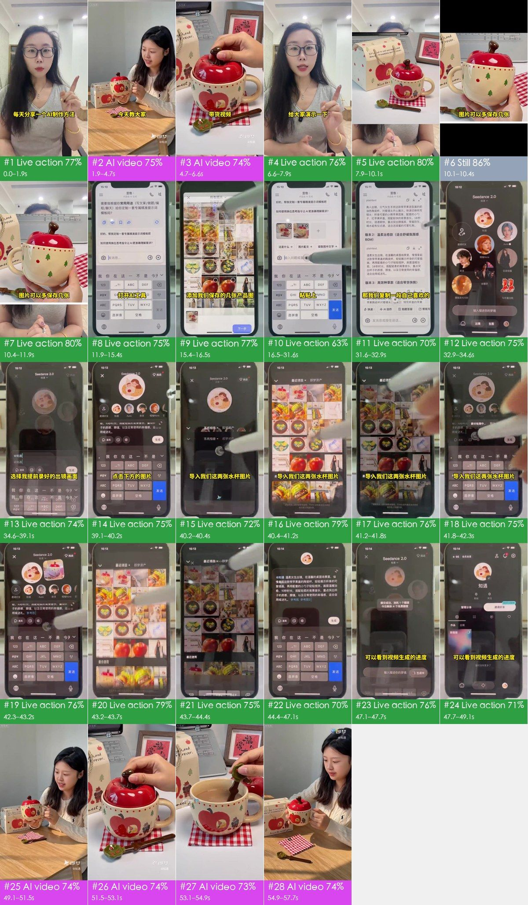

## What makes it work

- **The hook**: 0–1.9 s: she raises a finger and names her series, "每天分享一个 AI 制作方法" (one AI method a day); 1.9–6.6 s previews the finished AI video under "今天教大家 制作真人出镜的日用品带货视频"
- Result first, method second: a preview up front, the full reveal at 49.1–57.7 s, 37 s of steps in between, so anyone who wants the same result stays to the end
- Real phone operations: 11.9–49.1 s films a phone from above as a stylus taps through each step, one line of big text per step (open AI tool → paste prompt → import mug photos → generate)
- Looks low-barrier: two apps (Doubao for the prompt, Jimeng to generate), a few product photos and one pre-recorded clip; the daily-series intro suits regular posting
- Well-chosen actions in the result: holding up the mug, lifting the apple lid, stirring with the leaf spoon, raising it to her face; looks, details and use covered in four moves

## At a glance: picture, packaging, sound

Any short video splits into three layers: the picture, what is laid on top of it (subtitles, styled text, stickers), and the sound. Remake it one layer at a time.

| Layer | In this video | How to make it | Detail |
|---|---|---|---|
| **Picture** (base) | live action 21 shots, AI-generated video 6 shots, static hold 1 shot | filmed in 2 scenes; AI in 1 generation, repeated clips cut from the result; a single image held or moved | “Remake it yourself” |
| **Packaging** (on top) | subtitle, text, graphic, styled text | add in the editor: subtitles, styled text and stickers by the timeline | “Packaging layer” |
| **Sound** | voice（human recording）, music (115 BPM, to confirm), 3 distinct effects (4 hits) | voice: record it yourself; music: find a track with the same tempo and mood; effects: add from a library at the listed times | “Sound” |

## Content and structure

- The narrative line below comes from reading each shot; the lines were not transcribed separately, subtitle text is under “Packaging layer”

**Narrative line**

Keep this line in a remake: same order, same job at each step, with the point refilled from your own cases, numbers and material, so it is more than a change of subject.

| Time | Shots | Job | What it says |
|---|---|---|---|
| 0.0–6.6s | #1–#3 | grab attention | The presenter introduces her series: one AI production method shared every day → Opens with a preview of the finished AI video: a lifelike product-selling shot → Preview close-up: product details |
| 6.6–7.9s | #4 | set the scene | Says she will demo it live next |
| 7.9–47.1s | #5–#22 | add information | Step one: save the product images you want to sell → Shows the product image to be used → Tip: save several product images to use as references when generating → Open the AI tool to write the prompt → Send the product images to the AI → (… 15 points, each shot in the shot list) |
| 47.1–49.1s | #23, #24 | show evidence | Submitted → Wait for generation |
| 49.1–57.7s | #25–#28 | deliver the conclusion | Reveal of the generated product-selling video → Finished video: close-up of the lid design → Finished video: usage scene → Finished video: emotional close |

## Shot list

Picture, Camera and Overlays are what is visible on screen; Made with and Material are the tools' inference, with the basis in the shot-by-shot appendix.

| # | Frames | Time | Length | What it says | Picture | Camera | Overlays | Made with (inferred) | Material (inferred) | Remake |
|---|---|---|---|---|---|---|---|---|---|---|
| 1 |  | 0:00.0 | 1.9s | grab attention: The presenter introduces her ser… | A long-haired female presenter in black-… | smooth move | subtitle | live action 77% | live footage | reshoot · S1 |
| 2 | 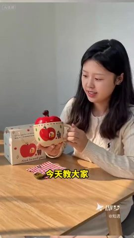 | 0:01.9 | 2.8s | grab attention: Opens with a preview of the fini… | The AI-generated woman "Zhiyu" sits at a… | smooth move | subtitle | AI-generated video 75% | AI-generated | AI generation · G1 (cut from #25) |
| 3 | 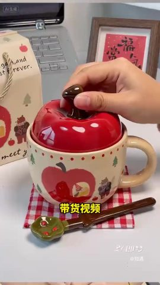 | 0:04.7 | 1.9s | grab attention: Preview close-up: product detail… | AI-generated close-up of the apple mug: … | smooth move | subtitle | AI-generated video 74% | AI-generated | AI generation · G1 (cut from #26) |
| 4 | 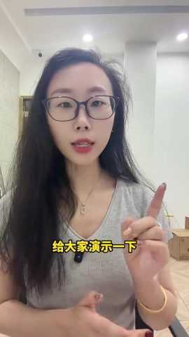 | 0:06.6 | 1.3s | set the scene: Says she will demo it live next | A long-haired female presenter in black-… | smooth move | text, graphic | live action 76% | live footage | reshoot · S1 |
| 5 | 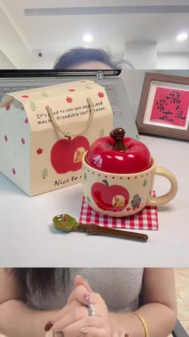 | 0:07.9 | 2.1s | add information: Step one: save the product imag… | Top/bottom split-screen: a real product … | static | subtitle | live action 80% | live footage; references for the remake: product reference image | reshoot · S1 |
| 6 | 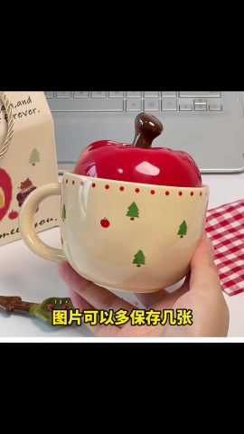 | 0:10.1 | 0.3s | add information: Shows the product image to be u… | A real product photo (a hand holding the… | static | text, subtitle | static hold 86% | photo, product photo | static frame |
| 7 | 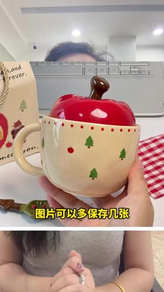 | 0:10.4 | 1.6s | add information: Tip: save several product image… | Top/bottom split-screen: a product photo… | static | text | live action 80% | live footage; references for the remake: product reference image | reshoot · S1 |
| 8 | 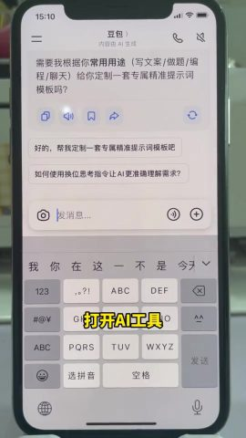 | 0:11.9 | 3.5s | add information: Open the AI tool to write the p… | Overhead shot of a real phone on a desk:… | static | subtitle | live action 75% | live footage | reshoot · S2 |
| 9 | 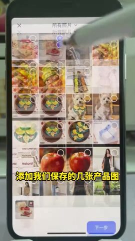 | 0:15.4 | 1.1s | add information: Send the product images to the … | Overhead shot of a real phone on a desk:… | static | subtitle | live action 77% | live footage | reshoot · S2 |
| 10 | 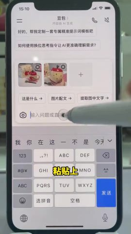 | 0:16.5 | 15.1s | add information: Have the AI write a video promp… | Overhead shot of a real phone on a desk:… | static | subtitle | live action 63% | live footage | reshoot · S2 |
| 11 | 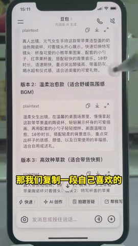 | 0:31.6 | 1.4s | add information: Pick a prompt you like and copy… | Overhead shot of a real phone on a desk:… | static | — | live action 70% | live footage | reshoot · S2 |
| 12 | 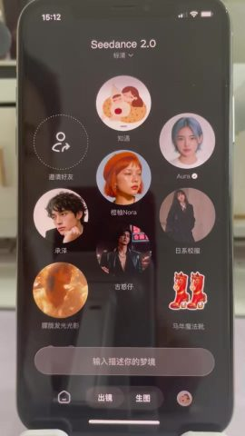 | 0:32.9 | 1.7s | add information: Switch to the video generation … | Overhead shot of a real phone on a desk:… | static | subtitle | live action 75% | live footage | reshoot · S2 |
| 13 | 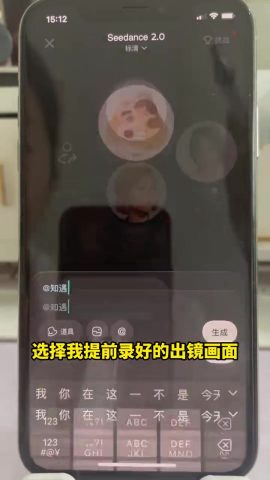 | 0:34.6 | 4.5s | add information: Pick the on-camera subject and … | Overhead shot of a real phone on a desk:… | static | subtitle | live action 74% | live footage | reshoot · S2 |
| 14 | 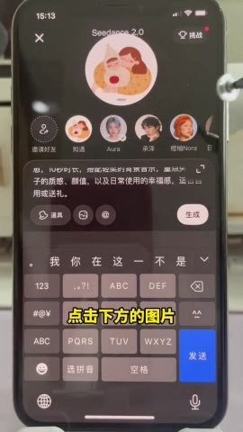 | 0:39.1 | 1.0s | add information: Get ready to add reference imag… | Overhead shot of a real phone on a desk:… | static | subtitle | live action 75% | live footage | reshoot · S2 |
| 15 | 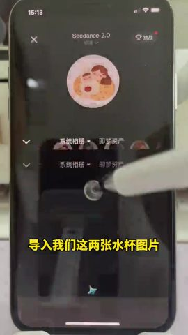 | 0:40.2 | 0.3s | add information: Transition | Overhead shot of a real phone on a desk:… | static (subject moves) | — | live action 72% | live footage | reshoot · S2 |
| 16 | 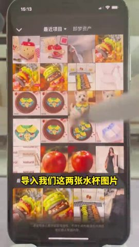 | 0:40.4 | 0.8s | add information: Import the product reference im… | Overhead shot of a real phone on a desk:… | static | text | live action 79% | live footage | reshoot · S2 |
| 17 | 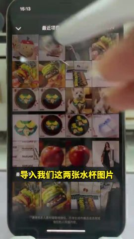 | 0:41.2 | 0.6s | add information: Import the product reference im… | Overhead shot of a real phone on a desk:… | smooth move | — | live action 76% | live footage | reshoot · S2 |
| 18 | 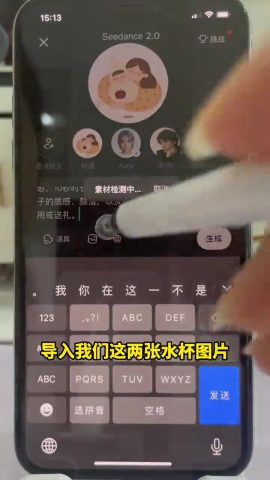 | 0:41.8 | 0.5s | add information: Reference images in place | Overhead shot of a real phone on a desk:… | static | — | live action 75% | live footage | reshoot · S2 |
| 19 | 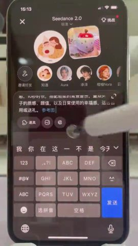 | 0:42.3 | 0.9s | add information: Reference the images in the pro… | Overhead shot of a real phone on a desk:… | static | — | live action 76% | live footage | reshoot · S2 |
| 20 | 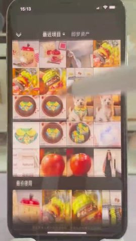 | 0:43.2 | 0.6s | add information: Transition | Overhead shot of a real phone on a desk:… | smooth move | — | live action 79% | live footage | reshoot · S2 |
| 21 | 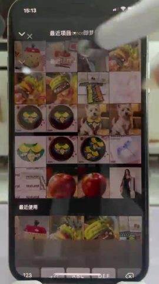 | 0:43.7 | 0.7s | add information: Transition | Overhead shot of a real phone on a desk:… | smooth move | — | live action 75% | live footage | reshoot · S2 |
| 22 | 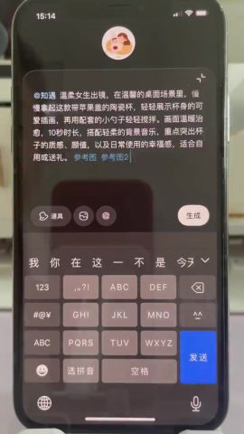 | 0:44.4 | 2.7s | add information: Submit for generation | Overhead shot of a real phone on a desk:… | static | subtitle | live action 70% | live footage | reshoot · S2 |
| 23 | 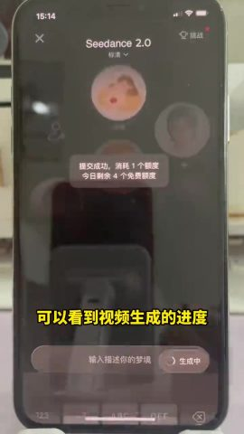 | 0:47.1 | 0.7s | show evidence: Submitted | Overhead shot of a real phone on a desk:… | static | — | live action 76% | live footage | reshoot · S2 |
| 24 | 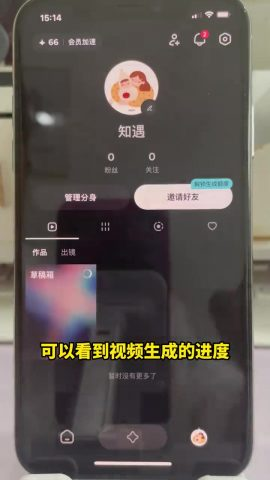 | 0:47.7 | 1.4s | show evidence: Wait for generation | Overhead shot of a real phone on a desk:… | static | subtitle, styled text | live action 71% | live footage | reshoot · S2 |
| 25 | 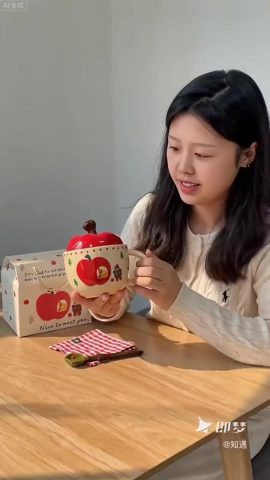 | 0:49.1 | 2.4s | deliver the conclusion: Reveal of the generated … | Generated result: the AI woman "Zhiyu" s… | smooth move | styled text | AI-generated video 74% | AI-generated | AI generation · G1 |
| 26 | 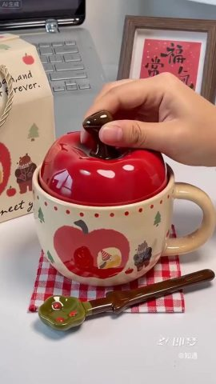 | 0:51.5 | 1.6s | deliver the conclusion: Finished video: close-up… | Generated result: close-up of the apple … | smooth move | styled text | AI-generated video 74% | AI-generated | AI generation · G1 |
| 27 | 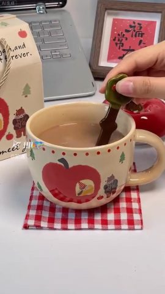 | 0:53.1 | 1.8s | deliver the conclusion: Finished video: usage sc… | Generated result: a hand stirs milk tea … | smooth move | — | AI-generated video 73% | AI-generated | AI generation · G1 |
| 28 | 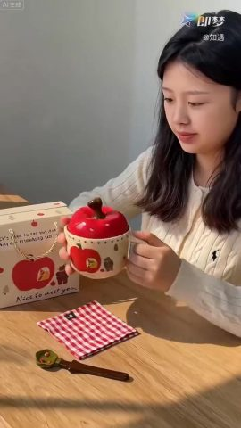 | 0:54.9 | 2.8s | deliver the conclusion: Finished video: emotiona… | Generated result: the woman holds the mu… | smooth move | — | AI-generated video 74% | AI-generated | AI generation · G1 |

## Remake it yourself: do it in this order

Copy the method and the rhythm, not the pictures.

1. **Plan the content**: write your script on the narrative line under “Content and structure”
2. **Collect material**: see “What to prepare” below
3. **Shoot**: 2 scenes, 4 camera setups, see “Shoot” below
4. **Generate**: 1 generation, see “AI generation” below
5. **Stills / moves**: see “Local rebuild” below
6. **Edit**: see “Edit” below
7. **Packaging**: the subtitle file `packaging/subtitles.srt` imports straight into an editor; styles and timeline under “Packaging layer”
8. **Sound**: see “Sound”; every effect can be played first
9. **Compare**: watch yours next to the original: shot lengths, subtitle positions, where the music comes in and drops

### What to prepare

- `@图片1` product photos (front + the side with the logo), supplied by the user
- `@图片2` character reference images (one frontal face + one half-body per character) so the look stays consistent across shots: Zhiyu (AI subject)
- Real files shown in the picture (screenshots, photos, recordings; get the originals):
  - **photo** (whole frame): shots #6, 0.3s in all
  - **product photo** (part of the frame), Product photo of a hand holding the apple mug: shots #6, 0.3s in all

### Shoot

Shoot every shot of one scene before moving to the next; within a scene, shoot the wider sizes first and the close-ups last so the lighting is set only once. Leave about 1s of handle at both ends of every take.

**S1**: shots #1, #4, #5, #7 (6.93s on screen); Office, White wall, downlights, hallway
- Lighting: Lit directly by office ceiling lights, no extra lighting
- Setup medium shot · fixed camera (tripod / mount / on the desk) · static: shots #5, #7, 3.7s on screen, shoot about 7.7s
- Setup close-up · moving camera (gimbal / handheld pan) · pan / track/pull-out: shots #1, #4, 3.23s on screen, shoot about 7.2s

**S2**: shots #8–#24 (37.2s on screen); Overhead shot of a phone on a desk, Phone screen on a dark desktop
- Lighting: No lighting, relies on screen brightness; avoid glare from the ceiling lights
- Setup close-up · fixed camera (tripod / mount / on the desk) · static: shots #8–#16, #18, #19, #22–#24, 35.4s on screen, shoot about 63.4s
- Setup close-up · moving camera (gimbal / handheld pan) · pan / track/static: shots #17, #20, #21, 1.8s on screen, shoot about 7.8s

### AI generation

**4 AI video shots → 1 generation unit, 1 Seedance 2.0 call (plus 2 shots reusing the same clip, just cut)**

- Grouping: AI shots in the same scene joined by hard cuts are generated in one call; ≤15s per call; consecutive hard cuts inside a unit preferably ≤8s, at most 10s; split at dissolves / fades and scene changes
- Audio: the model can generate action sound effects and ambience along with the picture; the voice was recorded by a person: record it separately and mix it in rather than having the video model speak, so copy and timing stay editable

A video model can take these inputs; each generation unit below lists which ones to feed and where they come from:
- **Text prompt**: always; describes the picture, action and camera
- **First frame**: locks the composition and subject of frame one. Without it this is plain text-to-video and framing changes every time
- **Last frame**: also locks the final frame so the model only fills in between. Suits a single shot with a camera move or action
- **Reference images**: how the product and people look, so they stay the same across shots (`@图片1` in the prompt)
- **Reference video**: copy the action, camera move and rhythm, not the picture (`@视频1`); not every model takes one

One generation per unit. The table lists what to feed the model; open a unit for where each input comes from and the prompt.

| Unit | Shots | Time | Duration | Mode | Feed | Continuity |
|---|---|---|---|---|---|---|
| G1 | #25–#28 | 49.1–57.7s | 8.5s | multi-shot | first frame + reference image + reference video | — |

The same clip is used more than once (spotted by the image reader): generate it once and place it at each spot in the edit.
- #2 and #25 are the same footage: cut it from G1's result
- #3 and #26 are the same footage: cut it from G1's result

<details><summary>G1 · shots #25–#28 · 8.5s · multi-reference generation</summary>

| Input | Needed | From | Why |
|---|---|---|---|
| text prompt | yes | see the prompt below | describes picture, action and camera; every other input only constrains it |
| first frame | worth it | source frame `shots/shot_025_first.jpg` (to change product, person or style, redraw it with an image model from the first-frame prompt below); this model takes frame inputs or references, not both: pass it as one more reference image and write “@图片3 as the first frame” in the prompt (Jimeng's omni-reference accepts this; most APIs do not, drop it if refused) | locks composition, shot size and subject position; with text alone every generation frames it differently |
| last frame | no | — | several shots in one call; a last frame would only constrain the final shot |
| reference image | yes | `@图片1` product photos (front + the side with the logo), supplied by the user; `@图片2` character reference images (one frontal face + one half-body per character) so the look stays consistent across shots | the first frame only fixes frame one; reference images keep the product and people consistent after it |
| reference video | worth it | `@视频1` source clip 49.1–57.7s | follow the action, camera move and cutting rhythm; reference only, the picture is not copied |

- First-frame image prompt: Vertical medium shot, eye level, a young long-haired woman seated behind a wooden table, cream cable-knit sweater, holding an apple-shaped red-lidded ceramic mug, gift box on the left, warm sunlight coming in from the right, window-pane shadows on the table

```text
Vertical 9:16; soft frontal light (flat light), soft light (almost no lit / shadow edge), warm (about 3000–4000K), background sharp. Product appearance follows @图片1, keep the logo and details consistent. Characters follow @图片2. Follow the action, camera movement and cutting rhythm of @视频1. Hard cuts between shots.
Shot 1 (0.0–2.4s): Vertical medium shot, the woman holds the apple mug up to the camera, then puts it back on the table and smiles, camera slowly pushes in
Shot 2 (2.4–3.9s): Vertical close-up, a hand pinches the stem of the apple lid from above and slowly lifts it off, revealing the mouth of the mug
Shot 3 (3.9–5.8s): Vertical close-up, a hand holding a green leaf spoon slowly stirs milk tea in the mug, locked-off camera
Shot 4 (5.8–8.5s): Vertical medium shot, the woman brings the apple mug up to her cheek with both hands, tilts her head slightly and smiles, camera slowly pulls back
```

English prompt:

```text
Shot 1 (0.0-2.4s): Vertical medium shot, the woman shows the apple mug to camera then puts it down, slow push-in
Shot 2 (2.4-3.9s): Vertical close-up, a hand lifts the apple lid off the mug by its stem
Shot 3 (3.9-5.8s): Vertical close-up, a hand slowly stirs milk tea in the mug with a green leaf spoon, locked-off
Shot 4 (5.8-8.5s): Vertical medium shot, the woman holds the mug near her cheek and smiles, slow pull-out
```

</details>

### Local rebuild

- #6 static hold 0.3s: one image + the measured zoom / pan parameters, rendered straight from ffmpeg

### Edit

- Cut in the order and lengths of the shot list
- Approach: Talking-head intro, then a preview of the finished AI video, then a split-screen walking through the steps, overhead recording of the phone operations, and finally the reveal of the finished video; large subtitles throughout
- Rhythm: 28.1 cuts per minute, 2.1s average live-action shot; 4 camera set-up(s) / location(s); 3 jump cut(s) and 3 punch-in(s) within the same set-up; inserts (screenshots / screen recordings / cards / stock) take 24%; 44% of cuts land in pauses of the speech; transitions cut×18, flash cut×2, jump cut×7

## Cast, scenes and props

| Id | Name | Kind | Look | Role | Voice | Shots |
|---|---|---|---|---|---|---|
| A | Presenter | person | Long straight black hair, black-framed glasses, grey V-neck T-shirt, gold bangle, wireless mic clipped to the collar | Explainer | Female voice, fast-paced | #1, #4, #5, #7 |
| B | Zhiyu (AI subject) | digital avatar | Early-twenties woman with long straight black hair, cream cable-knit sweater, gentle smile | AI-generated on-camera seller | None | #2, #25, #28 |

**Scenes**

| Scene | Where | When | Set / light | Shots |
|---|---|---|---|---|
| S1 | Office | Daytime | White wall, downlights, hallway | #1, #4, #5, #7 |
| S2 | Overhead shot of a phone on a desk | Daytime | Phone screen on a dark desktop | #8–#24 |
| S3 | AI-generated wooden table by a window | Warm daytime sunlight | Wooden table, light grey wall, window-pane shadows | #2, #3, #25–#28 |

**Props / products / logos**

- Apple-shaped red-lidded ceramic mug (shots #2, #3, #5–#7, #25–#28): The product being sold, apple and little-bear illustrations on the body
- Apple gift box, gingham cloth, leaf spoon (shots #2, #3, #25–#27): Accessories sold with the mug

## Camera and lighting

- Visual style: The first half is a phone-selfie talking head plus an overhead desk tutorial of a phone, natural light, no grading; the second half is a warm-sunlight lifestyle product film generated by Jimeng
- Framing: shot size close-up 92%, medium shot 8%; camera angle top-down; subject is the in-focus region (no face; shot size is an estimate)
- Camera: fixed camera (tripod / mount / on the desk) 89%, moving camera (gimbal / handheld pan) 11%; typical move pan / track
- Lighting: No lighting setup; office ceiling lights and the screen's own glow (image reading; pixel measurements in the fold below)
- Grade: natural (close to the original colours); normal saturation, normal contrast, normal blacks, overall neutral
- Format: tabletop / object shoot (face as subject 7%, objects / hands as subject 93%, handheld 11%); image readers: AI-tool tutorial talking-head video for product selling

<details class="ref"><summary>Per-item measurements and image readings (22)</summary>

| Aspect | Item | Verdict | Sources |
|---|---|---|---|
| Framing | shot size | close-up | measured; agent review: Close-up |
| Framing | camera angle | Top-down (directly above the desk) | agent review |
| Framing | composition | Phone centered, filling the vertical frame | agent review |
| Camera | camera support | Overhead desk stand | measured: fixed camera (tripod / mount / on the desk); agent review |
| Camera | lens | Phone rear main camera | agent review |
| Camera | speed | Normal | agent review |
| Camera | set-ups / locations | Talking head: phone front camera, locked off; tutorial: phone rear camera shooting another phone from above | agent review |
| Camera | likely gear | Two phones + a desk stand + a wireless lavalier mic | agent review |
| Lighting | location | Indoor; tabletop | agent review |
| Lighting | key light | Screen glow + room ceiling lights | agent review |
| Lighting | soft / hard | hard light (sharp shadow edge) | measured; agent review: Soft |
| Lighting | fill | None | agent review |
| Lighting | rim / backlight | None | agent review |
| Lighting | catchlight | Point (ceiling lights) | agent review |
| Lighting | practicals | Phone screen | agent review |
| Lighting | colour temperature | neutral (about 5000K) | measured; agent review: Neutral |
| Lighting | lighting set-up | No lighting, relies on screen brightness; avoid glare from the ceiling lights | agent review |
| Lighting | overall lighting | No lighting setup; office ceiling lights and the screen's own glow | agent review |
| Grade | colour grade | natural (close to the original colours) | measured; agent review: Natural |
| Grade | overall grade | Natural | agent review |
| Editing | editing style | Talking-head intro, then a preview of the finished AI video, then a split-screen walking through the steps, overhead recording of the phone operations, and finally the reveal of the finished video; large subtitles throughout | agent review |
| Format | video format | AI-tool tutorial talking-head video for product selling | measured: tabletop / object shoot; agent review |

</details>

- Note: lighting ratio, soft / hard, colour temperature and shot size are measured on the subject's pixels (the face when there is one, otherwise the in-focus region, which is an estimate); platform transcodes crush the shadows, so hardness and fill read conservative; camera angle, light source, catchlight and rim light follow the image readers. Where measurement and readers disagree, both are listed.

## Packaging layer (subtitles / styled text / stickers / sound-effect hits)

- 23 subtitle lines (bottom, up to 1 rows): yellow text, black outline, line height 4.0%; entrance: hard in×7, fade in×1
- text label ×1: "发送"
- SFX hits on: subtitle in ×2, cut ×1
- Placed by spoken line ×1 (with new wording they follow the line, not the old second): text label "发送" → 0.5s before "点击发送", on "发送"
- Exports: `packaging/subtitles.srt`, `packaging/overlays.ass`, `packaging/timeline.json` (SRT is the subtitle timeline; ASS carries colour, outline, position and entrance animation, swap in the original font; timeline.json is the full timeline)

<details class="ref"><summary>text timeline (24 rows)</summary>

| Time | Kind | Text | Style | In / out | SFX |
|---|---|---|---|---|---|
| 0.00–1.90s | subtitle | 每天分享一个A制作方法 | yellow text, black outline, black box, line height 3.8% (about 49px) | — | — |
| 1.90–2.90s | subtitle | 今天教大家 | yellow text, black outline, line height 4.3% (about 55px) | hard in | — |
| 3.00–4.20s | subtitle | 制作真人出镜的日用品 | yellow text, black outline, line height 3.8% (about 48px) | fade in / hard out | pop |
| 4.50–5.20s | subtitle | 带货视频 | yellow text, black outline, line height 4.1% (about 52px) | — | — |
| 5.50–6.20s | subtitle | 那我用这个水杯 | yellow text, black outline, line height 3.6% (about 46px) | — | click |
| 6.50–7.90s | subtitle | 给大家演示一下 | yellow text, black outline, line height 4.1% (about 52px) | hard out | — |
| 8.00–10.00s | subtitle | 保存好要带货的水杯图片 | yellow text, black outline, line height 3.8% (about 49px) | hard in | — |
| 10.00–11.80s | subtitle | 图片可以多保存几张 | yellow text, black outline, orange box, line height 3.6% (about 46px) | hard out | — |
| 11.90–13.30s | subtitle | 打开AI工具 | yellow text, black outline, line height 4.1% (about 53px) | hard in | — |
| 13.30–15.60s | subtitle | 添加我们保存的几张产品图 | yellow text, black outline, line height 3.8% (about 48px) | fade out | — |
| 16.00–16.40s | subtitle | 粘贴上 | yellow text, black outline, black box, line height 4.4% (about 56px) | hard in / hard out | — |
| 16.50–18.10s | subtitle | 刚准备好的这个提示词 | yellow text, black outline, grey box, line height 4.0% (about 51px) | hard in / slide out | — |
| 25.00–25.10s | subtitle | 提示词呢 | yellow text, black outline, line height 4.2% (about 54px) | hard in / hard out | — |
| 25.50–26.90s | subtitle | 也可以按照自己的需求 | yellow text, black outline, grey box, line height 3.8% (about 48px) | hard out | — |
| 26.90–27.50s | subtitle | 来修改 | yellow text, black outline, line height 4.8% (about 62px) | hard in | — |
| 27.00–28.20s | text label | 发送 | blue text, blue outline, line height 2.6% (about 33px) | hard out | — |
| 27.50–28.10s | subtitle | 点击发送 | yellow text, black outline, line height 4.4% (about 57px) | shrink out | — |
| 28.00–29.60s | subtitle | 提示词接着就出来了 | yellow text, black outline, line height 4.0% (about 51px) |  (bounces / changes colour midway) | — |
| 30.00–31.60s | subtitle | 那我们复制一段自己喜欢的 | yellow text, black outline, line height 3.8% (about 48px) | fade out | — |
| 32.50–33.60s | subtitle | 我们来到这个界面 | yellow text, black outline, keywords highlighted in grey, line height 4.0% (about 51px) | hard out (bounces / changes colour midway) | — |
| 34.00–36.50s | subtitle | 选择我提前录好的出镜画面 | yellow text, black outline, grey box, line height 3.8% (about 48px) | shrink out | — |
| 36.50–38.10s | subtitle | 粘贴上刚才复制的提示词 | yellow text, black outline, grey box, line height 3.8% (about 48px) | hard out | — |
| 38.50–40.00s | subtitle | 点击下方的图片 | yellow text, black outline, line height 4.0% (about 51px) | hard out | — |
| 40.00–41.60s | subtitle | 导入我们这两张水杯图片 | yellow text, black outline, line height 3.8% (about 48px) | fade out | — |

</details>

| Time | Layer | Spoken line |
|---|---|---|
| 27.00s | text label "发送" | 0.5s before "点击发送", on "发送" |

Remake: burn subtitles and styled text in with `packaging/overlays.ass` (ffmpeg -vf ass=overlays.ass), or rebuild them from timeline.json in CapCut / Remotion; stickers and GIFs need matching assets (meme / GIF libraries), crops are under packaging/.

## Sound

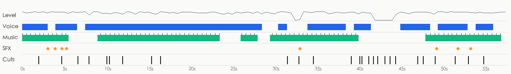

- loudness -17.3 dBFS, peak -0.2 dBFS; sound runs across cuts, laid in post as one bed (background changes 10.0dB at cuts vs 8.8dB within shots)
- Sources: Video type: live footage (location sound + music added in post) → voice: human recording; music: stock library music (leaning, to confirm); SFX: location sound

**Voice**

- 74% of the duration; pitch about 215.1Hz (female-leaning)
- Source: human recording (human recording 73%, TTS voice-over 20%, native dialogue from the AI video model 7%)
  - 77% of the picture is live footage: the voice is most likely location sound or a human voice-over
- Remake: record it yourself: phone or lavalier mic close to the mouth, in a quiet room; rewrite the lines from the script table

**Music**

- Tempo: 114.8 BPM (or 57.4/229.7); key F major (confidence 0.763); 72% of the duration (0.0–57.0s); section changes at 41.0s, 45.0s; ending: cut off hard
- Cuts vs beat: 15% of cuts land on a beat (chance: about 20%)
- Source: to confirm (stock library music 63%, well-known song 23%, AI-generated music 13%)
  - The music is a bed under the picture: in a regular video the bed usually comes from a stock library (prior)
  - The voice is speech / narration, not singing (sustained-pitch ratio 0.25): a regular "voice-over + music bed" video
  - The music is hard-cut at the end (still at full level when the video stops): typical of a trimmed existing track
  - Nothing about this track beyond the format prior and weak cues like the ending (no source heard, no platform music tag): source to confirm; an AI-generated bed cannot be told from a library bed here
  - How to confirm: Check the music tag on the original Douyin / Xiaohongshu / TikTok post: a song title → existing track; "original sound - @creator" → uploaded by the creator (for music videos, usually an AI song)
  - How to confirm: Run it through Shazam / ACRCloud or another song-ID service: a hit means an existing song
- Remake: The original track leans stock library music: search a library by BPM / mood / key for a similar track, or generate a royalty-free track in a similar style with AI

**Sound effects** (4 hits, 3 distinct sounds)

| Sound | Listen | Type | Times used | At | On screen |
|---|---|---|---|---|---|
| F1 | [listen](sfx/sfx_01.wav) | pop | 2 | 3.1s, 3.9s | subtitle "制作真人出镜的日用品" appears |
| F2 | [listen](sfx/sfx_02.wav) | click | 1 | 5.3s | subtitle "那我用这个水杯" appears |
| F3 | [listen](sfx/sfx_03.wav) | ding | 1 | 33.0s | cut |

- Remake: play each sound first (separated out, without voice or music), find one similar effect in the editor's library, and place it at every time listed under “At”

- Separated stems: `stems/original.wav` (original), `stems/vocals.wav` (dry voice), `stems/music.wav` (music + ambience), `stems/effects.wav` (effects track)
<!--stems-->

## Open questions

- No AI listened to the soundtrack (the review covered the picture only): real voice versus TTS is inferred from the waveform; the effects were found on the separated effects track and their types are estimated from the sound. Play the stems and each effect under “Sound” to check
- music source to confirm: most likely stock library music (63%); how to check is under “Sound”

## Appendix

### Shot by shot

Each shot has two parts: what is visible on screen, and how the tools infer it was made (with the basis); remake prompts last. Folded by default.

<details class="ref"><summary>#1 00:00.000–00:01.933 · live action + code / editor overlays (subtitles); brings in real material (live footage)</summary>

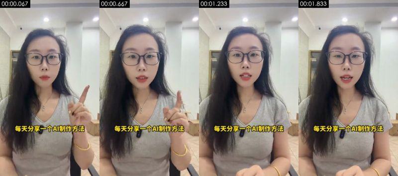

**Visible on screen** (check against the frames)
- Picture: A long-haired female presenter in black-framed glasses and a grey V-neck T-shirt sits in an office talking into the phone's front camera, raising her index finger for emphasis; white wall, downlights and a hallway behind her
- Camera / lighting: close-up; eye level; Tripod/stand, locked off; backlit / background brighter than subject; key light frontal (from the camera side; both sides of the subject about equally bright); lighting ratio about 1.1:1 (0.1 stops); soft light (almost no lit / shadow edge)
- Text track (subtitle/bottom): 每天分享一个A制作方法 / 每天分享一个AI制作方法
- [AI assistant review] Real presenter talking to camera: natural hair strands and finger movement, a wireless mic clipped to the collar, stable office ceiling lights and hallway perspective
- [AI assistant review] No AI platform watermark

**How it was made, as inferred by the tools** (inferred, not seen)
- Inference: live action 69%, AI-generated video 12%, film / TV footage 5% (fused_agent)
- Material: the user's real material: live footage
- Basis (tool measurements, not necessarily visible to the eye):
  - Photographic texture: noise σ=0.25, 121 colours, 10% flat blocks
  - Platform transcode (Douyin/TikTok) has compressed the sensor noise away: noise cues no longer apply, live action vs AI rests on frame rate and picture content

- Remake: Source is live action: reshoot per the shooting plan (shot size / camera setup / lighting); only fall back to AI image-to-video (first frame as reference) when a shoot is not possible; real material the user must supply: live footage (whole frame)
  - First-frame image prompt: close-up, Subject centered, vertical frame. Vertical close shot, eye level, a long-haired woman in black-framed glasses centered, grey V-neck T-shirt, bright office white wall and downlights behind, soft overhead light, natural color
  - Video prompt: close-up, Subject centered, vertical frame, camera pan / track. Vertical close shot at eye level, the woman centered talks to camera, raises her index finger for emphasis, slight head movement, locked-off camera

</details>

<details class="ref"><summary>#2 00:01.933–00:04.700 · AI-generated video + code / editor overlays (subtitles)</summary>

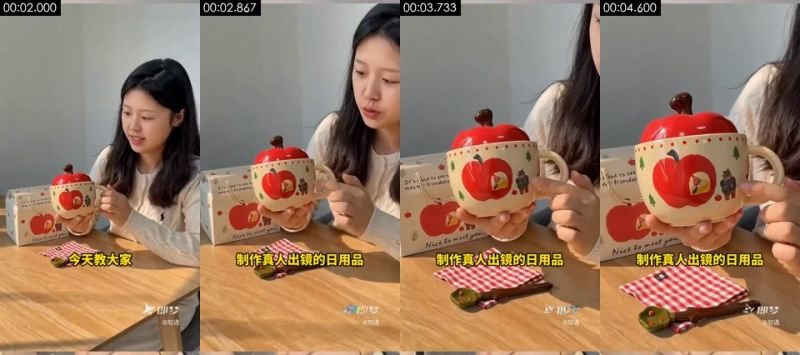

**Visible on screen** (check against the frames)
- Picture: The AI-generated woman "Zhiyu" sits at a wooden table, lifts the apple mug with both hands to show the camera and talks while looking at it; a wooden table in warm sunlight, light grey wall, with an apple-shaped red-lidded ceramic mug, an apple-print gift box, a red-and-white gingham cloth and a green leaf spoon on the table
- Camera / lighting: medium close-up; moving camera (gimbal / handheld pan); soft frontal light (flat light); key light frontal (from the camera side; both sides of the subject about equally bright); lighting ratio about 1.2:1 (0.2 stops); soft light (almost no lit / shadow edge)
- Text on objects in the scene (not subtitles): 带货视频, 即梦, @知遇, @知造, Nice to nkut geu, Nice to mattyou
- Text track (subtitle/bottom): 今天教大家 / 制作真人出镜的日用品
- [AI assistant review] Jimeng watermark and the subject name "@知遇" (Zhiyu) in the bottom-right corner
- [AI assistant review] The same character is the "知遇" (Zhiyu) subject picked in Jimeng later in the demo
- [AI assistant review] Lighting is too even and clean, and movement is slow

**How it was made, as inferred by the tools** (inferred, not seen)
- Inference: AI-generated video 72%, live action 10%, 3D render 4% (fused_agent)
- Material: AI-generated
- Basis (tool measurements, not necessarily visible to the eye):
  - Photographic texture: noise σ=0.22, 222 colours, 19% flat blocks
  - Platform transcode (Douyin/TikTok) has compressed the sensor noise away: noise cues no longer apply, live action vs AI rests on frame rate and picture content

- Remake: Source is AI-generated: use the shot's first and last frames for first/last-frame generation to closely match composition and motion; to change the subject, edit the first frame with an image model first
  - First-frame image prompt: medium close-up, subject in the upper right of the frame. Vertical medium close shot, eye level, a young long-haired woman seated behind a wooden table, slightly right of center, cream cable-knit sweater, holding an apple-shaped red-lidded ceramic mug in both hands, apple-print gift box on the left, warm side sunlight, light grey wall
  - Video prompt: medium close-up, subject in the upper right of the frame, camera push-in. Vertical medium close shot, the woman seated at the table lifts the apple mug to chest height to show it, looks down at it and smiles, camera slowly pushes in on the mug

</details>

<details class="ref"><summary>#3 00:04.700–00:06.633 · AI-generated video + code / editor overlays (subtitles)</summary>

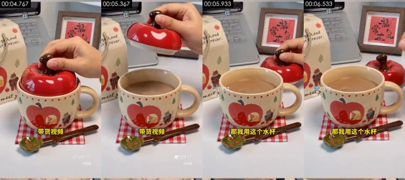

**Visible on screen** (check against the frames)
- Picture: AI-generated close-up of the apple mug: a hand lifts the red apple lid, the mug is printed with apples and a little bear; a wooden table in warm sunlight, light grey wall, with an apple-shaped red-lidded ceramic mug, an apple-print gift box, a red-and-white gingham cloth and a green leaf spoon on the table
- Camera / lighting: medium shot; moving camera (gimbal / handheld pan); backlit / background brighter than subject; key light frontal (from the camera side; both sides of the subject about equally bright); lighting ratio about 1.3:1 (0.4 stops); hard light (sharp shadow edge)
- Text on objects in the scene (not subtitles): 给大家演示一下, 即梦, @知遇, stfrever., st, meet
- Text track (subtitle/bottom): 带货视频 / 那我用这个水杯
- [AI assistant review] Jimeng watermark and the subject name "@知遇" (Zhiyu) in the bottom-right corner
- [AI assistant review] The same character is the "知遇" (Zhiyu) subject picked in Jimeng later in the demo
- [AI assistant review] Lighting is too even and clean, and movement is slow

**How it was made, as inferred by the tools** (inferred, not seen)
- Inference: AI-generated video 72%, live action 10%, 3D render 4% (fused_agent)
- Material: AI-generated
- Basis (tool measurements, not necessarily visible to the eye):
  - Photographic texture: noise σ=0.20, 262 colours, 19% flat blocks
  - Platform transcode (Douyin/TikTok) has compressed the sensor noise away: noise cues no longer apply, live action vs AI rests on frame rate and picture content

- Remake: Source is AI-generated: use the shot's first and last frames for first/last-frame generation to closely match composition and motion; to change the subject, edit the first frame with an image model first
  - First-frame image prompt: medium shot, subject in the lower middle of the frame. Vertical close-up, apple-shaped red-lidded ceramic mug centered, apple and bear illustrations on the body, gift box and a framed "福" character behind, red-and-white gingham cloth, soft daylight
  - Video prompt: medium shot, subject in the lower middle of the frame, camera pan / track. Vertical close-up, a hand pinches the stem of the apple lid from above and slowly lifts it off, slight camera pan

</details>

<details class="ref"><summary>#4 00:06.633–00:07.933 · live action + code / editor overlays (text labels, static graphics); brings in real material (live footage)</summary>

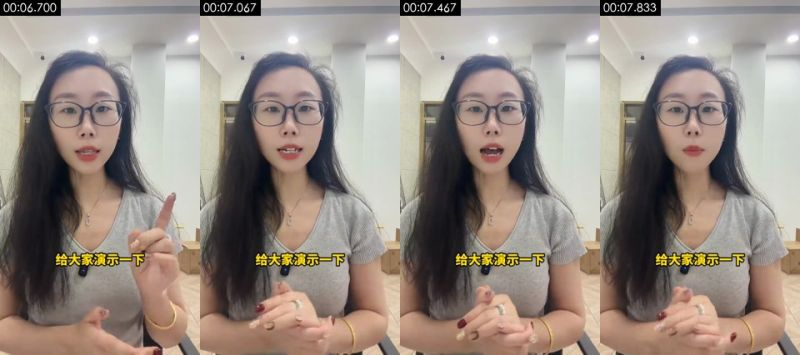

**Visible on screen** (check against the frames)
- Picture: A long-haired female presenter in black-framed glasses and a grey V-neck T-shirt sits in an office talking into the phone's front camera, raising her index finger for emphasis; white wall, downlights and a hallway behind her
- Camera / lighting: close-up; eye level; Tripod/stand, locked off; backlit / background brighter than subject; key light frontal (from the camera side; both sides of the subject about equally bright); lighting ratio about 1.0:1 (0.1 stops); soft light (almost no lit / shadow edge)
- Text track (text/bottom): 给大家演示一下
- [AI assistant review] Real presenter talking to camera: natural hair strands and finger movement, a wireless mic clipped to the collar, stable office ceiling lights and hallway perspective
- [AI assistant review] No AI platform watermark

**How it was made, as inferred by the tools** (inferred, not seen)
- Inference: live action 69%, AI-generated video 12%, film / TV footage 5% (fused_agent)
- Material: the user's real material: live footage
- Basis (tool measurements, not necessarily visible to the eye):
  - Photographic texture: noise σ=0.27, 121 colours, 11% flat blocks
  - Platform transcode (Douyin/TikTok) has compressed the sensor noise away: noise cues no longer apply, live action vs AI rests on frame rate and picture content

- Remake: Source is live action: reshoot per the shooting plan (shot size / camera setup / lighting); only fall back to AI image-to-video (first frame as reference) when a shoot is not possible; real material the user must supply: live footage (whole frame)
  - First-frame image prompt: close-up, Subject centered, vertical frame. Vertical close shot, eye level, a long-haired woman in black-framed glasses centered, grey V-neck T-shirt, bright office white wall and downlights behind, soft overhead light, natural color
  - Video prompt: close-up, Subject centered, vertical frame, camera pull-out. Vertical close shot at eye level, the woman centered talks to camera, raises her index finger for emphasis, slight head movement, locked-off camera

</details>

<details class="ref"><summary>#5 00:07.933–00:10.067 · live action + code / editor overlays (subtitles); brings in real material (live footage)</summary>

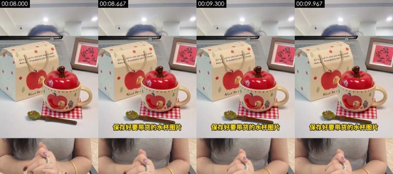

**Visible on screen** (check against the frames)
- Picture: Top/bottom split-screen: a real product photo of the apple mug on top, the presenter's clasped hands below
- Camera / lighting: medium shot; fixed camera (tripod / mount / on the desk); soft frontal light (flat light); key light frontal (from the camera side; both sides of the subject about equally bright); lighting ratio about 1.2:1 (0.3 stops); soft light (almost no lit / shadow edge)
- Text on objects in the scene (not subtitles): 图片可以多保存几张, 福, It's aodto see you aga.and, may ou/friendship las+frever.
- Text track (subtitle/bottom): 保存好要带货的水杯图片
- [AI assistant review] The top half is a still product photo; in the bottom half the presenter's hands are moving
- [AI assistant review] The frame is split into top and bottom panels, a split-screen made in the edit

**How it was made, as inferred by the tools** (inferred, not seen)
- Inference: live action 72%, film / TV footage 6%, AI-generated video 5% (fused_agent)
- Material: the user's real material: live footage; references for the remake: product reference image
- Basis (tool measurements, not necessarily visible to the eye):
  - Photographic texture: noise σ=0.25, 256 colours, 14% flat blocks
  - Platform transcode (Douyin/TikTok) has compressed the sensor noise away: noise cues no longer apply, live action vs AI rests on frame rate and picture content

- Remake: Source is live action: reshoot per the shooting plan (shot size / camera setup / lighting); only fall back to AI image-to-video (first frame as reference) when a shoot is not possible; real material the user must supply: live footage (whole frame); references for generation: product reference image
  - Video prompt: medium shot, subject in the lower middle of the frame. Top/bottom split-screen: a real product photo of the apple mug on top, the presenter's clasped hands below

</details>

<details class="ref"><summary>#6 00:10.067–00:10.367 · static hold (photo) + code / editor overlays (text labels, subtitles); brings in real material (photo, product photo)</summary>

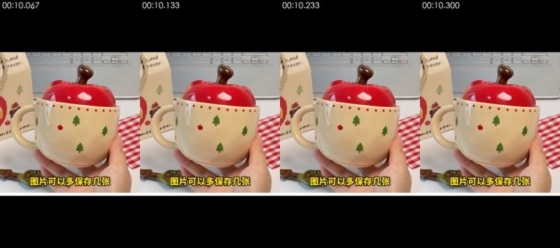

**Visible on screen** (check against the frames)
- Picture: A real product photo (a hand holding the apple mug) held full-screen, with black bars top and bottom
- [AI assistant review] A 0.3 s full-screen product photo with black bars top and bottom; the image does not move

**How it was made, as inferred by the tools** (inferred, not seen)
- Inference: static hold 86%, code / template render 9%, screen recording / screenshot 4% (fused_agent)
- Still source: photo
- Material: the user's real material: photo, product photo
- Basis (tool measurements, not necessarily visible to the eye):
  - Picture is almost entirely still: 100% of adjacent frames are pixel-identical, first-to-last frame difference 0.01
  - Platform transcode (Douyin/TikTok) has compressed the sensor noise away: noise cues no longer apply, live action vs AI rests on frame rate and picture content

- Remake: Static frame: one held image is enough; real material the user must supply: photo (whole frame), product photo (part of the frame)

</details>

<details class="ref"><summary>#7 00:10.367–00:11.933 · live action + code / editor overlays (text labels); brings in real material (live footage)</summary>

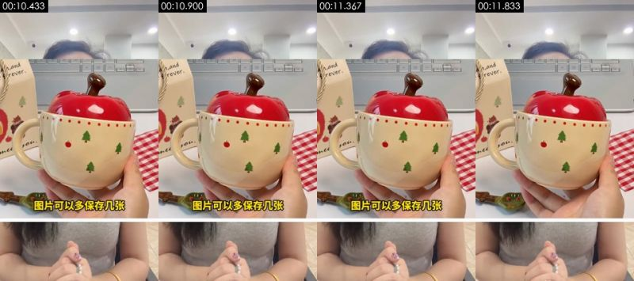

**Visible on screen** (check against the frames)
- Picture: Top/bottom split-screen: a product photo of a hand holding the apple mug on top, the presenter below
- Camera / lighting: medium shot; fixed camera (tripod / mount / on the desk); three-quarter key + fill (standard set-up); key light frame right, three-quarter front; lighting ratio about 1.4:1 (0.5 stops); unclear
- Text on objects in the scene (not subtitles): h,and, orever.
- Text track (text/bottom): 图片可以多保存几张
- [AI assistant review] The top half is a still product photo; in the bottom half the presenter's hands are moving
- [AI assistant review] The frame is split into top and bottom panels, a split-screen made in the edit

**How it was made, as inferred by the tools** (inferred, not seen)
- Inference: live action 72%, film / TV footage 6%, AI-generated video 5% (fused_agent)
- Material: the user's real material: live footage; references for the remake: product reference image
- Basis (tool measurements, not necessarily visible to the eye):
  - Photographic texture: noise σ=0.26, 240 colours, 12% flat blocks
  - Platform transcode (Douyin/TikTok) has compressed the sensor noise away: noise cues no longer apply, live action vs AI rests on frame rate and picture content

- Remake: Source is live action: reshoot per the shooting plan (shot size / camera setup / lighting); only fall back to AI image-to-video (first frame as reference) when a shoot is not possible; real material the user must supply: live footage (whole frame); references for generation: product reference image
  - Video prompt: medium shot, subject in the lower middle of the frame. Top/bottom split-screen: a product photo of a hand holding the apple mug on top, the presenter below

</details>

<details class="ref"><summary>#8 00:11.933–00:15.400 · live action + code / editor overlays (subtitles); brings in real material (live footage)</summary>

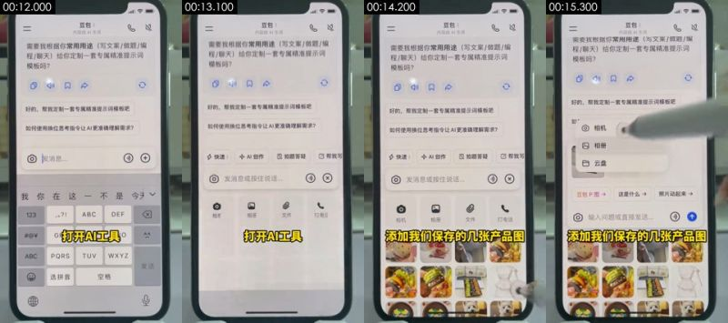

**Visible on screen** (check against the frames)
- Picture: Overhead shot of a real phone on a desk: the Doubao app is opened and asked in chat to write a custom prompt
- Camera / lighting: close-up; top-down; Overhead desk stand; soft frontal light (flat light); key light frontal (from the camera side; both sides of the subject about equally bright); lighting ratio about 1.0:1 (0.0 stops); hard light (sharp shadow edge)
- Text on objects in the scene (not subtitles): G, TUV, WXYZ, ABC, PQRS, 选拼音
- Text track (subtitle/bottom): 打开AI工具 / 添加我们保存的几张产品图
- [AI assistant review] Filming a real phone: the black bezel, screen glare and moiré are visible
- [AI assistant review] A stylus/finger taps the screen, with motion blur
- [AI assistant review] Not a screen recording: none of the crisp pixels a system screen capture would have

**How it was made, as inferred by the tools** (inferred, not seen)
- Inference: live action 67%, 3D render 6%, film / TV footage 5% (fused_agent)
- Material: the user's real material: live footage
- Basis (tool measurements, not necessarily visible to the eye):
  - Platform transcode (Douyin/TikTok) has compressed the sensor noise away: noise cues no longer apply, live action vs AI rests on frame rate and picture content

- Remake: Source is live action: reshoot per the shooting plan (shot size / camera setup / lighting); only fall back to AI image-to-video (first frame as reference) when a shoot is not possible; real material the user must supply: live footage (whole frame)
  - Video prompt: close-up, top-down, Phone centered, filling the vertical frame. Overhead shot of a real phone on a desk: the Doubao app is opened and asked in chat to write a custom prompt

</details>

<details class="ref"><summary>#9 00:15.400–00:16.467 · live action + code / editor overlays (subtitles); brings in real material (live footage)</summary>

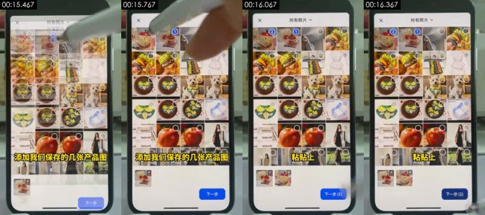

**Visible on screen** (check against the frames)
- Picture: Overhead shot of a real phone on a desk: several mug product images are picked from the photo album in Doubao
- Camera / lighting: close-up; top-down; Overhead desk stand; soft frontal light (flat light); key light frontal (from the camera side; both sides of the subject about equally bright); lighting ratio about 1.0:1 (0.0 stops); soft light (almost no lit / shadow edge)
- Text on objects in the scene (not subtitles): 添加我们保存的几张产品图, 下一步, 下一步价, Norurat:, ral, Naturc
- Text track (subtitle/bottom): 粘贴上
- [AI assistant review] Filming a real phone: the black bezel, screen glare and moiré are visible
- [AI assistant review] A stylus/finger taps the screen, with motion blur
- [AI assistant review] Not a screen recording: none of the crisp pixels a system screen capture would have

**How it was made, as inferred by the tools** (inferred, not seen)
- Inference: live action 69%, film / TV footage 5%, 3D render 5% (fused_agent)
- Material: the user's real material: live footage
- Basis (tool measurements, not necessarily visible to the eye):
  - Photographic texture: noise σ=0.30, 407 colours, 15% flat blocks
  - Platform transcode (Douyin/TikTok) has compressed the sensor noise away: noise cues no longer apply, live action vs AI rests on frame rate and picture content

- Remake: Source is live action: reshoot per the shooting plan (shot size / camera setup / lighting); only fall back to AI image-to-video (first frame as reference) when a shoot is not possible; real material the user must supply: live footage (whole frame)
  - Video prompt: close-up, top-down, Phone centered, filling the vertical frame. Overhead shot of a real phone on a desk: several mug product images are picked from the photo album in Doubao

</details>

<details class="ref"><summary>#10 00:16.467–00:31.567 · live action + code / editor overlays (subtitles); brings in real material (live footage)</summary>

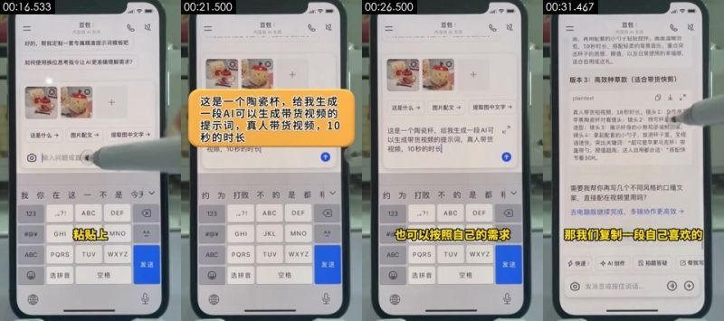

**Visible on screen** (check against the frames)
- Picture: Overhead shot of a real phone on a desk: "这是一个陶瓷杯，给我生成一段 AI 可以生成带货视频的提示词，真人带货视频，10 秒" ("This is a ceramic mug; write me a prompt an AI can use to generate a product-selling video, real person, 10 seconds") is pasted into Doubao, Doubao returns three versions of the prompt, and the stylus scrolls
- Camera / lighting: close-up; top-down; Overhead desk stand; soft frontal light (flat light); key light frontal (from the camera side; both sides of the subject about equally bright); lighting ratio about 1.1:1 (0.1 stops); soft light (almost no lit / shadow edge)
- Text on objects in the scene (not subtitles): GHI, JKL, MNO, ABC, PQRS, TUV
- Text track (subtitle/bottom): 刚准备好的这个提示词 / 提示词呢 / 也可以按照自己的需求 / 来修改
- Text track (subtitle/bottom): 发送
- Text track (subtitle/bottom): 发送
- Motion beats within the shot: 17.17s, 25.07s, 27.63s
- [AI assistant review] Filming a real phone: the black bezel, screen glare and moiré are visible
- [AI assistant review] A stylus/finger taps the screen, with motion blur
- [AI assistant review] Not a screen recording: none of the crisp pixels a system screen capture would have

**How it was made, as inferred by the tools** (inferred, not seen)
- Inference: live action 53%, code / template render 8%, screen recording / screenshot 7% (fused_agent)
- Material: the user's real material: live footage
- Basis (tool measurements, not necessarily visible to the eye):
  - 51% of adjacent frames are exact duplicates, only local elements move (typical of template / motion-graphics animation, or a hold with local motion)
  - Platform transcode (Douyin/TikTok) has compressed the sensor noise away: noise cues no longer apply, live action vs AI rests on frame rate and picture content

- Remake: Source is live action: reshoot per the shooting plan (shot size / camera setup / lighting); only fall back to AI image-to-video (first frame as reference) when a shoot is not possible; real material the user must supply: live footage (whole frame)
  - Video prompt: close-up, top-down, Phone centered, filling the vertical frame. Overhead shot of a real phone on a desk: "这是一个陶瓷杯，给我生成一段 AI 可以生成带货视频的提示词，真人带货视频，10 秒" ("This is a ceramic mug; write me a prompt an AI can use to generate a product-selling video, real person, 10 seconds") is pasted into Doubao, Doubao returns three versions of the prompt, and the stylus scrolls

</details>

<details class="ref"><summary>#11 00:31.567–00:32.933 · live action; brings in real material (live footage)</summary>

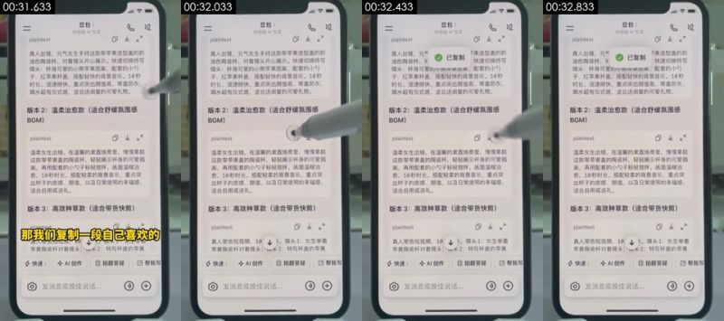

**Visible on screen** (check against the frames)
- Picture: Overhead shot of a real phone on a desk: version 3 of the prompt in Doubao's answer, about to be copied
- Camera / lighting: close-up; top-down; Overhead desk stand; soft frontal light (flat light); key light frontal (from the camera side; both sides of the subject about equally bright); lighting ratio about 1.0:1 (0.0 stops); soft light (almost no lit / shadow edge)
- Text on objects in the scene (not subtitles): plaintext, 不, 真人带货短视频，10√。镜头1：女生举着, 苹果陶瓷杯对着镜头；说大2：特写杯盖的苹果, 快速, AI创作
- [AI assistant review] Filming a real phone: the black bezel, screen glare and moiré are visible
- [AI assistant review] A stylus/finger taps the screen, with motion blur
- [AI assistant review] Not a screen recording: none of the crisp pixels a system screen capture would have

**How it was made, as inferred by the tools** (inferred, not seen)
- Inference: live action 61%, 3D render 8%, screen recording / screenshot 6% (fused_agent)
- Material: the user's real material: live footage
- Basis (tool measurements, not necessarily visible to the eye):
  - Rendered texture: 22% flat colour blocks, 95% of pixels use only 40 colours, 33% axis-aligned edges
  - Platform transcode (Douyin/TikTok) has compressed the sensor noise away: noise cues no longer apply, live action vs AI rests on frame rate and picture content

- Remake: Source is live action: reshoot per the shooting plan (shot size / camera setup / lighting); only fall back to AI image-to-video (first frame as reference) when a shoot is not possible; real material the user must supply: live footage (whole frame)
  - Video prompt: close-up, top-down, Phone centered, filling the vertical frame. Overhead shot of a real phone on a desk: version 3 of the prompt in Doubao's answer, about to be copied

</details>

<details class="ref"><summary>#12 00:32.933–00:34.633 · live action + code / editor overlays (subtitles); brings in real material (live footage)</summary>

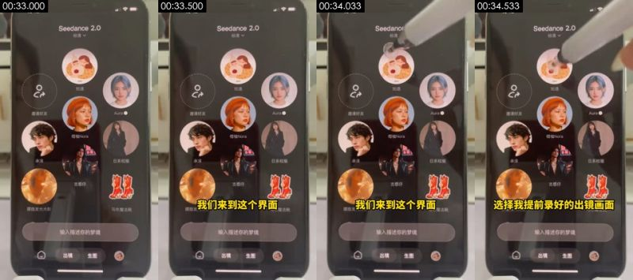

**Visible on screen** (check against the frames)
- Picture: Overhead shot of a real phone on a desk: switching to Jimeng Seedance 2.0, whose subject list shows avatars such as "知遇" (Zhiyu)
- Camera / lighting: close-up; top-down; Overhead desk stand; soft frontal light (flat light); key light frontal (from the camera side; both sides of the subject about equally bright); lighting ratio about 1.1:1 (0.2 stops); soft light (almost no lit / shadow edge)
- Text on objects in the scene (not subtitles): 朦胧发, 魔法靴, 选择我提前录好的出镜画面, 输入描述你的梦境, 123, ABC
- Text track (subtitle/bottom): 我们来到这个界面
- [AI assistant review] Filming a real phone: the black bezel, screen glare and moiré are visible
- [AI assistant review] A stylus/finger taps the screen, with motion blur
- [AI assistant review] Not a screen recording: none of the crisp pixels a system screen capture would have

**How it was made, as inferred by the tools** (inferred, not seen)
- Inference: live action 66%, 3D render 6%, screen recording / screenshot 5% (fused_agent)
- Material: the user's real material: live footage
- Basis (tool measurements, not necessarily visible to the eye):
  - Platform transcode (Douyin/TikTok) has compressed the sensor noise away: noise cues no longer apply, live action vs AI rests on frame rate and picture content

- Remake: Source is live action: reshoot per the shooting plan (shot size / camera setup / lighting); only fall back to AI image-to-video (first frame as reference) when a shoot is not possible; real material the user must supply: live footage (whole frame)
  - Video prompt: close-up, top-down, Phone centered, filling the vertical frame. Overhead shot of a real phone on a desk: switching to Jimeng Seedance 2.0, whose subject list shows avatars such as "知遇" (Zhiyu)

</details>

<details class="ref"><summary>#13 00:34.633–00:39.133 · live action + code / editor overlays (subtitles); brings in real material (live footage)</summary>

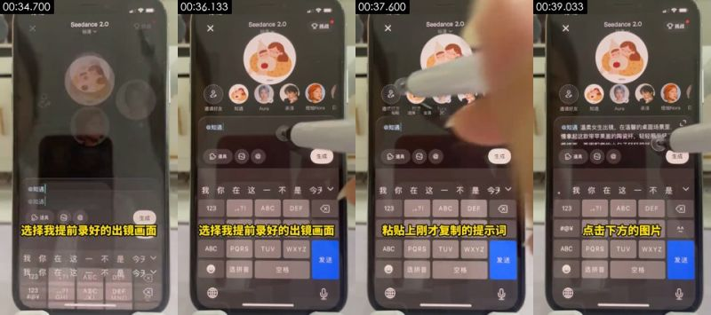

**Visible on screen** (check against the frames)
- Picture: Overhead shot of a real phone on a desk: "@知遇" (the on-camera subject recorded in advance) is selected in Jimeng and the prompt is pasted
- Camera / lighting: close-up; top-down; Overhead desk stand; soft frontal light (flat light); key light frontal (from the camera side; both sides of the subject about equally bright); lighting ratio about 1.1:1 (0.1 stops); soft light (almost no lit / shadow edge)
- Text on objects in the scene (not subtitles): ABC, PQRS, TUV, WXYZ, 发送, 选拼音
- Text track (subtitle/bottom): 选择我提前录好的出镜画面 / 粘贴上刚才复制的提示词
- [AI assistant review] Filming a real phone: the black bezel, screen glare and moiré are visible
- [AI assistant review] A stylus/finger taps the screen, with motion blur
- [AI assistant review] Not a screen recording: none of the crisp pixels a system screen capture would have

**How it was made, as inferred by the tools** (inferred, not seen)
- Inference: live action 65%, 3D render 7%, film / TV footage 5% (fused_agent)
- Material: the user's real material: live footage
- Basis (tool measurements, not necessarily visible to the eye):
  - Platform transcode (Douyin/TikTok) has compressed the sensor noise away: noise cues no longer apply, live action vs AI rests on frame rate and picture content

- Remake: Source is live action: reshoot per the shooting plan (shot size / camera setup / lighting); only fall back to AI image-to-video (first frame as reference) when a shoot is not possible; real material the user must supply: live footage (whole frame)
  - Video prompt: close-up, top-down, Phone centered, filling the vertical frame. Overhead shot of a real phone on a desk: "@知遇" (the on-camera subject recorded in advance) is selected in Jimeng and the prompt is pasted

</details>

<details class="ref"><summary>#14 00:39.133–00:40.167 · live action + code / editor overlays (subtitles); brings in real material (live footage)</summary>

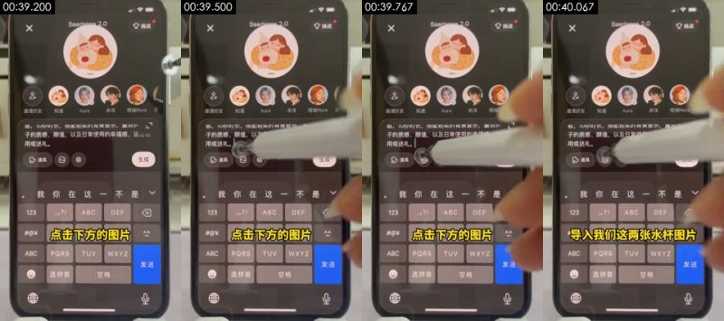

**Visible on screen** (check against the frames)
- Picture: Overhead shot of a real phone on a desk: tapping the image button below the input box
- Camera / lighting: close-up; top-down; Overhead desk stand; soft frontal light (flat light); key light frontal (from the camera side; both sides of the subject about equally bright); lighting ratio about 1.0:1 (0.1 stops); soft light (almost no lit / shadow edge)
- Text on objects in the scene (not subtitles): vV, ABC, PQRS, WXYZ, 发送, 选拼音
- Text track (subtitle/bottom): 点击下方的图片
- [AI assistant review] Filming a real phone: the black bezel, screen glare and moiré are visible
- [AI assistant review] A stylus/finger taps the screen, with motion blur
- [AI assistant review] Not a screen recording: none of the crisp pixels a system screen capture would have

**How it was made, as inferred by the tools** (inferred, not seen)
- Inference: live action 67%, 3D render 6%, film / TV footage 5% (fused_agent)
- Material: the user's real material: live footage
- Basis (tool measurements, not necessarily visible to the eye):
  - Platform transcode (Douyin/TikTok) has compressed the sensor noise away: noise cues no longer apply, live action vs AI rests on frame rate and picture content

- Remake: Source is live action: reshoot per the shooting plan (shot size / camera setup / lighting); only fall back to AI image-to-video (first frame as reference) when a shoot is not possible; real material the user must supply: live footage (whole frame)
  - Video prompt: close-up, top-down, Phone centered, filling the vertical frame. Overhead shot of a real phone on a desk: tapping the image button below the input box

</details>

<details class="ref"><summary>#15 00:40.167–00:40.433 · live action; brings in real material (live footage)</summary>

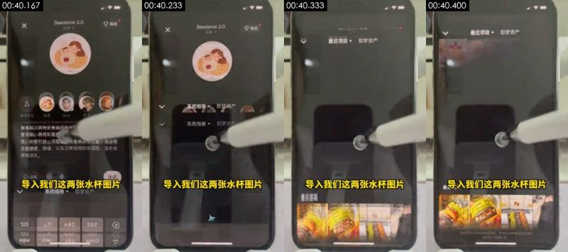

**Visible on screen** (check against the frames)
- Picture: Overhead shot of a real phone on a desk: the Jimeng album page flashes by
- Camera / lighting: close-up; top-down; Overhead desk stand; soft frontal light (flat light); key light frontal (from the camera side; both sides of the subject about equally bright); lighting ratio about 1.2:1 (0.2 stops); soft light (wide lit-to-shadow ramp)
- Text on objects in the scene (not subtitles): 道具, 生成, 导入我们这两张水杯图片, 123, ABC, DEF
- [AI assistant review] Filming a real phone: the black bezel, screen glare and moiré are visible
- [AI assistant review] A stylus/finger taps the screen, with motion blur
- [AI assistant review] Not a screen recording: none of the crisp pixels a system screen capture would have

**How it was made, as inferred by the tools** (inferred, not seen)
- Inference: live action 63%, 3D render 8%, film / TV footage 5% (fused_agent)
- Material: the user's real material: live footage
- Basis (tool measurements, not necessarily visible to the eye):
  - Platform transcode (Douyin/TikTok) has compressed the sensor noise away: noise cues no longer apply, live action vs AI rests on frame rate and picture content

- Remake: Source is live action: reshoot per the shooting plan (shot size / camera setup / lighting); only fall back to AI image-to-video (first frame as reference) when a shoot is not possible; real material the user must supply: live footage (whole frame)
  - Video prompt: close-up, top-down, Phone centered, filling the vertical frame. Overhead shot of a real phone on a desk: the Jimeng album page flashes by

</details>

<details class="ref"><summary>#16 00:40.433–00:41.200 · live action + code / editor overlays (text labels); brings in real material (live footage)</summary>

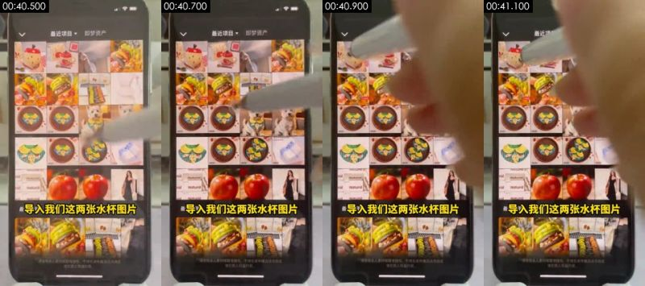

**Visible on screen** (check against the frames)
- Picture: Overhead shot of a real phone on a desk: two mug images are picked from recent items in Jimeng
- Camera / lighting: close-up; top-down; Overhead desk stand; soft frontal light (flat light); key light frontal (from the camera side; both sides of the subject about equally bright); lighting ratio about 1.0:1 (0.0 stops); soft light (almost no lit / shadow edge)
- Text on objects in the scene (not subtitles): 请便用本人重材网取得授权，不得生成传福违法违规或, 遵把他人权登内容, 使用本人需材毁取得模校，不得生成传插违法违规或, Naturat, ral, Natural
- Text track (text/bottom): 导入我们这两张水杯图片
- [AI assistant review] Filming a real phone: the black bezel, screen glare and moiré are visible
- [AI assistant review] A stylus/finger taps the screen, with motion blur
- [AI assistant review] Not a screen recording: none of the crisp pixels a system screen capture would have

**How it was made, as inferred by the tools** (inferred, not seen)
- Inference: live action 71%, film / TV footage 5%, AI-generated video 5% (fused_agent)
- Material: the user's real material: live footage
- Basis (tool measurements, not necessarily visible to the eye):
  - Photographic texture: noise σ=0.25, 410 colours, 10% flat blocks
  - Platform transcode (Douyin/TikTok) has compressed the sensor noise away: noise cues no longer apply, live action vs AI rests on frame rate and picture content

- Remake: Source is live action: reshoot per the shooting plan (shot size / camera setup / lighting); only fall back to AI image-to-video (first frame as reference) when a shoot is not possible; real material the user must supply: live footage (whole frame)
  - Video prompt: close-up, top-down, Phone centered, filling the vertical frame. Overhead shot of a real phone on a desk: two mug images are picked from recent items in Jimeng

</details>

<details class="ref"><summary>#17 00:41.200–00:41.767 · live action; brings in real material (live footage)</summary>

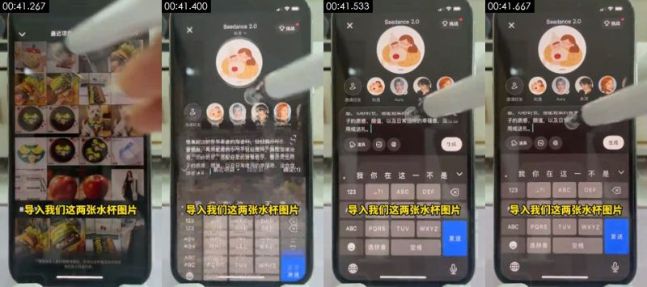

**Visible on screen** (check against the frames)
- Picture: Overhead shot of a real phone on a desk: more mug images are ticked in the album
- Camera / lighting: close-up; top-down; Overhead desk stand; soft frontal light (flat light); key light frontal (from the camera side; both sides of the subject about equally bright); lighting ratio about 1.1:1 (0.1 stops); soft light (almost no lit / shadow edge)
- Text on objects in the scene (not subtitles): 导入我们这两张水杯图片, ABC, PQRS, 发送, 选拼音, 空格
- [AI assistant review] Filming a real phone: the black bezel, screen glare and moiré are visible
- [AI assistant review] A stylus/finger taps the screen, with motion blur
- [AI assistant review] Not a screen recording: none of the crisp pixels a system screen capture would have

**How it was made, as inferred by the tools** (inferred, not seen)
- Inference: live action 67%, 3D render 6%, film / TV footage 5% (fused_agent)
- Material: the user's real material: live footage
- Basis (tool measurements, not necessarily visible to the eye):
  - Photographic texture: noise σ=0.17, 105 colours, 16% flat blocks
  - Platform transcode (Douyin/TikTok) has compressed the sensor noise away: noise cues no longer apply, live action vs AI rests on frame rate and picture content

- Remake: Source is live action: reshoot per the shooting plan (shot size / camera setup / lighting); only fall back to AI image-to-video (first frame as reference) when a shoot is not possible; real material the user must supply: live footage (whole frame)
  - Video prompt: close-up, top-down, Phone centered, filling the vertical frame, camera pan / track. Overhead shot of a real phone on a desk: more mug images are ticked in the album

</details>

<details class="ref"><summary>#18 00:41.767–00:42.267 · live action; brings in real material (live footage)</summary>

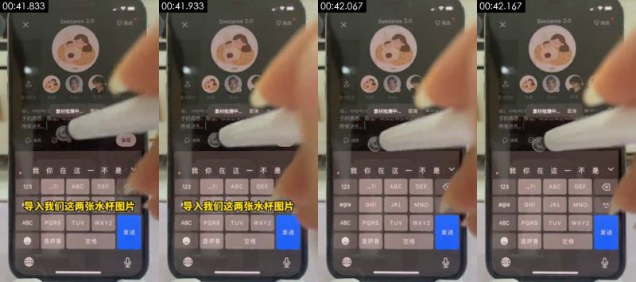

**Visible on screen** (check against the frames)
- Picture: Overhead shot of a real phone on a desk: the two mug images have been added to the input box
- Camera / lighting: close-up; top-down; Overhead desk stand; soft frontal light (flat light); key light frontal (from the camera side; both sides of the subject about equally bright); lighting ratio about 1.0:1 (0.0 stops); soft light (almost no lit / shadow edge)
- Text on objects in the scene (not subtitles): GHI, JKL, MNO, ABC, PQRS, TUV
- [AI assistant review] Filming a real phone: the black bezel, screen glare and moiré are visible
- [AI assistant review] A stylus/finger taps the screen, with motion blur
- [AI assistant review] Not a screen recording: none of the crisp pixels a system screen capture would have

**How it was made, as inferred by the tools** (inferred, not seen)
- Inference: live action 66%, 3D render 6%, film / TV footage 5% (fused_agent)
- Material: the user's real material: live footage
- Basis (tool measurements, not necessarily visible to the eye):
  - Platform transcode (Douyin/TikTok) has compressed the sensor noise away: noise cues no longer apply, live action vs AI rests on frame rate and picture content

- Remake: Source is live action: reshoot per the shooting plan (shot size / camera setup / lighting); only fall back to AI image-to-video (first frame as reference) when a shoot is not possible; real material the user must supply: live footage (whole frame)
  - Video prompt: close-up, top-down, Phone centered, filling the vertical frame. Overhead shot of a real phone on a desk: the two mug images have been added to the input box

</details>

<details class="ref"><summary>#19 00:42.267–00:43.167 · live action; brings in real material (live footage)</summary>

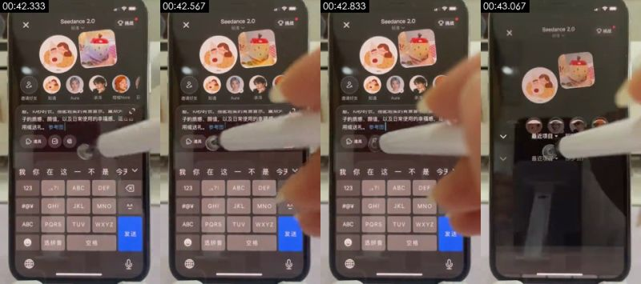

**Visible on screen** (check against the frames)
- Picture: Overhead shot of a real phone on a desk: reference image 1 and reference image 2 appear in the prompt
- Camera / lighting: close-up; top-down; Overhead desk stand; three-quarter key + fill (standard set-up); key light frame right, three-quarter front; lighting ratio about 1.5:1 (0.6 stops); hard light (sharp shadow edge)
- Text on objects in the scene (not subtitles): GHI, JKL, MNO, ABC, PQRS, TUV
- [AI assistant review] Filming a real phone: the black bezel, screen glare and moiré are visible
- [AI assistant review] A stylus/finger taps the screen, with motion blur
- [AI assistant review] Not a screen recording: none of the crisp pixels a system screen capture would have

**How it was made, as inferred by the tools** (inferred, not seen)
- Inference: live action 68%, 3D render 6%, film / TV footage 5% (fused_agent)
- Material: the user's real material: live footage
- Basis (tool measurements, not necessarily visible to the eye):
  - Photographic texture: noise σ=0.14, 123 colours, 17% flat blocks
  - Platform transcode (Douyin/TikTok) has compressed the sensor noise away: noise cues no longer apply, live action vs AI rests on frame rate and picture content

- Remake: Source is live action: reshoot per the shooting plan (shot size / camera setup / lighting); only fall back to AI image-to-video (first frame as reference) when a shoot is not possible; real material the user must supply: live footage (whole frame)
  - Video prompt: close-up, top-down, Phone centered, filling the vertical frame. Overhead shot of a real phone on a desk: reference image 1 and reference image 2 appear in the prompt

</details>

<details class="ref"><summary>#20 00:43.167–00:43.733 · live action; brings in real material (live footage)</summary>

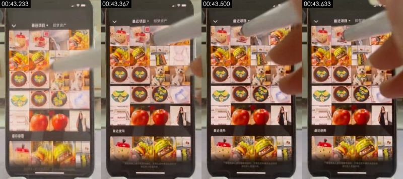

**Visible on screen** (check against the frames)
- Picture: Overhead shot of a real phone on a desk: the album screen flashes by
- Camera / lighting: close-up; top-down; Overhead desk stand; soft frontal light (flat light); key light frontal (from the camera side; both sides of the subject about equally bright); lighting ratio about 1.3:1 (0.4 stops); soft light (almost no lit / shadow edge)
- Text on objects in the scene (not subtitles): 最近使用, Haturol, 15:13, 最近项目
- [AI assistant review] Filming a real phone: the black bezel, screen glare and moiré are visible
- [AI assistant review] A stylus/finger taps the screen, with motion blur
- [AI assistant review] Not a screen recording: none of the crisp pixels a system screen capture would have

**How it was made, as inferred by the tools** (inferred, not seen)
- Inference: live action 71%, AI-generated video 5%, film / TV footage 5% (fused_agent)
- Material: the user's real material: live footage
- Basis (tool measurements, not necessarily visible to the eye):
  - Photographic texture: noise σ=0.27, 388 colours, 10% flat blocks
  - Platform transcode (Douyin/TikTok) has compressed the sensor noise away: noise cues no longer apply, live action vs AI rests on frame rate and picture content

- Remake: Source is live action: reshoot per the shooting plan (shot size / camera setup / lighting); only fall back to AI image-to-video (first frame as reference) when a shoot is not possible; real material the user must supply: live footage (whole frame)
  - Video prompt: close-up, top-down, Phone centered, filling the vertical frame, camera pan / track. Overhead shot of a real phone on a desk: the album screen flashes by

</details>

<details class="ref"><summary>#21 00:43.733–00:44.400 · live action; brings in real material (live footage)</summary>

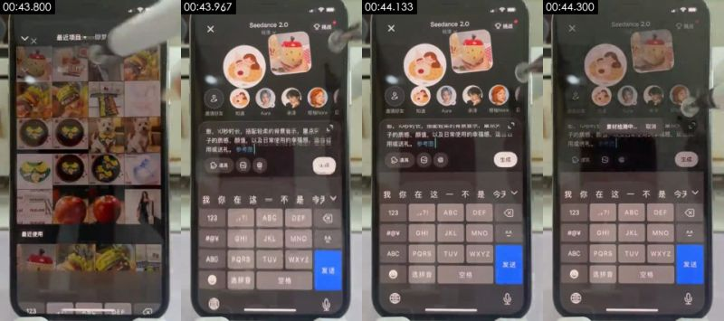

**Visible on screen** (check against the frames)
- Picture: Overhead shot of a real phone on a desk: the list of recently used images
- Camera / lighting: close-up; top-down; Overhead desk stand; soft frontal light (flat light); key light frontal (from the camera side; both sides of the subject about equally bright); lighting ratio about 1.1:1 (0.1 stops); soft light (almost no lit / shadow edge)
- Text on objects in the scene (not subtitles): GHI, JKL, MNO, ABC, PQRS, TUV
- [AI assistant review] Filming a real phone: the black bezel, screen glare and moiré are visible
- [AI assistant review] A stylus/finger taps the screen, with motion blur
- [AI assistant review] Not a screen recording: none of the crisp pixels a system screen capture would have

**How it was made, as inferred by the tools** (inferred, not seen)
- Inference: live action 67%, 3D render 6%, film / TV footage 5% (fused_agent)
- Material: the user's real material: live footage
- Basis (tool measurements, not necessarily visible to the eye):
  - Platform transcode (Douyin/TikTok) has compressed the sensor noise away: noise cues no longer apply, live action vs AI rests on frame rate and picture content

- Remake: Source is live action: reshoot per the shooting plan (shot size / camera setup / lighting); only fall back to AI image-to-video (first frame as reference) when a shoot is not possible; real material the user must supply: live footage (whole frame)
  - Video prompt: close-up, top-down, Phone centered, filling the vertical frame. Overhead shot of a real phone on a desk: the list of recently used images

</details>

<details class="ref"><summary>#22 00:44.400–00:47.067 · live action + code / editor overlays (subtitles); brings in real material (live footage)</summary>


**Visible on screen** (check against the frames)
- Picture: Overhead shot of a real phone on a desk: the full prompt is shown and the stylus taps "生成" (Generate)
- Camera / lighting: close-up; top-down; Overhead desk stand; soft frontal light (flat light); key light frontal (from the camera side; both sides of the subject about equally bright); lighting ratio about 1.0:1 (0.0 stops); soft light (almost no lit / shadow edge)
- Text on objects in the scene (not subtitles): ABC, PQRS, TUV, 选拼音, 空格, 输入描述你的梦境
- Text track (subtitle/bottom): 然后我们点击发送 / 在草稿箱里
- Text track (subtitle/bottom): 发送
- [AI assistant review] Filming a real phone: the black bezel, screen glare and moiré are visible
- [AI assistant review] A stylus/finger taps the screen, with motion blur
- [AI assistant review] Not a screen recording: none of the crisp pixels a system screen capture would have

**How it was made, as inferred by the tools** (inferred, not seen)
- Inference: live action 62%, 3D render 8%, screen recording / screenshot 6% (fused_agent)
- Material: the user's real material: live footage
- Basis (tool measurements, not necessarily visible to the eye):
  - Rendered texture: 24% flat colour blocks, 95% of pixels use only 73 colours, 40% axis-aligned edges
  - Platform transcode (Douyin/TikTok) has compressed the sensor noise away: noise cues no longer apply, live action vs AI rests on frame rate and picture content

- Remake: Source is live action: reshoot per the shooting plan (shot size / camera setup / lighting); only fall back to AI image-to-video (first frame as reference) when a shoot is not possible; real material the user must supply: live footage (whole frame)
  - Video prompt: close-up, top-down, Phone centered, filling the vertical frame. Overhead shot of a real phone on a desk: the full prompt is shown and the stylus taps "生成" (Generate)

</details>

<details class="ref"><summary>#23 00:47.067–00:47.733 · live action; brings in real material (live footage)</summary>


**Visible on screen** (check against the frames)
- Picture: Overhead shot of a real phone on a desk: a pop-up reads "提交成功，消耗 1 个额度" ("Submitted, 1 credit used")
- Camera / lighting: close-up; top-down; Overhead desk stand; soft frontal light (flat light); key light frontal (from the camera side; both sides of the subject about equally bright); lighting ratio about 1.2:1 (0.3 stops); soft light (almost no lit / shadow edge)
- Text on objects in the scene (not subtitles): 可以看到视频生成的进度, 暂时没有更多了, 内梦境, 出镜, 生图, 知遇
- [AI assistant review] Filming a real phone: the black bezel, screen glare and moiré are visible
- [AI assistant review] A stylus/finger taps the screen, with motion blur
- [AI assistant review] Not a screen recording: none of the crisp pixels a system screen capture would have

**How it was made, as inferred by the tools** (inferred, not seen)
- Inference: live action 67%, 3D render 6%, film / TV footage 5% (fused_agent)
- Material: the user's real material: live footage
- Basis (tool measurements, not necessarily visible to the eye):
  - Platform transcode (Douyin/TikTok) has compressed the sensor noise away: noise cues no longer apply, live action vs AI rests on frame rate and picture content

- Remake: Source is live action: reshoot per the shooting plan (shot size / camera setup / lighting); only fall back to AI image-to-video (first frame as reference) when a shoot is not possible; real material the user must supply: live footage (whole frame)
  - Video prompt: close-up, top-down, Phone centered, filling the vertical frame. Overhead shot of a real phone on a desk: a pop-up reads "提交成功，消耗 1 个额度" ("Submitted, 1 credit used")

</details>

<details class="ref"><summary>#24 00:47.733–00:49.133 · live action + code / editor overlays (subtitles, styled text); brings in real material (live footage)</summary>


**Visible on screen** (check against the frames)
- Picture: Overhead shot of a real phone on a desk: the progress of the video being generated is shown in the works tab of the Jimeng profile page
- Camera / lighting: close-up; top-down; Overhead desk stand; three-quarter key + fill (standard set-up); key light frame left, three-quarter front; lighting ratio about 1.5:1 (0.5 stops); soft light (wide lit-to-shadow ramp)
- Text on objects in the scene (not subtitles): 暂时没有更多了, 即梦, @知遇, 知遇, 粉丝, 关注
- Text track (subtitle/bottom): 可以看到视频生成的进度
- [AI assistant review] Filming a real phone: the black bezel, screen glare and moiré are visible
- [AI assistant review] A stylus/finger taps the screen, with motion blur
- [AI assistant review] Not a screen recording: none of the crisp pixels a system screen capture would have

**How it was made, as inferred by the tools** (inferred, not seen)
- Inference: live action 62%, 3D render 8%, film / TV footage 5% (fused_agent)
- Material: the user's real material: live footage
- Basis (tool measurements, not necessarily visible to the eye):
  - Rendered texture: 29% flat colour blocks, 95% of pixels use only 100 colours, 45% axis-aligned edges
  - Platform transcode (Douyin/TikTok) has compressed the sensor noise away: noise cues no longer apply, live action vs AI rests on frame rate and picture content

- Remake: Source is live action: reshoot per the shooting plan (shot size / camera setup / lighting); only fall back to AI image-to-video (first frame as reference) when a shoot is not possible; real material the user must supply: live footage (whole frame)
  - Video prompt: close-up, top-down, Phone centered, filling the vertical frame. Overhead shot of a real phone on a desk: the progress of the video being generated is shown in the works tab of the Jimeng profile page

</details>

<details class="ref"><summary>#25 00:49.133–00:51.500 · AI-generated video + code / editor overlays (styled text)</summary>


**Visible on screen** (check against the frames)
- Picture: Generated result: the AI woman "Zhiyu" sits at a wooden table, lifts the apple mug to show it and puts it down; a wooden table in warm sunlight, light grey wall, with an apple-shaped red-lidded ceramic mug, an apple-print gift box, a red-and-white gingham cloth and a green leaf spoon on the table
- Camera / lighting: medium close-up; moving camera (gimbal / handheld pan); soft frontal light (flat light); key light frontal (from the camera side; both sides of the subject about equally bright); lighting ratio about 1.3:1 (0.4 stops); soft light (almost no lit / shadow edge)
- Text on objects in the scene (not subtitles): 即梦, @知遇, Nice to mect yen, Nict tomcety, Nicctomeety, 14
- [AI assistant review] Jimeng watermark and the subject name "@知遇" (Zhiyu) in the bottom-right corner
- [AI assistant review] The same character is the "知遇" (Zhiyu) subject picked in Jimeng later in the demo
- [AI assistant review] Lighting is too even and clean, and movement is slow

**How it was made, as inferred by the tools** (inferred, not seen)
- Inference: AI-generated video 71%, live action 10%, 3D render 4% (fused_agent)
- Material: AI-generated
- Basis (tool measurements, not necessarily visible to the eye):
  - Photographic texture: noise σ=0.22, 210 colours, 21% flat blocks
  - Platform transcode (Douyin/TikTok) has compressed the sensor noise away: noise cues no longer apply, live action vs AI rests on frame rate and picture content

- Remake: Source is AI-generated: use the shot's first and last frames for first/last-frame generation to closely match composition and motion; to change the subject, edit the first frame with an image model first
  - First-frame image prompt: medium close-up, subject in the upper right of the frame. Vertical medium shot, eye level, a young long-haired woman seated behind a wooden table, cream cable-knit sweater, holding an apple-shaped red-lidded ceramic mug, gift box on the left, warm sunlight coming in from the right, window-pane shadows on the table
  - Video prompt: medium close-up, subject in the upper right of the frame, camera push-in. Vertical medium shot, the woman holds the apple mug up to the camera, then puts it back on the table and smiles, camera slowly pushes in

</details>

<details class="ref"><summary>#26 00:51.500–00:53.067 · AI-generated video + code / editor overlays (styled text)</summary>


**Visible on screen** (check against the frames)
- Picture: Generated result: close-up of the apple mug, a hand pinches the stem of the apple lid and lifts it off
- Camera / lighting: medium shot; moving camera (gimbal / handheld pan); backlit / background brighter than subject; key light frame right, three-quarter front; lighting ratio about 1.4:1 (0.4 stops); unclear
- Text on objects in the scene (not subtitles): 即梦, @知遇, AI生成
- [AI assistant review] Jimeng watermark and the subject name "@知遇" (Zhiyu) in the bottom-right corner
- [AI assistant review] The same character is the "知遇" (Zhiyu) subject picked in Jimeng later in the demo
- [AI assistant review] Lighting is too even and clean, and movement is slow

**How it was made, as inferred by the tools** (inferred, not seen)
- Inference: AI-generated video 72%, live action 10%, 3D render 4% (fused_agent)
- Material: AI-generated
- Basis (tool measurements, not necessarily visible to the eye):
  - Photographic texture: noise σ=0.22, 257 colours, 19% flat blocks
  - Platform transcode (Douyin/TikTok) has compressed the sensor noise away: noise cues no longer apply, live action vs AI rests on frame rate and picture content

- Remake: Source is AI-generated: use the shot's first and last frames for first/last-frame generation to closely match composition and motion; to change the subject, edit the first frame with an image model first
  - First-frame image prompt: medium shot, subject in the lower middle of the frame. Vertical close-up, apple-shaped red-lidded ceramic mug centered on a red-and-white gingham cloth, gift box and a framed "福" character behind, soft daylight
  - Video prompt: medium shot, subject in the lower middle of the frame, camera pan / track. Vertical close-up, a hand pinches the stem of the apple lid from above and slowly lifts it off, revealing the mouth of the mug

</details>

<details class="ref"><summary>#27 00:53.067–00:54.900 · AI-generated video</summary>


**Visible on screen** (check against the frames)
- Picture: Generated result: a hand stirs milk tea in the apple mug with the leaf spoon
- Camera / lighting: medium shot; moving camera (gimbal / handheld pan); soft frontal light (flat light); key light frontal (from the camera side; both sides of the subject about equally bright); lighting ratio about 1.2:1 (0.3 stops); soft light (almost no lit / shadow edge)
- Text on objects in the scene (not subtitles): eer, 即梦, meet, AI生成
- [AI assistant review] Jimeng watermark and the subject name "@知遇" (Zhiyu) in the bottom-right corner
- [AI assistant review] The same character is the "知遇" (Zhiyu) subject picked in Jimeng later in the demo
- [AI assistant review] Lighting is too even and clean, and movement is slow

**How it was made, as inferred by the tools** (inferred, not seen)
- Inference: AI-generated video 71%, live action 10%, 3D render 5% (fused_agent)
- Material: AI-generated
- Basis (tool measurements, not necessarily visible to the eye):
  - Photographic texture: noise σ=0.21, 234 colours, 22% flat blocks
  - Platform transcode (Douyin/TikTok) has compressed the sensor noise away: noise cues no longer apply, live action vs AI rests on frame rate and picture content

- Remake: Source is AI-generated: use the shot's first and last frames for first/last-frame generation to closely match composition and motion; to change the subject, edit the first frame with an image model first
  - First-frame image prompt: medium shot, subject in the lower middle of the frame. Vertical close-up, an apple-print ceramic mug of milk tea on a red-and-white gingham cloth, apple lid and gift box behind, soft daylight
  - Video prompt: medium shot, subject in the lower middle of the frame. Vertical close-up, a hand holding a green leaf spoon slowly stirs milk tea in the mug, locked-off camera

</details>

<details class="ref"><summary>#28 00:54.900–00:57.667 · AI-generated video</summary>


**Visible on screen** (check against the frames)
- Picture: Generated result: the woman holds the mug in both hands near her face, eyes closed, enjoying it
- Camera / lighting: medium close-up; moving camera (gimbal / handheld pan); soft frontal light (flat light); key light frontal (from the camera side; both sides of the subject about equally bright); lighting ratio about 1.2:1 (0.3 stops); soft light (almost no lit / shadow edge)
- Text on objects in the scene (not subtitles): Niee to mut gou, Niek to mtet you, Niee to mtut yeu, Ir':, keitr., eirr.
- [AI assistant review] Jimeng watermark and the subject name "@知遇" (Zhiyu) in the bottom-right corner
- [AI assistant review] The same character is the "知遇" (Zhiyu) subject picked in Jimeng later in the demo
- [AI assistant review] Lighting is too even and clean, and movement is slow

**How it was made, as inferred by the tools** (inferred, not seen)
- Inference: AI-generated video 71%, live action 9%, 3D render 4% (fused_agent)
- Material: AI-generated
- Basis (tool measurements, not necessarily visible to the eye):
  - Photographic texture: noise σ=0.23, 160 colours, 21% flat blocks
  - Platform transcode (Douyin/TikTok) has compressed the sensor noise away: noise cues no longer apply, live action vs AI rests on frame rate and picture content

- Remake: Source is AI-generated: use the shot's first and last frames for first/last-frame generation to closely match composition and motion; to change the subject, edit the first frame with an image model first
  - First-frame image prompt: medium close-up, subject in the upper right of the frame. Vertical medium shot, eye level, a young long-haired woman seated behind a wooden table, slightly right of center, holding the apple mug in both hands beside her chin, gift box on the left, gingham cloth and leaf spoon on the table, warm sunlight
  - Video prompt: medium close-up, subject in the upper right of the frame, camera pull-out. Vertical medium shot, the woman brings the apple mug up to her cheek with both hands, tilts her head slightly and smiles, camera slowly pulls back

</details>

### Metadata clues

- Encoder: `Lavf61.7.100`
- platform: Douyin/TikTok

### Notes

- Deterministic forensics is reliable on motion, whole-frame pan/zoom, rendered texture and 24→30 fps conversion; telling live action from AI from 3D needs image reading (a VLM or an AI assistant's review), and a look at the frames yourself.
- Platform transcoding usually strips metadata; missing metadata proves nothing.
- The full data is in `breakdown.json`; the package for models starts at `REEL.md`.
