# この動画はどう作られたか：ai_daihuo.mp4

> [report.md](report.md)（この動画に対して rea-video が生成した Markdown レポート）の日本語訳です。セクションの順序と内容はツールの出力に従っています。字幕や UI の文字など画面に実際に映っているテキストは原文の中国語のまま、コードブロック内のプロンプトは原文のまま残しています。

**ひとことで**：AI ツール解説系の商品紹介トーク動画。配信者が豆包でプロンプトを書き、即梦（Jimeng）Seedance 2.0 に事前収録した出演映像とカップ画像 2 枚を渡して、実写感のあるカップの商品紹介動画を生成する様子を実演
**作り方**：ハイブリッド制作：実写 77% + AI 生成動画 23% + 静止画ホールド 1%

- 0:57 · 縦型 9:16 · 28 ショット、平均 2.1 秒／ショット
- 判定の信頼度 72%、根拠：ツール計測 + AI アシスタントによる画像確認 28 ショット
- ⚠️ 判断しきれない点が 2 か所あり、「不確定な点」を参照

<!--mix-->

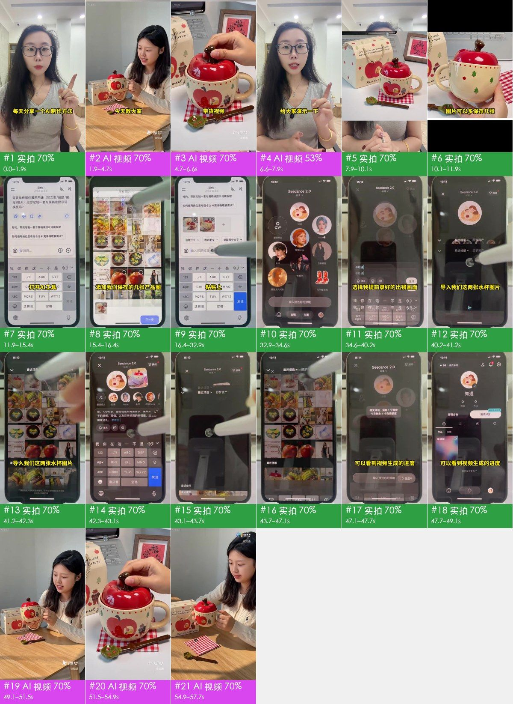

## 見どころ

- **冒頭のつかみ**：0–1.9 秒で配信者が人差し指を立てて番組名を名乗り「每天分享一个 AI 制作方法」、続く 1.9–6.6 秒で AI 完成動画の予告を流し、字幕「今天教大家 制作真人出镜的日用品带货视频」
- 結果を先に見せてから方法を教える構成：冒頭で予告、終盤 49.1–57.7 秒で全編を公開、中盤 37 秒で手順を解説。同じものを作りたい人は最後まで見る
- 手順は実機での操作：11.9–49.1 秒は実機スマホを俯瞰で撮り、タッチペンで一つずつタップ。各ステップに大きな文字を 1 行ずつ添えており（打开 AI 工具 → 粘贴提示词 → 导入水杯图片 → 生成）、そのまま真似できる
- ハードルが低く見える：アプリ 2 つ（豆包でプロンプト作成、即梦で生成）+ 商品画像数枚 + 事前収録した出演映像。「每天分享一个 AI 制作方法」という番組風のトークと合わせ、連続投稿でのフォロワー獲得に向く
- 完成動画の動作選びが的確：カップを両手で見せる、リンゴ型の蓋を開ける、葉っぱ型スプーンでかき混ぜる、顔の横に寄せる。4 つの動作で外観・ディテール・使用シーンをすべて伝えている

## ひと目でわかる：映像・パッケージ・音声の 3 層

ショート動画はどれも 3 層に分解できる：土台が映像そのもの、その上に字幕・装飾文字・ステッカーを重ね、さらに音声を付ける。再現は 1 層ずつ進める。

| 層 | この動画では何か | 作り方 | 詳細 |
|---|---|---|---|
| **映像**（土台） | 実写 21 ショット、AI 生成動画 6 ショット、静止画ホールド 1 ショット | 2 シーンに分けて撮影；AI は 1 回で生成、繰り返し出てくる部分は完成動画から切り出す；画像 1 枚で静止画ホールドまたはプッシュイン／プルアウト | 「自分で再現」 |
| **パッケージ**（映像の上に重ねる） | 字幕、テキスト、グラフィック貼り付け、装飾文字 | 編集ソフトで追加：字幕・装飾文字・ステッカーをタイムラインどおりに配置 | 「編集パッケージ層」 |
| **音声** | ボーカル（実録音）、BGM（115 BPM、要確認）、効果音 3 種（計 4 か所） | ボーカル：自分で録音；BGM：リズムと雰囲気で近い曲を探す；効果音：タイミングに合わせて効果音ライブラリから追加 | 「音声」 |

## 内容と構成

- 以下のストーリーラインはショットごとの画像確認によるもの。台詞は別途整理しておらず、字幕の原文は「編集パッケージ層」を参照

**ストーリーライン**

再現時はこの流れを残す：各ステップの順序と役割はそのまま、語る中身を自分の事例・データ・素材に置き換える。そうすれば単に主役を差し替えただけにはならない。

| 時間 | ショット | 役割 | 内容 |
|---|---|---|---|
| 0.0–6.6s | #1–#3 | つかみ | 配信者が番組名を名乗る：毎日 1 つ AI 制作方法を紹介 → まず AI 完成動画の予告：実写感のある商品紹介映像 → 予告のクローズアップ：商品のディテール |
| 6.6–7.9s | #4 | 背景説明 | これから実演することを伝える |
| 7.9–47.1s | #5–#22 | 情報の補足 | ステップ 1：紹介する商品の画像を保存しておく → 使う商品画像を見せる → 商品画像は多めに保存し、生成時の参考画像にするよう念押し → AI ツールを開いてプロンプトを書かせる → 商品画像を AI に送る →（計 15 項目、ショットごとの詳細は「ショットリスト」） |
| 47.1–49.1s | #23、#24 | 証拠を示す | 送信成功 → 生成待ち |
| 49.1–57.7s | #25–#28 | 結論 | 生成された商品紹介動画を公開 → 完成動画：クローズアップで蓋のデザインを見せる → 完成動画：使用シーン → 完成動画：情緒的な締め |

## ショットリスト

「映像」「カメラワーク」「オーバーレイ」は画面上で確認できる内容。「制作方法」「素材の出所」はツールによる推定で、根拠は付録のショット別エビデンスを参照。

| # | スクショ | 時間 | 長さ | 内容 | 映像 | カメラワーク | オーバーレイ | 制作方法（推定） | 素材の出所（推定） | 再現 |
|---|---|---|---|---|---|---|---|---|---|---|
| 1 | 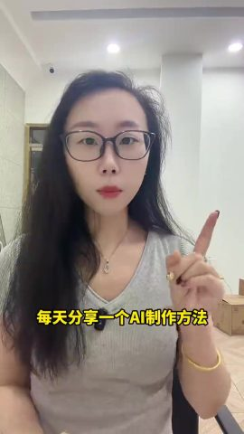 | 0:00.0 | 1.9s | つかみ：配信者が番組名を名乗る：毎日 1 つ AI 制作方法を紹介 | 黒縁メガネ・ロングヘアの女性配信者、グレーの V ネック T シャツ、オフィスでスマホのインカメラに向かってトーク、… | スムーズなカメラワーク | 字幕 | 実写 77% | 実写動画素材 | 実写 · S1 |
| 2 | 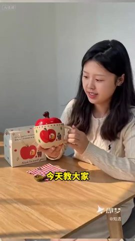 | 0:01.9 | 2.8s | つかみ：まず AI 完成動画の予告：実写感のある商品紹介映像 | AI 生成の女性「知遇」が木のテーブルに座り、リンゴ型カップを両手でカメラに見せながら説明；暖かい日差し… | スムーズなカメラワーク | 字幕 | AI 生成動画 75% | AI 生成 | AI 生成 · G1（#25 から切り出し） |
| 3 | 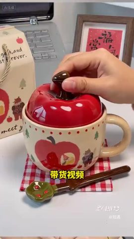 | 0:04.7 | 1.9s | つかみ：予告のクローズアップ：商品のディテール | AI 生成のリンゴ型カップのクローズアップ：手が赤いリンゴ型の蓋を開ける、カップにはリンゴとクマの柄；暖かい日差しの木のテーブル… | スムーズなカメラワーク | 字幕 | AI 生成動画 74% | AI 生成 | AI 生成 · G1（#26 から切り出し） |
| 4 | 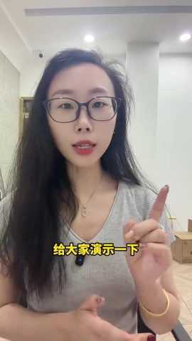 | 0:06.6 | 1.3s | 背景説明：これから実演することを伝える | 黒縁メガネ・ロングヘアの女性配信者、グレーの V ネック T シャツ、オフィスでスマホのインカメラに向かってトーク、… | スムーズなカメラワーク | テキスト、グラフィック貼り付け | 実写 76% | 実写動画素材 | 実写 · S1 |
| 5 | 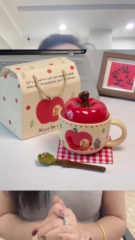 | 0:07.9 | 2.1s | 情報の補足：ステップ 1：紹介する商品の画像を保存しておく | 上下分割レイアウト：上半分はリンゴ型カップの商品実写画像、下半分は両手を組んだトーク中の配信者 | 固定 | 字幕 | 実写 80% | 実写動画素材；再現用参考：商品参考画像 | 実写 · S1 |
| 6 | 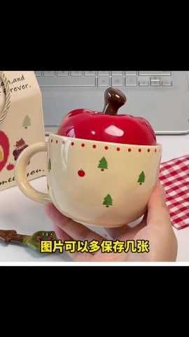 | 0:10.1 | 0.3s | 情報の補足：使う商品画像を見せる | 商品実写写真を全画面で静止表示（リンゴ型カップを持つ手）、上下に黒帯 | 固定 | テキスト、字幕 | 静止画ホールド 86% | 実写真、商品実写画像 | 静止画 |
| 7 | 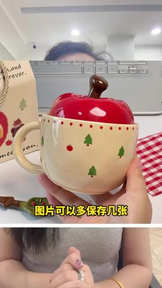 | 0:10.4 | 1.6s | 情報の補足：商品画像は多めに保存し、生成時の参考画像にするよう念押し | 上下分割レイアウト：上半分はリンゴ型カップを持つ手の商品写真、下半分はトーク中の配信者 | 固定 | テキスト | 実写 80% | 実写動画素材；再現用参考：商品参考画像 | 実写 · S1 |
| 8 | 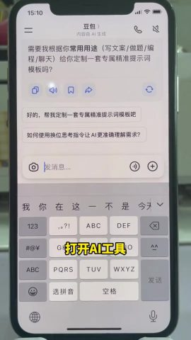 | 0:11.9 | 3.5s | 情報の補足：AI ツールを開いてプロンプトを書かせる | 机上の実機スマホを俯瞰撮影、豆包アプリを開き、チャットでプロンプトの作成を依頼 | 固定 | 字幕 | 実写 75% | 実写動画素材 | 実写 · S2 |
| 9 | 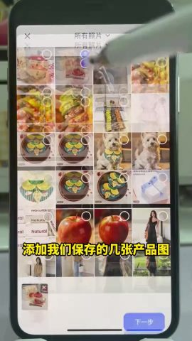 | 0:15.4 | 1.1s | 情報の補足：商品画像を AI に送る | 机上の実機スマホを俯瞰撮影、豆包でアルバムからカップの商品画像を数枚選択 | 固定 | 字幕 | 実写 77% | 実写動画素材 | 実写 · S2 |
| 10 | 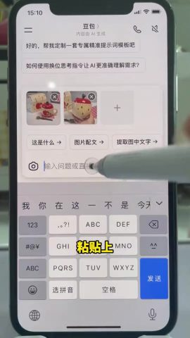 | 0:16.5 | 15.1s | 情報の補足：商品に合わせて動画プロンプトを AI に書かせる | 机上の実機スマホを俯瞰撮影、豆包に「这是一个陶瓷杯，给我生成一段 AI 可以生成带… | 固定 | 字幕 | 実写 63% | 実写動画素材 | 実写 · S2 |
| 11 | 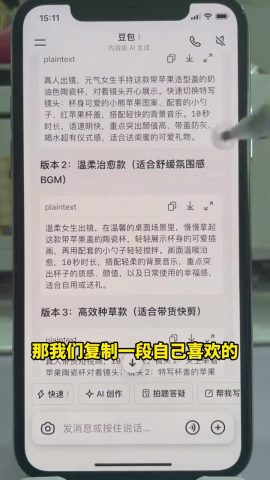 | 0:31.6 | 1.4s | 情報の補足：気に入ったプロンプトを選んでコピー | 机上の実機スマホを俯瞰撮影、豆包の回答にあるバージョン 3 のプロンプトをコピーしようとしている | 固定 | — | 実写 70% | 実写動画素材 | 実写 · S2 |
| 12 | 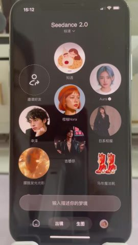 | 0:32.9 | 1.7s | 情報の補足：動画生成ツールに切り替え | 机上の実機スマホを俯瞰撮影、即梦 Seedance 2.0 に切り替え、被写体リストに「知遇」などの人物… | 固定 | 字幕 | 実写 75% | 実写動画素材 | 実写 · S2 |
| 13 | 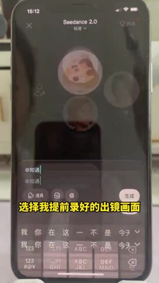 | 0:34.6 | 4.5s | 情報の補足：出演人物の被写体を選びプロンプトを貼り付け | 机上の実機スマホを俯瞰撮影、即梦で「@知遇」（事前収録した出演被写体）を選択し、プロンプトを貼り付け | 固定 | 字幕 | 実写 74% | 実写動画素材 | 実写 · S2 |
| 14 | 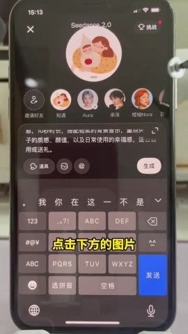 | 0:39.1 | 1.0s | 情報の補足：参考画像の追加準備 | 机上の実機スマホを俯瞰撮影、入力欄下の画像ボタンをタップ | 固定 | 字幕 | 実写 75% | 実写動画素材 | 実写 · S2 |
| 15 | 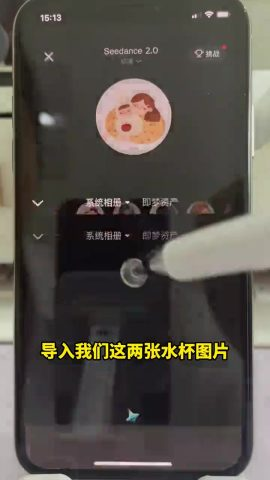 | 0:40.2 | 0.3s | 情報の補足：つなぎ | 机上の実機スマホを俯瞰撮影、即梦のアルバム画面が一瞬映る | 固定（被写体は動く） | — | 実写 72% | 実写動画素材 | 実写 · S2 |
| 16 | 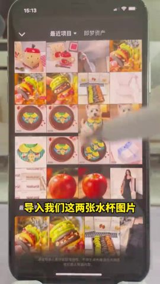 | 0:40.4 | 0.8s | 情報の補足：商品参考画像を読み込む | 机上の実機スマホを俯瞰撮影、即梦の最近のプロジェクトからカップ画像を 2 枚選択 | 固定 | テキスト | 実写 79% | 実写動画素材 | 実写 · S2 |
| 17 | 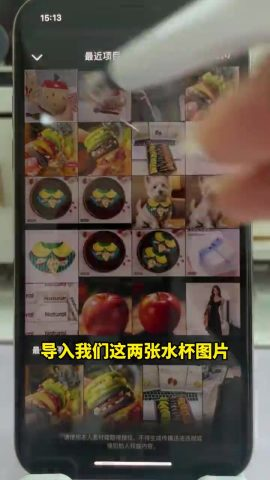 | 0:41.2 | 0.6s | 情報の補足：商品参考画像を読み込む | 机上の実機スマホを俯瞰撮影、アルバムでカップ画像を続けて選択 | スムーズなカメラワーク | — | 実写 76% | 実写動画素材 | 実写 · S2 |
| 18 | 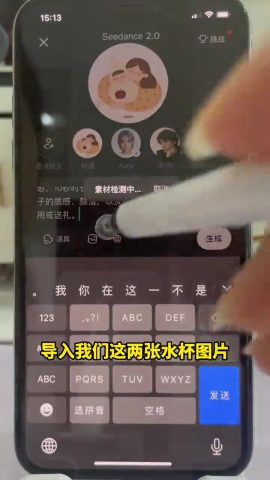 | 0:41.8 | 0.5s | 情報の補足：参考画像の準備完了 | 机上の実機スマホを俯瞰撮影、カップ画像 2 枚が入力欄に追加済み | 固定 | — | 実写 75% | 実写動画素材 | 実写 · S2 |
| 19 | 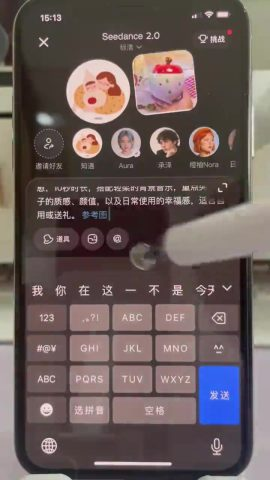 | 0:42.3 | 0.9s | 情報の補足：プロンプト内で参考画像を参照 | 机上の実機スマホを俯瞰撮影、プロンプトに参考画像 1・参考画像 2 が表示 | 固定 | — | 実写 76% | 実写動画素材 | 実写 · S2 |
| 20 | 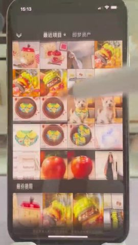 | 0:43.2 | 0.6s | 情報の補足：つなぎ | 机上の実機スマホを俯瞰撮影、アルバム画面が一瞬映る | スムーズなカメラワーク | — | 実写 79% | 実写動画素材 | 実写 · S2 |
| 21 | 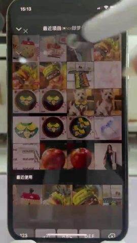 | 0:43.7 | 0.7s | 情報の補足：つなぎ | 机上の実機スマホを俯瞰撮影、最近使った画像の一覧 | スムーズなカメラワーク | — | 実写 75% | 実写動画素材 | 実写 · S2 |
| 22 | 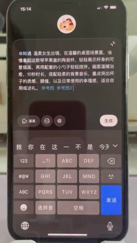 | 0:44.4 | 2.7s | 情報の補足：生成を送信 | 机上の実機スマホを俯瞰撮影、プロンプト全文が表示され、タッチペンで「生成」をタップ | 固定 | 字幕 | 実写 70% | 実写動画素材 | 実写 · S2 |
| 23 | 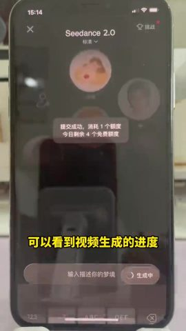 | 0:47.1 | 0.7s | 証拠を示す：送信成功 | 机上の実機スマホを俯瞰撮影、「提交成功，消耗 1 个额度」がポップアップ | 固定 | — | 実写 76% | 実写動画素材 | 実写 · S2 |
| 24 | 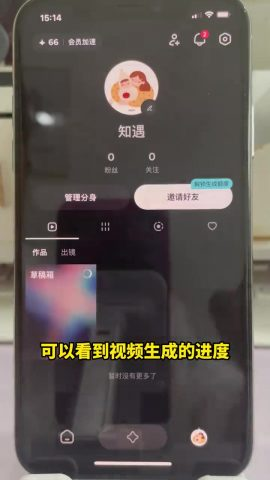 | 0:47.7 | 1.4s | 証拠を示す：生成待ち | 机上の実機スマホを俯瞰撮影、即梦のマイページの作品欄に生成中の動画の進捗が表示 | 固定 | 字幕、装飾文字 | 実写 71% | 実写動画素材 | 実写 · S2 |
| 25 | 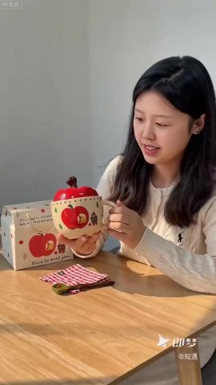 | 0:49.1 | 2.4s | 結論：生成された商品紹介動画を公開 | 生成結果：AI の女性「知遇」が木のテーブルに座り、リンゴ型カップを掲げて見せてから置く、暖かい日差しの木のテーブル、ライトグレー… | スムーズなカメラワーク | 装飾文字 | AI 生成動画 74% | AI 生成 | AI 生成 · G1 |
| 26 | 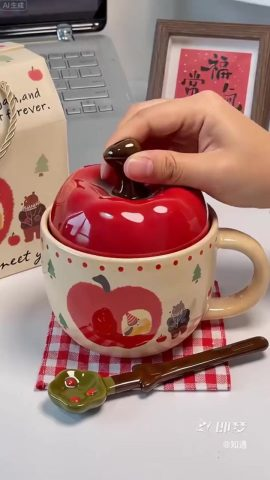 | 0:51.5 | 1.6s | 結論：完成動画：クローズアップで蓋のデザインを見せる | 生成結果：リンゴ型カップのクローズアップ、リンゴ型の蓋の軸をつまんで蓋を開ける | スムーズなカメラワーク | 装飾文字 | AI 生成動画 74% | AI 生成 | AI 生成 · G1 |
| 27 | 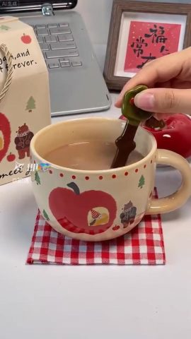 | 0:53.1 | 1.8s | 結論：完成動画：使用シーン | 生成結果：葉っぱ型の小さじでミルクティー入りのリンゴ型カップをかき混ぜる | スムーズなカメラワーク | — | AI 生成動画 73% | AI 生成 | AI 生成 · G1 |
| 28 | 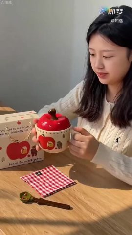 | 0:54.9 | 2.8s | 結論：完成動画：情緒的な締め | 生成結果：女性が両手でカップを顔の横に寄せ、目を閉じて味わう | スムーズなカメラワーク | — | AI 生成動画 74% | AI 生成 | AI 生成 · G1 |

## 自分で再現：この順序で進める

再現するのは作り方とリズムであり、映像をそのまま写すことではない。

1. **内容を決める**：「内容と構成」のストーリーラインに沿って自分の台本を書く
2. **素材を準備**：下の「用意する素材」を参照
3. **撮影**：2 シーン・4 カメラセットアップ、下の「撮影」を参照
4. **AI 生成**：1 回の生成、下の「AI 生成」を参照
5. **静止画ホールド／プッシュイン・プルアウト**：下の「ローカル再構成」を参照
6. **編集**：下の「編集」を参照
7. **パッケージ**：字幕ファイル `packaging/subtitles.srt` は編集ソフトにそのまま読み込める；スタイルとタイムラインは「編集パッケージ層」を参照
8. **音声**：「音声」を参照、効果音はすべて事前に試聴できる
9. **照合チェック**：完成動画と元動画を並べて見比べる：ショットの長さ、字幕の位置、音楽の入り・抜けが合っているか

### 用意する素材

- `@图片1` 商品の実写画像（正面 + ロゴ面）、ユーザー提供
- `@图片2` 人物参考画像（キャラクターごとに正面顔 + 上半身を 1 枚ずつ）、ショット間で顔立ちを一致させる：知遇（AI 被写体）
- 画面内でそのまま使う実ファイル（スクショ、写真、画面収録。元ファイルを入手すること）：
  - **実写真**（画面全体）：ショット #6、計 0.3s
  - **商品実写画像**（画面の一部）、リンゴ型カップを持つ手の商品写真：ショット #6、計 0.3s

### 撮影

同じシーンのショットはまとめて撮り終えてから次のシーンへ。シーン内では広いショットサイズを先に撮り、クローズアップは後に。ライティングの組み直しは不要。各テイクの前後に約 1s の余裕を残す。

**S1**：ショット #1、#4、#5、#7（完成尺 6.93s）；オフィス、白い壁・ダウンライト・廊下
- ライティング：オフィスの天井照明のみ、追加ライティングなし
- カメラセットアップ ミディアムショット · 固定カメラ（三脚／スタンド／机に置く） · 固定：ショット #5、#7、完成尺 3.7s、撮影目安 7.7s
- カメラセットアップ クローズアップ · 移動カメラ（ジンバル／手持ちでスライド） · プルアウト／パン／トラック：ショット #1、#4、完成尺 3.23s、撮影目安 7.2s

**S2**：ショット #8–#24（完成尺 37.2s）；机上のスマホを俯瞰撮影、暗い色の机の上のスマホ画面
- ライティング：照明なし、画面の明るさに頼る；天井照明の映り込みに注意
- カメラセットアップ クローズアップ · 固定カメラ（三脚／スタンド／机に置く） · 固定：ショット #8–#16、#18、#19、#22–#24、完成尺 35.4s、撮影目安 63.4s
- カメラセットアップ クローズアップ · 移動カメラ（ジンバル／手持ちでスライド） · 固定／パン／トラック：ショット #17、#20、#21、完成尺 1.8s、撮影目安 7.8s

### AI 生成

**AI 動画 4 ショット → 生成ユニット 1 つ、Seedance 2.0（Mini / Fast 含む）呼び出し 1 回（ほかに 2 ショットは同じ完成映像の使い回しなので、そのまま切り出す）**

- グループ化ルール：同じシーンでハードカットでつながる AI ショットは 1 回の生成にまとめる；1 回あたり ≤15s；ユニット内の連続ハードカットはなるべく ≤8s、最大 10s；ディゾルブ／フェード・シーン転換の位置で分割
- 音声：モデルは動作音と環境音を同時に生成できる；トークは実録音なので、別途録音してからミックスする。動画モデルには生成させず、台本の修正やタイミング合わせをしやすくする

AI 動画モデルが受け取れる入力は以下のとおり。各生成ユニットの下に、何を渡すか・どこから用意するかを記載：
- **テキストプロンプト**：必須、映像・動作・カメラワークを記述
- **先頭フレーム画像**：最初のフレームの構図と被写体を固定。渡さなければ純粋なテキスト生成になり、構図は毎回変わる
- **末尾フレーム画像**：最後のフレームも固定し、モデルは途中の過程だけを補完。カメラワークや動作のある単一ショット向き
- **参考画像**：商品や人物の見た目を伝え、複数ショットで同じ姿にする（プロンプトでは `@图片1` で指定）
- **参考動画**：動作・カメラワーク・リズムを真似させる。映像はコピーしない（`@视频1`）；対応していないモデルもある

各ユニットは 1 回で生成。表はモデルに渡すもので、ユニットを展開すると出所とプロンプトが見られる。

| ユニット | ショット | 時間 | 長さ | 方式 | 渡すもの | つなぎ |
|---|---|---|---|---|---|---|
| G1 | #25–#28 | 49.1–57.7s | 8.5s | 1 回で複数ショット | 先頭フレーム画像 + 参考画像 + 参考動画 | — |

同じ完成映像が複数回使われている（画像確認で判明）：生成は 1 回だけにして、編集時にそれぞれの位置に配置する。
- #2 と #25 は同じ映像：G1 の完成映像から切り出す
- #3 と #26 は同じ映像：G1 の完成映像から切り出す

<details><summary>G1 · ショット #25–#28 · 8.5s · マルチ参考生成</summary>

| 入力 | 要否 | 出所 | 理由 |
|---|---|---|---|
| テキストプロンプト | 必要 | 下のプロンプトを参照 | 映像・動作・カメラワークを記述；他の入力はすべてこれを制約するだけ |
| 先頭フレーム画像 | 推奨 | 元動画 `shots/shot_025_first.jpg`（商品・人物・画風を変える場合は、下の先頭フレームプロンプトで画像モデルに描き直させる）。このモデルは先頭フレームと参考画像を同時に渡せない：3 枚目の参考画像として渡し、プロンプトに「@图片3 作为首帧」と書く（即梦の全能参考は対応、API はおそらく非対応） | 構図・ショットサイズ・被写体の位置を一度に固定；テキストだけだと生成のたびに構図が変わる |
| 末尾フレーム画像 | 不要 | — | 1 回で複数ショットを出すため、末尾フレームは最後のショットしか制約できず、使わない |
| 参考画像 | 必要 | `@图片1` 商品の実写画像（正面 + ロゴ面）、ユーザー提供；`@图片2` 人物参考画像（キャラクターごとに正面顔 + 上半身を 1 枚ずつ）、ショット間で顔立ちを一致させる | 先頭フレームは最初のフレームしか担わないため、以降の映像の商品と人物は参考画像で一貫させる |
| 参考動画 | 推奨 | `@视频1` 元動画 49.1–57.7s の区間 | 動作・カメラワーク・編集リズムを真似させる；参考のみで映像はコピーしない |

- 先頭フレーム画像プロンプト：縦型ミディアムショット・アイレベル、ロングヘアの若い女性が木のテーブルの奥に座る、オフホワイトのケーブルニット、リンゴ型で赤い蓋の陶器カップを両手で持つ、左側にギフトボックス、暖かい日差しが右から差し込み、テーブルに窓枠の影

```text
竖屏 9:16；正面柔光（平光），柔光（几乎没有明暗分界），偏暖（约 3000–4000K），背景清晰。产品外观以 @图片1 为准，Logo 和细节保持一致。人物以 @图片2 为准。参考 @视频1 的动作、运镜和剪辑节奏。镜头之间硬切。
镜头1（0.0–2.4s）：竖屏中景，女生捧着苹果杯给镜头看，再把杯子放回桌上，微笑，镜头缓慢推近
镜头2（2.4–3.9s）：竖屏特写，手从上方捏住苹果盖的梗慢慢揭开，露出杯口
镜头3（3.9–5.8s）：竖屏特写，一只手捏着绿色叶子小勺在杯里缓慢搅拌奶茶，固定机位
镜头4（5.8–8.5s）：竖屏中景，女生双手捧着苹果杯靠到脸边，轻轻歪头微笑，镜头缓慢拉远
```

英語プロンプト：

```text
Shot 1 (0.0-2.4s): Vertical medium shot, the woman shows the apple mug to camera then puts it down, slow push-in
Shot 2 (2.4-3.9s): Vertical close-up, a hand lifts the apple lid off the mug by its stem
Shot 3 (3.9-5.8s): Vertical close-up, a hand slowly stirs milk tea in the mug with a green leaf spoon, locked-off
Shot 4 (5.8-8.5s): Vertical medium shot, the woman holds the mug near her cheek and smiles, slow pull-out
```

</details>

### ローカル再構成

- #6 静止画ホールド 0.3s：画像 1 枚 + 計測したズーム／パンのパラメータで、ffmpeg から直接出力

### 編集

- 「ショットリスト」の順序と長さどおりに編集
- 手法：トークの冒頭でまず AI 完成動画の予告を流し、次に分割レイアウトで手順を説明、俯瞰で操作を収録し、最後に完成動画を公開；全編を通して大きな字幕
- リズム：1 分あたり 28.1 カット、実写ショットは平均 2.1s；カメラセットアップ／シーンは 4 つ；同一カメラでのジャンプカット 3 か所、寄りへのカット 3 か所；インサート映像（スクショ／画面収録／カード／素材）が 24%；カット点の 44% が発話の間に位置；トランジション ハードカット×18、フラッシュカット×2、ジャンプカット×7

## 人物・シーン・小道具

| ID | 呼び名 | 種類 | 外見 | 役割 | 声 | 登場 |
|---|---|---|---|---|---|---|
| A | 配信者 | 実在の人物 | 黒のロングストレート、黒縁メガネ、グレーの V ネック T シャツ、金のバングル、襟元にワイヤレスマイク | 解説者 | 女性の声、早口 | #1、#4、#5、#7 |
| B | 知遇（AI 被写体） | デジタルヒューマン | 20 代前半、黒のロングストレートの女性、オフホワイトのケーブルニット、穏やかな笑顔 | AI 生成の商品紹介出演者 | なし | #2、#25、#28 |

**シーン**

| シーン | 場所 | 時間帯 | セット / 光 | ショット |
|---|---|---|---|---|
| S1 | オフィス | 昼 | 白い壁、ダウンライト、廊下 | #1、#4、#5、#7 |
| S2 | 机上のスマホを俯瞰撮影 | 昼 | 暗い色の机の上のスマホ画面 | #8–#24 |
| S3 | AI 生成の窓辺の木のテーブル | 昼の暖かい日差し | 木のテーブル、ライトグレーの壁、窓枠の影 | #2、#3、#25–#28 |

**小道具 / 商品 / ロゴ**

- リンゴ型で赤い蓋の陶器カップ（ショット #2、#3、#5–#7、#25–#28）：紹介商品、カップ本体にリンゴとクマのイラスト
- リンゴ柄のギフトボックス、赤白チェックのクロス、葉っぱ型の小さじ（ショット #2、#3、#25–#27）：商品の付属品

## 撮り方とライティング

- ビジュアルスタイル：前半はスマホ自撮りのトークと机上スマホの俯瞰チュートリアルで、自然光・カラーグレーディングなし。後半は即梦で生成した暖かい日差しの生活感ある商品映像
- フレーミング：ショットサイズ クローズアップ 92%、ミディアムショット 8%；カメラアングル 真上からの俯瞰（真上から机を撮影）；被写体は画面内のピントが合った領域（顔がないため、ショットサイズは推定）
- カメラセットアップ：固定カメラ（三脚／スタンド／机に置く） 89%、移動カメラ（ジンバル／手持ちでスライド） 11%；主なカメラワーク パン／トラック
- ライティング：照明なし、オフィスの天井照明と画面の発光のみ（画像確認による判断。ピクセル計測は下の折りたたみ参照）
- カラーグレーディング：ナチュラル（元の色に近い）；彩度・コントラスト・黒レベルはいずれも標準、全体はニュートラル
- 形式：机上／物撮り（テーブル撮影）（顔が主体 7%、物／手が主体 93%、手持ち 11%）；画像確認による判断：AI ツール解説系の商品紹介トーク

<details class="ref"><summary>項目別の計測と画像確認の結果（22 項目）</summary>

| 区分 | 項目 | 結論 | 根拠 |
|---|---|---|---|
| フレーミング | ショットサイズ | クローズアップ | 計測；画像確認 |
| フレーミング | カメラアングル | 真上からの俯瞰（真上から机を撮影） | 画像確認 |
| フレーミング | 構図 | スマホを中央に置き縦画面いっぱいに | 画像確認 |
| カメラセットアップ | 撮影方法 | 俯瞰撮影用の卓上スタンド | 計測：固定カメラ（三脚／スタンド／机に置く）；画像確認 |
| カメラセットアップ | レンズ | スマホ背面のメインカメラ | 画像確認 |
| カメラセットアップ | 速度 | 標準 | 画像確認 |
| カメラセットアップ | カメラセットアップ／シーン | トーク：スマホのインカメラで固定；チュートリアル：スマホの背面カメラで別のスマホを俯瞰撮影 | 画像確認 |
| カメラセットアップ | 推定機材 | スマホ 2 台 + 卓上スタンド + ワイヤレスピンマイク | 画像確認 |
| ライティング | シーン | 屋内；机上 | 画像確認 |
| ライティング | キーライト | 画面の発光 + 室内の天井照明 | 画像確認 |
| ライティング | 光の硬さ | ハードライト（明暗の境界がはっきり） | 計測；画像確認：ソフトライト |
| ライティング | フィル | なし | 画像確認 |
| ライティング | リムライト | なし | 画像確認 |
| ライティング | キャッチライト | 点状（天井照明） | 画像確認 |
| ライティング | 画面内の光源 | スマホ画面 | 画像確認 |
| ライティング | 色温度 | ニュートラル（約 5000K） | 計測；画像確認：ニュートラル |
| ライティング | ライティングプラン | 照明なし、画面の明るさに頼る；天井照明の映り込みに注意 | 画像確認 |
| ライティング | 全体のライティング | 照明なし、オフィスの天井照明と画面の発光のみ | 画像確認 |
| カラーグレーディング | グレーディングのスタイル | ナチュラル（元の色に近い） | 計測；画像確認：ナチュラル |
| カラーグレーディング | 全体のグレーディング | ナチュラル | 画像確認 |
| 編集 | 編集手法 | トークの冒頭でまず AI 完成動画の予告を流し、次に分割レイアウトで手順を説明、俯瞰で操作を収録し、最後に完成動画を公開；全編を通して大きな字幕 | 画像確認 |
| 形式 | 動画形式 | AI ツール解説系の商品紹介トーク | 計測：机上／物撮り（テーブル撮影）；画像確認 |

</details>

- 注：ライティング比、光の硬さ、色温度、ショットサイズは被写体のピクセルから計測（顔があれば顔、なければ画面内のピントが合った領域を使用、後者は推定）。プラットフォームの再エンコードで暗部が潰れるため、光の硬さとフィルは控えめに判定している。カメラアングル、光源の種類、キャッチライト、リムライトは画像確認の結果を優先。計測と画像確認が食い違う場合は両方を記載。

## 編集パッケージ層（字幕 / 装飾文字 / ステッカー / 効果音の同期）

- 字幕 23 行（下部、最大 1 行）：黄色の文字、黒の縁取り、文字の高さ 4.0%；登場：即表示×7、フェードイン×1
- テキストラベル 1 か所：「发送」
- 効果音の同期：字幕の表示 2 か所、カット 1 か所
- セリフ基準の配置 1 か所（台本を差し替えるときは秒数ではなくこのセリフに合わせて置く）：テキストラベル「发送」 → 「点击发送」の開始 0.5s 前、「发送」に合わせる
- 書き出し：`packaging/subtitles.srt`、`packaging/overlays.ass`、`packaging/timeline.json`（SRT は字幕のタイムライン。ASS は色・縁取り・位置・登場アニメーション付きで、フォントは元動画のものに差し替えが必要。timeline.json は完全なタイムライン）

<details class="ref"><summary>テキストのタイムライン（24 件）</summary>

| 時間 | 種類 | 文字 | スタイル | 登場 / 退場 | 効果音 |
|---|---|---|---|---|---|
| 0.00–1.90s | 字幕 | 每天分享一个A制作方法 | 黄色の文字、黒の縁取り、黒の背景ボックス、文字の高さ 3.8%（約 49px） | — | — |
| 1.90–2.90s | 字幕 | 今天教大家 | 黄色の文字、黒の縁取り、文字の高さ 4.3%（約 55px） | 即表示 | — |
| 3.00–4.20s | 字幕 | 制作真人出镜的日用品 | 黄色の文字、黒の縁取り、文字の高さ 3.8%（約 48px） | フェードイン / 即消去 | pop |
| 4.50–5.20s | 字幕 | 带货视频 | 黄色の文字、黒の縁取り、文字の高さ 4.1%（約 52px） | — | — |
| 5.50–6.20s | 字幕 | 那我用这个水杯 | 黄色の文字、黒の縁取り、文字の高さ 3.6%（約 46px） | — | click |
| 6.50–7.90s | 字幕 | 给大家演示一下 | 黄色の文字、黒の縁取り、文字の高さ 4.1%（約 52px） | 即消去 | — |
| 8.00–10.00s | 字幕 | 保存好要带货的水杯图片 | 黄色の文字、黒の縁取り、文字の高さ 3.8%（約 49px） | 即表示 | — |
| 10.00–11.80s | 字幕 | 图片可以多保存几张 | 黄色の文字、黒の縁取り、オレンジの背景ボックス、文字の高さ 3.6%（約 46px） | 即消去 | — |
| 11.90–13.30s | 字幕 | 打开AI工具 | 黄色の文字、黒の縁取り、文字の高さ 4.1%（約 53px） | 即表示 | — |
| 13.30–15.60s | 字幕 | 添加我们保存的几张产品图 | 黄色の文字、黒の縁取り、文字の高さ 3.8%（約 48px） | フェードアウト | — |
| 16.00–16.40s | 字幕 | 粘贴上 | 黄色の文字、黒の縁取り、黒の背景ボックス、文字の高さ 4.4%（約 56px） | 即表示 / 即消去 | — |
| 16.50–18.10s | 字幕 | 刚准备好的这个提示词 | 黄色の文字、黒の縁取り、グレーの背景ボックス、文字の高さ 4.0%（約 51px） | 即表示 / スライドアウト | — |
| 25.00–25.10s | 字幕 | 提示词呢 | 黄色の文字、黒の縁取り、文字の高さ 4.2%（約 54px） | 即表示 / 即消去 | — |
| 25.50–26.90s | 字幕 | 也可以按照自己的需求 | 黄色の文字、黒の縁取り、グレーの背景ボックス、文字の高さ 3.8%（約 48px） | 即消去 | — |
| 26.90–27.50s | 字幕 | 来修改 | 黄色の文字、黒の縁取り、文字の高さ 4.8%（約 62px） | 即表示 | — |
| 27.00–28.20s | テキストラベル | 发送 | 青の文字、青の縁取り、文字の高さ 2.6%（約 33px） | 即消去 | — |
| 27.50–28.10s | 字幕 | 点击发送 | 黄色の文字、黒の縁取り、文字の高さ 4.4%（約 57px） | 縮小して消去 | — |
| 28.00–29.60s | 字幕 | 提示词接着就出来了 | 黄色の文字、黒の縁取り、文字の高さ 4.0%（約 51px） | （途中でバウンス／色変化あり） | — |
| 30.00–31.60s | 字幕 | 那我们复制一段自己喜欢的 | 黄色の文字、黒の縁取り、文字の高さ 3.8%（約 48px） | フェードアウト | — |
| 32.50–33.60s | 字幕 | 我们来到这个界面 | 黄色の文字、黒の縁取り、キーワードをグレーでハイライト、文字の高さ 4.0%（約 51px） | 即消去（途中でバウンス／色変化あり） | — |
| 34.00–36.50s | 字幕 | 选择我提前录好的出镜画面 | 黄色の文字、黒の縁取り、グレーの背景ボックス、文字の高さ 3.8%（約 48px） | 縮小して消去 | — |
| 36.50–38.10s | 字幕 | 粘贴上刚才复制的提示词 | 黄色の文字、黒の縁取り、グレーの背景ボックス、文字の高さ 3.8%（約 48px） | 即消去 | — |
| 38.50–40.00s | 字幕 | 点击下方的图片 | 黄色の文字、黒の縁取り、文字の高さ 4.0%（約 51px） | 即消去 | — |
| 40.00–41.60s | 字幕 | 导入我们这两张水杯图片 | 黄色の文字、黒の縁取り、文字の高さ 3.8%（約 48px） | フェードアウト | — |

</details>

| 時間 | 要素 | 対応するセリフ |
|---|---|---|
| 27.00s | テキストラベル「发送」 | 「点击发送」の開始 0.5s 前、「发送」に合わせる |

再現：字幕と装飾文字は `packaging/overlays.ass` でそのまま焼き込む（ffmpeg -vf ass=overlays.ass）か、timeline.json をもとに剪映 / Remotion で組み直す。ステッカーやアニメ GIF は同じ素材を探す必要がある（スタンプ素材 / GIF ライブラリ）。スクリーンショットは packaging/ にある。

## 音声

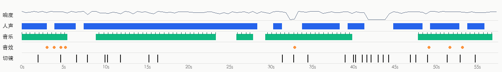

- ラウドネス -17.3 dBFS、ピーク -0.2 dBFS；音はカット点をまたいで連続しており、ポストプロダクションで全体に敷いたもの（カット点での背景音の変化 10.0dB、ショット内 8.8dB）
- ソース判定：動画タイプ：実写（同録音声 + 後付け BGM） → ボーカルは実際の人の録音；音楽は既存ライブラリの BGM（傾向、要確認）；効果音は実写の同録音

**ボーカル**

- 全体の 74% の時間；基本周波数 約 215.1Hz（女性の声寄り）
- ソース：実際の人の録音（実際の人の録音 73%、TTS ナレーション 20%、AI 動画ネイティブのセリフ（映像と同時生成） 7%）
  - 映像の 77% が実写：ボーカルは主に同時録音または実際の人によるアフレコ
- 再現：自分で録音。スマホかピンマイクを口元に近づけ、静かな部屋で録る；セリフは「内容と構成」の台本表をもとに書き換える

**BGM**

- テンポ：114.8 BPM（57.4/229.7 の可能性もあり）；キー F major（信頼度 0.763）；全体の 72% の時間（0.0–57.0s）；セクションの変化点 41.0s, 45.0s；末尾でカット
- 編集とビート：カット点の 15% がビートに乗っている（ランダムなら約 20%）
- ソース：要確認（既存ライブラリの BGM 63%、既存の有名曲 23%、AI 生成音楽 13%）
  - 音楽は映像の下に敷く BGM：一般的な動画の BGM は既存ライブラリ由来の可能性が高い（事前確率）
  - ボーカルは歌ではなく話し声／ナレーション（持続音高の割合 0.25）：「ナレーション + BGM」の一般的な動画形式
  - 末尾で音楽がカットされている（フル音量のまま動画が終わる）：既存曲を切り取ったときによく見られる
  - 動画形式の事前確率や末尾の形といった弱い証拠以外に、この音楽自体についての証拠はない（ソースを聞き取れず、プラットフォームの音楽情報もない）：ソースは要確認で、ここでは AI 生成の BGM とライブラリの BGM を区別できない
  - 確認方法：抖音／小红书の元動画ページで音楽タグを見る。曲名が表示される → 既存曲；「@作者创作的原声」と表示される → 作者が自分でアップロードしたもの（MV 系は AI 曲が多い）
  - 確認方法：汽水音乐／QQ 音乐の「听歌识曲」や ACRCloud で識別する。識別できれば既存曲
- 再現：原曲は既存ライブラリの BGM 寄り。BPM／ムード／キーでライブラリから似た曲を探すか、AI で近いスタイルのロイヤリティフリー曲を生成する

**効果音**（4 か所、3 種類）

| 音 | 試聴 | 種類 | 回数 | 出現位置 | 対応する映像 |
|---|---|---|---|---|---|
| F1 | [試聴](sfx/sfx_01.wav) | pop | 2 | 3.1s、3.9s | 字幕「制作真人出镜的日用品」の表示 |
| F2 | [試聴](sfx/sfx_02.wav) | click | 1 | 5.3s | 字幕「那我用这个水杯」の表示 |
| F3 | [試聴](sfx/sfx_03.wav) | ding | 1 | 33.0s | カット |

- 再現：まず各音の「試聴」を聞く（単独で分離済みで、ボーカルや BGM は入っていない）。編集ソフトの効果音ライブラリで同系統の音を探し、「出現位置」の時間に合わせて各所に置く

- 分離したトラック：`stems/original.wav`（元音声）、`stems/vocals.wav`（ボーカルのドライ音）、`stems/music.wav`（BGM + 環境音）、`stems/effects.wav`（効果音トラック）
<!--stems-->

## 不確定な点

- 音声は AI が聞いていない（確認は映像のみ）：ボーカルが実際の人か TTS かは波形から推定；効果音は単独分離した効果音トラックから抽出し、種類は音の特徴から推定。「音声」でステムと各効果音を試聴して確認できる
- BGM のソースは要確認：既存ライブラリの BGM の可能性が高い（63%）。確認方法は「音声」を参照

## 付録

### ショット別エビデンス

各ショットは 2 つに分かれる：画面で見えるものと、ツールが推定した制作方法（判断根拠付き）。最後に再現用プロンプト。デフォルトで折りたたみ、クリックで展開。

<details class="ref"><summary>#1 00:00.000–00:01.933 · 実写 + コード／編集オーバーレイ（字幕）；実素材を導入（実写動画素材）</summary>

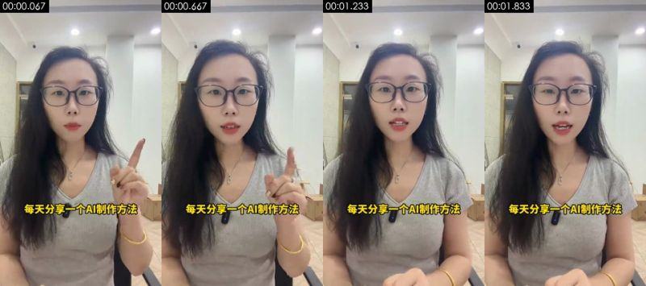

**画面で確認できる内容**（スクリーンショットと照合可能）
- 画面：黒縁メガネ・ロングヘアの女性配信者、グレーの V ネック T シャツ、オフィスでスマホのインカメラに向かってトークし、人差し指を立てて強調している；背景は白い壁、ダウンライト、廊下
- 撮影／ライティング：クローズアップ；アイレベル；三脚／スタンド固定；逆光／背景が被写体より明るい；キーライトは正面（カメラ方向からの光で、被写体の左右の明るさがほぼ同じ）；ライティング比約 1.1:1（差 0.1 段）；ソフトライト（明暗の境界がほとんどない）
- テキストトラック（字幕/bottom）：每天分享一个A制作方法 / 每天分享一个AI制作方法
- [AI アシスタント 画像確認] 実在の人物によるトーク：髪の毛や指の動きが自然、襟元にワイヤレスマイク、オフィスの天井照明と廊下のパースが安定している
- [AI アシスタント 画像確認] AI プラットフォームの透かしなし

**ツールの推定による制作方法**（推定であり、目視ではない）
- 推定：実写 69%、AI 生成動画 12%、映画・ドラマ素材 5%（fused_agent）
- 素材の出所：ユーザーの実素材：実写動画素材
- 判断根拠（ツール計測。肉眼では見分けにくい場合あり）：
  - テクスチャは写真／動画の特徴：ノイズ σ=0.25、使用色 121 種、フラットブロック 10%
  - プラットフォームで再トランスコード（Douyin/TikTok）されセンサーノイズが潰れている：ノイズ系の証拠は無効。実写か AI かは主にフレームレートと画面内容で判断

- 再現：元映像は実写：撮影プラン（ショットサイズ／カメラセットアップ／ライティング）どおりに撮り直す。撮影環境がない場合のみ AI の画像→動画生成で近似（先頭フレームを参照）。ユーザーの実素材が必要：実写動画素材（画面全体）
  - 先頭フレーム画像プロンプト：クローズアップ、人物は中央。縦型ミディアムクローズアップ、アイレベル、黒縁メガネ・ロングヘアの女性が中央、グレーの V ネック T シャツ、背景は明るいオフィスの白い壁とダウンライト、柔らかいトップライト、自然な色
  - 動画プロンプト：クローズアップ、人物は中央、カメラはパン／トラック。縦型ミディアムクローズアップ・アイレベル、女性が中央でカメラに向かって話し、人差し指を立てて強調、頭がわずかに揺れる、固定カメラ

</details>

<details class="ref"><summary>#2 00:01.933–00:04.700 · AI 生成動画 + コード／編集オーバーレイ（字幕）</summary>

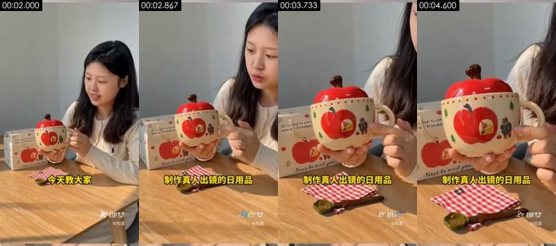

**画面で確認できる内容**（スクリーンショットと照合可能）
- 画面：AI 生成の女性「知遇」が木のテーブルに座り、両手でリンゴ型カップを持ち上げてカメラに見せ、カップを見ながら説明している；暖かい日差しの木のテーブル、ライトグレーの壁、テーブル上にはリンゴ型で赤い蓋の陶器カップ、リンゴ柄のギフトボックス、赤白チェックのクロス、緑の葉っぱ型の小さじ
- 撮影／ライティング：ミディアムクローズアップ；移動カメラ（ジンバル／手持ちでスライド）；正面ソフトライト（フラットライト）；キーライトは正面（カメラ方向からの光で、被写体の左右の明るさがほぼ同じ）；ライティング比約 1.2:1（差 0.2 段）；ソフトライト（明暗の境界がほとんどない）
- 画面内の物体上の文字（後付け字幕ではない）：带货视频、即梦、@知遇、@知造、Nice to nkut geu、Nice to mattyou
- テキストトラック（字幕/bottom）：今天教大家 / 制作真人出镜的日用品
- [AI アシスタント 画像確認] 右下に即梦の透かしと被写体名「@知遇」がある
- [AI アシスタント 画像確認] 同じキャラクターが、後のデモで即梦上で選ぶ被写体「知遇」そのもの
- [AI アシスタント 画像確認] 光が均一できれいすぎ、動きがゆっくり

**ツールの推定による制作方法**（推定であり、目視ではない）
- 推定：AI 生成動画 72%、実写 10%、3D レンダリング 4%（fused_agent）
- 素材の出所：AI 生成
- 判断根拠（ツール計測。肉眼では見分けにくい場合あり）：
  - テクスチャは写真／動画の特徴：ノイズ σ=0.22、使用色 222 種、フラットブロック 19%
  - プラットフォームで再トランスコード（Douyin/TikTok）されセンサーノイズが潰れている：ノイズ系の証拠は無効。実写か AI かは主にフレームレートと画面内容で判断

- 再現：元映像は AI 生成：元ショットの先頭・末尾フレームを使って先頭／末尾フレーム指定で生成すれば、構図と動きをかなり忠実に再現できる。被写体を差し替える場合は、先に画像モデルで先頭フレームを修正する
  - 先頭フレーム画像プロンプト：被写体は画面上部の右側。縦型ミディアムクローズアップ・アイレベル、ロングヘアの若い女性が木のテーブルの奥やや右に座る、オフホワイトのケーブルニット、両手でリンゴ型で赤い蓋の陶器カップを持つ、左側にリンゴ柄のギフトボックス、暖かい日差しのサイドライト、ライトグレーの壁
  - 動画プロンプト：被写体は画面上部の右側、カメラはプッシュイン。縦型ミディアムクローズアップ、女性がテーブルの奥に座り、リンゴ型カップを胸の前に持ち上げて見せ、うつむいてカップを見て微笑む、カメラはゆっくりカップまでプッシュイン

</details>

<details class="ref"><summary>#3 00:04.700–00:06.633 · AI 生成動画 + コード／編集オーバーレイ（字幕）</summary>

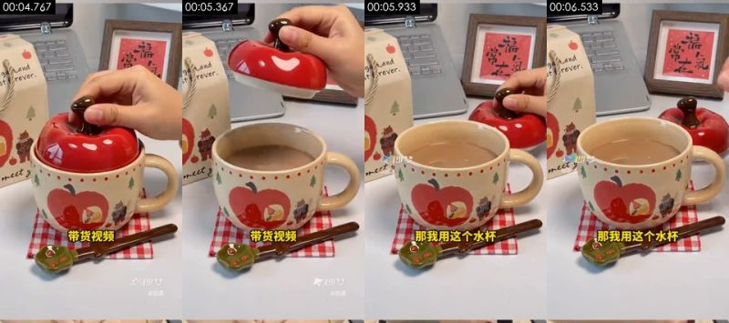

**画面で確認できる内容**（スクリーンショットと照合可能）
- 画面：AI 生成のリンゴ型カップのクローズアップ：手が赤いリンゴ型の蓋を開ける、カップ本体にはリンゴとクマの柄；暖かい日差しの木のテーブル、ライトグレーの壁、テーブル上にはリンゴ型で赤い蓋の陶器カップ、リンゴ柄のギフトボックス、赤白チェックのクロス、緑の葉っぱ型の小さじ
- 撮影／ライティング：ミディアムショット；移動カメラ（ジンバル／手持ちでスライド）；逆光／背景が被写体より明るい；キーライトは正面（カメラ方向からの光で、被写体の左右の明るさがほぼ同じ）；ライティング比約 1.3:1（差 0.4 段）；ハードライト（明暗の境界がはっきり）
- 画面内の物体上の文字（後付け字幕ではない）：给大家演示一下、即梦、@知遇、stfrever.、st、meet
- テキストトラック（字幕/bottom）：带货视频 / 那我用这个水杯
- [AI アシスタント 画像確認] 右下に即梦の透かしと被写体名「@知遇」がある
- [AI アシスタント 画像確認] 同じキャラクターが、後のデモで即梦上で選ぶ被写体「知遇」そのもの
- [AI アシスタント 画像確認] 光が均一できれいすぎ、動きがゆっくり

**ツールの推定による制作方法**（推定であり、目視ではない）
- 推定：AI 生成動画 72%、実写 10%、3D レンダリング 4%（fused_agent）
- 素材の出所：AI 生成
- 判断根拠（ツール計測。肉眼では見分けにくい場合あり）：
  - テクスチャは写真／動画の特徴：ノイズ σ=0.20、使用色 262 種、フラットブロック 19%
  - プラットフォームで再トランスコード（Douyin/TikTok）されセンサーノイズが潰れている：ノイズ系の証拠は無効。実写か AI かは主にフレームレートと画面内容で判断

- 再現：元映像は AI 生成：元ショットの先頭・末尾フレームを使って先頭／末尾フレーム指定で生成すれば、構図と動きをかなり忠実に再現できる。被写体を差し替える場合は、先に画像モデルで先頭フレームを修正する
  - 先頭フレーム画像プロンプト：ミディアムショット、被写体は画面下部の中央。縦型クローズアップ、リンゴ型で赤い蓋の陶器カップが中央、カップ本体にリンゴとクマのイラスト、奥にギフトボックスと額装された「福」の字、赤白チェックのクロス、柔らかい日光
  - 動画プロンプト：ミディアムショット、被写体は画面下部の中央、カメラはパン／トラック。縦型クローズアップ、手が上からリンゴ型の蓋の軸をつまんでゆっくり開ける、カメラはわずかにスライド

</details>

<details class="ref"><summary>#4 00:06.633–00:07.933 · 実写 + コード／編集オーバーレイ（テキストラベル、グラフィック貼り付け）；実素材を導入（実写動画素材）</summary>

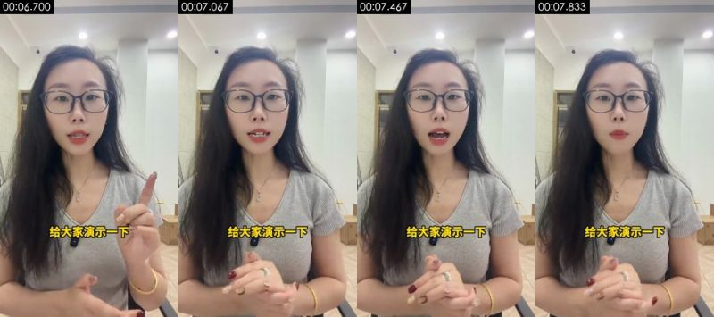

**画面で確認できる内容**（スクリーンショットと照合可能）
- 画面：黒縁メガネ・ロングヘアの女性配信者、グレーの V ネック T シャツ、オフィスでスマホのインカメラに向かってトークし、人差し指を立てて強調している；背景は白い壁、ダウンライト、廊下
- 撮影／ライティング：クローズアップ；アイレベル；三脚／スタンド固定；逆光／背景が被写体より明るい；キーライトは正面（カメラ方向からの光で、被写体の左右の明るさがほぼ同じ）；ライティング比約 1.0:1（差 0.1 段）；ソフトライト（明暗の境界がほとんどない）
- テキストトラック（テキスト/bottom）：给大家演示一下
- [AI アシスタント 画像確認] 実在の人物によるトーク：髪の毛や指の動きが自然、襟元にワイヤレスマイク、オフィスの天井照明と廊下のパースが安定している
- [AI アシスタント 画像確認] AI プラットフォームの透かしなし

**ツールの推定による制作方法**（推定であり、目視ではない）
- 推定：実写 69%、AI 生成動画 12%、映画・ドラマ素材 5%（fused_agent）
- 素材の出所：ユーザーの実素材：実写動画素材
- 判断根拠（ツール計測。肉眼では見分けにくい場合あり）：
  - テクスチャは写真／動画の特徴：ノイズ σ=0.27、使用色 121 種、フラットブロック 11%
  - プラットフォームで再トランスコード（Douyin/TikTok）されセンサーノイズが潰れている：ノイズ系の証拠は無効。実写か AI かは主にフレームレートと画面内容で判断

- 再現：元映像は実写：撮影プラン（ショットサイズ／カメラセットアップ／ライティング）どおりに撮り直す。撮影環境がない場合のみ AI の画像→動画生成で近似（先頭フレームを参照）。ユーザーの実素材が必要：実写動画素材（画面全体）
  - 先頭フレーム画像プロンプト：クローズアップ、人物は中央。縦型ミディアムクローズアップ、アイレベル、黒縁メガネ・ロングヘアの女性が中央、グレーの V ネック T シャツ、背景は明るいオフィスの白い壁とダウンライト、柔らかいトップライト、自然な色
  - 動画プロンプト：クローズアップ、人物は中央、カメラはプルアウト。縦型ミディアムクローズアップ・アイレベル、女性が中央でカメラに向かって話し、人差し指を立てて強調、頭がわずかに揺れる、固定カメラ

</details>

<details class="ref"><summary>#5 00:07.933–00:10.067 · 実写 + コード／編集オーバーレイ（字幕）；実素材を導入（実写動画素材）</summary>

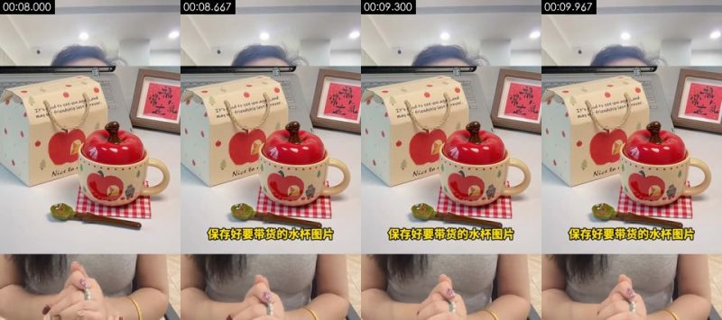

**画面で確認できる内容**（スクリーンショットと照合可能）
- 画面：上下分割レイアウト：上半分はリンゴ型カップの商品実写画像、下半分は両手を組んだトーク中の配信者
- 撮影／ライティング：ミディアムショット；固定カメラ（三脚／スタンド／机に置く）；正面ソフトライト（フラットライト）；キーライトは正面（カメラ方向からの光で、被写体の左右の明るさがほぼ同じ）；ライティング比約 1.2:1（差 0.3 段）；ソフトライト（明暗の境界がほとんどない）
- 画面内の物体上の文字（後付け字幕ではない）：图片可以多保存几张、福、It's aodto see you aga.and、may ou/friendship las+frever.
- テキストトラック（字幕/bottom）：保存好要带货的水杯图片
- [AI アシスタント 画像確認] 上半分は静止した商品実写写真、下半分はトーク中の配信者の手が動いている
- [AI アシスタント 画像確認] 画面が上下 2 ブロックに分かれており、編集による分割レイアウト

**ツールの推定による制作方法**（推定であり、目視ではない）
- 推定：実写 72%、映画・ドラマ素材 6%、AI 生成動画 5%（fused_agent）
- 素材の出所：ユーザーの実素材：実写動画素材；再現用参考：商品参考画像
- 判断根拠（ツール計測。肉眼では見分けにくい場合あり）：
  - テクスチャは写真／動画の特徴：ノイズ σ=0.25、使用色 256 種、フラットブロック 14%
  - プラットフォームで再トランスコード（Douyin/TikTok）されセンサーノイズが潰れている：ノイズ系の証拠は無効。実写か AI かは主にフレームレートと画面内容で判断

- 再現：元映像は実写：撮影プラン（ショットサイズ／カメラセットアップ／ライティング）どおりに撮り直す。撮影環境がない場合のみ AI の画像→動画生成で近似（先頭フレームを参照）。ユーザーの実素材が必要：実写動画素材（画面全体）。生成時の参考：商品参考画像
  - 動画プロンプト：ミディアムショット、被写体は画面下部の中央。上下分割レイアウト：上半分はリンゴ型カップの商品実写画像、下半分は両手を組んだトーク中の配信者

</details>

<details class="ref"><summary>#6 00:10.067–00:10.367 · 静止画ホールド（実写真） + コード／編集オーバーレイ（テキストラベル、字幕）；実素材を導入（実写真、商品実写画像）</summary>

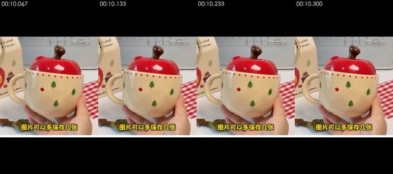

**画面で確認できる内容**（スクリーンショットと照合可能）
- 画面：商品実写写真を全画面で静止表示（リンゴ型カップを持つ手）、上下に黒帯
- [AI アシスタント 画像確認] 0.3 秒間の全画面の商品写真、上下に黒帯、画面は動かない

**ツールの推定による制作方法**（推定であり、目視ではない）
- 推定：静止画ホールド 86%、コード／テンプレートレンダリング 9%、画面録画／スクリーンショット 4%（fused_agent）
- 静止画の出所：photo
- 素材の出所：ユーザーの実素材：実写真、商品実写画像
- 判断根拠（ツール計測。肉眼では見分けにくい場合あり）：
  - 画面はほぼ完全に静止：隣接フレームの 100% がピクセル単位で同一、先頭・末尾フレームの差 0.01
  - プラットフォームで再トランスコード（Douyin/TikTok）されセンサーノイズが潰れている：ノイズ系の証拠は無効。実写か AI かは主にフレームレートと画面内容で判断

- 再現：静止画：1 枚の画像を静止表示すればよい。ユーザーの実素材が必要：実写真（画面全体）、商品実写画像（画面の一部）

</details>

<details class="ref"><summary>#7 00:10.367–00:11.933 · 実写 + コード／編集オーバーレイ（テキストラベル）；実素材を導入（実写動画素材）</summary>

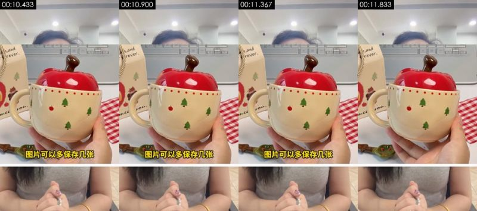

**画面で確認できる内容**（スクリーンショットと照合可能）
- 画面：上下分割レイアウト：上半分はリンゴ型カップを持つ手の商品写真、下半分はトーク中の配信者
- 撮影／ライティング：ミディアムショット；固定カメラ（三脚／スタンド／机に置く）；斜め前からのキーライト + フィル（標準的なライティング）；キーライトは画面右側のやや前方；ライティング比約 1.4:1（差 0.5 段）；判定不能
- 画面内の物体上の文字（後付け字幕ではない）：h,and、orever.
- テキストトラック（テキスト/bottom）：图片可以多保存几张
- [AI アシスタント 画像確認] 上半分は静止した商品実写写真、下半分はトーク中の配信者の手が動いている
- [AI アシスタント 画像確認] 画面が上下 2 ブロックに分かれており、編集による分割レイアウト

**ツールの推定による制作方法**（推定であり、目視ではない）
- 推定：実写 72%、映画・ドラマ素材 6%、AI 生成動画 5%（fused_agent）
- 素材の出所：ユーザーの実素材：実写動画素材；再現用参考：商品参考画像
- 判断根拠（ツール計測。肉眼では見分けにくい場合あり）：
  - テクスチャは写真／動画の特徴：ノイズ σ=0.26、使用色 240 種、フラットブロック 12%
  - プラットフォームで再トランスコード（Douyin/TikTok）されセンサーノイズが潰れている：ノイズ系の証拠は無効。実写か AI かは主にフレームレートと画面内容で判断

- 再現：元映像は実写：撮影プラン（ショットサイズ／カメラセットアップ／ライティング）どおりに撮り直す。撮影環境がない場合のみ AI の画像→動画生成で近似（先頭フレームを参照）。ユーザーの実素材が必要：実写動画素材（画面全体）。生成時の参考：商品参考画像
  - 動画プロンプト：ミディアムショット、被写体は画面下部の中央。上下分割レイアウト：上半分はリンゴ型カップを持つ手の商品写真、下半分はトーク中の配信者

</details>

<details class="ref"><summary>#8 00:11.933–00:15.400 · 実写 + コード／編集オーバーレイ（字幕）；実素材を導入（実写動画素材）</summary>

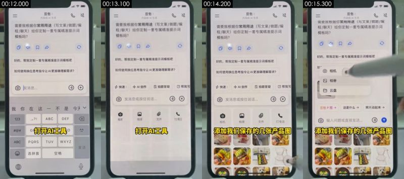

**画面で確認できる内容**（スクリーンショットと照合可能）
- 画面：机上の実機スマホを俯瞰撮影、豆包アプリを開き、チャットでプロンプトの作成を依頼
- 撮影／ライティング：クローズアップ；真上からの俯瞰（真上から机を撮影）；俯瞰撮影用の卓上スタンド；正面ソフトライト（フラットライト）；キーライトは正面（カメラ方向からの光で、被写体の左右の明るさがほぼ同じ）；ライティング比約 1.0:1（差 0.0 段）；ハードライト（明暗の境界がはっきり）
- 画面内の物体上の文字（後付け字幕ではない）：G、TUV、WXYZ、ABC、PQRS、选拼音
- テキストトラック（字幕/bottom）：打开AI工具 / 添加我们保存的几张产品图
- [AI アシスタント 画像確認] 撮っているのは実機のスマホ：本体の黒いベゼル、画面の反射、モアレが見える
- [AI アシスタント 画像確認] タッチペン／指で画面をタップしており、モーションブラーがある
- [AI アシスタント 画像確認] 画面録画ではない：システム録画特有のシャープなピクセルがない

**ツールの推定による制作方法**（推定であり、目視ではない）
- 推定：実写 67%、3D レンダリング 6%、映画・ドラマ素材 5%（fused_agent）
- 素材の出所：ユーザーの実素材：実写動画素材
- 判断根拠（ツール計測。肉眼では見分けにくい場合あり）：
  - プラットフォームで再トランスコード（Douyin/TikTok）されセンサーノイズが潰れている：ノイズ系の証拠は無効。実写か AI かは主にフレームレートと画面内容で判断

- 再現：元映像は実写：撮影プラン（ショットサイズ／カメラセットアップ／ライティング）どおりに撮り直す。撮影環境がない場合のみ AI の画像→動画生成で近似（先頭フレームを参照）。ユーザーの実素材が必要：実写動画素材（画面全体）
  - 動画プロンプト：クローズアップ、真上からの俯瞰（真上から机を撮影）、スマホを中央に置き縦画面いっぱいに。机上の実機スマホを俯瞰撮影、豆包アプリを開き、チャットでプロンプトの作成を依頼

</details>

<details class="ref"><summary>#9 00:15.400–00:16.467 · 実写 + コード／編集オーバーレイ（字幕）；実素材を導入（実写動画素材）</summary>

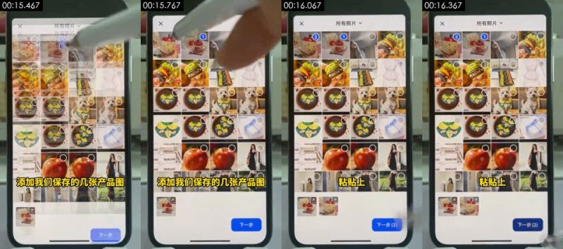

**画面で確認できる内容**（スクリーンショットと照合可能）
- 画面：机上の実機スマホを俯瞰撮影、豆包でアルバムからカップの商品画像を数枚選択
- 撮影／ライティング：クローズアップ；真上からの俯瞰（真上から机を撮影）；俯瞰撮影用の卓上スタンド；正面ソフトライト（フラットライト）；キーライトは正面（カメラ方向からの光で、被写体の左右の明るさがほぼ同じ）；ライティング比約 1.0:1（差 0.0 段）；ソフトライト（明暗の境界がほとんどない）
- 画面内の物体上の文字（後付け字幕ではない）：添加我们保存的几张产品图、下一步、下一步价、Norurat:、ral、Naturc
- テキストトラック（字幕/bottom）：粘贴上
- [AI アシスタント 画像確認] 撮っているのは実機のスマホ：本体の黒いベゼル、画面の反射、モアレが見える
- [AI アシスタント 画像確認] タッチペン／指で画面をタップしており、モーションブラーがある
- [AI アシスタント 画像確認] 画面録画ではない：システム録画特有のシャープなピクセルがない

**ツールの推定による制作方法**（推定であり、目視ではない）
- 推定：実写 69%、映画・ドラマ素材 5%、3D レンダリング 5%（fused_agent）
- 素材の出所：ユーザーの実素材：実写動画素材
- 判断根拠（ツール計測。肉眼では見分けにくい場合あり）：
  - テクスチャは写真／動画の特徴：ノイズ σ=0.30、使用色 407 種、フラットブロック 15%
  - プラットフォームで再トランスコード（Douyin/TikTok）されセンサーノイズが潰れている：ノイズ系の証拠は無効。実写か AI かは主にフレームレートと画面内容で判断

- 再現：元映像は実写：撮影プラン（ショットサイズ／カメラセットアップ／ライティング）どおりに撮り直す。撮影環境がない場合のみ AI の画像→動画生成で近似（先頭フレームを参照）。ユーザーの実素材が必要：実写動画素材（画面全体）
  - 動画プロンプト：クローズアップ、真上からの俯瞰（真上から机を撮影）、スマホを中央に置き縦画面いっぱいに。机上の実機スマホを俯瞰撮影、豆包でアルバムからカップの商品画像を数枚選択

</details>

<details class="ref"><summary>#10 00:16.467–00:31.567 · 実写 + コード／編集オーバーレイ（字幕）；実素材を導入（実写動画素材）</summary>

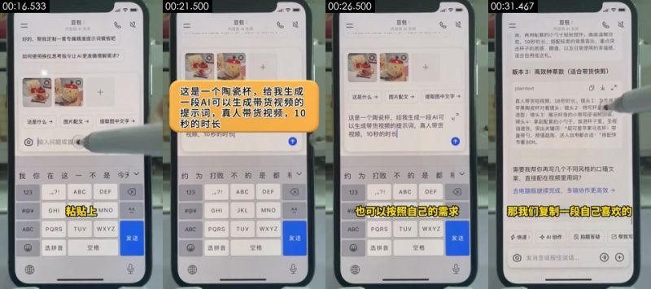

**画面で確認できる内容**（スクリーンショットと照合可能）
- 画面：机上の実機スマホを俯瞰撮影、豆包に「这是一个陶瓷杯，给我生成一段 AI 可以生成带货视频的提示词，真人带货视频，10 秒」（これは陶器のカップです。AI で商品紹介動画を生成できるプロンプトを作って。実在人物の商品紹介動画、10 秒）を貼り付け、豆包が 3 バージョンのプロンプトを返し、タッチペンでスクロール
- 撮影／ライティング：クローズアップ；真上からの俯瞰（真上から机を撮影）；俯瞰撮影用の卓上スタンド；正面ソフトライト（フラットライト）；キーライトは正面（カメラ方向からの光で、被写体の左右の明るさがほぼ同じ）；ライティング比約 1.1:1（差 0.1 段）；ソフトライト（明暗の境界がほとんどない）
- 画面内の物体上の文字（後付け字幕ではない）：GHI、JKL、MNO、ABC、PQRS、TUV
- テキストトラック（字幕/bottom）：刚准备好的这个提示词 / 提示词呢 / 也可以按照自己的需求 / 来修改
- テキストトラック（字幕/bottom）：发送
- テキストトラック（字幕/bottom）：发送
- ショット内のモーションの拍：17.17s、25.07s、27.63s
- [AI アシスタント 画像確認] 撮っているのは実機のスマホ：本体の黒いベゼル、画面の反射、モアレが見える
- [AI アシスタント 画像確認] タッチペン／指で画面をタップしており、モーションブラーがある
- [AI アシスタント 画像確認] 画面録画ではない：システム録画特有のシャープなピクセルがない

**ツールの推定による制作方法**（推定であり、目視ではない）
- 推定：実写 53%、コード／テンプレートレンダリング 8%、画面録画／スクリーンショット 7%（fused_agent）
- 素材の出所：ユーザーの実素材：実写動画素材
- 判断根拠（ツール計測。肉眼では見分けにくい場合あり）：
  - 隣接フレームの 51% が完全に同一で、一部の要素だけが動いている（典型的なテンプレート／MG アニメーション、または静止後の部分的な動き）
  - プラットフォームで再トランスコード（Douyin/TikTok）されセンサーノイズが潰れている：ノイズ系の証拠は無効。実写か AI かは主にフレームレートと画面内容で判断

- 再現：元映像は実写：撮影プラン（ショットサイズ／カメラセットアップ／ライティング）どおりに撮り直す。撮影環境がない場合のみ AI の画像→動画生成で近似（先頭フレームを参照）。ユーザーの実素材が必要：実写動画素材（画面全体）
  - 動画プロンプト：クローズアップ、真上からの俯瞰（真上から机を撮影）、スマホを中央に置き縦画面いっぱいに。机上の実機スマホを俯瞰撮影、豆包に「这是一个陶瓷杯，给我生成一段 AI 可以生成带货视频的提示词，真人带货视频，10 秒」を貼り付け、豆包が 3 バージョンのプロンプトを返し、タッチペンでスクロール

</details>

<details class="ref"><summary>#11 00:31.567–00:32.933 · 実写；実素材を導入（実写動画素材）</summary>

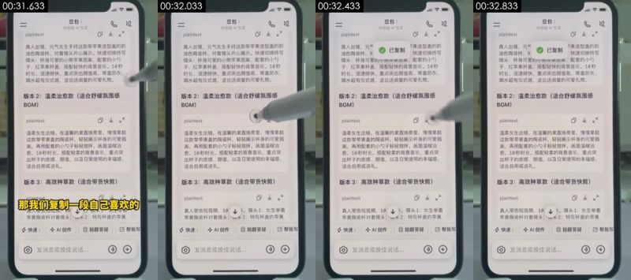

**画面で確認できる内容**（スクリーンショットと照合可能）
- 画面：机上の実機スマホを俯瞰撮影、豆包の回答にあるバージョン 3 のプロンプトをコピーしようとしている
- 撮影／ライティング：クローズアップ；真上からの俯瞰（真上から机を撮影）；俯瞰撮影用の卓上スタンド；正面ソフトライト（フラットライト）；キーライトは正面（カメラ方向からの光で、被写体の左右の明るさがほぼ同じ）；ライティング比約 1.0:1（差 0.0 段）；ソフトライト（明暗の境界がほとんどない）
- 画面内の物体上の文字（後付け字幕ではない）：plaintext、不、真人带货短视频，10√。镜头1：女生举着、苹果陶瓷杯对着镜头；说大2：特写杯盖的苹果、快速、AI创作
- [AI アシスタント 画像確認] 撮っているのは実機のスマホ：本体の黒いベゼル、画面の反射、モアレが見える
- [AI アシスタント 画像確認] タッチペン／指で画面をタップしており、モーションブラーがある
- [AI アシスタント 画像確認] 画面録画ではない：システム録画特有のシャープなピクセルがない

**ツールの推定による制作方法**（推定であり、目視ではない）
- 推定：実写 61%、3D レンダリング 8%、画面録画／スクリーンショット 6%（fused_agent）
- 素材の出所：ユーザーの実素材：実写動画素材
- 判断根拠（ツール計測。肉眼では見分けにくい場合あり）：
  - テクスチャはレンダリングの特徴：フラットな色ブロック 22%、95% のピクセルがわずか 40 色、水平・垂直の直線エッジ 33%
  - プラットフォームで再トランスコード（Douyin/TikTok）されセンサーノイズが潰れている：ノイズ系の証拠は無効。実写か AI かは主にフレームレートと画面内容で判断

- 再現：元映像は実写：撮影プラン（ショットサイズ／カメラセットアップ／ライティング）どおりに撮り直す。撮影環境がない場合のみ AI の画像→動画生成で近似（先頭フレームを参照）。ユーザーの実素材が必要：実写動画素材（画面全体）
  - 動画プロンプト：クローズアップ、真上からの俯瞰（真上から机を撮影）、スマホを中央に置き縦画面いっぱいに。机上の実機スマホを俯瞰撮影、豆包の回答にあるバージョン 3 のプロンプトをコピーしようとしている

</details>

<details class="ref"><summary>#12 00:32.933–00:34.633 · 実写 + コード／編集オーバーレイ（字幕）；実素材を導入（実写動画素材）</summary>

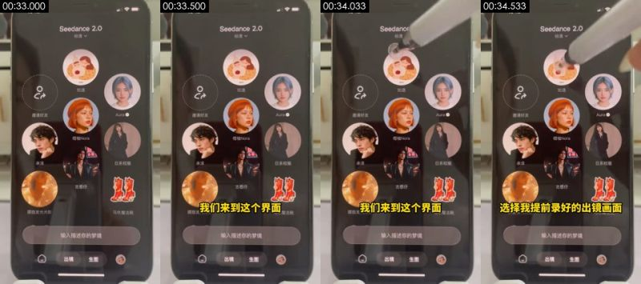

**画面で確認できる内容**（スクリーンショットと照合可能）
- 画面：机上の実機スマホを俯瞰撮影、即梦 Seedance 2.0 に切り替え、被写体リストに「知遇」などの人物アイコン
- 撮影／ライティング：クローズアップ；真上からの俯瞰（真上から机を撮影）；俯瞰撮影用の卓上スタンド；正面ソフトライト（フラットライト）；キーライトは正面（カメラ方向からの光で、被写体の左右の明るさがほぼ同じ）；ライティング比約 1.1:1（差 0.2 段）；ソフトライト（明暗の境界がほとんどない）
- 画面内の物体上の文字（後付け字幕ではない）：朦胧发、魔法靴、选择我提前录好的出镜画面、输入描述你的梦境、123、ABC
- テキストトラック（字幕/bottom）：我们来到这个界面
- [AI アシスタント 画像確認] 撮っているのは実機のスマホ：本体の黒いベゼル、画面の反射、モアレが見える
- [AI アシスタント 画像確認] タッチペン／指で画面をタップしており、モーションブラーがある
- [AI アシスタント 画像確認] 画面録画ではない：システム録画特有のシャープなピクセルがない

**ツールの推定による制作方法**（推定であり、目視ではない）
- 推定：実写 66%、3D レンダリング 6%、画面録画／スクリーンショット 5%（fused_agent）
- 素材の出所：ユーザーの実素材：実写動画素材
- 判断根拠（ツール計測。肉眼では見分けにくい場合あり）：
  - プラットフォームで再トランスコード（Douyin/TikTok）されセンサーノイズが潰れている：ノイズ系の証拠は無効。実写か AI かは主にフレームレートと画面内容で判断

- 再現：元映像は実写：撮影プラン（ショットサイズ／カメラセットアップ／ライティング）どおりに撮り直す。撮影環境がない場合のみ AI の画像→動画生成で近似（先頭フレームを参照）。ユーザーの実素材が必要：実写動画素材（画面全体）
  - 動画プロンプト：クローズアップ、真上からの俯瞰（真上から机を撮影）、スマホを中央に置き縦画面いっぱいに。机上の実機スマホを俯瞰撮影、即梦 Seedance 2.0 に切り替え、被写体リストに「知遇」などの人物アイコン

</details>

<details class="ref"><summary>#13 00:34.633–00:39.133 · 実写 + コード／編集オーバーレイ（字幕）；実素材を導入（実写動画素材）</summary>

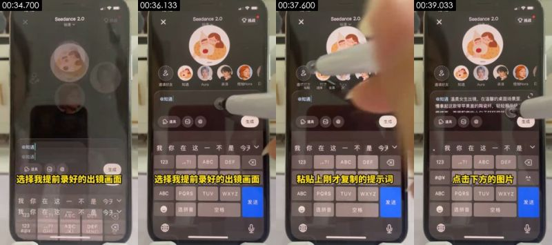

**画面で確認できる内容**（スクリーンショットと照合可能）
- 画面：机上の実機スマホを俯瞰撮影、即梦で「@知遇」（事前収録した出演被写体）を選択し、プロンプトを貼り付け
- 撮影／ライティング：クローズアップ；真上からの俯瞰（真上から机を撮影）；俯瞰撮影用の卓上スタンド；正面ソフトライト（フラットライト）；キーライトは正面（カメラ方向からの光で、被写体の左右の明るさがほぼ同じ）；ライティング比約 1.1:1（差 0.1 段）；ソフトライト（明暗の境界がほとんどない）
- 画面内の物体上の文字（後付け字幕ではない）：ABC、PQRS、TUV、WXYZ、发送、选拼音
- テキストトラック（字幕/bottom）：选择我提前录好的出镜画面 / 粘贴上刚才复制的提示词
- [AI アシスタント 画像確認] 撮っているのは実機のスマホ：本体の黒いベゼル、画面の反射、モアレが見える
- [AI アシスタント 画像確認] タッチペン／指で画面をタップしており、モーションブラーがある
- [AI アシスタント 画像確認] 画面録画ではない：システム録画特有のシャープなピクセルがない

**ツールの推定による制作方法**（推定であり、目視ではない）
- 推定：実写 65%、3D レンダリング 7%、映画・ドラマ素材 5%（fused_agent）
- 素材の出所：ユーザーの実素材：実写動画素材
- 判断根拠（ツール計測。肉眼では見分けにくい場合あり）：
  - プラットフォームで再トランスコード（Douyin/TikTok）されセンサーノイズが潰れている：ノイズ系の証拠は無効。実写か AI かは主にフレームレートと画面内容で判断

- 再現：元映像は実写：撮影プラン（ショットサイズ／カメラセットアップ／ライティング）どおりに撮り直す。撮影環境がない場合のみ AI の画像→動画生成で近似（先頭フレームを参照）。ユーザーの実素材が必要：実写動画素材（画面全体）
  - 動画プロンプト：クローズアップ、真上からの俯瞰（真上から机を撮影）、スマホを中央に置き縦画面いっぱいに。机上の実機スマホを俯瞰撮影、即梦で「@知遇」（事前収録した出演被写体）を選択し、プロンプトを貼り付け

</details>

<details class="ref"><summary>#14 00:39.133–00:40.167 · 実写 + コード／編集オーバーレイ（字幕）；実素材を導入（実写動画素材）</summary>

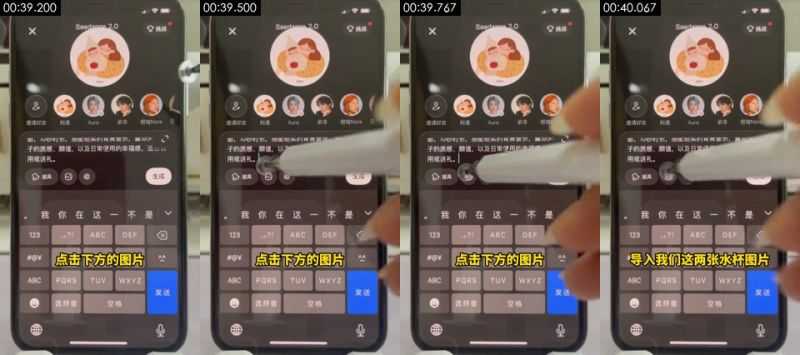

**画面で確認できる内容**（スクリーンショットと照合可能）
- 画面：机上の実機スマホを俯瞰撮影、入力欄下の画像ボタンをタップ
- 撮影／ライティング：クローズアップ；真上からの俯瞰（真上から机を撮影）；俯瞰撮影用の卓上スタンド；正面ソフトライト（フラットライト）；キーライトは正面（カメラ方向からの光で、被写体の左右の明るさがほぼ同じ）；ライティング比約 1.0:1（差 0.1 段）；ソフトライト（明暗の境界がほとんどない）
- 画面内の物体上の文字（後付け字幕ではない）：vV、ABC、PQRS、WXYZ、发送、选拼音
- テキストトラック（字幕/bottom）：点击下方的图片
- [AI アシスタント 画像確認] 撮っているのは実機のスマホ：本体の黒いベゼル、画面の反射、モアレが見える
- [AI アシスタント 画像確認] タッチペン／指で画面をタップしており、モーションブラーがある
- [AI アシスタント 画像確認] 画面録画ではない：システム録画特有のシャープなピクセルがない

**ツールの推定による制作方法**（推定であり、目視ではない）
- 推定：実写 67%、3D レンダリング 6%、映画・ドラマ素材 5%（fused_agent）
- 素材の出所：ユーザーの実素材：実写動画素材
- 判断根拠（ツール計測。肉眼では見分けにくい場合あり）：
  - プラットフォームで再トランスコード（Douyin/TikTok）されセンサーノイズが潰れている：ノイズ系の証拠は無効。実写か AI かは主にフレームレートと画面内容で判断

- 再現：元映像は実写：撮影プラン（ショットサイズ／カメラセットアップ／ライティング）どおりに撮り直す。撮影環境がない場合のみ AI の画像→動画生成で近似（先頭フレームを参照）。ユーザーの実素材が必要：実写動画素材（画面全体）
  - 動画プロンプト：クローズアップ、真上からの俯瞰（真上から机を撮影）、スマホを中央に置き縦画面いっぱいに。机上の実機スマホを俯瞰撮影、入力欄下の画像ボタンをタップ

</details>

<details class="ref"><summary>#15 00:40.167–00:40.433 · 実写；実素材を導入（実写動画素材）</summary>

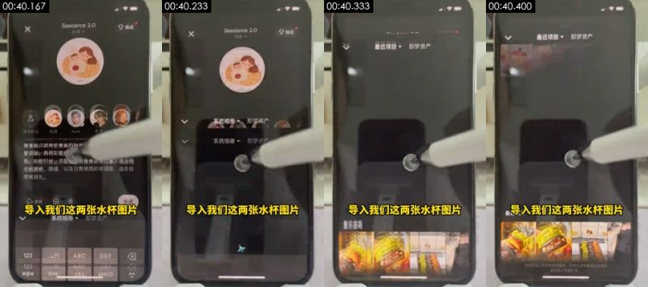

**画面で確認できる内容**（スクリーンショットと照合可能）
- 画面：机上の実機スマホを俯瞰撮影、即梦のアルバム画面が一瞬映る
- 撮影／ライティング：クローズアップ；真上からの俯瞰（真上から机を撮影）；俯瞰撮影用の卓上スタンド；正面ソフトライト（フラットライト）；キーライトは正面（カメラ方向からの光で、被写体の左右の明るさがほぼ同じ）；ライティング比約 1.2:1（差 0.2 段）；ソフトライト（明暗の移り変わりが緩やか）
- 画面内の物体上の文字（後付け字幕ではない）：道具、生成、导入我们这两张水杯图片、123、ABC、DEF
- [AI アシスタント 画像確認] 撮っているのは実機のスマホ：本体の黒いベゼル、画面の反射、モアレが見える
- [AI アシスタント 画像確認] タッチペン／指で画面をタップしており、モーションブラーがある
- [AI アシスタント 画像確認] 画面録画ではない：システム録画特有のシャープなピクセルがない

**ツールの推定による制作方法**（推定であり、目視ではない）
- 推定：実写 63%、3D レンダリング 8%、映画・ドラマ素材 5%（fused_agent）
- 素材の出所：ユーザーの実素材：実写動画素材
- 判断根拠（ツール計測。肉眼では見分けにくい場合あり）：
  - プラットフォームで再トランスコード（Douyin/TikTok）されセンサーノイズが潰れている：ノイズ系の証拠は無効。実写か AI かは主にフレームレートと画面内容で判断

- 再現：元映像は実写：撮影プラン（ショットサイズ／カメラセットアップ／ライティング）どおりに撮り直す。撮影環境がない場合のみ AI の画像→動画生成で近似（先頭フレームを参照）。ユーザーの実素材が必要：実写動画素材（画面全体）
  - 動画プロンプト：クローズアップ、真上からの俯瞰（真上から机を撮影）、スマホを中央に置き縦画面いっぱいに。机上の実機スマホを俯瞰撮影、即梦のアルバム画面が一瞬映る

</details>

<details class="ref"><summary>#16 00:40.433–00:41.200 · 実写 + コード／編集オーバーレイ（テキストラベル）；実素材を導入（実写動画素材）</summary>

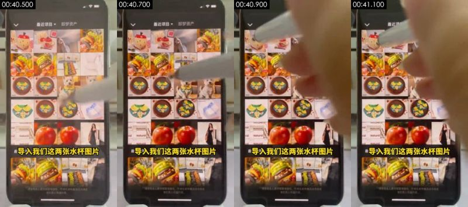

**画面で確認できる内容**（スクリーンショットと照合可能）
- 画面：机上の実機スマホを俯瞰撮影、即梦の最近のプロジェクトからカップ画像を 2 枚選択
- 撮影／ライティング：クローズアップ；真上からの俯瞰（真上から机を撮影）；俯瞰撮影用の卓上スタンド；正面ソフトライト（フラットライト）；キーライトは正面（カメラ方向からの光で、被写体の左右の明るさがほぼ同じ）；ライティング比約 1.0:1（差 0.0 段）；ソフトライト（明暗の境界がほとんどない）
- 画面内の物体上の文字（後付け字幕ではない）：请便用本人重材网取得授权，不得生成传福违法违规或、遵把他人权登内容、使用本人需材毁取得模校，不得生成传插违法违规或、Naturat、ral、Natural
- テキストトラック（テキスト/bottom）：导入我们这两张水杯图片
- [AI アシスタント 画像確認] 撮っているのは実機のスマホ：本体の黒いベゼル、画面の反射、モアレが見える
- [AI アシスタント 画像確認] タッチペン／指で画面をタップしており、モーションブラーがある
- [AI アシスタント 画像確認] 画面録画ではない：システム録画特有のシャープなピクセルがない

**ツールの推定による制作方法**（推定であり、目視ではない）
- 推定：実写 71%、映画・ドラマ素材 5%、AI 生成動画 5%（fused_agent）
- 素材の出所：ユーザーの実素材：実写動画素材
- 判断根拠（ツール計測。肉眼では見分けにくい場合あり）：
  - テクスチャは写真／動画の特徴：ノイズ σ=0.25、使用色 410 種、フラットブロック 10%
  - プラットフォームで再トランスコード（Douyin/TikTok）されセンサーノイズが潰れている：ノイズ系の証拠は無効。実写か AI かは主にフレームレートと画面内容で判断

- 再現：元映像は実写：撮影プラン（ショットサイズ／カメラセットアップ／ライティング）どおりに撮り直す。撮影環境がない場合のみ AI の画像→動画生成で近似（先頭フレームを参照）。ユーザーの実素材が必要：実写動画素材（画面全体）
  - 動画プロンプト：クローズアップ、真上からの俯瞰（真上から机を撮影）、スマホを中央に置き縦画面いっぱいに。机上の実機スマホを俯瞰撮影、即梦の最近のプロジェクトからカップ画像を 2 枚選択

</details>

<details class="ref"><summary>#17 00:41.200–00:41.767 · 実写；実素材を導入（実写動画素材）</summary>

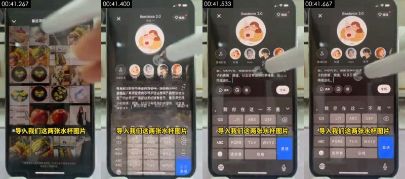

**画面で確認できる内容**（スクリーンショットと照合可能）
- 画面：机上の実機スマホを俯瞰撮影、アルバムでカップ画像を続けて選択
- 撮影／ライティング：クローズアップ；真上からの俯瞰（真上から机を撮影）；俯瞰撮影用の卓上スタンド；正面ソフトライト（フラットライト）；キーライトは正面（カメラ方向からの光で、被写体の左右の明るさがほぼ同じ）；ライティング比約 1.1:1（差 0.1 段）；ソフトライト（明暗の境界がほとんどない）
- 画面内の物体上の文字（後付け字幕ではない）：导入我们这两张水杯图片、ABC、PQRS、发送、选拼音、空格
- [AI アシスタント 画像確認] 撮っているのは実機のスマホ：本体の黒いベゼル、画面の反射、モアレが見える
- [AI アシスタント 画像確認] タッチペン／指で画面をタップしており、モーションブラーがある
- [AI アシスタント 画像確認] 画面録画ではない：システム録画特有のシャープなピクセルがない

**ツールの推定による制作方法**（推定であり、目視ではない）
- 推定：実写 67%、3D レンダリング 6%、映画・ドラマ素材 5%（fused_agent）
- 素材の出所：ユーザーの実素材：実写動画素材
- 判断根拠（ツール計測。肉眼では見分けにくい場合あり）：
  - テクスチャは写真／動画の特徴：ノイズ σ=0.17、使用色 105 種、フラットブロック 16%
  - プラットフォームで再トランスコード（Douyin/TikTok）されセンサーノイズが潰れている：ノイズ系の証拠は無効。実写か AI かは主にフレームレートと画面内容で判断

- 再現：元映像は実写：撮影プラン（ショットサイズ／カメラセットアップ／ライティング）どおりに撮り直す。撮影環境がない場合のみ AI の画像→動画生成で近似（先頭フレームを参照）。ユーザーの実素材が必要：実写動画素材（画面全体）
  - 動画プロンプト：クローズアップ、真上からの俯瞰（真上から机を撮影）、スマホを中央に置き縦画面いっぱいに、カメラはパン／トラック。机上の実機スマホを俯瞰撮影、アルバムでカップ画像を続けて選択

</details>

<details class="ref"><summary>#18 00:41.767–00:42.267 · 実写；実素材を導入（実写動画素材）</summary>

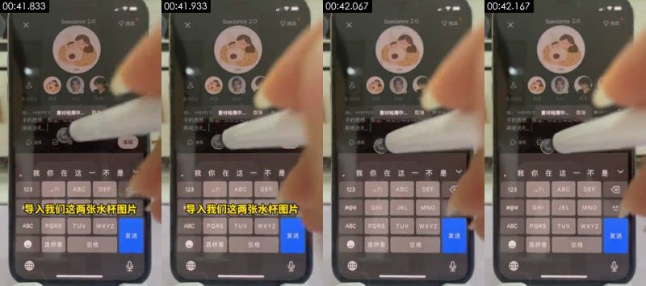

**画面で確認できる内容**（スクリーンショットと照合可能）
- 画面：机上の実機スマホを俯瞰撮影、カップ画像 2 枚が入力欄に追加済み
- 撮影／ライティング：クローズアップ；真上からの俯瞰（真上から机を撮影）；俯瞰撮影用の卓上スタンド；正面ソフトライト（フラットライト）；キーライトは正面（カメラ方向からの光で、被写体の左右の明るさがほぼ同じ）；ライティング比約 1.0:1（差 0.0 段）；ソフトライト（明暗の境界がほとんどない）
- 画面内の物体上の文字（後付け字幕ではない）：GHI、JKL、MNO、ABC、PQRS、TUV
- [AI アシスタント 画像確認] 撮っているのは実機のスマホ：本体の黒いベゼル、画面の反射、モアレが見える
- [AI アシスタント 画像確認] タッチペン／指で画面をタップしており、モーションブラーがある
- [AI アシスタント 画像確認] 画面録画ではない：システム録画特有のシャープなピクセルがない

**ツールの推定による制作方法**（推定であり、目視ではない）
- 推定：実写 66%、3D レンダリング 6%、映画・ドラマ素材 5%（fused_agent）
- 素材の出所：ユーザーの実素材：実写動画素材
- 判断根拠（ツール計測。肉眼では見分けにくい場合あり）：
  - プラットフォームで再トランスコード（Douyin/TikTok）されセンサーノイズが潰れている：ノイズ系の証拠は無効。実写か AI かは主にフレームレートと画面内容で判断

- 再現：元映像は実写：撮影プラン（ショットサイズ／カメラセットアップ／ライティング）どおりに撮り直す。撮影環境がない場合のみ AI の画像→動画生成で近似（先頭フレームを参照）。ユーザーの実素材が必要：実写動画素材（画面全体）
  - 動画プロンプト：クローズアップ、真上からの俯瞰（真上から机を撮影）、スマホを中央に置き縦画面いっぱいに。机上の実機スマホを俯瞰撮影、カップ画像 2 枚が入力欄に追加済み

</details>

<details class="ref"><summary>#19 00:42.267–00:43.167 · 実写；実素材を導入（実写動画素材）</summary>

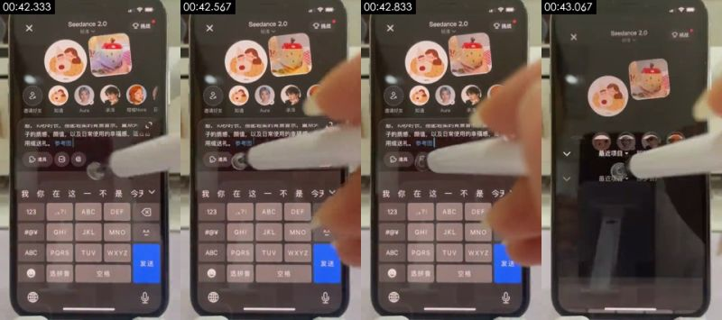

**画面で確認できる内容**（スクリーンショットと照合可能）
- 画面：机上の実機スマホを俯瞰撮影、プロンプトに参考画像 1・参考画像 2 が表示
- 撮影／ライティング：クローズアップ；真上からの俯瞰（真上から机を撮影）；俯瞰撮影用の卓上スタンド；斜め前からのキーライト + フィル（標準的なライティング）；キーライトは画面右側のやや前方；ライティング比約 1.5:1（差 0.6 段）；ハードライト（明暗の境界がはっきり）
- 画面内の物体上の文字（後付け字幕ではない）：GHI、JKL、MNO、ABC、PQRS、TUV
- [AI アシスタント 画像確認] 撮っているのは実機のスマホ：本体の黒いベゼル、画面の反射、モアレが見える
- [AI アシスタント 画像確認] タッチペン／指で画面をタップしており、モーションブラーがある
- [AI アシスタント 画像確認] 画面録画ではない：システム録画特有のシャープなピクセルがない

**ツールの推定による制作方法**（推定であり、目視ではない）
- 推定：実写 68%、3D レンダリング 6%、映画・ドラマ素材 5%（fused_agent）
- 素材の出所：ユーザーの実素材：実写動画素材
- 判断根拠（ツール計測。肉眼では見分けにくい場合あり）：
  - テクスチャは写真／動画の特徴：ノイズ σ=0.14、使用色 123 種、フラットブロック 17%
  - プラットフォームで再トランスコード（Douyin/TikTok）されセンサーノイズが潰れている：ノイズ系の証拠は無効。実写か AI かは主にフレームレートと画面内容で判断

- 再現：元映像は実写：撮影プラン（ショットサイズ／カメラセットアップ／ライティング）どおりに撮り直す。撮影環境がない場合のみ AI の画像→動画生成で近似（先頭フレームを参照）。ユーザーの実素材が必要：実写動画素材（画面全体）
  - 動画プロンプト：クローズアップ、真上からの俯瞰（真上から机を撮影）、スマホを中央に置き縦画面いっぱいに。机上の実機スマホを俯瞰撮影、プロンプトに参考画像 1・参考画像 2 が表示

</details>

<details class="ref"><summary>#20 00:43.167–00:43.733 · 実写；実素材を導入（実写動画素材）</summary>

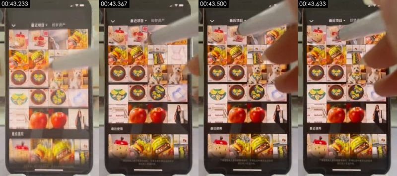

**画面で確認できる内容**（スクリーンショットと照合可能）
- 画面：机上の実機スマホを俯瞰撮影、アルバム画面が一瞬映る
- 撮影／ライティング：クローズアップ；真上からの俯瞰（真上から机を撮影）；俯瞰撮影用の卓上スタンド；正面ソフトライト（フラットライト）；キーライトは正面（カメラ方向からの光で、被写体の左右の明るさがほぼ同じ）；ライティング比約 1.3:1（差 0.4 段）；ソフトライト（明暗の境界がほとんどない）
- 画面内の物体上の文字（後付け字幕ではない）：最近使用、Haturol、15:13、最近项目
- [AI アシスタント 画像確認] 撮っているのは実機のスマホ：本体の黒いベゼル、画面の反射、モアレが見える
- [AI アシスタント 画像確認] タッチペン／指で画面をタップしており、モーションブラーがある
- [AI アシスタント 画像確認] 画面録画ではない：システム録画特有のシャープなピクセルがない

**ツールの推定による制作方法**（推定であり、目視ではない）
- 推定：実写 71%、AI 生成動画 5%、映画・ドラマ素材 5%（fused_agent）
- 素材の出所：ユーザーの実素材：実写動画素材
- 判断根拠（ツール計測。肉眼では見分けにくい場合あり）：
  - テクスチャは写真／動画の特徴：ノイズ σ=0.27、使用色 388 種、フラットブロック 10%
  - プラットフォームで再トランスコード（Douyin/TikTok）されセンサーノイズが潰れている：ノイズ系の証拠は無効。実写か AI かは主にフレームレートと画面内容で判断

- 再現：元映像は実写：撮影プラン（ショットサイズ／カメラセットアップ／ライティング）どおりに撮り直す。撮影環境がない場合のみ AI の画像→動画生成で近似（先頭フレームを参照）。ユーザーの実素材が必要：実写動画素材（画面全体）
  - 動画プロンプト：クローズアップ、真上からの俯瞰（真上から机を撮影）、スマホを中央に置き縦画面いっぱいに、カメラはパン／トラック。机上の実機スマホを俯瞰撮影、アルバム画面が一瞬映る

</details>

<details class="ref"><summary>#21 00:43.733–00:44.400 · 実写；実素材を導入（実写動画素材）</summary>


**画面で確認できる内容**（スクリーンショットと照合可能）
- 画面：机上の実機スマホを俯瞰撮影、最近使った画像の一覧
- 撮影／ライティング：クローズアップ；真上からの俯瞰（真上から机を撮影）；俯瞰撮影用の卓上スタンド；正面ソフトライト（フラットライト）；キーライトは正面（カメラ方向からの光で、被写体の左右の明るさがほぼ同じ）；ライティング比約 1.1:1（差 0.1 段）；ソフトライト（明暗の境界がほとんどない）
- 画面内の物体上の文字（後付け字幕ではない）：GHI、JKL、MNO、ABC、PQRS、TUV
- [AI アシスタント 画像確認] 撮っているのは実機のスマホ：本体の黒いベゼル、画面の反射、モアレが見える
- [AI アシスタント 画像確認] タッチペン／指で画面をタップしており、モーションブラーがある
- [AI アシスタント 画像確認] 画面録画ではない：システム録画特有のシャープなピクセルがない

**ツールの推定による制作方法**（推定であり、目視ではない）
- 推定：実写 67%、3D レンダリング 6%、映画・ドラマ素材 5%（fused_agent）
- 素材の出所：ユーザーの実素材：実写動画素材
- 判断根拠（ツール計測。肉眼では見分けにくい場合あり）：
  - プラットフォームで再トランスコード（Douyin/TikTok）されセンサーノイズが潰れている：ノイズ系の証拠は無効。実写か AI かは主にフレームレートと画面内容で判断

- 再現：元映像は実写：撮影プラン（ショットサイズ／カメラセットアップ／ライティング）どおりに撮り直す。撮影環境がない場合のみ AI の画像→動画生成で近似（先頭フレームを参照）。ユーザーの実素材が必要：実写動画素材（画面全体）
  - 動画プロンプト：クローズアップ、真上からの俯瞰（真上から机を撮影）、スマホを中央に置き縦画面いっぱいに。机上の実機スマホを俯瞰撮影、最近使った画像の一覧

</details>

<details class="ref"><summary>#22 00:44.400–00:47.067 · 実写 + コード／編集オーバーレイ（字幕）；実素材を導入（実写動画素材）</summary>


**画面で確認できる内容**（スクリーンショットと照合可能）
- 画面：机上の実機スマホを俯瞰撮影、プロンプト全文が表示され、タッチペンで「生成」をタップ
- 撮影／ライティング：クローズアップ；真上からの俯瞰（真上から机を撮影）；俯瞰撮影用の卓上スタンド；正面ソフトライト（フラットライト）；キーライトは正面（カメラ方向からの光で、被写体の左右の明るさがほぼ同じ）；ライティング比約 1.0:1（差 0.0 段）；ソフトライト（明暗の境界がほとんどない）
- 画面内の物体上の文字（後付け字幕ではない）：ABC、PQRS、TUV、选拼音、空格、输入描述你的梦境
- テキストトラック（字幕/bottom）：然后我们点击发送 / 在草稿箱里
- テキストトラック（字幕/bottom）：发送
- [AI アシスタント 画像確認] 撮っているのは実機のスマホ：本体の黒いベゼル、画面の反射、モアレが見える
- [AI アシスタント 画像確認] タッチペン／指で画面をタップしており、モーションブラーがある
- [AI アシスタント 画像確認] 画面録画ではない：システム録画特有のシャープなピクセルがない

**ツールの推定による制作方法**（推定であり、目視ではない）
- 推定：実写 62%、3D レンダリング 8%、画面録画／スクリーンショット 6%（fused_agent）
- 素材の出所：ユーザーの実素材：実写動画素材
- 判断根拠（ツール計測。肉眼では見分けにくい場合あり）：
  - テクスチャはレンダリングの特徴：フラットな色ブロック 24%、95% のピクセルがわずか 73 色、水平・垂直の直線エッジ 40%
  - プラットフォームで再トランスコード（Douyin/TikTok）されセンサーノイズが潰れている：ノイズ系の証拠は無効。実写か AI かは主にフレームレートと画面内容で判断

- 再現：元映像は実写：撮影プラン（ショットサイズ／カメラセットアップ／ライティング）どおりに撮り直す。撮影環境がない場合のみ AI の画像→動画生成で近似（先頭フレームを参照）。ユーザーの実素材が必要：実写動画素材（画面全体）
  - 動画プロンプト：クローズアップ、真上からの俯瞰（真上から机を撮影）、スマホを中央に置き縦画面いっぱいに。机上の実機スマホを俯瞰撮影、プロンプト全文が表示され、タッチペンで「生成」をタップ

</details>

<details class="ref"><summary>#23 00:47.067–00:47.733 · 実写；実素材を導入（実写動画素材）</summary>


**画面で確認できる内容**（スクリーンショットと照合可能）
- 画面：机上の実機スマホを俯瞰撮影、「提交成功，消耗 1 个额度」（送信完了、クレジット 1 消費）がポップアップ
- 撮影／ライティング：クローズアップ；真上からの俯瞰（真上から机を撮影）；俯瞰撮影用の卓上スタンド；正面ソフトライト（フラットライト）；キーライトは正面（カメラ方向からの光で、被写体の左右の明るさがほぼ同じ）；ライティング比約 1.2:1（差 0.3 段）；ソフトライト（明暗の境界がほとんどない）
- 画面内の物体上の文字（後付け字幕ではない）：可以看到视频生成的进度、暂时没有更多了、内梦境、出镜、生图、知遇
- [AI アシスタント 画像確認] 撮っているのは実機のスマホ：本体の黒いベゼル、画面の反射、モアレが見える
- [AI アシスタント 画像確認] タッチペン／指で画面をタップしており、モーションブラーがある
- [AI アシスタント 画像確認] 画面録画ではない：システム録画特有のシャープなピクセルがない

**ツールの推定による制作方法**（推定であり、目視ではない）
- 推定：実写 67%、3D レンダリング 6%、映画・ドラマ素材 5%（fused_agent）
- 素材の出所：ユーザーの実素材：実写動画素材
- 判断根拠（ツール計測。肉眼では見分けにくい場合あり）：
  - プラットフォームで再トランスコード（Douyin/TikTok）されセンサーノイズが潰れている：ノイズ系の証拠は無効。実写か AI かは主にフレームレートと画面内容で判断

- 再現：元映像は実写：撮影プラン（ショットサイズ／カメラセットアップ／ライティング）どおりに撮り直す。撮影環境がない場合のみ AI の画像→動画生成で近似（先頭フレームを参照）。ユーザーの実素材が必要：実写動画素材（画面全体）
  - 動画プロンプト：クローズアップ、真上からの俯瞰（真上から机を撮影）、スマホを中央に置き縦画面いっぱいに。机上の実機スマホを俯瞰撮影、「提交成功，消耗 1 个额度」がポップアップ

</details>

<details class="ref"><summary>#24 00:47.733–00:49.133 · 実写 + コード／編集オーバーレイ（字幕、装飾文字）；実素材を導入（実写動画素材）</summary>


**画面で確認できる内容**（スクリーンショットと照合可能）
- 画面：机上の実機スマホを俯瞰撮影、即梦のマイページの作品欄に生成中の動画の進捗が表示
- 撮影／ライティング：クローズアップ；真上からの俯瞰（真上から机を撮影）；俯瞰撮影用の卓上スタンド；斜め前からのキーライト + フィル（標準的なライティング）；キーライトは画面左側のやや前方；ライティング比約 1.5:1（差 0.5 段）；ソフトライト（明暗の移り変わりが緩やか）
- 画面内の物体上の文字（後付け字幕ではない）：暂时没有更多了、即梦、@知遇、知遇、粉丝、关注
- テキストトラック（字幕/bottom）：可以看到视频生成的进度
- [AI アシスタント 画像確認] 撮っているのは実機のスマホ：本体の黒いベゼル、画面の反射、モアレが見える
- [AI アシスタント 画像確認] タッチペン／指で画面をタップしており、モーションブラーがある
- [AI アシスタント 画像確認] 画面録画ではない：システム録画特有のシャープなピクセルがない

**ツールの推定による制作方法**（推定であり、目視ではない）
- 推定：実写 62%、3D レンダリング 8%、映画・ドラマ素材 5%（fused_agent）
- 素材の出所：ユーザーの実素材：実写動画素材
- 判断根拠（ツール計測。肉眼では見分けにくい場合あり）：
  - テクスチャはレンダリングの特徴：フラットな色ブロック 29%、95% のピクセルがわずか 100 色、水平・垂直の直線エッジ 45%
  - プラットフォームで再トランスコード（Douyin/TikTok）されセンサーノイズが潰れている：ノイズ系の証拠は無効。実写か AI かは主にフレームレートと画面内容で判断

- 再現：元映像は実写：撮影プラン（ショットサイズ／カメラセットアップ／ライティング）どおりに撮り直す。撮影環境がない場合のみ AI の画像→動画生成で近似（先頭フレームを参照）。ユーザーの実素材が必要：実写動画素材（画面全体）
  - 動画プロンプト：クローズアップ、真上からの俯瞰（真上から机を撮影）、スマホを中央に置き縦画面いっぱいに。机上の実機スマホを俯瞰撮影、即梦のマイページの作品欄に生成中の動画の進捗が表示

</details>

<details class="ref"><summary>#25 00:49.133–00:51.500 · AI 生成動画 + コード／編集オーバーレイ（装飾文字）</summary>


**画面で確認できる内容**（スクリーンショットと照合可能）
- 画面：生成結果：AI の女性「知遇」が木のテーブルに座り、リンゴ型カップを掲げて見せてから置く、暖かい日差しの木のテーブル、ライトグレーの壁、テーブル上にはリンゴ型で赤い蓋の陶器カップ、リンゴ柄のギフトボックス、赤白チェックのクロス、緑の葉っぱ型の小さじ
- 撮影／ライティング：ミディアムクローズアップ；移動カメラ（ジンバル／手持ちでスライド）；正面ソフトライト（フラットライト）；キーライトは正面（カメラ方向からの光で、被写体の左右の明るさがほぼ同じ）；ライティング比約 1.3:1（差 0.4 段）；ソフトライト（明暗の境界がほとんどない）
- 画面内の物体上の文字（後付け字幕ではない）：即梦、@知遇、Nice to mect yen、Nict tomcety、Nicctomeety、14
- [AI アシスタント 画像確認] 右下に即梦の透かしと被写体名「@知遇」がある
- [AI アシスタント 画像確認] 同じキャラクターが、後のデモで即梦上で選ぶ被写体「知遇」そのもの
- [AI アシスタント 画像確認] 光が均一できれいすぎ、動きがゆっくり

**ツールの推定による制作方法**（推定であり、目視ではない）
- 推定：AI 生成動画 71%、実写 10%、3D レンダリング 4%（fused_agent）
- 素材の出所：AI 生成
- 判断根拠（ツール計測。肉眼では見分けにくい場合あり）：
  - テクスチャは写真／動画の特徴：ノイズ σ=0.22、使用色 210 種、フラットブロック 21%
  - プラットフォームで再トランスコード（Douyin/TikTok）されセンサーノイズが潰れている：ノイズ系の証拠は無効。実写か AI かは主にフレームレートと画面内容で判断

- 再現：元映像は AI 生成：元ショットの先頭・末尾フレームを使って先頭／末尾フレーム指定で生成すれば、構図と動きをかなり忠実に再現できる。被写体を差し替える場合は、先に画像モデルで先頭フレームを修正する
  - 先頭フレーム画像プロンプト：ミディアムクローズアップ、被写体は画面上部の右側。縦型ミディアムショット・アイレベル、ロングヘアの若い女性が木のテーブルの奥に座る、オフホワイトのケーブルニット、リンゴ型で赤い蓋の陶器カップを両手で持つ、左側にギフトボックス、暖かい日差しが右から差し込み、テーブルに窓枠の影
  - 動画プロンプト：ミディアムクローズアップ、被写体は画面上部の右側、カメラはプッシュイン。縦型ミディアムショット、女性がリンゴ型カップをカメラに見せてからテーブルに戻し、微笑む、カメラはゆっくりプッシュイン

</details>

<details class="ref"><summary>#26 00:51.500–00:53.067 · AI 生成動画 + コード／編集オーバーレイ（装飾文字）</summary>


**画面で確認できる内容**（スクリーンショットと照合可能）
- 画面：生成結果：リンゴ型カップのクローズアップ、リンゴ型の蓋の軸をつまんで蓋を開ける
- 撮影／ライティング：ミディアムショット；移動カメラ（ジンバル／手持ちでスライド）；逆光／背景が被写体より明るい；キーライトは画面右側のやや前方；ライティング比約 1.4:1（差 0.4 段）；判定不能
- 画面内の物体上の文字（後付け字幕ではない）：即梦、@知遇、AI生成
- [AI アシスタント 画像確認] 右下に即梦の透かしと被写体名「@知遇」がある
- [AI アシスタント 画像確認] 同じキャラクターが、後のデモで即梦上で選ぶ被写体「知遇」そのもの
- [AI アシスタント 画像確認] 光が均一できれいすぎ、動きがゆっくり

**ツールの推定による制作方法**（推定であり、目視ではない）
- 推定：AI 生成動画 72%、実写 10%、3D レンダリング 4%（fused_agent）
- 素材の出所：AI 生成
- 判断根拠（ツール計測。肉眼では見分けにくい場合あり）：
  - テクスチャは写真／動画の特徴：ノイズ σ=0.22、使用色 257 種、フラットブロック 19%
  - プラットフォームで再トランスコード（Douyin/TikTok）されセンサーノイズが潰れている：ノイズ系の証拠は無効。実写か AI かは主にフレームレートと画面内容で判断

- 再現：元映像は AI 生成：元ショットの先頭・末尾フレームを使って先頭／末尾フレーム指定で生成すれば、構図と動きをかなり忠実に再現できる。被写体を差し替える場合は、先に画像モデルで先頭フレームを修正する
  - 先頭フレーム画像プロンプト：ミディアムショット、被写体は画面下部の中央。縦型クローズアップ、リンゴ型で赤い蓋の陶器カップが赤白チェックのクロスの中央に置かれ、奥にギフトボックスと額装された「福」の字、柔らかい日光
  - 動画プロンプト：ミディアムショット、被写体は画面下部の中央、カメラはパン／トラック。縦型クローズアップ、手が上からリンゴ型の蓋の軸をつまんでゆっくり開け、カップの口が見える

</details>

<details class="ref"><summary>#27 00:53.067–00:54.900 · AI 生成動画</summary>


**画面で確認できる内容**（スクリーンショットと照合可能）
- 画面：生成結果：葉っぱ型の小さじでミルクティー入りのリンゴ型カップをかき混ぜる
- 撮影／ライティング：ミディアムショット；移動カメラ（ジンバル／手持ちでスライド）；正面ソフトライト（フラットライト）；キーライトは正面（カメラ方向からの光で、被写体の左右の明るさがほぼ同じ）；ライティング比約 1.2:1（差 0.3 段）；ソフトライト（明暗の境界がほとんどない）
- 画面内の物体上の文字（後付け字幕ではない）：eer、即梦、meet、AI生成
- [AI アシスタント 画像確認] 右下に即梦の透かしと被写体名「@知遇」がある
- [AI アシスタント 画像確認] 同じキャラクターが、後のデモで即梦上で選ぶ被写体「知遇」そのもの
- [AI アシスタント 画像確認] 光が均一できれいすぎ、動きがゆっくり

**ツールの推定による制作方法**（推定であり、目視ではない）
- 推定：AI 生成動画 71%、実写 10%、3D レンダリング 5%（fused_agent）
- 素材の出所：AI 生成
- 判断根拠（ツール計測。肉眼では見分けにくい場合あり）：
  - テクスチャは写真／動画の特徴：ノイズ σ=0.21、使用色 234 種、フラットブロック 22%
  - プラットフォームで再トランスコード（Douyin/TikTok）されセンサーノイズが潰れている：ノイズ系の証拠は無効。実写か AI かは主にフレームレートと画面内容で判断

- 再現：元映像は AI 生成：元ショットの先頭・末尾フレームを使って先頭／末尾フレーム指定で生成すれば、構図と動きをかなり忠実に再現できる。被写体を差し替える場合は、先に画像モデルで先頭フレームを修正する
  - 先頭フレーム画像プロンプト：ミディアムショット、被写体は画面下部の中央。縦型クローズアップ、ミルクティー入りのリンゴ柄の陶器カップが赤白チェックのクロスに置かれ、奥にリンゴ型の蓋とギフトボックス、柔らかい日光
  - 動画プロンプト：ミディアムショット、被写体は画面下部の中央。縦型クローズアップ、片手で緑の葉っぱ型の小さじを持ち、カップの中のミルクティーをゆっくりかき混ぜる、固定カメラ

</details>

<details class="ref"><summary>#28 00:54.900–00:57.667 · AI 生成動画</summary>


**画面で確認できる内容**（スクリーンショットと照合可能）
- 画面：生成結果：女性が両手でカップを顔の横に寄せ、目を閉じて味わう
- 撮影／ライティング：ミディアムクローズアップ；移動カメラ（ジンバル／手持ちでスライド）；正面ソフトライト（フラットライト）；キーライトは正面（カメラ方向からの光で、被写体の左右の明るさがほぼ同じ）；ライティング比約 1.2:1（差 0.3 段）；ソフトライト（明暗の境界がほとんどない）
- 画面内の物体上の文字（後付け字幕ではない）：Niee to mut gou、Niek to mtet you、Niee to mtut yeu、Ir':、keitr.、eirr.
- [AI アシスタント 画像確認] 右下に即梦の透かしと被写体名「@知遇」がある
- [AI アシスタント 画像確認] 同じキャラクターが、後のデモで即梦上で選ぶ被写体「知遇」そのもの
- [AI アシスタント 画像確認] 光が均一できれいすぎ、動きがゆっくり

**ツールの推定による制作方法**（推定であり、目視ではない）
- 推定：AI 生成動画 71%、実写 9%、3D レンダリング 4%（fused_agent）
- 素材の出所：AI 生成
- 判断根拠（ツール計測。肉眼では見分けにくい場合あり）：
  - テクスチャは写真／動画の特徴：ノイズ σ=0.23、使用色 160 種、フラットブロック 21%
  - プラットフォームで再トランスコード（Douyin/TikTok）されセンサーノイズが潰れている：ノイズ系の証拠は無効。実写か AI かは主にフレームレートと画面内容で判断

- 再現：元映像は AI 生成：元ショットの先頭・末尾フレームを使って先頭／末尾フレーム指定で生成すれば、構図と動きをかなり忠実に再現できる。被写体を差し替える場合は、先に画像モデルで先頭フレームを修正する
  - 先頭フレーム画像プロンプト：ミディアムクローズアップ、被写体は画面上部の右側。縦型ミディアムショット・アイレベル、ロングヘアの若い女性が木のテーブルの奥やや右に座る、両手でリンゴ型カップをあごの横に持つ、左側にギフトボックス、テーブルにチェックのクロスと葉っぱ型のスプーン、暖かい日差し
  - 動画プロンプト：ミディアムクローズアップ、被写体は画面上部の右側、カメラはプルアウト。縦型ミディアムショット、女性が両手でリンゴ型カップを顔の横に寄せ、軽く首をかしげて微笑む、カメラはゆっくりプルアウト

</details>

### メタデータの手がかり

- エンコーダー：`Lavf61.7.100`
- platform：Douyin/TikTok

### 注記

- 決定論的な解析は「動いているか、画面全体のプッシュイン／プルアウトか、レンダリングのテクスチャか、24→30 のフレームレート変換か」については信頼性が高い。実写／AI／3D の区別は画像を見て判断する必要があり（画像認識モデルまたは AI アシスタントによる確認）、自分でもスクリーンショットと照合して一度確認するのが望ましい。
- メタデータはプラットフォームのトランスコードで消されることが多く、見当たらなくても元々なかったとは限らない。
- 全データは `breakdown.json` にある。モデルに読ませる分解パッケージは `REEL.md` から始まる。
