# 这条视频是怎么做的：dual_role.mp4

**一句话**：用两个 AI 角色一问一答，把一个小红书笔记诊断工具的输出截图串成 19 秒的「问题—原因—证据—改法」，每句回答都马上用真实截图证明。
**怎么做的**：混合制作：代码/模板渲染 59% + AI 生成视频 41%

- 0:19 · 竖屏 9:16 · 10 个镜头，平均 1.9 秒一个
- 判断可靠度 80%，依据：工具测量 + AI 助手看图复核 10 镜
- ⚠️ 有 1 处拿不准，见「不确定点」

<!--mix-->


## 核心看点

- **开头怎么抓人**：0–1.4 秒先甩出诊断截图，红字「不会。9 成扑街概率」配字幕「这条才发二十一分钟」；1.4 秒切到抱着手机的女生惊讶反问「就被判九成扑街？」，一个具体又扎心的数字加一个替观众发声的表情，做内容的人会停下来。
- 2.8–5.8 秒：回答者一句「封面顺序反了」，下一镜就把三张配图横向摆开、推到第 3 张大字图上：观点后面紧跟画面证据，观众不用想象就看懂问题
- 5.8 秒和 10.5 秒：提问者两次替观众追问（「它怎么知道哪张有钩子？」「连改法都给了？」），每次追问后接一张报告截图作答：用对话把功能点一个个抛出来，比旁白罗列卖点更像真实推荐
- 13.5–16.1 秒：回答者主动说门槛「前提是你得自己配一个会看图的大模型」：先把限制讲在前面，降低被骗感，评论区也少了质疑
- 16.1–19.0 秒：结尾落在 GitHub 仓库页并推近到仓库名，台词「先别删，拿它查查」和全程顶部标题「笔记没人看，先别删」首尾呼应，观众记住名字和去处

## 一眼看懂：画面、包装、声音三层

短视频都可以拆成三层：底下是画面本身，上面叠字幕、花字、贴纸，再配上声音。复刻时一层一层做。

| 层 | 这条视频里是什么 | 怎么做 | 细节 |
|---|---|---|---|
| **画面**（底层） | 代码/模板渲染 5 镜、AI 生成视频 5 镜 | AI 分 4 次生成；录屏 / 代码做动效 | 「自己复刻」 |
| **包装**（叠在画面上） | 文字、标题、字幕 | 剪辑软件里加：字幕、花字、贴纸照时间轴摆 | 「剪辑包装层」 |
| **声音** | 人声（AI 视频原生对白（随画面生成）） | 人声：跟 AI 视频一起生成 | 「声音」 |

## 内容与结构

- 下面的叙事线来自逐镜看图；台词没有单独整理，字幕原文见「剪辑包装层」

**叙事线**

复刻时保留这条线：每一步的顺序和作用照搬，讲的那一点换成自己的案例、数据和素材，就不只是换个主角。

| 时间 | 镜头 | 作用 | 在讲什么 |
|---|---|---|---|
| 0.0–2.8s | #1、#2 | 抓注意 | 开场直接亮出一个刺眼的坏结果数字 → 用当事人惊讶的反问放大痛点 |
| 2.8–3.9s | #3 | 补信息 | 懂行的一方一句话点出真正的原因 |
| 3.9–5.8s | #4 | 给证据 | 把三张图并排摆出来，让观众亲眼看到问题在哪 |
| 5.8–7.5s | #5 | 转折 | 替观众问出最直接的质疑 |
| 7.5–10.5s | #6 | 给证据 | 拿同类前几名做对比，给出判断依据 |
| 10.5–11.5s | #7 | 转折 | 惊喜追问，把话题从诊断推到解决办法 |
| 11.5–13.5s | #8 | 给证据 | 直接展示工具给出的现成改法 |
| 13.5–16.1s | #9 | 补信息 | 主动交代使用门槛，先把预期说清楚 |
| 16.1–19.0s | #10 | 引导行动 | 落到工具本身，告诉观众去哪里拿 |

## 分镜表

「画面」「运镜」「叠加层」是画面里看得到的；「制作方式」「素材来源」是工具推断的，依据见附录逐镜取证。

| # | 截图 | 时间 | 时长 | 在讲什么 | 画面 | 运镜 | 叠加层 | 制作方式（推断） | 素材来源（推断） | 复刻 |
|---|---|---|---|---|---|---|---|---|---|---|
| 1 |  | 0:00.0 | 1.4s | 抓注意：开场直接亮出一个刺眼的坏结果数字 | 竖屏模板：深灰底，顶部标题「笔记没人看，先别删」，底部字幕。中间一张诊断报告截图… | 平滑运镜 | — | 代码/模板渲染 77% | 录屏素材、界面截图 | 代码渲染 · 段1 |
| 2 |  | 0:01.4 | 1.5s | 抓注意：用当事人惊讶的反问放大痛点 | 夜晚客厅，短发女生戴青绿色粗框眼镜、穿浅黄色连帽卫衣，盘腿坐在沙发上抱着米白抱枕… | 平滑运镜 | 文字、标题 | AI 生成视频 85% | AI 生成 | AI 生成 · G1 |
| 3 |  | 0:02.8 | 1.0s | 补信息：懂行的一方一句话点出真正的原因 | 夜晚书房，短发女性戴黑色报童帽和细金属圆框眼镜，白衬衫外套墨绿色 V 领针织背心… | 平滑运镜 | 文字、标题 | AI 生成视频 68% | AI 生成 | AI 生成 · G2 |
| 4 |  | 0:03.9 | 2.0s | 给证据：把三张图并排摆出来，让观众亲眼看到问题在哪 | 深灰模板上，一条横向截图展示笔记的三张配图：第 1 张蒸汽朋克火车插画、第 2 … | 平滑运镜 | — | 代码/模板渲染 79% | 录屏素材、界面截图 | 代码渲染 · 段2 |
| 5 |  | 0:05.8 | 1.7s | 转折：替观众问出最直接的质疑 | 同 #2 的客厅场景和女生：她从笑着开口变成皱眉思考，眼睛看向画面右侧发问，身体… | 固定 | 字幕、标题 | AI 生成视频 88% | AI 生成 | AI 生成 · G3 |
| 6 |  | 0:07.5 | 3.0s | 给证据：拿同类前几名做对比，给出判断依据 | 深灰模板上，一张诊断报告截图：粉色标题「6. 共性总结 — 用户该抄什么」、黑字… | 平滑运镜 | — | 代码/模板渲染 79% | 录屏素材、界面截图 | 代码渲染 · 段3 |
| 7 |  | 0:10.5 | 1.0s | 转折：惊喜追问，把话题从诊断推到解决办法 | 同 #2 的客厅场景和女生：她看向画面右侧，惊喜地张嘴发问，随后又低头看了一眼手… | 固定（主体在动） | 字幕、标题 | AI 生成视频 85% | AI 生成 | AI 生成 · G3 |
| 8 |  | 0:11.5 | 1.9s | 给证据：直接展示工具给出的现成改法 | 深灰模板上，一张诊断报告截图：标题「P0 — 现在就改（5 分钟内，决定生死）」… | 平滑运镜 | — | 代码/模板渲染 77% | 录屏素材、界面截图 | 代码渲染 · 段4 |
| 9 |  | 0:13.5 | 2.7s | 补信息：主动交代使用门槛，先把预期说清楚 | 同 #3 的书房场景和戴报童帽的女性：她看向画面左侧，微笑着边说边点头，双手捧杯… | 平滑运镜 | 字幕、标题 | AI 生成视频 88% | AI 生成 | AI 生成 · G4 |
| 10 |  | 0:16.1 | 2.9s | 引导行动：落到工具本身，告诉观众去哪里拿 | 深灰模板上，一张 GitHub 移动端仓库页截图（仓库 JuneYaooo/so… | 平滑运镜 | — | 代码/模板渲染 73% | 界面截图 | 代码渲染 · 段5 |

## 自己复刻：按这个顺序做

复刻的是做法和节奏，不是照抄画面。

1. **定内容**：照「内容与结构」的叙事线写自己的脚本
2. **备素材**：见下方「要准备的素材」
3. **AI 生成**：4 次生成，见下方「AI 生成」
4. **录屏和动效**：见下方「代码合成」
5. **剪辑**：见下方「剪辑」
6. **包装**：字幕文件 `packaging/subtitles.srt` 可以直接导入剪辑软件；样式和时间轴见「剪辑包装层」
7. **声音**：见「声音」，每处音效都能先试听
8. **对照检查**：成片和原片并排看一遍：镜头长短、字幕位置、音乐起落对不对得上

### 要准备的素材

- `@图片1` 人物参考图（每个角色一张正脸 + 半身），保证跨镜头长相一致：提问的女生（发笔记的博主）、戴报童帽的女性（懂行的人）
- 画面里直接用的真实文件（截图、照片、录屏，要拿到原文件）：
  - **录屏素材**（画面局部 x0% y31% 宽100% 高37%）：镜头 #1，共 1.4s
  - **界面截图**（画面局部），诊断报告截图（TL;DR 和核心诊断段落）（画面中部卡片）：镜头 #1，共 1.4s
  - **录屏素材**（画面局部 x0% y29% 宽100% 高41%）：镜头 #4，共 2.0s
  - **界面截图**（画面局部），笔记三张配图及说明文字的截图（画面中部横条）：镜头 #4，共 2.0s
  - **录屏素材**（画面局部 x0% y36% 宽100% 高27%）：镜头 #6，共 3.0s
  - **界面截图**（画面局部），诊断报告「共性总结」段落截图（画面中部卡片）：镜头 #6，共 3.0s
  - **录屏素材**（画面局部 x0% y36% 宽100% 高28%）：镜头 #8，共 1.9s
  - **界面截图**（画面局部），诊断报告「P0 现在就改」段落截图（画面中部卡片）：镜头 #8，共 1.9s
  - **界面截图**（画面局部 x0% y22% 宽100% 高69%）：镜头 #10，共 2.9s
  - **界面截图**（画面局部），GitHub 仓库页（手机网页）截图（画面中部，最后占满宽度）：镜头 #10，共 2.9s

### AI 生成

**AI 视频 5 镜 → 4 个生成单元、4 次 Seedance 2.0（含 Mini / Fast） 调用**

- 分组规则：同场景、硬切相连的 AI 镜头合并为一次生成；单次 ≤15s；单元内连续硬切尽量 ≤8s、最多 10s；在叠化/淡入淡出和换场景处切开
- 声音：模型可以同时生成动作音效和环境声；口播是真人录的：单独录好再混进去，不让视频模型生成，方便改文案和卡时间
- 包装层：生成单元镜头上的字幕属于后期包装，不写进提示词；参考帧上带着的先擦掉，生成后按「剪辑包装层」的时间轴叠回

AI 视频模型能吃这几种输入，每个生成单元下面写了要喂哪些、从哪来：
- **文字提示词**：必需，描述画面、动作、运镜
- **首帧图**：锁住第一帧的构图和主体。不给就是纯文生，构图每次都不一样
- **尾帧图**：再锁住最后一帧，模型只补中间过程。适合单个有运镜或动作的镜头
- **参考图**：商品、人物的样子，让多个镜头里长得一样（提示词里用 `@图片1` 指代）
- **参考视频**：照着学动作、运镜和节奏，不复制画面（`@视频1`）；不是每个模型都支持

每个单元一次生成。表里是要喂给模型的东西，展开单元看来源和提示词。

| 单元 | 镜头 | 时间 | 时长 | 方式 | 要喂的 | 衔接 |
|---|---|---|---|---|---|---|
| G1 | #2 | 1.4–2.8s | 1.5s | 单镜 | 首帧图 + 参考图 + 参考视频 | — |
| G2 | #3 | 2.8–3.9s | 1.0s | 单镜 | 首帧图 + 参考图 + 参考视频 | — |
| G3 | #5、#7 | 5.8–7.5s、10.5–11.5s | 2.7s | 一次多镜头 | 首帧图 + 参考图 + 参考视频 | — |
| G4 | #9 | 13.5–16.1s | 2.7s | 单镜 | 首帧图 + 参考图 + 参考视频 | — |

<details><summary>G1 · 镜头 #2 · 1.5s · 多参考生成</summary>

| 输入 | 要不要 | 从哪来 | 为什么 |
|---|---|---|---|
| 文字提示词 | 要 | 见下面的提示词 | 描述画面、动作和运镜；其他输入都只是约束它 |
| 首帧图 | 建议 | 原片 `shots/shot_002_first.jpg`（换产品、人物或画风时，用图像模型照下面的首帧提示词重画）。这个模型首帧和参考图不能同时传：作为第 2 张参考图传入，提示词写「@图片2 作为首帧」（即梦全能参考支持，API 多半不支持） | 构图、景别、主体位置一次锁定；只给文字，每次生成的构图都不一样 |
| 尾帧图 | 不用 | — | 这一单元用参考图保住商品和人物，这个模型在参考模式下不收尾帧 |
| 参考图 | 要 | `@图片1` 人物参考图（每个角色一张正脸 + 半身），保证跨镜头长相一致 | 首帧只管第一帧，后面画面里的商品和人靠参考图保持一致 |
| 参考视频 | 建议 | `@视频1` 原片 1.4–2.8s 片段 | 照着学动作、运镜和剪辑节奏；只作参考，不会复制画面 |

- 首帧图像提示词：竖屏 9:16，中景，略俯视角。夜晚客厅，短发中国女生戴青绿色粗框圆眼镜，穿浅黄色连帽卫衣，盘腿坐在米白沙发上，怀里抱着米白抱枕，右手拿着深色手机，坐在画面左中、身体朝右前方，抬头看向画面右侧。右后方一盏暖色落地灯，背景窗帘与绿植虚化，手机屏幕的冷光照亮脸，写实电影感。
- 生成 4s 后剪到 1.5s（太短的镜头单独生成不稳定）

```text
竖屏 9:16；夜景/弱光环境光，没有专门补光，柔光（几乎没有明暗分界），偏冷（日光/冷白 LED），背景略虚。人物以 @图片1 为准。参考 @视频1 的动作、运镜和剪辑节奏。
中景，略俯视角，女生坐在画面左中。她刚看完手机，抬头望向画面右侧，眉毛扬起、嘴巴张开，惊讶地说「就被判九成扑街？」，手里的手机轻轻晃动，结尾停在惊讶的表情上。固定机位。
```

英文提示词：

```text
Medium shot, slightly high angle, the young woman sits left of center. Having just looked at her phone, she looks up toward frame right, eyebrows raised and mouth open, and asks in surprise "就被判九成扑街？"; the phone in her hand moves slightly; ends on her surprised face. Locked-off camera.
```

</details>

<details><summary>G2 · 镜头 #3 · 1.0s · 多参考生成</summary>

| 输入 | 要不要 | 从哪来 | 为什么 |
|---|---|---|---|
| 文字提示词 | 要 | 见下面的提示词 | 描述画面、动作和运镜；其他输入都只是约束它 |
| 首帧图 | 建议 | 原片 `shots/shot_003_first.jpg`（换产品、人物或画风时，用图像模型照下面的首帧提示词重画）。这个模型首帧和参考图不能同时传：作为第 2 张参考图传入，提示词写「@图片2 作为首帧」（即梦全能参考支持，API 多半不支持） | 构图、景别、主体位置一次锁定；只给文字，每次生成的构图都不一样 |
| 尾帧图 | 不用 | — | 这一单元用参考图保住商品和人物，这个模型在参考模式下不收尾帧 |
| 参考图 | 要 | `@图片1` 人物参考图（每个角色一张正脸 + 半身），保证跨镜头长相一致 | 首帧只管第一帧，后面画面里的商品和人靠参考图保持一致 |
| 参考视频 | 建议 | `@视频1` 原片 2.8–3.9s 片段 | 照着学动作、运镜和剪辑节奏；只作参考，不会复制画面 |

- 首帧图像提示词：竖屏 9:16，中景，平视。夜晚书房，短发中国女性戴黑色呢子报童帽和细金属圆框眼镜，白衬衫外套墨绿色 V 领针织背心，坐在米白扶手椅上，位于画面中间偏左，身体微侧，双手捧着白色马克杯放在腿前。背景深色书架、暖色吊灯和绿植虚化，左前方暖色柔光，暗调写实电影感。
- 生成 4s 后剪到 1.0s（太短的镜头单独生成不稳定）

```text
竖屏 9:16；夜景/弱光环境光，没有专门补光，柔光（几乎没有明暗分界），偏冷（日光/冷白 LED），背景略虚。人物以 @图片1 为准。参考 @视频1 的动作、运镜和剪辑节奏。
中景，平视，女性坐在画面中间偏左的扶手椅上。她先眨一下眼，然后看向画面左侧，平静笃定地说「封面顺序反了」，头轻轻点一下，双手一直捧着马克杯。固定机位。
```

英文提示词：

```text
Medium shot, eye level, the woman sits in the armchair left of center. She blinks once, then looks toward frame left and says calmly and firmly "封面顺序反了", with a small nod, both hands holding the mug throughout. Locked-off camera.
```

</details>

<details><summary>G3 · 镜头 #5、#7 · 2.7s · 多参考生成</summary>

| 输入 | 要不要 | 从哪来 | 为什么 |
|---|---|---|---|
| 文字提示词 | 要 | 见下面的提示词 | 描述画面、动作和运镜；其他输入都只是约束它 |
| 首帧图 | 建议 | 原片 `shots/shot_005_first.jpg`（换产品、人物或画风时，用图像模型照下面的首帧提示词重画）。这个模型首帧和参考图不能同时传：作为第 2 张参考图传入，提示词写「@图片2 作为首帧」（即梦全能参考支持，API 多半不支持） | 构图、景别、主体位置一次锁定；只给文字，每次生成的构图都不一样 |
| 尾帧图 | 不用 | — | 一次出多个镜头，尾帧只能约束最后一镜，不用 |
| 参考图 | 要 | `@图片1` 人物参考图（每个角色一张正脸 + 半身），保证跨镜头长相一致 | 首帧只管第一帧，后面画面里的商品和人靠参考图保持一致 |
| 参考视频 | 建议 | `@视频1` 原片 5.8–7.5s、10.5–11.5s 片段（剪掉中间插入的画面后拼成一段） | 照着学动作、运镜和剪辑节奏；只作参考，不会复制画面 |

- 首帧图像提示词：同 #2 的首帧：竖屏 9:16 中景略俯，夜晚客厅，戴青绿色粗框眼镜、穿浅黄色连帽卫衣的短发女生盘腿坐沙发抱抱枕拿手机，看向画面右侧，嘴角带笑。
- 生成 4s 后剪到 2.7s（太短的镜头单独生成不稳定）；这几镜在成片里被插入画面隔开：生成时连着出，剪辑时再把插入画面放回去

```text
竖屏 9:16；夜景/弱光环境光，没有专门补光，柔光（几乎没有明暗分界），偏冷（日光/冷白 LED），背景略虚。人物以 @图片1 为准。参考 @视频1 的动作、运镜和剪辑节奏。镜头之间硬切。
镜头1（0.0–1.7s）：中景，略俯视角，女生坐在画面左中。她先笑着张口，随后皱眉、眼睛看向画面右侧，疑惑地问「它怎么知道哪张有钩子？」，手机握在手里，结尾停在疑惑表情上。固定机位。
镜头2（1.7–2.7s）：中景，略俯视角，女生坐在画面左中。她看着画面右侧，眼睛睁大、惊喜地问「连改法都给了？」，说完低头瞄一眼手机再抬头。固定机位。
```

英文提示词：

```text
Shot 1 (0.0-1.7s): Medium shot, slightly high angle, the young woman sits left of center. She starts with an open smile, then frowns and looks toward frame right, asking puzzled "它怎么知道哪张有钩子？"; the phone stays in her hand; ends on a puzzled look. Locked-off camera.
Shot 2 (1.7-2.7s): Medium shot, slightly high angle, the young woman sits left of center. Looking toward frame right, eyes wide, she asks delighted "连改法都给了？", then glances down at her phone and looks up again. Locked-off camera.
```

</details>

<details><summary>G4 · 镜头 #9 · 2.7s · 多参考生成</summary>

| 输入 | 要不要 | 从哪来 | 为什么 |
|---|---|---|---|
| 文字提示词 | 要 | 见下面的提示词 | 描述画面、动作和运镜；其他输入都只是约束它 |
| 首帧图 | 建议 | 原片 `shots/shot_009_first.jpg`（换产品、人物或画风时，用图像模型照下面的首帧提示词重画）。这个模型首帧和参考图不能同时传：作为第 2 张参考图传入，提示词写「@图片2 作为首帧」（即梦全能参考支持，API 多半不支持） | 构图、景别、主体位置一次锁定；只给文字，每次生成的构图都不一样 |
| 尾帧图 | 不用 | — | 这一单元用参考图保住商品和人物，这个模型在参考模式下不收尾帧 |
| 参考图 | 要 | `@图片1` 人物参考图（每个角色一张正脸 + 半身），保证跨镜头长相一致 | 首帧只管第一帧，后面画面里的商品和人靠参考图保持一致 |
| 参考视频 | 建议 | `@视频1` 原片 13.5–16.1s 片段 | 照着学动作、运镜和剪辑节奏；只作参考，不会复制画面 |

- 首帧图像提示词：同 #3 的首帧：竖屏 9:16 中景平视，夜晚书房，戴黑色报童帽和细金属圆框眼镜、白衬衫外套墨绿针织背心的短发女性坐在米白扶手椅上，双手捧白色马克杯，看向画面左侧微笑。
- 生成 4s 后剪到 2.7s（太短的镜头单独生成不稳定）

```text
竖屏 9:16；夜景/弱光环境光，没有专门补光，柔光（几乎没有明暗分界），偏冷（日光/冷白 LED），背景略虚。人物以 @图片1 为准。参考 @视频1 的动作、运镜和剪辑节奏。
中景，平视，女性坐在画面中间偏左的扶手椅上。她看向画面左侧，微笑着不紧不慢地说「前提是你得自己配一个会看图的大模型」，说话时轻轻点头，双手捧着杯子，结尾停在微笑上。固定机位。
```

英文提示词：

```text
Medium shot, eye level, the woman sits in the armchair left of center. Looking toward frame left, she smiles and says unhurriedly "前提是你得自己配一个会看图的大模型", nodding gently while she talks, both hands around the mug; ends on her smile. Locked-off camera.
```

</details>

### 代码合成

一个 Remotion/HTML 工程，按文字轨和版式重建（文字、界面 100% 可控，改文案只改数据）；可以让 LLM 直接写这个工程。

- 段1：镜头 #1（0.0–1.4s）
- 段2：镜头 #4（3.9–5.8s）
- 段3：镜头 #6（7.5–10.5s）
- 段4：镜头 #8（11.5–13.5s）
- 段5：镜头 #10（16.1–19.0s）

复刻资产（都在报告目录里，复刻时和下面的数据一起交给写代码的人或 LLM）：
- `shots/shot_XXX_first.jpg` / `_last.jpg`：每镜首尾帧原分辨率，对版式、字号、留白
- `shots/shot_XXX_strip.jpg`：约每 0.5 秒一张的关键帧条，看动画过程
- `shots/shot_XXX_elements.jpg` 和 `_el_NN.jpg` / `_st_NN.jpg` / `_ly_NN.jpg`：每个元素停稳后的原分辨率截图，编号对应动效时间轴；图形照着重画，图标、Logo、插画这类画不出来的可以直接抠图用
- `packaging/overlays.ass`、`packaging/timeline.json`：文字的时间、位置、颜色

画面做法（按工具测得的画面类型）：
- 数据图表：SVG/D3 比例尺画坐标和图形，数字用 interpolate() 逐帧计数，柱/线按 spring() 生长

| 镜头 | 时间 | 做法 | 画面 | 运镜 | 主色 | 画面文字 |
|---|---|---|---|---|---|---|
| #1 | 0.0–1.4s | 数据图表 | 竖屏模板：深灰底，顶部标题「笔记没人看，先别删」，底部字幕。中间一张诊断报告截图（粉色小标题「0. TL;DR — 这条会爆吗？」、红字结论「不会。9 成扑街概率」、三条「核心诊断」列表），整张截图以左边为基点迅速放大、上沿向上移，结论那一行越来越大。 | 推近 57%/s，画面向上移 | 底 #1e2931 · #fbeef3 #b6aeb0 #ddd0d7 #8e8a8d | 这条才发二十一分钟 / 0.TL;DR一这条会爆吗？ / 无垂直标签积累→第一池200-500曝光后大概率不进 / 笔记没人看，先别删 / 笔记没人看，先别册 |
| #4 | 3.9–5.8s | 数据图表 | 深灰模板上，一条横向截图展示笔记的三张配图：第 1 张蒸汽朋克火车插画、第 2 张双重曝光精灵女王、第 3 张白底黑字大字图「image2王炸效果，设计师又又又要失业了」（「设计师」黄色高亮）。截图边放大边向左移，停在第 2、3 张上，对应台词「带钩子那张埋在第三张」。 | 推近 25%/s，画面向左移 | 底 #1e2931 · #fafafa #dad6c8 #999484 #bab4a2 | 带钩子那张埋在第三张 / 笔记没人看，先别册 / 笔记没人看，先别删 |
| #6 | 7.5–10.5s | 数据图表 | 深灰模板上，一张诊断报告截图：粉色标题「6. 共性总结 — 用户该抄什么」、黑字「top 9 都在做的事（你这条 1 个都没做）」和 5 条列表（封面有大字、明确身份锚定、反差、原型对比、垂直号沉淀）。截图从小到大慢慢推近，3 秒里放大约三分之一。 | 推近 11%/s，画面向上移 | 底 #1e2931 · #fbfcfd #dedddf #aaa8a8 #c7c2c3 | 笔记没人看，先别册 / 笔记没人看，先别删 |
| #8 | 11.5–13.5s | 数据图表 | 深灰模板上，一张诊断报告截图：标题「P0 — 现在就改（5 分钟内，决定生死）」，三条改法（把第 3 张设成封面、正文补提示词、改标题）和三个候选标题。截图慢慢推近，停在候选标题上。 | 推近 25%/s，画面向上移 | 底 #1e2931 · #fbfcfd #cbccce #e4e4e4 #b2b1af | 三个新标题都写好了 / 笔记没人看，先别册 |
| #10 | 16.1–19.0s | 数据图表 | 深灰模板上，一张 GitHub 移动端仓库页截图（仓库 JuneYaooo/social-account-doctor，Code 按钮、分支 main、文件列表）。截图从全宽开始持续推近，最后停在仓库名和前几个文件夹上。 | 推近 20%/s，画面向上移 | 底 #1e2931 · #f5f9fa #000102 #d1dae0 #b5b6b8 | 笔记没人看，先别删 / 笔记没人看，先别册 / Sign in / Sig |

逐镜动效时间轴（工具测量：位置是占画面宽高的百分比，颜色是元素稳定后的取色；配合关键帧条看）

<details class="ref"><summary>动效 #1 0.0–1.4s · 5 个</summary>

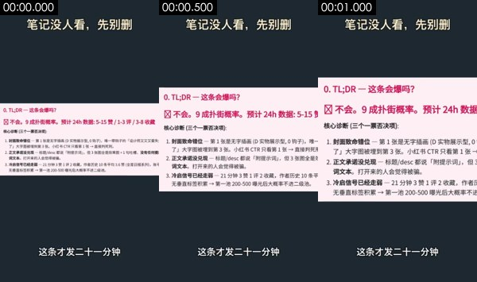

- 背景 #1e2931；其他主色 #fbeef3 #b6aeb0 #ddd0d7 #8e8a8d
元素截图（编号对应下面的动效；L 是持续运动层的镜头中段和结尾，S 是整镜不动的元素），原分辨率单张在 `shots/` 里：


- S1. 整镜不动：图形/文字块 · x 16%–56%，y 6%–11% · #ded9c9 · 文字「笔记没人看，先别删 / 笔记没人看，先别册」 · [截图](shots/shot_001_st_01.jpg)
- S2. 整镜不动：图形/文字块 · x 61%–84%，y 6%–11% · #e9e6d1 · [截图](shots/shot_001_st_02.jpg)
- S3. 整镜不动：图形/文字块 · x 0%–100%，y 40%–61% · #fdeff3 · 文字「0.TL;DR一这条会爆吗？ / 不会。9成扑街概率。预计24h数据：5-15赞/1-3评/3-8收藏 / 核心诊断（三个一票否决项）：」 · [截图](shots/shot_001_st_03.jpg)
- S4. 整镜不动：图形/文字块 · x 24%–76%，y 88%–91% · #dde1e5 · 文字「这条才发二十一分钟」 · [截图](shots/shot_001_st_04.jpg)
- [截图 L1](shots/shot_001_ly_01.jpg) [截图 L2](shots/shot_001_ly_02.jpg) · 持续运动层：35% 的画面整镜都在动（x 0%–100%，y 28%–71%），如漂移的渐变、粒子流、辉光呼吸
1. 0.07–0.40s · 中右（x 76%–100%，y 44%–45%） · 消失，匀速 · #e290ad · [截图](shots/shot_001_el_01.jpg)
2. 0.07–0.93s · 中右（x 36%–100%，y 55%–58%） · 出现，向右移入，先慢后快 · #b6acaf · 文字「2.正文承诺没兑现一标题/desc都说「附提示词，但3张图全是效果图+1句吐槽，没有任何提 / 3.冷启信号已经走弱一21分钟3赞1评2收藏，作者历史10条平均3.6赞（全是日报系列），账号 / 了」大字图被埋到第3张。小红书CTR只看第1张→直接判死开」 · [截图](shots/shot_001_el_02.jpg)
3. 0.07–0.80s · 中右（x 64%–100%，y 59%–63%） · 消失，由小放大，缓入缓出 · #212831 · [截图](shots/shot_001_el_03.jpg)
4. 1.00–1.07s · 下（x 0%–100%，y 71%–72%） · 出现，瞬间 · #b3aeb5 · [截图](shots/shot_001_el_04.jpg)
5. 1.07–1.13s · 上（x 0%–100%，y 26%–27%） · 变化，瞬间 · #353b45 · [截图](shots/shot_001_el_05.jpg)

</details>

<details class="ref"><summary>动效 #4 3.9–5.8s · 3 个</summary>

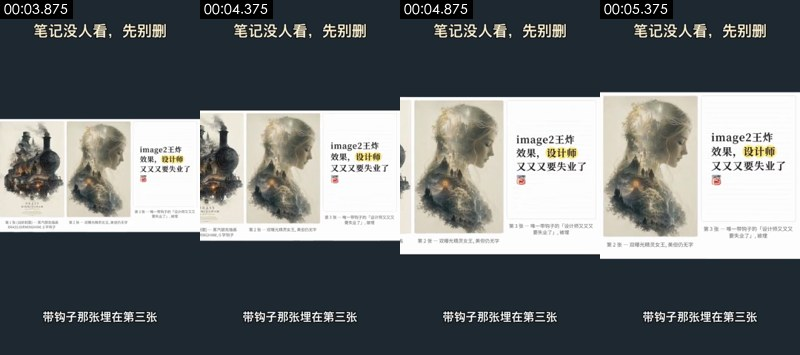

- 背景 #1e2931；其他主色 #fafafa #dad6c8 #999484 #bab4a2
元素截图（编号对应下面的动效；L 是持续运动层的镜头中段和结尾，S 是整镜不动的元素），原分辨率单张在 `shots/` 里：


- S1. 整镜不动：图形/文字块 · x 16%–56%，y 6%–11% · #dfdac9 · 文字「笔记没人看，先别册 / 笔记没人看，先别删」 · [截图](shots/shot_004_st_01.jpg)
- S2. 整镜不动：图形/文字块 · x 61%–84%，y 6%–11% · #ebe5d0 · [截图](shots/shot_004_st_02.jpg)
- S3. 整镜不动：图形/文字块 · x 67%–100%，y 35%–65% · #fdfdfd · 文字「image2王炸 / 效果，设计师 / 又又又要失业了」 · [截图](shots/shot_004_st_03.jpg)
- S4. 整镜不动：图形/文字块 · x 21%–79%，y 87%–91% · #d9dee1 · 文字「带钩子那张埋在第三张」 · [截图](shots/shot_004_st_04.jpg)
- [截图 L1](shots/shot_004_ly_01.jpg) [截图 L2](shots/shot_004_ly_02.jpg) · 持续运动层：38% 的画面整镜都在动（x 0%–100%，y 26%–72%），如漂移的渐变、粒子流、辉光呼吸
1. 4.01–4.41s · 中右（x 62%–100%，y 32%–38%） · 消失，匀速 · #222a33 · 文字「image2王炸」 · [截图](shots/shot_004_el_01.jpg)
2. 5.28–5.41s · 下（x 0%–100%，y 72%–74%） · 出现，瞬间 · #b1b4b6 · [截图](shots/shot_004_el_02.jpg)
3. 5.34–5.41s · 上（x 0%–100%，y 25%–26%） · 出现，瞬间 · #d3d9de · [截图](shots/shot_004_el_03.jpg)

</details>

<details class="ref"><summary>动效 #6 7.5–10.5s · 8 个</summary>


- 背景 #1e2931；其他主色 #fbfcfd #dedddf #aaa8a8 #c7c2c3
元素截图（编号对应下面的动效；L 是持续运动层的镜头中段和结尾，S 是整镜不动的元素），原分辨率单张在 `shots/` 里：

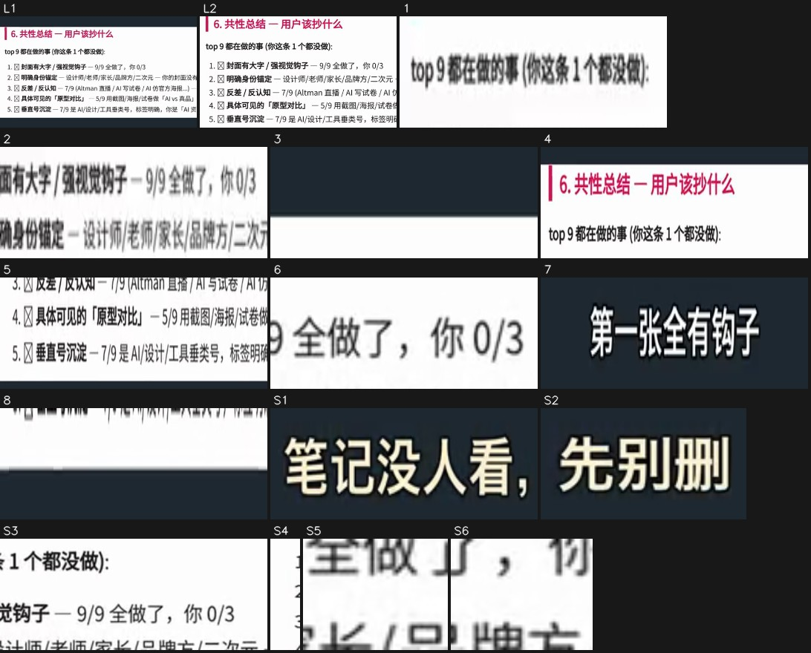

- S1. 整镜不动：图形/文字块 · x 16%–56%，y 6%–11% · #dfdac8 · 文字「笔记没人看，先别册 / 笔记没人看，先别删」 · [截图](shots/shot_006_st_01.jpg)
- S2. 整镜不动：图形/文字块 · x 61%–84%，y 6%–11% · #e8e6d0 · [截图](shots/shot_006_st_02.jpg)
- S3. 整镜不动：图形/文字块 · x 47%–100%，y 41%–50% · #fdfdfd · 文字「2.明确身份锚定一设计师/老师/家长/品牌方/二次元一你的封面没有人群 / 2.明确身份锚定一设计师/老师/家长/品牌方/二次元一你的封面 / 1.封面有大字/强视觉钩子一9/9全做了，你0/3」 · [截图](shots/shot_006_st_03.jpg)
- S4. 整镜不动：图形/文字块 · x 0%–4%，y 46%–57% · #fdfdfd · [截图](shots/shot_006_st_04.jpg)
- S5. 整镜不动：图形/文字块 · x 69%–76%，y 49%–50% · #fefefe · [截图](shots/shot_006_st_05.jpg)
- S6. 整镜不动：图形/文字块 · x 78%–84%，y 49%–50% · #fdfdfd · [截图](shots/shot_006_st_06.jpg)
- [截图 L1](shots/shot_006_ly_01.jpg) [截图 L2](shots/shot_006_ly_02.jpg) · 持续运动层：20% 的画面整镜都在动（x 0%–100%，y 35%–64%），如漂移的渐变、粒子流、辉光呼吸
1. 7.61–8.74s · 中左（x 0%–38%，y 45%–46%） · 消失，向左移动，匀速 · #979797 · 文字「top9都在做的事（你这条1个都没做）： / 1.封面有大字/强视觉钩子一9/9全做了，你0/3」 · [截图](shots/shot_006_el_01.jpg)
2. 7.68–9.01s · 中左（x 11%–51%，y 49%–50%） · 消失，向左移动，匀速 · #d8d7d7 · 文字「1.封面有大字/强视觉钩子一9/9全做了，你0/3 / 2.明确身份锚定一设计师/老师/家长/品牌方/二次元一你的封面没有人群 / 2.明确身份锚定一设计师/老师/家长/品牌方/二次元一你的封面」 · [截图](shots/shot_006_el_02.jpg)
3. 7.74–8.54s · 中右（x 44%–100%，y 39%–41%） · 消失，向右展开（描线/生长/擦除），匀速 · #222c32 · [截图](shots/shot_006_el_03.jpg)
4. 8.54–9.94s · 中（x 0%–100%，y 32%–44%） · 变化，向右移动，先慢后快 · #fdfdfd · 文字「6.共性总结一用户该抄什么 / top9都在做的事（你这条1个都没做）：」 · [截图](shots/shot_006_el_04.jpg)
5. 8.54–9.61s · 中（x 0%–100%，y 56%–65%） · 变化，向下展开（描线/生长/擦除），先慢后快 · #fdfcfc · 文字「4.具体可见的「原型对比]一5/9用截图/海报/试卷做「AVS真品]对照，你纯插画 / 5.垂直号沉淀一7/9是AI/设计/工具垂类号，标签明确，你是「AI资讯日报]杂牌 / 4.具体可见的「原型对比]一5/9用截图/海报/试卷做「Alvs真品]对照，你」 · [截图](shots/shot_006_el_05.jpg)
6. 8.88–9.94s · 中右（x 67%–93%，y 46%–49%） · 出现，向右移入，先慢后快 · #adadad · [截图](shots/shot_006_el_06.jpg)
7. 9.14–9.21s · 下（x 20%–80%，y 88%–91%） · 变化，瞬间 · #202831 · 文字「它对比了同赛道前九名 / 第一张全有钩子 / 连改法都给了？」 · [截图](shots/shot_006_el_07.jpg)
8. 9.61–9.88s · 中（x 0%–100%，y 65%–66%） · 出现，匀速 · #fdfefe · [截图](shots/shot_006_el_08.jpg)

</details>

<details class="ref"><summary>动效 #8 11.5–13.5s · 5 个</summary>

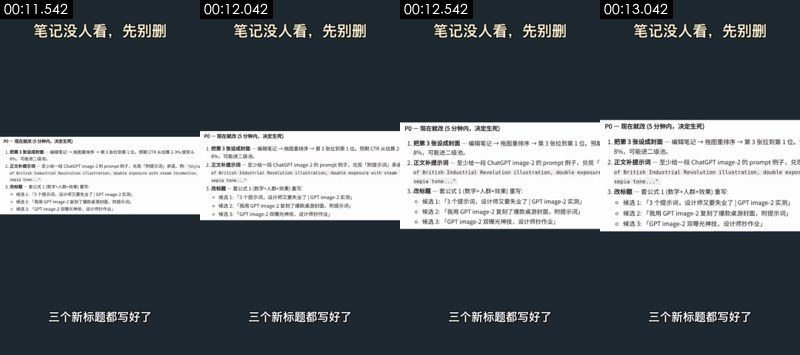

- 背景 #1e2931；其他主色 #fbfcfd #cbccce #e4e4e4 #b2b1af
元素截图（编号对应下面的动效；L 是持续运动层的镜头中段和结尾，S 是整镜不动的元素），原分辨率单张在 `shots/` 里：

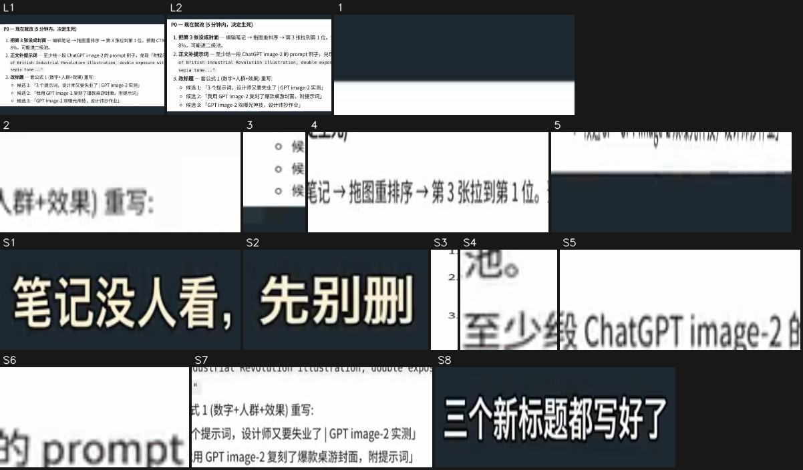

- S1. 整镜不动：图形/文字块 · x 16%–56%，y 6%–11% · #e0d9c6 · 文字「笔记没人看，先别册」 · [截图](shots/shot_008_st_01.jpg)
- S2. 整镜不动：图形/文字块 · x 61%–84%，y 6%–11% · #e9e6d2 · [截图](shots/shot_008_st_02.jpg)
- S3. 整镜不动：图形/文字块 · x 0%–4%，y 41%–60% · #fdfdfd · [截图](shots/shot_008_st_03.jpg)
- S4. 整镜不动：图形/文字块 · x 31%–36%，y 44%–45% · #fdfdfd · [截图](shots/shot_008_st_04.jpg)
- S5. 整镜不动：横线 · x 44%–71%，y 44%–45% · #fdfdfd · 文字「1.把第3张设成封面一编辑笔记→拖图重排序→第3张拉到第1位。预期CTR从估算2-3 / 2.正文补提示词一至少给一段ChatGPTimage-2的prompt例子，兑现「附提示词承诺 / 2.正文补提示词一至少给一段ChatGPTimage-2的prompt例子，兑现「」 · [截图](shots/shot_008_st_05.jpg)
- S6. 整镜不动：图形/文字块 · x 73%–84%，y 44%–45% · #fdfdfd · [截图](shots/shot_008_st_06.jpg)
- S7. 整镜不动：图形/文字块 · x 29%–100%，y 50%–60% · #fdfdfd · 文字「of British Industrial Revolution illustration,double exposure with steam l / o候选1:「3个提示词，设计师又要失业了|GPTimage-2实测] / o候选2：「我用GPTimage-2复刻了爆款桌游封面，附提示词]」 · [截图](shots/shot_008_st_07.jpg)
- S8. 整镜不动：图形/文字块 · x 24%–76%，y 87%–91% · #d1d2d4 · 文字「三个新标题都写好了」 · [截图](shots/shot_008_st_08.jpg)
- [截图 L1](shots/shot_008_ly_01.jpg) [截图 L2](shots/shot_008_ly_02.jpg) · 持续运动层：24% 的画面整镜都在动（x 0%–100%，y 34%–65%），如漂移的渐变、粒子流、辉光呼吸
1. 11.61–12.14s · 中右（x 47%–100%，y 38%–39%） · 消失，匀速 · #1e2831 · 文字「1.把第3张设成封面一编辑笔记→拖图重排序→第3张拉到第1位。预期 / 1.把第3张设成封面一编辑笔记→拖图重排序→第3张拉到第1位。」 · [截图](shots/shot_008_el_01.jpg)
2. 11.67–12.27s · 中（x 31%–51%，y 51%–52%） · 消失，向右移动，匀速 · #c6c6c6 · 文字「3.改标题一套公式1（数字+人群+效果）重写：」 · [截图](shots/shot_008_el_02.jpg)
3. 11.67–12.54s · 中左（x 0%–9%，y 55%–61%） · 消失，向右移动，匀速 · #abb0b3 · [截图](shots/shot_008_el_03.jpg)
4. 12.34–13.07s · 中右（x 44%–100%，y 38%–41%） · 出现，向右移入，先慢后快 · #bcbabb · 文字「1.把第3张设成封面一编辑笔记→拖图重排序→第3张拉到第1位。预期CTR从估算2-3 / 1.把第3张设成封面一编辑笔记→拖图重排序→第3张拉到第1位。预期 / 1.把第3张设成封面一编辑笔记→拖图重排序→第3张拉到第1位。」 · [截图](shots/shot_008_el_04.jpg)
5. 12.94–13.07s · 中（x 0%–84%，y 65%–66%） · 出现，向左移入，瞬间 · #93989e · 文字「o候选3:「GPTimage-2双曝光神技，设计师抄作业]」 · [截图](shots/shot_008_el_05.jpg)

</details>

<details class="ref"><summary>动效 #10 16.1–19.0s · 10 个</summary>


- 背景 #1e2931；其他主色 #f5f9fa #000102 #d1dae0 #b5b6b8
元素截图（编号对应下面的动效；L 是持续运动层的镜头中段和结尾，S 是整镜不动的元素），原分辨率单张在 `shots/` 里：

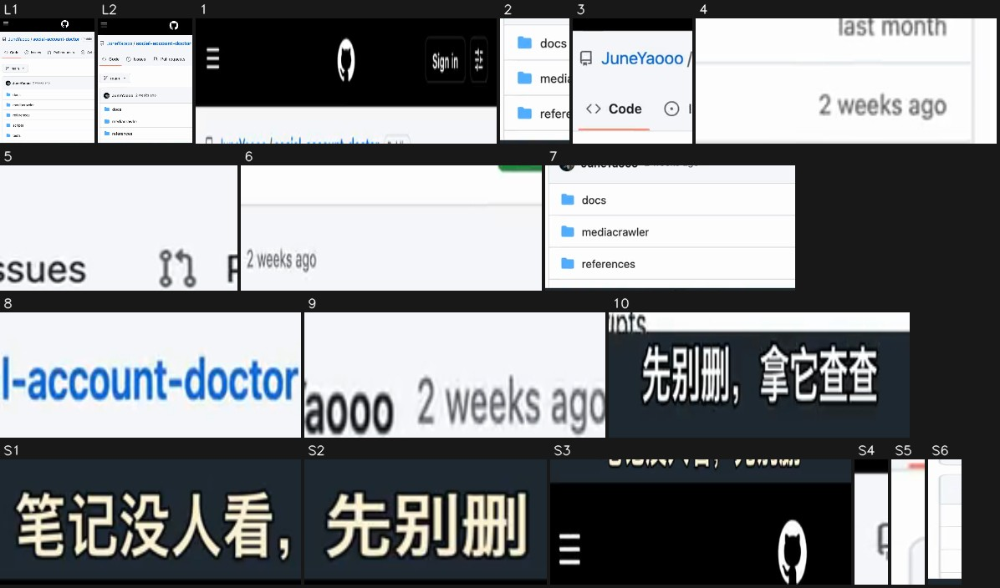

- S1. 整镜不动：图形/文字块 · x 16%–56%，y 6%–11% · #e0d9c6 · 文字「笔记没人看，先别删 / 笔记没人看，先别册」 · [截图](shots/shot_010_st_01.jpg)
- S2. 整镜不动：图形/文字块 · x 61%–84%，y 6%–11% · #ece6d1 · [截图](shots/shot_010_st_02.jpg)
- S3. 整镜不动：图形/文字块 · x 0%–100%，y 12%–19% · #000000 · 文字「Sign in / Sig」 · [截图](shots/shot_010_st_03.jpg)
- S4. 整镜不动：图形/文字块 · x 0%–2%，y 24%–30% · #f4f6f9 · [截图](shots/shot_010_st_04.jpg)
- S5. 整镜不动：图形/文字块 · x 0%–2%，y 42%–48% · #fdfdfd · [截图](shots/shot_010_st_05.jpg)
- S6. 整镜不动：竖线 · x 0%–4%，y 51%–87% · #fdfdfd · [截图](shots/shot_010_st_06.jpg)
- [截图 L1](shots/shot_010_ly_01.jpg) [截图 L2](shots/shot_010_ly_02.jpg) · 持续运动层：28% 的画面整镜都在动（x 0%–100%，y 15%–86%），如漂移的渐变、粒子流、辉光呼吸
1. 16.19–17.12s · 上（x 0%–100%，y 14%–20%） · 消失，向左移动，匀速 · #eeeeee · 文字「Sign in / Sig」 · [截图](shots/shot_010_el_01.jpg)
2. 16.19–18.39s · 下左（x 2%–24%，y 64%–86%） · 变化，向上移动，匀速 · #eef6fd · 文字「tests / tikhub / .env.example」 · [截图](shots/shot_010_el_02.jpg)
3. 16.26–18.26s · 上左（x 0%–38%，y 22%–43%） · 变化，向左移动，缓入缓出 · #cacfda · 文字「JuneYaooo/social-account-doctor / <>Code / Issues」 · [截图](shots/shot_010_el_03.jpg)
4. 16.26–17.93s · 中右（x 67%–100%，y 55%–59%） · 消失，向左移动，缓入缓出 · #bfbfbf · 文字「last month / 2v」 · [截图](shots/shot_010_el_04.jpg)
5. 17.06–18.32s · 中（x 42%–67%，y 32%–38%） · 出现，向下展开（描线/生长/擦除），缓入缓出 · #b4b6b9 · 文字「Pullrequests / Pull requests / Issues」 · [截图](shots/shot_010_el_05.jpg)
6. 17.26–17.66s · 中（x 31%–98%，y 42%–48%） · 消失，向下移动，缓入缓出 · #ececee · 文字「2weeksago / JuneYaooo2weeksago」 · [截图](shots/shot_010_el_06.jpg)
7. 17.32–18.39s · 下（x 2%–100%，y 61%–86%） · 变化，匀速 · #e8ebec · 文字「scripts / 2weeksago / tests」 · [截图](shots/shot_010_el_07.jpg)
8. 17.59–18.46s · 上右（x 56%–98%，y 26%–30%） · 出现，向右移入，先慢后快 · #8ab5eb · 文字「Actions / Pullrequests / Public」 · [截图](shots/shot_010_el_08.jpg)
9. 17.79–18.46s · 中（x 29%–60%，y 57%–59%） · 出现，向左移入，缓入缓出 · #cfd1d3 · 文字「JuneYaooo2weeksago」 · [截图](shots/shot_010_el_09.jpg)
10. 17.93–17.99s · 下（x 22%–78%，y 88%–91%） · 变化，瞬间 · #494d4f · 文字「行，下回发了没人看」 · [截图](shots/shot_010_el_10.jpg)

</details>

### 剪辑

- 按「分镜表」的顺序和时长剪
- 手法：一问一答式对切：提问者 → 回答者 → 回答内容的截图，每段 1–3 秒硬切；截图段全部套同一个深灰模板，顶部常驻标题、底部逐句字幕
- 节奏：每分钟 28.4 刀，平均镜头 1.9s；没有实拍镜头；转场 硬切×9

## 角色、场景与道具

| 编号 | 称呼 | 类型 | 外观 | 作用 | 声音 | 出场 |
|---|---|---|---|---|---|---|
| A | 提问的女生（发笔记的博主） | 真人 | 年轻中国女生，黑色短发齐刘海，青绿色粗框圆眼镜，浅黄色连帽卫衣，怀抱米白抱枕，手拿深色手机，盘腿坐在沙发上 | 遇到问题的人，替观众提问 | 年轻女声，语气惊讶、好奇 | #2、#5、#7 |
| B | 戴报童帽的女性（懂行的人） | 真人 | 短发中国女性，黑色呢子报童帽，细金属圆框眼镜，白衬衫外套墨绿色 V 领针织背心，深色下装，双手捧白色马克杯，坐在米白扶手椅上；五官与 A 很像，疑似同一张脸的两种造型（一人分饰两角） | 给答案、讲工具的人 | 女声，沉稳笃定 | #3、#9 |

**场景**

| 场景 | 地点 | 时间 | 布景 / 光线 | 镜头 |
|---|---|---|---|---|
| S1 | 客厅沙发 | 夜晚 | 米白沙发和毛毯，右后方暖色落地灯，窗帘、窗外夜色和绿植 | #2、#5、#7 |
| S2 | 书房扶手椅 | 夜晚 | 米白扶手椅，背景深色书架、暖色吊灯和绿植，暗调 | #3、#9 |
| S3 | 截图展示模板 | — | 深灰底（#1e2931），顶部白字标题，中间白色截图卡片，底部白字字幕 | #1、#4、#6、#8、#10 |

**道具 / 商品 / Logo**

- 手机（镜头 #2、#5、#7）：A 一直拿在手里看笔记数据
- 白色马克杯（镜头 #3、#9）：B 双手捧着
- 诊断报告截图（镜头 #1、#6、#8）：工具输出的 Markdown 报告：TL;DR、共性总结、P0 改法
- 笔记配图截图（镜头 #4）：被诊断的笔记的三张配图
- GitHub 仓库页截图（镜头 #10）：social-account-doctor 仓库页（手机网页）

## 拍法与打光

- 视觉风格：写实电影感 AI 人像，夜晚暖色室内暗调；截图段是深灰底 + 白色文档卡片的简洁模板
- 取景：景别 近景 100%；机位角度 略俯拍；主体是人脸（按脸高算景别）
- 机位：移动机位（稳定器/手持平移） 66%、固定机位（三脚架/支架/放在桌上） 34%
- 打光：两个场景都是夜晚暖色室内光：客厅靠落地灯和手机屏幕光，书房靠左前方暖色柔光和背景吊灯；整体暗调（看图判断；像素测量见下方折叠）
- 调色：自然（接近原色）；饱和度正常、对比正常、黑位正常、整体中性

<details class="ref"><summary>逐项测量与看图结果（19 项）</summary>

| 维度 | 项目 | 结论 | 来源 |
|---|---|---|---|
| 取景 | 景别 | 近景 | 测量；看图：中景 |
| 取景 | 机位角度 | 略俯拍 | 看图 |
| 取景 | 构图 | 竖屏；人物坐在画面左中，身体朝右前方，右上角留出落地灯和窗户 | 看图 |
| 机位 | 拍摄方式 | 三脚架/支架固定 | 测量：混合：移动机位（稳定器/手持平移） 66%、固定机位（三脚架/支架/放在桌上） 34%；看图 |
| 机位 | 速度 | 正常 | 看图 |
| 机位 | 机位/场景 | 两个固定机位场景：夜晚客厅沙发（提问的女生，略俯中景）和夜晚书房扶手椅（戴帽的女性，平视中景）；全片没有运镜，靠切镜推进 | 看图 |
| 机位 | 推测设备 | 无实拍：人物镜头是 AI 图生视频，截图卡片是剪辑软件 / 代码模板做的推近 | 看图 |
| 打光 | 场景 | 室内；夜晚；客厅沙发 | 看图 |
| 打光 | 主光 | 画面右后方落地灯的暖光 + 手机屏幕从下方照亮脸 | 看图 |
| 打光 | 软硬 | 硬光（明暗分界清楚） | 测量；看图：柔光 |
| 打光 | 补光 | 没有明显补光，暗部较深 | 看图 |
| 打光 | 轮廓光 | 落地灯在头发和肩膀右侧留下暖色亮边 | 看图 |
| 打光 | 眼神光 | 眼镜反光，看不清眼神光 | 看图 |
| 打光 | 可见光源 | 落地灯、手机屏幕 | 看图 |
| 打光 | 色温 | 偏冷（日光/冷白 LED） | 测量；看图：混合（暖色灯光 + 屏幕冷光） |
| 打光 | 布光方案 | 夜晚客厅：一盏暖色落地灯做背景和轮廓，手机屏幕做脸部主光（AI 画面，不是拍摄方案） | 看图 |
| 打光 | 整体布光 | 两个场景都是夜晚暖色室内光：客厅靠落地灯和手机屏幕光，书房靠左前方暖色柔光和背景吊灯；整体暗调 | 看图 |
| 调色 | 调色风格 | 自然（接近原色） | 测量；看图：暗调暖色：黑位压低，暖黄为主，屏幕处略带冷青 |
| 调色 | 整体调色 | 暗调暖色电影感，黑位压低，人物肤色偏暖 | 看图 |

</details>

- 说明：光比、软硬、色温、景别由主体像素测得（有人脸用人脸，没有用画面清晰区域，后者是估算）；平台转码会压暗部，软硬和补光偏保守；机位角度、光源种类、眼神光、轮廓光以看图结果为准。测量和看图不一致时两者都列出。

## 剪辑包装层（字幕 / 花字 / 贴纸 / 音效卡点）

- 字幕 13 句（底部，最多 1 行）：白字、黑描边、字高 3.3%；入场：直接出现×9
- 导出：`packaging/subtitles.srt`、`packaging/overlays.ass`、`packaging/timeline.json`（SRT 是字幕时间轴；ASS 带颜色、描边、位置和入场动画，字体需要换成原片字体；timeline.json 是完整时间轴）

<details class="ref"><summary>文字时间轴（13 条）</summary>

| 时间 | 类型 | 文字 | 样式 | 入场 / 出场 | 音效 |
|---|---|---|---|---|---|
| 0.00–1.40s | 字幕 | 这条才发二十一分钟 | 白字、黑描边、字高 3.0%（约 26px） | 直接消失 | — |
| 1.40–2.80s | 字幕 | 就被判九成扑街？ | 白字、黑描边、字高 3.3%（约 28px） | 直接出现 / 直接消失 | — |
| 2.80–3.90s | 字幕 | 封面顺序反了 | 白字、黑描边、字高 3.5%（约 30px） | 直接出现 / 直接消失 | — |
| 3.90–5.80s | 字幕 | 带钩子那张埋在第三张 | 白字、黑描边、字高 3.5%（约 30px） | 直接出现 / 直接消失 | — |
| 5.80–7.50s | 字幕 | 它怎么知道哪张有钩子？ | 白字、黑描边、字高 3.0%（约 26px） | 直接出现 / 直接消失 | — |
| 7.50–9.00s | 字幕 | 它对比了同赛道前九名 | 白字、黑描边、字高 3.0%（约 26px） | 直接出现 | — |
| 9.00–10.50s | 字幕 | 第一张全有钩子 | 白字、黑描边、字高 3.3%（约 28px） | 直接消失 | — |
| 10.50–11.50s | 字幕 | 连改法都给了？ | 白字、黑描边、字高 3.3%（约 28px） | 直接出现 / 直接消失 | — |
| 11.50–13.50s | 字幕 | 三个新标题都写好了 | 白字、黑描边、字高 3.0%（约 26px） | 直接出现 / 直接消失 | — |
| 13.50–14.10s | 字幕 | 前提是你得自己配 | 白字、黑描边、字高 3.0%（约 26px） | 直接出现 / 缩小消失 | — |
| 14.50–16.00s | 字幕 | 一个会看图的大模型 | 白字、黑描边、字高 3.6%（约 31px） | 缩小消失 | — |
| 16.00–17.90s | 字幕 | 行，下回发了没人看 | 白字、黑描边、字高 3.8%（约 32px） | 直接消失 | — |
| 17.90–19.00s | 字幕 | 先别删，拿它查查 | 白字、黑描边、字高 3.5%（约 30px） | 直接出现 | — |

</details>

复刻：字幕和花字用 `packaging/overlays.ass` 直接压制（ffmpeg -vf ass=overlays.ass），或按 timeline.json 在剪映 / Remotion 里重建；贴纸和动图要找同款素材（表情包库 / GIF 库），截图在 packaging/ 下。

## 声音

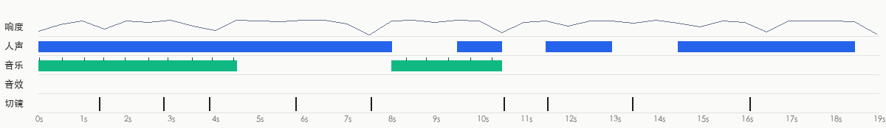

- 响度 -16.8 dBFS，峰值 -3.5 dBFS；每段画面自带声音（切点处背景声跳变 23.6dB，镜头内 9.3dB）
- 来源判断：视频类型：AI 视频原生出声（每段画面自带声音） → 人声AI 视频原生对白（随画面生成）；音效AI 视频模型随画面生成（原生音频）

**人声**

- 占 76% 时长；基频约 247.8Hz（偏女声）
- 来源：AI 视频原生对白（随画面生成）（AI 视频原生对白（随画面生成） 65%，TTS 配音 18%，真人录音 18%）
  - 背景声在每个切点跳变、画面是 AI 视频：人声很可能是视频模型连同画面一起生成的（如 Seedance/Veo/H3 原生音频）
- 复刻：跟 AI 视频一起生成：用能出对白的视频模型，台词写进提示词

**背景音乐**

- 未检测到持续的音乐床

**音效**

- 没有找到明显的音效（人声和音乐下面很轻的音效可能漏掉）

- 分离出的音轨：`stems/original.wav`（原声）、`stems/vocals.wav`（人声干声）、`stems/music.wav`（配乐 + 环境声）、`stems/effects.wav`（音效轨）
<!--stems-->

## 不确定点

- 声音没有 AI 听过（复核只看了画面）：人声是真人还是 TTS 是按波形推断的；音效是从单独分离出的音效轨里找的，类型是按声音特征估的。可以在「声音」里试听分轨和每处音效核对

## 附录

### 逐镜取证

每个镜头分两块：画面里看得到的，和工具推断的制作方式（附判断依据）；最后是复刻提示词。默认折叠，点开看。

<details class="ref"><summary>#1 00:00.000–00:01.375 · 代码/模板渲染；引入真实素材（录屏素材、界面截图）</summary>


**画面里看得到的**（可以对照截图核实）
- 画面：竖屏模板：深灰底，顶部标题「笔记没人看，先别删」，底部字幕。中间一张诊断报告截图（粉色小标题「0. TL;DR — 这条会爆吗？」、红字结论「不会。9 成扑街概率」、三条「核心诊断」列表），整张截图以左边为基点迅速放大、上沿向上移，结论那一行越来越大。
- 文字轨（画面内容文字/bottom）：这条才发二十一分钟
- 文字轨（画面内容文字/middle）：0.TL;DR一这条会爆吗？ / 不会。9成扑街概率。预计24h数据：5-15赞/1-3评/3-8收藏 / 不会。9成扑街概率。预计24h数据：5-15 / 不会。9成扑街概率。预计24h数据
- 文字轨（画面内容文字/middle）：核心诊断（三个一票否决项）： / 1.封面致命错位一第1张是无字插画（D实物展示型，0钩子），唯一带钩子的「设计师 / 了J大字图被埋到第3张。小红书CTR只看第1张→直接判死刑。 / 1.封面致命错位一第1张是无字插画（D实物展示型，0钩子），唯一
- 文字轨（画面内容文字/middle）：2.正文承诺没兑现一标题/desc都说「附提示词，但3张图全是效果图+1句吐槽， / 词文本。打开来的人会觉得被骗。 / 3.冷启信号已经走弱一21分钟3赞1评2收藏，作者历史10条平均3.6赞（全是日 / 了」大字图被埋到第3张。小红书CTR只看第1张→直接判死开
- [AI 助手 看图] 深灰纯色底（#1e2931），上方固定白字标题、下方固定白字字幕
- [AI 助手 看图] 中间是一张浅粉底的文档截图卡片（「0. TL;DR — 这条会爆吗？」「不会。9 成扑街概率」），文字边缘锐利、排版是 Markdown 渲染
- [AI 助手 看图] 整张卡片在 1.4 秒里放大并向左平移，卡片内部文字不变形

**工具推断的制作方式**（是推断，不是看到的）
- 推断：代码/模板渲染 70%，屏幕录制/截图 13%，3D 渲染 4%（fused_agent）
- 素材来源：混合（含真实素材）：录屏素材、界面截图
  - 录屏素材：浅色界面面板内有 9 处文字（其中 9 处小字号）
- 判断依据（工具测量，肉眼不一定看得出）：
  - 纹理呈渲染特征：平坦色块 71%、95% 像素仅用 35 种颜色、横竖直边 27%
  - 平坦底色上有大量细小高频细节（小字号文字/界面），像截图或文档画面

- 复刻：代码渲染：用 Remotion/HTML 按文字轨与版式重建，100% 可控，不需要生成模型；需要用户提供真实素材：录屏素材（画面局部 x0% y31% 宽100% 高37%）、界面截图（画面局部）

</details>

<details class="ref"><summary>#2 00:01.375–00:02.833 · AI 生成视频 + 代码/剪辑叠加（文字标注、标题）</summary>

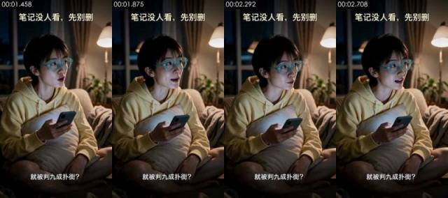

**画面里看得到的**（可以对照截图核实）
- 画面：夜晚客厅，短发女生戴青绿色粗框眼镜、穿浅黄色连帽卫衣，盘腿坐在沙发上抱着米白抱枕，右手拿手机，抬头望向画面右侧，惊讶地开口说话。背景暖色落地灯、窗帘和绿植，固定机位中景。
- 拍法/打光：近景；略俯拍；三脚架/支架固定；夜景/弱光环境光，没有专门补光；主光正面（光从镜头方向来，主体两侧亮度接近）；光比约 1.3:1（相差 0.4 档）；中等柔度
- 文字轨（文字/bottom）：就被判九成扑街？
- 文字轨（标题/top）：笔记没人看，先别册 / 笔记没人看，先别删
- [AI 助手 看图] 皮肤过分光滑、光线均匀，像 AI 写实图
- [AI 助手 看图] 和 #5、#7 的首帧几乎同一构图同一姿势，像同一张首帧图多次生成
- [AI 助手 看图] 头部转动、嘴型和握手机的手都有动作，不是只动嘴的数字人；手机屏幕没有可读内容

**工具推断的制作方式**（是推断，不是看到的）
- 推断：AI 生成视频 74%，数字人口播 11%，实拍 5%（fused_agent）
- 素材来源：AI 生成
- 判断依据（工具测量，肉眼不一定看得出）：
  - 低照度画面：36% 的区域接近全黑但带颗粒（不是纯色底），亮部平坦块只有 1%、且有人脸：平坦块/少色是暗部被压缩造成的，不按渲染特征算
  - 纹理呈照片/视频特征：噪声 σ=0.34、用色 121 种、平坦块 11%
  - 逐帧清晰度呈周期性起伏（周期 4 帧，相关 0.87），但没有重复帧：可能是插帧/帧率转换，也可能只是重新压缩留下的节奏（去掉了平台标记的转码文件也会这样），单凭这一条不能定 AI

- 复刻：原片为 AI 生成：取原镜头首尾帧做首尾帧生成，可高度还原构图与动作；换主体时先用图像模型改首帧
  - 首帧图像提示词：近景，略俯拍，竖屏；人物坐在画面左中，右上角留出落地灯和窗户。竖屏 9:16，中景，略俯视角。夜晚客厅，短发中国女生戴青绿色粗框圆眼镜，穿浅黄色连帽卫衣，盘腿坐在米白沙发上，怀里抱着米白抱枕，右手拿着深色手机，坐在画面左中、身体朝右前方，抬头看向画面右侧。右后方一盏暖色落地灯，背景窗帘与绿植虚化，手机屏幕的冷光照亮脸，写实电影感。
  - 视频提示词：近景，略俯拍，竖屏；人物坐在画面左中，身体朝右前方，右上角留出落地灯和窗户。中景，略俯视角，女生坐在画面左中。她刚看完手机，抬头望向画面右侧，眉毛扬起、嘴巴张开，惊讶地说「就被判九成扑街？」，手里的手机轻轻晃动，结尾停在惊讶的表情上。固定机位。

</details>

<details class="ref"><summary>#3 00:02.833–00:03.875 · AI 生成视频 + 代码/剪辑叠加（文字标注、标题）</summary>

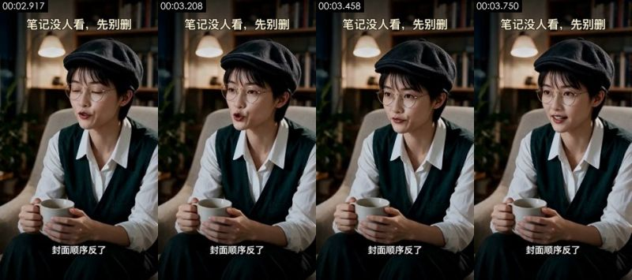

**画面里看得到的**（可以对照截图核实）
- 画面：夜晚书房，短发女性戴黑色报童帽和细金属圆框眼镜，白衬衫外套墨绿色 V 领针织背心，坐在米白扶手椅上双手捧白色马克杯，眨眼后看向画面左侧说话。背景书架、暖色吊灯和绿植，固定机位中景。
- 拍法/打光：近景；平视；三脚架/支架固定；夜景/弱光环境光，没有专门补光；主光画面左侧偏前方；光比约 2.0:1（相差 1.0 档）；中等柔度
- 文字轨（文字/bottom）：封面顺序反了
- 文字轨（标题/top）：笔记没人看，先别删 / 笔记没人看，先别册
- [AI 助手 看图] 和 #9 是同一角色、同一椅子、同一构图，开头一帧闭眼的过渡很顺滑但脸部质感过于干净
- [AI 助手 看图] 背景书架上的书脊糊成色块、没有可读文字
- [AI 助手 看图] 手捧马克杯的手指形状稳定，动作幅度小，光线均匀，像 AI 写实视频

**工具推断的制作方式**（是推断，不是看到的）
- 推断：AI 生成视频 68%，实拍 14%，数字人口播 9%（fused_agent）
- 素材来源：AI 生成
- 判断依据（工具测量，肉眼不一定看得出）：
  - 低照度画面：46% 的区域接近全黑但带颗粒（不是纯色底），亮部平坦块只有 0%、且有人脸：平坦块/少色是暗部被压缩造成的，不按渲染特征算
  - 纹理呈照片/视频特征：噪声 σ=0.31、用色 98 种、平坦块 9%

- 复刻：原片为 AI 生成：取原镜头首尾帧做首尾帧生成，可高度还原构图与动作；换主体时先用图像模型改首帧
  - 首帧图像提示词：近景，竖屏；人物居中偏左坐在扶手椅上，背景书架和吊灯。竖屏 9:16，中景，平视。夜晚书房，短发中国女性戴黑色呢子报童帽和细金属圆框眼镜，白衬衫外套墨绿色 V 领针织背心，坐在米白扶手椅上，位于画面中间偏左，身体微侧，双手捧着白色马克杯放在腿前。背景深色书架、暖色吊灯和绿植虚化，左前方暖色柔光，暗调写实电影感。
  - 视频提示词：近景，竖屏；人物居中偏左坐在扶手椅上，身体微侧，背景书架和吊灯。中景，平视，女性坐在画面中间偏左的扶手椅上。她先眨一下眼，然后看向画面左侧，平静笃定地说「封面顺序反了」，头轻轻点一下，双手一直捧着马克杯。固定机位。

</details>

<details class="ref"><summary>#4 00:03.875–00:05.833 · 代码/模板渲染；引入真实素材（录屏素材、界面截图）</summary>


**画面里看得到的**（可以对照截图核实）
- 画面：深灰模板上，一条横向截图展示笔记的三张配图：第 1 张蒸汽朋克火车插画、第 2 张双重曝光精灵女王、第 3 张白底黑字大字图「image2王炸效果，设计师又又又要失业了」（「设计师」黄色高亮）。截图边放大边向左移，停在第 2、3 张上，对应台词「带钩子那张埋在第三张」。
- 文字轨（画面内容文字/bottom）：带钩子那张埋在第三张
- 文字轨（画面内容文字/middle）：image2王炸 / 效果，设计师 / 又又又要失业了
- 文字轨（画面内容文字/middle）：BIRMISGHAM / BRASS / 第3张一唯一带钩子的「设计师又又又 / 要失业了J，被埋
- 文字轨（画面内容文字/middle）：蒸汽朋克插画 / 第2张一双曝光精灵女王，美但仍无字 / AM.0字钩子 / 要失业了」，被埋
- [AI 助手 看图] 同一深灰模板、同一标题和字幕位置
- [AI 助手 看图] 中间是一排三张笔记配图的截图（蒸汽火车插画、双重曝光女王、写着「image2王炸效果，设计师又又又要失业了」的大字图），下方配小字说明
- [AI 助手 看图] 截图整体放大并向左平移，从第 1 张移到第 3 张，图片内部没有独立运动

**工具推断的制作方式**（是推断，不是看到的）
- 推断：代码/模板渲染 70%，屏幕录制/截图 12%，3D 渲染 6%（fused_agent）
- 素材来源：混合（含真实素材）：录屏素材、界面截图
  - 录屏素材：浅色界面面板内有 10 处文字（其中 10 处小字号）
- 判断依据（工具测量，肉眼不一定看得出）：
  - 纹理呈渲染特征：平坦色块 62%、95% 像素仅用 44 种颜色、横竖直边 32%
  - 平坦底色上有大量细小高频细节（小字号文字/界面），像截图或文档画面
  - 逐帧清晰度呈周期性起伏（周期 4 帧，相关 0.55），但没有重复帧：可能是插帧/帧率转换，也可能只是重新压缩留下的节奏（去掉了平台标记的转码文件也会这样），单凭这一条不能定 AI

- 复刻：代码渲染：用 Remotion/HTML 按文字轨与版式重建，100% 可控，不需要生成模型；需要用户提供真实素材：录屏素材（画面局部 x0% y29% 宽100% 高41%）、界面截图（画面局部）

</details>

<details class="ref"><summary>#5 00:05.833–00:07.542 · AI 生成视频 + 代码/剪辑叠加（字幕、标题）</summary>

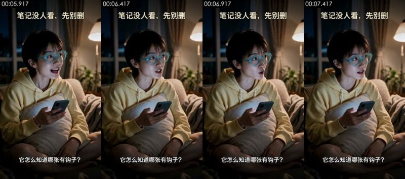

**画面里看得到的**（可以对照截图核实）
- 画面：同 #2 的客厅场景和女生：她从笑着开口变成皱眉思考，眼睛看向画面右侧发问，身体基本不动，手机在手里。固定机位中景。
- 拍法/打光：近景；略俯拍；三脚架/支架固定；夜景/弱光环境光，没有专门补光；主光正面（光从镜头方向来，主体两侧亮度接近）；光比约 1.2:1（相差 0.3 档）；柔光（几乎没有明暗分界）
- 文字轨（字幕/bottom）：它怎么知道哪张有钩子？ / 它对比了同赛道前九名
- 文字轨（字幕/middle）：6.共性总结一用户该抄什么 / top9都在做的事（你这条1个都没做）：
- 文字轨（字幕/middle）：1.封面有大字/强视觉钩子一9/9全做了，你0/3 / 2.明确身份锚定一设计师/老师/家长/品牌方/二次元一你的封面没有人群
- 文字轨（字幕/middle）：4.具体可见的「原型对比J一5/9用截图/海报/试卷做「AIvs真品J对照，你纯 / 5.垂直号沉淀一7/9是AI/设计/工具垂类号，标签明确，你是「AI资讯日报J杂
- [AI 助手 看图] 首帧和 #7 首帧几乎一模一样（同一笑容、同一手势），是同一张首帧图生成的不同片段
- [AI 助手 看图] 眼镜框、手指和手机边缘在帧间轻微漂移
- [AI 助手 看图] 光线和皮肤过于完美，背景窗帘和绿植是均匀的虚化

**工具推断的制作方式**（是推断，不是看到的）
- 推断：AI 生成视频 73%，数字人口播 14%，实拍 3%（fused_agent）
- 素材来源：AI 生成
- 判断依据（工具测量，肉眼不一定看得出）：
  - 低照度画面：37% 的区域接近全黑但带颗粒（不是纯色底），亮部平坦块只有 0%、且有人脸：平坦块/少色是暗部被压缩造成的，不按渲染特征算
  - 纹理呈照片/视频特征：噪声 σ=0.34、用色 116 种、平坦块 10%
  - 逐帧清晰度呈周期性起伏（周期 4 帧，相关 0.74），但没有重复帧：可能是插帧/帧率转换，也可能只是重新压缩留下的节奏（去掉了平台标记的转码文件也会这样），单凭这一条不能定 AI
  - 100% 的采样帧有正脸且机位固定，音轨有人声

- 复刻：原片为 AI 生成：取原镜头首尾帧做首尾帧生成，可高度还原构图与动作；换主体时先用图像模型改首帧
  - 首帧图像提示词：近景，略俯拍，竖屏；人物坐在画面左中，身体朝右前方，右上角留出落地灯和窗户。同 #2 的首帧：竖屏 9:16 中景略俯，夜晚客厅，戴青绿色粗框眼镜、穿浅黄色连帽卫衣的短发女生盘腿坐沙发抱抱枕拿手机，看向画面右侧，嘴角带笑。
  - 视频提示词：近景，略俯拍，竖屏；人物坐在画面左中，身体朝右前方，右上角留出落地灯和窗户。中景，略俯视角，女生坐在画面左中。她先笑着张口，随后皱眉、眼睛看向画面右侧，疑惑地问「它怎么知道哪张有钩子？」，手机握在手里，结尾停在疑惑表情上。固定机位。

</details>

<details class="ref"><summary>#6 00:07.542–00:10.542 · 代码/模板渲染；引入真实素材（录屏素材、界面截图）</summary>


**画面里看得到的**（可以对照截图核实）
- 画面：深灰模板上，一张诊断报告截图：粉色标题「6. 共性总结 — 用户该抄什么」、黑字「top 9 都在做的事（你这条 1 个都没做）」和 5 条列表（封面有大字、明确身份锚定、反差、原型对比、垂直号沉淀）。截图从小到大慢慢推近，3 秒里放大约三分之一。
- 文字轨（画面内容文字/bottom）：它对比了同赛道前九名 / 第一张全有钩子 / 连改法都给了？
- 文字轨（画面内容文字/middle）：6.共性总结一用户该抄什么 / top9都在做的事（你这条1个都没做）：
- 文字轨（画面内容文字/middle）：1.封面有大字/强视觉钩子一9/9全做了，你0/3 / 2.明确身份锚定一设计师/老师/家长/品牌方/二次元一你的封面没有人群 / 3.反差/反认知一7/9（Altman直播/AI写试卷/Al仿官方海报)一你只有 / 3.反差/反认知一7/9（Altman直播/AI写试卷/Al仿官方海报..）一你
- 文字轨（画面内容文字/middle）：4.具体可见的「原型对比]一5/9用截图/海报/试卷做「AVS真品]对照，你纯插 / 5.垂直号沉淀一7/9是AI/设计/工具垂类号，标签明确，你是「AI资讯日报]杂 / 4.具体可见的「原型对比]一5/9用截图/海报/试卷做「Alvs真品]对照，你 / 5.垂直号沉淀一7/9是AI/设计/工具垂类号，标签明确，你是「AI资讯日报]
- [AI 助手 看图] 同一深灰模板
- [AI 助手 看图] 中间是一张白底文档截图：粉色小标题「6. 共性总结 — 用户该抄什么」和 5 条带复选框的列表
- [AI 助手 看图] 整张截图匀速放大并略向上移，文字锐利不变形

**工具推断的制作方式**（是推断，不是看到的）
- 推断：代码/模板渲染 72%，屏幕录制/截图 13%，3D 渲染 4%（fused_agent）
- 素材来源：混合（含真实素材）：录屏素材、界面截图
  - 录屏素材：浅色界面面板内有 7 处文字（其中 7 处小字号）
- 判断依据（工具测量，肉眼不一定看得出）：
  - 纹理呈渲染特征：平坦色块 75%、95% 像素仅用 14 种颜色、横竖直边 31%
  - 平坦底色上有大量细小高频细节（小字号文字/界面），像截图或文档画面
  - 逐帧清晰度呈周期性起伏（周期 2 帧，相关 0.08），但没有重复帧：可能是插帧/帧率转换，也可能只是重新压缩留下的节奏（去掉了平台标记的转码文件也会这样），单凭这一条不能定 AI

- 复刻：代码渲染：用 Remotion/HTML 按文字轨与版式重建，100% 可控，不需要生成模型；需要用户提供真实素材：录屏素材（画面局部 x0% y36% 宽100% 高27%）、界面截图（画面局部）

</details>

<details class="ref"><summary>#7 00:10.542–00:11.542 · AI 生成视频 + 代码/剪辑叠加（字幕、标题）</summary>


**画面里看得到的**（可以对照截图核实）
- 画面：同 #2 的客厅场景和女生：她看向画面右侧，惊喜地张嘴发问，随后又低头看了一眼手机再抬头。固定机位中景。
- 拍法/打光：近景；略俯拍；三脚架/支架固定；夜景/弱光环境光，没有专门补光；主光正面（光从镜头方向来，主体两侧亮度接近）；光比约 1.1:1（相差 0.1 档）；柔光（几乎没有明暗分界）
- 文字轨（字幕/bottom）：连改法都给了？ / 三个新标题都写好了
- 文字轨（字幕/middle）：P0一现在就改（5分钟内，决定生死） / 1.把第3张设成封面一编辑笔记→拖图重排序→第3张拉到第1位。预期CTR从估算2 / 8%，可能进二级池。
- 文字轨（字幕/middle）：2.正文补提示词一至少给一段ChatGPTimage-2的prompt例子，兑现 / of British Industrial Revolution illustr / sepia tone..." / 3.改标题一套公式1（数字+人群+效果）重写：
- 文字轨（字幕/middle）：o候选1：「3个提示词，设计师又要失业了|GPTimage-2实测 / o候选2：「我用GPTimage-2复刻了爆款桌游封面，附提示词] / o候选3:「GPTimage-2双曝光神技，设计师抄作业J
- [AI 助手 看图] 首帧与 #5 首帧几乎相同，同一首帧图生成
- [AI 助手 看图] 口型、头部转动自然但皮肤和光线过于干净
- [AI 助手 看图] 手机和手指边缘有轻微形变

**工具推断的制作方式**（是推断，不是看到的）
- 推断：AI 生成视频 71%，数字人口播 14%，实拍 5%（fused_agent）
- 素材来源：AI 生成
- 判断依据（工具测量，肉眼不一定看得出）：
  - 低照度画面：38% 的区域接近全黑但带颗粒（不是纯色底），亮部平坦块只有 1%、且有人脸：平坦块/少色是暗部被压缩造成的，不按渲染特征算
  - 纹理呈照片/视频特征：噪声 σ=0.33、用色 114 种、平坦块 11%
  - 100% 的采样帧有正脸且机位固定，音轨有人声

- 复刻：原片为 AI 生成：取原镜头首尾帧做首尾帧生成，可高度还原构图与动作；换主体时先用图像模型改首帧
  - 首帧图像提示词：近景，略俯拍，竖屏；人物坐在画面左中，身体朝右前方，右上角留出落地灯和窗户。同 #2 的首帧：竖屏 9:16 中景略俯，夜晚客厅，戴青绿色粗框眼镜、穿浅黄色连帽卫衣的短发女生盘腿坐沙发抱抱枕拿手机，看向画面右侧，嘴角带笑。
  - 视频提示词：近景，略俯拍，竖屏；人物坐在画面左中，身体朝右前方，右上角留出落地灯和窗户。中景，略俯视角，女生坐在画面左中。她看着画面右侧，眼睛睁大、惊喜地问「连改法都给了？」，说完低头瞄一眼手机再抬头。固定机位。

</details>

<details class="ref"><summary>#8 00:11.542–00:13.458 · 代码/模板渲染；引入真实素材（录屏素材、界面截图）</summary>


**画面里看得到的**（可以对照截图核实）
- 画面：深灰模板上，一张诊断报告截图：标题「P0 — 现在就改（5 分钟内，决定生死）」，三条改法（把第 3 张设成封面、正文补提示词、改标题）和三个候选标题。截图慢慢推近，停在候选标题上。
- 文字轨（画面内容文字/bottom）：三个新标题都写好了
- 文字轨（画面内容文字/middle）：P0一现在就改（5分钟内，决定生死） / 1.把第3张设成封面一编辑笔记→拖图重排序→第3张拉到第1位。预期CTR从估算2 / 8%，可能进二级池。 / 1.把第3张设成封面一编辑笔记→拖图重排序→第3张拉到第1位。预期
- 文字轨（画面内容文字/middle）：2.正文补提示词一至少给一段ChatGPTimage-2的prompt例子，兑现 / of British Industrial Revolution illustr / sepia tone..." / 2.正文补提示词一至少给一段ChatGPTimage-2的prompt例子，兑现
- 文字轨（画面内容文字/middle）：3.改标题一套公式1（数字+人群+效果）重写： / o候选1:「3个提示词，设计师又要失业了|GPTimage-2实测] / o候选2：「我用GPTimage-2复刻了爆款桌游封面，附提示词] / o候选1：「3个提示词，设计师又要失业了GPTimage-2实测]
- [AI 助手 看图] 同一深灰模板
- [AI 助手 看图] 中间是一张白底文档截图：「P0 — 现在就改（5 分钟内，决定生死）」，下面三条改法和三个候选标题，含等宽字体的 prompt 示例
- [AI 助手 看图] 截图整体推近并略上移，文字锐利不变形

**工具推断的制作方式**（是推断，不是看到的）
- 推断：代码/模板渲染 70%，屏幕录制/截图 14%，3D 渲染 4%（fused_agent）
- 素材来源：混合（含真实素材）：录屏素材、界面截图
  - 录屏素材：浅色界面面板内有 10 处文字（其中 10 处小字号）
- 判断依据（工具测量，肉眼不一定看得出）：
  - 纹理呈渲染特征：平坦色块 74%、95% 像素仅用 12 种颜色、横竖直边 28%
  - 平坦底色上有大量细小高频细节（小字号文字/界面），像截图或文档画面
  - 逐帧清晰度呈周期性起伏（周期 5 帧，相关 0.11），但没有重复帧：可能是插帧/帧率转换，也可能只是重新压缩留下的节奏（去掉了平台标记的转码文件也会这样），单凭这一条不能定 AI

- 复刻：代码渲染：用 Remotion/HTML 按文字轨与版式重建，100% 可控，不需要生成模型；需要用户提供真实素材：录屏素材（画面局部 x0% y36% 宽100% 高28%）、界面截图（画面局部）

</details>

<details class="ref"><summary>#9 00:13.458–00:16.125 · AI 生成视频 + 代码/剪辑叠加（字幕、标题）</summary>

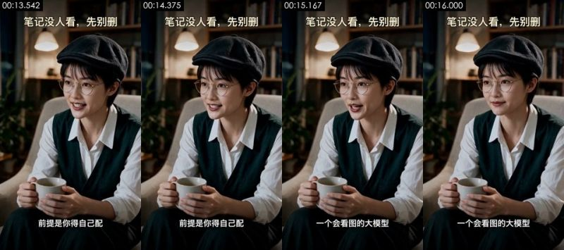

**画面里看得到的**（可以对照截图核实）
- 画面：同 #3 的书房场景和戴报童帽的女性：她看向画面左侧，微笑着边说边点头，双手捧杯几乎不动。固定机位中景。
- 拍法/打光：近景；平视；三脚架/支架固定；夜景/弱光环境光，没有专门补光；主光画面左侧偏前方；光比约 1.8:1（相差 0.9 档）；硬光（明暗分界清楚）
- 画面里物体上的字（不是后期字幕）：口、.env.example、2weeks ago
- 文字轨（字幕/bottom）：前提是你得自己配 / 一个会看图的大模型 / README.md / 2weeks ago
- 文字轨（字幕/bottom）：口 / .env.example / 2weeks ago / .gitignore
- 文字轨（字幕/bottom）：LICENSE / 5months ago
- 文字轨（字幕/middle）：<>Code / Issues /  Pullrequests / Actions
- [AI 助手 看图] 和 #3 同一角色同一构图，首帧构图几乎一致
- [AI 助手 看图] 头部有转动和点头、手指在杯子上微动，不是只有嘴动的数字人，但身体动作很少
- [AI 助手 看图] 背景书架糊成色块，皮肤质感过于光滑

**工具推断的制作方式**（是推断，不是看到的）
- 推断：AI 生成视频 78%，数字人口播 10%，实拍 2%（fused_agent）
- 素材来源：AI 生成
- 判断依据（工具测量，肉眼不一定看得出）：
  - 低照度画面：46% 的区域接近全黑但带颗粒（不是纯色底），亮部平坦块只有 0%、且有人脸：平坦块/少色是暗部被压缩造成的，不按渲染特征算
  - OCR 读到 5 行小字号文字：画面里有界面/文档截图
  - 纹理呈照片/视频特征：噪声 σ=0.35、用色 96 种、平坦块 8%
  - 逐帧清晰度呈周期性起伏（周期 4 帧，相关 0.61），但没有重复帧：可能是插帧/帧率转换，也可能只是重新压缩留下的节奏（去掉了平台标记的转码文件也会这样），单凭这一条不能定 AI

- 复刻：原片为 AI 生成：取原镜头首尾帧做首尾帧生成，可高度还原构图与动作；换主体时先用图像模型改首帧
  - 首帧图像提示词：近景，竖屏；人物居中偏左坐在扶手椅上，身体微侧，背景书架和吊灯。同 #3 的首帧：竖屏 9:16 中景平视，夜晚书房，戴黑色报童帽和细金属圆框眼镜、白衬衫外套墨绿针织背心的短发女性坐在米白扶手椅上，双手捧白色马克杯，看向画面左侧微笑。
  - 视频提示词：近景，竖屏；人物居中偏左坐在扶手椅上，身体微侧，背景书架和吊灯。中景，平视，女性坐在画面中间偏左的扶手椅上。她看向画面左侧，微笑着不紧不慢地说「前提是你得自己配一个会看图的大模型」，说话时轻轻点头，双手捧着杯子，结尾停在微笑上。固定机位。

</details>

<details class="ref"><summary>#10 00:16.125–00:19.042 · 代码/模板渲染；引入真实素材（界面截图）</summary>


**画面里看得到的**（可以对照截图核实）
- 画面：深灰模板上，一张 GitHub 移动端仓库页截图（仓库 JuneYaooo/social-account-doctor，Code 按钮、分支 main、文件列表）。截图从全宽开始持续推近，最后停在仓库名和前几个文件夹上。
- 文字轨（画面内容文字/bottom）：tikhub / 2weeksago / .env.example / tests
- 文字轨（画面内容文字/bottom）：口 / gitignore / 2weeksago / LICENSE
- 文字轨（画面内容文字/bottom）：行，下回发了没人看 / 先别删，拿它查查
- 文字轨（画面内容文字/middle）：JuneYaooo/social-account-doctor / Public / <>Code / Issues
- [AI 助手 看图] 同一深灰模板，顶部标题不变
- [AI 助手 看图] 中间是 GitHub 手机网页的仓库页截图（JuneYaooo / social-account-doctor，Code / Issues / Pull requests，文件列表 docs、mediacrawler、references…），界面元素真实
- [AI 助手 看图] 截图在 3 秒里持续放大，最后放大到仓库名和文件列表占满宽度，没有光标或滚动

**工具推断的制作方式**（是推断，不是看到的）
- 推断：代码/模板渲染 65%，屏幕录制/截图 22%，3D 渲染 5%（fused_agent）
- 素材来源：混合（含真实素材）：界面截图
  - 界面截图：浅色界面面板内有 30 处文字（其中 29 处小字号）
- 判断依据（工具测量，肉眼不一定看得出）：
  - 纹理呈渲染特征：平坦色块 68%、95% 像素仅用 14 种颜色、横竖直边 51%
  - 平坦底色上有大量细小高频细节（小字号文字/界面），像截图或文档画面
  - 逐帧清晰度呈周期性起伏（周期 5 帧，相关 0.14），但没有重复帧：可能是插帧/帧率转换，也可能只是重新压缩留下的节奏（去掉了平台标记的转码文件也会这样），单凭这一条不能定 AI

- 复刻：代码渲染：用 Remotion/HTML 按文字轨与版式重建，100% 可控，不需要生成模型；需要用户提供真实素材：界面截图（画面局部 x0% y22% 宽100% 高69%）、界面截图（画面局部）

</details>

### 元数据线索

- 编码器：`Lavf61.7.100`

### 说明

- 确定性取证对「是否在动、是否整图推拉、是否渲染纹理、是否 24→30 帧率转换」很可靠；对实拍 / AI / 3D 的区分要靠看图（看图模型或 AI 助手复核），最好再自己对照截图看一眼。
- 元数据经平台转码常被清除，缺失不代表没有。
- 完整数据在 `breakdown.json`；给模型读的拆片包从 `VIDEO.md` 开始。
