# How this video was made: dual_role.mp4

**In one line**: Two AI characters trade questions and answers, stringing the output screenshots of a Xiaohongshu post-diagnosis tool into a 19 s problem → cause → evidence → fix, with every answer backed at once by a
**How it was made**: Mixed production: code / template render 59% + AI-generated video 41%

- 0:19 · vertical 9:16 · 10 shots, 1.9s each on average
- Confidence 80%, based on: tool measurements + AI assistant reviewed 10 shots
- ⚠️ 1 points are uncertain, see “Open questions”

<!--mix-->

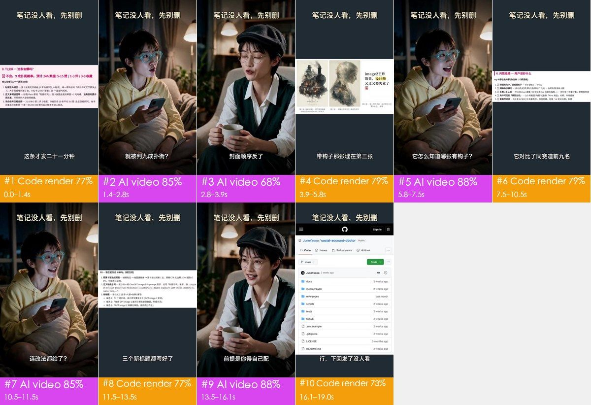

## What makes it work

- **The hook**: 0–1.4 s opens on the diagnosis screenshot, red text 「不会。9 成扑街概率」 ("90% chance it flops") with the subtitle 「这条才发二十一分钟」 ("posted only 21 minutes ago"); at 1.4 s it cuts to the woman with the phone aski
- 2.8–5.8 s: the answerer says 「封面顺序反了」 ("the cover order is backwards") and the next shot lays the three images out and pushes in on the third, big-text one: evidence right after the claim, so viewers 
- 5.8 s and 10.5 s: the asker twice voices the viewer's follow-up (「它怎么知道哪张有钩子？」「连改法都给了？」), each answered by a report screenshot: features surface one by one through dialogue, which feels more like a re
- 13.5–16.1 s: the answerer volunteers the catch, 「前提是你得自己配一个会看图的大模型」 ("you need to bring your own vision model"): stating the limit up front lowers the bait-and-switch feeling and heads off objections 
- 16.1–19.0 s: it ends on the GitHub repo page, pushing in on the repo name, with 「先别删，拿它查查」 echoing the title 「笔记没人看，先别删」 that stays on top the whole time: viewers leave with the name and where to find

## At a glance: picture, packaging, sound

Any short video splits into three layers: the picture, what is laid on top of it (subtitles, styled text, stickers), and the sound. Remake it one layer at a time.

| Layer | In this video | How to make it | Detail |
|---|---|---|---|
| **Picture** (base) | code / template render 5 shots, AI-generated video 5 shots | AI in 4 generations; screen recording / motion graphics in code | “Remake it yourself” |
| **Packaging** (on top) | text, title, subtitle | add in the editor: subtitles, styled text and stickers by the timeline | “Packaging layer” |
| **Sound** | voice（native dialogue from the AI video model） | voice: generated with the AI video | “Sound” |

## Content and structure

- The narrative line below comes from reading each shot; the lines were not transcribed separately, subtitle text is under “Packaging layer”

**Narrative line**

Keep this line in a remake: same order, same job at each step, with the point refilled from your own cases, numbers and material, so it is more than a change of subject.

| Time | Shots | Job | What it says |
|---|---|---|---|
| 0.0–2.8s | #1, #2 | grab attention | Open straight on a glaring bad-result number → The person affected asks back in surprise, magnifying the pain point |
| 2.8–3.9s | #3 | add information | The one who knows names the real cause in one line |
| 3.9–5.8s | #4 | show evidence | Lay the three images side by side so viewers see the problem for themselves |
| 5.8–7.5s | #5 | turn | Voice the viewer's most direct doubt |
| 7.5–10.5s | #6 | show evidence | Compare against the top posts in the same niche to back the verdict |
| 10.5–11.5s | #7 | turn | A delighted follow-up that moves from diagnosis to the fix |
| 11.5–13.5s | #8 | show evidence | Show the ready-made fixes the tool hands back |
| 13.5–16.1s | #9 | add information | State the requirement up front so expectations are set |
| 16.1–19.0s | #10 | call to action | Land on the tool itself and tell viewers where to get it |

## Shot list

Picture, Camera and Overlays are what is visible on screen; Made with and Material are the tools' inference, with the basis in the shot-by-shot appendix.

| # | Frames | Time | Length | What it says | Picture | Camera | Overlays | Made with (inferred) | Material (inferred) | Remake |
|---|---|---|---|---|---|---|---|---|---|---|
| 1 |  | 0:00.0 | 1.4s | grab attention: Open straight on a glaring bad-r… | Vertical template: dark grey background,… | smooth move | — | code / template render 77% | screen recording, UI screenshot | code render · Part 1 |
| 2 |  | 0:01.4 | 1.5s | grab attention: The person affected asks back in… | Living room at night: a short-haired you… | smooth move | text, title | AI-generated video 85% | AI-generated | AI generation · G1 |
| 3 | 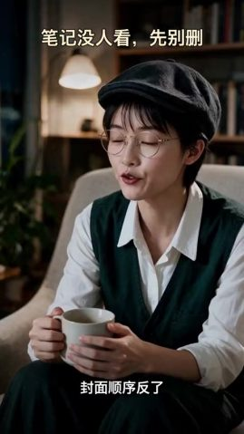 | 0:02.8 | 1.0s | add information: The one who knows names the rea… | Study at night: a short-haired woman in … | smooth move | text, title | AI-generated video 68% | AI-generated | AI generation · G2 |
| 4 |  | 0:03.9 | 2.0s | show evidence: Lay the three images side by side… | On the dark grey template, a horizontal … | smooth move | — | code / template render 79% | screen recording, UI screenshot | code render · Part 2 |
| 5 | 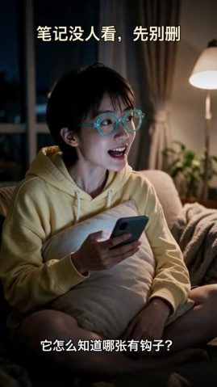 | 0:05.8 | 1.7s | turn: Voice the viewer's most direct doubt | Same living room and young woman as #2: … | static | subtitle, title | AI-generated video 88% | AI-generated | AI generation · G3 |
| 6 |  | 0:07.5 | 3.0s | show evidence: Compare against the top posts in … | On the dark grey template, a diagnosis-r… | smooth move | — | code / template render 79% | screen recording, UI screenshot | code render · Part 3 |
| 7 |  | 0:10.5 | 1.0s | turn: A delighted follow-up that moves from diag… | Same living room and young woman as #2: … | static (subject moves) | subtitle, title | AI-generated video 85% | AI-generated | AI generation · G3 |
| 8 |  | 0:11.5 | 1.9s | show evidence: Show the ready-made fixes the too… | On the dark grey template, a diagnosis-r… | smooth move | — | code / template render 77% | screen recording, UI screenshot | code render · Part 4 |
| 9 |  | 0:13.5 | 2.7s | add information: State the requirement up front … | Same study and woman in the newsboy cap … | smooth move | subtitle, title | AI-generated video 88% | AI-generated | AI generation · G4 |
| 10 |  | 0:16.1 | 2.9s | call to action: Land on the tool itself and tell… | On the dark grey template, a screenshot … | smooth move | — | code / template render 73% | UI screenshot | code render · Part 5 |

## Remake it yourself: do it in this order

Copy the method and the rhythm, not the pictures.

1. **Plan the content**: write your script on the narrative line under “Content and structure”
2. **Collect material**: see “What to prepare” below
3. **Generate**: 4 generations, see “AI generation” below
4. **Screen and motion graphics**: see “Code build” below
5. **Edit**: see “Edit” below
6. **Packaging**: the subtitle file `packaging/subtitles.srt` imports straight into an editor; styles and timeline under “Packaging layer”
7. **Sound**: see “Sound”; every effect can be played first
8. **Compare**: watch yours next to the original: shot lengths, subtitle positions, where the music comes in and drops

### What to prepare

- `@图片1` character reference images (one frontal face + one half-body per character) so the look stays consistent across shots: The young woman asking (the creator who , The woman in the newsboy cap (the one wh
- Real files shown in the picture (screenshots, photos, recordings; get the originals):
  - **screen recording** (part of the frame x0% y31% w100% h37%): shots #1, 1.4s in all
  - **UI screenshot** (part of the frame), Screenshot of the diagnosis report (TL;DR and core diagnosis) (card in the middle of the frame): shots #1, 1.4s in all
  - **screen recording** (part of the frame x0% y29% w100% h41%): shots #4, 2.0s in all
  - **UI screenshot** (part of the frame), Screenshot of the post's three images with captions (strip in the middle of the frame): shots #4, 2.0s in all
  - **screen recording** (part of the frame x0% y36% w100% h27%): shots #6, 3.0s in all
  - **UI screenshot** (part of the frame), Screenshot of the report's "what they have in common" section (card in the middle of the frame): shots #6, 3.0s in all
  - **screen recording** (part of the frame x0% y36% w100% h28%): shots #8, 1.9s in all
  - **UI screenshot** (part of the frame), Screenshot of the report's "P0 fix now" section (card in the middle of the frame): shots #8, 1.9s in all
  - **UI screenshot** (part of the frame x0% y22% w100% h69%): shots #10, 2.9s in all
  - **UI screenshot** (part of the frame), Screenshot of the GitHub repository page (mobile web) (middle of the frame, fills the width at the end): shots #10, 2.9s in all

### AI generation

**5 AI video shots → 4 generation units, 4 Seedance 2.0 calls**

- Grouping: AI shots in the same scene joined by hard cuts are generated in one call; ≤15s per call; consecutive hard cuts inside a unit preferably ≤8s, at most 10s; split at dissolves / fades and scene changes
- Audio: the model can generate action sound effects and ambience along with the picture; the voice was recorded by a person: record it separately and mix it in rather than having the video model speak, so copy and timing stay editable
- Packaging: the subtitle on the generated shots is post-production packaging: keep it out of the prompts, erase it from reference frames, and lay it back on from the packaging timeline after generation

A video model can take these inputs; each generation unit below lists which ones to feed and where they come from:
- **Text prompt**: always; describes the picture, action and camera
- **First frame**: locks the composition and subject of frame one. Without it this is plain text-to-video and framing changes every time
- **Last frame**: also locks the final frame so the model only fills in between. Suits a single shot with a camera move or action
- **Reference images**: how the product and people look, so they stay the same across shots (`@图片1` in the prompt)
- **Reference video**: copy the action, camera move and rhythm, not the picture (`@视频1`); not every model takes one

One generation per unit. The table lists what to feed the model; open a unit for where each input comes from and the prompt.

| Unit | Shots | Time | Duration | Mode | Feed | Continuity |
|---|---|---|---|---|---|---|
| G1 | #2 | 1.4–2.8s | 1.5s | single shot | first frame + reference image + reference video | — |
| G2 | #3 | 2.8–3.9s | 1.0s | single shot | first frame + reference image + reference video | — |
| G3 | #5, #7 | 5.8–7.5s, 10.5–11.5s | 2.7s | multi-shot | first frame + reference image + reference video | — |
| G4 | #9 | 13.5–16.1s | 2.7s | single shot | first frame + reference image + reference video | — |

<details><summary>G1 · shots #2 · 1.5s · multi-reference generation</summary>

| Input | Needed | From | Why |
|---|---|---|---|
| text prompt | yes | see the prompt below | describes picture, action and camera; every other input only constrains it |
| first frame | worth it | source frame `shots/shot_002_first.jpg` (to change product, person or style, redraw it with an image model from the first-frame prompt below); this model takes frame inputs or references, not both: pass it as one more reference image and write “@图片2 as the first frame” in the prompt (Jimeng's omni-reference accepts this; most APIs do not, drop it if refused) | locks composition, shot size and subject position; with text alone every generation frames it differently |
| last frame | no | — | this unit uses references to keep the product and people; the model takes no last frame alongside them |
| reference image | yes | `@图片1` character reference images (one frontal face + one half-body per character) so the look stays consistent across shots | the first frame only fixes frame one; reference images keep the product and people consistent after it |
| reference video | worth it | `@视频1` source clip 1.4–2.8s | follow the action, camera move and cutting rhythm; reference only, the picture is not copied |

- First-frame image prompt: Vertical 9:16, medium shot, slightly high angle. Living room at night, a short-haired Chinese young woman in teal thick-rimmed round glasses and a pale yellow hoodie sits cross-legged on an off-white sofa, hugging an off-white cushion, a dark phone in her right hand; she sits left of center, body toward front-right, looking up toward frame right. A warm floor lamp behind on the right, curtains and plants blurred in the background, cool phone light on her face, photoreal cinematic.
- Generate 4s and trim to 1.5s (very short shots are unstable when generated on their own)

```text
Vertical 9:16; night / low-light ambient, no dedicated fill, soft light (almost no lit / shadow edge), cool (daylight / cool-white LED), background slightly soft. Characters follow @图片1. Follow the action, camera movement and cutting rhythm of @视频1.
Medium shot, slightly high angle, the young woman sits left of center. Having just looked at her phone, she looks up toward frame right, eyebrows raised and mouth open, and asks in surprise "就被判九成扑街？"; the phone in her hand moves slightly; ends on her surprised face. Locked-off camera.
```

English prompt:

```text
Medium shot, slightly high angle, the young woman sits left of center. Having just looked at her phone, she looks up toward frame right, eyebrows raised and mouth open, and asks in surprise "就被判九成扑街？"; the phone in her hand moves slightly; ends on her surprised face. Locked-off camera.
```

</details>

<details><summary>G2 · shots #3 · 1.0s · multi-reference generation</summary>

| Input | Needed | From | Why |
|---|---|---|---|
| text prompt | yes | see the prompt below | describes picture, action and camera; every other input only constrains it |
| first frame | worth it | source frame `shots/shot_003_first.jpg` (to change product, person or style, redraw it with an image model from the first-frame prompt below); this model takes frame inputs or references, not both: pass it as one more reference image and write “@图片2 as the first frame” in the prompt (Jimeng's omni-reference accepts this; most APIs do not, drop it if refused) | locks composition, shot size and subject position; with text alone every generation frames it differently |
| last frame | no | — | this unit uses references to keep the product and people; the model takes no last frame alongside them |
| reference image | yes | `@图片1` character reference images (one frontal face + one half-body per character) so the look stays consistent across shots | the first frame only fixes frame one; reference images keep the product and people consistent after it |
| reference video | worth it | `@视频1` source clip 2.8–3.9s | follow the action, camera move and cutting rhythm; reference only, the picture is not copied |

- First-frame image prompt: Vertical 9:16, medium shot, eye level. Study at night, a short-haired Chinese woman in a black wool newsboy cap and thin metal round glasses, white shirt under a dark green V-neck knit vest, sits in an off-white armchair left of center, body slightly turned, holding a white mug in both hands in front of her lap. Dark bookshelf, warm pendant lamp and plants blurred behind, warm soft light from front-left, dark photoreal cinematic.
- Generate 4s and trim to 1.0s (very short shots are unstable when generated on their own)

```text
Vertical 9:16; night / low-light ambient, no dedicated fill, soft light (almost no lit / shadow edge), cool (daylight / cool-white LED), background slightly soft. Characters follow @图片1. Follow the action, camera movement and cutting rhythm of @视频1.
Medium shot, eye level, the woman sits in the armchair left of center. She blinks once, then looks toward frame left and says calmly and firmly "封面顺序反了", with a small nod, both hands holding the mug throughout. Locked-off camera.
```

English prompt:

```text
Medium shot, eye level, the woman sits in the armchair left of center. She blinks once, then looks toward frame left and says calmly and firmly "封面顺序反了", with a small nod, both hands holding the mug throughout. Locked-off camera.
```

</details>

<details><summary>G3 · shots #5, #7 · 2.7s · multi-reference generation</summary>

| Input | Needed | From | Why |
|---|---|---|---|
| text prompt | yes | see the prompt below | describes picture, action and camera; every other input only constrains it |
| first frame | worth it | source frame `shots/shot_005_first.jpg` (to change product, person or style, redraw it with an image model from the first-frame prompt below); this model takes frame inputs or references, not both: pass it as one more reference image and write “@图片2 as the first frame” in the prompt (Jimeng's omni-reference accepts this; most APIs do not, drop it if refused) | locks composition, shot size and subject position; with text alone every generation frames it differently |
| last frame | no | — | several shots in one call; a last frame would only constrain the final shot |
| reference image | yes | `@图片1` character reference images (one frontal face + one half-body per character) so the look stays consistent across shots | the first frame only fixes frame one; reference images keep the product and people consistent after it |
| reference video | worth it | `@视频1` source clip 5.8–7.5s, 10.5–11.5s (inserted shots removed, pieces joined) | follow the action, camera move and cutting rhythm; reference only, the picture is not copied |

- First-frame image prompt: Same first frame as #2: vertical 9:16 medium shot, slightly high angle, living room at night, the short-haired young woman in teal thick-rimmed glasses and a pale yellow hoodie sits cross-legged on the sofa hugging a cushion with a phone, looking toward frame right with a smile.
- Generate 4s and trim to 2.7s (very short shots are unstable when generated on their own); In the final cut these shots are separated by inserts: generate them back to back and put the inserts back in the edit

```text
Vertical 9:16; night / low-light ambient, no dedicated fill, soft light (almost no lit / shadow edge), cool (daylight / cool-white LED), background slightly soft. Characters follow @图片1. Follow the action, camera movement and cutting rhythm of @视频1. Hard cuts between shots.
Shot 1 (0.0–1.7s): Medium shot, slightly high angle, the young woman sits left of center. She starts with an open smile, then frowns and looks toward frame right, asking puzzled "它怎么知道哪张有钩子？"; the phone stays in her hand; ends on a puzzled look. Locked-off camera.
Shot 2 (1.7–2.7s): Medium shot, slightly high angle, the young woman sits left of center. Looking toward frame right, eyes wide, she asks delighted "连改法都给了？", then glances down at her phone and looks up again. Locked-off camera.
```

English prompt:

```text
Shot 1 (0.0-1.7s): Medium shot, slightly high angle, the young woman sits left of center. She starts with an open smile, then frowns and looks toward frame right, asking puzzled "它怎么知道哪张有钩子？"; the phone stays in her hand; ends on a puzzled look. Locked-off camera.
Shot 2 (1.7-2.7s): Medium shot, slightly high angle, the young woman sits left of center. Looking toward frame right, eyes wide, she asks delighted "连改法都给了？", then glances down at her phone and looks up again. Locked-off camera.
```

</details>

<details><summary>G4 · shots #9 · 2.7s · multi-reference generation</summary>

| Input | Needed | From | Why |
|---|---|---|---|
| text prompt | yes | see the prompt below | describes picture, action and camera; every other input only constrains it |
| first frame | worth it | source frame `shots/shot_009_first.jpg` (to change product, person or style, redraw it with an image model from the first-frame prompt below); this model takes frame inputs or references, not both: pass it as one more reference image and write “@图片2 as the first frame” in the prompt (Jimeng's omni-reference accepts this; most APIs do not, drop it if refused) | locks composition, shot size and subject position; with text alone every generation frames it differently |
| last frame | no | — | this unit uses references to keep the product and people; the model takes no last frame alongside them |
| reference image | yes | `@图片1` character reference images (one frontal face + one half-body per character) so the look stays consistent across shots | the first frame only fixes frame one; reference images keep the product and people consistent after it |
| reference video | worth it | `@视频1` source clip 13.5–16.1s | follow the action, camera move and cutting rhythm; reference only, the picture is not copied |

- First-frame image prompt: Same first frame as #3: vertical 9:16 medium shot, eye level, study at night, the short-haired woman in a black newsboy cap, thin metal round glasses, white shirt and dark green knit vest sits in an off-white armchair holding a white mug, looking toward frame left with a smile.
- Generate 4s and trim to 2.7s (very short shots are unstable when generated on their own)

```text
Vertical 9:16; night / low-light ambient, no dedicated fill, soft light (almost no lit / shadow edge), cool (daylight / cool-white LED), background slightly soft. Characters follow @图片1. Follow the action, camera movement and cutting rhythm of @视频1.
Medium shot, eye level, the woman sits in the armchair left of center. Looking toward frame left, she smiles and says unhurriedly "前提是你得自己配一个会看图的大模型", nodding gently while she talks, both hands around the mug; ends on her smile. Locked-off camera.
```

English prompt:

```text
Medium shot, eye level, the woman sits in the armchair left of center. Looking toward frame left, she smiles and says unhurriedly "前提是你得自己配一个会看图的大模型", nodding gently while she talks, both hands around the mug; ends on her smile. Locked-off camera.
```

</details>

### Code build

One Remotion / HTML project rebuilt from the text tracks and layout (text and UI are 100% controllable; changing copy is a data change). An LLM can write this project directly.

- Part 1: shots #1 (0.0–1.4s)
- Part 2: shots #4 (3.9–5.8s)
- Part 3: shots #6 (7.5–10.5s)
- Part 4: shots #8 (11.5–13.5s)
- Part 5: shots #10 (16.1–19.0s)

Remake assets (all in the report folder; hand them over together with the data below to whoever writes the code, or to an LLM):
- `shots/shot_XXX_first.jpg` / `_last.jpg`: first / last frame of each shot at full size, for layout, type size and margins
- `shots/shot_XXX_strip.jpg`: key frames about every 0.5 s, to follow the animation
- `shots/shot_XXX_elements.jpg` and `_el_NN.jpg` / `_st_NN.jpg` / `_ly_NN.jpg`: full-size crop of every element once settled, numbered as in the motion timeline; redraw shapes from them, cut out icons, logos and illustrations that cannot be redrawn
- `packaging/overlays.ass`, `packaging/timeline.json`: timing, position and colour of the text

How to build the pictures (by the measured picture type):
- data chart: SVG / D3 scales for axes and marks, numbers counted up with interpolate(), bars / lines grown with spring()

| Shot | Time | Build | Picture | Camera | Colours | On-screen text |
|---|---|---|---|---|---|---|
| #1 | 0.0–1.4s | data chart | Vertical template: dark grey background, the title 「笔记没人看，先别删」 ("Nobody reads your post? Don't delete it yet") at the top, subtitles at the bottom. In the middle, a screenshot of a diagnosis report (pink heading 「0. TL;DR — 这条会爆吗？」, red verdict 「不会。9 成扑街概率」 "No. 90% chance it flops", three "core diagnosis" items). The screenshot scales up fast from its left edge while its top moves up, so the verdict line grows larger. | push in 57%/s, picture drifts up | ground #1e2931 · #fbeef3 #b6aeb0 #ddd0d7 #8e8a8d | 这条才发二十一分钟 / 0.TL;DR一这条会爆吗？ / 无垂直标签积累→第一池200-500曝光后大概率不进 / 笔记没人看，先别删 / 笔记没人看，先别册 |
| #4 | 3.9–5.8s | data chart | On the dark grey template, a horizontal screenshot shows the post's three images: 1) a steampunk train illustration, 2) a double-exposure elf queen, 3) a white card with big black text 「image2王炸效果，设计师又又又要失业了」 ("设计师" highlighted in yellow). The strip scales up while panning left and settles on images 2 and 3, matching the line 「带钩子那张埋在第三张」 ("the one with the hook is buried third"). | push in 25%/s, picture drifts left | ground #1e2931 · #fafafa #dad6c8 #999484 #bab4a2 | 带钩子那张埋在第三张 / 笔记没人看，先别册 / 笔记没人看，先别删 |
| #6 | 7.5–10.5s | data chart | On the dark grey template, a diagnosis-report screenshot: pink heading 「6. 共性总结 — 用户该抄什么」 ("What the top posts have in common"), black line 「top 9 都在做的事（你这条 1 个都没做）」 and five items (big text on the cover, a clear audience, contrast, a visible before/after comparison, a niche account). The screenshot pushes in slowly, growing about a third over 3 s. | push in 11%/s, picture drifts up | ground #1e2931 · #fbfcfd #dedddf #aaa8a8 #c7c2c3 | 笔记没人看，先别册 / 笔记没人看，先别删 |
| #8 | 11.5–13.5s | data chart | On the dark grey template, a diagnosis-report screenshot: heading 「P0 — 现在就改（5 分钟内，决定生死）」 ("P0: fix now"), three fixes (make image 3 the cover, add the prompts to the body, rewrite the title) and three candidate titles. The screenshot pushes in slowly and settles on the candidate titles. | push in 25%/s, picture drifts up | ground #1e2931 · #fbfcfd #cbccce #e4e4e4 #b2b1af | 三个新标题都写好了 / 笔记没人看，先别册 |
| #10 | 16.1–19.0s | data chart | On the dark grey template, a screenshot of a GitHub mobile repository page (repo JuneYaooo/social-account-doctor, Code button, branch main, file list). It starts at full width and keeps pushing in, ending on the repo name and the first few folders. | push in 20%/s, picture drifts up | ground #1e2931 · #f5f9fa #000102 #d1dae0 #b5b6b8 | 笔记没人看，先别删 / 笔记没人看，先别册 / Sign in / Sig |

Per-shot motion timeline (measured: positions in % of frame width / height, colours sampled once the element settles; read together with the key-frame strip)

<details class="ref"><summary>Motion #1 0.0–1.4s · 5 events</summary>

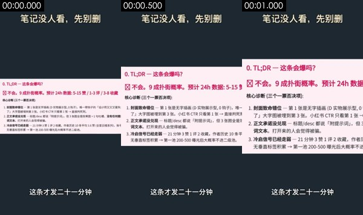

- Ground #1e2931; other main colours #fbeef3 #b6aeb0 #ddd0d7 #8e8a8d
Element crops (numbers match the motion list below; L = the continuously moving layer mid-shot and at the end, S = elements that never move), full-size files in `shots/`:


- S1. never moves: shape / text block · x 16%–56%, y 6%–11% · #ded9c9 · text “笔记没人看，先别删 / 笔记没人看，先别册” · [crop](shots/shot_001_st_01.jpg)
- S2. never moves: shape / text block · x 61%–84%, y 6%–11% · #e9e6d1 · [crop](shots/shot_001_st_02.jpg)
- S3. never moves: shape / text block · x 0%–100%, y 40%–61% · #fdeff3 · text “0.TL;DR一这条会爆吗？ / 不会。9成扑街概率。预计24h数据：5-15赞/1-3评/3-8收藏 / 核心诊断（三个一票否决项）：” · [crop](shots/shot_001_st_03.jpg)
- S4. never moves: shape / text block · x 24%–76%, y 88%–91% · #dde1e5 · text “这条才发二十一分钟” · [crop](shots/shot_001_st_04.jpg)
- [crop L1](shots/shot_001_ly_01.jpg) [crop L2](shots/shot_001_ly_02.jpg) · Continuous layer: 35% of the frame moves through the whole shot (x 0%–100%, y 28%–71%), e.g. drifting gradients, particle flow, breathing glow
1. 0.07–0.40s · middle right (x 76%–100%, y 44%–45%) · disappears, linear · #e290ad · [crop](shots/shot_001_el_01.jpg)
2. 0.07–0.93s · middle right (x 36%–100%, y 55%–58%) · appears, slides rightward, ease-in · #b6acaf · text “2.正文承诺没兑现一标题/desc都说「附提示词，但3张图全是效果图+1句吐槽，没有任何提 / 3.冷启信号已经走弱一21分钟3赞1评2收藏，作者历史10条平均3.6赞（全是日报系列），账号 / 了」大字图被埋到第3张。小红书CTR只看第1张→直接判死开” · [crop](shots/shot_001_el_02.jpg)
3. 0.07–0.80s · middle right (x 64%–100%, y 59%–63%) · disappears, scales up, ease-in-out · #212831 · [crop](shots/shot_001_el_03.jpg)
4. 1.00–1.07s · bottom (x 0%–100%, y 71%–72%) · appears, instant · #b3aeb5 · [crop](shots/shot_001_el_04.jpg)
5. 1.07–1.13s · top (x 0%–100%, y 26%–27%) · changes, instant · #353b45 · [crop](shots/shot_001_el_05.jpg)

</details>

<details class="ref"><summary>Motion #4 3.9–5.8s · 3 events</summary>

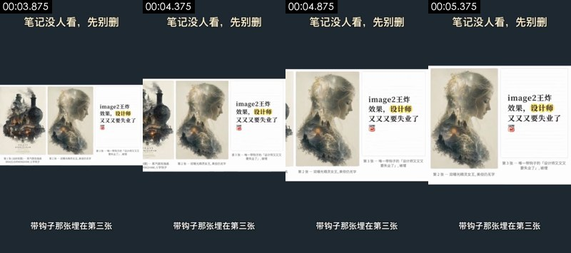

- Ground #1e2931; other main colours #fafafa #dad6c8 #999484 #bab4a2
Element crops (numbers match the motion list below; L = the continuously moving layer mid-shot and at the end, S = elements that never move), full-size files in `shots/`:


- S1. never moves: shape / text block · x 16%–56%, y 6%–11% · #dfdac9 · text “笔记没人看，先别册 / 笔记没人看，先别删” · [crop](shots/shot_004_st_01.jpg)
- S2. never moves: shape / text block · x 61%–84%, y 6%–11% · #ebe5d0 · [crop](shots/shot_004_st_02.jpg)
- S3. never moves: shape / text block · x 67%–100%, y 35%–65% · #fdfdfd · text “image2王炸 / 效果，设计师 / 又又又要失业了” · [crop](shots/shot_004_st_03.jpg)
- S4. never moves: shape / text block · x 21%–79%, y 87%–91% · #d9dee1 · text “带钩子那张埋在第三张” · [crop](shots/shot_004_st_04.jpg)
- [crop L1](shots/shot_004_ly_01.jpg) [crop L2](shots/shot_004_ly_02.jpg) · Continuous layer: 38% of the frame moves through the whole shot (x 0%–100%, y 26%–72%), e.g. drifting gradients, particle flow, breathing glow
1. 4.01–4.41s · middle right (x 62%–100%, y 32%–38%) · disappears, linear · #222a33 · text “image2王炸” · [crop](shots/shot_004_el_01.jpg)
2. 5.28–5.41s · bottom (x 0%–100%, y 72%–74%) · appears, instant · #b1b4b6 · [crop](shots/shot_004_el_02.jpg)
3. 5.34–5.41s · top (x 0%–100%, y 25%–26%) · appears, instant · #d3d9de · [crop](shots/shot_004_el_03.jpg)

</details>

<details class="ref"><summary>Motion #6 7.5–10.5s · 8 events</summary>


- Ground #1e2931; other main colours #fbfcfd #dedddf #aaa8a8 #c7c2c3
Element crops (numbers match the motion list below; L = the continuously moving layer mid-shot and at the end, S = elements that never move), full-size files in `shots/`:

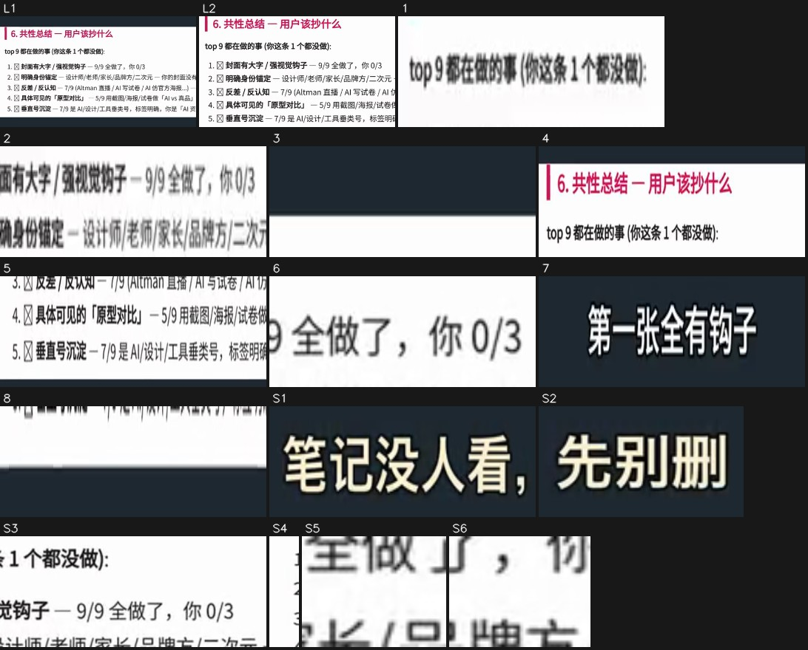

- S1. never moves: shape / text block · x 16%–56%, y 6%–11% · #dfdac8 · text “笔记没人看，先别册 / 笔记没人看，先别删” · [crop](shots/shot_006_st_01.jpg)
- S2. never moves: shape / text block · x 61%–84%, y 6%–11% · #e8e6d0 · [crop](shots/shot_006_st_02.jpg)
- S3. never moves: shape / text block · x 47%–100%, y 41%–50% · #fdfdfd · text “2.明确身份锚定一设计师/老师/家长/品牌方/二次元一你的封面没有人群 / 2.明确身份锚定一设计师/老师/家长/品牌方/二次元一你的封面 / 1.封面有大字/强视觉钩子一9/9全做了，你0/3” · [crop](shots/shot_006_st_03.jpg)
- S4. never moves: shape / text block · x 0%–4%, y 46%–57% · #fdfdfd · [crop](shots/shot_006_st_04.jpg)
- S5. never moves: shape / text block · x 69%–76%, y 49%–50% · #fefefe · [crop](shots/shot_006_st_05.jpg)
- S6. never moves: shape / text block · x 78%–84%, y 49%–50% · #fdfdfd · [crop](shots/shot_006_st_06.jpg)
- [crop L1](shots/shot_006_ly_01.jpg) [crop L2](shots/shot_006_ly_02.jpg) · Continuous layer: 20% of the frame moves through the whole shot (x 0%–100%, y 35%–64%), e.g. drifting gradients, particle flow, breathing glow
1. 7.61–8.74s · middle left (x 0%–38%, y 45%–46%) · disappears, moves leftward, linear · #979797 · text “top9都在做的事（你这条1个都没做）： / 1.封面有大字/强视觉钩子一9/9全做了，你0/3” · [crop](shots/shot_006_el_01.jpg)
2. 7.68–9.01s · middle left (x 11%–51%, y 49%–50%) · disappears, moves leftward, linear · #d8d7d7 · text “1.封面有大字/强视觉钩子一9/9全做了，你0/3 / 2.明确身份锚定一设计师/老师/家长/品牌方/二次元一你的封面没有人群 / 2.明确身份锚定一设计师/老师/家长/品牌方/二次元一你的封面” · [crop](shots/shot_006_el_02.jpg)
3. 7.74–8.54s · middle right (x 44%–100%, y 39%–41%) · disappears, unfolds rightward (draw-on / grow / wipe), linear · #222c32 · [crop](shots/shot_006_el_03.jpg)
4. 8.54–9.94s · middle (x 0%–100%, y 32%–44%) · changes, moves rightward, ease-in · #fdfdfd · text “6.共性总结一用户该抄什么 / top9都在做的事（你这条1个都没做）：” · [crop](shots/shot_006_el_04.jpg)
5. 8.54–9.61s · middle (x 0%–100%, y 56%–65%) · changes, unfolds downward (draw-on / grow / wipe), ease-in · #fdfcfc · text “4.具体可见的「原型对比]一5/9用截图/海报/试卷做「AVS真品]对照，你纯插画 / 5.垂直号沉淀一7/9是AI/设计/工具垂类号，标签明确，你是「AI资讯日报]杂牌 / 4.具体可见的「原型对比]一5/9用截图/海报/试卷做「Alvs真品]对照，你” · [crop](shots/shot_006_el_05.jpg)
6. 8.88–9.94s · middle right (x 67%–93%, y 46%–49%) · appears, slides rightward, ease-in · #adadad · [crop](shots/shot_006_el_06.jpg)
7. 9.14–9.21s · bottom (x 20%–80%, y 88%–91%) · changes, instant · #202831 · text “它对比了同赛道前九名 / 第一张全有钩子 / 连改法都给了？” · [crop](shots/shot_006_el_07.jpg)
8. 9.61–9.88s · middle (x 0%–100%, y 65%–66%) · appears, linear · #fdfefe · [crop](shots/shot_006_el_08.jpg)

</details>

<details class="ref"><summary>Motion #8 11.5–13.5s · 5 events</summary>


- Ground #1e2931; other main colours #fbfcfd #cbccce #e4e4e4 #b2b1af
Element crops (numbers match the motion list below; L = the continuously moving layer mid-shot and at the end, S = elements that never move), full-size files in `shots/`:

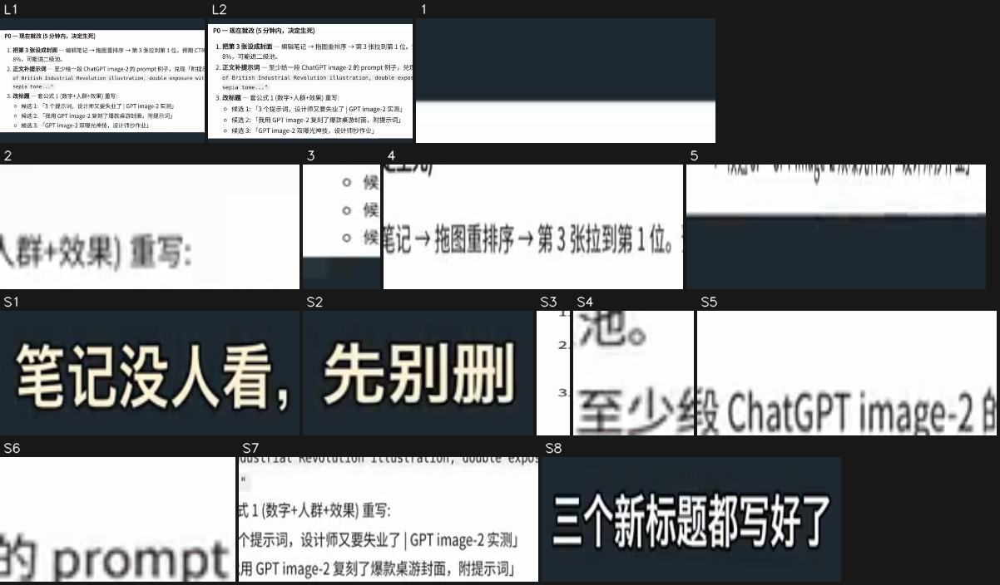

- S1. never moves: shape / text block · x 16%–56%, y 6%–11% · #e0d9c6 · text “笔记没人看，先别册” · [crop](shots/shot_008_st_01.jpg)
- S2. never moves: shape / text block · x 61%–84%, y 6%–11% · #e9e6d2 · [crop](shots/shot_008_st_02.jpg)
- S3. never moves: shape / text block · x 0%–4%, y 41%–60% · #fdfdfd · [crop](shots/shot_008_st_03.jpg)
- S4. never moves: shape / text block · x 31%–36%, y 44%–45% · #fdfdfd · [crop](shots/shot_008_st_04.jpg)
- S5. never moves: horizontal line · x 44%–71%, y 44%–45% · #fdfdfd · text “1.把第3张设成封面一编辑笔记→拖图重排序→第3张拉到第1位。预期CTR从估算2-3 / 2.正文补提示词一至少给一段ChatGPTimage-2的prompt例子，兑现「附提示词承诺 / 2.正文补提示词一至少给一段ChatGPTimage-2的prompt例子，兑现「” · [crop](shots/shot_008_st_05.jpg)
- S6. never moves: shape / text block · x 73%–84%, y 44%–45% · #fdfdfd · [crop](shots/shot_008_st_06.jpg)
- S7. never moves: shape / text block · x 29%–100%, y 50%–60% · #fdfdfd · text “of British Industrial Revolution illustration,double exposure with steam l / o候选1:「3个提示词，设计师又要失业了|GPTimage-2实测] / o候选2：「我用GPTimage-2复刻了爆款桌游封面，附提示词]” · [crop](shots/shot_008_st_07.jpg)
- S8. never moves: shape / text block · x 24%–76%, y 87%–91% · #d1d2d4 · text “三个新标题都写好了” · [crop](shots/shot_008_st_08.jpg)
- [crop L1](shots/shot_008_ly_01.jpg) [crop L2](shots/shot_008_ly_02.jpg) · Continuous layer: 24% of the frame moves through the whole shot (x 0%–100%, y 34%–65%), e.g. drifting gradients, particle flow, breathing glow
1. 11.61–12.14s · middle right (x 47%–100%, y 38%–39%) · disappears, linear · #1e2831 · text “1.把第3张设成封面一编辑笔记→拖图重排序→第3张拉到第1位。预期 / 1.把第3张设成封面一编辑笔记→拖图重排序→第3张拉到第1位。” · [crop](shots/shot_008_el_01.jpg)
2. 11.67–12.27s · middle (x 31%–51%, y 51%–52%) · disappears, moves rightward, linear · #c6c6c6 · text “3.改标题一套公式1（数字+人群+效果）重写：” · [crop](shots/shot_008_el_02.jpg)
3. 11.67–12.54s · middle left (x 0%–9%, y 55%–61%) · disappears, moves rightward, linear · #abb0b3 · [crop](shots/shot_008_el_03.jpg)
4. 12.34–13.07s · middle right (x 44%–100%, y 38%–41%) · appears, slides rightward, ease-in · #bcbabb · text “1.把第3张设成封面一编辑笔记→拖图重排序→第3张拉到第1位。预期CTR从估算2-3 / 1.把第3张设成封面一编辑笔记→拖图重排序→第3张拉到第1位。预期 / 1.把第3张设成封面一编辑笔记→拖图重排序→第3张拉到第1位。” · [crop](shots/shot_008_el_04.jpg)
5. 12.94–13.07s · middle (x 0%–84%, y 65%–66%) · appears, slides leftward, instant · #93989e · text “o候选3:「GPTimage-2双曝光神技，设计师抄作业]” · [crop](shots/shot_008_el_05.jpg)

</details>

<details class="ref"><summary>Motion #10 16.1–19.0s · 10 events</summary>


- Ground #1e2931; other main colours #f5f9fa #000102 #d1dae0 #b5b6b8
Element crops (numbers match the motion list below; L = the continuously moving layer mid-shot and at the end, S = elements that never move), full-size files in `shots/`:

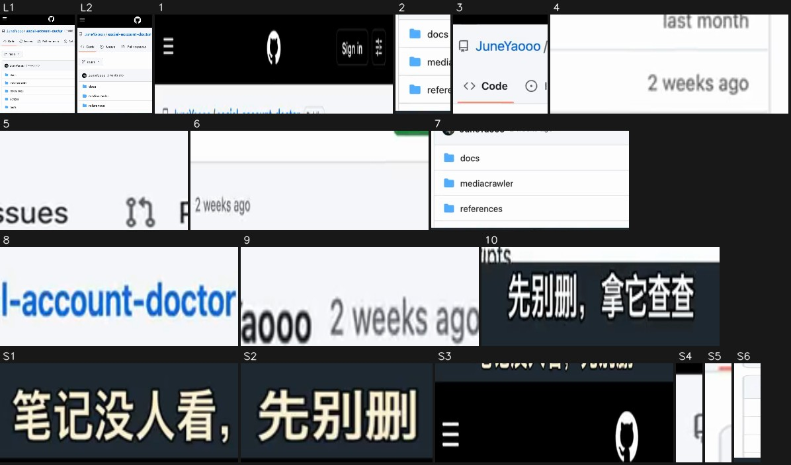

- S1. never moves: shape / text block · x 16%–56%, y 6%–11% · #e0d9c6 · text “笔记没人看，先别删 / 笔记没人看，先别册” · [crop](shots/shot_010_st_01.jpg)
- S2. never moves: shape / text block · x 61%–84%, y 6%–11% · #ece6d1 · [crop](shots/shot_010_st_02.jpg)
- S3. never moves: shape / text block · x 0%–100%, y 12%–19% · #000000 · text “Sign in / Sig” · [crop](shots/shot_010_st_03.jpg)
- S4. never moves: shape / text block · x 0%–2%, y 24%–30% · #f4f6f9 · [crop](shots/shot_010_st_04.jpg)
- S5. never moves: shape / text block · x 0%–2%, y 42%–48% · #fdfdfd · [crop](shots/shot_010_st_05.jpg)
- S6. never moves: vertical line · x 0%–4%, y 51%–87% · #fdfdfd · [crop](shots/shot_010_st_06.jpg)
- [crop L1](shots/shot_010_ly_01.jpg) [crop L2](shots/shot_010_ly_02.jpg) · Continuous layer: 28% of the frame moves through the whole shot (x 0%–100%, y 15%–86%), e.g. drifting gradients, particle flow, breathing glow
1. 16.19–17.12s · top (x 0%–100%, y 14%–20%) · disappears, moves leftward, linear · #eeeeee · text “Sign in / Sig” · [crop](shots/shot_010_el_01.jpg)
2. 16.19–18.39s · bottom left (x 2%–24%, y 64%–86%) · changes, moves upward, linear · #eef6fd · text “tests / tikhub / .env.example” · [crop](shots/shot_010_el_02.jpg)
3. 16.26–18.26s · top left (x 0%–38%, y 22%–43%) · changes, moves leftward, ease-in-out · #cacfda · text “JuneYaooo/social-account-doctor / <>Code / Issues” · [crop](shots/shot_010_el_03.jpg)
4. 16.26–17.93s · middle right (x 67%–100%, y 55%–59%) · disappears, moves leftward, ease-in-out · #bfbfbf · text “last month / 2v” · [crop](shots/shot_010_el_04.jpg)
5. 17.06–18.32s · middle (x 42%–67%, y 32%–38%) · appears, unfolds downward (draw-on / grow / wipe), ease-in-out · #b4b6b9 · text “Pullrequests / Pull requests / Issues” · [crop](shots/shot_010_el_05.jpg)
6. 17.26–17.66s · middle (x 31%–98%, y 42%–48%) · disappears, moves downward, ease-in-out · #ececee · text “2weeksago / JuneYaooo2weeksago” · [crop](shots/shot_010_el_06.jpg)
7. 17.32–18.39s · bottom (x 2%–100%, y 61%–86%) · changes, linear · #e8ebec · text “scripts / 2weeksago / tests” · [crop](shots/shot_010_el_07.jpg)
8. 17.59–18.46s · top right (x 56%–98%, y 26%–30%) · appears, slides rightward, ease-in · #8ab5eb · text “Actions / Pullrequests / Public” · [crop](shots/shot_010_el_08.jpg)
9. 17.79–18.46s · middle (x 29%–60%, y 57%–59%) · appears, slides leftward, ease-in-out · #cfd1d3 · text “JuneYaooo2weeksago” · [crop](shots/shot_010_el_09.jpg)
10. 17.93–17.99s · bottom (x 22%–78%, y 88%–91%) · changes, instant · #494d4f · text “行，下回发了没人看” · [crop](shots/shot_010_el_10.jpg)

</details>

### Edit

- Cut in the order and lengths of the shot list
- Approach: Question-and-answer cross-cutting: asker → answerer → a screenshot of the answer, hard cuts every 1–3 s; every screenshot segment uses the same dark grey template with a fixed title at the top and line-by-line subtitles at the bottom
- Rhythm: 28.4 cuts per minute, 1.9s average shot; no live-action shots; transitions cut×9

## Cast, scenes and props

| Id | Name | Kind | Look | Role | Voice | Shots |
|---|---|---|---|---|---|---|
| A | The young woman asking (the creator who  | person | Young Chinese woman, short black hair with bangs, teal thick-rimmed round glasses, pale yellow hoodie, hugging an off-white cushion, dark phone in hand, sitting cross-legged on a sofa | Has the problem, asks on the viewer's behalf | Young female voice, surprised and curious | #2, #5, #7 |
| B | The woman in the newsboy cap (the one wh | person | Short-haired Chinese woman, black wool newsboy cap, thin metal round glasses, white shirt under a dark green V-neck knit vest, dark bottoms, holding a white mug in both hands, sitting in an off-white armchair; her features closely match A's, likely one face in two looks (one person playing both role | Gives the answers and presents the tool | Female voice, calm and assured | #3, #9 |

**Scenes**

| Scene | Where | When | Set / light | Shots |
|---|---|---|---|---|
| S1 | Living-room sofa | Night | Off-white sofa and throw, warm floor lamp behind on the right, curtains, night window and plants | #2, #5, #7 |
| S2 | Study armchair | Night | Off-white armchair, dark bookshelf, warm pendant lamp and plants behind, low key | #3, #9 |
| S3 | Screenshot template | — | Dark grey background (#1e2931), white title at the top, white screenshot card in the middle, white subtitles at the bottom | #1, #4, #6, #8, #10 |

**Props / products / logos**

- Phone (shots #2, #5, #7): A holds it throughout, checking the post's numbers
- White mug (shots #3, #9): B holds it in both hands
- Diagnosis report screenshots (shots #1, #6, #8): The tool's Markdown report: TL;DR, what top posts share, P0 fixes
- Post image screenshot (shots #4): The three images of the diagnosed post
- GitHub repo page screenshot (shots #10): The social-account-doctor repository page (mobile web)

## Camera and lighting

- Visual style: Photoreal cinematic AI portraits, dark warm interiors at night; the screenshot segments use a plain dark grey template with white document cards
- Framing: shot size medium close-up 100%; camera angle slightly high angle; subject is a face (shot size from face height)
- Camera: moving camera (gimbal / handheld pan) 66%, fixed camera (tripod / mount / on the desk) 34%
- Lighting: Both scenes are warm indoor light at night: the living room from a floor lamp and the phone screen, the study from a warm soft light front-left and a pendant lamp behind; dark overall (image reading; pixel measurements in the fold below)
- Grade: natural (close to the original colours); normal saturation, normal contrast, normal blacks, overall neutral

<details class="ref"><summary>Per-item measurements and image readings (20)</summary>

| Aspect | Item | Verdict | Sources |
|---|---|---|---|
| Framing | shot size | medium close-up | measured; agent review: medium shot |
| Framing | camera angle | slightly high angle | agent review |
| Framing | composition | vertical; the subject sits left of center facing front-right, with the floor lamp and window in the top right | agent review |
| Camera | camera support | tripod / fixed mount | measured: mixed: moving camera (gimbal / handheld pan) 66%, fixed camera (tripod / mount / on the desk) 34%; agent review |
| Camera | lens | cannot tell | agent review |
| Camera | speed | normal | agent review |
| Camera | set-ups / locations | Two locked-off setups: a living-room sofa at night (the young woman asking, slightly high medium shot) and a study armchair at night (the woman in the cap, eye-level medium shot); no camera moves, the cuts carry it | agent review |
| Camera | likely gear | No live action: the people are AI image-to-video, the screenshot cards are push-ins made in an editor / code template | agent review |
| Lighting | location | indoors; night; living-room sofa | agent review |
| Lighting | key light | warm floor lamp behind on the right + the phone screen lighting the face from below | agent review |
| Lighting | soft / hard | hard light (sharp shadow edge) | measured; agent review: soft |
| Lighting | fill | no visible fill, deep shadows | agent review |
| Lighting | rim / backlight | the floor lamp leaves a warm edge on the hair and right shoulder | agent review |
| Lighting | catchlight | glasses reflections, no clear catchlight | agent review |
| Lighting | practicals | floor lamp, phone screen | agent review |
| Lighting | colour temperature | cool (daylight / cool-white LED) | measured; agent review: mixed (warm lamp + cool screen) |
| Lighting | lighting set-up | living room at night: one warm floor lamp for background and edge, the phone screen as key on the face (AI picture, not a shooting plan) | agent review |
| Lighting | overall lighting | Both scenes are warm indoor light at night: the living room from a floor lamp and the phone screen, the study from a warm soft light front-left and a pendant lamp behind; dark overall | agent review |
| Grade | colour grade | natural (close to the original colours) | measured; agent review: dark warm look: crushed blacks, mostly warm yellow, a slight cool cyan near the screen |
| Grade | overall grade | Dark warm cinematic, crushed blacks, warm skin tones | agent review |

</details>

- Note: lighting ratio, soft / hard, colour temperature and shot size are measured on the subject's pixels (the face when there is one, otherwise the in-focus region, which is an estimate); platform transcodes crush the shadows, so hardness and fill read conservative; camera angle, light source, catchlight and rim light follow the image readers. Where measurement and readers disagree, both are listed.

## Packaging layer (subtitles / styled text / stickers / sound-effect hits)

- 13 subtitle lines (bottom, up to 1 rows): white text, black outline, line height 3.3%; entrance: hard in×9
- Exports: `packaging/subtitles.srt`, `packaging/overlays.ass`, `packaging/timeline.json` (SRT is the subtitle timeline; ASS carries colour, outline, position and entrance animation, swap in the original font; timeline.json is the full timeline)

<details class="ref"><summary>text timeline (13 rows)</summary>

| Time | Kind | Text | Style | In / out | SFX |
|---|---|---|---|---|---|
| 0.00–1.40s | subtitle | 这条才发二十一分钟 | white text, black outline, line height 3.0% (about 26px) | hard out | — |
| 1.40–2.80s | subtitle | 就被判九成扑街？ | white text, black outline, line height 3.3% (about 28px) | hard in / hard out | — |
| 2.80–3.90s | subtitle | 封面顺序反了 | white text, black outline, line height 3.5% (about 30px) | hard in / hard out | — |
| 3.90–5.80s | subtitle | 带钩子那张埋在第三张 | white text, black outline, line height 3.5% (about 30px) | hard in / hard out | — |
| 5.80–7.50s | subtitle | 它怎么知道哪张有钩子？ | white text, black outline, line height 3.0% (about 26px) | hard in / hard out | — |
| 7.50–9.00s | subtitle | 它对比了同赛道前九名 | white text, black outline, line height 3.0% (about 26px) | hard in | — |
| 9.00–10.50s | subtitle | 第一张全有钩子 | white text, black outline, line height 3.3% (about 28px) | hard out | — |
| 10.50–11.50s | subtitle | 连改法都给了？ | white text, black outline, line height 3.3% (about 28px) | hard in / hard out | — |
| 11.50–13.50s | subtitle | 三个新标题都写好了 | white text, black outline, line height 3.0% (about 26px) | hard in / hard out | — |
| 13.50–14.10s | subtitle | 前提是你得自己配 | white text, black outline, line height 3.0% (about 26px) | hard in / shrink out | — |
| 14.50–16.00s | subtitle | 一个会看图的大模型 | white text, black outline, line height 3.6% (about 31px) | shrink out | — |
| 16.00–17.90s | subtitle | 行，下回发了没人看 | white text, black outline, line height 3.8% (about 32px) | hard out | — |
| 17.90–19.00s | subtitle | 先别删，拿它查查 | white text, black outline, line height 3.5% (about 30px) | hard in | — |

</details>

Remake: burn subtitles and styled text in with `packaging/overlays.ass` (ffmpeg -vf ass=overlays.ass), or rebuild them from timeline.json in CapCut / Remotion; stickers and GIFs need matching assets (meme / GIF libraries), crops are under packaging/.

## Sound

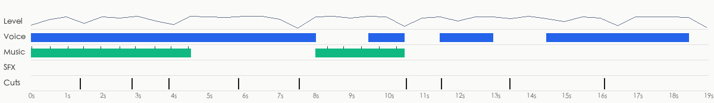

- loudness -16.8 dBFS, peak -3.5 dBFS; each clip carries its own sound (background jumps 23.6dB at cuts vs 9.3dB within shots)
- Sources: Video type: AI video with native audio (each clip carries its own sound) → voice: native dialogue from the AI video model; SFX: generated with the picture by the video model (native audio)

**Voice**

- 76% of the duration; pitch about 247.8Hz (female-leaning)
- Source: native dialogue from the AI video model (native dialogue from the AI video model 65%, TTS voice-over 18%, human recording 18%)
  - The background sound jumps at every cut and the picture is AI video: the voice was most likely generated with the picture by the video model (e.g. Seedance / Veo / H3 native audio)
- Remake: generated with the AI video: use a video model that speaks, with the lines in the prompt

**Music**

- No sustained music bed detected

**Sound effects**

- No clear sound effects found (very quiet ones under the voice and music may be missed)

- Separated stems: `stems/original.wav` (original), `stems/vocals.wav` (dry voice), `stems/music.wav` (music + ambience), `stems/effects.wav` (effects track)
<!--stems-->

## Open questions

- No AI listened to the soundtrack (the review covered the picture only): real voice versus TTS is inferred from the waveform; the effects were found on the separated effects track and their types are estimated from the sound. Play the stems and each effect under “Sound” to check

## Appendix

### Shot by shot

Each shot has two parts: what is visible on screen, and how the tools infer it was made (with the basis); remake prompts last. Folded by default.

<details class="ref"><summary>#1 00:00.000–00:01.375 · code / template render; brings in real material (screen recording, UI screenshot)</summary>


**Visible on screen** (check against the frames)
- Picture: Vertical template: dark grey background, the title 「笔记没人看，先别删」 ("Nobody reads your post? Don't delete it yet") at the top, subtitles at the bottom. In the middle, a screenshot of a diagnosis report (pink heading 「0. TL;DR — 这条会爆吗？」, red verdict 「不会。9 成扑街概率」 "No. 90% chance it flops", three "core diagnosis" items). The screenshot scales up fast from its left edge while its top moves up, so the verdict line grows larger.
- Text track (text in the picture/bottom): 这条才发二十一分钟
- Text track (text in the picture/middle): 0.TL;DR一这条会爆吗？ / 不会。9成扑街概率。预计24h数据：5-15赞/1-3评/3-8收藏 / 不会。9成扑街概率。预计24h数据：5-15 / 不会。9成扑街概率。预计24h数据
- Text track (text in the picture/middle): 核心诊断（三个一票否决项）： / 1.封面致命错位一第1张是无字插画（D实物展示型，0钩子），唯一带钩子的「设计师 / 了J大字图被埋到第3张。小红书CTR只看第1张→直接判死刑。 / 1.封面致命错位一第1张是无字插画（D实物展示型，0钩子），唯一
- Text track (text in the picture/middle): 2.正文承诺没兑现一标题/desc都说「附提示词，但3张图全是效果图+1句吐槽， / 词文本。打开来的人会觉得被骗。 / 3.冷启信号已经走弱一21分钟3赞1评2收藏，作者历史10条平均3.6赞（全是日 / 了」大字图被埋到第3张。小红书CTR只看第1张→直接判死开
- [AI assistant review] Flat dark grey background (#1e2931), a fixed white title at the top and a fixed white subtitle at the bottom
- [AI assistant review] In the middle, a light pink document screenshot card ("0. TL;DR — 这条会爆吗？", "不会。9 成扑街概率"), crisp text, Markdown-rendered layout
- [AI assistant review] The whole card scales up and shifts within 1.4 s, the text inside does not deform

**How it was made, as inferred by the tools** (inferred, not seen)
- Inference: code / template render 70%, screen recording / screenshot 13%, 3D render 4% (fused_agent)
- Material: mixed (includes real material): screen recording, UI screenshot
  - screen recording: 浅色界面面板内有 9 处文字（其中 9 处小字号）
- Basis (tool measurements, not necessarily visible to the eye):
  - Rendered texture: 71% flat colour blocks, 95% of pixels use only 35 colours, 27% axis-aligned edges
  - Dense fine high-frequency detail on a flat background (small text / UI), looks like a screenshot or document

- Remake: Code render: rebuild in Remotion / HTML from the text tracks and layout, 100% controllable, no generative model needed; real material the user must supply: screen recording (part of the frame x0% y31% w100% h37%), UI screenshot (part of the frame)

</details>

<details class="ref"><summary>#2 00:01.375–00:02.833 · AI-generated video + code / editor overlays (text labels, title)</summary>

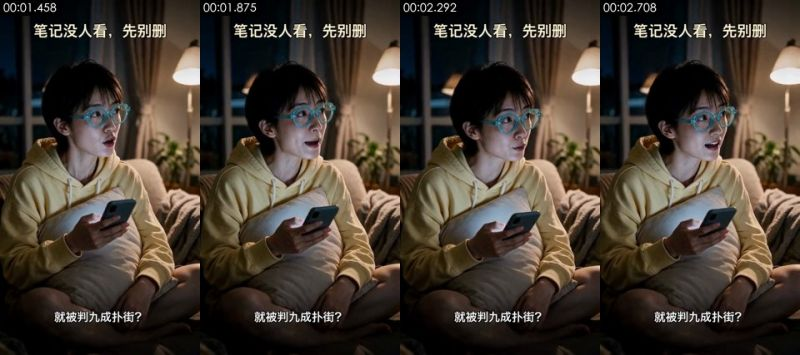

**Visible on screen** (check against the frames)
- Picture: Living room at night: a short-haired young woman in teal thick-rimmed glasses and a pale yellow hoodie sits cross-legged on the sofa hugging an off-white cushion, phone in her right hand; she looks up toward frame right and speaks in surprise. Warm floor lamp, curtains and plants behind; locked-off medium shot.
- Camera / lighting: medium close-up; slightly high angle; tripod / fixed mount; night / low-light ambient, no dedicated fill; key light frontal (from the camera side; both sides of the subject about equally bright); lighting ratio about 1.3:1 (0.4 stops); medium-soft
- Text track (text/bottom): 就被判九成扑街？
- Text track (title/top): 笔记没人看，先别册 / 笔记没人看，先别删
- [AI assistant review] Skin too smooth and lighting too even, like an AI photoreal image
- [AI assistant review] Almost the same framing and pose as the first frames of #5 and #7, like one first-frame image generated several times
- [AI assistant review] The head turns, the mouth and the hand holding the phone move: not a talking-head avatar that only moves the mouth; nothing readable on the phone screen

**How it was made, as inferred by the tools** (inferred, not seen)
- Inference: AI-generated video 74%, AI avatar (talking head) 11%, live action 5% (fused_agent)
- Material: AI-generated
- Basis (tool measurements, not necessarily visible to the eye):
  - Low-light shot: 36% of the frame is near-black but grainy (not a solid fill), flat blocks cover only 1% of the lit part, and there is a face: the flat blocks / small palette come from crushed shadows, not counted as rendered texture
  - Photographic texture: noise σ=0.34, 121 colours, 11% flat blocks
  - Per-frame sharpness oscillates periodically (period 4 frames, correlation 0.87) with no duplicate frames: frame interpolation / rate conversion, or just the rhythm of a re-encode (transcodes whose platform tags were stripped show it too); not enough on its own to call AI

- Remake: Source is AI-generated: use the shot's first and last frames for first/last-frame generation to closely match composition and motion; to change the subject, edit the first frame with an image model first
  - First-frame image prompt: medium close-up, vertical; the subject sits left of center facing front-right, with the floor lamp and window in the top right. Vertical 9:16, medium shot, slightly high angle. Living room at night, a short-haired Chinese young woman in teal thick-rimmed round glasses and a pale yellow hoodie sits cross-legged on an off-white sofa, hugging an off-white cushion, a dark phone in her right hand; she sits left of center, body toward front-right, looking up toward frame right. A warm floor lamp behind on the right, curtains and plants blurred in the background, cool phone light on her face, photoreal cinematic.
  - Video prompt: medium close-up, vertical; the subject sits left of center facing front-right, with the floor lamp and window in the top right. Medium shot, slightly high angle, the young woman sits left of center. Having just looked at her phone, she looks up toward frame right, eyebrows raised and mouth open, and asks in surprise "就被判九成扑街？"; the phone in her hand moves slightly; ends on her surprised face. Locked-off camera.

</details>

<details class="ref"><summary>#3 00:02.833–00:03.875 · AI-generated video + code / editor overlays (text labels, title)</summary>

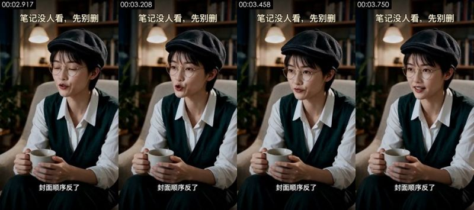

**Visible on screen** (check against the frames)
- Picture: Study at night: a short-haired woman in a black newsboy cap and thin metal round glasses, white shirt under a dark green V-neck knit vest, sits in an off-white armchair holding a white mug in both hands; she blinks, then looks toward frame left and speaks. Bookshelf, warm pendant lamp and plants behind; locked-off medium shot.
- Camera / lighting: medium close-up; eye level; tripod / fixed mount; night / low-light ambient, no dedicated fill; key light frame left, three-quarter front; lighting ratio about 2.0:1 (1.0 stops); medium-soft
- Text track (text/bottom): 封面顺序反了
- Text track (title/top): 笔记没人看，先别删 / 笔记没人看，先别册
- [AI assistant review] Same character, same chair and same framing as #9; the eye blink at the start is smooth but the face is too clean
- [AI assistant review] Book spines on the shelf melt into colour blocks, no readable text
- [AI assistant review] Fingers around the mug keep a stable shape, motion is small and the light is even, like photoreal AI video

**How it was made, as inferred by the tools** (inferred, not seen)
- Inference: AI-generated video 68%, live action 14%, AI avatar (talking head) 9% (fused_agent)
- Material: AI-generated
- Basis (tool measurements, not necessarily visible to the eye):
  - Low-light shot: 46% of the frame is near-black but grainy (not a solid fill), flat blocks cover only 0% of the lit part, and there is a face: the flat blocks / small palette come from crushed shadows, not counted as rendered texture
  - Photographic texture: noise σ=0.31, 98 colours, 9% flat blocks

- Remake: Source is AI-generated: use the shot's first and last frames for first/last-frame generation to closely match composition and motion; to change the subject, edit the first frame with an image model first
  - First-frame image prompt: medium close-up, vertical; the subject sits left of center in an armchair, bookshelf and pendant lamp behind. Vertical 9:16, medium shot, eye level. Study at night, a short-haired Chinese woman in a black wool newsboy cap and thin metal round glasses, white shirt under a dark green V-neck knit vest, sits in an off-white armchair left of center, body slightly turned, holding a white mug in both hands in front of her lap. Dark bookshelf, warm pendant lamp and plants blurred behind, warm soft light from front-left, dark photoreal cinematic.
  - Video prompt: medium close-up, vertical; the subject sits left of center in an armchair, body slightly turned, bookshelf and pendant lamp behind. Medium shot, eye level, the woman sits in the armchair left of center. She blinks once, then looks toward frame left and says calmly and firmly "封面顺序反了", with a small nod, both hands holding the mug throughout. Locked-off camera.

</details>

<details class="ref"><summary>#4 00:03.875–00:05.833 · code / template render; brings in real material (screen recording, UI screenshot)</summary>


**Visible on screen** (check against the frames)
- Picture: On the dark grey template, a horizontal screenshot shows the post's three images: 1) a steampunk train illustration, 2) a double-exposure elf queen, 3) a white card with big black text 「image2王炸效果，设计师又又又要失业了」 ("设计师" highlighted in yellow). The strip scales up while panning left and settles on images 2 and 3, matching the line 「带钩子那张埋在第三张」 ("the one with the hook is buried third").
- Text track (text in the picture/bottom): 带钩子那张埋在第三张
- Text track (text in the picture/middle): image2王炸 / 效果，设计师 / 又又又要失业了
- Text track (text in the picture/middle): BIRMISGHAM / BRASS / 第3张一唯一带钩子的「设计师又又又 / 要失业了J，被埋
- Text track (text in the picture/middle): 蒸汽朋克插画 / 第2张一双曝光精灵女王，美但仍无字 / AM.0字钩子 / 要失业了」，被埋
- [AI assistant review] Same dark grey template, same title and subtitle positions
- [AI assistant review] In the middle, a screenshot strip of the post's three images (a steam-train illustration, a double-exposure queen, a big-text card reading 「image2王炸效果，设计师又又又要失业了」) with small captions below
- [AI assistant review] The strip scales up and pans left from image 1 to image 3; nothing moves inside the images

**How it was made, as inferred by the tools** (inferred, not seen)
- Inference: code / template render 70%, screen recording / screenshot 12%, 3D render 6% (fused_agent)
- Material: mixed (includes real material): screen recording, UI screenshot
  - screen recording: 浅色界面面板内有 10 处文字（其中 10 处小字号）
- Basis (tool measurements, not necessarily visible to the eye):
  - Rendered texture: 62% flat colour blocks, 95% of pixels use only 44 colours, 32% axis-aligned edges
  - Dense fine high-frequency detail on a flat background (small text / UI), looks like a screenshot or document
  - Per-frame sharpness oscillates periodically (period 4 frames, correlation 0.55) with no duplicate frames: frame interpolation / rate conversion, or just the rhythm of a re-encode (transcodes whose platform tags were stripped show it too); not enough on its own to call AI

- Remake: Code render: rebuild in Remotion / HTML from the text tracks and layout, 100% controllable, no generative model needed; real material the user must supply: screen recording (part of the frame x0% y29% w100% h41%), UI screenshot (part of the frame)

</details>

<details class="ref"><summary>#5 00:05.833–00:07.542 · AI-generated video + code / editor overlays (subtitles, title)</summary>

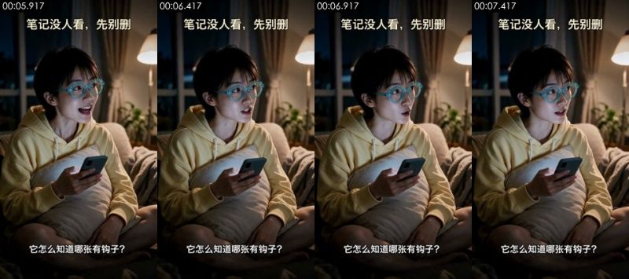

**Visible on screen** (check against the frames)
- Picture: Same living room and young woman as #2: she goes from an open smile to a puzzled frown, looking toward frame right as she asks; body almost still, phone in hand. Locked-off medium shot.
- Camera / lighting: medium close-up; slightly high angle; tripod / fixed mount; night / low-light ambient, no dedicated fill; key light frontal (from the camera side; both sides of the subject about equally bright); lighting ratio about 1.2:1 (0.3 stops); soft light (almost no lit / shadow edge)
- Text track (subtitle/bottom): 它怎么知道哪张有钩子？ / 它对比了同赛道前九名
- Text track (subtitle/middle): 6.共性总结一用户该抄什么 / top9都在做的事（你这条1个都没做）：
- Text track (subtitle/middle): 1.封面有大字/强视觉钩子一9/9全做了，你0/3 / 2.明确身份锚定一设计师/老师/家长/品牌方/二次元一你的封面没有人群
- Text track (subtitle/middle): 4.具体可见的「原型对比J一5/9用截图/海报/试卷做「AIvs真品J对照，你纯 / 5.垂直号沉淀一7/9是AI/设计/工具垂类号，标签明确，你是「AI资讯日报J杂
- [AI assistant review] First frame is nearly identical to #7's (same smile, same hand pose): different clips generated from one first-frame image
- [AI assistant review] Glasses rims, fingers and phone edges drift slightly between frames
- [AI assistant review] Light and skin too perfect, curtains and plants evenly blurred

**How it was made, as inferred by the tools** (inferred, not seen)
- Inference: AI-generated video 73%, AI avatar (talking head) 14%, live action 3% (fused_agent)
- Material: AI-generated
- Basis (tool measurements, not necessarily visible to the eye):
  - Low-light shot: 37% of the frame is near-black but grainy (not a solid fill), flat blocks cover only 0% of the lit part, and there is a face: the flat blocks / small palette come from crushed shadows, not counted as rendered texture
  - Photographic texture: noise σ=0.34, 116 colours, 10% flat blocks
  - Per-frame sharpness oscillates periodically (period 4 frames, correlation 0.74) with no duplicate frames: frame interpolation / rate conversion, or just the rhythm of a re-encode (transcodes whose platform tags were stripped show it too); not enough on its own to call AI
  - 100% of sampled frames show a frontal face on a fixed camera, voice on the audio track

- Remake: Source is AI-generated: use the shot's first and last frames for first/last-frame generation to closely match composition and motion; to change the subject, edit the first frame with an image model first
  - First-frame image prompt: medium close-up, vertical; the subject sits left of center facing front-right, with the floor lamp and window in the top right. Same first frame as #2: vertical 9:16 medium shot, slightly high angle, living room at night, the short-haired young woman in teal thick-rimmed glasses and a pale yellow hoodie sits cross-legged on the sofa hugging a cushion with a phone, looking toward frame right with a smile.
  - Video prompt: medium close-up, vertical; the subject sits left of center facing front-right, with the floor lamp and window in the top right. Medium shot, slightly high angle, the young woman sits left of center. She starts with an open smile, then frowns and looks toward frame right, asking puzzled "它怎么知道哪张有钩子？"; the phone stays in her hand; ends on a puzzled look. Locked-off camera.

</details>

<details class="ref"><summary>#6 00:07.542–00:10.542 · code / template render; brings in real material (screen recording, UI screenshot)</summary>


**Visible on screen** (check against the frames)
- Picture: On the dark grey template, a diagnosis-report screenshot: pink heading 「6. 共性总结 — 用户该抄什么」 ("What the top posts have in common"), black line 「top 9 都在做的事（你这条 1 个都没做）」 and five items (big text on the cover, a clear audience, contrast, a visible before/after comparison, a niche account). The screenshot pushes in slowly, growing about a third over 3 s.
- Text track (text in the picture/bottom): 它对比了同赛道前九名 / 第一张全有钩子 / 连改法都给了？
- Text track (text in the picture/middle): 6.共性总结一用户该抄什么 / top9都在做的事（你这条1个都没做）：
- Text track (text in the picture/middle): 1.封面有大字/强视觉钩子一9/9全做了，你0/3 / 2.明确身份锚定一设计师/老师/家长/品牌方/二次元一你的封面没有人群 / 3.反差/反认知一7/9（Altman直播/AI写试卷/Al仿官方海报)一你只有 / 3.反差/反认知一7/9（Altman直播/AI写试卷/Al仿官方海报..）一你
- Text track (text in the picture/middle): 4.具体可见的「原型对比]一5/9用截图/海报/试卷做「AVS真品]对照，你纯插 / 5.垂直号沉淀一7/9是AI/设计/工具垂类号，标签明确，你是「AI资讯日报]杂 / 4.具体可见的「原型对比]一5/9用截图/海报/试卷做「Alvs真品]对照，你 / 5.垂直号沉淀一7/9是AI/设计/工具垂类号，标签明确，你是「AI资讯日报]
- [AI assistant review] Same dark grey template
- [AI assistant review] In the middle, a white document screenshot: pink heading 「6. 共性总结 — 用户该抄什么」 and five checkbox items
- [AI assistant review] The whole screenshot scales up steadily and moves up slightly; text stays crisp

**How it was made, as inferred by the tools** (inferred, not seen)
- Inference: code / template render 72%, screen recording / screenshot 13%, 3D render 4% (fused_agent)
- Material: mixed (includes real material): screen recording, UI screenshot
  - screen recording: 浅色界面面板内有 7 处文字（其中 7 处小字号）
- Basis (tool measurements, not necessarily visible to the eye):
  - Rendered texture: 75% flat colour blocks, 95% of pixels use only 14 colours, 31% axis-aligned edges
  - Dense fine high-frequency detail on a flat background (small text / UI), looks like a screenshot or document
  - Per-frame sharpness oscillates periodically (period 2 frames, correlation 0.08) with no duplicate frames: frame interpolation / rate conversion, or just the rhythm of a re-encode (transcodes whose platform tags were stripped show it too); not enough on its own to call AI

- Remake: Code render: rebuild in Remotion / HTML from the text tracks and layout, 100% controllable, no generative model needed; real material the user must supply: screen recording (part of the frame x0% y36% w100% h27%), UI screenshot (part of the frame)

</details>

<details class="ref"><summary>#7 00:10.542–00:11.542 · AI-generated video + code / editor overlays (subtitles, title)</summary>


**Visible on screen** (check against the frames)
- Picture: Same living room and young woman as #2: she looks toward frame right and asks with delight, then glances down at her phone and looks up again. Locked-off medium shot.
- Camera / lighting: medium close-up; slightly high angle; tripod / fixed mount; night / low-light ambient, no dedicated fill; key light frontal (from the camera side; both sides of the subject about equally bright); lighting ratio about 1.1:1 (0.1 stops); soft light (almost no lit / shadow edge)
- Text track (subtitle/bottom): 连改法都给了？ / 三个新标题都写好了
- Text track (subtitle/middle): P0一现在就改（5分钟内，决定生死） / 1.把第3张设成封面一编辑笔记→拖图重排序→第3张拉到第1位。预期CTR从估算2 / 8%，可能进二级池。
- Text track (subtitle/middle): 2.正文补提示词一至少给一段ChatGPTimage-2的prompt例子，兑现 / of British Industrial Revolution illustr / sepia tone..." / 3.改标题一套公式1（数字+人群+效果）重写：
- Text track (subtitle/middle): o候选1：「3个提示词，设计师又要失业了|GPTimage-2实测 / o候选2：「我用GPTimage-2复刻了爆款桌游封面，附提示词] / o候选3:「GPTimage-2双曝光神技，设计师抄作业J
- [AI assistant review] First frame nearly the same as #5's: generated from the same first-frame image
- [AI assistant review] Lip movement and head turns are natural but the skin and light are too clean
- [AI assistant review] Slight deformation at the phone and finger edges

**How it was made, as inferred by the tools** (inferred, not seen)
- Inference: AI-generated video 71%, AI avatar (talking head) 14%, live action 5% (fused_agent)
- Material: AI-generated
- Basis (tool measurements, not necessarily visible to the eye):
  - Low-light shot: 38% of the frame is near-black but grainy (not a solid fill), flat blocks cover only 1% of the lit part, and there is a face: the flat blocks / small palette come from crushed shadows, not counted as rendered texture
  - Photographic texture: noise σ=0.33, 114 colours, 11% flat blocks
  - 100% of sampled frames show a frontal face on a fixed camera, voice on the audio track

- Remake: Source is AI-generated: use the shot's first and last frames for first/last-frame generation to closely match composition and motion; to change the subject, edit the first frame with an image model first
  - First-frame image prompt: medium close-up, vertical; the subject sits left of center facing front-right, with the floor lamp and window in the top right. Same first frame as #2: vertical 9:16 medium shot, slightly high angle, living room at night, the short-haired young woman in teal thick-rimmed glasses and a pale yellow hoodie sits cross-legged on the sofa hugging a cushion with a phone, looking toward frame right with a smile.
  - Video prompt: medium close-up, vertical; the subject sits left of center facing front-right, with the floor lamp and window in the top right. Medium shot, slightly high angle, the young woman sits left of center. Looking toward frame right, eyes wide, she asks delighted "连改法都给了？", then glances down at her phone and looks up again. Locked-off camera.

</details>

<details class="ref"><summary>#8 00:11.542–00:13.458 · code / template render; brings in real material (screen recording, UI screenshot)</summary>


**Visible on screen** (check against the frames)
- Picture: On the dark grey template, a diagnosis-report screenshot: heading 「P0 — 现在就改（5 分钟内，决定生死）」 ("P0: fix now"), three fixes (make image 3 the cover, add the prompts to the body, rewrite the title) and three candidate titles. The screenshot pushes in slowly and settles on the candidate titles.
- Text track (text in the picture/bottom): 三个新标题都写好了
- Text track (text in the picture/middle): P0一现在就改（5分钟内，决定生死） / 1.把第3张设成封面一编辑笔记→拖图重排序→第3张拉到第1位。预期CTR从估算2 / 8%，可能进二级池。 / 1.把第3张设成封面一编辑笔记→拖图重排序→第3张拉到第1位。预期
- Text track (text in the picture/middle): 2.正文补提示词一至少给一段ChatGPTimage-2的prompt例子，兑现 / of British Industrial Revolution illustr / sepia tone..." / 2.正文补提示词一至少给一段ChatGPTimage-2的prompt例子，兑现
- Text track (text in the picture/middle): 3.改标题一套公式1（数字+人群+效果）重写： / o候选1:「3个提示词，设计师又要失业了|GPTimage-2实测] / o候选2：「我用GPTimage-2复刻了爆款桌游封面，附提示词] / o候选1：「3个提示词，设计师又要失业了GPTimage-2实测]
- [AI assistant review] Same dark grey template
- [AI assistant review] In the middle, a white document screenshot: 「P0 — 现在就改（5 分钟内，决定生死）」, three fixes and three candidate titles below, including a monospace prompt example
- [AI assistant review] The screenshot pushes in and moves up slightly; text stays crisp

**How it was made, as inferred by the tools** (inferred, not seen)
- Inference: code / template render 70%, screen recording / screenshot 14%, 3D render 4% (fused_agent)
- Material: mixed (includes real material): screen recording, UI screenshot
  - screen recording: 浅色界面面板内有 10 处文字（其中 10 处小字号）
- Basis (tool measurements, not necessarily visible to the eye):
  - Rendered texture: 74% flat colour blocks, 95% of pixels use only 12 colours, 28% axis-aligned edges
  - Dense fine high-frequency detail on a flat background (small text / UI), looks like a screenshot or document
  - Per-frame sharpness oscillates periodically (period 5 frames, correlation 0.11) with no duplicate frames: frame interpolation / rate conversion, or just the rhythm of a re-encode (transcodes whose platform tags were stripped show it too); not enough on its own to call AI

- Remake: Code render: rebuild in Remotion / HTML from the text tracks and layout, 100% controllable, no generative model needed; real material the user must supply: screen recording (part of the frame x0% y36% w100% h28%), UI screenshot (part of the frame)

</details>

<details class="ref"><summary>#9 00:13.458–00:16.125 · AI-generated video + code / editor overlays (subtitles, title)</summary>

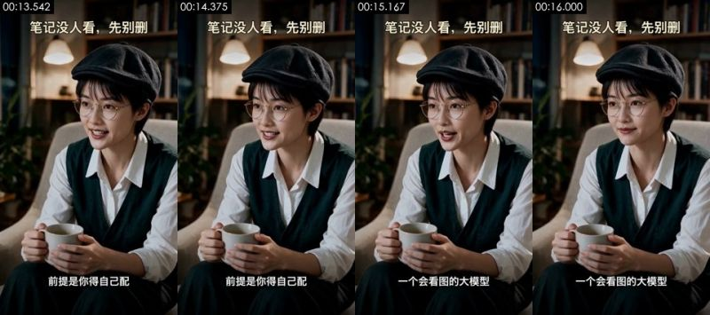

**Visible on screen** (check against the frames)
- Picture: Same study and woman in the newsboy cap as #3: she looks toward frame left, smiling and nodding as she talks, both hands on the mug almost still. Locked-off medium shot.
- Camera / lighting: medium close-up; eye level; tripod / fixed mount; night / low-light ambient, no dedicated fill; key light frame left, three-quarter front; lighting ratio about 1.8:1 (0.9 stops); hard light (sharp shadow edge)
- Text on objects in the scene (not subtitles): 口, .env.example, 2weeks ago
- Text track (subtitle/bottom): 前提是你得自己配 / 一个会看图的大模型 / README.md / 2weeks ago
- Text track (subtitle/bottom): 口 / .env.example / 2weeks ago / .gitignore
- Text track (subtitle/bottom): LICENSE / 5months ago
- Text track (subtitle/middle): <>Code / Issues /  Pullrequests / Actions
- [AI assistant review] Same character and framing as #3, nearly the same first frame
- [AI assistant review] The head turns and nods and the fingers move on the mug: not a mouth-only avatar, though the body barely moves
- [AI assistant review] Bookshelf melts into colour blocks, skin too smooth

**How it was made, as inferred by the tools** (inferred, not seen)
- Inference: AI-generated video 78%, AI avatar (talking head) 10%, live action 2% (fused_agent)
- Material: AI-generated
- Basis (tool measurements, not necessarily visible to the eye):
  - Low-light shot: 46% of the frame is near-black but grainy (not a solid fill), flat blocks cover only 0% of the lit part, and there is a face: the flat blocks / small palette come from crushed shadows, not counted as rendered texture
  - OCR reads 5 lines of small text: the frame holds a UI / document screenshot
  - Photographic texture: noise σ=0.35, 96 colours, 8% flat blocks
  - Per-frame sharpness oscillates periodically (period 4 frames, correlation 0.61) with no duplicate frames: frame interpolation / rate conversion, or just the rhythm of a re-encode (transcodes whose platform tags were stripped show it too); not enough on its own to call AI

- Remake: Source is AI-generated: use the shot's first and last frames for first/last-frame generation to closely match composition and motion; to change the subject, edit the first frame with an image model first
  - First-frame image prompt: medium close-up, vertical; the subject sits left of center in an armchair, body slightly turned, bookshelf and pendant lamp behind. Same first frame as #3: vertical 9:16 medium shot, eye level, study at night, the short-haired woman in a black newsboy cap, thin metal round glasses, white shirt and dark green knit vest sits in an off-white armchair holding a white mug, looking toward frame left with a smile.
  - Video prompt: medium close-up, vertical; the subject sits left of center in an armchair, body slightly turned, bookshelf and pendant lamp behind. Medium shot, eye level, the woman sits in the armchair left of center. Looking toward frame left, she smiles and says unhurriedly "前提是你得自己配一个会看图的大模型", nodding gently while she talks, both hands around the mug; ends on her smile. Locked-off camera.

</details>

<details class="ref"><summary>#10 00:16.125–00:19.042 · code / template render; brings in real material (UI screenshot)</summary>


**Visible on screen** (check against the frames)
- Picture: On the dark grey template, a screenshot of a GitHub mobile repository page (repo JuneYaooo/social-account-doctor, Code button, branch main, file list). It starts at full width and keeps pushing in, ending on the repo name and the first few folders.
- Text track (text in the picture/bottom): tikhub / 2weeksago / .env.example / tests
- Text track (text in the picture/bottom): 口 / gitignore / 2weeksago / LICENSE
- Text track (text in the picture/bottom): 行，下回发了没人看 / 先别删，拿它查查
- Text track (text in the picture/middle): JuneYaooo/social-account-doctor / Public / <>Code / Issues
- [AI assistant review] Same dark grey template, title unchanged at the top
- [AI assistant review] In the middle, a screenshot of a GitHub repository page on mobile web (JuneYaooo / social-account-doctor, Code / Issues / Pull requests, files docs, mediacrawler, references…), real interface elements
- [AI assistant review] The screenshot keeps scaling up over 3 s until the repo name and file list fill the width; no cursor, no scrolling

**How it was made, as inferred by the tools** (inferred, not seen)
- Inference: code / template render 65%, screen recording / screenshot 22%, 3D render 5% (fused_agent)
- Material: mixed (includes real material): UI screenshot
  - UI screenshot: 浅色界面面板内有 30 处文字（其中 29 处小字号）
- Basis (tool measurements, not necessarily visible to the eye):
  - Rendered texture: 68% flat colour blocks, 95% of pixels use only 14 colours, 51% axis-aligned edges
  - Dense fine high-frequency detail on a flat background (small text / UI), looks like a screenshot or document
  - Per-frame sharpness oscillates periodically (period 5 frames, correlation 0.14) with no duplicate frames: frame interpolation / rate conversion, or just the rhythm of a re-encode (transcodes whose platform tags were stripped show it too); not enough on its own to call AI

- Remake: Code render: rebuild in Remotion / HTML from the text tracks and layout, 100% controllable, no generative model needed; real material the user must supply: UI screenshot (part of the frame x0% y22% w100% h69%), UI screenshot (part of the frame)

</details>

### Metadata clues

- Encoder: `Lavf61.7.100`

### Notes

- Deterministic forensics is reliable on motion, whole-frame pan/zoom, rendered texture and 24→30 fps conversion; telling live action from AI from 3D needs image reading (a VLM or an AI assistant's review), and a look at the frames yourself.
- Platform transcoding usually strips metadata; missing metadata proves nothing.
- The full data is in `breakdown.json`; the package for models starts at `REEL.md`.
