# この動画はどう作られたか：dual_role.mp4

> 本ファイルは [report.md](report.md) の日本語訳です。字幕・タイトル・画面上の文字（OCR のテキストトラックなど）とプロンプトは原文の中国語のまま残しています。

**ひとことで**：2 人の AI キャラクターの一問一答で、小紅書（RED）の投稿診断ツールの出力スクリーンショットを 19 秒の「問題—原因—根拠—改善策」につなげた動画。どの回答も直後に実際のスクリーンショットで裏付けている。
**作り方**：ハイブリッド制作：コード/テンプレートレンダリング 59% + AI 生成動画 41%

- 0:19 · 縦型 9:16 · 10 ショット、1 ショット平均 1.9 秒
- 判定の信頼度 80%、根拠：ツールによる測定 + AI アシスタントによる画像の再確認 10 ショット
- ⚠️ 判断しきれない箇所が 1 つあります。「不確定な点」を参照

<!--mix-->

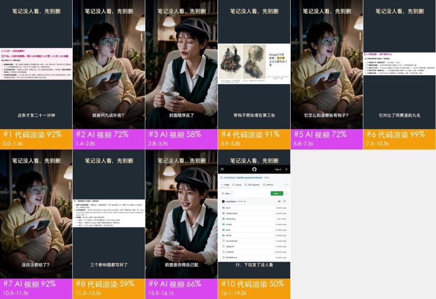

## 見どころ

- **冒頭のつかみ**：0–1.4 秒でまず診断スクリーンショットを突きつけ、赤字「不会。9 成扑街概率」に字幕「这条才发二十一分钟」を合わせる。1.4 秒でスマホを抱えた女性に切り替わり、驚いて「就被判九成扑街？」と聞き返す。具体的で刺さる数字と、視聴者の気持ちを代弁する表情の組み合わせで、発信をしている人は手が止まる。
- 2.8–5.8 秒：回答役が「封面顺序反了」と一言言うと、次のショットで 3 枚の画像を横に並べ、3 枚目の大きな文字の画像へプッシュインする。主張の直後に映像の根拠が来るので、視聴者は想像しなくても問題がわかる
- 5.8 秒と 10.5 秒：質問役が 2 回、視聴者に代わって突っ込む（「它怎么知道哪张有钩子？」「连改法都给了？」）。そのたびにレポートのスクリーンショットで答える。会話で機能を一つずつ出していくので、ナレーションで売りを並べるよりも本物のおすすめに見える
- 13.5–16.1 秒：回答役が自分から利用条件を話す「前提是你得自己配一个会看图的大模型」。制約を先に伝えて「騙された」感を減らし、コメント欄の疑いも少なくなる
- 16.1–19.0 秒：ラストは GitHub リポジトリページで、リポジトリ名へプッシュインする。セリフ「先别删，拿它查查」と全編上部のタイトル「笔记没人看，先别删」が最初と最後で呼応し、視聴者は名前と行き先を覚える

## ひと目でわかる：映像・パッケージ・サウンドの 3 層

ショート動画はどれも 3 層に分けられる：下に映像そのもの、その上に字幕・装飾テキスト・ステッカーを重ね、さらにサウンドを付ける。再現するときは 1 層ずつ作る。

| 層 | この動画では何か | 作り方 | 詳細 |
|---|---|---|---|
| **映像**（下層） | コード/テンプレートレンダリング 5 ショット、AI 生成動画 5 ショット | AI で 4 回に分けて生成；画面録画 / コードでモーション作成 | 「自分で再現」 |
| **パッケージ**（映像の上に重ねる） | 文字、タイトル、字幕 | 編集ソフトで追加：字幕・装飾テキスト・ステッカーをタイムラインどおりに配置 | 「編集パッケージ層」 |
| **サウンド** | 人の声（AI 動画のネイティブ台詞（映像と一緒に生成）） | 人の声：AI 動画と一緒に生成 | 「サウンド」 |

## 内容と構成

- 下のナラティブラインはショットごとの画像確認から作ったもの。台詞は別途整理しておらず、字幕の原文は「編集パッケージ層」を参照

**ナラティブライン**

再現するときはこのラインを残す：各ステップの順番と役割はそのまま、語る中身を自分の事例・データ・素材に置き換えれば、ただ主役を入れ替えただけにはならない。

| 時間 | ショット | 役割 | 何を伝えているか |
|---|---|---|---|
| 0.0–2.8s | #1、#2 | 注意を引く | 冒頭でいきなり目を引く悪い結果の数字を見せる → 当事者の驚いた聞き返しで痛みを増幅 |
| 2.8–3.9s | #3 | 情報を補う | 詳しい側が一言で本当の原因を指摘 |
| 3.9–5.8s | #4 | 根拠を示す | 3 枚の画像を並べ、どこが問題かを視聴者自身の目で確認させる |
| 5.8–7.5s | #5 | 転換 | 視聴者に代わって一番素直な疑問をぶつける |
| 7.5–10.5s | #6 | 根拠を示す | 同ジャンルの上位と比較し、判断の根拠を示す |
| 10.5–11.5s | #7 | 転換 | 驚きの追加質問で、話題を診断から解決策へ進める |
| 11.5–13.5s | #8 | 根拠を示す | ツールが出したそのまま使える改善策を直接見せる |
| 13.5–16.1s | #9 | 情報を補う | 自分から利用条件を説明し、期待値を先にすり合わせる |
| 16.1–19.0s | #10 | 行動を促す | ツールそのものに着地し、どこで手に入るかを伝える |

## 絵コンテ表

「画面」「カメラワーク」「オーバーレイ」は映像から直接見えるもの。「制作方法」「素材ソース」はツールの推定で、根拠は付録の「ショット別の検証」を参照。

| # | スクリーンショット | 時間 | 長さ | 何を伝えているか | 画面 | カメラワーク | オーバーレイ | 制作方法（推定） | 素材ソース（推定） | 再現 |
|---|---|---|---|---|---|---|---|---|---|---|
| 1 | 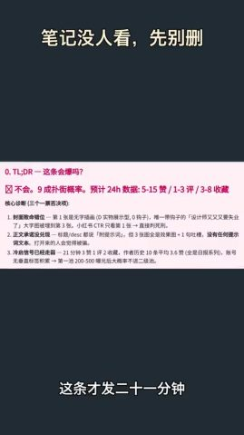 | 0:00.0 | 1.4s | 注意を引く：冒頭でいきなり目を引く悪い結果の数字を見せる | 縦型テンプレート：ダークグレーの背景、上部にタイトル「笔记没人看，先别删」、下部に字幕。中央に診断レポートのスクリーンショット… | スムーズなカメラワーク | — | コード/テンプレートレンダリング 77% | 画面録画素材、UI スクリーンショット | コードレンダリング · セグメント1 |
| 2 |  | 0:01.4 | 1.5s | 注意を引く：当事者の驚いた聞き返しで痛みを増幅 | 夜のリビング。ショートヘアの女性が青緑の太縁メガネをかけ、淡い黄色のパーカーを着て、ソファにあぐらをかいてオフホワイトのクッションを抱えている… | スムーズなカメラワーク | 文字、タイトル | AI 生成動画 85% | AI 生成 | AI 生成 · G1 |
| 3 | 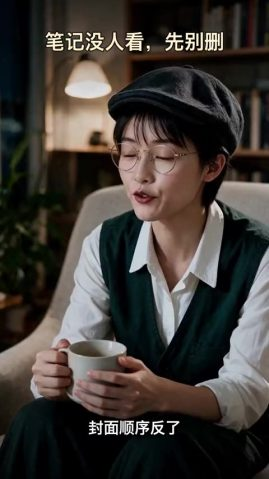 | 0:02.8 | 1.0s | 情報を補う：詳しい側が一言で本当の原因を指摘 | 夜の書斎。ショートヘアの女性が黒いキャスケットと細いメタルの丸メガネを身につけ、白シャツの上に深緑の V ネックニットベスト… | スムーズなカメラワーク | 文字、タイトル | AI 生成動画 68% | AI 生成 | AI 生成 · G2 |
| 4 |  | 0:03.9 | 2.0s | 根拠を示す：3 枚の画像を並べ、どこが問題かを視聴者自身の目で確認させる | ダークグレーのテンプレート上に、投稿の画像 3 枚を見せる横長のスクリーンショット：1 枚目はスチームパンクの列車イラスト、2 … | スムーズなカメラワーク | — | コード/テンプレートレンダリング 79% | 画面録画素材、UI スクリーンショット | コードレンダリング · セグメント2 |
| 5 |  | 0:05.8 | 1.7s | 転換：視聴者に代わって一番素直な疑問をぶつける | #2 と同じリビングと女性：笑顔で話し始めてから眉をひそめて考え込み、画面右側を見て質問する。体は… | 固定 | 字幕、タイトル | AI 生成動画 88% | AI 生成 | AI 生成 · G3 |
| 6 | 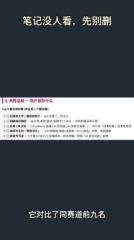 | 0:07.5 | 3.0s | 根拠を示す：同ジャンルの上位と比較し、判断の根拠を示す | ダークグレーのテンプレート上に診断レポートのスクリーンショット：ピンクの見出し「6. 共性总结 — 用户该抄什么」、黒字… | スムーズなカメラワーク | — | コード/テンプレートレンダリング 79% | 画面録画素材、UI スクリーンショット | コードレンダリング · セグメント3 |
| 7 |  | 0:10.5 | 1.0s | 転換：驚きの追加質問で、話題を診断から解決策へ進める | #2 と同じリビングと女性：画面右側を見て、うれしそうに口を開けて質問し、そのあとうつむいて手… | 固定（被写体が動く） | 字幕、タイトル | AI 生成動画 85% | AI 生成 | AI 生成 · G3 |
| 8 | 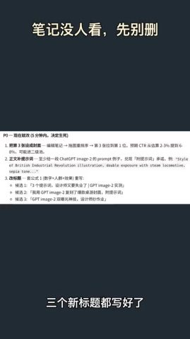 | 0:11.5 | 1.9s | 根拠を示す：ツールが出したそのまま使える改善策を直接見せる | ダークグレーのテンプレート上に診断レポートのスクリーンショット：見出し「P0 — 现在就改（5 分钟内，决定生死）」… | スムーズなカメラワーク | — | コード/テンプレートレンダリング 77% | 画面録画素材、UI スクリーンショット | コードレンダリング · セグメント4 |
| 9 |  | 0:13.5 | 2.7s | 情報を補う：自分から利用条件を説明し、期待値を先にすり合わせる | #3 と同じ書斎とキャスケットの女性：画面左側を見て、微笑みながら話しつつうなずき、両手でカップを持つ… | スムーズなカメラワーク | 字幕、タイトル | AI 生成動画 88% | AI 生成 | AI 生成 · G4 |
| 10 |  | 0:16.1 | 2.9s | 行動を促す：ツールそのものに着地し、どこで手に入るかを伝える | ダークグレーのテンプレート上に GitHub モバイル版リポジトリページのスクリーンショット（リポジトリ JuneYaooo/so… | スムーズなカメラワーク | — | コード/テンプレートレンダリング 73% | UI スクリーンショット | コードレンダリング · セグメント5 |

## 自分で再現：この順番で作る

再現するのは作り方とテンポで、映像を丸写しすることではない。

1. **内容を決める**：「内容と構成」のナラティブラインに沿って自分の台本を書く
2. **素材を用意する**：下の「準備する素材」を参照
3. **AI 生成**：4 回生成。下の「AI 生成」を参照
4. **画面録画とモーション**：下の「コード合成」を参照
5. **編集**：下の「編集」を参照
6. **パッケージ**：字幕ファイル `packaging/subtitles.srt` はそのまま編集ソフトに読み込める。スタイルとタイムラインは「編集パッケージ層」を参照
7. **サウンド**：「サウンド」を参照。効果音はどれも先に試聴できる
8. **見比べてチェック**：完成版と元動画を並べて一通り見て、ショットの長さ、字幕の位置、音楽の入りと抜けが合っているか確認する

### 準備する素材

- `@图片1` 人物の参照画像（キャラクターごとに正面顔 1 枚 + 上半身）。ショットをまたいで顔立ちを揃える：質問役の女性（投稿したクリエイター）、キャスケットの女性（詳しい人）
- 映像内でそのまま使う実ファイル（スクリーンショット、写真、画面録画。元ファイルを入手すること）：
  - **画面録画素材**（画面の一部 x0% y31% 幅100% 高さ37%）：ショット #1、計 1.4s
  - **UI スクリーンショット**（画面の一部）、診断レポートのスクリーンショット（TL;DR と核心の診断部分）（画面中央のカード）：ショット #1、計 1.4s
  - **画面録画素材**（画面の一部 x0% y29% 幅100% 高さ41%）：ショット #4、計 2.0s
  - **UI スクリーンショット**（画面の一部）、投稿の画像 3 枚と説明文のスクリーンショット（画面中央の横帯）：ショット #4、計 2.0s
  - **画面録画素材**（画面の一部 x0% y36% 幅100% 高さ27%）：ショット #6、計 3.0s
  - **UI スクリーンショット**（画面の一部）、診断レポート「共性总结」部分のスクリーンショット（画面中央のカード）：ショット #6、計 3.0s
  - **画面録画素材**（画面の一部 x0% y36% 幅100% 高さ28%）：ショット #8、計 1.9s
  - **UI スクリーンショット**（画面の一部）、診断レポート「P0 现在就改」部分のスクリーンショット（画面中央のカード）：ショット #8、計 1.9s
  - **UI スクリーンショット**（画面の一部 x0% y22% 幅100% 高さ69%）：ショット #10、計 2.9s
  - **UI スクリーンショット**（画面の一部）、GitHub リポジトリページ（スマホ版 Web）のスクリーンショット（画面中央、最後は横幅いっぱい）：ショット #10、計 2.9s

### AI 生成

**AI 動画 5 ショット → 生成ユニット 4 つ、Seedance 2.0（Mini / Fast を含む） 呼び出し 4 回**

- グループ分けのルール：同じシーンでハードカットでつながる AI ショットは 1 回の生成にまとめる。1 回 ≤15s。ユニット内の連続ハードカットはなるべく ≤8s、最大 10s。ディゾルブ/フェードとシーン転換の箇所で分ける
- サウンド：モデルは動作の効果音と環境音も同時に生成できる。語りは人が録音したもの：別に録ってからミックスし、動画モデルには生成させない。文言の修正やタイミング合わせがしやすいため
- パッケージ層：生成ユニットのショットに載っている字幕はポストプロダクションのパッケージなので、プロンプトには書かない。参照フレームに入っている字幕は先に消し、生成後に「編集パッケージ層」のタイムラインどおりに重ね直す

AI 動画モデルが受け付ける入力は次のとおり。各生成ユニットの下に、何を渡すか・どこから用意するかを書いてある：
- **テキストプロンプト**：必須。画面、動作、カメラワークを記述する
- **先頭フレーム画像**：最初のフレームの構図と被写体を固定する。渡さなければ純粋なテキスト生成になり、毎回構図が変わる
- **末尾フレーム画像**：最後のフレームも固定し、モデルには中間だけを補わせる。カメラワークや動作のある単独ショット向き
- **参照画像**：商品や人物の見た目。複数ショットで同じ見た目にする（プロンプトでは `@图片1` で指す）
- **参照動画**：動作・カメラワーク・テンポを真似させるもので、映像はコピーしない（`@视频1`）。対応していないモデルもある

ユニットごとに 1 回生成する。表はモデルに渡すもの。ユニットを展開すると入手元とプロンプトが見られる。

| ユニット | ショット | 時間 | 長さ | 方式 | 渡すもの | つなぎ |
|---|---|---|---|---|---|---|
| G1 | #2 | 1.4–2.8s | 1.5s | 単独ショット | 先頭フレーム画像 + 参照画像 + 参照動画 | — |
| G2 | #3 | 2.8–3.9s | 1.0s | 単独ショット | 先頭フレーム画像 + 参照画像 + 参照動画 | — |
| G3 | #5、#7 | 5.8–7.5s、10.5–11.5s | 2.7s | 1 回で複数ショット | 先頭フレーム画像 + 参照画像 + 参照動画 | — |
| G4 | #9 | 13.5–16.1s | 2.7s | 単独ショット | 先頭フレーム画像 + 参照画像 + 参照動画 | — |

<details><summary>G1 · ショット #2 · 1.5s · マルチ参照生成</summary>

| 入力 | 必要か | 入手元 | 理由 |
|---|---|---|---|
| テキストプロンプト | 必要 | 下のプロンプトを参照 | 画面、動作、カメラワークを記述する。ほかの入力はすべてこれを制約するだけ |
| 先頭フレーム画像 | 推奨 | 元動画 `shots/shot_002_first.jpg`（商品・人物・画風を変える場合は、下の先頭フレームプロンプトに沿って画像モデルで描き直す）。このモデルは先頭フレームと参照画像を同時に渡せない：2 枚目の参照画像として渡し、プロンプトに「@图片2 作为首帧」と書く（即夢の全能参照は対応、API はおそらく非対応） | 構図・ショットサイズ・被写体の位置を一度に固定する。テキストだけだと毎回構図が変わる |
| 末尾フレーム画像 | 不要 | — | このユニットは参照画像で商品と人物を保つ。このモデルは参照モードでは末尾フレームを受け付けない |
| 参照画像 | 必要 | `@图片1` 人物の参照画像（キャラクターごとに正面顔 1 枚 + 上半身）。ショットをまたいで顔立ちを揃える | 先頭フレームが効くのは最初のフレームだけ。以降の画面の商品と人物は参照画像で一貫させる |
| 参照動画 | 推奨 | `@视频1` 元動画 1.4–2.8s のクリップ | 動作・カメラワーク・編集テンポを真似させる。参照のみで、映像はコピーしない |

- 先頭フレーム画像プロンプト：縦型 9:16、ミディアムショット、やや俯瞰。夜のリビング。ショートヘアの中国人女性が青緑の太縁丸メガネをかけ、淡い黄色のパーカーを着て、オフホワイトのソファにあぐらをかき、オフホワイトのクッションを抱えている。右手に濃い色のスマホを持ち、画面の左寄り中央に座って体は右前方を向き、顔を上げて画面右側を見ている。右奥に暖色のフロアランプ、背景のカーテンと観葉植物はぼかし、スマホ画面の冷たい光が顔を照らす。リアルで映画的な質感。
- 4s 生成してから 1.5s にカット（短すぎるショットは単独生成だと不安定）

```text
竖屏 9:16；夜景/弱光环境光，没有专门补光，柔光（几乎没有明暗分界），偏冷（日光/冷白 LED），背景略虚。人物以 @图片1 为准。参考 @视频1 的动作、运镜和剪辑节奏。
中景，略俯视角，女生坐在画面左中。她刚看完手机，抬头望向画面右侧，眉毛扬起、嘴巴张开，惊讶地说「就被判九成扑街？」，手里的手机轻轻晃动，结尾停在惊讶的表情上。固定机位。
```

英語プロンプト：

```text
Medium shot, slightly high angle, the young woman sits left of center. Having just looked at her phone, she looks up toward frame right, eyebrows raised and mouth open, and asks in surprise "就被判九成扑街？"; the phone in her hand moves slightly; ends on her surprised face. Locked-off camera.
```

</details>

<details><summary>G2 · ショット #3 · 1.0s · マルチ参照生成</summary>

| 入力 | 必要か | 入手元 | 理由 |
|---|---|---|---|
| テキストプロンプト | 必要 | 下のプロンプトを参照 | 画面、動作、カメラワークを記述する。ほかの入力はすべてこれを制約するだけ |
| 先頭フレーム画像 | 推奨 | 元動画 `shots/shot_003_first.jpg`（商品・人物・画風を変える場合は、下の先頭フレームプロンプトに沿って画像モデルで描き直す）。このモデルは先頭フレームと参照画像を同時に渡せない：2 枚目の参照画像として渡し、プロンプトに「@图片2 作为首帧」と書く（即夢の全能参照は対応、API はおそらく非対応） | 構図・ショットサイズ・被写体の位置を一度に固定する。テキストだけだと毎回構図が変わる |
| 末尾フレーム画像 | 不要 | — | このユニットは参照画像で商品と人物を保つ。このモデルは参照モードでは末尾フレームを受け付けない |
| 参照画像 | 必要 | `@图片1` 人物の参照画像（キャラクターごとに正面顔 1 枚 + 上半身）。ショットをまたいで顔立ちを揃える | 先頭フレームが効くのは最初のフレームだけ。以降の画面の商品と人物は参照画像で一貫させる |
| 参照動画 | 推奨 | `@视频1` 元動画 2.8–3.9s のクリップ | 動作・カメラワーク・編集テンポを真似させる。参照のみで、映像はコピーしない |

- 先頭フレーム画像プロンプト：縦型 9:16、ミディアムショット、アイレベル。夜の書斎。ショートヘアの中国人女性が黒いウールのキャスケットと細いメタルの丸メガネを身につけ、白シャツの上に深緑の V ネックニットベストを着て、オフホワイトのアームチェアに座っている。画面中央やや左に位置し、体を少し斜めに向け、両手で白いマグカップを持って膝の前に置いている。背景の濃い色の本棚、暖色のペンダントライト、観葉植物はぼかし、左前方から暖色のソフトライト。暗めのトーンでリアルな映画的質感。
- 4s 生成してから 1.0s にカット（短すぎるショットは単独生成だと不安定）

```text
竖屏 9:16；夜景/弱光环境光，没有专门补光，柔光（几乎没有明暗分界），偏冷（日光/冷白 LED），背景略虚。人物以 @图片1 为准。参考 @视频1 的动作、运镜和剪辑节奏。
中景，平视，女性坐在画面中间偏左的扶手椅上。她先眨一下眼，然后看向画面左侧，平静笃定地说「封面顺序反了」，头轻轻点一下，双手一直捧着马克杯。固定机位。
```

英語プロンプト：

```text
Medium shot, eye level, the woman sits in the armchair left of center. She blinks once, then looks toward frame left and says calmly and firmly "封面顺序反了", with a small nod, both hands holding the mug throughout. Locked-off camera.
```

</details>

<details><summary>G3 · ショット #5、#7 · 2.7s · マルチ参照生成</summary>

| 入力 | 必要か | 入手元 | 理由 |
|---|---|---|---|
| テキストプロンプト | 必要 | 下のプロンプトを参照 | 画面、動作、カメラワークを記述する。ほかの入力はすべてこれを制約するだけ |
| 先頭フレーム画像 | 推奨 | 元動画 `shots/shot_005_first.jpg`（商品・人物・画風を変える場合は、下の先頭フレームプロンプトに沿って画像モデルで描き直す）。このモデルは先頭フレームと参照画像を同時に渡せない：2 枚目の参照画像として渡し、プロンプトに「@图片2 作为首帧」と書く（即夢の全能参照は対応、API はおそらく非対応） | 構図・ショットサイズ・被写体の位置を一度に固定する。テキストだけだと毎回構図が変わる |
| 末尾フレーム画像 | 不要 | — | 1 回で複数ショットを出すため、末尾フレームは最後のショットしか制約できない。使わない |
| 参照画像 | 必要 | `@图片1` 人物の参照画像（キャラクターごとに正面顔 1 枚 + 上半身）。ショットをまたいで顔立ちを揃える | 先頭フレームが効くのは最初のフレームだけ。以降の画面の商品と人物は参照画像で一貫させる |
| 参照動画 | 推奨 | `@视频1` 元動画 5.8–7.5s、10.5–11.5s のクリップ（間に挿入された映像を切り取って 1 本につなぐ） | 動作・カメラワーク・編集テンポを真似させる。参照のみで、映像はコピーしない |

- 先頭フレーム画像プロンプト：#2 の先頭フレームと同じ：縦型 9:16 ミディアムショットやや俯瞰、夜のリビング。青緑の太縁メガネに淡い黄色のパーカーのショートヘアの女性がソファにあぐらをかき、クッションを抱えてスマホを持ち、画面右側を見て口元に笑みを浮かべている。
- 4s 生成してから 2.7s にカット（短すぎるショットは単独生成だと不安定）。これらのショットは完成版では挿入映像で隔てられている：生成時は続けて出し、編集時に挿入映像を戻す

```text
竖屏 9:16；夜景/弱光环境光，没有专门补光，柔光（几乎没有明暗分界），偏冷（日光/冷白 LED），背景略虚。人物以 @图片1 为准。参考 @视频1 的动作、运镜和剪辑节奏。镜头之间硬切。
镜头1（0.0–1.7s）：中景，略俯视角，女生坐在画面左中。她先笑着张口，随后皱眉、眼睛看向画面右侧，疑惑地问「它怎么知道哪张有钩子？」，手机握在手里，结尾停在疑惑表情上。固定机位。
镜头2（1.7–2.7s）：中景，略俯视角，女生坐在画面左中。她看着画面右侧，眼睛睁大、惊喜地问「连改法都给了？」，说完低头瞄一眼手机再抬头。固定机位。
```

英語プロンプト：

```text
Shot 1 (0.0-1.7s): Medium shot, slightly high angle, the young woman sits left of center. She starts with an open smile, then frowns and looks toward frame right, asking puzzled "它怎么知道哪张有钩子？"; the phone stays in her hand; ends on a puzzled look. Locked-off camera.
Shot 2 (1.7-2.7s): Medium shot, slightly high angle, the young woman sits left of center. Looking toward frame right, eyes wide, she asks delighted "连改法都给了？", then glances down at her phone and looks up again. Locked-off camera.
```

</details>

<details><summary>G4 · ショット #9 · 2.7s · マルチ参照生成</summary>

| 入力 | 必要か | 入手元 | 理由 |
|---|---|---|---|
| テキストプロンプト | 必要 | 下のプロンプトを参照 | 画面、動作、カメラワークを記述する。ほかの入力はすべてこれを制約するだけ |
| 先頭フレーム画像 | 推奨 | 元動画 `shots/shot_009_first.jpg`（商品・人物・画風を変える場合は、下の先頭フレームプロンプトに沿って画像モデルで描き直す）。このモデルは先頭フレームと参照画像を同時に渡せない：2 枚目の参照画像として渡し、プロンプトに「@图片2 作为首帧」と書く（即夢の全能参照は対応、API はおそらく非対応） | 構図・ショットサイズ・被写体の位置を一度に固定する。テキストだけだと毎回構図が変わる |
| 末尾フレーム画像 | 不要 | — | このユニットは参照画像で商品と人物を保つ。このモデルは参照モードでは末尾フレームを受け付けない |
| 参照画像 | 必要 | `@图片1` 人物の参照画像（キャラクターごとに正面顔 1 枚 + 上半身）。ショットをまたいで顔立ちを揃える | 先頭フレームが効くのは最初のフレームだけ。以降の画面の商品と人物は参照画像で一貫させる |
| 参照動画 | 推奨 | `@视频1` 元動画 13.5–16.1s のクリップ | 動作・カメラワーク・編集テンポを真似させる。参照のみで、映像はコピーしない |

- 先頭フレーム画像プロンプト：#3 の先頭フレームと同じ：縦型 9:16 ミディアムショットのアイレベル、夜の書斎。黒いキャスケットと細いメタルの丸メガネ、白シャツに深緑のニットベストのショートヘアの女性がオフホワイトのアームチェアに座り、両手で白いマグカップを持って、画面左側を見て微笑んでいる。
- 4s 生成してから 2.7s にカット（短すぎるショットは単独生成だと不安定）

```text
竖屏 9:16；夜景/弱光环境光，没有专门补光，柔光（几乎没有明暗分界），偏冷（日光/冷白 LED），背景略虚。人物以 @图片1 为准。参考 @视频1 的动作、运镜和剪辑节奏。
中景，平视，女性坐在画面中间偏左的扶手椅上。她看向画面左侧，微笑着不紧不慢地说「前提是你得自己配一个会看图的大模型」，说话时轻轻点头，双手捧着杯子，结尾停在微笑上。固定机位。
```

英語プロンプト：

```text
Medium shot, eye level, the woman sits in the armchair left of center. Looking toward frame left, she smiles and says unhurriedly "前提是你得自己配一个会看图的大模型", nodding gently while she talks, both hands around the mug; ends on her smile. Locked-off camera.
```

</details>

### コード合成

Remotion/HTML のプロジェクトを 1 つ用意し、テキストトラックとレイアウトに沿って組み直す（テキストと UI は 100% 制御でき、文言を変えるときはデータだけ差し替えればよい）。このプロジェクトは LLM にそのまま書かせることもできる。

- セグメント1：ショット #1（0.0–1.4s）
- セグメント2：ショット #4（3.9–5.8s）
- セグメント3：ショット #6（7.5–10.5s）
- セグメント4：ショット #8（11.5–13.5s）
- セグメント5：ショット #10（16.1–19.0s）

再現用アセット（すべてレポートフォルダ内にあり、再現時は下のデータと一緒にコードを書く人または LLM に渡す）：
- `shots/shot_XXX_first.jpg` / `_last.jpg`：各ショットの最初と最後のフレーム（元解像度）。レイアウト、文字サイズ、余白の照合用
- `shots/shot_XXX_strip.jpg`：約 0.5 秒ごとのキーフレームを並べたストリップ。アニメーションの過程を確認する用
- `shots/shot_XXX_elements.jpg` と `_el_NN.jpg` / `_st_NN.jpg` / `_ly_NN.jpg`：各要素が静止した後の元解像度の切り抜き。番号はモーションタイムラインに対応。図形はこれを見て描き直し、アイコン・ロゴ・イラストなど描き起こせないものは切り抜いてそのまま使える
- `packaging/overlays.ass`、`packaging/timeline.json`：テキストのタイミング、位置、色

画面の作り方（ツールが測定した画面タイプ別）：
- データチャート：SVG/D3 のスケールで軸と図形を描き、数字は interpolate() でフレームごとにカウントアップ、棒／線は spring() で伸ばす

| ショット | 時間 | 作り方 | 画面 | カメラワーク | メインカラー | 画面文字 |
|---|---|---|---|---|---|---|
| #1 | 0.0–1.4s | データチャート | 縦型テンプレート：ダークグレーの背景、上部にタイトル「笔记没人看，先别删」、下部に字幕。中央に診断レポートのスクリーンショット（ピンクの小見出し「0. TL;DR — 这条会爆吗？」、赤字の結論「不会。9 成扑街概率」、3 項目の「核心诊断」リスト）。スクリーンショット全体が左端を基点に素早く拡大し、上端が上へ移動して、結論の行がどんどん大きくなる。 | プッシュイン 57%/s、画面は上へ移動 | 背景 #1e2931 · #fbeef3 #b6aeb0 #ddd0d7 #8e8a8d | 这条才发二十一分钟 / 0.TL;DR一这条会爆吗？ / 无垂直标签积累→第一池200-500曝光后大概率不进 / 笔记没人看，先别删 / 笔记没人看，先别册 |
| #4 | 3.9–5.8s | データチャート | ダークグレーのテンプレート上に、投稿の画像 3 枚を横に並べたスクリーンショット：1 枚目はスチームパンクの列車イラスト、2 枚目は二重露光のエルフの女王、3 枚目は白地に黒の大きな文字の画像「image2王炸效果，设计师又又又要失业了」（「设计师」が黄色ハイライト）。スクリーンショットは拡大しながら左へ移動し、2・3 枚目で止まる。セリフ「带钩子那张埋在第三张」に対応。 | プッシュイン 25%/s、画面は左へ移動 | 背景 #1e2931 · #fafafa #dad6c8 #999484 #bab4a2 | 带钩子那张埋在第三张 / 笔记没人看，先别册 / 笔记没人看，先别删 |
| #6 | 7.5–10.5s | データチャート | ダークグレーのテンプレート上に、診断レポートのスクリーンショット：ピンクのタイトル「6. 共性总结 — 用户该抄什么」、黒字「top 9 都在做的事（你这条 1 个都没做）」と 5 項目のリスト（表紙に大きな文字、明確な属性の打ち出し、ギャップ、比較素材、ジャンル特化アカウントの蓄積）。スクリーンショットが小さい状態からゆっくりプッシュインし、3 秒で約 3 分の 1 拡大する。 | プッシュイン 11%/s、画面は上へ移動 | 背景 #1e2931 · #fbfcfd #dedddf #aaa8a8 #c7c2c3 | 笔记没人看，先别册 / 笔记没人看，先别删 |
| #8 | 11.5–13.5s | データチャート | ダークグレーのテンプレート上に、診断レポートのスクリーンショット：タイトル「P0 — 现在就改（5 分钟内，决定生死）」、3 つの改善策（3 枚目を表紙にする、本文にプロンプトを追加、タイトルを変える）と 3 つの候補タイトル。スクリーンショットがゆっくりプッシュインし、候補タイトルで止まる。 | プッシュイン 25%/s、画面は上へ移動 | 背景 #1e2931 · #fbfcfd #cbccce #e4e4e4 #b2b1af | 三个新标题都写好了 / 笔记没人看，先别册 |
| #10 | 16.1–19.0s | データチャート | ダークグレーのテンプレート上に、GitHub モバイル版のリポジトリページのスクリーンショット（リポジトリ JuneYaooo/social-account-doctor、Code ボタン、ブランチ main、ファイル一覧）。スクリーンショットは全幅から始まって継続的にプッシュインし、最後にリポジトリ名と最初のいくつかのフォルダで止まる。 | プッシュイン 20%/s、画面は上へ移動 | 背景 #1e2931 · #f5f9fa #000102 #d1dae0 #b5b6b8 | 笔记没人看，先别删 / 笔记没人看，先别册 / Sign in / Sig |

ショットごとのモーションタイムライン（ツールによる測定：位置は画面の幅・高さに対する割合、色は要素が安定した後の取得色。キーフレームストリップと合わせて見る）

<details class="ref"><summary>モーション #1 0.0–1.4s · 5 個</summary>

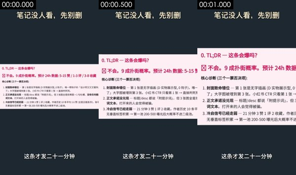

- 背景 #1e2931、その他のメインカラー #fbeef3 #b6aeb0 #ddd0d7 #8e8a8d
要素の切り抜き（番号は下のモーションに対応。L は常に動くレイヤーのショット中盤と終盤、S はショット中ずっと静止している要素）。元解像度の個別画像は `shots/` にある：

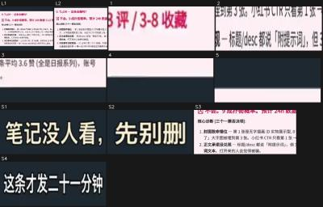

- S1. ショット中ずっと静止：図形／テキストブロック · x 16%–56%，y 6%–11% · #ded9c9 · 文字「笔记没人看，先别删 / 笔记没人看，先别册」 · [切り抜き](shots/shot_001_st_01.jpg)
- S2. ショット中ずっと静止：図形／テキストブロック · x 61%–84%，y 6%–11% · #e9e6d1 · [切り抜き](shots/shot_001_st_02.jpg)
- S3. ショット中ずっと静止：図形／テキストブロック · x 0%–100%，y 40%–61% · #fdeff3 · 文字「0.TL;DR一这条会爆吗？ / 不会。9成扑街概率。预计24h数据：5-15赞/1-3评/3-8收藏 / 核心诊断（三个一票否决项）：」 · [切り抜き](shots/shot_001_st_03.jpg)
- S4. ショット中ずっと静止：図形／テキストブロック · x 24%–76%，y 88%–91% · #dde1e5 · 文字「这条才发二十一分钟」 · [切り抜き](shots/shot_001_st_04.jpg)
- [切り抜き L1](shots/shot_001_ly_01.jpg) [切り抜き L2](shots/shot_001_ly_02.jpg) · 常に動くレイヤー：画面の 35% がショット中ずっと動いている（x 0%–100%，y 28%–71%）。漂うグラデーション、パーティクルの流れ、グローの明滅など
1. 0.07–0.40s · 中央右（x 76%–100%，y 44%–45%） · 消える、等速 · #e290ad · [切り抜き](shots/shot_001_el_01.jpg)
2. 0.07–0.93s · 中央右（x 36%–100%，y 55%–58%） · 現れる、右からスライドイン、イーズイン · #b6acaf · 文字「2.正文承诺没兑现一标题/desc都说「附提示词，但3张图全是效果图+1句吐槽，没有任何提 / 3.冷启信号已经走弱一21分钟3赞1评2收藏，作者历史10条平均3.6赞（全是日报系列），账号 / 了」大字图被埋到第3张。小红书CTR只看第1张→直接判死开」 · [切り抜き](shots/shot_001_el_02.jpg)
3. 0.07–0.80s · 中央右（x 64%–100%，y 59%–63%） · 消える、小から大へ拡大、イーズインアウト · #212831 · [切り抜き](shots/shot_001_el_03.jpg)
4. 1.00–1.07s · 下（x 0%–100%，y 71%–72%） · 現れる、瞬時 · #b3aeb5 · [切り抜き](shots/shot_001_el_04.jpg)
5. 1.07–1.13s · 上（x 0%–100%，y 26%–27%） · 変化、瞬時 · #353b45 · [切り抜き](shots/shot_001_el_05.jpg)

</details>

<details class="ref"><summary>モーション #4 3.9–5.8s · 3 個</summary>

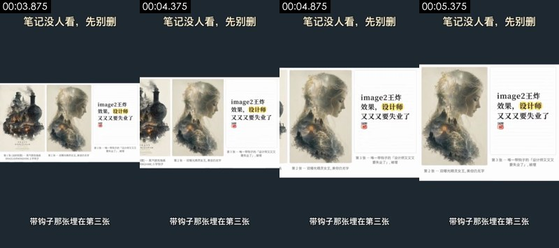

- 背景 #1e2931、その他のメインカラー #fafafa #dad6c8 #999484 #bab4a2
要素の切り抜き（番号は下のモーションに対応。L は常に動くレイヤーのショット中盤と終盤、S はショット中ずっと静止している要素）。元解像度の個別画像は `shots/` にある：

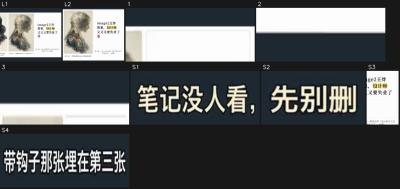

- S1. ショット中ずっと静止：図形／テキストブロック · x 16%–56%，y 6%–11% · #dfdac9 · 文字「笔记没人看，先别册 / 笔记没人看，先别删」 · [切り抜き](shots/shot_004_st_01.jpg)
- S2. ショット中ずっと静止：図形／テキストブロック · x 61%–84%，y 6%–11% · #ebe5d0 · [切り抜き](shots/shot_004_st_02.jpg)
- S3. ショット中ずっと静止：図形／テキストブロック · x 67%–100%，y 35%–65% · #fdfdfd · 文字「image2王炸 / 效果，设计师 / 又又又要失业了」 · [切り抜き](shots/shot_004_st_03.jpg)
- S4. ショット中ずっと静止：図形／テキストブロック · x 21%–79%，y 87%–91% · #d9dee1 · 文字「带钩子那张埋在第三张」 · [切り抜き](shots/shot_004_st_04.jpg)
- [切り抜き L1](shots/shot_004_ly_01.jpg) [切り抜き L2](shots/shot_004_ly_02.jpg) · 常に動くレイヤー：画面の 38% がショット中ずっと動いている（x 0%–100%，y 26%–72%）。漂うグラデーション、パーティクルの流れ、グローの明滅など
1. 4.01–4.41s · 中央右（x 62%–100%，y 32%–38%） · 消える、等速 · #222a33 · 文字「image2王炸」 · [切り抜き](shots/shot_004_el_01.jpg)
2. 5.28–5.41s · 下（x 0%–100%，y 72%–74%） · 現れる、瞬時 · #b1b4b6 · [切り抜き](shots/shot_004_el_02.jpg)
3. 5.34–5.41s · 上（x 0%–100%，y 25%–26%） · 現れる、瞬時 · #d3d9de · [切り抜き](shots/shot_004_el_03.jpg)

</details>

<details class="ref"><summary>モーション #6 7.5–10.5s · 8 個</summary>


- 背景 #1e2931、その他のメインカラー #fbfcfd #dedddf #aaa8a8 #c7c2c3
要素の切り抜き（番号は下のモーションに対応。L は常に動くレイヤーのショット中盤と終盤、S はショット中ずっと静止している要素）。元解像度の個別画像は `shots/` にある：

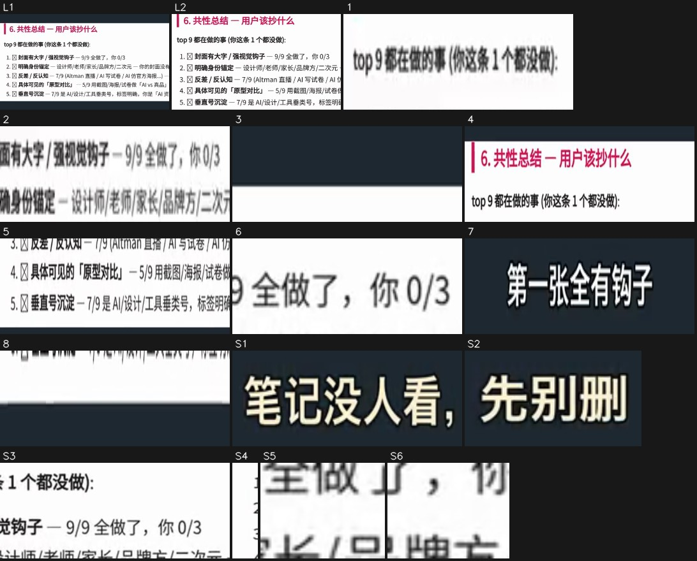

- S1. ショット中ずっと静止：図形／テキストブロック · x 16%–56%，y 6%–11% · #dfdac8 · 文字「笔记没人看，先别册 / 笔记没人看，先别删」 · [切り抜き](shots/shot_006_st_01.jpg)
- S2. ショット中ずっと静止：図形／テキストブロック · x 61%–84%，y 6%–11% · #e8e6d0 · [切り抜き](shots/shot_006_st_02.jpg)
- S3. ショット中ずっと静止：図形／テキストブロック · x 47%–100%，y 41%–50% · #fdfdfd · 文字「2.明确身份锚定一设计师/老师/家长/品牌方/二次元一你的封面没有人群 / 2.明确身份锚定一设计师/老师/家长/品牌方/二次元一你的封面 / 1.封面有大字/强视觉钩子一9/9全做了，你0/3」 · [切り抜き](shots/shot_006_st_03.jpg)
- S4. ショット中ずっと静止：図形／テキストブロック · x 0%–4%，y 46%–57% · #fdfdfd · [切り抜き](shots/shot_006_st_04.jpg)
- S5. ショット中ずっと静止：図形／テキストブロック · x 69%–76%，y 49%–50% · #fefefe · [切り抜き](shots/shot_006_st_05.jpg)
- S6. ショット中ずっと静止：図形／テキストブロック · x 78%–84%，y 49%–50% · #fdfdfd · [切り抜き](shots/shot_006_st_06.jpg)
- [切り抜き L1](shots/shot_006_ly_01.jpg) [切り抜き L2](shots/shot_006_ly_02.jpg) · 常に動くレイヤー：画面の 20% がショット中ずっと動いている（x 0%–100%，y 35%–64%）。漂うグラデーション、パーティクルの流れ、グローの明滅など
1. 7.61–8.74s · 中央左（x 0%–38%，y 45%–46%） · 消える、左へ移動、等速 · #979797 · 文字「top9都在做的事（你这条1个都没做）： / 1.封面有大字/强视觉钩子一9/9全做了，你0/3」 · [切り抜き](shots/shot_006_el_01.jpg)
2. 7.68–9.01s · 中央左（x 11%–51%，y 49%–50%） · 消える、左へ移動、等速 · #d8d7d7 · 文字「1.封面有大字/强视觉钩子一9/9全做了，你0/3 / 2.明确身份锚定一设计师/老师/家长/品牌方/二次元一你的封面没有人群 / 2.明确身份锚定一设计师/老师/家长/品牌方/二次元一你的封面」 · [切り抜き](shots/shot_006_el_02.jpg)
3. 7.74–8.54s · 中央右（x 44%–100%，y 39%–41%） · 消える、右へ展開（描線／伸長／ワイプ）、等速 · #222c32 · [切り抜き](shots/shot_006_el_03.jpg)
4. 8.54–9.94s · 中央（x 0%–100%，y 32%–44%） · 変化、右へ移動、イーズイン · #fdfdfd · 文字「6.共性总结一用户该抄什么 / top9都在做的事（你这条1个都没做）：」 · [切り抜き](shots/shot_006_el_04.jpg)
5. 8.54–9.61s · 中央（x 0%–100%，y 56%–65%） · 変化、下へ展開（描線／伸長／ワイプ）、イーズイン · #fdfcfc · 文字「4.具体可见的「原型对比]一5/9用截图/海报/试卷做「AVS真品]对照，你纯插画 / 5.垂直号沉淀一7/9是AI/设计/工具垂类号，标签明确，你是「AI资讯日报]杂牌 / 4.具体可见的「原型对比]一5/9用截图/海报/试卷做「Alvs真品]对照，你」 · [切り抜き](shots/shot_006_el_05.jpg)
6. 8.88–9.94s · 中央右（x 67%–93%，y 46%–49%） · 現れる、右からスライドイン、イーズイン · #adadad · [切り抜き](shots/shot_006_el_06.jpg)
7. 9.14–9.21s · 下（x 20%–80%，y 88%–91%） · 変化、瞬時 · #202831 · 文字「它对比了同赛道前九名 / 第一张全有钩子 / 连改法都给了？」 · [切り抜き](shots/shot_006_el_07.jpg)
8. 9.61–9.88s · 中央（x 0%–100%，y 65%–66%） · 現れる、等速 · #fdfefe · [切り抜き](shots/shot_006_el_08.jpg)

</details>

<details class="ref"><summary>モーション #8 11.5–13.5s · 5 個</summary>

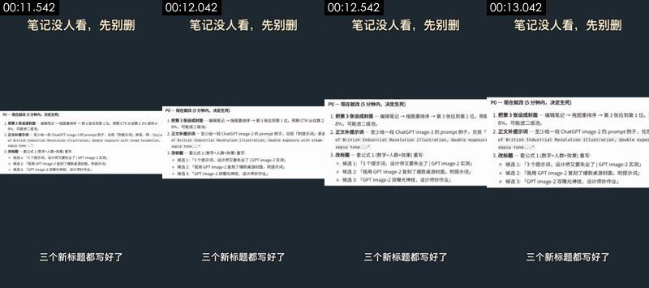

- 背景 #1e2931、その他のメインカラー #fbfcfd #cbccce #e4e4e4 #b2b1af
要素の切り抜き（番号は下のモーションに対応。L は常に動くレイヤーのショット中盤と終盤、S はショット中ずっと静止している要素）。元解像度の個別画像は `shots/` にある：

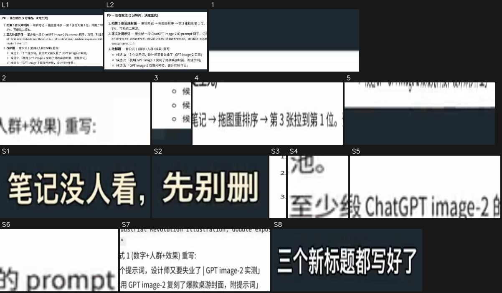

- S1. ショット中ずっと静止：図形／テキストブロック · x 16%–56%，y 6%–11% · #e0d9c6 · 文字「笔记没人看，先别册」 · [切り抜き](shots/shot_008_st_01.jpg)
- S2. ショット中ずっと静止：図形／テキストブロック · x 61%–84%，y 6%–11% · #e9e6d2 · [切り抜き](shots/shot_008_st_02.jpg)
- S3. ショット中ずっと静止：図形／テキストブロック · x 0%–4%，y 41%–60% · #fdfdfd · [切り抜き](shots/shot_008_st_03.jpg)
- S4. ショット中ずっと静止：図形／テキストブロック · x 31%–36%，y 44%–45% · #fdfdfd · [切り抜き](shots/shot_008_st_04.jpg)
- S5. ショット中ずっと静止：横線 · x 44%–71%，y 44%–45% · #fdfdfd · 文字「1.把第3张设成封面一编辑笔记→拖图重排序→第3张拉到第1位。预期CTR从估算2-3 / 2.正文补提示词一至少给一段ChatGPTimage-2的prompt例子，兑现「附提示词承诺 / 2.正文补提示词一至少给一段ChatGPTimage-2的prompt例子，兑现「」 · [切り抜き](shots/shot_008_st_05.jpg)
- S6. ショット中ずっと静止：図形／テキストブロック · x 73%–84%，y 44%–45% · #fdfdfd · [切り抜き](shots/shot_008_st_06.jpg)
- S7. ショット中ずっと静止：図形／テキストブロック · x 29%–100%，y 50%–60% · #fdfdfd · 文字「of British Industrial Revolution illustration,double exposure with steam l / o候选1:「3个提示词，设计师又要失业了|GPTimage-2实测] / o候选2：「我用GPTimage-2复刻了爆款桌游封面，附提示词]」 · [切り抜き](shots/shot_008_st_07.jpg)
- S8. ショット中ずっと静止：図形／テキストブロック · x 24%–76%，y 87%–91% · #d1d2d4 · 文字「三个新标题都写好了」 · [切り抜き](shots/shot_008_st_08.jpg)
- [切り抜き L1](shots/shot_008_ly_01.jpg) [切り抜き L2](shots/shot_008_ly_02.jpg) · 常に動くレイヤー：画面の 24% がショット中ずっと動いている（x 0%–100%，y 34%–65%）。漂うグラデーション、パーティクルの流れ、グローの明滅など
1. 11.61–12.14s · 中央右（x 47%–100%，y 38%–39%） · 消える、等速 · #1e2831 · 文字「1.把第3张设成封面一编辑笔记→拖图重排序→第3张拉到第1位。预期 / 1.把第3张设成封面一编辑笔记→拖图重排序→第3张拉到第1位。」 · [切り抜き](shots/shot_008_el_01.jpg)
2. 11.67–12.27s · 中央（x 31%–51%，y 51%–52%） · 消える、右へ移動、等速 · #c6c6c6 · 文字「3.改标题一套公式1（数字+人群+效果）重写：」 · [切り抜き](shots/shot_008_el_02.jpg)
3. 11.67–12.54s · 中央左（x 0%–9%，y 55%–61%） · 消える、右へ移動、等速 · #abb0b3 · [切り抜き](shots/shot_008_el_03.jpg)
4. 12.34–13.07s · 中央右（x 44%–100%，y 38%–41%） · 現れる、右からスライドイン、イーズイン · #bcbabb · 文字「1.把第3张设成封面一编辑笔记→拖图重排序→第3张拉到第1位。预期CTR从估算2-3 / 1.把第3张设成封面一编辑笔记→拖图重排序→第3张拉到第1位。预期 / 1.把第3张设成封面一编辑笔记→拖图重排序→第3张拉到第1位。」 · [切り抜き](shots/shot_008_el_04.jpg)
5. 12.94–13.07s · 中央（x 0%–84%，y 65%–66%） · 現れる、左からスライドイン、瞬時 · #93989e · 文字「o候选3:「GPTimage-2双曝光神技，设计师抄作业]」 · [切り抜き](shots/shot_008_el_05.jpg)

</details>

<details class="ref"><summary>モーション #10 16.1–19.0s · 10 個</summary>


- 背景 #1e2931、その他のメインカラー #f5f9fa #000102 #d1dae0 #b5b6b8
要素の切り抜き（番号は下のモーションに対応。L は常に動くレイヤーのショット中盤と終盤、S はショット中ずっと静止している要素）。元解像度の個別画像は `shots/` にある：

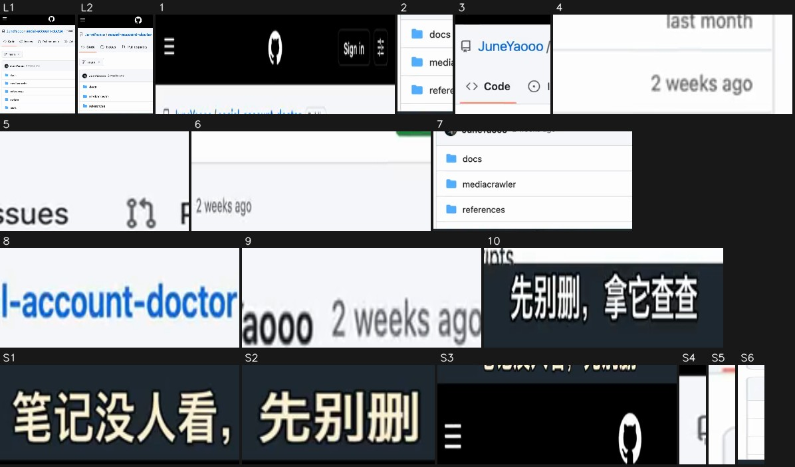

- S1. ショット中ずっと静止：図形／テキストブロック · x 16%–56%，y 6%–11% · #e0d9c6 · 文字「笔记没人看，先别删 / 笔记没人看，先别册」 · [切り抜き](shots/shot_010_st_01.jpg)
- S2. ショット中ずっと静止：図形／テキストブロック · x 61%–84%，y 6%–11% · #ece6d1 · [切り抜き](shots/shot_010_st_02.jpg)
- S3. ショット中ずっと静止：図形／テキストブロック · x 0%–100%，y 12%–19% · #000000 · 文字「Sign in / Sig」 · [切り抜き](shots/shot_010_st_03.jpg)
- S4. ショット中ずっと静止：図形／テキストブロック · x 0%–2%，y 24%–30% · #f4f6f9 · [切り抜き](shots/shot_010_st_04.jpg)
- S5. ショット中ずっと静止：図形／テキストブロック · x 0%–2%，y 42%–48% · #fdfdfd · [切り抜き](shots/shot_010_st_05.jpg)
- S6. ショット中ずっと静止：縦線 · x 0%–4%，y 51%–87% · #fdfdfd · [切り抜き](shots/shot_010_st_06.jpg)
- [切り抜き L1](shots/shot_010_ly_01.jpg) [切り抜き L2](shots/shot_010_ly_02.jpg) · 常に動くレイヤー：画面の 28% がショット中ずっと動いている（x 0%–100%，y 15%–86%）。漂うグラデーション、パーティクルの流れ、グローの明滅など
1. 16.19–17.12s · 上（x 0%–100%，y 14%–20%） · 消える、左へ移動、等速 · #eeeeee · 文字「Sign in / Sig」 · [切り抜き](shots/shot_010_el_01.jpg)
2. 16.19–18.39s · 下左（x 2%–24%，y 64%–86%） · 変化、上へ移動、等速 · #eef6fd · 文字「tests / tikhub / .env.example」 · [切り抜き](shots/shot_010_el_02.jpg)
3. 16.26–18.26s · 上左（x 0%–38%，y 22%–43%） · 変化、左へ移動、イーズインアウト · #cacfda · 文字「JuneYaooo/social-account-doctor / <>Code / Issues」 · [切り抜き](shots/shot_010_el_03.jpg)
4. 16.26–17.93s · 中央右（x 67%–100%，y 55%–59%） · 消える、左へ移動、イーズインアウト · #bfbfbf · 文字「last month / 2v」 · [切り抜き](shots/shot_010_el_04.jpg)
5. 17.06–18.32s · 中央（x 42%–67%，y 32%–38%） · 現れる、下へ展開（描線／伸長／ワイプ）、イーズインアウト · #b4b6b9 · 文字「Pullrequests / Pull requests / Issues」 · [切り抜き](shots/shot_010_el_05.jpg)
6. 17.26–17.66s · 中央（x 31%–98%，y 42%–48%） · 消える、下へ移動、イーズインアウト · #ececee · 文字「2weeksago / JuneYaooo2weeksago」 · [切り抜き](shots/shot_010_el_06.jpg)
7. 17.32–18.39s · 下（x 2%–100%，y 61%–86%） · 変化、等速 · #e8ebec · 文字「scripts / 2weeksago / tests」 · [切り抜き](shots/shot_010_el_07.jpg)
8. 17.59–18.46s · 上右（x 56%–98%，y 26%–30%） · 現れる、右からスライドイン、イーズイン · #8ab5eb · 文字「Actions / Pullrequests / Public」 · [切り抜き](shots/shot_010_el_08.jpg)
9. 17.79–18.46s · 中央（x 29%–60%，y 57%–59%） · 現れる、左からスライドイン、イーズインアウト · #cfd1d3 · 文字「JuneYaooo2weeksago」 · [切り抜き](shots/shot_010_el_09.jpg)
10. 17.93–17.99s · 下（x 22%–78%，y 88%–91%） · 変化、瞬時 · #494d4f · 文字「行，下回发了没人看」 · [切り抜き](shots/shot_010_el_10.jpg)

</details>

### 編集

- 「絵コンテ表」の順番と尺どおりに編集する
- 手法：一問一答形式の切り返し：質問する人 → 答える人 → 回答内容のスクリーンショット、各セグメント 1–3 秒でハードカット。スクリーンショットのセグメントはすべて同じダークグレーのテンプレートを使い、上部にタイトルを常時表示、下部に字幕を 1 文ずつ表示
- テンポ：1 分あたり 28.4 カット、平均ショット長 1.9s。実写ショットなし。トランジション ハードカット×9

## キャラクター・シーン・小道具

| 番号 | 呼び名 | 種類 | 外見 | 役割 | 声 | 登場 |
|---|---|---|---|---|---|---|
| A | 質問する女性（投稿したクリエイター） | 実在の人物 | 若い中国人女性、黒のショートヘアにぱっつん前髪、青緑の太縁丸メガネ、淡い黄色のパーカー、オフホワイトのクッションを抱え、濃い色のスマホを手に、ソファにあぐらをかいて座っている | 問題を抱えている人。視聴者の代わりに質問する | 若い女性の声、驚き・好奇心のある口調 | #2、#5、#7 |
| B | キャスケットの女性（詳しい人） | 実在の人物 | ショートヘアの中国人女性、黒のウールのキャスケット、細いメタルの丸メガネ、白シャツの上に深緑の V ネックニットベスト、濃い色のボトムス、両手で白いマグカップを持ち、オフホワイトのアームチェアに座っている。顔立ちが A とよく似ており、同じ顔の 2 つのスタイリング（一人二役）と思われる | 答えを示し、ツールを紹介する人 | 女性の声、落ち着いて確信のある口調 | #3、#9 |

**シーン**

| シーン | 場所 | 時間帯 | セット / 光 | ショット |
|---|---|---|---|---|
| S1 | リビングのソファ | 夜 | オフホワイトのソファとブランケット、右奥に暖色のフロアランプ、カーテン、窓の外の夜景と観葉植物 | #2、#5、#7 |
| S2 | 書斎のアームチェア | 夜 | オフホワイトのアームチェア、背景に濃い色の本棚、暖色のペンダントライトと観葉植物、ローキー | #3、#9 |
| S3 | スクリーンショット表示テンプレート | — | ダークグレーの背景（#1e2931）、上部に白文字のタイトル、中央に白いスクリーンショットカード、下部に白文字の字幕 | #1、#4、#6、#8、#10 |

**小道具 / 商品 / ロゴ**

- スマホ（ショット #2、#5、#7）：A がずっと手に持って投稿のデータを見ている
- 白いマグカップ（ショット #3、#9）：B が両手で持っている
- 診断レポートのスクリーンショット（ショット #1、#6、#8）：ツールが出力した Markdown レポート：TL;DR、共通点のまとめ、P0 の改善策
- 投稿画像のスクリーンショット（ショット #4）：診断された投稿の画像 3 枚
- GitHub リポジトリページのスクリーンショット（ショット #10）：social-account-doctor のリポジトリページ（スマホ版 Web）

## 撮り方とライティング

- ビジュアルスタイル：リアルでシネマティックな AI ポートレート、夜の暖色の室内でローキー。スクリーンショットのセグメントはダークグレーの背景 + 白いドキュメントカードのシンプルなテンプレート
- フレーミング：ショットサイズ クローズショット 100%、カメラアングル やや俯瞰。被写体は人の顔（顔の高さでショットサイズを算出）
- カメラ位置：移動カメラ（スタビライザー／手持ちパン） 66%、固定カメラ（三脚／スタンド／机置き） 34%
- ライティング：2 つのシーンとも夜の暖色の室内光。リビングはフロアランプとスマホ画面の光、書斎は左前方の暖色のソフトライトと背景のペンダントライト。全体的にローキー（目視による判断。ピクセル測定は下の折りたたみを参照）
- カラーグレーディング：ナチュラル（元の色に近い）。彩度は標準、コントラストは標準、黒レベルは標準、全体的にニュートラル

<details class="ref"><summary>項目別の測定と目視の結果（19 項目）</summary>

| 区分 | 項目 | 結論 | 出典 |
|---|---|---|---|
| フレーミング | ショットサイズ | クローズショット | 測定；目視：ミディアムショット |
| フレーミング | カメラアングル | やや俯瞰 | 目視 |
| フレーミング | 構図 | 縦型。人物は画面の左中央に座り、体は右前方を向き、右上にフロアランプと窓のスペースを残している | 目視 |
| カメラ位置 | 撮影方法 | 三脚／スタンドで固定 | 測定：混在：移動カメラ（スタビライザー／手持ちパン） 66%、固定カメラ（三脚／スタンド／机置き） 34%；目視 |
| カメラ位置 | 速度 | 通常 | 目視 |
| カメラ位置 | カメラ位置／シーン | 固定カメラの 2 シーン：夜のリビングのソファ（質問する女性、やや俯瞰のミディアムショット）と夜の書斎のアームチェア（帽子をかぶった女性、アイレベルのミディアムショット）。全編を通してカメラワークはなく、カット割りで展開する | 目視 |
| カメラ位置 | 推定機材 | 実写なし：人物ショットは AI の画像から動画生成、スクリーンショットカードは編集ソフト／コードテンプレートによるプッシュイン | 目視 |
| ライティング | シーン | 室内；夜；リビングのソファ | 目視 |
| ライティング | キーライト | 画面右奥のフロアランプの暖色光 + スマホ画面が下から顔を照らす | 目視 |
| ライティング | 硬さ・柔らかさ | ハードライト（明暗の境界がはっきり） | 測定；目視：ソフトライト |
| ライティング | フィル | はっきりしたフィルはなく、暗部が深い | 目視 |
| ライティング | リムライト | フロアランプが髪と肩の右側に暖色のエッジを作っている | 目視 |
| ライティング | キャッチライト | メガネの反射でキャッチライトは見えない | 目視 |
| ライティング | 見える光源 | フロアランプ、スマホ画面 | 目視 |
| ライティング | 色温度 | やや寒色（デイライト／クールホワイト LED） | 測定；目視：混在（暖色の照明 + 画面の寒色光） |
| ライティング | ライティングプラン | 夜のリビング：暖色のフロアランプ 1 灯で背景と輪郭を作り、スマホ画面を顔のキーライトにする（AI の画面であり、撮影プランではない） | 目視 |
| ライティング | 全体のライティング | 2 つのシーンとも夜の暖色の室内光。リビングはフロアランプとスマホ画面の光、書斎は左前方の暖色のソフトライトと背景のペンダントライト。全体的にローキー | 目視 |
| カラーグレーディング | グレーディングスタイル | ナチュラル（元の色に近い） | 測定；目視：ローキーの暖色：黒レベルを沈め、暖かい黄色が主体、画面付近はわずかに寒色のシアン |
| カラーグレーディング | 全体のグレーディング | ローキーの暖色でシネマティック、黒レベルを沈め、肌色は暖かめ | 目視 |

</details>

- 注記：光比、硬さ・柔らかさ、色温度、ショットサイズは被写体のピクセルから測定（顔があれば顔を使い、なければ画面内のピントが合った領域を使用。後者は推定値）。プラットフォームのトランスコードで暗部がつぶれるため、硬さ・柔らかさとフィルの判定は控えめになる。カメラアングル、光源の種類、キャッチライト、リムライトは目視の結果を優先する。測定と目視が食い違う場合は両方を記載している。

## 編集パッケージ層（字幕 / 装飾テキスト / ステッカー / 効果音の同期）

- 字幕 13 行（下部、最大 1 行）：白文字、黒縁取り、文字高 3.3%；登場：そのまま表示×9
- 書き出し：`packaging/subtitles.srt`、`packaging/overlays.ass`、`packaging/timeline.json`（SRT は字幕のタイムライン；ASS は色・縁取り・位置・登場アニメーション付きで、フォントは元動画のフォントに差し替える必要あり；timeline.json は完全なタイムライン）

<details class="ref"><summary>テキストタイムライン（13 件）</summary>

| 時間 | 種類 | テキスト | スタイル | 登場 / 退場 | 効果音 |
|---|---|---|---|---|---|
| 0.00–1.40s | 字幕 | 这条才发二十一分钟 | 白文字、黒縁取り、文字高 3.0%（約 26px） | そのまま消える | — |
| 1.40–2.80s | 字幕 | 就被判九成扑街？ | 白文字、黒縁取り、文字高 3.3%（約 28px） | そのまま表示 / そのまま消える | — |
| 2.80–3.90s | 字幕 | 封面顺序反了 | 白文字、黒縁取り、文字高 3.5%（約 30px） | そのまま表示 / そのまま消える | — |
| 3.90–5.80s | 字幕 | 带钩子那张埋在第三张 | 白文字、黒縁取り、文字高 3.5%（約 30px） | そのまま表示 / そのまま消える | — |
| 5.80–7.50s | 字幕 | 它怎么知道哪张有钩子？ | 白文字、黒縁取り、文字高 3.0%（約 26px） | そのまま表示 / そのまま消える | — |
| 7.50–9.00s | 字幕 | 它对比了同赛道前九名 | 白文字、黒縁取り、文字高 3.0%（約 26px） | そのまま表示 | — |
| 9.00–10.50s | 字幕 | 第一张全有钩子 | 白文字、黒縁取り、文字高 3.3%（約 28px） | そのまま消える | — |
| 10.50–11.50s | 字幕 | 连改法都给了？ | 白文字、黒縁取り、文字高 3.3%（約 28px） | そのまま表示 / そのまま消える | — |
| 11.50–13.50s | 字幕 | 三个新标题都写好了 | 白文字、黒縁取り、文字高 3.0%（約 26px） | そのまま表示 / そのまま消える | — |
| 13.50–14.10s | 字幕 | 前提是你得自己配 | 白文字、黒縁取り、文字高 3.0%（約 26px） | そのまま表示 / 縮小して消える | — |
| 14.50–16.00s | 字幕 | 一个会看图的大模型 | 白文字、黒縁取り、文字高 3.6%（約 31px） | 縮小して消える | — |
| 16.00–17.90s | 字幕 | 行，下回发了没人看 | 白文字、黒縁取り、文字高 3.8%（約 32px） | そのまま消える | — |
| 17.90–19.00s | 字幕 | 先别删，拿它查查 | 白文字、黒縁取り、文字高 3.5%（約 30px） | そのまま表示 | — |

</details>

再現：字幕と装飾テキストは `packaging/overlays.ass` でそのまま焼き込む（ffmpeg -vf ass=overlays.ass）か、timeline.json に沿って CapCut / Remotion で組み直す；ステッカーや GIF は同じ素材を探す必要があり（スタンプ素材 / GIF ライブラリ）、スクリーンショットは packaging/ にある。

## サウンド

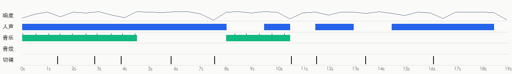

- ラウドネス -16.8 dBFS、ピーク -3.5 dBFS；各カットの映像が音声を内蔵（カット点で背景音が 23.6dB 跳ね、ショット内は 9.3dB）
- 出所の判定：動画タイプ：AI 動画がネイティブで音を出す（各カットの映像が音声を内蔵） → 人の声：AI 動画のネイティブ台詞（映像と一緒に生成）；効果音：AI 動画モデルが映像と一緒に生成（ネイティブ音声）

**人の声**

- 尺の 76% を占める；基本周波数 約 247.8Hz（女性の声寄り）
- 出所：AI 動画のネイティブ台詞（映像と一緒に生成）（AI 動画のネイティブ台詞（映像と一緒に生成） 65%、TTS ナレーション 18%、肉声録音 18%）
  - 背景音がカット点ごとに跳ね、映像が AI 動画：人の声は動画モデルが映像と一緒に生成した可能性が高い（Seedance/Veo/H3 のネイティブ音声など）
- 再現：AI 動画と一緒に生成：台詞を出せる動画モデルを使い、台詞をプロンプトに書き込む

**BGM**

- 持続的な BGM（ミュージックベッド）は検出されなかった

**効果音**

- はっきりした効果音は見つからなかった（人の声や音楽の下にあるごく小さな効果音は見落としている可能性がある）

- 分離した音声トラック：`stems/original.wav`（元音声）、`stems/vocals.wav`（人の声のドライ音源）、`stems/music.wav`（BGM + 環境音）、`stems/effects.wav`（効果音トラック）
<!--stems-->

## 不確定な点

- 音は AI が聞いていない（レビューは映像のみ）：人の声が肉声か TTS かは波形から推定；効果音は個別に分離した効果音トラックから探したもので、種類は音の特徴から推定。「サウンド」で分離トラックと各効果音を試聴して確認できる

## 付録

### ショット別の検証

各ショットは 2 部構成：画面で見えるものと、ツールが推定した制作方法（判断根拠付き）；最後に再現用プロンプト。デフォルトでは折りたたみ、クリックで展開。

<details class="ref"><summary>#1 00:00.000–00:01.375 · コード/テンプレートレンダリング；実素材を使用（画面録画素材、UI スクリーンショット）</summary>

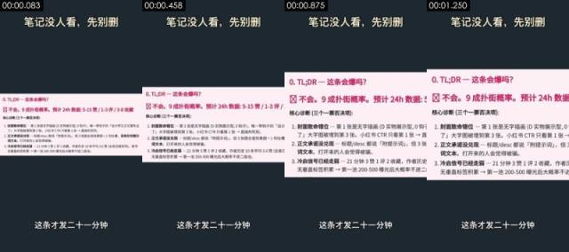

**画面で見えるもの**（スクリーンショットと照らし合わせて確認できる）
- 画面：縦型テンプレート：ダークグレーの背景、上部にタイトル「笔记没人看，先别删」、下部に字幕。中央に診断レポートのスクリーンショット（ピンクの小見出し「0. TL;DR — 这条会爆吗？」、赤字の結論「不会。9 成扑街概率」、3 項目の「核心诊断」リスト）があり、スクリーンショット全体が左端を基点に素早く拡大し、上端が上へ移動して、結論の行がどんどん大きくなる。
- テキストトラック（画面内テキスト/bottom）：这条才发二十一分钟
- テキストトラック（画面内テキスト/middle）：0.TL;DR一这条会爆吗？ / 不会。9成扑街概率。预计24h数据：5-15赞/1-3评/3-8收藏 / 不会。9成扑街概率。预计24h数据：5-15 / 不会。9成扑街概率。预计24h数据
- テキストトラック（画面内テキスト/middle）：核心诊断（三个一票否决项）： / 1.封面致命错位一第1张是无字插画（D实物展示型，0钩子），唯一带钩子的「设计师 / 了J大字图被埋到第3张。小红书CTR只看第1张→直接判死刑。 / 1.封面致命错位一第1张是无字插画（D实物展示型，0钩子），唯一
- テキストトラック（画面内テキスト/middle）：2.正文承诺没兑现一标题/desc都说「附提示词，但3张图全是效果图+1句吐槽， / 词文本。打开来的人会觉得被骗。 / 3.冷启信号已经走弱一21分钟3赞1评2收藏，作者历史10条平均3.6赞（全是日 / 了」大字图被埋到第3张。小红书CTR只看第1张→直接判死开
- [AI アシスタント 目視] ダークグレーの単色背景（#1e2931）、上部に固定の白文字タイトル、下部に固定の白文字字幕
- [AI アシスタント 目視] 中央は薄いピンク地のドキュメントのスクリーンショットカード（「0. TL;DR — 这条会爆吗？」「不会。9 成扑街概率」）で、文字のエッジがシャープ、レイアウトは Markdown レンダリング
- [AI アシスタント 目視] カード全体が 1.4 秒で拡大しつつ左へパンし、カード内の文字は変形しない

**ツールが推定した制作方法**（推定であり、目で見たものではない）
- 推定：コード/テンプレートレンダリング 70%、画面録画/スクリーンショット 13%、3D レンダリング 4%（fused_agent）
- 素材の出所：混合（実素材を含む）：画面録画素材、UI スクリーンショット
  - 画面録画素材：明るい UI パネル内に文字が 9 箇所（うち 9 箇所は小さい文字）
- 判断根拠（ツールによる測定。肉眼では分からないこともある）：
  - テクスチャはレンダリングの特徴を示す：平坦な色ブロック 71%、95% のピクセルがわずか 35 色、水平・垂直の直線エッジ 27%
  - 平坦な下地に細かい高周波のディテール（小さい文字/UI）が多く、スクリーンショットや文書画面のよう

- 再現：コードレンダリング：Remotion/HTML でテキストトラックとレイアウトに沿って組み直す。100% 制御可能で、生成モデルは不要。ユーザーが実素材を用意する必要あり：画面録画素材（画面の一部 x0% y31% 幅100% 高さ37%）、UI スクリーンショット（画面の一部）

</details>

<details class="ref"><summary>#2 00:01.375–00:02.833 · AI 生成動画 + コード/編集オーバーレイ（テキスト注記、タイトル）</summary>

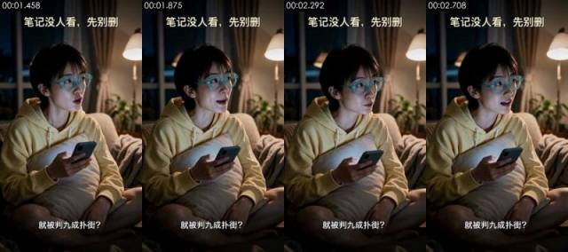

**画面で見えるもの**（スクリーンショットと照らし合わせて確認できる）
- 画面：夜のリビング、ショートヘアの女性が青緑の太縁メガネをかけ、淡い黄色のパーカーを着て、ソファにあぐらをかいてオフホワイトのクッションを抱え、右手にスマホを持ち、顔を上げて画面右側を見て、驚いたように話し出す。背景に暖色のフロアランプ、カーテン、観葉植物、固定カメラのミディアムショット。
- 撮り方/ライティング：クローズショット；やや俯瞰；三脚/スタンドで固定；夜景/低照度の環境光、専用の補助光なし；キーライトは正面（光はカメラ方向から来て、被写体の左右の明るさがほぼ同じ）；ライティング比 約 1.3:1（差 0.4 段）；中程度の柔らかさ
- テキストトラック（テキスト/bottom）：就被判九成扑街？
- テキストトラック（タイトル/top）：笔记没人看，先别册 / 笔记没人看，先别删
- [AI アシスタント 目視] 肌が滑らかすぎ、光が均一で、AI の写実画像のよう
- [AI アシスタント 目視] #5、#7 の先頭フレームとほぼ同じ構図・同じポーズで、同じ先頭フレーム画像から何度も生成したよう
- [AI アシスタント 目視] 頭の動き、口の形、スマホを持つ手にも動きがあり、口だけが動くデジタルヒューマンではない；スマホ画面に読める内容はない

**ツールが推定した制作方法**（推定であり、目で見たものではない）
- 推定：AI 生成動画 74%、デジタルヒューマン 11%、実写 5%（fused_agent）
- 素材の出所：AI 生成
- 判断根拠（ツールによる測定。肉眼では分からないこともある）：
  - 低照度の画面：36% の領域がほぼ真っ黒だが粒状感がある（単色の下地ではない）。明部の平坦ブロックは 1% のみで、人の顔がある：平坦ブロック/少色は暗部の圧縮によるもので、レンダリングの特徴とはみなさない
  - テクスチャは写真/動画の特徴を示す：ノイズ σ=0.34、使用色 121 色、平坦ブロック 11%
  - フレームごとの鮮明度が周期的に上下する（周期 4 フレーム、相関 0.87）が、重複フレームはない：フレーム補間/フレームレート変換の可能性もあれば、再圧縮で残ったリズムにすぎない可能性もある（プラットフォームのマークを除去したトランスコードファイルでも同様になる）。この一点だけでは AI と断定できない

- 再現：元動画は AI 生成：元ショットの最初と最後のフレームを使って先頭・末尾フレーム指定で生成すれば、構図と動きをかなり忠実に再現できる。被写体を変える場合は、まず画像モデルで先頭フレームを修正する
  - 先頭フレーム画像プロンプト：クローズショット、やや俯瞰、縦型；人物は画面の左中央に座り、右上にフロアランプと窓が見える余白を残す。縦型 9:16、ミディアムショット、やや俯瞰のアングル。夜のリビング、ショートヘアの中国人女性が青緑の太縁丸メガネをかけ、淡い黄色のパーカーを着て、オフホワイトのソファにあぐらをかき、オフホワイトのクッションを抱え、右手に濃い色のスマホを持ち、画面の左中央に座って体を右前方に向け、顔を上げて画面右側を見ている。右奥に暖色のフロアランプ、背景のカーテンと観葉植物はぼかし、スマホ画面の冷たい光が顔を照らす、写実的なシネマ風。
  - 動画プロンプト：クローズショット、やや俯瞰、縦型；人物は画面の左中央に座り、体を右前方に向け、右上にフロアランプと窓が見える余白を残す。ミディアムショット、やや俯瞰のアングル、女性は画面の左中央に座っている。スマホを見終えたところで顔を上げて画面右側を見つめ、眉を上げ口を開けて、驚いたように「就被判九成扑街？」と言い、手の中のスマホが軽く揺れ、最後は驚いた表情で止まる。固定カメラ。

</details>

<details class="ref"><summary>#3 00:02.833–00:03.875 · AI 生成動画 + コード/編集オーバーレイ（テキスト注記、タイトル）</summary>

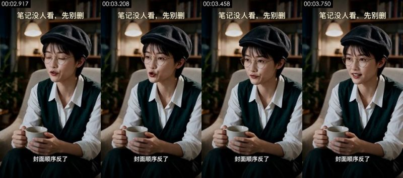

**画面で見えるもの**（スクリーンショットと照らし合わせて確認できる）
- 画面：夜の書斎、ショートヘアの女性が黒いキャスケットと細いメタルの丸メガネをかけ、白シャツの上に深緑の V ネックニットベストを着て、オフホワイトのアームチェアに座り両手で白いマグカップを持ち、まばたきした後に画面左側を見て話す。背景に本棚、暖色のペンダントライト、観葉植物、固定カメラのミディアムショット。
- 撮り方/ライティング：クローズショット；アイレベル；三脚/スタンドで固定；夜景/低照度の環境光、専用の補助光なし；キーライトは画面左側のやや前方；ライティング比 約 2.0:1（差 1.0 段）；中程度の柔らかさ
- テキストトラック（テキスト/bottom）：封面顺序反了
- テキストトラック（タイトル/top）：笔记没人看，先别删 / 笔记没人看，先别册
- [AI アシスタント 目視] #9 と同じキャラクター、同じ椅子、同じ構図で、冒頭 1 フレームの目を閉じた状態からの遷移は滑らかだが、顔の質感がきれいすぎる
- [AI アシスタント 目視] 背景の本棚の背表紙が色の塊にぼやけ、読める文字がない
- [AI アシスタント 目視] マグカップを持つ指の形が安定し、動きは小さく、光が均一で、AI の写実動画のよう

**ツールが推定した制作方法**（推定であり、目で見たものではない）
- 推定：AI 生成動画 68%、実写 14%、デジタルヒューマン 9%（fused_agent）
- 素材の出所：AI 生成
- 判断根拠（ツールによる測定。肉眼では分からないこともある）：
  - 低照度の画面：46% の領域がほぼ真っ黒だが粒状感がある（単色の下地ではない）。明部の平坦ブロックは 0% のみで、人の顔がある：平坦ブロック/少色は暗部の圧縮によるもので、レンダリングの特徴とはみなさない
  - テクスチャは写真/動画の特徴を示す：ノイズ σ=0.31、使用色 98 色、平坦ブロック 9%

- 再現：元動画は AI 生成：元ショットの最初と最後のフレームを使って先頭・末尾フレーム指定で生成すれば、構図と動きをかなり忠実に再現できる。被写体を変える場合は、まず画像モデルで先頭フレームを修正する
  - 先頭フレーム画像プロンプト：クローズショット、縦型；人物は中央やや左寄りでアームチェアに座り、背景に本棚とペンダントライト。縦型 9:16、ミディアムショット、アイレベル。夜の書斎、ショートヘアの中国人女性が黒いウールのキャスケットと細いメタルの丸メガネをかけ、白シャツの上に深緑の V ネックニットベストを着て、オフホワイトのアームチェアに座り、画面の中央やや左に位置し、体を少し斜めに向け、両手で白いマグカップを膝の前に持っている。背景の濃い色の本棚、暖色のペンダントライト、観葉植物はぼかし、左前方から暖色のソフトライト、暗めのトーンの写実的なシネマ風。
  - 動画プロンプト：クローズショット、縦型；人物は中央やや左寄りでアームチェアに座り、体を少し斜めに向け、背景に本棚とペンダントライト。ミディアムショット、アイレベル、女性は画面の中央やや左のアームチェアに座っている。まず一度まばたきし、それから画面左側を見て、落ち着いて確信を持って「封面顺序反了」と言い、軽く一度うなずき、両手はずっとマグカップを持ったまま。固定カメラ。

</details>

<details class="ref"><summary>#4 00:03.875–00:05.833 · コード/テンプレートレンダリング；実素材を使用（画面録画素材、UI スクリーンショット）</summary>


**画面で見えるもの**（スクリーンショットと照らし合わせて確認できる）
- 画面：ダークグレーのテンプレート上に、投稿の画像 3 枚を横一列に並べたスクリーンショット：1 枚目はスチームパンクの列車イラスト、2 枚目は二重露光のエルフの女王、3 枚目は白地に黒の大きな文字の画像「image2王炸效果，设计师又又又要失业了」（「设计师」は黄色ハイライト）。スクリーンショットは拡大しながら左へ移動し、2・3 枚目で止まる。セリフ「带钩子那张埋在第三张」に対応。
- テキストトラック（画面内テキスト/bottom）：带钩子那张埋在第三张
- テキストトラック（画面内テキスト/middle）：image2王炸 / 效果，设计师 / 又又又要失业了
- テキストトラック（画面内テキスト/middle）：BIRMISGHAM / BRASS / 第3张一唯一带钩子的「设计师又又又 / 要失业了J，被埋
- テキストトラック（画面内テキスト/middle）：蒸汽朋克插画 / 第2张一双曝光精灵女王，美但仍无字 / AM.0字钩子 / 要失业了」，被埋
- [AI アシスタント 目視] 同じダークグレーのテンプレート、同じタイトルと字幕の位置
- [AI アシスタント 目視] 中央に投稿の画像 3 枚を並べたスクリーンショット（蒸気機関車のイラスト、二重露光の女王、「image2王炸效果，设计师又又又要失业了」と書かれた大きな文字の画像）、その下に小さな説明文
- [AI アシスタント 目視] スクリーンショット全体が拡大しながら左へパンし、1 枚目から 3 枚目へ移る。画像内部に独立した動きはない

**ツールが推定した制作方法**（推定であり、目で見たものではない）
- 推定：コード/テンプレートレンダリング 70%、画面録画/スクリーンショット 12%、3D レンダリング 6%（fused_agent）
- 素材の出所：混合（実素材を含む）：画面録画素材、UI スクリーンショット
  - 画面録画素材：明るい UI パネル内に文字が 10 箇所（うち 10 箇所は小さい文字）
- 判断根拠（ツールによる測定。肉眼では分からないこともある）：
  - テクスチャはレンダリングの特徴を示す：平坦な色ブロック 62%、95% のピクセルがわずか 44 色、水平・垂直の直線エッジ 32%
  - 平坦な下地に細かい高周波のディテール（小さい文字/UI）が多く、スクリーンショットや文書画面のよう
  - フレームごとの鮮明度が周期的に上下する（周期 4 フレーム、相関 0.55）が、重複フレームはない：フレーム補間/フレームレート変換の可能性もあれば、再圧縮で残ったリズムにすぎない可能性もある（プラットフォームのマークを除去したトランスコードファイルでも同様になる）。この一点だけでは AI と断定できない

- 再現：コードレンダリング：Remotion/HTML でテキストトラックとレイアウトに沿って組み直す。100% 制御可能で、生成モデルは不要。ユーザーが実素材を用意する必要あり：画面録画素材（画面の一部 x0% y29% 幅100% 高さ41%）、UI スクリーンショット（画面の一部）

</details>

<details class="ref"><summary>#5 00:05.833–00:07.542 · AI 生成動画 + コード/編集オーバーレイ（字幕、タイトル）</summary>

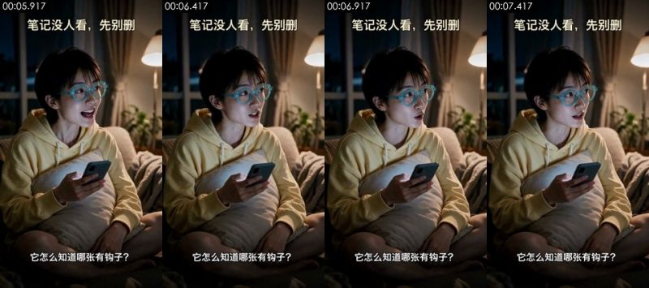

**画面で見えるもの**（スクリーンショットと照らし合わせて確認できる）
- 画面：#2 と同じリビングのシーンと女性：笑って話し始めたあと眉をひそめて考え込み、画面右側を見て問いかける。体はほぼ動かず、スマホを手に持っている。固定カメラのミディアムショット。
- 撮り方/ライティング：クローズショット；やや俯瞰；三脚/スタンドで固定；夜景/低照度の環境光、専用の補助光なし；キーライトは正面（光はカメラ方向から来て、被写体の左右の明るさがほぼ同じ）；ライティング比 約 1.2:1（差 0.3 段）；ソフトライト（明暗の境目がほとんどない）
- テキストトラック（字幕/bottom）：它怎么知道哪张有钩子？ / 它对比了同赛道前九名
- テキストトラック（字幕/middle）：6.共性总结一用户该抄什么 / top9都在做的事（你这条1个都没做）：
- テキストトラック（字幕/middle）：1.封面有大字/强视觉钩子一9/9全做了，你0/3 / 2.明确身份锚定一设计师/老师/家长/品牌方/二次元一你的封面没有人群
- テキストトラック（字幕/middle）：4.具体可见的「原型对比J一5/9用截图/海报/试卷做「AIvs真品J对照，你纯 / 5.垂直号沉淀一7/9是AI/设计/工具垂类号，标签明确，你是「AI资讯日报J杂
- [AI アシスタント 目視] 先頭フレームは #7 の先頭フレームとほぼ同一（同じ笑顔、同じ手の形）。同じ先頭フレーム画像から生成された別のクリップ
- [AI アシスタント 目視] メガネのフレーム、指、スマホの縁がフレーム間でわずかにずれる
- [AI アシスタント 目視] 光と肌が完璧すぎ、背景のカーテンと観葉植物は均一にぼけている

**ツールが推定した制作方法**（推定であり、目で見たものではない）
- 推定：AI 生成動画 73%、デジタルヒューマン 14%、実写 3%（fused_agent）
- 素材の出所：AI 生成
- 判断根拠（ツールによる測定。肉眼では分からないこともある）：
  - 低照度の画面：37% の領域がほぼ真っ黒だが粒状感がある（単色の下地ではない）。明部の平坦ブロックは 0% のみで、人の顔がある：平坦ブロック/少色は暗部の圧縮によるもので、レンダリングの特徴とはみなさない
  - テクスチャは写真/動画の特徴を示す：ノイズ σ=0.34、使用色 116 色、平坦ブロック 10%
  - フレームごとの鮮明度が周期的に上下する（周期 4 フレーム、相関 0.74）が、重複フレームはない：フレーム補間/フレームレート変換の可能性もあれば、再圧縮で残ったリズムにすぎない可能性もある（プラットフォームのマークを除去したトランスコードファイルでも同様になる）。この一点だけでは AI と断定できない
  - サンプリングしたフレームの 100% に正面の顔があり、カメラは固定、音声トラックに人の声がある

- 再現：元動画は AI 生成：元ショットの最初と最後のフレームを使って先頭・末尾フレーム指定で生成すれば、構図と動きをかなり忠実に再現できる。被写体を変える場合は、まず画像モデルで先頭フレームを修正する
  - 先頭フレーム画像プロンプト：クローズショット、やや俯瞰、縦型；人物は画面の左中央に座り、体は右前方を向く。右上にフロアランプと窓が見える余白を残す。#2 と同じ先頭フレーム：縦型 9:16、やや俯瞰のミディアムショット、夜のリビング。青緑の太縁メガネをかけ、淡い黄色のパーカーを着たショートヘアの女性がソファにあぐらをかいて座り、クッションを抱えてスマホを持ち、画面右側を見て口元に笑みを浮かべている。
  - 動画プロンプト：クローズショット、やや俯瞰、縦型；人物は画面の左中央に座り、体は右前方を向く。右上にフロアランプと窓が見える余白を残す。ミディアムショット、やや俯瞰のアングルで、女性は画面の左中央に座っている。まず笑って口を開き、続いて眉をひそめ、画面右側を見ながら不思議そうに「它怎么知道哪张有钩子？」と尋ねる。スマホは手に握ったまま、最後は戸惑った表情で止まる。固定カメラ。

</details>

<details class="ref"><summary>#6 00:07.542–00:10.542 · コード/テンプレートレンダリング；実素材を使用（画面録画素材、UI スクリーンショット）</summary>

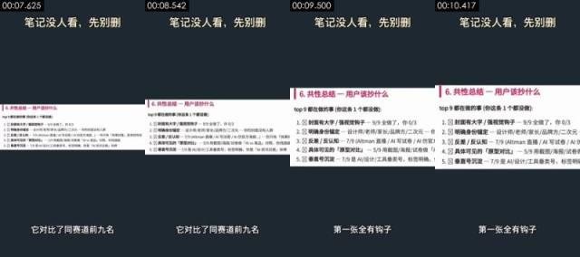

**画面で見えるもの**（スクリーンショットと照らし合わせて確認できる）
- 画面：ダークグレーのテンプレート上に、診断レポートのスクリーンショット：ピンクのタイトル「6. 共性总结 — 用户该抄什么」、黒字の「top 9 都在做的事（你这条 1 个都没做）」と 5 項目のリスト（表紙に大きな文字、明確な属性の打ち出し、ギャップ、比較素材、ジャンル特化アカウントの蓄積）。スクリーンショットは小さい状態からゆっくりプッシュインし、3 秒で約 3 分の 1 拡大する。
- テキストトラック（画面内テキスト/bottom）：它对比了同赛道前九名 / 第一张全有钩子 / 连改法都给了？
- テキストトラック（画面内テキスト/middle）：6.共性总结一用户该抄什么 / top9都在做的事（你这条1个都没做）：
- テキストトラック（画面内テキスト/middle）：1.封面有大字/强视觉钩子一9/9全做了，你0/3 / 2.明确身份锚定一设计师/老师/家长/品牌方/二次元一你的封面没有人群 / 3.反差/反认知一7/9（Altman直播/AI写试卷/Al仿官方海报)一你只有 / 3.反差/反认知一7/9（Altman直播/AI写试卷/Al仿官方海报..）一你
- テキストトラック（画面内テキスト/middle）：4.具体可见的「原型对比]一5/9用截图/海报/试卷做「AVS真品]对照，你纯插 / 5.垂直号沉淀一7/9是AI/设计/工具垂类号，标签明确，你是「AI资讯日报]杂 / 4.具体可见的「原型对比]一5/9用截图/海报/试卷做「Alvs真品]对照，你 / 5.垂直号沉淀一7/9是AI/设计/工具垂类号，标签明确，你是「AI资讯日报]
- [AI アシスタント 目視] 同じダークグレーのテンプレート
- [AI アシスタント 目視] 中央に白地の文書のスクリーンショット：ピンクの小見出し「6. 共性总结 — 用户该抄什么」と、チェックボックス付きの 5 項目のリスト
- [AI アシスタント 目視] スクリーンショット全体が一定の速度で拡大しながらわずかに上へ移動し、文字はシャープで歪まない

**ツールが推定した制作方法**（推定であり、目で見たものではない）
- 推定：コード/テンプレートレンダリング 72%、画面録画/スクリーンショット 13%、3D レンダリング 4%（fused_agent）
- 素材の出所：混合（実素材を含む）：画面録画素材、UI スクリーンショット
  - 画面録画素材：明るい UI パネル内に文字が 7 箇所（うち 7 箇所は小さい文字）
- 判断根拠（ツールによる測定。肉眼では分からないこともある）：
  - テクスチャはレンダリングの特徴を示す：平坦な色ブロック 75%、95% のピクセルがわずか 14 色、水平・垂直の直線エッジ 31%
  - 平坦な下地に細かい高周波のディテール（小さい文字/UI）が多く、スクリーンショットや文書画面のよう
  - フレームごとの鮮明度が周期的に上下する（周期 2 フレーム、相関 0.08）が、重複フレームはない：フレーム補間/フレームレート変換の可能性もあれば、再圧縮で残ったリズムにすぎない可能性もある（プラットフォームのマークを除去したトランスコードファイルでも同様になる）。この一点だけでは AI と断定できない

- 再現：コードレンダリング：Remotion/HTML でテキストトラックとレイアウトに沿って組み直す。100% 制御可能で、生成モデルは不要。ユーザーが実素材を用意する必要あり：画面録画素材（画面の一部 x0% y36% 幅100% 高さ27%）、UI スクリーンショット（画面の一部）

</details>

<details class="ref"><summary>#7 00:10.542–00:11.542 · AI 生成動画 + コード/編集オーバーレイ（字幕、タイトル）</summary>


**画面で見えるもの**（スクリーンショットと照らし合わせて確認できる）
- 画面：#2 と同じリビングのシーンと女性：画面右側を見て、うれしそうに口を開けて問いかけ、そのあと一度うつむいてスマホに目をやってから顔を上げる。固定カメラのミディアムショット。
- 撮り方/ライティング：クローズショット；やや俯瞰；三脚/スタンドで固定；夜景/低照度の環境光、専用の補助光なし；キーライトは正面（光はカメラ方向から来て、被写体の左右の明るさがほぼ同じ）；ライティング比 約 1.1:1（差 0.1 段）；ソフトライト（明暗の境目がほとんどない）
- テキストトラック（字幕/bottom）：连改法都给了？ / 三个新标题都写好了
- テキストトラック（字幕/middle）：P0一现在就改（5分钟内，决定生死） / 1.把第3张设成封面一编辑笔记→拖图重排序→第3张拉到第1位。预期CTR从估算2 / 8%，可能进二级池。
- テキストトラック（字幕/middle）：2.正文补提示词一至少给一段ChatGPTimage-2的prompt例子，兑现 / of British Industrial Revolution illustr / sepia tone..." / 3.改标题一套公式1（数字+人群+效果）重写：
- テキストトラック（字幕/middle）：o候选1：「3个提示词，设计师又要失业了|GPTimage-2实测 / o候选2：「我用GPTimage-2复刻了爆款桌游封面，附提示词] / o候选3:「GPTimage-2双曝光神技，设计师抄作业J
- [AI アシスタント 目視] 先頭フレームは #5 の先頭フレームとほぼ同じで、同じ先頭フレーム画像から生成
- [AI アシスタント 目視] 口の動きや頭の向きの変化は自然だが、肌と光がきれいすぎる
- [AI アシスタント 目視] スマホと指の縁にわずかな変形がある

**ツールが推定した制作方法**（推定であり、目で見たものではない）
- 推定：AI 生成動画 71%、デジタルヒューマン 14%、実写 5%（fused_agent）
- 素材の出所：AI 生成
- 判断根拠（ツールによる測定。肉眼では分からないこともある）：
  - 低照度の画面：38% の領域がほぼ真っ黒だが粒状感がある（単色の下地ではない）。明部の平坦ブロックは 1% のみで、人の顔がある：平坦ブロック/少色は暗部の圧縮によるもので、レンダリングの特徴とはみなさない
  - テクスチャは写真/動画の特徴を示す：ノイズ σ=0.33、使用色 114 色、平坦ブロック 11%
  - サンプリングしたフレームの 100% に正面の顔があり、カメラは固定、音声トラックに人の声がある

- 再現：元動画は AI 生成：元ショットの最初と最後のフレームを使って先頭・末尾フレーム指定で生成すれば、構図と動きをかなり忠実に再現できる。被写体を変える場合は、まず画像モデルで先頭フレームを修正する
  - 先頭フレーム画像プロンプト：クローズショット、やや俯瞰、縦型；人物は画面の左中央に座り、体は右前方を向く。右上にフロアランプと窓が見える余白を残す。#2 と同じ先頭フレーム：縦型 9:16、やや俯瞰のミディアムショット、夜のリビング。青緑の太縁メガネをかけ、淡い黄色のパーカーを着たショートヘアの女性がソファにあぐらをかいて座り、クッションを抱えてスマホを持ち、画面右側を見て口元に笑みを浮かべている。
  - 動画プロンプト：クローズショット、やや俯瞰、縦型；人物は画面の左中央に座り、体は右前方を向く。右上にフロアランプと窓が見える余白を残す。ミディアムショット、やや俯瞰のアングルで、女性は画面の左中央に座っている。画面右側を見ながら目を見開き、うれしそうに「连改法都给了？」と尋ね、言い終えるとうつむいてスマホをちらっと見てから顔を上げる。固定カメラ。

</details>

<details class="ref"><summary>#8 00:11.542–00:13.458 · コード/テンプレートレンダリング；実素材を使用（画面録画素材、UI スクリーンショット）</summary>

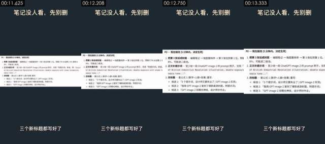

**画面で見えるもの**（スクリーンショットと照らし合わせて確認できる）
- 画面：ダークグレーのテンプレート上に、診断レポートのスクリーンショット：タイトル「P0 — 现在就改（5 分钟内，决定生死）」、3 つの改善策（3 枚目を表紙にする、本文にプロンプトを追加する、タイトルを変える）と 3 つの候補タイトル。スクリーンショットはゆっくりプッシュインし、候補タイトルの部分で止まる。
- テキストトラック（画面内テキスト/bottom）：三个新标题都写好了
- テキストトラック（画面内テキスト/middle）：P0一现在就改（5分钟内，决定生死） / 1.把第3张设成封面一编辑笔记→拖图重排序→第3张拉到第1位。预期CTR从估算2 / 8%，可能进二级池。 / 1.把第3张设成封面一编辑笔记→拖图重排序→第3张拉到第1位。预期
- テキストトラック（画面内テキスト/middle）：2.正文补提示词一至少给一段ChatGPTimage-2的prompt例子，兑现 / of British Industrial Revolution illustr / sepia tone..." / 2.正文补提示词一至少给一段ChatGPTimage-2的prompt例子，兑现
- テキストトラック（画面内テキスト/middle）：3.改标题一套公式1（数字+人群+效果）重写： / o候选1:「3个提示词，设计师又要失业了|GPTimage-2实测] / o候选2：「我用GPTimage-2复刻了爆款桌游封面，附提示词] / o候选1：「3个提示词，设计师又要失业了GPTimage-2实测]
- [AI アシスタント 目視] 同じダークグレーのテンプレート
- [AI アシスタント 目視] 中央に白地の文書のスクリーンショット：「P0 — 现在就改（5 分钟内，决定生死）」、その下に 3 つの改善策と 3 つの候補タイトル、等幅フォントの prompt 例を含む
- [AI アシスタント 目視] スクリーンショット全体がプッシュインしながらわずかに上へ移動し、文字はシャープで歪まない

**ツールが推定した制作方法**（推定であり、目で見たものではない）
- 推定：コード/テンプレートレンダリング 70%、画面録画/スクリーンショット 14%、3D レンダリング 4%（fused_agent）
- 素材の出所：混合（実素材を含む）：画面録画素材、UI スクリーンショット
  - 画面録画素材：明るい UI パネル内に文字が 10 箇所（うち 10 箇所は小さい文字）
- 判断根拠（ツールによる測定。肉眼では分からないこともある）：
  - テクスチャはレンダリングの特徴を示す：平坦な色ブロック 74%、95% のピクセルがわずか 12 色、水平・垂直の直線エッジ 28%
  - 平坦な下地に細かい高周波のディテール（小さい文字/UI）が多く、スクリーンショットや文書画面のよう
  - フレームごとの鮮明度が周期的に上下する（周期 5 フレーム、相関 0.11）が、重複フレームはない：フレーム補間/フレームレート変換の可能性もあれば、再圧縮で残ったリズムにすぎない可能性もある（プラットフォームのマークを除去したトランスコードファイルでも同様になる）。この一点だけでは AI と断定できない

- 再現：コードレンダリング：Remotion/HTML でテキストトラックとレイアウトに沿って組み直す。100% 制御可能で、生成モデルは不要。ユーザーが実素材を用意する必要あり：画面録画素材（画面の一部 x0% y36% 幅100% 高さ28%）、UI スクリーンショット（画面の一部）

</details>

<details class="ref"><summary>#9 00:13.458–00:16.125 · AI 生成動画 + コード/編集オーバーレイ（字幕、タイトル）</summary>

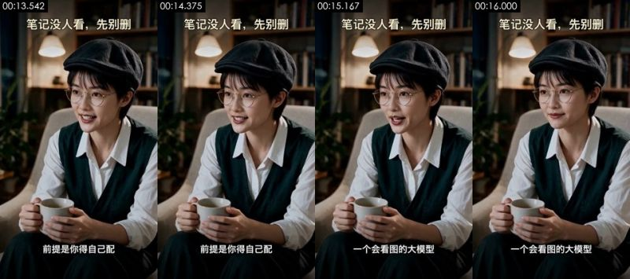

**画面で見えるもの**（スクリーンショットと照らし合わせて確認できる）
- 画面：#3 と同じ書斎のシーンとキャスケットの女性：画面左側を見て、微笑みながら話しつつうなずく。両手で持ったカップはほとんど動かない。固定カメラのミディアムショット。
- 撮り方/ライティング：クローズショット；アイレベル；三脚/スタンドで固定；夜景/低照度の環境光、専用の補助光なし；キーライトは画面左側のやや前方；ライティング比 約 1.8:1（差 0.9 段）；ハードライト（明暗の境目がはっきりしている）
- 画面内の物体に書かれた文字（後付けの字幕ではない）：口、.env.example、2weeks ago
- テキストトラック（字幕/bottom）：前提是你得自己配 / 一个会看图的大模型 / README.md / 2weeks ago
- テキストトラック（字幕/bottom）：口 / .env.example / 2weeks ago / .gitignore
- テキストトラック（字幕/bottom）：LICENSE / 5months ago
- テキストトラック（字幕/middle）：<>Code / Issues /  Pullrequests / Actions
- [AI アシスタント 目視] #3 と同じキャラクター・同じ構図で、先頭フレームの構図はほぼ一致
- [AI アシスタント 目視] 頭の向きの変化やうなずき、カップ上の指の小さな動きがあり、口だけが動くデジタルヒューマンではないが、体の動きはごくわずか
- [AI アシスタント 目視] 背景の本棚は色の塊にぼけ、肌の質感が滑らかすぎる

**ツールが推定した制作方法**（推定であり、目で見たものではない）
- 推定：AI 生成動画 78%、デジタルヒューマン 10%、実写 2%（fused_agent）
- 素材の出所：AI 生成
- 判断根拠（ツールによる測定。肉眼では分からないこともある）：
  - 低照度の画面：46% の領域がほぼ真っ黒だが粒状感がある（単色の下地ではない）。明部の平坦ブロックは 0% のみで、人の顔がある：平坦ブロック/少色は暗部の圧縮によるもので、レンダリングの特徴とはみなさない
  - OCR で小さい文字を 5 行検出：画面内に UI/文書のスクリーンショットがある
  - テクスチャは写真/動画の特徴を示す：ノイズ σ=0.35、使用色 96 色、平坦ブロック 8%
  - フレームごとの鮮明度が周期的に上下する（周期 4 フレーム、相関 0.61）が、重複フレームはない：フレーム補間/フレームレート変換の可能性もあれば、再圧縮で残ったリズムにすぎない可能性もある（プラットフォームのマークを除去したトランスコードファイルでも同様になる）。この一点だけでは AI と断定できない

- 再現：元動画は AI 生成：元ショットの最初と最後のフレームを使って先頭・末尾フレーム指定で生成すれば、構図と動きをかなり忠実に再現できる。被写体を変える場合は、まず画像モデルで先頭フレームを修正する
  - 先頭フレーム画像プロンプト：クローズショット、縦型；人物は中央やや左のアームチェアに座り、体は少し斜めを向く。背景に本棚とペンダントライト。#3 と同じ先頭フレーム：縦型 9:16、アイレベルのミディアムショット、夜の書斎。黒いキャスケットと細いメタルの丸メガネをかけ、白シャツに深緑のニットベストを重ねたショートヘアの女性がオフホワイトのアームチェアに座り、両手で白いマグカップを持って画面左側を見て微笑んでいる。
  - 動画プロンプト：クローズショット、縦型；人物は中央やや左のアームチェアに座り、体は少し斜めを向く。背景に本棚とペンダントライト。ミディアムショット、アイレベルで、女性は画面中央やや左のアームチェアに座っている。画面左側を見ながら、微笑んで落ち着いた口調で「前提是你得自己配一个会看图的大模型」と話し、話しながら軽くうなずく。両手でカップを持ち、最後は微笑んだまま止まる。固定カメラ。

</details>

<details class="ref"><summary>#10 00:16.125–00:19.042 · コード/テンプレートレンダリング；実素材を使用（UI スクリーンショット）</summary>

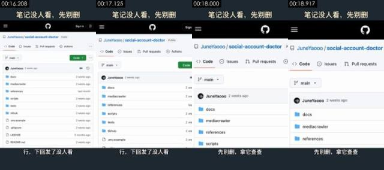

**画面で見えるもの**（スクリーンショットと照らし合わせて確認できる）
- 画面：ダークグレーのテンプレート上に、GitHub モバイル版のリポジトリページのスクリーンショット（リポジトリ JuneYaooo/social-account-doctor、Code ボタン、ブランチ main、ファイル一覧）。スクリーンショットは全幅の状態から継続的にプッシュインし、最後はリポジトリ名と最初のいくつかのフォルダで止まる。
- テキストトラック（画面内テキスト/bottom）：tikhub / 2weeksago / .env.example / tests
- テキストトラック（画面内テキスト/bottom）：口 / gitignore / 2weeksago / LICENSE
- テキストトラック（画面内テキスト/bottom）：行，下回发了没人看 / 先别删，拿它查查
- テキストトラック（画面内テキスト/middle）：JuneYaooo/social-account-doctor / Public / <>Code / Issues
- [AI アシスタント 目視] 同じダークグレーのテンプレートで、上部のタイトルは変わらない
- [AI アシスタント 目視] 中央に GitHub スマホ版 Web のリポジトリページのスクリーンショット（JuneYaooo / social-account-doctor、Code / Issues / Pull requests、ファイル一覧 docs、mediacrawler、references…）、UI 要素は本物
- [AI アシスタント 目視] スクリーンショットは 3 秒間拡大し続け、最後はリポジトリ名とファイル一覧が幅いっぱいになるまで拡大される。カーソルやスクロールはない

**ツールが推定した制作方法**（推定であり、目で見たものではない）
- 推定：コード/テンプレートレンダリング 65%、画面録画/スクリーンショット 22%、3D レンダリング 5%（fused_agent）
- 素材の出所：混合（実素材を含む）：UI スクリーンショット
  - UI スクリーンショット：明るい UI パネル内に文字が 30 箇所（うち 29 箇所は小さい文字）
- 判断根拠（ツールによる測定。肉眼では分からないこともある）：
  - テクスチャはレンダリングの特徴を示す：平坦な色ブロック 68%、95% のピクセルがわずか 14 色、水平・垂直の直線エッジ 51%
  - 平坦な下地に細かい高周波のディテール（小さい文字/UI）が多く、スクリーンショットや文書画面のよう
  - フレームごとの鮮明度が周期的に上下する（周期 5 フレーム、相関 0.14）が、重複フレームはない：フレーム補間/フレームレート変換の可能性もあれば、再圧縮で残ったリズムにすぎない可能性もある（プラットフォームのマークを除去したトランスコードファイルでも同様になる）。この一点だけでは AI と断定できない

- 再現：コードレンダリング：Remotion/HTML でテキストトラックとレイアウトに沿って組み直す。100% 制御可能で、生成モデルは不要。ユーザーが実素材を用意する必要あり：UI スクリーンショット（画面の一部 x0% y22% 幅100% 高さ69%）、UI スクリーンショット（画面の一部）

</details>

### メタデータの手がかり

- エンコーダー：`Lavf61.7.100`

### 注記

- 決定論的なフォレンジックは「動いているか、画像全体のプッシュイン/プルアウトか、レンダリングのテクスチャか、24→30 のフレームレート変換か」については信頼性が高い。一方、実写 / AI / 3D の区別は画像を見て判断する必要がある（画像認識モデルまたは AI アシスタントによる確認）。できれば自分でもスクリーンショットと照らし合わせて確認してほしい。
- メタデータはプラットフォームのトランスコードで消えることが多く、ないからといって元から存在しなかったとは限らない。
- 完全なデータは `breakdown.json` にある。モデルに読ませる分解パッケージは `VIDEO.md` から始まる。
