# 这条视频是怎么做的：qing_mv.mp4

**一句话**：AI 制作的历史说唱 MV：让曾国藩戴上耳机进录音棚，用第一人称把自己屡考屡败、屡战屡败、晚年背骂名的一生唱成「打脱牙和血吞」，靠古人进录音棚的反差和每句歌词都配上对应历史画面吸引人。
**怎么做的**：混合制作：AI 生成视频 53% + 数字人口播 32% + 静态图 + 推拉动效 13% + 代码/模板渲染 3%

- 2:44 · 竖屏 9:16 · 118 个镜头，平均 1.4 秒一个
- 判断可靠度 82%，依据：工具测量 + AI 助手看图复核 118 镜
- ⚠️ 有 2 处拿不准，见「不确定点」

<!--mix-->

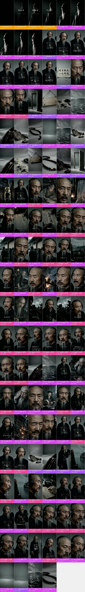

## 核心看点

- **开头怎么抓人**：0–7 秒黑底片名「和血吞」和「作词 Claude 作曲 Suno」压在逐渐亮起的老者剪影上；7–16 秒他在录音棚开口第一句就是「官至极品，一无所成」，再补一句「这话，我自己写的」，17 秒把这八个字写在宣纸上给观众看。
- 20–29 秒「上 Beat」之后连切 16 个每拍一换的静物空镜（木门、木牌、墨纸、黑水、空船、焦木、佛珠），不交代信息只卡鼓点，把气氛从念白切到说唱；同一组空镜在 85、116 秒和 152 秒片尾重复出现，成了整首歌的视觉韵脚。
- 29–135 秒每句歌词配一个对应的历史画面：「考了七回」配伏案的少年，「文理太浅」配写着这四个字的书页，「湘江水冷」配被部下从江里拉上船，「老乡砸了」配燃烧的牌匾；观众不用懂历史也能看懂唱的是什么。
- 66–85 秒副歌「打脱牙和血吞」全部回到录音棚，用 9 刀不同景别的说唱特写连着唱，叙事画面和录音棚表演一段一段交替，节奏清楚。
- 145 秒唱完「德行一无可许」后，他轻声说一句「这条，过了。」，像录音师确认一条录音，同时也像给自己的一生盖章，和开头「这话，我自己写的」首尾呼应。

## 一眼看懂：画面、包装、声音三层

短视频都可以拆成三层：底下是画面本身，上面叠字幕、花字、贴纸，再配上声音。复刻时一层一层做。

| 层 | 这条视频里是什么 | 怎么做 | 细节 |
|---|---|---|---|
| **画面**（底层） | AI 生成视频 60 镜、数字人口播 37 镜、静态图 + 推拉动效 17 镜、代码/模板渲染 4 镜 | AI 分 33 次生成，重复出现的片段从成片里剪；数字人口播；录屏 / 代码做动效；一张图做静帧或推拉 | 「自己复刻」 |
| **包装**（叠在画面上） | 图形贴片、文字、字幕 | 剪辑软件里加：字幕、花字、贴纸照时间轴摆 | 「剪辑包装层」 |
| **声音** | 人声（TTS 配音）、背景音乐（178 BPM、待确认） | 人声：TTS 配音；配乐：按节奏和情绪找同类曲 | 「声音」 |

## 内容与结构

- 下面的叙事线来自逐镜看图；台词没有单独整理，字幕原文见「剪辑包装层」

**叙事线**

复刻时保留这条线：每一步的顺序和作用照搬，讲的那一点换成自己的案例、数据和素材，就不只是换个主角。

| 时间 | 镜头 | 作用 | 在讲什么 |
|---|---|---|---|
| 0.0–4.9s | #1–#4 | 抓注意 | 黑底片名先亮出歌名和「AI 作词作曲」的身份 → 片名压在逐渐亮起的人物剪影上，先不给正脸制造悬念 |
| 4.9–7.2s | #5–#9 | 渲染情绪 | 用几刀极短的剪影特写卡鼓点，铺出沉郁气氛 |
| 7.2–13.0s | #10–#13 | 抓注意 | 主角开口先甩出一句对自己一生的否定，制造反差 |
| 13.0–15.8s | #14–#16 | 交代背景 | 补一句「这话我自己写的」，交代这是本人给自己下的评语 |
| 15.8–18.1s | #17 | 给证据 | 把刚说出口的评语写成纸上的字，让观众再看一遍 |
| 18.1–20.1s | #18–#20 | 转折 | 从念白切到沉默的大特写，给进入说唱留一拍 → 一句「上 Beat」从念白转进说唱 |
| 20.1–29.2s | #21–#36 | 渲染情绪 | 进主歌前用一串每拍一换的象征静物空镜卡鼓点 |
| 29.2–31.6s | #37 | 补信息 | 少年进考场，开讲科举经历 |
| 31.6–31.8s | #38 | 渲染情绪 | 一闪而过的全身位置镜头，提醒观众回到录音棚 |
| 31.8–36.7s | #39–#41 | 补信息 | 唱出屡考不中的数字 → 屡考屡败，用伏案苦读的画面配「考了七回」 → 父子同场、父亲上榜，加一层难堪 |
| 36.7–39.5s | #42 | 给证据 | 名字被挂出来示众，用红圈特写给证据 |
| 39.5–40.2s | #43 | 渲染情绪 | 扶耳机唱的动作，让人物更像真在录歌 |
| 40.2–42.9s | #44 | 给证据 | 把「文理太浅」四个字直接放进画面当证据 |
| 42.9–43.6s | #45 | 补信息 | 唱出丢脸丢到全城 |
| 43.6–44.8s | #46 | 给证据 | 再推近一次，让四个字压满画面 |
| 44.8–64.7s | #47–#63 | 补信息 | 说唱特写把情绪推近 → 放榜人群里挤着看名次，交代又考了三次 → 考进士又是三回 → 名次垫底，补完科举这一段 → 四十岁才学带兵，头一仗就败 →（共 12 点，逐镜见「分镜表」） |
| 64.7–65.4s | #64 | 渲染情绪 | 唱段之间的低头停顿 |
| 65.4–67.2s | #65 | 补信息 | 结硬寨、打呆仗，用挖壕的剪影把笨功夫画出来 |
| 67.2–85.5s | #66–#74 | 给结论 | 副歌点题：一路挨骂一路败，牙打掉了和血咽下 |
| 85.5–88.6s | #75–#77 | 渲染情绪 | 副歌后插回同一组静物空镜换气 → 一闪而过的全身位置镜头，提醒观众回到录音棚 |
| 88.6–93.3s | #78–#80 | 补信息 | 晚年右眼失明 → 转入晚年段 → 头晕不止，病痛缠身 |
| 93.3–94.0s | #81 | 渲染情绪 | 一个直视镜头的停顿，压住情绪 |
| 94.0–106.1s | #82–#86 | 转折 | 带病去天津办案，结果背上卖国贼的骂名 → 说唱特写衔接骂名段落 → 按耳机唱的动作，转入会馆砸匾 → 家乡人砸了他的匾，骂名落到实处 |
| 106.1–109.0s | #87–#89 | 渲染情绪 | 骂名段落用痛苦的大特写收住 → 副歌前回到录音棚中景，换一口气 |
| 109.0–115.7s | #90–#92 | 给结论 | 副歌再来一遍，把骂名也和血吞下 |
| 115.7–122.3s | #93–#95 | 渲染情绪 | 副歌后插回同一组静物空镜换气 → 空镜之后回到录音棚，引出洋务段 |
| 122.3–129.2s | #96–#100 | 补信息 | 洋务成果：看着中国自造的蒸汽船下水 → 唱出洋务的成绩 → 签下幼童出洋的折子 |
| 129.2–131.0s | #101、#102 | 渲染情绪 | 唱段间的沉默停顿 |
| 131.0–132.6s | #103、#104 | 转折 | 摊手的动作把遗憾唱出来 |
| 132.6–143.0s | #105–#109 | 给结论 | 临终自评：官做到顶，学业一无所成 |
| 143.0–144.0s | #110 | 渲染情绪 | 收尾前的停顿 |
| 144.0–152.0s | #111–#114 | 给结论 | 全身镜头把自评唱到最后一句 → 像录音师喊过一样说「这条过了」，把一生评语和录歌收在一起 → 最后一个直视镜头的沉默，把评价留给观众 |
| 152.0–165.0s | #115–#118 | 渲染情绪 | 片尾回到开头那组静物空镜收尾，首尾呼应 → 片尾用佛珠收住，落在一生自省的意味上 |

## 分镜表

「画面」「运镜」「叠加层」是画面里看得到的；「制作方式」「素材来源」是工具推断的，依据见附录逐镜取证。

| # | 截图 | 时间 | 时长 | 在讲什么 | 画面 | 运镜 | 叠加层 | 制作方式（推断） | 素材来源（推断） | 复刻 |
|---|---|---|---|---|---|---|---|---|---|---|
| 1 |  | 0:00.0 | 2.1s | 抓注意：黑底片名先亮出歌名和「AI 作词作曲」的身份 | 纯黑底片名卡：上方小字「大清有说唱」，中间大字「和血吞」，下方小字署名「作词 C… | 固定 | — | 代码/模板渲染 93% | 制作方渲染 | 代码渲染 · 段1 |
| 2 | 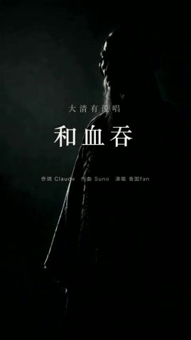 | 0:02.1 | 1.0s | 抓注意：片名压在逐渐亮起的人物剪影上，先不给正脸制造悬念 | 黑底侧逆光：一位长须老者的侧脸剪影从黑暗中慢慢浮现，只有额头、胡须和肩部被冷白轮… | 平滑运镜 | — | 代码/模板渲染 88% | 制作方渲染 | 代码渲染 · 段1 |
| 3 | 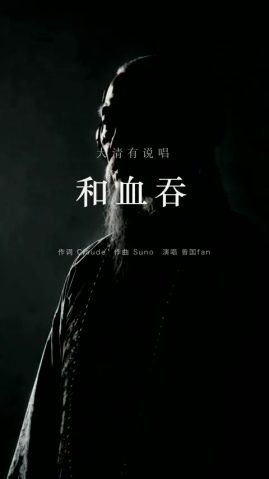 | 0:03.2 | 1.0s | 抓注意：片名压在逐渐亮起的人物剪影上，先不给正脸制造悬念 | 黑底侧逆光：一位长须老者的侧脸剪影从黑暗中慢慢浮现，只有额头、胡须和肩部被冷白轮… | 平滑运镜 | — | 代码/模板渲染 77% | 制作方渲染 | 代码渲染 · 段1 |
| 4 | 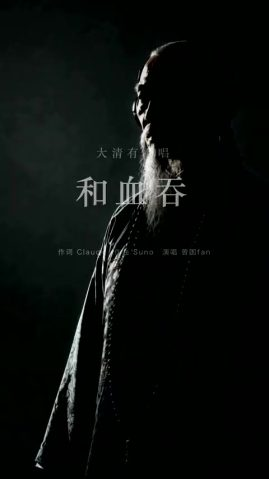 | 0:04.2 | 0.7s | 抓注意：片名压在逐渐亮起的人物剪影上，先不给正脸制造悬念 | 黑底侧逆光：一位长须老者的侧脸剪影从黑暗中慢慢浮现，只有额头、胡须和肩部被冷白轮… | 平滑运镜 | — | 代码/模板渲染 68% | 制作方渲染 | 代码渲染 · 段1 |
| 5 | 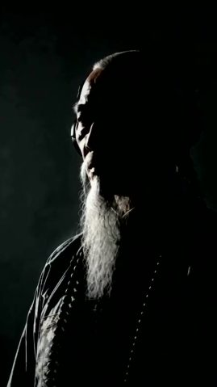 | 0:04.9 | 0.7s | 渲染情绪：用几刀极短的剪影特写卡鼓点，铺出沉郁气氛 | 黑底侧逆光老者侧脸特写：白色长须、额头被轮廓光照亮，老者微微张嘴、偏头；几刀不同… | 平滑运镜 | — | AI 生成视频 74% | AI 生成 | AI 生成 · G1 |
| 6 | 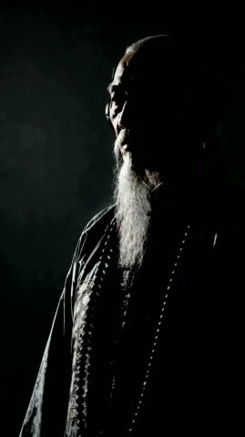 | 0:05.5 | 0.3s | 渲染情绪：用几刀极短的剪影特写卡鼓点，铺出沉郁气氛 | 黑底侧逆光老者侧脸特写：白色长须、额头被轮廓光照亮，老者微微张嘴、偏头；几刀不同… | 平滑运镜 | — | AI 生成视频 73% | AI 生成 | AI 生成 · G1 |
| 7 | 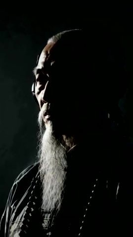 | 0:05.9 | 0.7s | 渲染情绪：用几刀极短的剪影特写卡鼓点，铺出沉郁气氛 | 黑底侧逆光老者侧脸特写：白色长须、额头被轮廓光照亮，老者微微张嘴、偏头；几刀不同… | 平滑运镜 | — | AI 生成视频 75% | AI 生成 | AI 生成 · G1 |
| 8 | 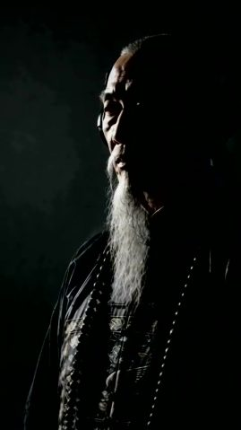 | 0:06.6 | 0.3s | 渲染情绪：用几刀极短的剪影特写卡鼓点，铺出沉郁气氛 | 黑底侧逆光老者侧脸特写：白色长须、额头被轮廓光照亮，老者微微张嘴、偏头；几刀不同… | 平滑运镜 | 图形贴片 | AI 生成视频 74% | AI 生成 | AI 生成 · G1 |
| 9 | 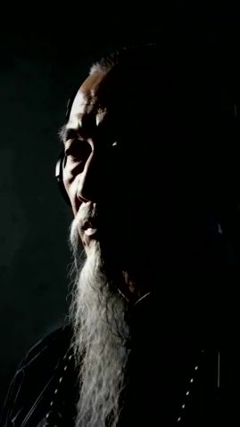 | 0:06.9 | 0.3s | 渲染情绪：用几刀极短的剪影特写卡鼓点，铺出沉郁气氛 | 黑底侧逆光老者侧脸特写：白色长须、额头被轮廓光照亮，老者微微张嘴、偏头；几刀不同… | 平滑运镜 | — | AI 生成视频 74% | AI 生成 | AI 生成 · G1 |
| 10 |  | 0:07.2 | 1.4s | 抓注意：主角开口先甩出一句对自己一生的否定，制造反差 | 录音棚中景：清代老者（曾国藩）：前额剃光、脑后长辫，花白长须垂到胸口，八字胡，黑… | 整图推拉/平移 | 文字、图形贴片 | 静态图 + 推拉动效 69% | AI 生成 | 本地 ffmpeg 推拉 |
| 11 | 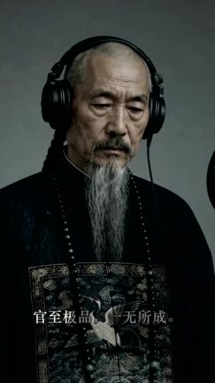 | 0:08.6 | 1.3s | 抓注意：主角开口先甩出一句对自己一生的否定，制造反差 | 录音棚中景：清代老者（曾国藩）：前额剃光、脑后长辫，花白长须垂到胸口，八字胡，黑… | 整图推拉/平移 | 文字 | AI 生成视频 79% | AI 生成 | AI 生成 · G2 |
| 12 | 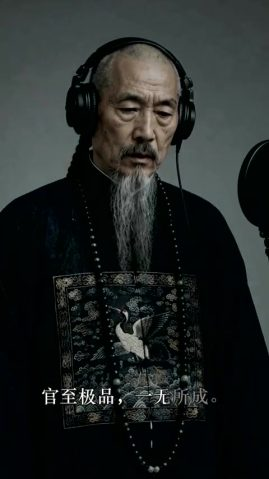 | 0:10.0 | 1.7s | 抓注意：主角开口先甩出一句对自己一生的否定，制造反差 | 录音棚中景：清代老者（曾国藩）：前额剃光、脑后长辫，花白长须垂到胸口，八字胡，黑… | 整图推拉/平移 | 文字、图形贴片 | AI 生成视频 79% | AI 生成 | AI 生成 · G2 |
| 13 | 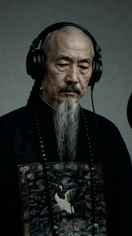 | 0:11.7 | 1.4s | 抓注意：主角开口先甩出一句对自己一生的否定，制造反差 | 录音棚中景：清代老者（曾国藩）：前额剃光、脑后长辫，花白长须垂到胸口，八字胡，黑… | 整图推拉/平移 | 图形贴片 | AI 生成视频 79% | AI 生成 | AI 生成 · G2 |
| 14 | 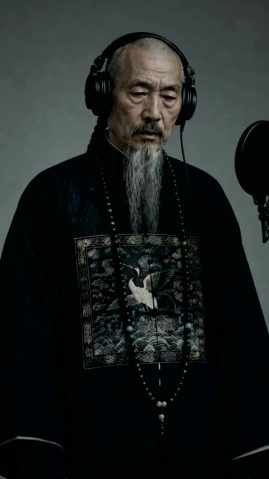 | 0:13.0 | 1.0s | 交代背景：补一句「这话我自己写的」，交代这是本人给自己下的评语 | 录音棚中景：清代老者（曾国藩）：前额剃光、脑后长辫，花白长须垂到胸口，八字胡，黑… | 平滑运镜 | 文字 | AI 生成视频 77% | AI 生成 | AI 生成 · G2 |
| 15 | 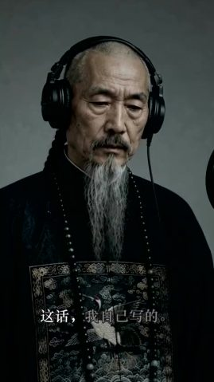 | 0:14.0 | 0.7s | 交代背景：补一句「这话我自己写的」，交代这是本人给自己下的评语 | 录音棚中景：清代老者（曾国藩）：前额剃光、脑后长辫，花白长须垂到胸口，八字胡，黑… | 整图推拉/平移 | 文字 | AI 生成视频 79% | AI 生成 | AI 生成 · G2 |
| 16 | 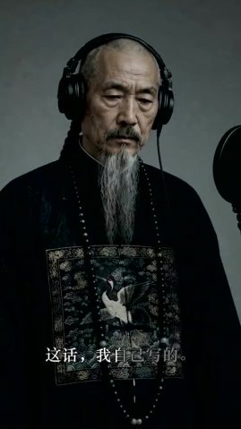 | 0:14.7 | 1.0s | 交代背景：补一句「这话我自己写的」，交代这是本人给自己下的评语 | 录音棚中景：清代老者（曾国藩）：前额剃光、脑后长辫，花白长须垂到胸口，八字胡，黑… | 整图推拉/平移 | 文字、图形贴片 | AI 生成视频 77% | AI 生成 | AI 生成 · G2 |
| 17 |  | 0:15.8 | 2.3s | 给证据：把刚说出口的评语写成纸上的字，让观众再看一遍 | 灰色台面上一张毛边宣纸，上面毛笔大字「官至极品 一无所成」，画面缓慢推近；底部是… | 整图推拉/平移 | 文字 | 静态图 + 推拉动效 77% | AI 生成 | 本地 ffmpeg 推拉 |
| 18 | 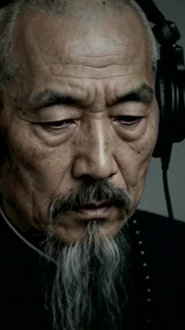 | 0:18.1 | 0.7s | 转折：从念白切到沉默的大特写，给进入说唱留一拍 | 录音棚大特写：老者低头垂眼，戴着监听耳机，面部皱纹和老年斑清晰，冷灰背景。 | 手持晃动 | — | AI 生成视频 86% | AI 生成 | AI 生成 · G2 |
| 19 | 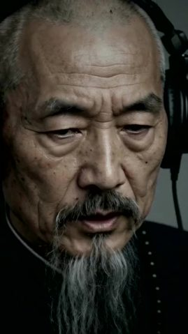 | 0:18.8 | 0.7s | 转折：一句「上 Beat」从念白转进说唱 | 录音棚特写：老者从低头到抬头直视镜头，开口说「上Beat。」 | 平滑运镜 | — | 数字人口播 85% | AI 生成 | TTS + 数字人 |
| 20 | 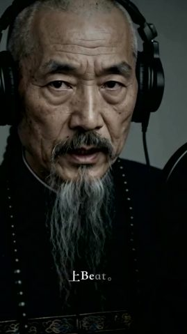 | 0:19.5 | 0.7s | 转折：一句「上 Beat」从念白转进说唱 | 录音棚特写：老者从低头到抬头直视镜头，开口说「上Beat。」 | 平滑运镜 | 文字、图形贴片 | 数字人口播 85% | AI 生成 | TTS + 数字人 |
| 21 | 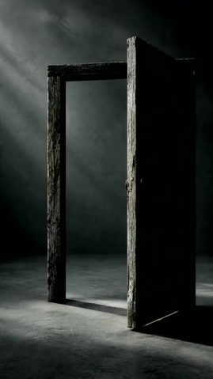 | 0:20.1 | 0.7s | 渲染情绪：进主歌前用一串每拍一换的象征静物空镜卡鼓点 | 空旷灰色空间里立着一扇半开的旧木门，左上方斜射进来一束冷光，画面缓慢推近。 | 整图推拉/平移 | — | 静态图 + 推拉动效 78% | AI 生成 | 本地 ffmpeg 推拉 |
| 22 |  | 0:20.8 | 0.7s | 渲染情绪：进主歌前用一串每拍一换的象征静物空镜卡鼓点 | 灰墙上用麻绳挂着一块空白的做旧木牌，左上方有斜光，画面缓慢推近。 | 整图推拉/平移 | — | 静态图 + 推拉动效 77% | AI 生成 | 本地 ffmpeg 推拉 |
| 23 | 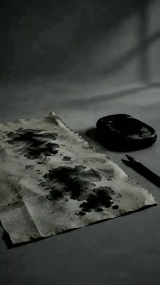 | 0:21.5 | 0.7s | 渲染情绪：进主歌前用一串每拍一换的象征静物空镜卡鼓点 | 灰色桌面上铺着一张满是墨迹的皱宣纸，旁边一方黑砚台和毛笔，背景墙上有窗格投影，镜… | 平滑运镜 | — | AI 生成视频 82% | AI 生成 | AI 生成 · G3 |
| 24 |  | 0:22.2 | 0.7s | 渲染情绪：进主歌前用一串每拍一换的象征静物空镜卡鼓点 | 黑白调的暗色水面特写，细密波纹持续荡漾，远处一道弧形水平线，上方阴沉的天空投下斜… | 平滑运镜 | 图形贴片 | AI 生成视频 77% | AI 生成 | AI 生成 · G33（剪自 #117） |
| 25 |  | 0:22.9 | 0.7s | 渲染情绪：进主歌前用一串每拍一换的象征静物空镜卡鼓点 | 一艘黑色旧木船的船舷弧线斜切画面，舱内横放两支木桨和一捆麻绳，背景是灰色雾气和斜… | 整图推拉/平移 | — | 静态图 + 推拉动效 76% | AI 生成 | 本地 ffmpeg 推拉 |
| 26 | 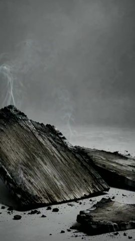 | 0:23.5 | 0.7s | 渲染情绪：进主歌前用一串每拍一换的象征静物空镜卡鼓点 | 灰色台面上几块烧焦碳化的木板残片，上方升起几缕白烟，背景灰雾。 | 整图推拉/平移 | — | 静态图 + 推拉动效 83% | AI 生成 | 本地 ffmpeg 推拉 |
| 27 | 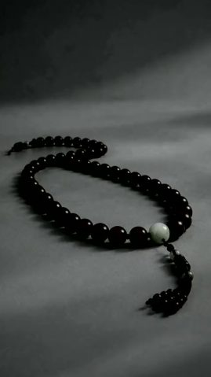 | 0:24.2 | 0.7s | 渲染情绪：进主歌前用一串每拍一换的象征静物空镜卡鼓点 | 灰色台面上一串黑色佛珠盘成一圈，带一颗浅色主珠和流苏，画面缓慢推近。 | 整图推拉/平移 | — | 静态图 + 推拉动效 76% | AI 生成 | 本地 ffmpeg 推拉 |
| 28 | 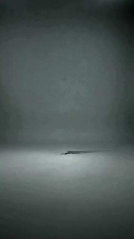 | 0:24.9 | 0.7s | 渲染情绪：进主歌前用一串每拍一换的象征静物空镜卡鼓点 | 空旷的灰色雾气空间，远处地平线上一叶细小的黑色木船（或木板）带着长长的投影缓慢从… | — | — | AI 生成视频 70% | AI 生成 | AI 生成 · G33（剪自 #115） |
| 29 |  | 0:25.6 | 0.7s | 渲染情绪：进主歌前用一串每拍一换的象征静物空镜卡鼓点 | 黑白调的暗色水面特写，细密波纹持续荡漾，远处一道弧形水平线，上方阴沉的天空投下斜… | 平滑运镜 | 图形贴片 | AI 生成视频 78% | AI 生成 | AI 生成 · G33（剪自 #117） |
| 30 |  | 0:26.2 | 0.7s | 渲染情绪：进主歌前用一串每拍一换的象征静物空镜卡鼓点 | 灰色台面上几块烧焦碳化的木板残片，上方升起几缕白烟，背景灰雾。 | 整图推拉/平移 | — | 静态图 + 推拉动效 85% | AI 生成 | 本地 ffmpeg 推拉 |
| 31 |  | 0:26.9 | 0.7s | 渲染情绪：进主歌前用一串每拍一换的象征静物空镜卡鼓点 | 一艘黑色旧木船的船舷弧线斜切画面，舱内横放两支木桨和一捆麻绳，背景是灰色雾气和斜… | 平滑运镜 | 图形贴片 | AI 生成视频 76% | AI 生成 | AI 生成 · G19（剪自 #75） |
| 32 | 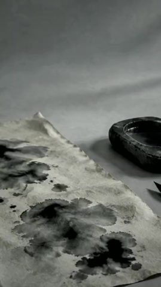 | 0:27.6 | 0.3s | 渲染情绪：进主歌前用一串每拍一换的象征静物空镜卡鼓点 | 灰色桌面上铺着一张满是墨迹的皱宣纸，旁边一方黑砚台和毛笔，背景墙上有窗格投影，镜… | 整图推拉/平移 | — | 静态图 + 推拉动效 77% | AI 生成 | 本地 ffmpeg 推拉 |
| 33 |  | 0:28.0 | 0.3s | 渲染情绪：进主歌前用一串每拍一换的象征静物空镜卡鼓点 | 灰墙上用麻绳挂着一块空白的做旧木牌，左上方有斜光，画面缓慢推近。 | 整图推拉/平移 | — | 静态图 + 推拉动效 78% | AI 生成 | 本地 ffmpeg 推拉 |
| 34 |  | 0:28.3 | 0.3s | 渲染情绪：进主歌前用一串每拍一换的象征静物空镜卡鼓点 | 灰色台面上一串深色佛珠蜿蜒成 S 形，镜头贴着珠串缓慢移动，经过一颗带金色裂纹的… | 平滑运镜 | — | AI 生成视频 78% | AI 生成 | AI 生成 · G3 |
| 35 | 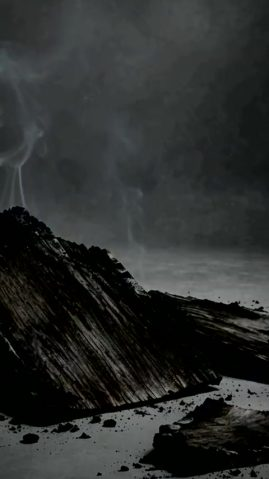 | 0:28.6 | 0.4s | 渲染情绪：进主歌前用一串每拍一换的象征静物空镜卡鼓点 | 灰色台面上几块烧焦碳化的木板残片，上方升起几缕白烟，背景灰雾。 | 整图推拉/平移 | — | 静态图 + 推拉动效 84% | AI 生成 | 本地 ffmpeg 推拉 |
| 36 | 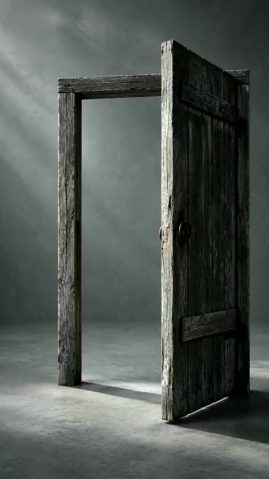 | 0:29.0 | 0.2s | 渲染情绪：进主歌前用一串每拍一换的象征静物空镜卡鼓点 | 空旷灰色空间里立着一扇半开的旧木门，左上方斜射进来一束冷光，画面缓慢推近。 | 整图推拉/平移 | — | 静态图 + 推拉动效 78% | AI 生成 | 本地 ffmpeg 推拉 |
| 37 | 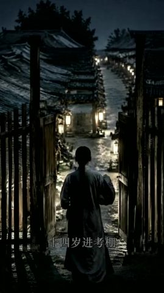 | 0:29.2 | 2.4s | 补信息：少年进考场，开讲科举经历 | 夜色中一个梳长辫、穿灰长衫的少年背对镜头，穿过木栅门走进两旁挂着灯笼的考棚长巷，… | 平滑运镜 | 字幕 | AI 生成视频 82% | AI 生成 | AI 生成 · G4 |
| 38 | 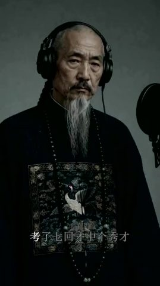 | 0:31.6 | 0.1s | 渲染情绪：一闪而过的全身位置镜头，提醒观众回到录音棚 | 录音棚中景：老者站在麦克风前，胸前仙鹤补子，短暂停在画面上。 | 平滑运镜 | 文字 | AI 生成视频 84% | AI 生成 | AI 生成 · G5 |
| 39 | 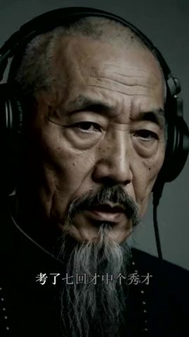 | 0:31.8 | 0.4s | 补信息：唱出屡考不中的数字 | 录音棚特写：老者戴耳机对麦克风说唱「考了七回才中个秀才」。 | 平滑运镜 | 文字 | 数字人口播 83% | AI 生成 | TTS + 数字人 |
| 40 | 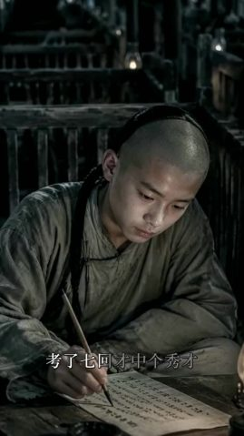 | 0:32.2 | 2.5s | 补信息：屡考屡败，用伏案苦读的画面配「考了七回」 | 昏暗考棚里，剃了前额的少年伏案用毛笔写字，背后是一排排木格号舍和油灯，镜头缓慢推… | 平滑运镜 | 文字 | AI 生成视频 88% | AI 生成 | AI 生成 · G6 |
| 41 | 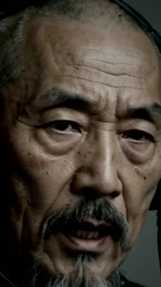 | 0:34.6 | 2.0s | 补信息：父子同场、父亲上榜，加一层难堪 | 录音棚大特写：老者脸部占满画面，对口型唱「同一场我爹上了榜」。 | 平滑运镜 | 字幕 | 数字人口播 85% | AI 生成 | TTS + 数字人 |
| 42 | 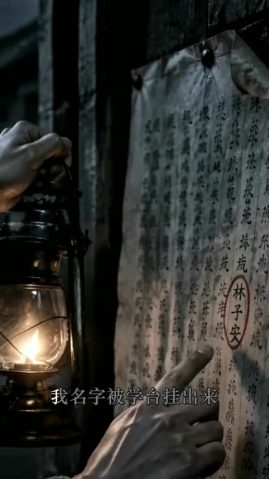 | 0:36.7 | 2.9s | 给证据：名字被挂出来示众，用红圈特写给证据 | 夜里一只手提着油灯，另一只手的手指点在墙上贴着的榜文上，榜上一个名字被红圈圈出，… | 平滑运镜 | 字幕 | AI 生成视频 81% | AI 生成 | AI 生成 · G7 |
| 43 | 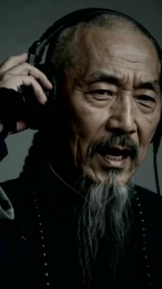 | 0:39.5 | 0.7s | 渲染情绪：扶耳机唱的动作，让人物更像真在录歌 | 录音棚特写：老者一手扶着耳机，边听边开口唱。 | 平滑运镜 | — | AI 生成视频 83% | AI 生成 | AI 生成 · G8 |
| 44 | 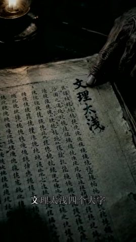 | 0:40.2 | 2.6s | 给证据：把「文理太浅」四个字直接放进画面当证据 | 昏暗油灯下，一只苍老的手指按在摊开的旧书页上，页面上写着四个大字「文理太浅」，旁… | 平滑运镜 | 字幕 | AI 生成视频 74% | AI 生成 | AI 生成 · G9 |
| 45 | 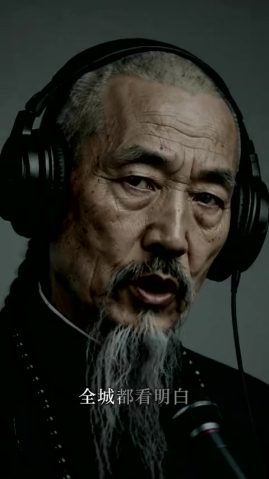 | 0:42.9 | 0.7s | 补信息：唱出丢脸丢到全城 | 录音棚特写：老者唱「全城都看明白」，表情苦涩。 | 平滑运镜 | 文字 | 数字人口播 84% | AI 生成 | TTS + 数字人 |
| 46 | 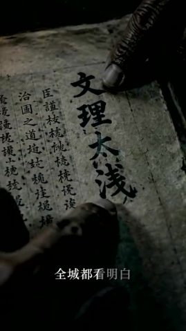 | 0:43.6 | 1.2s | 给证据：再推近一次，让四个字压满画面 | 同一页旧书的更近特写，「文理太浅」四个大字占据画面，手指在下方移动。 | 平滑运镜 | 文字 | AI 生成视频 76% | AI 生成 | AI 生成 · G10 |
| 47 | 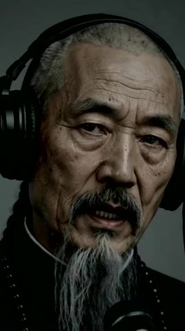 | 0:44.8 | 0.6s | 补信息：说唱特写把情绪推近 | 录音棚大特写：老者面部占满画面，边唱边皱眉。 | 平滑运镜 | — | 数字人口播 86% | AI 生成 | TTS + 数字人 |
| 48 | 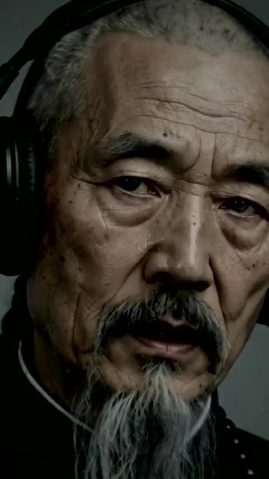 | 0:45.4 | 0.2s | 补信息：说唱特写把情绪推近 | 录音棚大特写：老者面部占满画面，边唱边皱眉。 | 平滑运镜 | 文字 | 数字人口播 85% | AI 生成 | TTS + 数字人 |
| 49 | 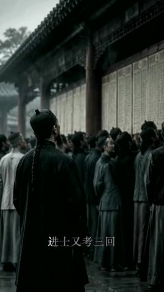 | 0:45.7 | 1.3s | 补信息：放榜人群里挤着看名次，交代又考了三次 | 阴天贡院墙下，挤满了穿长袍的读书人仰头看榜，前景一个戴瓜皮帽、梳长辫的人背对镜头… | 平滑运镜 | 文字 | AI 生成视频 78% | AI 生成 | AI 生成 · G11 |
| 50 | 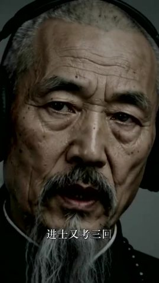 | 0:47.0 | 0.6s | 补信息：考进士又是三回 | 录音棚大特写：老者唱「进士又考三回」。 | 平滑运镜 | 文字 | 数字人口播 85% | AI 生成 | TTS + 数字人 |
| 51 | 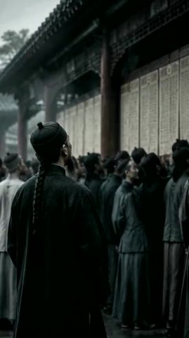 | 0:47.6 | 0.6s | 补信息：放榜人群里挤着看名次，交代又考了三次 | 阴天贡院墙下，挤满了穿长袍的读书人仰头看榜，前景一个戴瓜皮帽、梳长辫的人背对镜头… | 平滑运镜 | — | AI 生成视频 77% | AI 生成 | AI 生成 · G12 |
| 52 | 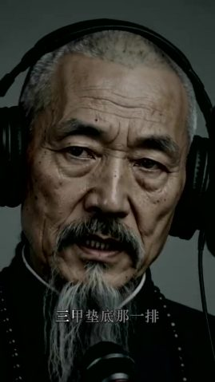 | 0:48.2 | 0.6s | 补信息：名次垫底，补完科举这一段 | 录音棚特写：老者对着前景麦克风唱「三甲垫底那一排」。 | 平滑运镜 | 文字 | 数字人口播 83% | AI 生成 | TTS + 数字人 |
| 53 | 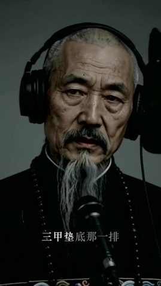 | 0:48.8 | 1.6s | 补信息：名次垫底，补完科举这一段 | 录音棚特写：老者对着前景麦克风唱「三甲垫底那一排」。 | 平滑运镜 | 文字 | 数字人口播 86% | AI 生成 | TTS + 数字人 |
| 54 | 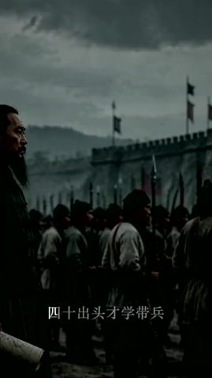 | 0:50.4 | 3.1s | 补信息：四十岁才学带兵，头一仗就败 | 阴云下的城墙外，左侧前景一位蓄须将领手持卷轴侧身肃立，背景大批持长矛的清军列队行… | 平滑运镜 | 字幕、文字 | AI 生成视频 78% | AI 生成 | AI 生成 · G13 |
| 55 | 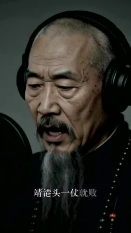 | 0:53.5 | 0.8s | 补信息：带兵首战即败 | 录音棚特写：老者侧脸对麦克风唱「靖港头一仗就败」。 | 平滑运镜 | 文字、图形贴片 | 数字人口播 84% | AI 生成 | TTS + 数字人 |
| 56 |  | 0:54.2 | 2.0s | 补信息：落水被部下捞起，配「湘江水冷」 | 夜间江上木船，浑身湿透的白须老者双手撑在船板上，被身后的部下从江水里拉上船，船头… | 平滑运镜 | 文字 | AI 生成视频 86% | AI 生成 | AI 生成 · G14 |
| 57 | 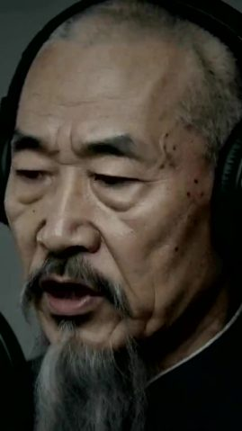 | 0:56.2 | 0.7s | 补信息：说唱特写衔接下一段战败 | 录音棚大特写：老者侧脸低头唱，表情沉重。 | 平滑运镜 | 文字 | 数字人口播 82% | AI 生成 | TTS + 数字人 |
| 58 |  | 0:56.9 | 1.5s | 补信息：湖口再败、座船被截，用火光战船表现 | 夜晚水战，燃烧的战船上士兵持刀剪影激烈交战，背景火光和浓烟，旗帜飘动。 | 平滑运镜 | 字幕 | AI 生成视频 84% | AI 生成 | AI 生成 · G15 |
| 59 | 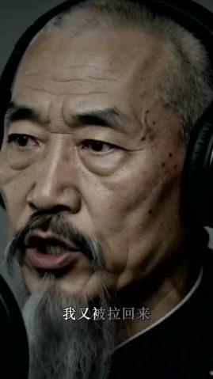 | 0:58.4 | 0.5s | 补信息：又一次死里逃生 | 录音棚大特写：老者张大嘴唱「我又被拉回来」，情绪激动。 | 平滑运镜 | 文字 | 数字人口播 82% | AI 生成 | TTS + 数字人 |
| 60 | 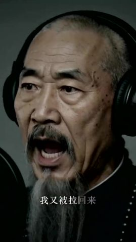 | 0:58.9 | 0.6s | 补信息：又一次死里逃生 | 录音棚大特写：老者张大嘴唱「我又被拉回来」，情绪激动。 | 平滑运镜 | 文字、图形贴片 | 数字人口播 83% | AI 生成 | TTS + 数字人 |
| 61 | 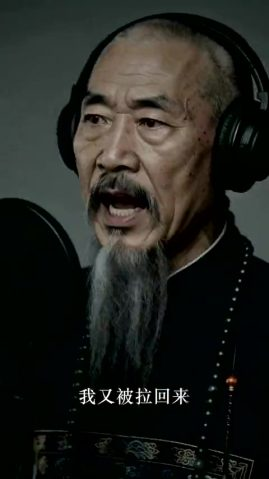 | 0:59.5 | 0.1s | 补信息：又一次死里逃生 | 录音棚大特写：老者张大嘴唱「我又被拉回来」，情绪激动。 | 平滑运镜 | 文字 | 数字人口播 84% | AI 生成 | TTS + 数字人 |
| 62 | 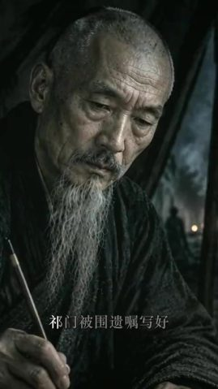 | 0:59.6 | 2.9s | 补信息：祁门被围先写好遗嘱 | 昏暗营帐里，白须老者低头执笔写字，背后帐门外是夜色中的营火，镜头缓慢推近。 | 平滑运镜 | 字幕 | AI 生成视频 89% | AI 生成 | AI 生成 · G16 |
| 63 |  | 1:02.5 | 2.1s | 补信息：结硬寨、打呆仗，用挖壕的剪影把笨功夫画出来 | 乌云翻滚的天空下，一群士兵剪影挥锹抡锤挖壕筑寨，背景有木制瞭望塔，低机位。 | 平滑运镜 | 字幕 | AI 生成视频 77% | AI 生成 | AI 生成 · G16 |
| 64 |  | 1:04.7 | 0.7s | 渲染情绪：唱段之间的低头停顿 | 录音棚中景：老者低头站在麦克风后沉默，没有开口。 | 平滑运镜 | 图形贴片 | AI 生成视频 84% | AI 生成 | AI 生成 · G17 |
| 65 |  | 1:05.4 | 1.8s | 补信息：结硬寨、打呆仗，用挖壕的剪影把笨功夫画出来 | 乌云翻滚的天空下，一群士兵剪影挥锹抡锤挖壕筑寨，背景有木制瞭望塔，低机位。 | 平滑运镜 | 文字 | AI 生成视频 77% | AI 生成 | AI 生成 · G18 |
| 66 |  | 1:07.2 | 2.8s | 给结论：副歌点题：一路挨骂一路败，牙打掉了和血咽下 | 录音棚特写：老者戴耳机对着麦克风唱副歌「打脱牙和血吞」「京城骂完长沙骂」「长沙骂… | 平滑运镜 | 字幕 | 数字人口播 86% | AI 生成 | TTS + 数字人 |
| 67 |  | 1:10.0 | 0.5s | 给结论：副歌点题：一路挨骂一路败，牙打掉了和血咽下 | 录音棚特写：老者戴耳机对着麦克风唱副歌「打脱牙和血吞」「京城骂完长沙骂」「长沙骂… | 平滑运镜 | 文字、图形贴片 | 数字人口播 85% | AI 生成 | TTS + 数字人 |
| 68 |  | 1:10.5 | 1.2s | 给结论：副歌点题：一路挨骂一路败，牙打掉了和血咽下 | 录音棚特写：老者戴耳机对着麦克风唱副歌「打脱牙和血吞」「京城骂完长沙骂」「长沙骂… | 平滑运镜 | 文字、图形贴片 | 数字人口播 84% | AI 生成 | TTS + 数字人 |
| 69 |  | 1:11.8 | 2.8s | 给结论：副歌点题：一路挨骂一路败，牙打掉了和血咽下 | 录音棚特写：老者戴耳机对着麦克风唱副歌「打脱牙和血吞」「京城骂完长沙骂」「长沙骂… | 固定（主体在动） | 字幕、图形贴片 | 数字人口播 87% | AI 生成 | TTS + 数字人 |
| 70 |  | 1:14.6 | 1.4s | 给结论：副歌点题：一路挨骂一路败，牙打掉了和血咽下 | 录音棚特写：老者戴耳机对着麦克风唱副歌「打脱牙和血吞」「京城骂完长沙骂」「长沙骂… | 平滑运镜 | 字幕、图形贴片 | 数字人口播 85% | AI 生成 | TTS + 数字人 |
| 71 |  | 1:16.0 | 1.3s | 给结论：副歌点题：一路挨骂一路败，牙打掉了和血咽下 | 录音棚特写：老者戴耳机对着麦克风唱副歌「打脱牙和血吞」「京城骂完长沙骂」「长沙骂… | 平滑运镜 | 文字 | 数字人口播 84% | AI 生成 | TTS + 数字人 |
| 72 |  | 1:17.3 | 2.9s | 给结论：副歌点题：一路挨骂一路败，牙打掉了和血咽下 | 录音棚特写：老者戴耳机对着麦克风唱副歌「打脱牙和血吞」「京城骂完长沙骂」「长沙骂… | 平滑运镜 | 字幕、文字、图形贴片 | 数字人口播 86% | AI 生成 | TTS + 数字人 |
| 73 |  | 1:20.2 | 1.0s | 给结论：副歌点题：一路挨骂一路败，牙打掉了和血咽下 | 录音棚特写：老者戴耳机对着麦克风唱副歌「打脱牙和血吞」「京城骂完长沙骂」「长沙骂… | 平滑运镜 | — | 数字人口播 84% | AI 生成 | TTS + 数字人 |
| 74 |  | 1:21.2 | 4.2s | 给结论：副歌点题：一路挨骂一路败，牙打掉了和血咽下 | 录音棚特写：老者戴耳机对着麦克风唱副歌「打脱牙和血吞」「京城骂完长沙骂」「长沙骂… | 平滑运镜 | 字幕 | 数字人口播 85% | AI 生成 | TTS + 数字人 |
| 75 |  | 1:25.5 | 1.7s | 渲染情绪：副歌后插回同一组静物空镜换气 | 一艘黑色旧木船的船舷弧线斜切画面，舱内横放两支木桨和一捆麻绳，背景是灰色雾气和斜… | 平滑运镜 | — | AI 生成视频 77% | AI 生成 | AI 生成 · G19 |
| 76 |  | 1:27.1 | 1.2s | 渲染情绪：副歌后插回同一组静物空镜换气 | 黑白调的暗色水面特写，细密波纹持续荡漾，远处一道弧形水平线，上方阴沉的天空投下斜… | 平滑运镜 | 图形贴片 | AI 生成视频 80% | AI 生成 | AI 生成 · G33（剪自 #117） |
| 77 |  | 1:28.3 | 0.2s | 渲染情绪：一闪而过的全身位置镜头，提醒观众回到录音棚 | 录音棚中景：老者站在麦克风前，胸前仙鹤补子，短暂停在画面上。 | 固定 | — | AI 生成视频 71% | AI 生成 | AI 生成 · G20 |
| 78 |  | 1:28.6 | 2.2s | 补信息：晚年右眼失明 | 昏暗室内，穿官服的白须老者用右手捂住右眼，神情疲惫苍老，镜头缓慢推近。 | 平滑运镜 | 文字 | AI 生成视频 80% | AI 生成 | AI 生成 · G21 |
| 79 |  | 1:30.8 | 0.7s | 补信息：转入晚年段 | 录音棚特写：老者正面直视镜头开口唱，表情沉重。 | 平滑运镜 | — | 数字人口播 84% | AI 生成 | TTS + 数字人 |
| 80 |  | 1:31.4 | 1.9s | 补信息：头晕不止，病痛缠身 | 白须老者闭眼按揉太阳穴和眼睛，神情眩晕痛苦，镜头缓慢推近。 | 平滑运镜 | 文字 | AI 生成视频 80% | AI 生成 | AI 生成 · G22 |
| 81 |  | 1:33.3 | 0.7s | 渲染情绪：一个直视镜头的停顿，压住情绪 | 老者面部大特写，不戴耳机的写实肖像，眼神沉重地直视镜头，镜头缓慢推近。 | 平滑运镜 | — | AI 生成视频 84% | AI 生成 | AI 生成 · G23 |
| 82 |  | 1:34.0 | 5.2s | 转折：带病去天津办案，结果背上卖国贼的骂名 | 清代谈判长桌前，戴官帽、穿一品官服的白须官员沉重凝视前方，前景是几位西洋人的背影… | 平滑运镜 | 字幕 | AI 生成视频 88% | AI 生成 | AI 生成 · G24 |
| 83 |  | 1:39.2 | 1.1s | 转折：说唱特写衔接骂名段落 | 录音棚特写：老者正面对口型唱，眉头紧锁。 | 平滑运镜 | — | 数字人口播 86% | AI 生成 | TTS + 数字人 |
| 84 |  | 1:40.3 | 1.0s | 转折：按耳机唱的动作，转入会馆砸匾 | 录音棚中景：老者一手按着耳机侧头听，边唱「湖广会馆挂我的匾」。 | 平滑运镜 | 文字、图形贴片 | AI 生成视频 84% | AI 生成 | AI 生成 · G25 |
| 85 |  | 1:41.3 | 1.8s | 转折：按耳机唱的动作，转入会馆砸匾 | 录音棚中景：老者一手按着耳机侧头听，边唱「湖广会馆挂我的匾」。 | 平滑运镜 | 文字、图形贴片 | AI 生成视频 84% | AI 生成 | AI 生成 · G25 |
| 86 |  | 1:43.1 | 3.0s | 转折：家乡人砸了他的匾，骂名落到实处 | 夜里会馆门前，乡民举着火把把写着金字的牌匾砸落在地，牌匾燃起大火。 | 平滑运镜 | 字幕 | AI 生成视频 82% | AI 生成 | AI 生成 · G26 |
| 87 |  | 1:46.1 | 1.3s | 渲染情绪：骂名段落用痛苦的大特写收住 | 录音棚大特写：老者眯眼皱眉，表情痛苦，一只手按在耳机上，唱「外惭清议」。 | 平滑运镜 | 文字 | AI 生成视频 86% | AI 生成 | AI 生成 · G27 |
| 88 |  | 1:47.4 | 0.5s | 渲染情绪：骂名段落用痛苦的大特写收住 | 录音棚大特写：老者眯眼皱眉，表情痛苦，一只手按在耳机上，唱「外惭清议」。 | 平滑运镜 | 图形贴片 | AI 生成视频 81% | AI 生成 | AI 生成 · G27 |
| 89 |  | 1:47.9 | 1.1s | 渲染情绪：副歌前回到录音棚中景，换一口气 | 录音棚中景：老者站在麦克风前，胸前仙鹤补子，短暂停在画面上。 | 平滑运镜 | — | AI 生成视频 76% | AI 生成 | AI 生成 · G27 |
| 90 |  | 1:49.0 | 2.6s | 给结论：副歌再来一遍，把骂名也和血吞下 | 录音棚中景：老者胸前仙鹤补子，对麦克风唱「内疚神明」「打脱牙和血吞」，最后低头。 | 固定 | 字幕、图形贴片 | 数字人口播 87% | AI 生成 | TTS + 数字人 |
| 91 |  | 1:51.7 | 1.3s | 给结论：副歌再来一遍，把骂名也和血吞下 | 录音棚中景：老者胸前仙鹤补子，对麦克风唱「内疚神明」「打脱牙和血吞」，最后低头。 | 平滑运镜 | 文字 | 数字人口播 86% | AI 生成 | TTS + 数字人 |
| 92 |  | 1:53.0 | 2.8s | 给结论：副歌再来一遍，把骂名也和血吞下 | 录音棚中景：老者胸前仙鹤补子，对麦克风唱「内疚神明」「打脱牙和血吞」，最后低头。 | 平滑运镜 | 文字 | 数字人口播 87% | AI 生成 | TTS + 数字人 |
| 93 |  | 1:55.7 | 3.5s | 渲染情绪：副歌后插回同一组静物空镜换气 | 灰色台面上几块烧焦碳化的木板残片，上方升起几缕白烟，背景灰雾。 | 整图推拉/平移 | — | 静态图 + 推拉动效 85% | AI 生成 | 本地 ffmpeg 推拉 |
| 94 |  | 1:59.2 | 2.4s | 渲染情绪：副歌后插回同一组静物空镜换气 | 一艘黑色旧木船的船舷弧线斜切画面，舱内横放两支木桨和一捆麻绳，背景是灰色雾气和斜… | 整图推拉/平移 | — | 静态图 + 推拉动效 73% | AI 生成 | 本地 ffmpeg 推拉 |
| 95 |  | 2:01.6 | 0.7s | 渲染情绪：空镜之后回到录音棚，引出洋务段 | 录音棚侧身中景：老者站在麦克风架前，一手按着耳机低头听。 | 整图推拉/平移 | — | 静态图 + 推拉动效 82% | AI 生成 | 本地 ffmpeg 推拉 |
| 96 |  | 2:02.3 | 1.9s | 补信息：洋务成果：看着中国自造的蒸汽船下水 | 雾蒙蒙的江边，白须老者站在左侧前景岸边眺望，远处江面停着一艘冒着黑烟的明轮蒸汽船… | 整图推拉/平移 | 文字 | 静态图 + 推拉动效 75% | AI 生成 | 本地 ffmpeg 推拉 |
| 97 |  | 2:04.2 | 0.6s | 补信息：唱出洋务的成绩 | 录音棚侧脸特写：老者朝画面右侧唱「黄鹄号下了水」。 | 平滑运镜 | 文字 | 数字人口播 83% | AI 生成 | TTS + 数字人 |
| 98 |  | 2:04.8 | 0.6s | 补信息：洋务成果：看着中国自造的蒸汽船下水 | 雾蒙蒙的江边，白须老者站在左侧前景岸边眺望，远处江面停着一艘冒着黑烟的明轮蒸汽船… | 平滑运镜 | 文字 | AI 生成视频 76% | AI 生成 | AI 生成 · G28 |
| 99 |  | 2:05.5 | 1.6s | 补信息：唱出洋务的成绩 | 录音棚侧脸特写：老者朝画面右侧唱「黄鹄号下了水」。 | 平滑运镜 | — | 数字人口播 78% | AI 生成 | TTS + 数字人 |
| 100 |  | 2:07.1 | 2.1s | 补信息：签下幼童出洋的折子 | 暗色书案上摊着一本写满小字的折子，一只苍老的手按在纸上，旁边有石狮印章和红印泥，… | 平滑运镜 | 文字 | AI 生成视频 79% | AI 生成 | AI 生成 · G29 |
| 101 |  | 2:09.2 | 0.9s | 渲染情绪：唱段间的沉默停顿 | 录音棚近景：老者 3/4 侧身站在防喷罩前，沉默地望向画面右侧。 | 平滑运镜 | 图形贴片 | AI 生成视频 71% | AI 生成 | AI 生成 · G30 |
| 102 |  | 2:10.1 | 0.8s | 渲染情绪：唱段间的沉默停顿 | 录音棚近景：老者 3/4 侧身站在防喷罩前，沉默地望向画面右侧。 | 平滑运镜 | — | AI 生成视频 84% | AI 生成 | AI 生成 · G30 |
| 103 |  | 2:11.0 | 0.7s | 转折：摊手的动作把遗憾唱出来 | 录音棚中景：老者站在麦克风前摊开一只手，边比划边唱「船开那天我没等到」。 | 平滑运镜 | 图形贴片 | AI 生成视频 84% | AI 生成 | AI 生成 · G30 |
| 104 |  | 2:11.6 | 1.0s | 转折：摊手的动作把遗憾唱出来 | 录音棚中景：老者站在麦克风前摊开一只手，边比划边唱「船开那天我没等到」。 | 平滑运镜 | 文字、图形贴片 | AI 生成视频 76% | AI 生成 | AI 生成 · G30 |
| 105 |  | 2:12.6 | 1.4s | 给结论：临终自评：官做到顶，学业一无所成 | 录音棚近景：老者 3/4 侧身对麦克风唱「通籍三十年官至极品」「学业一无所成」，… | 平滑运镜 | — | 数字人口播 86% | AI 生成 | TTS + 数字人 |
| 106 |  | 2:14.0 | 3.2s | 给结论：临终自评：官做到顶，学业一无所成 | 录音棚近景：老者 3/4 侧身对麦克风唱「通籍三十年官至极品」「学业一无所成」，… | 平滑运镜 | 文字 | 数字人口播 85% | AI 生成 | TTS + 数字人 |
| 107 |  | 2:17.2 | 1.6s | 给结论：临终自评：官做到顶，学业一无所成 | 录音棚近景：老者 3/4 侧身对麦克风唱「通籍三十年官至极品」「学业一无所成」，… | 平滑运镜 | 文字、图形贴片 | 数字人口播 84% | AI 生成 | TTS + 数字人 |
| 108 |  | 2:18.9 | 3.5s | 给结论：临终自评：官做到顶，学业一无所成 | 录音棚近景：老者 3/4 侧身对麦克风唱「通籍三十年官至极品」「学业一无所成」，… | 平滑运镜 | 文字 | 数字人口播 86% | AI 生成 | TTS + 数字人 |
| 109 |  | 2:22.3 | 0.7s | 给结论：临终自评：官做到顶，学业一无所成 | 录音棚近景：老者 3/4 侧身对麦克风唱「通籍三十年官至极品」「学业一无所成」，… | 平滑运镜 | 文字、图形贴片 | 数字人口播 83% | AI 生成 | TTS + 数字人 |
| 110 |  | 2:23.0 | 1.0s | 渲染情绪：收尾前的停顿 | 录音棚近景：老者 3/4 侧身低头，没有开口。 | 整图推拉/平移 | 图形贴片 | AI 生成视频 70% | AI 生成 | AI 生成 · G31 |
| 111 |  | 2:24.0 | 1.8s | 给结论：全身镜头把自评唱到最后一句 | 录音棚全身镜头：老者穿彩色仙鹤补服站在复古麦克风前低头，唱「德行一无可许」。 | 平滑运镜 | 文字 | AI 生成视频 77% | AI 生成 | AI 生成 · G31 |
| 112 |  | 2:25.8 | 2.2s | 给结论：像录音师喊过一样说「这条过了」，把一生评语和录歌收在一起 | 录音棚近景：老者低头说「德行一无可许」，然后轻声说「这条，过了。」 | 平滑运镜 | 字幕、文字 | 数字人口播 86% | AI 生成 | TTS + 数字人 |
| 113 |  | 2:28.0 | 1.1s | 给结论：最后一个直视镜头的沉默，把评价留给观众 | 录音棚大特写：老者低头后抬眼直视镜头，不再开口。 | 平滑运镜 | 文字 | AI 生成视频 84% | AI 生成 | AI 生成 · G32 |
| 114 |  | 2:29.2 | 2.8s | 给结论：最后一个直视镜头的沉默，把评价留给观众 | 录音棚大特写：老者低头后抬眼直视镜头，不再开口。 | 平滑运镜 | — | AI 生成视频 86% | AI 生成 | AI 生成 · G32 |
| 115 |  | 2:32.0 | 3.0s | 渲染情绪：片尾回到开头那组静物空镜收尾，首尾呼应 | 空旷的灰色雾气空间，远处地平线上一叶细小的黑色木船（或木板）带着长长的投影缓慢从… | — | — | AI 生成视频 76% | AI 生成 | AI 生成 · G33 |
| 116 |  | 2:35.0 | 3.1s | 渲染情绪：片尾回到开头那组静物空镜收尾，首尾呼应 | 空旷的灰色雾气空间，远处地平线上一叶细小的黑色木船（或木板）带着长长的投影缓慢从… | 整图推拉/平移 | — | 静态图 + 推拉动效 84% | AI 生成 | 本地 ffmpeg 推拉 |
| 117 |  | 2:38.1 | 2.2s | 渲染情绪：片尾回到开头那组静物空镜收尾，首尾呼应 | 黑白调的暗色水面特写，细密波纹持续荡漾，远处一道弧形水平线，上方阴沉的天空投下斜… | 平滑运镜 | 图形贴片 | AI 生成视频 79% | AI 生成 | AI 生成 · G33 |
| 118 |  | 2:40.4 | 4.6s | 渲染情绪：片尾用佛珠收住，落在一生自省的意味上 | 灰色台面上一串深色佛珠蜿蜒成 S 形，镜头贴着珠串缓慢移动，经过一颗带金色裂纹的… | 平滑运镜 | — | AI 生成视频 77% | AI 生成 | AI 生成 · G33 |

## 自己复刻：按这个顺序做

复刻的是做法和节奏，不是照抄画面。

1. **定内容**：照「内容与结构」的叙事线写自己的脚本
2. **备素材**：见下方「要准备的素材」
3. **AI 生成**：33 次生成，见下方「AI 生成」
4. **录屏和动效**：见下方「代码合成」
5. **静帧 / 推拉**：见下方「本地重建」
6. **剪辑**：见下方「剪辑」
7. **包装**：字幕文件 `packaging/subtitles.srt` 可以直接导入剪辑软件；样式和时间轴见「剪辑包装层」
8. **声音**：见「声音」，每处音效都能先试听
9. **对照检查**：成片和原片并排看一遍：镜头长短、字幕位置、音乐起落对不对得上

### 要准备的素材

- `@图片1` 人物参考图（每个角色一张正脸 + 半身），保证跨镜头长相一致：曾国藩（老年，说唱者）、少年曾国藩、清军士兵 / 部下、西洋使节

### AI 生成

**AI 视频 55 镜 → 33 个生成单元、33 次 Seedance 2.0（含 Mini / Fast） 调用（另有 5 镜是同一段成片重复使用，直接剪）**

- 分组规则：同场景、硬切相连的 AI 镜头合并为一次生成；单次 ≤15s；单元内连续硬切尽量 ≤8s、最多 10s；在叠化/淡入淡出和换场景处切开
- 声音：模型可以同时生成动作音效和环境声；口播建议单独 TTS 再混进去，方便改文案和卡时间
- 包装层：生成单元镜头上的字幕属于后期包装，不写进提示词；参考帧上带着的先擦掉，生成后按「剪辑包装层」的时间轴叠回

AI 视频模型能吃这几种输入，每个生成单元下面写了要喂哪些、从哪来：
- **文字提示词**：必需，描述画面、动作、运镜
- **首帧图**：锁住第一帧的构图和主体。不给就是纯文生，构图每次都不一样
- **尾帧图**：再锁住最后一帧，模型只补中间过程。适合单个有运镜或动作的镜头
- **参考图**：商品、人物的样子，让多个镜头里长得一样（提示词里用 `@图片1` 指代）
- **参考视频**：照着学动作、运镜和节奏，不复制画面（`@视频1`）；不是每个模型都支持

每个单元一次生成。表里是要喂给模型的东西，展开单元看来源和提示词。

| 单元 | 镜头 | 时间 | 时长 | 方式 | 要喂的 | 衔接 |
|---|---|---|---|---|---|---|
| G1 | #5–#9 | 4.9–7.2s | 2.4s | 一次多镜头 | 首帧图 + 参考图 + 参考视频 | — |
| G2 | #11–#16、#18 | 8.6–15.8s、18.1–18.8s | 7.8s | 一次多镜头 | 首帧图 + 参考图 + 参考视频 | — |
| G3 | #23、#34 | 21.5–22.2s、28.3–28.6s | 1.0s | 一次多镜头 | 首帧图 + 参考图 + 参考视频 | — |
| G4 | #37 | 29.2–31.6s | 2.4s | 单镜 | 首帧图 + 参考图 + 参考视频 | — |
| G5 | #38 | 31.6–31.8s | 0.1s | 单镜 | 首帧图 + 参考图 + 参考视频 | — |
| G6 | #40 | 32.2–34.6s | 2.5s | 单镜 | 首帧图 + 参考图 + 参考视频 | — |
| G7 | #42 | 36.7–39.5s | 2.9s | 单镜 | 首帧图 + 参考图 + 参考视频 | — |
| G8 | #43 | 39.5–40.2s | 0.7s | 单镜 | 首帧图 + 参考图 + 参考视频 | — |
| G9 | #44 | 40.2–42.9s | 2.6s | 单镜 | 首帧图 + 参考图 + 参考视频 | — |
| G10 | #46 | 43.6–44.8s | 1.2s | 单镜 | 首帧图 + 参考图 + 参考视频 | — |
| G11 | #49 | 45.7–47.0s | 1.3s | 单镜 | 首帧图 + 参考图 + 参考视频 | — |
| G12 | #51 | 47.6–48.2s | 0.6s | 单镜 | 首帧图 + 参考图 + 参考视频 | — |
| G13 | #54 | 50.4–53.5s | 3.1s | 单镜 | 首帧图 + 参考图 + 参考视频 | — |
| G14 | #56 | 54.2–56.2s | 2.0s | 单镜 | 首帧图 + 参考图 + 参考视频 | — |
| G15 | #58 | 56.9–58.4s | 1.5s | 单镜 | 首帧图 + 参考图 + 参考视频 | — |
| G16 | #62–#63 | 59.6–64.7s | 5.0s | 一次多镜头 | 首帧图 + 参考图 + 参考视频 | — |
| G17 | #64 | 64.7–65.4s | 0.7s | 单镜 | 首帧图 + 参考图 + 参考视频 | — |
| G18 | #65 | 65.4–67.2s | 1.8s | 单镜 | 首帧图 + 参考图 + 参考视频 | — |
| G19 | #75 | 85.5–87.1s | 1.7s | 单镜 | 首帧图 + 参考图 + 参考视频 | — |
| G20 | #77 | 88.3–88.6s | 0.2s | 单镜 | 首帧图 + 参考图 + 参考视频 | — |
| G21 | #78 | 88.6–90.8s | 2.2s | 单镜 | 首帧图 + 参考图 + 参考视频 | — |
| G22 | #80 | 91.4–93.3s | 1.9s | 单镜 | 首帧图 + 参考图 + 参考视频 | — |
| G23 | #81 | 93.3–94.0s | 0.7s | 单镜 | 首帧图 + 参考图 + 参考视频 | — |
| G24 | #82 | 94.0–99.2s | 5.2s | 单镜 | 首帧图 + 参考图 + 参考视频 | — |
| G25 | #84–#85 | 100.3–103.1s | 2.8s | 一次多镜头 | 首帧图 + 参考图 + 参考视频 | — |
| G26 | #86 | 103.1–106.1s | 3.0s | 单镜 | 首帧图 + 参考图 + 参考视频 | — |
| G27 | #87–#89 | 106.1–109.0s | 2.9s | 一次多镜头 | 首帧图 + 参考图 + 参考视频 | — |
| G28 | #98 | 124.8–125.5s | 0.6s | 单镜 | 首帧图 + 参考图 + 参考视频 | — |
| G29 | #100 | 127.1–129.2s | 2.1s | 单镜 | 首帧图 + 参考图 + 参考视频 | — |
| G30 | #101–#104 | 129.2–132.6s | 3.4s | 一次多镜头 | 首帧图 + 参考图 + 参考视频 | — |
| G31 | #110–#111 | 143.0–145.8s | 2.8s | 一次多镜头 | 首帧图 + 参考图 + 参考视频 | — |
| G32 | #113–#114 | 148.0–152.0s | 4.0s | 一次多镜头 | 首帧图 + 参考图 + 参考视频 | — |
| G33 | #115、#117、#118 | 152.0–155.0s、158.1–165.0s | 9.8s | 一次多镜头 | 首帧图 + 参考图 + 参考视频 | — |

同一段成片用了不止一次（看图认出的）：只生成一次，剪辑时再放到每一处。
- #31 和 #75 是同一段画面：从 G19 的成片里剪出来
- #24 和 #117 是同一段画面：从 G33 的成片里剪出来
- #28 和 #115 是同一段画面：从 G33 的成片里剪出来
- #29 和 #117 是同一段画面：从 G33 的成片里剪出来
- #76 和 #117 是同一段画面：从 G33 的成片里剪出来

<details><summary>G1 · 镜头 #5–#9 · 2.4s · 多参考生成</summary>

| 输入 | 要不要 | 从哪来 | 为什么 |
|---|---|---|---|
| 文字提示词 | 要 | 见下面的提示词 | 描述画面、动作和运镜；其他输入都只是约束它 |
| 首帧图 | 建议 | 原片 `shots/shot_005_first.jpg`（换产品、人物或画风时，用图像模型照下面的首帧提示词重画）。这个模型首帧和参考图不能同时传：作为第 2 张参考图传入，提示词写「@图片2 作为首帧」（即梦全能参考支持，API 多半不支持） | 构图、景别、主体位置一次锁定；只给文字，每次生成的构图都不一样 |
| 尾帧图 | 不用 | — | 一次出多个镜头，尾帧只能约束最后一镜，不用 |
| 参考图 | 要 | `@图片1` 人物参考图（每个角色一张正脸 + 半身），保证跨镜头长相一致 | 首帧只管第一帧，后面画面里的商品和人靠参考图保持一致 |
| 参考视频 | 建议 | `@视频1` 原片 4.9–7.2s 片段 | 照着学动作、运镜和剪辑节奏；只作参考，不会复制画面 |

- 首帧图像提示词：特写，平视，老者侧脸朝左位于画面中部，花白长须，黑色长袍，纯黑背景，单侧冷白逆光勾边，低调高反差
- 生成 4s 后剪到 2.4s（太短的镜头单独生成不稳定）

```text
竖屏 9:16；夜景/弱光环境光，没有专门补光，柔光（明暗过渡宽），中性（约 5000K），背景明显虚化（浅景深/人像模式）。人物以 @图片1 为准。参考 @视频1 的动作、运镜和剪辑节奏。镜头之间硬切。
镜头1（0.0–0.7s）：特写，平视，老者侧脸在画面中部；他微张嘴唇、轻轻偏头，镜头固定
镜头2（0.7–1.0s）：特写，平视，老者侧脸在画面中部；他微张嘴唇、轻轻偏头，镜头固定
镜头3（1.0–1.7s）：特写，平视，老者侧脸在画面中部；他微张嘴唇、轻轻偏头，镜头固定
镜头4（1.7–2.0s）：特写，平视，老者侧脸在画面中部；他微张嘴唇、轻轻偏头，镜头固定
镜头5（2.0–2.4s）：特写，平视，老者侧脸在画面中部；他微张嘴唇、轻轻偏头，镜头固定
```

英文提示词：

```text
Shot 1 (0.0-0.7s): Close-up, eye level, old man's backlit profile in the middle of frame; he parts his lips and tilts his head slightly, locked-off camera
Shot 2 (0.7-1.0s): Close-up, eye level, old man's backlit profile in the middle of frame; he parts his lips and tilts his head slightly, locked-off camera
Shot 3 (1.0-1.7s): Close-up, eye level, old man's backlit profile in the middle of frame; he parts his lips and tilts his head slightly, locked-off camera
Shot 4 (1.7-2.0s): Close-up, eye level, old man's backlit profile in the middle of frame; he parts his lips and tilts his head slightly, locked-off camera
Shot 5 (2.0-2.4s): Close-up, eye level, old man's backlit profile in the middle of frame; he parts his lips and tilts his head slightly, locked-off camera
```

</details>

<details><summary>G2 · 镜头 #11–#16、#18 · 7.8s · 多参考生成</summary>

| 输入 | 要不要 | 从哪来 | 为什么 |
|---|---|---|---|
| 文字提示词 | 要 | 见下面的提示词 | 描述画面、动作和运镜；其他输入都只是约束它 |
| 首帧图 | 建议 | 原片 `shots/shot_011_first.jpg`（换产品、人物或画风时，用图像模型照下面的首帧提示词重画）。这个模型首帧和参考图不能同时传：作为第 2 张参考图传入，提示词写「@图片2 作为首帧」（即梦全能参考支持，API 多半不支持） | 构图、景别、主体位置一次锁定；只给文字，每次生成的构图都不一样 |
| 尾帧图 | 不用 | — | 一次出多个镜头，尾帧只能约束最后一镜，不用 |
| 参考图 | 要 | `@图片1` 人物参考图（每个角色一张正脸 + 半身），保证跨镜头长相一致 | 首帧只管第一帧，后面画面里的商品和人靠参考图保持一致 |
| 参考视频 | 建议 | `@视频1` 原片 8.6–15.8s、18.1–18.8s 片段（剪掉中间插入的画面后拼成一段） | 照着学动作、运镜和剪辑节奏；只作参考，不会复制画面 |

- 首帧图像提示词：中景，平视，人物居中，清代老者（曾国藩）：前额剃光、脑后长辫，花白长须垂到胸口，八字胡，黑色立领长袍，戴黑色头戴式监听耳机，胸前一品仙鹤补子，挂朝珠，画面右侧防喷罩和录音麦克风，灰色无缝背景，侧前方柔光，低调写实
- 这几镜在成片里被插入画面隔开：生成时连着出，剪辑时再把插入画面放回去

```text
竖屏 9:16；夜景/弱光环境光，没有专门补光，柔光（明暗过渡宽），中性（约 5000K），背景明显虚化（浅景深/人像模式）。人物以 @图片1 为准。参考 @视频1 的动作、运镜和剪辑节奏。镜头之间硬切。
镜头1（0.0–1.3s）：中景，平视，老者居中站在麦克风前；他先低头，再抬眼对着麦克风平静念白，嘴型对上台词，身体基本不动，镜头缓慢推近
镜头2（1.3–3.0s）：中景，平视，老者居中站在麦克风前；他先低头，再抬眼对着麦克风平静念白，嘴型对上台词，身体基本不动，镜头缓慢推近
镜头3（3.0–4.4s）：中景，平视，老者居中站在麦克风前；他先低头，再抬眼对着麦克风平静念白，嘴型对上台词，身体基本不动，镜头缓慢推近
镜头4（4.4–5.4s）：中景，平视，老者居中站在麦克风前；他先低头，再抬眼对着麦克风平静念白，嘴型对上台词，身体基本不动，镜头缓慢推近
镜头5（5.4–6.1s）：中景，平视，老者居中站在麦克风前；他先低头，再抬眼对着麦克风平静念白，嘴型对上台词，身体基本不动，镜头缓慢推近
镜头6（6.1–7.1s）：中景，平视，老者居中站在麦克风前；他先低头，再抬眼对着麦克风平静念白，嘴型对上台词，身体基本不动，镜头缓慢推近
镜头7（7.1–7.8s）：大特写，平视，老者脸部占满画面；他低头垂眼，轻轻吸一口气，镜头固定
```

英文提示词：

```text
Shot 1 (0.0-1.3s): Medium shot, eye level, the old man centered at a studio mic; he looks down, then raises his eyes and calmly speaks into the mic with lip sync, body still, slow push-in
Shot 2 (1.3-3.0s): Medium shot, eye level, the old man centered at a studio mic; he looks down, then raises his eyes and calmly speaks into the mic with lip sync, body still, slow push-in
Shot 3 (3.0-4.4s): Medium shot, eye level, the old man centered at a studio mic; he looks down, then raises his eyes and calmly speaks into the mic with lip sync, body still, slow push-in
Shot 4 (4.4-5.4s): Medium shot, eye level, the old man centered at a studio mic; he looks down, then raises his eyes and calmly speaks into the mic with lip sync, body still, slow push-in
Shot 5 (5.4-6.1s): Medium shot, eye level, the old man centered at a studio mic; he looks down, then raises his eyes and calmly speaks into the mic with lip sync, body still, slow push-in
Shot 6 (6.1-7.1s): Medium shot, eye level, the old man centered at a studio mic; he looks down, then raises his eyes and calmly speaks into the mic with lip sync, body still, slow push-in
Shot 7 (7.1-7.8s): Extreme close-up, eye level, the old man's face fills the frame; he looks down and takes a quiet breath, locked-off camera
```

</details>

<details><summary>G3 · 镜头 #23、#34 · 1.0s · 多参考生成</summary>

| 输入 | 要不要 | 从哪来 | 为什么 |
|---|---|---|---|
| 文字提示词 | 要 | 见下面的提示词 | 描述画面、动作和运镜；其他输入都只是约束它 |
| 首帧图 | 建议 | 原片 `shots/shot_023_first.jpg`（换产品、人物或画风时，用图像模型照下面的首帧提示词重画）。这个模型首帧和参考图不能同时传：作为第 2 张参考图传入，提示词写「@图片2 作为首帧」（即梦全能参考支持，API 多半不支持） | 构图、景别、主体位置一次锁定；只给文字，每次生成的构图都不一样 |
| 尾帧图 | 不用 | — | 一次出多个镜头，尾帧只能约束最后一镜，不用 |
| 参考图 | 要 | `@图片1` 人物参考图（每个角色一张正脸 + 半身），保证跨镜头长相一致 | 首帧只管第一帧，后面画面里的商品和人靠参考图保持一致 |
| 参考视频 | 建议 | `@视频1` 原片 21.5–22.2s、28.3–28.6s 片段（剪掉中间插入的画面后拼成一段） | 照着学动作、运镜和剪辑节奏；只作参考，不会复制画面 |

- 首帧图像提示词：近景，略俯拍，灰色桌面上一张布满墨渍的皱宣纸，右上角一方黑色砚台和毛笔，背景墙有窗格投影，低饱和静物
- 生成 4s 后剪到 1.0s（太短的镜头单独生成不稳定）；这几镜在成片里被插入画面隔开：生成时连着出，剪辑时再把插入画面放回去

```text
竖屏 9:16；夜景/弱光环境光，没有专门补光，柔光（明暗过渡宽），中性（约 5000K），背景明显虚化（浅景深/人像模式）。人物以 @图片1 为准。参考 @视频1 的动作、运镜和剪辑节奏。镜头之间硬切。
镜头1（0.0–0.7s）：近景，略俯拍，宣纸占画面下半部；镜头缓慢向右平移
镜头2（0.7–1.0s）：特写，低机位，珠串从前景延伸向远处；镜头贴着珠串缓慢横移，经过带裂纹的珠子
```

英文提示词：

```text
Shot 1 (0.0-0.7s): Close shot, slightly high angle, ink-stained crumpled rice paper with an inkstone; slow pan right
Shot 2 (0.7-1.0s): Macro close-up, low angle along a snaking string of dark prayer beads; the camera glides slowly along them past a cracked gold-veined bead
```

</details>

<details><summary>G4 · 镜头 #37 · 2.4s · 多参考生成</summary>

| 输入 | 要不要 | 从哪来 | 为什么 |
|---|---|---|---|
| 文字提示词 | 要 | 见下面的提示词 | 描述画面、动作和运镜；其他输入都只是约束它 |
| 首帧图 | 建议 | 原片 `shots/shot_037_first.jpg`（换产品、人物或画风时，用图像模型照下面的首帧提示词重画）。这个模型首帧和参考图不能同时传：作为第 2 张参考图传入，提示词写「@图片2 作为首帧」（即梦全能参考支持，API 多半不支持） | 构图、景别、主体位置一次锁定；只给文字，每次生成的构图都不一样 |
| 尾帧图 | 不用 | — | 这一单元用参考图保住商品和人物，这个模型在参考模式下不收尾帧 |
| 参考图 | 要 | `@图片1` 人物参考图（每个角色一张正脸 + 半身），保证跨镜头长相一致 | 首帧只管第一帧，后面画面里的商品和人靠参考图保持一致 |
| 参考视频 | 建议 | `@视频1` 原片 29.2–31.6s 片段 | 照着学动作、运镜和剪辑节奏；只作参考，不会复制画面 |

- 首帧图像提示词：全景，平视，少年背影位于画面中下部，梳长辫穿灰布长衫，站在木栅门口，前方是两侧挂灯笼的夜间考棚长巷，雨后地面反光，冷暗调与暖灯对比
- 生成 4s 后剪到 2.4s（太短的镜头单独生成不稳定）

```text
竖屏 9:16；夜景/弱光环境光，没有专门补光，柔光（明暗过渡宽），中性（约 5000K），背景明显虚化（浅景深/人像模式）。人物以 @图片1 为准。参考 @视频1 的动作、运镜和剪辑节奏。
全景，平视，少年背影居中；他缓步穿过木栅门走向灯笼长巷深处，镜头缓慢跟随前推
```

英文提示词：

```text
Wide shot, eye level, a boy in a grey robe with a queue seen from behind; he walks through a wooden gate into a lantern-lit exam alley at night, camera slowly follows
```

</details>

<details><summary>G5 · 镜头 #38 · 0.1s · 多参考生成</summary>

| 输入 | 要不要 | 从哪来 | 为什么 |
|---|---|---|---|
| 文字提示词 | 要 | 见下面的提示词 | 描述画面、动作和运镜；其他输入都只是约束它 |
| 首帧图 | 建议 | 原片 `shots/shot_038_first.jpg`（换产品、人物或画风时，用图像模型照下面的首帧提示词重画）。这个模型首帧和参考图不能同时传：作为第 2 张参考图传入，提示词写「@图片2 作为首帧」（即梦全能参考支持，API 多半不支持） | 构图、景别、主体位置一次锁定；只给文字，每次生成的构图都不一样 |
| 尾帧图 | 不用 | — | 这一单元用参考图保住商品和人物，这个模型在参考模式下不收尾帧 |
| 参考图 | 要 | `@图片1` 人物参考图（每个角色一张正脸 + 半身），保证跨镜头长相一致 | 首帧只管第一帧，后面画面里的商品和人靠参考图保持一致 |
| 参考视频 | 建议 | `@视频1` 原片 31.6–31.8s 片段 | 照着学动作、运镜和剪辑节奏；只作参考，不会复制画面 |

- 首帧图像提示词：中景，平视，清代老者（曾国藩）：前额剃光、脑后长辫，花白长须垂到胸口，八字胡，黑色立领长袍，戴黑色头戴式监听耳机，灰色无缝背景，录音麦克风，侧前方柔光，低调写实
- 生成 4s 后剪到 0.1s（太短的镜头单独生成不稳定）

```text
竖屏 9:16；夜景/弱光环境光，没有专门补光，柔光（明暗过渡宽），中性（约 5000K），背景明显虚化（浅景深/人像模式）。人物以 @图片1 为准。参考 @视频1 的动作、运镜和剪辑节奏。
中景，平视，老者居中站在麦克风前，轻轻抬眼，镜头固定
```

英文提示词：

```text
Medium shot, eye level, the old man stands at the mic and lifts his eyes slightly, locked-off camera
```

</details>

<details><summary>G6 · 镜头 #40 · 2.5s · 多参考生成</summary>

| 输入 | 要不要 | 从哪来 | 为什么 |
|---|---|---|---|
| 文字提示词 | 要 | 见下面的提示词 | 描述画面、动作和运镜；其他输入都只是约束它 |
| 首帧图 | 建议 | 原片 `shots/shot_040_first.jpg`（换产品、人物或画风时，用图像模型照下面的首帧提示词重画）。这个模型首帧和参考图不能同时传：作为第 2 张参考图传入，提示词写「@图片2 作为首帧」（即梦全能参考支持，API 多半不支持） | 构图、景别、主体位置一次锁定；只给文字，每次生成的构图都不一样 |
| 尾帧图 | 不用 | — | 这一单元用参考图保住商品和人物，这个模型在参考模式下不收尾帧 |
| 参考图 | 要 | `@图片1` 人物参考图（每个角色一张正脸 + 半身），保证跨镜头长相一致 | 首帧只管第一帧，后面画面里的商品和人靠参考图保持一致 |
| 参考视频 | 建议 | `@视频1` 原片 32.2–34.6s 片段 | 照着学动作、运镜和剪辑节奏；只作参考，不会复制画面 |

- 首帧图像提示词：中景，略俯拍，剃前额梳辫子的少年坐在画面中部伏案写毛笔字，穿灰布长衫，背景一排排木格号舍和小油灯，冷暗调
- 生成 4s 后剪到 2.5s（太短的镜头单独生成不稳定）

```text
竖屏 9:16；夜景/弱光环境光，没有专门补光，柔光（明暗过渡宽），中性（约 5000K），背景明显虚化（浅景深/人像模式）。人物以 @图片1 为准。参考 @视频1 的动作、运镜和剪辑节奏。
中景，略俯拍，少年居中伏案；他低头一笔一笔写字，镜头缓慢推近
```

英文提示词：

```text
Medium shot, slightly high angle, a boy with shaved forehead writing with a brush at an exam-cell desk; slow push-in
```

</details>

<details><summary>G7 · 镜头 #42 · 2.9s · 多参考生成</summary>

| 输入 | 要不要 | 从哪来 | 为什么 |
|---|---|---|---|
| 文字提示词 | 要 | 见下面的提示词 | 描述画面、动作和运镜；其他输入都只是约束它 |
| 首帧图 | 建议 | 原片 `shots/shot_042_first.jpg`（换产品、人物或画风时，用图像模型照下面的首帧提示词重画）。这个模型首帧和参考图不能同时传：作为第 2 张参考图传入，提示词写「@图片2 作为首帧」（即梦全能参考支持，API 多半不支持） | 构图、景别、主体位置一次锁定；只给文字，每次生成的构图都不一样 |
| 尾帧图 | 不用 | — | 这一单元用参考图保住商品和人物，这个模型在参考模式下不收尾帧 |
| 参考图 | 要 | `@图片1` 人物参考图（每个角色一张正脸 + 半身），保证跨镜头长相一致 | 首帧只管第一帧，后面画面里的商品和人靠参考图保持一致 |
| 参考视频 | 建议 | `@视频1` 原片 36.7–39.5s 片段 | 照着学动作、运镜和剪辑节奏；只作参考，不会复制画面 |

- 首帧图像提示词：近景，平视，左下一只手提着老式油灯，右下一只手的食指点在墙上的竖排榜文上，榜上一个名字被红色圆圈圈住，暖色灯光照亮局部，四周昏暗
- 生成 4s 后剪到 2.9s（太短的镜头单独生成不稳定）

```text
竖屏 9:16；夜景/弱光环境光，没有专门补光，柔光（明暗过渡宽），中性（约 5000K），背景明显虚化（浅景深/人像模式）。人物以 @图片1 为准。参考 @视频1 的动作、运镜和剪辑节奏。
近景，平视，榜文占画面右半部；手指沿榜文移到红圈处停住，油灯微微晃动，镜头缓慢推近
```

英文提示词：

```text
Close shot, eye level, a hand holding an oil lamp and another finger pointing at a posted list with a name circled in red; slow push-in
```

</details>

<details><summary>G8 · 镜头 #43 · 0.7s · 多参考生成</summary>

| 输入 | 要不要 | 从哪来 | 为什么 |
|---|---|---|---|
| 文字提示词 | 要 | 见下面的提示词 | 描述画面、动作和运镜；其他输入都只是约束它 |
| 首帧图 | 建议 | 原片 `shots/shot_043_first.jpg`（换产品、人物或画风时，用图像模型照下面的首帧提示词重画）。这个模型首帧和参考图不能同时传：作为第 2 张参考图传入，提示词写「@图片2 作为首帧」（即梦全能参考支持，API 多半不支持） | 构图、景别、主体位置一次锁定；只给文字，每次生成的构图都不一样 |
| 尾帧图 | 不用 | — | 这一单元用参考图保住商品和人物，这个模型在参考模式下不收尾帧 |
| 参考图 | 要 | `@图片1` 人物参考图（每个角色一张正脸 + 半身），保证跨镜头长相一致 | 首帧只管第一帧，后面画面里的商品和人靠参考图保持一致 |
| 参考视频 | 建议 | `@视频1` 原片 39.5–40.2s 片段 | 照着学动作、运镜和剪辑节奏；只作参考，不会复制画面 |

- 首帧图像提示词：特写，平视，清代老者（曾国藩）：前额剃光、脑后长辫，花白长须垂到胸口，八字胡，黑色立领长袍，戴黑色头戴式监听耳机，灰色无缝背景，录音麦克风，侧前方柔光，低调写实
- 生成 4s 后剪到 0.7s（太短的镜头单独生成不稳定）

```text
竖屏 9:16；夜景/弱光环境光，没有专门补光，柔光（明暗过渡宽），中性（约 5000K），背景明显虚化（浅景深/人像模式）。人物以 @图片1 为准。参考 @视频1 的动作、运镜和剪辑节奏。
特写，平视，老者位于画面中部；他抬手扶住左耳耳机，开口说唱，镜头缓慢推近
```

英文提示词：

```text
Close-up, eye level, the old man presses one headphone cup with his hand and starts rapping; slow push-in
```

</details>

<details><summary>G9 · 镜头 #44 · 2.6s · 多参考生成</summary>

| 输入 | 要不要 | 从哪来 | 为什么 |
|---|---|---|---|
| 文字提示词 | 要 | 见下面的提示词 | 描述画面、动作和运镜；其他输入都只是约束它 |
| 首帧图 | 建议 | 原片 `shots/shot_044_first.jpg`（换产品、人物或画风时，用图像模型照下面的首帧提示词重画）。这个模型首帧和参考图不能同时传：作为第 2 张参考图传入，提示词写「@图片2 作为首帧」（即梦全能参考支持，API 多半不支持） | 构图、景别、主体位置一次锁定；只给文字，每次生成的构图都不一样 |
| 尾帧图 | 不用 | — | 这一单元用参考图保住商品和人物，这个模型在参考模式下不收尾帧 |
| 参考图 | 要 | `@图片1` 人物参考图（每个角色一张正脸 + 半身），保证跨镜头长相一致 | 首帧只管第一帧，后面画面里的商品和人靠参考图保持一致 |
| 参考视频 | 建议 | `@视频1` 原片 40.2–42.9s 片段 | 照着学动作、运镜和剪辑节奏；只作参考，不会复制画面 |

- 首帧图像提示词：特写，略俯拍，摊开的旧书页占满画面，上面四个大号毛笔字「文理太浅」，周围是竖排小楷，一只苍老的手指按在页面下方，油灯侧光
- 生成 4s 后剪到 2.6s（太短的镜头单独生成不稳定）

```text
竖屏 9:16；夜景/弱光环境光，没有专门补光，柔光（明暗过渡宽），中性（约 5000K），背景明显虚化（浅景深/人像模式）。人物以 @图片1 为准。参考 @视频1 的动作、运镜和剪辑节奏。
特写，略俯拍，书页占满画面；苍老的手指沿着字慢慢移动，镜头缓慢推近到「文理太浅」
```

英文提示词：

```text
Close-up, slightly high angle, an old book page with four large brush characters; an aged finger slides along the text, slow push-in
```

</details>

<details><summary>G10 · 镜头 #46 · 1.2s · 多参考生成</summary>

| 输入 | 要不要 | 从哪来 | 为什么 |
|---|---|---|---|
| 文字提示词 | 要 | 见下面的提示词 | 描述画面、动作和运镜；其他输入都只是约束它 |
| 首帧图 | 建议 | 原片 `shots/shot_046_first.jpg`（换产品、人物或画风时，用图像模型照下面的首帧提示词重画）。这个模型首帧和参考图不能同时传：作为第 2 张参考图传入，提示词写「@图片2 作为首帧」（即梦全能参考支持，API 多半不支持） | 构图、景别、主体位置一次锁定；只给文字，每次生成的构图都不一样 |
| 尾帧图 | 不用 | — | 这一单元用参考图保住商品和人物，这个模型在参考模式下不收尾帧 |
| 参考图 | 要 | `@图片1` 人物参考图（每个角色一张正脸 + 半身），保证跨镜头长相一致 | 首帧只管第一帧，后面画面里的商品和人靠参考图保持一致 |
| 参考视频 | 建议 | `@视频1` 原片 43.6–44.8s 片段 | 照着学动作、运镜和剪辑节奏；只作参考，不会复制画面 |

- 首帧图像提示词：特写，略俯拍，旧书页上的四个大字「文理太浅」占满画面上半部，旁边竖排小字，下方一只手的阴影，油灯侧光
- 生成 4s 后剪到 1.2s（太短的镜头单独生成不稳定）

```text
竖屏 9:16；夜景/弱光环境光，没有专门补光，柔光（明暗过渡宽），中性（约 5000K），背景明显虚化（浅景深/人像模式）。人物以 @图片1 为准。参考 @视频1 的动作、运镜和剪辑节奏。
特写，略俯拍，四个大字占满画面；镜头继续缓慢推近
```

英文提示词：

```text
Close-up, slightly high angle, the four large characters fill the frame; continued slow push-in
```

</details>

<details><summary>G11 · 镜头 #49 · 1.3s · 多参考生成</summary>

| 输入 | 要不要 | 从哪来 | 为什么 |
|---|---|---|---|
| 文字提示词 | 要 | 见下面的提示词 | 描述画面、动作和运镜；其他输入都只是约束它 |
| 首帧图 | 建议 | 原片 `shots/shot_049_first.jpg`（换产品、人物或画风时，用图像模型照下面的首帧提示词重画）。这个模型首帧和参考图不能同时传：作为第 2 张参考图传入，提示词写「@图片2 作为首帧」（即梦全能参考支持，API 多半不支持） | 构图、景别、主体位置一次锁定；只给文字，每次生成的构图都不一样 |
| 尾帧图 | 不用 | — | 这一单元用参考图保住商品和人物，这个模型在参考模式下不收尾帧 |
| 参考图 | 要 | `@图片1` 人物参考图（每个角色一张正脸 + 半身），保证跨镜头长相一致 | 首帧只管第一帧，后面画面里的商品和人靠参考图保持一致 |
| 参考视频 | 建议 | `@视频1` 原片 45.7–47.0s 片段 | 照着学动作、运镜和剪辑节奏；只作参考，不会复制画面 |

- 首帧图像提示词：全景，平视，前景一个戴瓜皮帽梳长辫的清代读书人背影位于画面左侧，前方黑压压的人群仰头看墙上的长榜，阴天，冷灰调
- 生成 4s 后剪到 1.3s（太短的镜头单独生成不稳定）

```text
竖屏 9:16；夜景/弱光环境光，没有专门补光，柔光（明暗过渡宽），中性（约 5000K），背景明显虚化（浅景深/人像模式）。人物以 @图片1 为准。参考 @视频1 的动作、运镜和剪辑节奏。
全景，平视，前景背影在左侧；人群轻微晃动仰望榜单，前景人物慢慢转头，镜头缓慢推近
```

英文提示词：

```text
Wide shot, eye level, a Qing scholar in a skullcap seen from behind among a crowd reading a long exam list on a palace wall; slow push-in
```

</details>

<details><summary>G12 · 镜头 #51 · 0.6s · 多参考生成</summary>

| 输入 | 要不要 | 从哪来 | 为什么 |
|---|---|---|---|
| 文字提示词 | 要 | 见下面的提示词 | 描述画面、动作和运镜；其他输入都只是约束它 |
| 首帧图 | 建议 | 原片 `shots/shot_051_first.jpg`（换产品、人物或画风时，用图像模型照下面的首帧提示词重画）。这个模型首帧和参考图不能同时传：作为第 2 张参考图传入，提示词写「@图片2 作为首帧」（即梦全能参考支持，API 多半不支持） | 构图、景别、主体位置一次锁定；只给文字，每次生成的构图都不一样 |
| 尾帧图 | 不用 | — | 这一单元用参考图保住商品和人物，这个模型在参考模式下不收尾帧 |
| 参考图 | 要 | `@图片1` 人物参考图（每个角色一张正脸 + 半身），保证跨镜头长相一致 | 首帧只管第一帧，后面画面里的商品和人靠参考图保持一致 |
| 参考视频 | 建议 | `@视频1` 原片 47.6–48.2s 片段 | 照着学动作、运镜和剪辑节奏；只作参考，不会复制画面 |

- 首帧图像提示词：全景，平视，前景一个戴瓜皮帽梳长辫的清代读书人背影位于画面左侧，前方黑压压的人群仰头看墙上的长榜，阴天，冷灰调
- 生成 4s 后剪到 0.6s（太短的镜头单独生成不稳定）

```text
竖屏 9:16；夜景/弱光环境光，没有专门补光，柔光（明暗过渡宽），中性（约 5000K），背景明显虚化（浅景深/人像模式）。人物以 @图片1 为准。参考 @视频1 的动作、运镜和剪辑节奏。
全景，平视，前景背影在左侧；人群轻微晃动仰望榜单，前景人物慢慢转头，镜头缓慢推近
```

英文提示词：

```text
Wide shot, eye level, a Qing scholar in a skullcap seen from behind among a crowd reading a long exam list on a palace wall; slow push-in
```

</details>

<details><summary>G13 · 镜头 #54 · 3.1s · 多参考生成</summary>

| 输入 | 要不要 | 从哪来 | 为什么 |
|---|---|---|---|
| 文字提示词 | 要 | 见下面的提示词 | 描述画面、动作和运镜；其他输入都只是约束它 |
| 首帧图 | 建议 | 原片 `shots/shot_054_first.jpg`（换产品、人物或画风时，用图像模型照下面的首帧提示词重画）。这个模型首帧和参考图不能同时传：作为第 2 张参考图传入，提示词写「@图片2 作为首帧」（即梦全能参考支持，API 多半不支持） | 构图、景别、主体位置一次锁定；只给文字，每次生成的构图都不一样 |
| 尾帧图 | 不用 | — | 这一单元用参考图保住商品和人物，这个模型在参考模式下不收尾帧 |
| 参考图 | 要 | `@图片1` 人物参考图（每个角色一张正脸 + 半身），保证跨镜头长相一致 | 首帧只管第一帧，后面画面里的商品和人靠参考图保持一致 |
| 参考视频 | 建议 | `@视频1` 原片 50.4–53.5s 片段 | 照着学动作、运镜和剪辑节奏；只作参考，不会复制画面 |

- 首帧图像提示词：全景，平视，前景左侧一位蓄须清代将领侧身手持卷轴，背景城墙下大批持长矛的清军列队，阴云密布，低饱和
- 生成 4s 后剪到 3.1s（太短的镜头单独生成不稳定）

```text
竖屏 9:16；夜景/弱光环境光，没有专门补光，柔光（明暗过渡宽），中性（约 5000K），背景明显虚化（浅景深/人像模式）。人物以 @图片1 为准。参考 @视频1 的动作、运镜和剪辑节奏。
全景，平视，将领位于左侧前景；背景士兵列队行进，旗帜飘动，镜头缓慢推进
```

英文提示词：

```text
Wide shot, eye level, a bearded Qing commander holding a scroll in the left foreground, ranks of spear-carrying soldiers marching below a city wall; slow push-in
```

</details>

<details><summary>G14 · 镜头 #56 · 2.0s · 多参考生成</summary>

| 输入 | 要不要 | 从哪来 | 为什么 |
|---|---|---|---|
| 文字提示词 | 要 | 见下面的提示词 | 描述画面、动作和运镜；其他输入都只是约束它 |
| 首帧图 | 建议 | 原片 `shots/shot_056_first.jpg`（换产品、人物或画风时，用图像模型照下面的首帧提示词重画）。这个模型首帧和参考图不能同时传：作为第 2 张参考图传入，提示词写「@图片2 作为首帧」（即梦全能参考支持，API 多半不支持） | 构图、景别、主体位置一次锁定；只给文字，每次生成的构图都不一样 |
| 尾帧图 | 不用 | — | 这一单元用参考图保住商品和人物，这个模型在参考模式下不收尾帧 |
| 参考图 | 要 | `@图片1` 人物参考图（每个角色一张正脸 + 半身），保证跨镜头长相一致 | 首帧只管第一帧，后面画面里的商品和人靠参考图保持一致 |
| 参考视频 | 建议 | `@视频1` 原片 54.2–56.2s 片段 | 照着学动作、运镜和剪辑节奏；只作参考，不会复制画面 |

- 首帧图像提示词：中景，平视，清代老者（曾国藩）：前额剃光、脑后长辫，花白长须垂到胸口，八字胡，黑色立领长袍，浑身湿透双手撑在木船船板上位于画面中部，身后有部下伸手拉他，船头挂一盏油灯，夜晚江面浪花，冷暗调
- 生成 4s 后剪到 2.0s（太短的镜头单独生成不稳定）

```text
竖屏 9:16；夜景/弱光环境光，没有专门补光，柔光（明暗过渡宽），中性（约 5000K），背景明显虚化（浅景深/人像模式）。人物以 @图片1 为准。参考 @视频1 的动作、运镜和剪辑节奏。
中景，平视，老者居中撑着船板；他喘着气抬头，身后部下拉住他的胳膊，浪花拍打船舷，镜头缓慢推近
```

英文提示词：

```text
Medium shot, eye level, a drenched old Qing man braced on the deck of a wooden boat at night, crew pulling him up behind; slow push-in
```

</details>

<details><summary>G15 · 镜头 #58 · 1.5s · 多参考生成</summary>

| 输入 | 要不要 | 从哪来 | 为什么 |
|---|---|---|---|
| 文字提示词 | 要 | 见下面的提示词 | 描述画面、动作和运镜；其他输入都只是约束它 |
| 首帧图 | 建议 | 原片 `shots/shot_058_first.jpg`（换产品、人物或画风时，用图像模型照下面的首帧提示词重画）。这个模型首帧和参考图不能同时传：作为第 2 张参考图传入，提示词写「@图片2 作为首帧」（即梦全能参考支持，API 多半不支持） | 构图、景别、主体位置一次锁定；只给文字，每次生成的构图都不一样 |
| 尾帧图 | 不用 | — | 这一单元用参考图保住商品和人物，这个模型在参考模式下不收尾帧 |
| 参考图 | 要 | `@图片1` 人物参考图（每个角色一张正脸 + 半身），保证跨镜头长相一致 | 首帧只管第一帧，后面画面里的商品和人靠参考图保持一致 |
| 参考视频 | 建议 | `@视频1` 原片 56.9–58.4s 片段 | 照着学动作、运镜和剪辑节奏；只作参考，不会复制画面 |

- 首帧图像提示词：全景，略仰拍，夜晚燃烧的木战船甲板上一群士兵剪影持刀交战，背后熊熊火光和浓烟，破旗飘动，高反差
- 生成 4s 后剪到 1.5s（太短的镜头单独生成不稳定）

```text
竖屏 9:16；夜景/弱光环境光，没有专门补光，柔光（明暗过渡宽），中性（约 5000K），背景明显虚化（浅景深/人像模式）。人物以 @图片1 为准。参考 @视频1 的动作、运镜和剪辑节奏。
全景，略仰拍，士兵剪影在甲板上交战；火光闪烁，浓烟翻滚，镜头缓慢推进
```

英文提示词：

```text
Wide shot, slight low angle, silhouetted soldiers fighting on a burning wooden warship at night; flames flicker, smoke billows, slow push-in
```

</details>

<details><summary>G16 · 镜头 #62、#63 · 5.0s · 多参考生成</summary>

| 输入 | 要不要 | 从哪来 | 为什么 |
|---|---|---|---|
| 文字提示词 | 要 | 见下面的提示词 | 描述画面、动作和运镜；其他输入都只是约束它 |
| 首帧图 | 建议 | 原片 `shots/shot_062_first.jpg`（换产品、人物或画风时，用图像模型照下面的首帧提示词重画）。这个模型首帧和参考图不能同时传：作为第 2 张参考图传入，提示词写「@图片2 作为首帧」（即梦全能参考支持，API 多半不支持） | 构图、景别、主体位置一次锁定；只给文字，每次生成的构图都不一样 |
| 尾帧图 | 不用 | — | 一次出多个镜头，尾帧只能约束最后一镜，不用 |
| 参考图 | 要 | `@图片1` 人物参考图（每个角色一张正脸 + 半身），保证跨镜头长相一致 | 首帧只管第一帧，后面画面里的商品和人靠参考图保持一致 |
| 参考视频 | 建议 | `@视频1` 原片 59.6–64.7s 片段 | 照着学动作、运镜和剪辑节奏；只作参考，不会复制画面 |

- 首帧图像提示词：近景，平视，清代老者（曾国藩）：前额剃光、脑后长辫，花白长须垂到胸口，八字胡，黑色立领长袍，坐在画面中部低头执毛笔写字，背后营帐门外夜色中点点营火，冷暗调

```text
竖屏 9:16；夜景/弱光环境光，没有专门补光，柔光（明暗过渡宽），中性（约 5000K），背景明显虚化（浅景深/人像模式）。人物以 @图片1 为准。参考 @视频1 的动作、运镜和剪辑节奏。镜头之间硬切。
镜头1（0.0–2.9s）：近景，平视，老者居中；他低头一笔一笔写字，神情凝重，镜头缓慢推近
镜头2（2.9–5.0s）：全景，低机位，士兵剪影在前景挖土打桩；他们反复挥动工具，乌云翻滚，镜头缓慢横移
```

英文提示词：

```text
Shot 1 (0.0-2.9s): Close shot, eye level, the white-bearded old man writing with a brush in a dim army tent, campfires outside; slow push-in
Shot 2 (2.9-5.0s): Wide shot, low angle, silhouetted soldiers digging trenches and driving stakes under a stormy sky with watchtowers; slow lateral move
```

</details>

<details><summary>G17 · 镜头 #64 · 0.7s · 多参考生成</summary>

| 输入 | 要不要 | 从哪来 | 为什么 |
|---|---|---|---|
| 文字提示词 | 要 | 见下面的提示词 | 描述画面、动作和运镜；其他输入都只是约束它 |
| 首帧图 | 建议 | 原片 `shots/shot_064_first.jpg`（换产品、人物或画风时，用图像模型照下面的首帧提示词重画）。这个模型首帧和参考图不能同时传：作为第 2 张参考图传入，提示词写「@图片2 作为首帧」（即梦全能参考支持，API 多半不支持） | 构图、景别、主体位置一次锁定；只给文字，每次生成的构图都不一样 |
| 尾帧图 | 不用 | — | 这一单元用参考图保住商品和人物，这个模型在参考模式下不收尾帧 |
| 参考图 | 要 | `@图片1` 人物参考图（每个角色一张正脸 + 半身），保证跨镜头长相一致 | 首帧只管第一帧，后面画面里的商品和人靠参考图保持一致 |
| 参考视频 | 建议 | `@视频1` 原片 64.7–65.4s 片段 | 照着学动作、运镜和剪辑节奏；只作参考，不会复制画面 |

- 首帧图像提示词：中景，平视，清代老者（曾国藩）：前额剃光、脑后长辫，花白长须垂到胸口，八字胡，黑色立领长袍，戴黑色头戴式监听耳机，灰色无缝背景，录音麦克风，侧前方柔光，低调写实
- 生成 4s 后剪到 0.7s（太短的镜头单独生成不稳定）

```text
竖屏 9:16；夜景/弱光环境光，没有专门补光，柔光（明暗过渡宽），中性（约 5000K），背景明显虚化（浅景深/人像模式）。人物以 @图片1 为准。参考 @视频1 的动作、运镜和剪辑节奏。
中景，平视，老者站在麦克风后；他低头沉默，轻轻叹气，镜头固定
```

英文提示词：

```text
Medium shot, eye level, the old man stands behind the mic, head lowered in silence, locked-off camera
```

</details>

<details><summary>G18 · 镜头 #65 · 1.8s · 多参考生成</summary>

| 输入 | 要不要 | 从哪来 | 为什么 |
|---|---|---|---|
| 文字提示词 | 要 | 见下面的提示词 | 描述画面、动作和运镜；其他输入都只是约束它 |
| 首帧图 | 建议 | 原片 `shots/shot_065_first.jpg`（换产品、人物或画风时，用图像模型照下面的首帧提示词重画）。这个模型首帧和参考图不能同时传：作为第 2 张参考图传入，提示词写「@图片2 作为首帧」（即梦全能参考支持，API 多半不支持） | 构图、景别、主体位置一次锁定；只给文字，每次生成的构图都不一样 |
| 尾帧图 | 不用 | — | 这一单元用参考图保住商品和人物，这个模型在参考模式下不收尾帧 |
| 参考图 | 要 | `@图片1` 人物参考图（每个角色一张正脸 + 半身），保证跨镜头长相一致 | 首帧只管第一帧，后面画面里的商品和人靠参考图保持一致 |
| 参考视频 | 建议 | `@视频1` 原片 65.4–67.2s 片段 | 照着学动作、运镜和剪辑节奏；只作参考，不会复制画面 |

- 首帧图像提示词：全景，低机位略仰拍，暗色泥地上一群士兵剪影挥锹抡锤挖壕沟、打木桩，背景木制瞭望塔和乌云翻滚的天空，高反差
- 生成 4s 后剪到 1.8s（太短的镜头单独生成不稳定）

```text
竖屏 9:16；夜景/弱光环境光，没有专门补光，柔光（明暗过渡宽），中性（约 5000K），背景明显虚化（浅景深/人像模式）。人物以 @图片1 为准。参考 @视频1 的动作、运镜和剪辑节奏。
全景，低机位，士兵剪影在前景挖土打桩；他们反复挥动工具，乌云翻滚，镜头缓慢横移
```

英文提示词：

```text
Wide shot, low angle, silhouetted soldiers digging trenches and driving stakes under a stormy sky with watchtowers; slow lateral move
```

</details>

<details><summary>G19 · 镜头 #75 · 1.7s · 多参考生成</summary>

| 输入 | 要不要 | 从哪来 | 为什么 |
|---|---|---|---|
| 文字提示词 | 要 | 见下面的提示词 | 描述画面、动作和运镜；其他输入都只是约束它 |
| 首帧图 | 建议 | 原片 `shots/shot_075_first.jpg`（换产品、人物或画风时，用图像模型照下面的首帧提示词重画）。这个模型首帧和参考图不能同时传：作为第 2 张参考图传入，提示词写「@图片2 作为首帧」（即梦全能参考支持，API 多半不支持） | 构图、景别、主体位置一次锁定；只给文字，每次生成的构图都不一样 |
| 尾帧图 | 不用 | — | 这一单元用参考图保住商品和人物，这个模型在参考模式下不收尾帧 |
| 参考图 | 要 | `@图片1` 人物参考图（每个角色一张正脸 + 半身），保证跨镜头长相一致 | 首帧只管第一帧，后面画面里的商品和人靠参考图保持一致 |
| 参考视频 | 建议 | `@视频1` 原片 85.5–87.1s 片段 | 照着学动作、运镜和剪辑节奏；只作参考，不会复制画面 |

- 首帧图像提示词：近景，略俯拍，一艘黑色旧木船的船舷弧线从画面右下斜切到上方，船舱里放着两支木桨和一捆麻绳，背景灰色雾气和斜光条纹，低饱和
- 生成 4s 后剪到 1.7s（太短的镜头单独生成不稳定）

```text
竖屏 9:16；夜景/弱光环境光，没有专门补光，柔光（明暗过渡宽），中性（约 5000K），背景明显虚化（浅景深/人像模式）。人物以 @图片1 为准。参考 @视频1 的动作、运镜和剪辑节奏。
近景，略俯拍，船舷斜切画面右侧；镜头缓慢推近
```

英文提示词：

```text
Close shot, slightly high angle, the curved gunwale of an old black wooden boat with two oars inside; slow push-in
```

</details>

<details><summary>G20 · 镜头 #77 · 0.2s · 多参考生成</summary>

| 输入 | 要不要 | 从哪来 | 为什么 |
|---|---|---|---|
| 文字提示词 | 要 | 见下面的提示词 | 描述画面、动作和运镜；其他输入都只是约束它 |
| 首帧图 | 建议 | 原片 `shots/shot_077_first.jpg`（换产品、人物或画风时，用图像模型照下面的首帧提示词重画）。这个模型首帧和参考图不能同时传：作为第 2 张参考图传入，提示词写「@图片2 作为首帧」（即梦全能参考支持，API 多半不支持） | 构图、景别、主体位置一次锁定；只给文字，每次生成的构图都不一样 |
| 尾帧图 | 不用 | — | 这一单元用参考图保住商品和人物，这个模型在参考模式下不收尾帧 |
| 参考图 | 要 | `@图片1` 人物参考图（每个角色一张正脸 + 半身），保证跨镜头长相一致 | 首帧只管第一帧，后面画面里的商品和人靠参考图保持一致 |
| 参考视频 | 建议 | `@视频1` 原片 88.3–88.6s 片段 | 照着学动作、运镜和剪辑节奏；只作参考，不会复制画面 |

- 首帧图像提示词：中景，平视，清代老者（曾国藩）：前额剃光、脑后长辫，花白长须垂到胸口，八字胡，黑色立领长袍，戴黑色头戴式监听耳机，灰色无缝背景，录音麦克风，侧前方柔光，低调写实
- 生成 4s 后剪到 0.2s（太短的镜头单独生成不稳定）

```text
竖屏 9:16；夜景/弱光环境光，没有专门补光，柔光（明暗过渡宽），中性（约 5000K），背景明显虚化（浅景深/人像模式）。人物以 @图片1 为准。参考 @视频1 的动作、运镜和剪辑节奏。
中景，平视，老者居中站在麦克风前，轻轻抬眼，镜头固定
```

英文提示词：

```text
Medium shot, eye level, the old man stands at the mic and lifts his eyes slightly, locked-off camera
```

</details>

<details><summary>G21 · 镜头 #78 · 2.2s · 多参考生成</summary>

| 输入 | 要不要 | 从哪来 | 为什么 |
|---|---|---|---|
| 文字提示词 | 要 | 见下面的提示词 | 描述画面、动作和运镜；其他输入都只是约束它 |
| 首帧图 | 建议 | 原片 `shots/shot_078_first.jpg`（换产品、人物或画风时，用图像模型照下面的首帧提示词重画）。这个模型首帧和参考图不能同时传：作为第 2 张参考图传入，提示词写「@图片2 作为首帧」（即梦全能参考支持，API 多半不支持） | 构图、景别、主体位置一次锁定；只给文字，每次生成的构图都不一样 |
| 尾帧图 | 不用 | — | 这一单元用参考图保住商品和人物，这个模型在参考模式下不收尾帧 |
| 参考图 | 要 | `@图片1` 人物参考图（每个角色一张正脸 + 半身），保证跨镜头长相一致 | 首帧只管第一帧，后面画面里的商品和人靠参考图保持一致 |
| 参考视频 | 建议 | `@视频1` 原片 88.6–90.8s 片段 | 照着学动作、运镜和剪辑节奏；只作参考，不会复制画面 |

- 首帧图像提示词：近景，平视，清代老者（曾国藩）：前额剃光、脑后长辫，花白长须垂到胸口，八字胡，黑色立领长袍，在画面中部用右手捂住右眼，闭眼皱眉，昏暗室内，冷暗调
- 生成 4s 后剪到 2.2s（太短的镜头单独生成不稳定）

```text
竖屏 9:16；夜景/弱光环境光，没有专门补光，柔光（明暗过渡宽），中性（约 5000K），背景明显虚化（浅景深/人像模式）。人物以 @图片1 为准。参考 @视频1 的动作、运镜和剪辑节奏。
近景，平视，老者居中；他缓缓抬手捂住右眼，眉头紧皱，镜头缓慢推近
```

英文提示词：

```text
Close shot, eye level, the old man slowly covers his right eye with his hand, brows knitted; slow push-in
```

</details>

<details><summary>G22 · 镜头 #80 · 1.9s · 多参考生成</summary>

| 输入 | 要不要 | 从哪来 | 为什么 |
|---|---|---|---|
| 文字提示词 | 要 | 见下面的提示词 | 描述画面、动作和运镜；其他输入都只是约束它 |
| 首帧图 | 建议 | 原片 `shots/shot_080_first.jpg`（换产品、人物或画风时，用图像模型照下面的首帧提示词重画）。这个模型首帧和参考图不能同时传：作为第 2 张参考图传入，提示词写「@图片2 作为首帧」（即梦全能参考支持，API 多半不支持） | 构图、景别、主体位置一次锁定；只给文字，每次生成的构图都不一样 |
| 尾帧图 | 不用 | — | 这一单元用参考图保住商品和人物，这个模型在参考模式下不收尾帧 |
| 参考图 | 要 | `@图片1` 人物参考图（每个角色一张正脸 + 半身），保证跨镜头长相一致 | 首帧只管第一帧，后面画面里的商品和人靠参考图保持一致 |
| 参考视频 | 建议 | `@视频1` 原片 91.4–93.3s 片段 | 照着学动作、运镜和剪辑节奏；只作参考，不会复制画面 |

- 首帧图像提示词：特写，平视，老者脸部偏右，一只手按在额头和眼睛上，闭眼痛苦，灰暗背景，侧光
- 生成 4s 后剪到 1.9s（太短的镜头单独生成不稳定）

```text
竖屏 9:16；夜景/弱光环境光，没有专门补光，柔光（明暗过渡宽），中性（约 5000K），背景明显虚化（浅景深/人像模式）。人物以 @图片1 为准。参考 @视频1 的动作、运镜和剪辑节奏。
特写，平视，老者脸部在画面中部；他闭眼用手揉按太阳穴，身体微晃，镜头缓慢推近
```

英文提示词：

```text
Close-up, eye level, the old man presses his hand against his temple and eyes, swaying slightly in pain; slow push-in
```

</details>

<details><summary>G23 · 镜头 #81 · 0.7s · 多参考生成</summary>

| 输入 | 要不要 | 从哪来 | 为什么 |
|---|---|---|---|
| 文字提示词 | 要 | 见下面的提示词 | 描述画面、动作和运镜；其他输入都只是约束它 |
| 首帧图 | 建议 | 原片 `shots/shot_081_first.jpg`（换产品、人物或画风时，用图像模型照下面的首帧提示词重画）。这个模型首帧和参考图不能同时传：作为第 2 张参考图传入，提示词写「@图片2 作为首帧」（即梦全能参考支持，API 多半不支持） | 构图、景别、主体位置一次锁定；只给文字，每次生成的构图都不一样 |
| 尾帧图 | 不用 | — | 这一单元用参考图保住商品和人物，这个模型在参考模式下不收尾帧 |
| 参考图 | 要 | `@图片1` 人物参考图（每个角色一张正脸 + 半身），保证跨镜头长相一致 | 首帧只管第一帧，后面画面里的商品和人靠参考图保持一致 |
| 参考视频 | 建议 | `@视频1` 原片 93.3–94.0s 片段 | 照着学动作、运镜和剪辑节奏；只作参考，不会复制画面 |

- 首帧图像提示词：大特写，平视，老者正面直视镜头，脸部占满画面，花白胡须，冷灰背景，侧前方柔光
- 生成 4s 后剪到 0.7s（太短的镜头单独生成不稳定）

```text
竖屏 9:16；夜景/弱光环境光，没有专门补光，柔光（明暗过渡宽），中性（约 5000K），背景明显虚化（浅景深/人像模式）。人物以 @图片1 为准。参考 @视频1 的动作、运镜和剪辑节奏。
大特写，平视，老者正面居中；他静静直视镜头，眼神沉重，镜头缓慢推近
```

英文提示词：

```text
Extreme close-up, eye level, the old man stares straight into the lens; slow push-in
```

</details>

<details><summary>G24 · 镜头 #82 · 5.2s · 多参考生成</summary>

| 输入 | 要不要 | 从哪来 | 为什么 |
|---|---|---|---|
| 文字提示词 | 要 | 见下面的提示词 | 描述画面、动作和运镜；其他输入都只是约束它 |
| 首帧图 | 建议 | 原片 `shots/shot_082_first.jpg`（换产品、人物或画风时，用图像模型照下面的首帧提示词重画）。这个模型首帧和参考图不能同时传：作为第 2 张参考图传入，提示词写「@图片2 作为首帧」（即梦全能参考支持，API 多半不支持） | 构图、景别、主体位置一次锁定；只给文字，每次生成的构图都不一样 |
| 尾帧图 | 不用 | — | 这一单元用参考图保住商品和人物，这个模型在参考模式下不收尾帧 |
| 参考图 | 要 | `@图片1` 人物参考图（每个角色一张正脸 + 半身），保证跨镜头长相一致 | 首帧只管第一帧，后面画面里的商品和人靠参考图保持一致 |
| 参考视频 | 建议 | `@视频1` 原片 94.0–99.2s 片段 | 照着学动作、运镜和剪辑节奏；只作参考，不会复制画面 |

- 首帧图像提示词：中景，平视，戴清代官帽穿一品补服的白须老官员坐在长桌后居中，前景两三位西洋人背影，桌上文书，背景雕花屏风，冷暗调侧光

```text
竖屏 9:16；夜景/弱光环境光，没有专门补光，柔光（明暗过渡宽），中性（约 5000K），背景明显虚化（浅景深/人像模式）。人物以 @图片1 为准。参考 @视频1 的动作、运镜和剪辑节奏。
中景，平视，老官员居中；他双手按在桌上沉默凝视，前景洋人轻微侧头，镜头缓慢推近
```

英文提示词：

```text
Medium shot, eye level, the old Qing official in court hat at a long table facing Western envoys seen from behind; slow push-in
```

</details>

<details><summary>G25 · 镜头 #84、#85 · 2.8s · 多参考生成</summary>

| 输入 | 要不要 | 从哪来 | 为什么 |
|---|---|---|---|
| 文字提示词 | 要 | 见下面的提示词 | 描述画面、动作和运镜；其他输入都只是约束它 |
| 首帧图 | 建议 | 原片 `shots/shot_084_first.jpg`（换产品、人物或画风时，用图像模型照下面的首帧提示词重画）。这个模型首帧和参考图不能同时传：作为第 2 张参考图传入，提示词写「@图片2 作为首帧」（即梦全能参考支持，API 多半不支持） | 构图、景别、主体位置一次锁定；只给文字，每次生成的构图都不一样 |
| 尾帧图 | 不用 | — | 一次出多个镜头，尾帧只能约束最后一镜，不用 |
| 参考图 | 要 | `@图片1` 人物参考图（每个角色一张正脸 + 半身），保证跨镜头长相一致 | 首帧只管第一帧，后面画面里的商品和人靠参考图保持一致 |
| 参考视频 | 建议 | `@视频1` 原片 100.3–103.1s 片段 | 照着学动作、运镜和剪辑节奏；只作参考，不会复制画面 |

- 首帧图像提示词：中景，平视，清代老者（曾国藩）：前额剃光、脑后长辫，花白长须垂到胸口，八字胡，黑色立领长袍，戴黑色头戴式监听耳机，灰色无缝背景，录音麦克风，侧前方柔光，低调写实
- 生成 4s 后剪到 2.8s（太短的镜头单独生成不稳定）

```text
竖屏 9:16；夜景/弱光环境光，没有专门补光，柔光（明暗过渡宽），中性（约 5000K），背景明显虚化（浅景深/人像模式）。人物以 @图片1 为准。参考 @视频1 的动作、运镜和剪辑节奏。镜头之间硬切。
镜头1（0.0–1.0s）：中景，平视，老者居中；他一手按住耳机微微侧头，边听边唱，镜头缓慢推近
镜头2（1.0–2.8s）：中景，平视，老者居中；他一手按住耳机微微侧头，边听边唱，镜头缓慢推近
```

英文提示词：

```text
Shot 1 (0.0-1.0s): Medium shot, eye level, the old man holds one headphone cup, head tilted, singing; slow push-in
Shot 2 (1.0-2.8s): Medium shot, eye level, the old man holds one headphone cup, head tilted, singing; slow push-in
```

</details>

<details><summary>G26 · 镜头 #86 · 3.0s · 多参考生成</summary>

| 输入 | 要不要 | 从哪来 | 为什么 |
|---|---|---|---|
| 文字提示词 | 要 | 见下面的提示词 | 描述画面、动作和运镜；其他输入都只是约束它 |
| 首帧图 | 建议 | 原片 `shots/shot_086_first.jpg`（换产品、人物或画风时，用图像模型照下面的首帧提示词重画）。这个模型首帧和参考图不能同时传：作为第 2 张参考图传入，提示词写「@图片2 作为首帧」（即梦全能参考支持，API 多半不支持） | 构图、景别、主体位置一次锁定；只给文字，每次生成的构图都不一样 |
| 尾帧图 | 不用 | — | 这一单元用参考图保住商品和人物，这个模型在参考模式下不收尾帧 |
| 参考图 | 要 | `@图片1` 人物参考图（每个角色一张正脸 + 半身），保证跨镜头长相一致 | 首帧只管第一帧，后面画面里的商品和人靠参考图保持一致 |
| 参考视频 | 建议 | `@视频1` 原片 103.1–106.1s 片段 | 照着学动作、运镜和剪辑节奏；只作参考，不会复制画面 |

- 首帧图像提示词：近景，略仰拍，一块写着金字的木匾斜砸在地上燃烧，背景是古建筑门楼和举火把的人影，夜色，火光暖色与冷调对比
- 生成 4s 后剪到 3.0s（太短的镜头单独生成不稳定）

```text
竖屏 9:16；夜景/弱光环境光，没有专门补光，柔光（明暗过渡宽），中性（约 5000K），背景明显虚化（浅景深/人像模式）。人物以 @图片1 为准。参考 @视频1 的动作、运镜和剪辑节奏。
近景，略仰拍，燃烧的牌匾斜倒在画面中部；火焰窜起，人影举着火把走过，镜头缓慢推近
```

英文提示词：

```text
Close shot, slight low angle, a gilded wooden plaque smashed on the ground and burning, torch-bearing villagers behind; slow push-in
```

</details>

<details><summary>G27 · 镜头 #87–#89 · 2.9s · 多参考生成</summary>

| 输入 | 要不要 | 从哪来 | 为什么 |
|---|---|---|---|
| 文字提示词 | 要 | 见下面的提示词 | 描述画面、动作和运镜；其他输入都只是约束它 |
| 首帧图 | 建议 | 原片 `shots/shot_087_first.jpg`（换产品、人物或画风时，用图像模型照下面的首帧提示词重画）。这个模型首帧和参考图不能同时传：作为第 2 张参考图传入，提示词写「@图片2 作为首帧」（即梦全能参考支持，API 多半不支持） | 构图、景别、主体位置一次锁定；只给文字，每次生成的构图都不一样 |
| 尾帧图 | 不用 | — | 一次出多个镜头，尾帧只能约束最后一镜，不用 |
| 参考图 | 要 | `@图片1` 人物参考图（每个角色一张正脸 + 半身），保证跨镜头长相一致 | 首帧只管第一帧，后面画面里的商品和人靠参考图保持一致 |
| 参考视频 | 建议 | `@视频1` 原片 106.1–109.0s 片段 | 照着学动作、运镜和剪辑节奏；只作参考，不会复制画面 |

- 首帧图像提示词：大特写，平视，清代老者（曾国藩）：前额剃光、脑后长辫，花白长须垂到胸口，八字胡，黑色立领长袍，戴黑色头戴式监听耳机，灰色无缝背景，录音麦克风，侧前方柔光，低调写实
- 生成 4s 后剪到 2.9s（太短的镜头单独生成不稳定）

```text
竖屏 9:16；夜景/弱光环境光，没有专门补光，柔光（明暗过渡宽），中性（约 5000K），背景明显虚化（浅景深/人像模式）。人物以 @图片1 为准。参考 @视频1 的动作、运镜和剪辑节奏。镜头之间硬切。
镜头1（0.0–1.3s）：大特写，平视，老者脸部占满画面；他眯眼皱眉，表情痛苦，手按在耳机上，镜头缓慢推近
镜头2（1.3–1.8s）：大特写，平视，老者脸部占满画面；他眯眼皱眉，表情痛苦，手按在耳机上，镜头缓慢推近
镜头3（1.8–2.9s）：中景，平视，老者居中站在麦克风前，轻轻抬眼，镜头固定
```

英文提示词：

```text
Shot 1 (0.0-1.3s): Extreme close-up, the old man squints and frowns in pain, hand pressed on the headphone; slow push-in
Shot 2 (1.3-1.8s): Extreme close-up, the old man squints and frowns in pain, hand pressed on the headphone; slow push-in
Shot 3 (1.8-2.9s): Medium shot, eye level, the old man stands at the mic and lifts his eyes slightly, locked-off camera
```

</details>

<details><summary>G28 · 镜头 #98 · 0.6s · 多参考生成</summary>

| 输入 | 要不要 | 从哪来 | 为什么 |
|---|---|---|---|
| 文字提示词 | 要 | 见下面的提示词 | 描述画面、动作和运镜；其他输入都只是约束它 |
| 首帧图 | 建议 | 原片 `shots/shot_098_first.jpg`（换产品、人物或画风时，用图像模型照下面的首帧提示词重画）。这个模型首帧和参考图不能同时传：作为第 2 张参考图传入，提示词写「@图片2 作为首帧」（即梦全能参考支持，API 多半不支持） | 构图、景别、主体位置一次锁定；只给文字，每次生成的构图都不一样 |
| 尾帧图 | 不用 | — | 这一单元用参考图保住商品和人物，这个模型在参考模式下不收尾帧 |
| 参考图 | 要 | `@图片1` 人物参考图（每个角色一张正脸 + 半身），保证跨镜头长相一致 | 首帧只管第一帧，后面画面里的商品和人靠参考图保持一致 |
| 参考视频 | 建议 | `@视频1` 原片 124.8–125.5s 片段 | 照着学动作、运镜和剪辑节奏；只作参考，不会复制画面 |

- 首帧图像提示词：全景，平视，清代老者（曾国藩）：前额剃光、脑后长辫，花白长须垂到胸口，八字胡，黑色立领长袍，站在画面左侧岸边侧身眺望，右侧远处江面一艘冒黑烟的明轮蒸汽船，雾气，冷青灰调
- 生成 4s 后剪到 0.6s（太短的镜头单独生成不稳定）

```text
竖屏 9:16；夜景/弱光环境光，没有专门补光，柔光（明暗过渡宽），中性（约 5000K），背景明显虚化（浅景深/人像模式）。人物以 @图片1 为准。参考 @视频1 的动作、运镜和剪辑节奏。
全景，平视，老者在左侧前景；他静静望向江面，远处蒸汽船冒着黑烟缓缓前行，镜头缓慢推近
```

英文提示词：

```text
Wide shot, eye level, the old man stands on the riverbank at left gazing at a smoking paddle steamer on a misty river; slow push-in
```

</details>

<details><summary>G29 · 镜头 #100 · 2.1s · 多参考生成</summary>

| 输入 | 要不要 | 从哪来 | 为什么 |
|---|---|---|---|
| 文字提示词 | 要 | 见下面的提示词 | 描述画面、动作和运镜；其他输入都只是约束它 |
| 首帧图 | 建议 | 原片 `shots/shot_100_first.jpg`（换产品、人物或画风时，用图像模型照下面的首帧提示词重画）。这个模型首帧和参考图不能同时传：作为第 2 张参考图传入，提示词写「@图片2 作为首帧」（即梦全能参考支持，API 多半不支持） | 构图、景别、主体位置一次锁定；只给文字，每次生成的构图都不一样 |
| 尾帧图 | 不用 | — | 这一单元用参考图保住商品和人物，这个模型在参考模式下不收尾帧 |
| 参考图 | 要 | `@图片1` 人物参考图（每个角色一张正脸 + 半身），保证跨镜头长相一致 | 首帧只管第一帧，后面画面里的商品和人靠参考图保持一致 |
| 参考视频 | 建议 | `@视频1` 原片 127.1–129.2s 片段 | 照着学动作、运镜和剪辑节奏；只作参考，不会复制画面 |

- 首帧图像提示词：近景，略俯拍，暗色书案上摊开一本写满竖排小字的折子，一只苍老的手按在纸页右侧，左上方一枚石狮钮印章和红色印泥，冷暗调侧光
- 生成 4s 后剪到 2.1s（太短的镜头单独生成不稳定）

```text
竖屏 9:16；夜景/弱光环境光，没有专门补光，柔光（明暗过渡宽），中性（约 5000K），背景明显虚化（浅景深/人像模式）。人物以 @图片1 为准。参考 @视频1 的动作、运镜和剪辑节奏。
近景，略俯拍，折子占画面下半部；苍老的手在纸上移动后抬起，镜头缓慢推近
```

英文提示词：

```text
Close shot, slightly high angle, an aged hand resting on an open memorial document beside a lion-knob seal and red ink paste; slow push-in
```

</details>

<details><summary>G30 · 镜头 #101–#104 · 3.4s · 多参考生成</summary>

| 输入 | 要不要 | 从哪来 | 为什么 |
|---|---|---|---|
| 文字提示词 | 要 | 见下面的提示词 | 描述画面、动作和运镜；其他输入都只是约束它 |
| 首帧图 | 建议 | 原片 `shots/shot_101_first.jpg`（换产品、人物或画风时，用图像模型照下面的首帧提示词重画）。这个模型首帧和参考图不能同时传：作为第 2 张参考图传入，提示词写「@图片2 作为首帧」（即梦全能参考支持，API 多半不支持） | 构图、景别、主体位置一次锁定；只给文字，每次生成的构图都不一样 |
| 尾帧图 | 不用 | — | 一次出多个镜头，尾帧只能约束最后一镜，不用 |
| 参考图 | 要 | `@图片1` 人物参考图（每个角色一张正脸 + 半身），保证跨镜头长相一致 | 首帧只管第一帧，后面画面里的商品和人靠参考图保持一致 |
| 参考视频 | 建议 | `@视频1` 原片 129.2–132.6s 片段 | 照着学动作、运镜和剪辑节奏；只作参考，不会复制画面 |

- 首帧图像提示词：近景，平视，清代老者（曾国藩）：前额剃光、脑后长辫，花白长须垂到胸口，八字胡，黑色立领长袍，戴黑色头戴式监听耳机，灰色无缝背景，录音麦克风，侧前方柔光，低调写实
- 生成 4s 后剪到 3.4s（太短的镜头单独生成不稳定）

```text
竖屏 9:16；夜景/弱光环境光，没有专门补光，柔光（明暗过渡宽），中性（约 5000K），背景明显虚化（浅景深/人像模式）。人物以 @图片1 为准。参考 @视频1 的动作、运镜和剪辑节奏。镜头之间硬切。
镜头1（0.0–0.9s）：近景，平视，老者 3/4 侧身位于画面中部；他静静望向画面右侧，眨眼，镜头缓慢推近
镜头2（0.9–1.8s）：近景，平视，老者 3/4 侧身位于画面中部；他静静望向画面右侧，眨眼，镜头缓慢推近
镜头3（1.8–2.4s）：中景，平视，老者居中站在麦克风前；他抬起一只手摊开比划，边唱边看向一侧，镜头缓慢推近
镜头4（2.4–3.4s）：中景，平视，老者居中站在麦克风前；他抬起一只手摊开比划，边唱边看向一侧，镜头缓慢推近
```

英文提示词：

```text
Shot 1 (0.0-0.9s): Close shot, three-quarter view, the old man silently looks off to the right and blinks; slow push-in
Shot 2 (0.9-1.8s): Close shot, three-quarter view, the old man silently looks off to the right and blinks; slow push-in
Shot 3 (1.8-2.4s): Medium shot, the old man at the mic opens one hand in a gesture while singing; slow push-in
Shot 4 (2.4-3.4s): Medium shot, the old man at the mic opens one hand in a gesture while singing; slow push-in
```

</details>

<details><summary>G31 · 镜头 #110、#111 · 2.8s · 多参考生成</summary>

| 输入 | 要不要 | 从哪来 | 为什么 |
|---|---|---|---|
| 文字提示词 | 要 | 见下面的提示词 | 描述画面、动作和运镜；其他输入都只是约束它 |
| 首帧图 | 建议 | 原片 `shots/shot_110_first.jpg`（换产品、人物或画风时，用图像模型照下面的首帧提示词重画）。这个模型首帧和参考图不能同时传：作为第 2 张参考图传入，提示词写「@图片2 作为首帧」（即梦全能参考支持，API 多半不支持） | 构图、景别、主体位置一次锁定；只给文字，每次生成的构图都不一样 |
| 尾帧图 | 不用 | — | 一次出多个镜头，尾帧只能约束最后一镜，不用 |
| 参考图 | 要 | `@图片1` 人物参考图（每个角色一张正脸 + 半身），保证跨镜头长相一致 | 首帧只管第一帧，后面画面里的商品和人靠参考图保持一致 |
| 参考视频 | 建议 | `@视频1` 原片 143.0–145.8s 片段 | 照着学动作、运镜和剪辑节奏；只作参考，不会复制画面 |

- 首帧图像提示词：近景，平视，清代老者（曾国藩）：前额剃光、脑后长辫，花白长须垂到胸口，八字胡，黑色立领长袍，戴黑色头戴式监听耳机，灰色无缝背景，录音麦克风，侧前方柔光，低调写实
- 生成 4s 后剪到 2.8s（太短的镜头单独生成不稳定）

```text
竖屏 9:16；夜景/弱光环境光，没有专门补光，柔光（明暗过渡宽），中性（约 5000K），背景明显虚化（浅景深/人像模式）。人物以 @图片1 为准。参考 @视频1 的动作、运镜和剪辑节奏。镜头之间硬切。
镜头1（0.0–1.0s）：近景，平视，老者 3/4 侧身；他低头沉默，镜头缓慢推近
镜头2（1.0–2.8s）：全景，平视，老者全身站在画面中部，复古麦克风在右侧；他低头静立，镜头缓慢推近
```

英文提示词：

```text
Shot 1 (0.0-1.0s): Close shot, three-quarter view, the old man lowers his head in silence; slow push-in
Shot 2 (1.0-2.8s): Full shot, eye level, the old man stands at a vintage mic, head bowed; slow push-in
```

</details>

<details><summary>G32 · 镜头 #113、#114 · 4.0s · 多参考生成</summary>

| 输入 | 要不要 | 从哪来 | 为什么 |
|---|---|---|---|
| 文字提示词 | 要 | 见下面的提示词 | 描述画面、动作和运镜；其他输入都只是约束它 |
| 首帧图 | 建议 | 原片 `shots/shot_113_first.jpg`（换产品、人物或画风时，用图像模型照下面的首帧提示词重画）。这个模型首帧和参考图不能同时传：作为第 2 张参考图传入，提示词写「@图片2 作为首帧」（即梦全能参考支持，API 多半不支持） | 构图、景别、主体位置一次锁定；只给文字，每次生成的构图都不一样 |
| 尾帧图 | 不用 | — | 一次出多个镜头，尾帧只能约束最后一镜，不用 |
| 参考图 | 要 | `@图片1` 人物参考图（每个角色一张正脸 + 半身），保证跨镜头长相一致 | 首帧只管第一帧，后面画面里的商品和人靠参考图保持一致 |
| 参考视频 | 建议 | `@视频1` 原片 148.0–152.0s 片段 | 照着学动作、运镜和剪辑节奏；只作参考，不会复制画面 |

- 首帧图像提示词：大特写，平视，清代老者（曾国藩）：前额剃光、脑后长辫，花白长须垂到胸口，八字胡，黑色立领长袍，戴黑色头戴式监听耳机，灰色无缝背景，录音麦克风，侧前方柔光，低调写实

```text
竖屏 9:16；夜景/弱光环境光，没有专门补光，柔光（明暗过渡宽），中性（约 5000K），背景明显虚化（浅景深/人像模式）。人物以 @图片1 为准。参考 @视频1 的动作、运镜和剪辑节奏。镜头之间硬切。
镜头1（0.0–1.1s）：大特写，平视，老者脸部占满画面；他从低头缓缓抬眼直视镜头，镜头固定
镜头2（1.1–4.0s）：大特写，平视，老者脸部占满画面；他从低头缓缓抬眼直视镜头，镜头固定
```

英文提示词：

```text
Shot 1 (0.0-1.1s): Extreme close-up, the old man slowly raises his eyes from looking down to stare into the lens, locked-off camera
Shot 2 (1.1-4.0s): Extreme close-up, the old man slowly raises his eyes from looking down to stare into the lens, locked-off camera
```

</details>

<details><summary>G33 · 镜头 #115、#117、#118 · 9.8s · 多参考生成</summary>

| 输入 | 要不要 | 从哪来 | 为什么 |
|---|---|---|---|
| 文字提示词 | 要 | 见下面的提示词 | 描述画面、动作和运镜；其他输入都只是约束它 |
| 首帧图 | 建议 | 原片 `shots/shot_115_first.jpg`（换产品、人物或画风时，用图像模型照下面的首帧提示词重画）。这个模型首帧和参考图不能同时传：作为第 2 张参考图传入，提示词写「@图片2 作为首帧」（即梦全能参考支持，API 多半不支持） | 构图、景别、主体位置一次锁定；只给文字，每次生成的构图都不一样 |
| 尾帧图 | 不用 | — | 一次出多个镜头，尾帧只能约束最后一镜，不用 |
| 参考图 | 要 | `@图片1` 人物参考图（每个角色一张正脸 + 半身），保证跨镜头长相一致 | 首帧只管第一帧，后面画面里的商品和人靠参考图保持一致 |
| 参考视频 | 建议 | `@视频1` 原片 152.0–155.0s、158.1–165.0s 片段（剪掉中间插入的画面后拼成一段） | 照着学动作、运镜和剪辑节奏；只作参考，不会复制画面 |

- 首帧图像提示词：远景，平视，空旷灰色雾气空间，画面中部地平线上一叶细小黑色木船带着长投影，上方大面积留白，极简低饱和
- 这几镜在成片里被插入画面隔开：生成时连着出，剪辑时再把插入画面放回去

```text
竖屏 9:16；夜景/弱光环境光，没有专门补光，柔光（明暗过渡宽），中性（约 5000K），背景明显虚化（浅景深/人像模式）。人物以 @图片1 为准。参考 @视频1 的动作、运镜和剪辑节奏。镜头之间硬切。
镜头1（0.0–3.0s）：远景，平视，小船位于画面中部偏左；小船缓慢从左向右漂过，镜头固定
镜头2（3.0–5.2s）：近景，低机位，水面占满下半画面；波纹持续荡漾，镜头缓慢前推
镜头3（5.2–9.8s）：特写，低机位，珠串从前景延伸向远处；镜头贴着珠串缓慢横移，经过带裂纹的珠子
```

英文提示词：

```text
Shot 1 (0.0-3.0s): Extreme wide shot, eye level, an empty grey misty void; a tiny dark boat with a long shadow drifts slowly from left to right, locked-off camera
Shot 2 (3.0-5.2s): Close shot, low angle near the water surface; dark ripples keep rolling toward the lens, slow push forward
Shot 3 (5.2-9.8s): Macro close-up, low angle along a snaking string of dark prayer beads; the camera glides slowly along them past a cracked gold-veined bead
```

</details>

### 代码合成

一个 Remotion/HTML 工程，按文字轨和版式重建（文字、界面 100% 可控，改文案只改数据）；可以让 LLM 直接写这个工程。

- 段1：镜头 #1–#4（0.0–4.9s）

复刻资产（都在报告目录里，复刻时和下面的数据一起交给写代码的人或 LLM）：
- `shots/shot_XXX_first.jpg` / `_last.jpg`：每镜首尾帧原分辨率，对版式、字号、留白
- `shots/shot_XXX_strip.jpg`：约每 0.5 秒一张的关键帧条，看动画过程
- `shots/shot_XXX_elements.jpg` 和 `_el_NN.jpg` / `_st_NN.jpg` / `_ly_NN.jpg`：每个元素停稳后的原分辨率截图，编号对应动效时间轴；图形照着重画，图标、Logo、插画这类画不出来的可以直接抠图用
- `packaging/overlays.ass`、`packaging/timeline.json`：文字的时间、位置、颜色

画面做法（按工具测得的画面类型）：
- 粒子/点云：Three.js 粒子系统（点按目标形状采样，形状间插值变形，加辉光后期），用 @remotion/three 逐帧渲染

粒子类镜头：每一镜粒子拼成什么形状、怎么动是复刻好坏的关键，章节牌、标注、数字等 HUD 文字用 HTML 层叠在上面，按下表逐镜做，不要所有镜头共用一个背景。

| 镜头 | 时间 | 做法 | 画面 | 运镜 | 主色 | 画面文字 |
|---|---|---|---|---|---|---|
| #1 | 0.0–2.1s | 粒子/点云 | 纯黑底片名卡：上方小字「大清有说唱」，中间大字「和血吞」，下方小字署名「作词 Claude 作曲 Suno 演唱 曾国fan」，三行白字淡入。 | 固定 | 底 #000100 ·  | 大清有说唱 / 和血吞 / 作词Claude作曲Suno演唱曾国fan |
| #2 | 2.1–3.2s | 粒子/点云 | 黑底侧逆光：一位长须老者的侧脸剪影从黑暗中慢慢浮现，只有额头、胡须和肩部被冷白轮廓光勾出；片名文字叠在中间，随后淡出。 | 推近 1%/s | 底 #000100 · #030d0b #0f1815 #17201d #303734 | 大清有说唱 / 和血吞 |
| #3 | 3.2–4.2s | 粒子/点云 | 黑底侧逆光：一位长须老者的侧脸剪影从黑暗中慢慢浮现，只有额头、胡须和肩部被冷白轮廓光勾出；片名文字叠在中间，随后淡出。 | 推近 13%/s，画面向左移 | 底 #000100 · #111a17 #030d0b #2f3431 #4e5451 | 和血吞 |
| #4 | 4.2–4.9s | 粒子/点云 | 黑底侧逆光：一位长须老者的侧脸剪影从黑暗中慢慢浮现，只有额头、胡须和肩部被冷白轮廓光勾出；片名文字叠在中间，随后淡出。 | 推近 14%/s，画面向左移 | 底 #000100 · #030d0b #0d1814 #17201d #525855 | 大清有唱 / 和血吞 |

逐镜动效时间轴（工具测量：位置是占画面宽高的百分比，颜色是元素稳定后的取色；配合关键帧条看）

<details class="ref"><summary>动效 #1 0.0–2.1s · 1 个</summary>


- 背景 #000100；其他主色 —
元素截图（编号对应下面的动效；L 是持续运动层的镜头中段和结尾，S 是整镜不动的元素），原分辨率单张在 `shots/` 里：


- 持续运动层：3% 的画面整镜都在动（x 22%–78%，y 31%–54%），如漂移的渐变、粒子流、辉光呼吸
1. 0.40–0.80s · 中（x 29%–56%，y 39%–44%） · 出现，缓入缓出 · #777b77 · 文字「和血吞」 · [截图](shots/shot_001_el_01.jpg)

</details>

<details class="ref"><summary>动效 #2 2.1–3.2s · 0 个</summary>


- 背景 #000100；其他主色 #030d0b #0f1815 #17201d #303734
元素截图（编号对应下面的动效；L 是持续运动层的镜头中段和结尾，S 是整镜不动的元素），原分辨率单张在 `shots/` 里：


- S1. 整镜不动：图形/文字块 · x 0%–51%，y 16%–49% · #18211e · 文字「大清有说唱 / 和血吞」 · [截图](shots/shot_002_st_01.jpg)
- S2. 整镜不动：图形/文字块 · x 60%–63%，y 31%–33% · #565956 · [截图](shots/shot_002_st_02.jpg)
- S3. 整镜不动：图形/文字块 · x 57%–70%，y 37%–44% · #e0e3e0 · [截图](shots/shot_002_st_03.jpg)
- S4. 整镜不动：图形/文字块 · x 44%–55%，y 38%–43% · #f2f5f2 · 文字「和血吞」 · [截图](shots/shot_002_st_04.jpg)
- S5. 整镜不动：图形/文字块 · x 21%–33%，y 52%–54% · #48504b · [截图](shots/shot_002_st_05.jpg)
- S6. 整镜不动：图形/文字块 · x 49%–58%，y 52%–54% · #3f433f · 文字「作词Claude作曲Suno演唱曾国fan / 作词ClauAe作曲Suno演唱曾国fan」 · [截图](shots/shot_002_st_06.jpg)
- S7. 整镜不动：图形/文字块 · x 60%–66%，y 52%–54% · #4c504c · [截图](shots/shot_002_st_07.jpg)
- S8. 整镜不动：图形/文字块 · x 67%–79%，y 52%–54% · #4b4f4b · [截图](shots/shot_002_st_08.jpg)
- 持续运动层：2% 的画面整镜都在动（x 22%–58%，y 10%–79%），如漂移的渐变、粒子流、辉光呼吸

</details>

<details class="ref"><summary>动效 #3 3.2–4.2s · 2 个</summary>


- 背景 #000100；其他主色 #111a17 #030d0b #2f3431 #4e5451
元素截图（编号对应下面的动效；L 是持续运动层的镜头中段和结尾，S 是整镜不动的元素），原分辨率单张在 `shots/` 里：


- S1. 整镜不动：图形/文字块 · x 0%–29%，y 27%–67% · #111b18 · [截图](shots/shot_003_st_01.jpg)
- S2. 整镜不动：图形/文字块 · x 47%–52%，y 30%–33% · #626763 · 文字「大清有说唱 / 情有说唱」 · [截图](shots/shot_003_st_02.jpg)
- S3. 整镜不动：图形/文字块 · x 53%–58%，y 31%–33% · #50534e · 文字「情有说唱」 · [截图](shots/shot_003_st_03.jpg)
- S4. 整镜不动：图形/文字块 · x 58%–63%，y 31%–33% · #505350 · [截图](shots/shot_003_st_04.jpg)
- S5. 整镜不动：图形/文字块 · x 33%–38%，y 42%–49% · #131a18 · [截图](shots/shot_003_st_05.jpg)
- S6. 整镜不动：图形/文字块 · x 21%–29%，y 50%–55% · #3c4440 · [截图](shots/shot_003_st_06.jpg)
- S7. 整镜不动：图形/文字块 · x 60%–66%，y 52%–54% · #464a46 · [截图](shots/shot_003_st_07.jpg)
- S8. 整镜不动：图形/文字块 · x 67%–79%，y 52%–54% · #4c504c · [截图](shots/shot_003_st_08.jpg)
- [截图 L1](shots/shot_003_ly_01.jpg) [截图 L2](shots/shot_003_ly_02.jpg) · 持续运动层：7% 的画面整镜都在动（x 2%–58%，y 12%–100%），如漂移的渐变、粒子流、辉光呼吸
1. 3.23–4.17s · 中（x 20%–62%，y 45%–81%） · 出现，向右移入，先慢后快 · #333734 · 文字「作词Cude作曲Suno演唱曾国fan / 作词Claude由Suno演唱曾国fan」 · [截图](shots/shot_003_el_01.jpg)
2. 3.83–4.17s · 中（x 29%–69%，y 36%–44%） · 变化，向右移动，先慢后快 · #999c97 · 文字「和血吞」 · [截图](shots/shot_003_el_02.jpg)

</details>

<details class="ref"><summary>动效 #4 4.2–4.9s · 3 个</summary>


- 背景 #000100；其他主色 #030d0b #0d1814 #17201d #525855
元素截图（编号对应下面的动效；L 是持续运动层的镜头中段和结尾，S 是整镜不动的元素），原分辨率单张在 `shots/` 里：


- S1. 整镜不动：图形/文字块 · x 0%–41%，y 18%–50% · #161f1c · [截图](shots/shot_004_st_01.jpg)
- S2. 整镜不动：图形/文字块 · x 38%–42%，y 29%–31% · #0f1916 · [截图](shots/shot_004_st_02.jpg)
- S3. 整镜不动：图形/文字块 · x 32%–38%，y 47%–51% · #101a17 · [截图](shots/shot_004_st_03.jpg)
- [截图 L1](shots/shot_004_ly_01.jpg) [截图 L2](shots/shot_004_ly_02.jpg) · 持续运动层：9% 的画面整镜都在动（x 11%–71%，y 11%–100%），如漂移的渐变、粒子流、辉光呼吸
1. 4.27–4.81s · 下（x 31%–49%，y 90%–100%） · 出现，向左移入，先慢后快 · #2c3533 · [截图](shots/shot_004_el_01.jpg)
2. 4.27–4.81s · 下（x 44%–49%，y 94%–100%） · 出现，向下移入，缓入缓出 · #0b120e · [截图](shots/shot_004_el_02.jpg)
3. 4.34–4.54s · 上（x 36%–51%，y 30%–34%） · 消失，缓入缓出 · #2e3835 · 文字「大清有唱」 · [截图](shots/shot_004_el_03.jpg)

</details>

### 本地重建

- #10 静态图 + 推拉动效 1.4s；#17 静态图 + 推拉动效 2.3s；#21 静态图 + 推拉动效 0.7s；#22 静态图 + 推拉动效 0.7s；#25 静态图 + 推拉动效 0.7s；#26 静态图 + 推拉动效 0.7s；#27 静态图 + 推拉动效 0.7s；#30 静态图 + 推拉动效 0.7s；#32 静态图 + 推拉动效 0.3s；#33 静态图 + 推拉动效 0.3s；#35 静态图 + 推拉动效 0.4s；#36 静态图 + 推拉动效 0.2s；#93 静态图 + 推拉动效 3.5s；#94 静态图 + 推拉动效 2.4s；#95 静态图 + 推拉动效 0.7s；#96 静态图 + 推拉动效 1.9s；#116 静态图 + 推拉动效 3.1s：一张图 + 测得的缩放/平移参数，ffmpeg 直接出

### 剪辑

- 按「分镜表」的顺序和时长剪
- 手法：按鼓点硬切，主歌叙事画面与录音棚说唱交替，副歌全用录音棚特写，静物空镜每拍一换并在片中和片尾重复
- 节奏：每分钟 42.6 刀，实拍镜头平均 1.42s；机位/场景 2 个；同机位跳切 0 处、推近切 0 处；插入画面（截图/录屏/卡片/素材）占 68%；95% 的切点落在说话停顿处（剪气口）；转场 硬切×88、跳剪×29

## 角色、场景与道具

| 编号 | 称呼 | 类型 | 外观 | 作用 | 声音 | 出场 |
|---|---|---|---|---|---|---|
| A | 曾国藩（老年，说唱者） | 真人 | 六十岁上下的清代老者，前额剃光、脑后一条长辫，花白长须垂到胸口，浓八字胡，眼袋下垂，脸上有老年斑；黑色立领长袍，胸前一品文官仙鹤补子，挂朝珠；录音棚里戴黑色头戴式监听耳机，历史场景里不戴耳机，天津一场戴清代官帽 | 第一人称讲自己一生的说唱者，也是历史场景里的主角 | 低沉沙哑的老年男声，念白平静，说唱时咬字重 | #2–#20、#38、#39、#41、#43、#45、#47、#48、#50、#52、#53、#55–#57、#59–#62、#64、#66–#74、#77–#85、#87–#92、#95–#99、#101–#114 |
| B | 少年曾国藩 | 真人 | 十四岁左右的少年，前额剃光、脑后长辫，灰色布长衫 | 科举段落里的少年时期 | — | #37、#40 |
| C | 清军士兵 / 部下 | 真人 | 清代兵勇，短褂、头巾，持长矛或铁锹，多以剪影出现 | 带兵、水战、挖壕段落的群像 | — | #54、#56、#58、#63、#65 |
| D | 西洋使节 | 真人 | 金发西装的西洋人，只露背影 | 天津教案谈判对手 | — | #82 |

**场景**

| 场景 | 地点 | 时间 | 布景 / 光线 | 镜头 |
|---|---|---|---|---|
| S1 | 纯黑空间 | — | 纯黑背景，单侧冷白逆光只勾出人物轮廓 | #1–#9 |
| S2 | 录音棚 | — | 灰色无缝背景，防喷罩和电容麦克风，侧前方柔光，低调冷灰 | #10–#16、#18–#20、#38、#39、#41、#43、#45、#47、#48、#50、#52、#53、#55、#57、#59–#61、#64、#66–#74、#77、#79、#81、#83–#85、#87–#92、#95、#97、#99、#101–#114 |
| S3 | 灰色静物台 / 雾气空间 | — | 灰色台面和灰雾背景，斜光，单个象征物居中：木门、木牌、墨纸、黑水、空船、焦木、佛珠、远处小舟 | #17、#21–#36、#75、#76、#93、#94、#115–#118 |
| S4 | 清代考场与贡院 | 夜晚 / 阴天 | 灯笼长巷、木格号舍、贡院墙下看榜人群 | #37、#40、#42、#44、#46、#49、#51 |
| S5 | 战场与军营 | 阴天 / 夜晚 | 城墙下列队清军、夜江木船、燃烧战船、营帐、挖壕工地 | #54、#56、#58、#62、#63、#65 |
| S6 | 晚年：内室、天津谈判厅、会馆门前、江边 | 夜晚 / 雾天 | 昏暗内室，雕花屏风的谈判厅，火把与燃烧牌匾，雾中江面蒸汽船，书案折子 | #78、#80、#82、#86、#96、#98、#100 |

**道具 / 商品 / Logo**

- 监听耳机与录音麦克风（镜头 #10、#19、#43、#84、#95、#111）：古人进录音棚的核心反差道具
- 一品仙鹤补子官服（镜头 #10、#89、#90、#111）：胸前补子交代官至极品
- 宣纸「官至极品 一无所成」（镜头 #17）：开场把自评写成字
- 旧书页「文理太浅」（镜头 #44、#46）：科举被评语羞辱的证据
- 佛珠（镜头 #27、#34、#118）：静物空镜和片尾收束
- 黄鹄号蒸汽船（镜头 #96、#98）：洋务成果

## 拍法与打光

- 视觉风格：低饱和冷灰暗调、接近黑白的写实电影感；录音棚用灰色无缝背景和单侧柔光，历史场景以夜景、阴天和火光为主。
- 取景：景别 大特写 68%、特写 27%、近景 5%；机位角度 平视；主体是人脸（按脸高算景别）
- 机位：移动机位（稳定器/手持平移） 90%、固定机位（三脚架/支架/放在桌上） 10%；常见运镜 摇/移
- 打光：录音棚：单盏大柔光箱侧前方主光 + 灰背景 + 弱轮廓光；开场黑底侧逆光；历史场景是夜景暖灯、火光和阴天冷光（看图判断；像素测量见下方折叠）
- 调色：暗调低饱和（电影感）；低饱和、对比正常、黑位正常、整体偏冷
- 形式：人物口播（人脸为主体 97%、物品/手为主体 3%、手持 90%）；看图判断：竖屏 9:16 AI 历史说唱 MV，底部逐句歌词字幕

<details class="ref"><summary>逐项测量与看图结果（22 项）</summary>

| 维度 | 项目 | 结论 | 来源 |
|---|---|---|---|
| 取景 | 景别 | 大特写 | 测量；看图：特写 |
| 取景 | 机位角度 | 平视 | 看图 |
| 取景 | 构图 | 竖屏，人物居中或略偏左，右侧露出防喷罩/麦克风 | 看图 |
| 机位 | 拍摄方式 | 三脚架/支架固定 | 测量：移动机位（稳定器/手持平移）；看图 |
| 机位 | 镜头 | 相机人像/长焦 | 看图 |
| 机位 | 速度 | 正常 | 看图 |
| 机位 | 机位/场景 | 全片是生成画面：录音棚固定机位（中景、近景、特写、大特写轮换）+ 历史场景（全景、近景为主）+ 静物空镜，几乎所有镜头都是缓慢推近 | 看图 |
| 机位 | 推测设备 | 无实拍设备；人像用 AI 生图定角色，再用图生视频 / 数字人对口型驱动 | 看图 |
| 打光 | 场景 | 室内；录音棚；灰色无缝背景 | 看图 |
| 打光 | 主光 | 画面左前方约 45° 略高的大柔光箱 | 看图 |
| 打光 | 软硬 | 柔光（明暗过渡宽） | 测量；看图：柔光 |
| 打光 | 补光 | 补光很弱，暗部压得很深 | 看图 |
| 打光 | 轮廓光 | 头顶和肩部有弱轮廓光 | 看图 |
| 打光 | 眼神光 | 小块方形眼神光（柔光箱） | 看图 |
| 打光 | 可见光源 | 无 | 看图 |
| 打光 | 色温 | 中性（约 5000K） | 测量；看图：冷 |
| 打光 | 布光方案 | 单盏大柔光箱侧前方主光 + 灰背景 + 弱轮廓光，低调人像 | 看图 |
| 打光 | 整体布光 | 录音棚：单盏大柔光箱侧前方主光 + 灰背景 + 弱轮廓光；开场黑底侧逆光；历史场景是夜景暖灯、火光和阴天冷光 | 看图 |
| 调色 | 调色风格 | 暗调低饱和（电影感） | 测量；看图：暗调低饱和冷灰，黑位压低，接近黑白 |
| 调色 | 整体调色 | 整片低饱和冷灰暗调，接近黑白，只有油灯和火光保留暖色 | 看图 |
| 剪辑 | 剪辑手法 | 按鼓点硬切，主歌叙事画面与录音棚说唱交替，副歌全用录音棚特写，静物空镜每拍一换并在片中和片尾重复 | 看图 |
| 形式 | 视频形式 | 竖屏 9:16 AI 历史说唱 MV，底部逐句歌词字幕 | 测量：人物口播；看图 |

</details>

- 说明：光比、软硬、色温、景别由主体像素测得（有人脸用人脸，没有用画面清晰区域，后者是估算）；平台转码会压暗部，软硬和补光偏保守；机位角度、光源种类、眼神光、轮廓光以看图结果为准。测量和看图不一致时两者都列出。

## 剪辑包装层（字幕 / 花字 / 贴纸 / 音效卡点）

- 字幕 43 句（底部，最多 1 行）：黑字、关键词白色高亮、字高 3.9%；入场：直接出现×25、淡入×6、滑入×2、缩放弹出×1；说到关键词时变色
- 导出：`packaging/subtitles.srt`、`packaging/overlays.ass`、`packaging/timeline.json`（SRT 是字幕时间轴；ASS 带颜色、描边、位置和入场动画，字体需要换成原片字体；timeline.json 是完整时间轴）

<details class="ref"><summary>文字时间轴（43 条）</summary>

| 时间 | 类型 | 文字 | 样式 | 入场 / 出场 | 音效 |
|---|---|---|---|---|---|
| 7.60–11.30s | 字幕 | 官至极品，一无所成。 | 黑字、关键词白色高亮、字高 4.3%（约 37px） | 淡入 / 淡出 | — |
| 13.10–16.80s | 字幕 | 这话，我自己写的。 | 黑字、关键词白色高亮、字高 4.2%（约 36px） | 弹出 / 淡出 | — |
| 19.20–19.30s | 字幕 | 上Beat. | 黑字、字高 4.0%（约 34px） | 直接出现 / 直接消失 | — |
| 29.30–31.30s | 字幕 | 十四岁进考棚 | 黑字、关键词白色高亮、字高 3.8%（约 32px） | 直接出现 / 直接消失 | — |
| 31.60–34.00s | 字幕 | 考了七回才中个秀才 | 黑字、关键词白色高亮、字高 4.1%（约 35px） | 直接出现 / 淡出 | — |
| 35.00–35.80s | 字幕 | 同一场我参上了榜 | 黑字、关键词白色高亮、字高 3.8%（约 32px） | 直接出现 / 直接消失 | — |
| 36.40–39.50s | 字幕 | 我名字被学合挂出来 | 黑字、关键词白色高亮、字高 3.8%（约 32px） | 直接消失 | — |
| 40.60–41.30s | 字幕 | 文理太浅四个大字 | 黑字、白描边、字高 4.0%（约 34px） | 直接出现 / 滑出 | — |
| 41.90–44.80s | 字幕 | 全城都看明白 | 黑字、灰描边、字高 4.0%（约 34px） | 直接消失 | — |
| 45.70–47.00s | 字幕 | 进士又考三回 | 黑字、灰描边、字高 3.9%（约 34px） | 直接出现 / 直接消失 | — |
| 48.10–49.60s | 字幕 | 三甲垫底那一排 | 黑字、关键词白色高亮、字高 4.3%（约 37px） | 直接出现 / 直接消失 | — |
| 50.20–52.30s | 字幕 | 四十出头才学带兵 | 黑字、字高 3.6%（约 31px） | 直接消失 | — |
| 52.20–54.20s | 字幕 | 靖港头一仗就败 | 黑字、字高 3.8%（约 32px） | 直接消失 | — |
| 54.20–55.70s | 字幕 | 湘江水冷是部下把我捞上来 | 黑字、关键词灰色高亮、字高 3.8%（约 32px） | 直接出现 / 淡出 | — |
| 57.00–57.40s | 字幕 | 湖口再败座船被截 | 黑字、关键词白色高亮、字高 3.5%（约 30px） | 直接出现 / 淡出 | — |
| 57.70–59.70s | 字幕 | 我又被拉回来 | 黑字、关键词白色高亮、字高 3.8%（约 32px） | 直接消失 | — |
| 59.70–60.90s | 字幕 | 祁门被围遗嘱写好 | 黑字、白描边、字高 3.6%（约 31px） | 直接出现 / 直接消失 | — |
| 60.90–62.50s | 字幕 | 不肯退营等最坏 | 黑字、白描边、字高 3.6%（约 31px） | 直接出现 / 直接消失 | — |
| 62.50–64.70s | 字幕 | 结硬寨打呆仗 | 黑字、字高 4.1%（约 35px） | 直接消失 | — |
| 65.70–67.30s | 字幕 | 笨人只会慢慢挨 | 黑字、灰描边、字高 4.2%（约 36px） | 直接出现 | — |
| 67.30–70.00s | 字幕 | 打脱牙和血吞 | 黑字、灰描边、关键词白色高亮、字高 4.0%（约 35px） | 直接出现 / 直接消失 | — |
| 70.00–72.70s | 字幕 | 京城骂完长沙骂 | 黑字、灰描边、字高 3.9%（约 33px） | 直接出现 / 直接消失 | — |
| 72.70–75.70s | 字幕 | 打脱牙和血吞 | 黑字、灰描边、字高 4.1%（约 35px） | 直接出现 / 直接消失 | — |
| 75.60–77.80s | 字幕 | 长沙骂完江西骂 | 黑字、灰描边、关键词灰色高亮、字高 3.9%（约 33px） | — | — |
| 78.30–79.80s | 字幕 | 岳州败靖港败湖口败 | 黑字、灰描边、粗体、字高 3.8%（约 32px） | 直接出现 / 直接消失 | — |
| 79.60–79.80s | 字幕 | D | 黑字、灰描边、粗体、字高 2.9%（约 25px） | 滑入 / 直接消失 | — |
| 82.50–85.00s | 字幕 | 一口一口和血吞 | 黑字、关键词白色高亮、字高 3.8%（约 32px） | 直接出现 / 淡出 | — |
| 88.60–90.70s | 字幕 | 同治九年右眼失明 | 黑字、关键词白色高亮、字高 3.9%（约 33px） | 直接出现 / 直接消失 | — |
| 91.70–93.30s | 字幕 | 床在转头晕个不停 | 黑字、关键词白色高亮、字高 3.6%（约 31px） | 淡入 | — |
| 94.10–96.10s | 字幕 | 带着病被派去天津 | 黑字、关键词白色高亮、字高 3.6%（约 31px） | 直接出现 / 缩小消失 | — |
| 96.80–99.30s | 字幕 | 案子一结卖国贼成了我的名 | 黑字、关键词灰色高亮、字高 3.8%（约 32px） | 直接出现 / 淡出 | — |
| 100.30–103.10s | 字幕 | 湖广会馆挂我的匾 | 黑字、关键词白色高亮、字高 4.0%（约 34px） | 直接出现 / 直接消失 | — |
| 103.10–104.60s | 字幕 | 老乡砸了烧成灰烟 | 黑字、字高 4.0%（约 34px） | 淡出 | — |
| 105.10–106.00s | 字幕 | 外惭清议 | 黑字、灰底框、字高 4.3%（约 37px） | 滑入 / 淡出 | — |
| 109.00–110.70s | 字幕 | 内疾神明 | 黑字、关键词灰色高亮、字高 4.3%（约 37px） | 直接出现 / 淡出 | — |
| 111.30–115.50s | 字幕 | 打脱牙和血吞 | 黑字、关键词白色高亮、字高 3.6%（约 31px） | 淡入 / 直接消失 | — |
| 122.30–125.40s | 字幕 | 黄号下了水 | 黑字、关键词灰色高亮、字高 4.1%（约 35px） | 直接出现 / 直接消失 | — |
| 127.20–129.30s | 字幕 | 幼童出洋的折子我签了 | 黑字、关键词灰色高亮、字高 3.8%（约 32px） | 淡入 / 滑出 | — |
| 131.30–132.30s | 字幕 | 船开那天我没等到 | 黑字、字高 3.6%（约 31px） | 直接出现 / 直接消失 | — |
| 135.40–136.80s | 字幕 | 通籍三十年官至极品 | 黑字、关键词灰色高亮、字高 4.1%（约 35px） | 淡入 / 直接消失 | — |
| 140.80–142.70s | 字幕 | 学业一无所成 | 黑字、关键词白色高亮、字高 4.2%（约 36px） | 直接出现 / 淡出 | — |
| 144.30–146.80s | 字幕 | 德行一无可许 | 黑字、关键词白色高亮、字高 3.8%（约 33px） | 淡入（中途有弹跳/变色） | — |
| 146.80–149.00s | 字幕 | 这条，过了。 | 黑字、关键词白色高亮、字高 4.3%（约 37px） | 滑出 | — |

</details>

复刻：字幕和花字用 `packaging/overlays.ass` 直接压制（ffmpeg -vf ass=overlays.ass），或按 timeline.json 在剪映 / Remotion 里重建；贴纸和动图要找同款素材（表情包库 / GIF 库），截图在 packaging/ 下。

## 声音


- 响度 -17.4 dBFS，峰值 -0.1 dBFS；声音跨切点连续，是后期整体铺的（切点处背景声变化 6.2dB，镜头内 5.7dB）
- 来源判断：视频类型：旁白/口播 + 配乐 → 人声TTS 配音；音乐现成曲库配乐（倾向，待确认）

**人声**

- 占 22% 时长；基频约 127.5Hz（偏男声）
- 来源：TTS 配音（TTS 配音 64%，真人录音 27%，AI 视频原生对白（随画面生成） 9%）
  - 人声和背景声跨切点连续：整条旁白是后期单独配上去的（TTS 或真人配音）
- 复刻：TTS 配音：剪映「文本朗读」或其他配音工具，选相近的音色和语速

**背景音乐**

- 节奏：178.2 BPM（也可能是 89.1/356.4）；调性 A minor（置信 0.669）；占 100% 时长（0.0–164.5s）；段落变化点 4.0s, 19.0s, 63.5s, 68.0s, 107.5s, 111.5s, 123.0s, 133.5s；片尾ends_with_video
- 剪辑与节拍：41% 的切点落在节拍上（随机约 42%）
- 来源：待确认（现成曲库配乐 52%，AI 生成音乐 30%，现成知名歌曲 17%）
  - 音乐是给画面垫底的配乐：普通视频的配乐大概率来自现成曲库（先验）
  - 人声是说话/旁白而不是唱歌（持续音高占比 0.29）：属于「旁白 + BGM」的普通视频形式
  - 音乐与视频同时收尾：按片长剪辑或定制过（两种来源都可能，弱证据）
  - 除了视频形式的先验和片尾形状这类弱证据，没有关于这段音乐本身的证据（没听出来源、没有平台音乐信息）：来源待确认，AI 生成的配乐在这里和曲库配乐分不开
  - 确认方法：在抖音/小红书原视频页面看音乐标签：显示歌名 → 现成曲目；显示「@作者创作的原声」→ 作者自己上传（MV 类多为 AI 歌）
  - 确认方法：用汽水音乐/QQ 音乐「听歌识曲」或 ACRCloud 识别：识别得到就是现成歌曲
- 复刻：原曲倾向现成曲库配乐：按 BPM/情绪/调性在曲库检索同类曲，或用 AI 生成相近风格的免版权曲

**音效**

- 没有找到明显的音效（人声和音乐下面很轻的音效可能漏掉）

- 分离出的音轨：`stems/original.wav`（原声）、`stems/vocals.wav`（人声干声）、`stems/music.wav`（配乐 + 环境声）、`stems/effects.wav`（音效轨）
<!--stems-->

## 不确定点

- 声音没有 AI 听过（复核只看了画面）：人声是真人还是 TTS 是按波形推断的；音效是从单独分离出的音效轨里找的，类型是按声音特征估的。可以在「声音」里试听分轨和每处音效核对
- 背景音乐来源待确认：更像现成曲库配乐（52%），确认方法见「声音」

## 附录

### 逐镜取证

每个镜头分两块：画面里看得到的，和工具推断的制作方式（附判断依据）；最后是复刻提示词。默认折叠，点开看。

<details class="ref"><summary>#1 00:00.000–00:02.125 · 代码/模板渲染</summary>


**画面里看得到的**（可以对照截图核实）
- 画面：纯黑底片名卡：上方小字「大清有说唱」，中间大字「和血吞」，下方小字署名「作词 Claude 作曲 Suno 演唱 曾国fan」，三行白字淡入。
- 文字轨（画面内容文字/middle）：大清有说唱
- 文字轨（画面内容文字/middle）：和血吞
- 文字轨（画面内容文字/middle）：作词Claude作曲Suno演唱曾国fan
- [AI 助手 看图] 纯黑底上只有三行居中文字依次淡入，没有任何画面内容
- [AI 助手 看图] 字是后期排版的衬线字体，边缘干净无形变

**工具推断的制作方式**（是推断，不是看到的）
- 推断：代码/模板渲染 89%，2D 动画 2%，3D 渲染 2%（fused_agent）
- 素材来源：制作方渲染
- 判断依据（工具测量，肉眼不一定看得出）：
  - 80% 的相邻帧完全重复，只有局部元素在动（典型的模板/MG 动画或定格后局部动效）
  - 暗底上的亮部几乎全是细碎亮点/细线（亮部平滑过渡只占 13%，每百个亮像素 24 个亮峰）：粒子/点云/线框类图形，不是有明暗过渡的实拍、3D 表面或 AI 画面
  - 纹理呈渲染特征：平坦色块 96%、95% 像素仅用 1 种颜色、横竖直边 40%
  - 背景 100% 像素逐帧完全不变、只有局部元素在动：2D 合成/代码动效特征

- 复刻：代码渲染：用 Remotion/HTML 按文字轨与版式重建，100% 可控，不需要生成模型

</details>

<details class="ref"><summary>#2 00:02.125–00:03.167 · 代码/模板渲染</summary>


**画面里看得到的**（可以对照截图核实）
- 画面：黑底侧逆光：一位长须老者的侧脸剪影从黑暗中慢慢浮现，只有额头、胡须和肩部被冷白轮廓光勾出；片名文字叠在中间，随后淡出。
- 文字轨（画面内容文字/middle）：大清有说唱
- 文字轨（画面内容文字/middle）：和血吞
- 文字轨（画面内容文字/middle）：作词Claude作曲Suno演唱曾国fan / 作词ClauAe作曲Suno演唱曾国fan
- [AI 助手 看图] 黑底中人物侧脸逐渐被侧逆光照亮，胡须、衣褶有细微连续运动
- [AI 助手 看图] 片名文字叠在画面上，第 4 镜中文字淡出

**工具推断的制作方式**（是推断，不是看到的）
- 推断：代码/模板渲染 88%，3D 渲染 4%，屏幕录制/截图 4%（fused_agent）
- 素材来源：制作方渲染
- 判断依据（工具测量，肉眼不一定看得出）：
  - 暗底上的亮部几乎全是细碎亮点/细线（亮部平滑过渡只占 8%，每百个亮像素 14 个亮峰）：粒子/点云/线框类图形，不是有明暗过渡的实拍、3D 表面或 AI 画面
  - 纹理呈渲染特征：平坦色块 79%、95% 像素仅用 4 种颜色、横竖直边 25%
  - 背景 96% 像素逐帧完全不变、只有局部元素在动：2D 合成/代码动效特征

- 复刻：代码渲染：用 Remotion/HTML 按文字轨与版式重建，100% 可控，不需要生成模型

</details>

<details class="ref"><summary>#3 00:03.167–00:04.208 · 代码/模板渲染</summary>


**画面里看得到的**（可以对照截图核实）
- 画面：黑底侧逆光：一位长须老者的侧脸剪影从黑暗中慢慢浮现，只有额头、胡须和肩部被冷白轮廓光勾出；片名文字叠在中间，随后淡出。
- 文字轨（画面内容文字/middle）：大清有说唱 / 情有说唱
- 文字轨（画面内容文字/middle）：和血吞
- 文字轨（画面内容文字/middle）：作词Cude作曲Suno演唱曾国fan / 作词Claude由Suno演唱曾国fan
- [AI 助手 看图] 黑底中人物侧脸逐渐被侧逆光照亮，胡须、衣褶有细微连续运动
- [AI 助手 看图] 片名文字叠在画面上，第 4 镜中文字淡出

**工具推断的制作方式**（是推断，不是看到的）
- 推断：代码/模板渲染 77%，3D 渲染 11%，屏幕录制/截图 6%（fused_agent）
- 素材来源：制作方渲染
- 判断依据（工具测量，肉眼不一定看得出）：
  - 暗底上的亮部几乎全是细碎亮点/细线（亮部平滑过渡只占 9%，每百个亮像素 9 个亮峰）：粒子/点云/线框类图形，不是有明暗过渡的实拍、3D 表面或 AI 画面
  - 纹理呈渲染特征：平坦色块 75%、95% 像素仅用 5 种颜色、横竖直边 20%

- 复刻：代码渲染：用 Remotion/HTML 按文字轨与版式重建，100% 可控，不需要生成模型

</details>

<details class="ref"><summary>#4 00:04.208–00:04.875 · 代码/模板渲染</summary>


**画面里看得到的**（可以对照截图核实）
- 画面：黑底侧逆光：一位长须老者的侧脸剪影从黑暗中慢慢浮现，只有额头、胡须和肩部被冷白轮廓光勾出；片名文字叠在中间，随后淡出。
- 文字轨（画面内容文字/middle）：大清有唱
- 文字轨（画面内容文字/middle）：和血吞
- 文字轨（画面内容文字/middle）：作词Clauo / ‘Suno演唱曾国fan
- [AI 助手 看图] 黑底中人物侧脸逐渐被侧逆光照亮，胡须、衣褶有细微连续运动
- [AI 助手 看图] 片名文字叠在画面上，第 4 镜中文字淡出

**工具推断的制作方式**（是推断，不是看到的）
- 推断：代码/模板渲染 68%，3D 渲染 15%，AI 生成视频 6%（fused_agent）
- 素材来源：制作方渲染
- 判断依据（工具测量，肉眼不一定看得出）：
  - 暗底上的亮部几乎全是细碎亮点/细线（亮部平滑过渡只占 8%，每百个亮像素 6 个亮峰）：粒子/点云/线框类图形，不是有明暗过渡的实拍、3D 表面或 AI 画面
  - 纹理呈渲染特征：平坦色块 73%、95% 像素仅用 7 种颜色、横竖直边 14%

- 复刻：代码渲染：用 Remotion/HTML 按文字轨与版式重建，100% 可控，不需要生成模型

</details>

<details class="ref"><summary>#5 00:04.875–00:05.542 · AI 生成视频</summary>


**画面里看得到的**（可以对照截图核实）
- 画面：黑底侧逆光老者侧脸特写：白色长须、额头被轮廓光照亮，老者微微张嘴、偏头；几刀不同景别的短切。
- 拍法/打光：特写；移动机位（稳定器/手持平移）；夜景/弱光环境光，没有专门补光；主光画面右侧（侧光）；光比约 3.2:1（相差 1.7 档）；硬光（明暗分界清楚）
- [AI 助手 看图] 同一侧逆光人物，头部和嘴唇有细微连续运动，不是整图推拉
- [AI 助手 看图] 每刀不到 1 秒，按鼓点切换景别

**工具推断的制作方式**（是推断，不是看到的）
- 推断：AI 生成视频 67%，数字人口播 8%，3D 渲染 6%（fused_agent）
- 素材来源：AI 生成
- 判断依据（工具测量，肉眼不一定看得出）：
  - 暗底上的亮部几乎全是细碎亮点/细线（亮部平滑过渡只占 14%，每百个亮像素 4 个亮峰）：粒子/点云/线框类图形，不是有明暗过渡的实拍、3D 表面或 AI 画面
  - 纹理呈渲染特征：平坦色块 72%、95% 像素仅用 17 种颜色、横竖直边 12%

- 复刻：原片为 AI 生成：取原镜头首尾帧做首尾帧生成，可高度还原构图与动作；换主体时先用图像模型改首帧
  - 首帧图像提示词：主体在画面左侧。特写，平视，老者侧脸朝左位于画面中部，花白长须，黑色长袍，纯黑背景，单侧冷白逆光勾边，低调高反差
  - 视频提示词：主体在画面左侧，镜头推。特写，平视，老者侧脸在画面中部；他微张嘴唇、轻轻偏头，镜头固定

</details>

<details class="ref"><summary>#6 00:05.542–00:05.875 · AI 生成视频</summary>


**画面里看得到的**（可以对照截图核实）
- 画面：黑底侧逆光老者侧脸特写：白色长须、额头被轮廓光照亮，老者微微张嘴、偏头；几刀不同景别的短切。
- 拍法/打光：特写；移动机位（稳定器/手持平移）；夜景/弱光环境光，没有专门补光；主光画面右侧偏前方；光比约 1.7:1（相差 0.8 档）；柔光（明暗过渡宽）
- [AI 助手 看图] 同一侧逆光人物，头部和嘴唇有细微连续运动，不是整图推拉
- [AI 助手 看图] 每刀不到 1 秒，按鼓点切换景别

**工具推断的制作方式**（是推断，不是看到的）
- 推断：AI 生成视频 66%，数字人口播 8%，代码/模板渲染 7%（fused_agent）
- 素材来源：AI 生成
- 判断依据（工具测量，肉眼不一定看得出）：
  - 暗底上的亮部几乎全是细碎亮点/细线（亮部平滑过渡只占 11%，每百个亮像素 5 个亮峰）：粒子/点云/线框类图形，不是有明暗过渡的实拍、3D 表面或 AI 画面
  - 纹理呈渲染特征：平坦色块 71%、95% 像素仅用 14 种颜色、横竖直边 12%

- 复刻：原片为 AI 生成：取原镜头首尾帧做首尾帧生成，可高度还原构图与动作；换主体时先用图像模型改首帧
  - 首帧图像提示词：主体在画面左侧。特写，平视，老者侧脸朝左位于画面中部，花白长须，黑色长袍，纯黑背景，单侧冷白逆光勾边，低调高反差
  - 视频提示词：主体在画面左侧，镜头推。特写，平视，老者侧脸在画面中部；他微张嘴唇、轻轻偏头，镜头固定

</details>

<details class="ref"><summary>#7 00:05.875–00:06.583 · AI 生成视频</summary>


**画面里看得到的**（可以对照截图核实）
- 画面：黑底侧逆光老者侧脸特写：白色长须、额头被轮廓光照亮，老者微微张嘴、偏头；几刀不同景别的短切。
- 拍法/打光：近景；移动机位（稳定器/手持平移）；夜景/弱光环境光，没有专门补光；主光画面右侧（侧光）；光比约 5.5:1（相差 2.5 档）；硬光（明暗分界清楚）
- [AI 助手 看图] 同一侧逆光人物，头部和嘴唇有细微连续运动，不是整图推拉
- [AI 助手 看图] 每刀不到 1 秒，按鼓点切换景别

**工具推断的制作方式**（是推断，不是看到的）
- 推断：AI 生成视频 67%，数字人口播 8%，3D 渲染 6%（fused_agent）
- 素材来源：AI 生成
- 判断依据（工具测量，肉眼不一定看得出）：
  - 纹理呈渲染特征：平坦色块 72%、95% 像素仅用 21 种颜色、横竖直边 11%

- 复刻：原片为 AI 生成：取原镜头首尾帧做首尾帧生成，可高度还原构图与动作；换主体时先用图像模型改首帧
  - 首帧图像提示词：近景，主体在画面左侧。特写，平视，老者侧脸朝左位于画面中部，花白长须，黑色长袍，纯黑背景，单侧冷白逆光勾边，低调高反差
  - 视频提示词：近景，主体在画面左侧，镜头推。特写，平视，老者侧脸在画面中部；他微张嘴唇、轻轻偏头，镜头固定

</details>

<details class="ref"><summary>#8 00:06.583–00:06.917 · AI 生成视频 + 代码/剪辑叠加（图形贴片）</summary>


**画面里看得到的**（可以对照截图核实）
- 画面：黑底侧逆光老者侧脸特写：白色长须、额头被轮廓光照亮，老者微微张嘴、偏头；几刀不同景别的短切。
- 拍法/打光：近景；移动机位（稳定器/手持平移）；夜景/弱光环境光，没有专门补光；主光画面右侧（侧光）；光比约 4.6:1（相差 2.2 档）；硬光（明暗分界清楚）
- [AI 助手 看图] 同一侧逆光人物，头部和嘴唇有细微连续运动，不是整图推拉
- [AI 助手 看图] 每刀不到 1 秒，按鼓点切换景别

**工具推断的制作方式**（是推断，不是看到的）
- 推断：AI 生成视频 66%，数字人口播 8%，代码/模板渲染 7%（fused_agent）
- 素材来源：AI 生成
- 判断依据（工具测量，肉眼不一定看得出）：
  - 暗底上的亮部几乎全是细碎亮点/细线（亮部平滑过渡只占 13%，每百个亮像素 6 个亮峰）：粒子/点云/线框类图形，不是有明暗过渡的实拍、3D 表面或 AI 画面
  - 纹理呈渲染特征：平坦色块 71%、95% 像素仅用 15 种颜色、横竖直边 11%

- 复刻：原片为 AI 生成：取原镜头首尾帧做首尾帧生成，可高度还原构图与动作；换主体时先用图像模型改首帧
  - 首帧图像提示词：近景，主体在画面正中。特写，平视，老者侧脸朝左位于画面中部，花白长须，黑色长袍，纯黑背景，单侧冷白逆光勾边，低调高反差
  - 视频提示词：近景，主体在画面正中，镜头推。特写，平视，老者侧脸在画面中部；他微张嘴唇、轻轻偏头，镜头固定

</details>

<details class="ref"><summary>#9 00:06.917–00:07.250 · AI 生成视频</summary>


**画面里看得到的**（可以对照截图核实）
- 画面：黑底侧逆光老者侧脸特写：白色长须、额头被轮廓光照亮，老者微微张嘴、偏头；几刀不同景别的短切。
- 拍法/打光：近景；移动机位（稳定器/手持平移）；夜景/弱光环境光，没有专门补光；主光画面左侧（侧光）；光比约 2.6:1（相差 1.4 档）；硬光（明暗分界清楚）
- [AI 助手 看图] 同一侧逆光人物，头部和嘴唇有细微连续运动，不是整图推拉
- [AI 助手 看图] 每刀不到 1 秒，按鼓点切换景别

**工具推断的制作方式**（是推断，不是看到的）
- 推断：AI 生成视频 67%，3D 渲染 8%，数字人口播 7%（fused_agent）
- 素材来源：AI 生成
- 判断依据（工具测量，肉眼不一定看得出）：
  - 纹理呈渲染特征：平坦色块 75%、95% 像素仅用 20 种颜色、横竖直边 12%

- 复刻：原片为 AI 生成：取原镜头首尾帧做首尾帧生成，可高度还原构图与动作；换主体时先用图像模型改首帧
  - 首帧图像提示词：近景，主体在画面左侧。特写，平视，老者侧脸朝左位于画面中部，花白长须，黑色长袍，纯黑背景，单侧冷白逆光勾边，低调高反差
  - 视频提示词：近景，主体在画面左侧，镜头推。特写，平视，老者侧脸在画面中部；他微张嘴唇、轻轻偏头，镜头固定

</details>

<details class="ref"><summary>#10 00:07.250–00:08.625 · 静态图 + 推拉动效（AI 生成图） + 代码/剪辑叠加（文字标注、图形贴片）</summary>


**画面里看得到的**（可以对照截图核实）
- 画面：录音棚中景：清代老者（曾国藩）：前额剃光、脑后长辫，花白长须垂到胸口，八字胡，黑色立领长袍，戴黑色头戴式监听耳机，胸前一品仙鹤补子，挂朝珠，右侧有防喷罩和麦克风；他低头又抬眼，平静地念出「官至极品，一无所成。这话，我自己写的。」
- 文字轨（文字/bottom）：官至极品，一无所成。
- [AI 助手 看图] 眼皮、嘴唇随念白开合，身体几乎不动，是一张人像被音频驱动的效果
- [AI 助手 看图] 镜头有很慢的推近，背景灰布和防喷罩不变形
- [AI 助手 看图] 胸前一品文官仙鹤补子的刺绣细节在帧间轻微游移，像生成画面

**工具推断的制作方式**（是推断，不是看到的）
- 推断：静态图 + 推拉动效 69%，屏幕录制/截图 15%，AI 生成视频 11%（fused_agent）
- 静帧来源：ai_image
- 素材来源：AI 生成
- 判断依据（工具测量，肉眼不一定看得出）：
  - 整帧按单一刚体变换运动（拟合内点 100%，残差 0.09px，无局部运动）→ 静态图推拉：缩放 -0.1%/s，平移 5px/s
  - 纹理呈渲染特征：平坦色块 52%、95% 像素仅用 23 种颜色、横竖直边 14%

- 复刻：静态图推拉：用一张图 + 测得的缩放/平移参数在本地 ffmpeg 精确复刻

</details>

<details class="ref"><summary>#11 00:08.625–00:09.958 · AI 生成视频 + 代码/剪辑叠加（文字标注）</summary>


**画面里看得到的**（可以对照截图核实）
- 画面：录音棚中景：清代老者（曾国藩）：前额剃光、脑后长辫，花白长须垂到胸口，八字胡，黑色立领长袍，戴黑色头戴式监听耳机，胸前一品仙鹤补子，挂朝珠，右侧有防喷罩和麦克风；他低头又抬眼，平静地念出「官至极品，一无所成。这话，我自己写的。」
- 拍法/打光：特写；平视；三脚架/支架固定；夜景/弱光环境光，没有专门补光；主光画面右侧偏前方；光比约 1.9:1（相差 1.0 档）；柔光（明暗过渡宽）
- 文字轨（文字/bottom）：官至极品，一无所成。
- [AI 助手 看图] 眼皮、嘴唇随念白开合，身体几乎不动，是一张人像被音频驱动的效果
- [AI 助手 看图] 镜头有很慢的推近，背景灰布和防喷罩不变形
- [AI 助手 看图] 胸前一品文官仙鹤补子的刺绣细节在帧间轻微游移，像生成画面

**工具推断的制作方式**（是推断，不是看到的）
- 推断：AI 生成视频 77%，静态图 + 推拉动效 7%，屏幕录制/截图 5%（fused_agent）
- 素材来源：AI 生成
- 判断依据（工具测量，肉眼不一定看得出）：
  - 整帧按单一刚体变换运动（拟合内点 100%，残差 0.13px，无局部运动）→ 静态图推拉：缩放 -0.1%/s，平移 3px/s
  - 纹理呈渲染特征：平坦色块 43%、95% 像素仅用 32 种颜色、横竖直边 14%

- 复刻：原片为 AI 生成：取原镜头首尾帧做首尾帧生成，可高度还原构图与动作；换主体时先用图像模型改首帧
  - 首帧图像提示词：特写，竖屏，人物居中或略偏左，右侧露出防喷罩/麦克风。中景，平视，人物居中，清代老者（曾国藩）：前额剃光、脑后长辫，花白长须垂到胸口，八字胡，黑色立领长袍，戴黑色头戴式监听耳机，胸前一品仙鹤补子，挂朝珠，画面右侧防喷罩和录音麦克风，灰色无缝背景，侧前方柔光，低调写实
  - 视频提示词：特写，竖屏，人物居中或略偏左，右侧露出防喷罩/麦克风。中景，平视，老者居中站在麦克风前；他先低头，再抬眼对着麦克风平静念白，嘴型对上台词，身体基本不动，镜头缓慢推近

</details>

<details class="ref"><summary>#12 00:09.958–00:11.667 · AI 生成视频 + 代码/剪辑叠加（文字标注、图形贴片）</summary>


**画面里看得到的**（可以对照截图核实）
- 画面：录音棚中景：清代老者（曾国藩）：前额剃光、脑后长辫，花白长须垂到胸口，八字胡，黑色立领长袍，戴黑色头戴式监听耳机，胸前一品仙鹤补子，挂朝珠，右侧有防喷罩和麦克风；他低头又抬眼，平静地念出「官至极品，一无所成。这话，我自己写的。」
- 拍法/打光：近景；平视；三脚架/支架固定；夜景/弱光环境光，没有专门补光；主光画面右侧偏前方；光比约 2.4:1（相差 1.2 档）；柔光（明暗过渡宽）
- 文字轨（文字/bottom）：官至极品，一无所成。
- [AI 助手 看图] 眼皮、嘴唇随念白开合，身体几乎不动，是一张人像被音频驱动的效果
- [AI 助手 看图] 镜头有很慢的推近，背景灰布和防喷罩不变形
- [AI 助手 看图] 胸前一品文官仙鹤补子的刺绣细节在帧间轻微游移，像生成画面

**工具推断的制作方式**（是推断，不是看到的）
- 推断：AI 生成视频 78%，静态图 + 推拉动效 7%，屏幕录制/截图 5%（fused_agent）
- 素材来源：AI 生成
- 判断依据（工具测量，肉眼不一定看得出）：
  - 整帧按单一刚体变换运动（拟合内点 100%，残差 0.10px，无局部运动）→ 静态图推拉：缩放 +0.1%/s，平移 3px/s
  - 纹理呈渲染特征：平坦色块 47%、95% 像素仅用 29 种颜色、横竖直边 14%

- 复刻：原片为 AI 生成：取原镜头首尾帧做首尾帧生成，可高度还原构图与动作；换主体时先用图像模型改首帧
  - 首帧图像提示词：近景，竖屏，人物居中或略偏左，右侧露出防喷罩/麦克风。中景，平视，人物居中，清代老者（曾国藩）：前额剃光、脑后长辫，花白长须垂到胸口，八字胡，黑色立领长袍，戴黑色头戴式监听耳机，胸前一品仙鹤补子，挂朝珠，画面右侧防喷罩和录音麦克风，灰色无缝背景，侧前方柔光，低调写实
  - 视频提示词：近景，竖屏，人物居中或略偏左，右侧露出防喷罩/麦克风。中景，平视，老者居中站在麦克风前；他先低头，再抬眼对着麦克风平静念白，嘴型对上台词，身体基本不动，镜头缓慢推近

</details>

<details class="ref"><summary>#13 00:11.667–00:13.042 · AI 生成视频 + 代码/剪辑叠加（图形贴片）</summary>


**画面里看得到的**（可以对照截图核实）
- 画面：录音棚中景：清代老者（曾国藩）：前额剃光、脑后长辫，花白长须垂到胸口，八字胡，黑色立领长袍，戴黑色头戴式监听耳机，胸前一品仙鹤补子，挂朝珠，右侧有防喷罩和麦克风；他低头又抬眼，平静地念出「官至极品，一无所成。这话，我自己写的。」
- 拍法/打光：特写；平视；三脚架/支架固定；夜景/弱光环境光，没有专门补光；主光画面右侧偏前方；光比约 2.0:1（相差 1.0 档）；柔光（明暗过渡宽）
- [AI 助手 看图] 眼皮、嘴唇随念白开合，身体几乎不动，是一张人像被音频驱动的效果
- [AI 助手 看图] 镜头有很慢的推近，背景灰布和防喷罩不变形
- [AI 助手 看图] 胸前一品文官仙鹤补子的刺绣细节在帧间轻微游移，像生成画面

**工具推断的制作方式**（是推断，不是看到的）
- 推断：AI 生成视频 78%，静态图 + 推拉动效 8%，2D 动画 4%（fused_agent）
- 素材来源：AI 生成
- 判断依据（工具测量，肉眼不一定看得出）：
  - 整帧按单一刚体变换运动（拟合内点 100%，残差 0.08px，无局部运动）→ 静态图推拉：缩放 -0.6%/s，平移 2px/s
  - 纹理呈渲染特征：平坦色块 43%、95% 像素仅用 32 种颜色、横竖直边 13%

- 复刻：原片为 AI 生成：取原镜头首尾帧做首尾帧生成，可高度还原构图与动作；换主体时先用图像模型改首帧
  - 首帧图像提示词：特写，竖屏，人物居中或略偏左，右侧露出防喷罩/麦克风。中景，平视，人物居中，清代老者（曾国藩）：前额剃光、脑后长辫，花白长须垂到胸口，八字胡，黑色立领长袍，戴黑色头戴式监听耳机，胸前一品仙鹤补子，挂朝珠，画面右侧防喷罩和录音麦克风，灰色无缝背景，侧前方柔光，低调写实
  - 视频提示词：特写，竖屏，人物居中或略偏左，右侧露出防喷罩/麦克风。中景，平视，老者居中站在麦克风前；他先低头，再抬眼对着麦克风平静念白，嘴型对上台词，身体基本不动，镜头缓慢推近

</details>

<details class="ref"><summary>#14 00:13.042–00:14.042 · AI 生成视频 + 代码/剪辑叠加（文字标注）</summary>


**画面里看得到的**（可以对照截图核实）
- 画面：录音棚中景：清代老者（曾国藩）：前额剃光、脑后长辫，花白长须垂到胸口，八字胡，黑色立领长袍，戴黑色头戴式监听耳机，胸前一品仙鹤补子，挂朝珠，右侧有防喷罩和麦克风；他低头又抬眼，平静地念出「官至极品，一无所成。这话，我自己写的。」
- 拍法/打光：近景；平视；三脚架/支架固定；夜景/弱光环境光，没有专门补光；主光画面右侧偏前方；光比约 2.2:1（相差 1.1 档）；柔光（明暗过渡宽）
- 文字轨（文字/bottom）：这话，我自己写的。
- [AI 助手 看图] 眼皮、嘴唇随念白开合，身体几乎不动，是一张人像被音频驱动的效果
- [AI 助手 看图] 镜头有很慢的推近，背景灰布和防喷罩不变形
- [AI 助手 看图] 胸前一品文官仙鹤补子的刺绣细节在帧间轻微游移，像生成画面

**工具推断的制作方式**（是推断，不是看到的）
- 推断：AI 生成视频 70%，3D 渲染 8%，数字人口播 7%（fused_agent）
- 素材来源：AI 生成
- 判断依据（工具测量，肉眼不一定看得出）：
  - 纹理呈渲染特征：平坦色块 51%、95% 像素仅用 24 种颜色、横竖直边 14%

- 复刻：原片为 AI 生成：取原镜头首尾帧做首尾帧生成，可高度还原构图与动作；换主体时先用图像模型改首帧
  - 首帧图像提示词：近景，竖屏，人物居中或略偏左，右侧露出防喷罩/麦克风。中景，平视，人物居中，清代老者（曾国藩）：前额剃光、脑后长辫，花白长须垂到胸口，八字胡，黑色立领长袍，戴黑色头戴式监听耳机，胸前一品仙鹤补子，挂朝珠，画面右侧防喷罩和录音麦克风，灰色无缝背景，侧前方柔光，低调写实
  - 视频提示词：近景，竖屏，人物居中或略偏左，右侧露出防喷罩/麦克风。中景，平视，老者居中站在麦克风前；他先低头，再抬眼对着麦克风平静念白，嘴型对上台词，身体基本不动，镜头缓慢推近

</details>

<details class="ref"><summary>#15 00:14.042–00:14.708 · AI 生成视频 + 代码/剪辑叠加（文字标注）</summary>


**画面里看得到的**（可以对照截图核实）
- 画面：录音棚中景：清代老者（曾国藩）：前额剃光、脑后长辫，花白长须垂到胸口，八字胡，黑色立领长袍，戴黑色头戴式监听耳机，胸前一品仙鹤补子，挂朝珠，右侧有防喷罩和麦克风；他低头又抬眼，平静地念出「官至极品，一无所成。这话，我自己写的。」
- 拍法/打光：特写；平视；三脚架/支架固定；夜景/弱光环境光，没有专门补光；主光画面右侧偏前方；光比约 2.2:1（相差 1.1 档）；柔光（明暗过渡宽）
- 文字轨（文字/bottom）：这话，我自己写的。
- [AI 助手 看图] 眼皮、嘴唇随念白开合，身体几乎不动，是一张人像被音频驱动的效果
- [AI 助手 看图] 镜头有很慢的推近，背景灰布和防喷罩不变形
- [AI 助手 看图] 胸前一品文官仙鹤补子的刺绣细节在帧间轻微游移，像生成画面

**工具推断的制作方式**（是推断，不是看到的）
- 推断：AI 生成视频 77%，静态图 + 推拉动效 7%，屏幕录制/截图 5%（fused_agent）
- 素材来源：AI 生成
- 判断依据（工具测量，肉眼不一定看得出）：
  - 整帧按单一刚体变换运动（拟合内点 100%，残差 0.13px，无局部运动）→ 静态图推拉：缩放 +0.1%/s，平移 3px/s
  - 纹理呈渲染特征：平坦色块 42%、95% 像素仅用 32 种颜色、横竖直边 14%

- 复刻：原片为 AI 生成：取原镜头首尾帧做首尾帧生成，可高度还原构图与动作；换主体时先用图像模型改首帧
  - 首帧图像提示词：特写，竖屏，人物居中或略偏左，右侧露出防喷罩/麦克风。中景，平视，人物居中，清代老者（曾国藩）：前额剃光、脑后长辫，花白长须垂到胸口，八字胡，黑色立领长袍，戴黑色头戴式监听耳机，胸前一品仙鹤补子，挂朝珠，画面右侧防喷罩和录音麦克风，灰色无缝背景，侧前方柔光，低调写实
  - 视频提示词：特写，竖屏，人物居中或略偏左，右侧露出防喷罩/麦克风。中景，平视，老者居中站在麦克风前；他先低头，再抬眼对着麦克风平静念白，嘴型对上台词，身体基本不动，镜头缓慢推近

</details>

<details class="ref"><summary>#16 00:14.708–00:15.750 · AI 生成视频 + 代码/剪辑叠加（文字标注、图形贴片）</summary>


**画面里看得到的**（可以对照截图核实）
- 画面：录音棚中景：清代老者（曾国藩）：前额剃光、脑后长辫，花白长须垂到胸口，八字胡，黑色立领长袍，戴黑色头戴式监听耳机，胸前一品仙鹤补子，挂朝珠，右侧有防喷罩和麦克风；他低头又抬眼，平静地念出「官至极品，一无所成。这话，我自己写的。」
- 拍法/打光：近景；平视；三脚架/支架固定；夜景/弱光环境光，没有专门补光；主光画面右侧偏前方；光比约 2.3:1（相差 1.2 档）；柔光（明暗过渡宽）
- 文字轨（文字/bottom）：这话，我自己写的。
- [AI 助手 看图] 眼皮、嘴唇随念白开合，身体几乎不动，是一张人像被音频驱动的效果
- [AI 助手 看图] 镜头有很慢的推近，背景灰布和防喷罩不变形
- [AI 助手 看图] 胸前一品文官仙鹤补子的刺绣细节在帧间轻微游移，像生成画面

**工具推断的制作方式**（是推断，不是看到的）
- 推断：AI 生成视频 76%，静态图 + 推拉动效 9%，屏幕录制/截图 5%（fused_agent）
- 素材来源：AI 生成
- 判断依据（工具测量，肉眼不一定看得出）：
  - 整帧按单一刚体变换运动（拟合内点 100%，残差 0.10px，无局部运动）→ 静态图推拉：缩放 -0.1%/s，平移 5px/s
  - 纹理呈渲染特征：平坦色块 48%、95% 像素仅用 29 种颜色、横竖直边 14%

- 复刻：原片为 AI 生成：取原镜头首尾帧做首尾帧生成，可高度还原构图与动作；换主体时先用图像模型改首帧
  - 首帧图像提示词：近景，竖屏，人物居中或略偏左，右侧露出防喷罩/麦克风。中景，平视，人物居中，清代老者（曾国藩）：前额剃光、脑后长辫，花白长须垂到胸口，八字胡，黑色立领长袍，戴黑色头戴式监听耳机，胸前一品仙鹤补子，挂朝珠，画面右侧防喷罩和录音麦克风，灰色无缝背景，侧前方柔光，低调写实
  - 视频提示词：近景，竖屏，人物居中或略偏左，右侧露出防喷罩/麦克风。中景，平视，老者居中站在麦克风前；他先低头，再抬眼对着麦克风平静念白，嘴型对上台词，身体基本不动，镜头缓慢推近

</details>

<details class="ref"><summary>#17 00:15.750–00:18.083 · 静态图 + 推拉动效（AI 生成图） + 代码/剪辑叠加（文字标注）</summary>


**画面里看得到的**（可以对照截图核实）
- 画面：灰色台面上一张毛边宣纸，上面毛笔大字「官至极品 一无所成」，画面缓慢推近；底部是字幕「这话，我自己写的。」
- 文字轨（文字/bottom）：这话，我自己写的。
- [AI 助手 看图] 整张纸按单一刚体缩放平移，纸面和背景之间没有相对运动
- [AI 助手 看图] 毛笔字和毛边纸纹理清楚，字形正确，是生成图里的字而不是后期字幕

**工具推断的制作方式**（是推断，不是看到的）
- 推断：静态图 + 推拉动效 77%，AI 生成视频 16%，2D 动画 2%（fused_agent）
- 静帧来源：ai_image
- 素材来源：AI 生成
- 判断依据（工具测量，肉眼不一定看得出）：
  - 整帧按单一刚体变换运动（拟合内点 98%，残差 0.12px，无局部运动）→ 静态图推拉：缩放 +10.9%/s，平移 54px/s

- 复刻：静态图推拉：用一张图 + 测得的缩放/平移参数在本地 ffmpeg 精确复刻

</details>

<details class="ref"><summary>#18 00:18.083–00:18.792 · AI 生成视频</summary>


**画面里看得到的**（可以对照截图核实）
- 画面：录音棚大特写：老者低头垂眼，戴着监听耳机，面部皱纹和老年斑清晰，冷灰背景。
- 拍法/打光：大特写；平视；三脚架/支架固定；夜景/弱光环境光，没有专门补光；主光画面右侧偏前方；光比约 1.7:1（相差 0.8 档）；柔光（明暗过渡宽）
- [AI 助手 看图] 人脸大特写，眼皮和头部有连续细微运动，皮肤纹理、老年斑在帧间稳定
- [AI 助手 看图] 没有对口型，只是低头沉默

**工具推断的制作方式**（是推断，不是看到的）
- 推断：AI 生成视频 78%，数字人口播 8%，影视片段 3%（fused_agent）
- 素材来源：AI 生成
- 判断依据（工具测量，肉眼不一定看得出）：
  - 低照度画面：38% 的区域接近全黑但带颗粒（不是纯色底），亮部平坦块只有 4%、且有人脸：平坦块/少色是暗部被压缩造成的，不按渲染特征算
  - 纹理呈照片/视频特征：噪声 σ=0.36、用色 40 种、平坦块 21%

- 复刻：原片为 AI 生成：取原镜头首尾帧做首尾帧生成，可高度还原构图与动作；换主体时先用图像模型改首帧
  - 首帧图像提示词：竖屏，人物居中或略偏左，右侧露出防喷罩/麦克风。大特写，平视略俯，老者脸部占满画面，低头垂眼，清代老者（曾国藩）：前额剃光、脑后长辫，花白长须垂到胸口，八字胡，黑色立领长袍，戴黑色头戴式监听耳机，灰色背景，侧前方柔光，皮肤纹理写实
  - 视频提示词：竖屏，人物居中或略偏左，右侧露出防喷罩/麦克风。大特写，平视，老者脸部占满画面；他低头垂眼，轻轻吸一口气，镜头固定

</details>

<details class="ref"><summary>#19 00:18.792–00:19.458 · 数字人口播</summary>


**画面里看得到的**（可以对照截图核实）
- 画面：录音棚特写：老者从低头到抬头直视镜头，开口说「上Beat。」
- 拍法/打光：大特写；平视；三脚架/支架固定；夜景/弱光环境光，没有专门补光；主光画面右侧偏前方；光比约 1.8:1（相差 0.9 档）；柔光（明暗过渡宽）
- [AI 助手 看图] 老者抬头直视镜头并开口，嘴型对上「上 Beat」
- [AI 助手 看图] 头部和胡须连续运动，背景不变形

**工具推断的制作方式**（是推断，不是看到的）
- 推断：数字人口播 46%，AI 生成视频 39%，影视片段 3%（fused_agent）
- 素材来源：AI 生成
- 判断依据（工具测量，肉眼不一定看得出）：
  - 低照度画面：38% 的区域接近全黑但带颗粒（不是纯色底），亮部平坦块只有 3%、且有人脸：平坦块/少色是暗部被压缩造成的，不按渲染特征算
  - 纹理呈照片/视频特征：噪声 σ=0.32、用色 40 种、平坦块 20%

- 复刻：数字人口播：先克隆/合成配音，再用数字人模型由人像 + 音频驱动
  - 首帧图像提示词：大特写，竖屏，人物居中或略偏左，右侧露出防喷罩/麦克风。特写，平视，老者正面直视镜头位于画面中央，清代老者（曾国藩）：前额剃光、脑后长辫，花白长须垂到胸口，八字胡，黑色立领长袍，戴黑色头戴式监听耳机，灰色背景，侧前方柔光，低调写实
  - 视频提示词：大特写，竖屏，人物居中或略偏左，右侧露出防喷罩/麦克风，镜头推。特写，平视，老者居中；他慢慢抬头直视镜头，开口说一句短词，镜头固定

</details>

<details class="ref"><summary>#20 00:19.458–00:20.125 · 数字人口播 + 代码/剪辑叠加（文字标注、图形贴片）</summary>


**画面里看得到的**（可以对照截图核实）
- 画面：录音棚特写：老者从低头到抬头直视镜头，开口说「上Beat。」
- 拍法/打光：大特写；平视；三脚架/支架固定；夜景/弱光环境光，没有专门补光；主光画面右侧偏前方；光比约 1.9:1（相差 0.9 档）；柔光（明暗过渡宽）
- 文字轨（文字/bottom）：上Beat.
- [AI 助手 看图] 老者抬头直视镜头并开口，嘴型对上「上 Beat」
- [AI 助手 看图] 头部和胡须连续运动，背景不变形

**工具推断的制作方式**（是推断，不是看到的）
- 推断：数字人口播 46%，AI 生成视频 39%，3D 渲染 5%（fused_agent）
- 素材来源：AI 生成
- 判断依据（工具测量，肉眼不一定看得出）：
  - 人脸占画面 30%、100% 的采样帧都有：是人物近景画面，平坦色块多来自墙面/衣服，渲染特征降权
  - 纹理呈照片/视频特征：噪声 σ=0.10、用色 34 种、平坦块 41%

- 复刻：数字人口播：先克隆/合成配音，再用数字人模型由人像 + 音频驱动
  - 首帧图像提示词：大特写，竖屏，人物居中或略偏左，右侧露出防喷罩/麦克风。特写，平视，老者正面直视镜头位于画面中央，清代老者（曾国藩）：前额剃光、脑后长辫，花白长须垂到胸口，八字胡，黑色立领长袍，戴黑色头戴式监听耳机，灰色背景，侧前方柔光，低调写实
  - 视频提示词：大特写，竖屏，人物居中或略偏左，右侧露出防喷罩/麦克风，镜头摇/移。特写，平视，老者居中；他慢慢抬头直视镜头，开口说一句短词，镜头固定

</details>

<details class="ref"><summary>#21 00:20.125–00:20.833 · 静态图 + 推拉动效（AI 生成图）</summary>


**画面里看得到的**（可以对照截图核实）
- 画面：空旷灰色空间里立着一扇半开的旧木门，左上方斜射进来一束冷光，画面缓慢推近。
- [AI 助手 看图] 门、门框和地面投影按同一比例缩放，画面内部没有独立运动

**工具推断的制作方式**（是推断，不是看到的）
- 推断：静态图 + 推拉动效 78%，AI 生成视频 14%，2D 动画 2%（fused_agent）
- 静帧来源：ai_image
- 素材来源：AI 生成
- 判断依据（工具测量，肉眼不一定看得出）：
  - 整帧按单一刚体变换运动（拟合内点 100%，残差 0.07px，无局部运动）→ 静态图推拉：缩放 +2.4%/s，平移 11px/s
  - 纹理呈渲染特征：平坦色块 30%、95% 像素仅用 26 种颜色、横竖直边 28%

- 复刻：静态图推拉：用一张图 + 测得的缩放/平移参数在本地 ffmpeg 精确复刻

</details>

<details class="ref"><summary>#22 00:20.833–00:21.500 · 静态图 + 推拉动效（AI 生成图）</summary>


**画面里看得到的**（可以对照截图核实）
- 画面：灰墙上用麻绳挂着一块空白的做旧木牌，左上方有斜光，画面缓慢推近。
- [AI 助手 看图] 木牌、麻绳和墙面一起刚体平移，木牌本身没有晃动

**工具推断的制作方式**（是推断，不是看到的）
- 推断：静态图 + 推拉动效 77%，AI 生成视频 15%，2D 动画 2%（fused_agent）
- 静帧来源：ai_image
- 素材来源：AI 生成
- 判断依据（工具测量，肉眼不一定看得出）：
  - 整帧按单一刚体变换运动（拟合内点 100%，残差 0.06px，无局部运动）→ 静态图推拉：缩放 +1.2%/s，平移 7px/s
  - 纹理呈渲染特征：平坦色块 27%、95% 像素仅用 40 种颜色、横竖直边 19%

- 复刻：静态图推拉：用一张图 + 测得的缩放/平移参数在本地 ffmpeg 精确复刻

</details>

<details class="ref"><summary>#23 00:21.500–00:22.167 · AI 生成视频</summary>


**画面里看得到的**（可以对照截图核实）
- 画面：灰色桌面上铺着一张满是墨迹的皱宣纸，旁边一方黑砚台和毛笔，背景墙上有窗格投影，镜头缓慢平移。
- 拍法/打光：近景；移动机位（稳定器/手持平移）；正面柔光（平光）；主光正面（光从镜头方向来，主体两侧亮度接近）；光比约 1.1:1（相差 0.1 档）；柔光（几乎没有明暗分界）
- [AI 助手 看图] 纸面、砚台和背景窗影之间有轻微视差，不是单张图整体推拉
- [AI 助手 看图] 墨迹纹理在帧间轻微游移，是生成画面

**工具推断的制作方式**（是推断，不是看到的）
- 推断：AI 生成视频 80%，3D 渲染 6%，2D 动画 4%（fused_agent）
- 素材来源：AI 生成

- 复刻：原片为 AI 生成：取原镜头首尾帧做首尾帧生成，可高度还原构图与动作；换主体时先用图像模型改首帧
  - 首帧图像提示词：主体在画面正中。近景，略俯拍，灰色桌面上一张布满墨渍的皱宣纸，右上角一方黑色砚台和毛笔，背景墙有窗格投影，低饱和静物
  - 视频提示词：主体在画面正中，镜头摇/移。近景，略俯拍，宣纸占画面下半部；镜头缓慢向右平移

</details>

<details class="ref"><summary>#24 00:22.167–00:22.875 · AI 生成视频 + 代码/剪辑叠加（图形贴片）</summary>


**画面里看得到的**（可以对照截图核实）
- 画面：黑白调的暗色水面特写，细密波纹持续荡漾，远处一道弧形水平线，上方阴沉的天空投下斜光。
- 拍法/打光：中景；移动机位（稳定器/手持平移）；正面柔光（平光）；主光正面（光从镜头方向来，主体两侧亮度接近）；光比约 1.2:1（相差 0.3 档）；柔光（几乎没有明暗分界）
- [AI 助手 看图] 水面波纹持续自然流动，高光在波纹上闪动，不是整图推拉
- [AI 助手 看图] 远处弧形水平线和天空光斑稳定

**工具推断的制作方式**（是推断，不是看到的）
- 推断：AI 生成视频 71%，3D 渲染 7%，数字人口播 7%（fused_agent）
- 素材来源：AI 生成

- 复刻：原片为 AI 生成：取原镜头首尾帧做首尾帧生成，可高度还原构图与动作；换主体时先用图像模型改首帧
  - 首帧图像提示词：中景，主体在画面下部左侧。近景，低机位贴近水面，暗色水面占画面下三分之二，远处弧形水平线，上方灰暗天空有斜光斑，黑白低饱和
  - 视频提示词：中景，主体在画面下部左侧，镜头拉。近景，低机位，水面占满下半画面；波纹持续荡漾，镜头缓慢前推

</details>

<details class="ref"><summary>#25 00:22.875–00:23.542 · 静态图 + 推拉动效（AI 生成图）</summary>


**画面里看得到的**（可以对照截图核实）
- 画面：一艘黑色旧木船的船舷弧线斜切画面，舱内横放两支木桨和一捆麻绳，背景是灰色雾气和斜光条纹，画面缓慢推移。
- [AI 助手 看图] 船沿、船桨和背景光斑同步平移缩放，画面内部无独立运动

**工具推断的制作方式**（是推断，不是看到的）
- 推断：静态图 + 推拉动效 76%，AI 生成视频 16%，2D 动画 2%（fused_agent）
- 静帧来源：ai_image
- 素材来源：AI 生成
- 判断依据（工具测量，肉眼不一定看得出）：
  - 整帧按单一刚体变换运动（拟合内点 99%，残差 0.14px，无局部运动）→ 静态图推拉：缩放 +5.7%/s，平移 29px/s
  - 纹理呈渲染特征：平坦色块 37%、95% 像素仅用 27 种颜色、横竖直边 9%

- 复刻：静态图推拉：用一张图 + 测得的缩放/平移参数在本地 ffmpeg 精确复刻

</details>

<details class="ref"><summary>#26 00:23.542–00:24.208 · 静态图 + 推拉动效（AI 生成图）</summary>


**画面里看得到的**（可以对照截图核实）
- 画面：灰色台面上几块烧焦碳化的木板残片，上方升起几缕白烟，背景灰雾。
- [AI 助手 看图] 焦木上方的白烟持续飘动变形，烟和木头之间有相对运动，不是静图推拉

**工具推断的制作方式**（是推断，不是看到的）
- 推断：静态图 + 推拉动效 83%，AI 生成视频 10%，屏幕录制/截图 2%（fused_agent）
- 静帧来源：ai_image
- 素材来源：AI 生成
- 判断依据（工具测量，肉眼不一定看得出）：
  - 整帧按单一刚体变换运动（拟合内点 100%，残差 0.07px，无局部运动）→ 静态图推拉：缩放 +1.4%/s，平移 7px/s

- 复刻：静态图推拉：用一张图 + 测得的缩放/平移参数在本地 ffmpeg 精确复刻

</details>

<details class="ref"><summary>#27 00:24.208–00:24.917 · 静态图 + 推拉动效（AI 生成图）</summary>


**画面里看得到的**（可以对照截图核实）
- 画面：灰色台面上一串黑色佛珠盘成一圈，带一颗浅色主珠和流苏，画面缓慢推近。
- [AI 助手 看图] 整串佛珠和台面一起刚体缩放，珠子本身不动

**工具推断的制作方式**（是推断，不是看到的）
- 推断：静态图 + 推拉动效 76%，AI 生成视频 16%，2D 动画 2%（fused_agent）
- 静帧来源：ai_image
- 素材来源：AI 生成
- 判断依据（工具测量，肉眼不一定看得出）：
  - 整帧按单一刚体变换运动（拟合内点 99%，残差 0.16px，无局部运动）→ 静态图推拉：缩放 +14.1%/s，平移 60px/s
  - 纹理呈渲染特征：平坦色块 26%、95% 像素仅用 18 种颜色、横竖直边 11%

- 复刻：静态图推拉：用一张图 + 测得的缩放/平移参数在本地 ffmpeg 精确复刻

</details>

<details class="ref"><summary>#28 00:24.917–00:25.583 · AI 生成视频</summary>


**画面里看得到的**（可以对照截图核实）
- 画面：空旷的灰色雾气空间，远处地平线上一叶细小的黑色木船（或木板）带着长长的投影缓慢从左漂向右，大量留白。
- 拍法/打光：近景；正面柔光（平光）；主光正面（光从镜头方向来，主体两侧亮度接近）；光比约 1.2:1（相差 0.2 档）；柔光（几乎没有明暗分界）
- [AI 助手 看图] 远处小物体和它的投影在帧间从左向右平移，背景不动，是画面内部的运动

**工具推断的制作方式**（是推断，不是看到的）
- 推断：AI 生成视频 61%，3D 渲染 10%，数字人口播 9%（fused_agent）
- 素材来源：AI 生成
- 判断依据（工具测量，肉眼不一定看得出）：
  - 纹理呈渲染特征：平坦色块 28%、95% 像素仅用 21 种颜色、横竖直边 56%

- 复刻：原片为 AI 生成：取原镜头首尾帧做首尾帧生成，可高度还原构图与动作；换主体时先用图像模型改首帧
  - 首帧图像提示词：近景，主体在画面下部正中。远景，平视，空旷灰色雾气空间，画面中部地平线上一叶细小黑色木船带着长投影，上方大面积留白，极简低饱和
  - 视频提示词：近景，主体在画面下部正中。远景，平视，小船位于画面中部偏左；小船缓慢从左向右漂过，镜头固定

</details>

<details class="ref"><summary>#29 00:25.583–00:26.250 · AI 生成视频 + 代码/剪辑叠加（图形贴片）</summary>


**画面里看得到的**（可以对照截图核实）
- 画面：黑白调的暗色水面特写，细密波纹持续荡漾，远处一道弧形水平线，上方阴沉的天空投下斜光。
- 拍法/打光：中景；移动机位（稳定器/手持平移）；侧前方主光 + 补光（标准布光）；主光画面左侧偏前方；光比约 1.5:1（相差 0.6 档）；中等柔度
- [AI 助手 看图] 水面波纹持续自然流动，高光在波纹上闪动，不是整图推拉
- [AI 助手 看图] 远处弧形水平线和天空光斑稳定

**工具推断的制作方式**（是推断，不是看到的）
- 推断：AI 生成视频 71%，3D 渲染 7%，数字人口播 7%（fused_agent）
- 素材来源：AI 生成

- 复刻：原片为 AI 生成：取原镜头首尾帧做首尾帧生成，可高度还原构图与动作；换主体时先用图像模型改首帧
  - 首帧图像提示词：中景，主体在画面下部左侧。近景，低机位贴近水面，暗色水面占画面下三分之二，远处弧形水平线，上方灰暗天空有斜光斑，黑白低饱和
  - 视频提示词：中景，主体在画面下部左侧，镜头拉。近景，低机位，水面占满下半画面；波纹持续荡漾，镜头缓慢前推

</details>

<details class="ref"><summary>#30 00:26.250–00:26.917 · 静态图 + 推拉动效（AI 生成图）</summary>


**画面里看得到的**（可以对照截图核实）
- 画面：灰色台面上几块烧焦碳化的木板残片，上方升起几缕白烟，背景灰雾。
- [AI 助手 看图] 焦木上方的白烟持续飘动变形，烟和木头之间有相对运动，不是静图推拉

**工具推断的制作方式**（是推断，不是看到的）
- 推断：静态图 + 推拉动效 85%，AI 生成视频 9%，屏幕录制/截图 2%（fused_agent）
- 静帧来源：ai_image
- 素材来源：AI 生成
- 判断依据（工具测量，肉眼不一定看得出）：
  - 整帧按单一刚体变换运动（拟合内点 100%，残差 0.07px，无局部运动）→ 静态图推拉：缩放 +1.9%/s，平移 9px/s

- 复刻：静态图推拉：用一张图 + 测得的缩放/平移参数在本地 ffmpeg 精确复刻

</details>

<details class="ref"><summary>#31 00:26.917–00:27.625 · AI 生成视频 + 代码/剪辑叠加（图形贴片）</summary>


**画面里看得到的**（可以对照截图核实）
- 画面：一艘黑色旧木船的船舷弧线斜切画面，舱内横放两支木桨和一捆麻绳，背景是灰色雾气和斜光条纹，画面缓慢推移。
- 拍法/打光：特写；移动机位（稳定器/手持平移）；夜景/弱光环境光，没有专门补光；主光画面左侧（侧光）；光比约 3.6:1（相差 1.9 档）；柔光（明暗过渡宽）
- [AI 助手 看图] 船舷、木桨和背景光斑之间有视差，镜头有真实的前推感，不是单张图推拉
- [AI 助手 看图] 船内麻绳纹理在帧间轻微游移，是生成画面

**工具推断的制作方式**（是推断，不是看到的）
- 推断：AI 生成视频 73%，3D 渲染 9%，2D 动画 4%（fused_agent）
- 素材来源：AI 生成
- 判断依据（工具测量，肉眼不一定看得出）：
  - 纹理呈渲染特征：平坦色块 42%、95% 像素仅用 28 种颜色、横竖直边 6%

- 复刻：原片为 AI 生成：取原镜头首尾帧做首尾帧生成，可高度还原构图与动作；换主体时先用图像模型改首帧
  - 首帧图像提示词：特写，主体在画面下部正中。近景，略俯拍，一艘黑色旧木船的船舷弧线从画面右下斜切到上方，船舱里放着两支木桨和一捆麻绳，背景灰色雾气和斜光条纹，低饱和
  - 视频提示词：特写，主体在画面下部正中，镜头推。近景，略俯拍，船舷斜切画面右侧；镜头缓慢推近

</details>

<details class="ref"><summary>#32 00:27.625–00:27.958 · 静态图 + 推拉动效（AI 生成图）</summary>


**画面里看得到的**（可以对照截图核实）
- 画面：灰色桌面上铺着一张满是墨迹的皱宣纸，旁边一方黑砚台和毛笔，背景墙上有窗格投影，镜头缓慢平移。
- [AI 助手 看图] 纸、砚台、背景窗影一起整体平移，没有墨迹扩散或其他局部运动

**工具推断的制作方式**（是推断，不是看到的）
- 推断：静态图 + 推拉动效 77%，AI 生成视频 15%，屏幕录制/截图 2%（fused_agent）
- 静帧来源：ai_image
- 素材来源：AI 生成
- 判断依据（工具测量，肉眼不一定看得出）：
  - 整帧按单一刚体变换运动（拟合内点 100%，残差 0.10px，无局部运动）→ 静态图推拉：缩放 +0.3%/s，平移 9px/s

- 复刻：静态图推拉：用一张图 + 测得的缩放/平移参数在本地 ffmpeg 精确复刻

</details>

<details class="ref"><summary>#33 00:27.958–00:28.292 · 静态图 + 推拉动效（AI 生成图）</summary>


**画面里看得到的**（可以对照截图核实）
- 画面：灰墙上用麻绳挂着一块空白的做旧木牌，左上方有斜光，画面缓慢推近。
- [AI 助手 看图] 木牌、麻绳和墙面一起刚体平移，木牌本身没有晃动

**工具推断的制作方式**（是推断，不是看到的）
- 推断：静态图 + 推拉动效 78%，AI 生成视频 15%，2D 动画 2%（fused_agent）
- 静帧来源：ai_image
- 素材来源：AI 生成
- 判断依据（工具测量，肉眼不一定看得出）：
  - 整帧按单一刚体变换运动（拟合内点 100%，残差 0.11px，无局部运动）→ 静态图推拉：缩放 +2.9%/s，平移 16px/s

- 复刻：静态图推拉：用一张图 + 测得的缩放/平移参数在本地 ffmpeg 精确复刻

</details>

<details class="ref"><summary>#34 00:28.292–00:28.625 · AI 生成视频</summary>


**画面里看得到的**（可以对照截图核实）
- 画面：灰色台面上一串深色佛珠蜿蜒成 S 形，镜头贴着珠串缓慢移动，经过一颗带金色裂纹的珠子和一颗浅青色珠子。
- 拍法/打光：近景；移动机位（稳定器/手持平移）；侧前方主光 + 补光（标准布光）；主光画面右侧偏前方；光比约 1.4:1（相差 0.5 档）；柔光（明暗过渡宽）
- [AI 助手 看图] 镜头沿珠串移动时近处珠子和远处珠子有视差，不是单张图推拉
- [AI 助手 看图] 一颗带金色裂纹的珠子和一颗浅青色珠子做点缀

**工具推断的制作方式**（是推断，不是看到的）
- 推断：AI 生成视频 71%，3D 渲染 8%，数字人口播 7%（fused_agent）
- 素材来源：AI 生成
- 判断依据（工具测量，肉眼不一定看得出）：
  - 纹理呈渲染特征：平坦色块 23%、95% 像素仅用 24 种颜色、横竖直边 11%

- 复刻：原片为 AI 生成：取原镜头首尾帧做首尾帧生成，可高度还原构图与动作；换主体时先用图像模型改首帧
  - 首帧图像提示词：近景，主体在画面下部正中。特写，低机位贴近台面，深色木佛珠沿 S 形从前景延伸到远处，前景一颗带金色裂纹的珠子，浅景深，灰色背景，低饱和
  - 视频提示词：近景，主体在画面下部正中，镜头推。特写，低机位，珠串从前景延伸向远处；镜头贴着珠串缓慢横移，经过带裂纹的珠子

</details>

<details class="ref"><summary>#35 00:28.625–00:29.000 · 静态图 + 推拉动效（AI 生成图）</summary>


**画面里看得到的**（可以对照截图核实）
- 画面：灰色台面上几块烧焦碳化的木板残片，上方升起几缕白烟，背景灰雾。
- [AI 助手 看图] 焦木上方的白烟持续飘动变形，烟和木头之间有相对运动，不是静图推拉

**工具推断的制作方式**（是推断，不是看到的）
- 推断：静态图 + 推拉动效 84%，AI 生成视频 10%，屏幕录制/截图 2%（fused_agent）
- 静帧来源：ai_image
- 素材来源：AI 生成
- 判断依据（工具测量，肉眼不一定看得出）：
  - 整帧按单一刚体变换运动（拟合内点 100%，残差 0.08px，无局部运动）→ 静态图推拉：缩放 +1.7%/s，平移 9px/s

- 复刻：静态图推拉：用一张图 + 测得的缩放/平移参数在本地 ffmpeg 精确复刻

</details>

<details class="ref"><summary>#36 00:29.000–00:29.250 · 静态图 + 推拉动效（AI 生成图）</summary>


**画面里看得到的**（可以对照截图核实）
- 画面：空旷灰色空间里立着一扇半开的旧木门，左上方斜射进来一束冷光，画面缓慢推近。
- [AI 助手 看图] 门、门框和地面投影按同一比例缩放，画面内部没有独立运动

**工具推断的制作方式**（是推断，不是看到的）
- 推断：静态图 + 推拉动效 78%，AI 生成视频 15%，2D 动画 2%（fused_agent）
- 静帧来源：ai_image
- 素材来源：AI 生成
- 判断依据（工具测量，肉眼不一定看得出）：
  - 整帧按单一刚体变换运动（拟合内点 100%，残差 0.11px，无局部运动）→ 静态图推拉：缩放 +3.0%/s，平移 16px/s

- 复刻：静态图推拉：用一张图 + 测得的缩放/平移参数在本地 ffmpeg 精确复刻

</details>

<details class="ref"><summary>#37 00:29.250–00:31.625 · AI 生成视频 + 代码/剪辑叠加（字幕）</summary>


**画面里看得到的**（可以对照截图核实）
- 画面：夜色中一个梳长辫、穿灰长衫的少年背对镜头，穿过木栅门走进两旁挂着灯笼的考棚长巷，镜头缓慢跟进。
- 拍法/打光：近景；移动机位（稳定器/手持平移）；夜景/弱光环境光，没有专门补光；主光正面（光从镜头方向来，主体两侧亮度接近）；光比约 1.2:1（相差 0.2 档）；硬光（明暗分界清楚）
- 文字轨（字幕/bottom）：十四岁进考棚 / 考了七回才中个秀才
- [AI 助手 看图] 人物行走时长衫和辫子运动连贯，灯笼排列整齐但远处细节糊成一片
- [AI 助手 看图] 整体是生成画面常见的冷暗调与暖灯对比

**工具推断的制作方式**（是推断，不是看到的）
- 推断：AI 生成视频 75%，数字人口播 6%，3D 渲染 6%（fused_agent）
- 素材来源：AI 生成
- 判断依据（工具测量，肉眼不一定看得出）：
  - 逐帧清晰度呈周期性起伏（周期 4 帧，相关 0.60），但没有重复帧：可能是插帧/帧率转换，也可能只是重新压缩留下的节奏（去掉了平台标记的转码文件也会这样），单凭这一条不能定 AI

- 复刻：原片为 AI 生成：取原镜头首尾帧做首尾帧生成，可高度还原构图与动作；换主体时先用图像模型改首帧
  - 首帧图像提示词：近景，主体在画面下部正中。全景，平视，少年背影位于画面中下部，梳长辫穿灰布长衫，站在木栅门口，前方是两侧挂灯笼的夜间考棚长巷，雨后地面反光，冷暗调与暖灯对比
  - 视频提示词：近景，主体在画面下部正中，镜头推。全景，平视，少年背影居中；他缓步穿过木栅门走向灯笼长巷深处，镜头缓慢跟随前推

</details>

<details class="ref"><summary>#38 00:31.625–00:31.750 · AI 生成视频 + 代码/剪辑叠加（文字标注）</summary>


**画面里看得到的**（可以对照截图核实）
- 画面：录音棚中景：老者站在麦克风前，胸前仙鹤补子，短暂停在画面上。
- 拍法/打光：近景；平视；三脚架/支架固定；夜景/弱光环境光，没有专门补光；主光画面右侧偏前方；光比约 2.4:1（相差 1.2 档）；柔光（明暗过渡宽）
- 文字轨（文字/bottom）：考了七回才中介秀才
- [AI 助手 看图] 与开场录音棚中景同一角色同一布景，人物有细微动作
- [AI 助手 看图] 极短的一刀，用来卡节拍

**工具推断的制作方式**（是推断，不是看到的）
- 推断：AI 生成视频 76%，数字人口播 8%，3D 渲染 5%（fused_agent）
- 素材来源：AI 生成
- 判断依据（工具测量，肉眼不一定看得出）：
  - 人脸占画面 7%、100% 的采样帧都有：是人物近景画面，平坦色块多来自墙面/衣服，渲染特征降权
  - 纹理呈照片/视频特征：噪声 σ=0.01、用色 25 种、平坦块 52%

- 复刻：原片为 AI 生成：取原镜头首尾帧做首尾帧生成，可高度还原构图与动作；换主体时先用图像模型改首帧
  - 首帧图像提示词：近景，竖屏，人物居中或略偏左，右侧露出防喷罩/麦克风。中景，平视，清代老者（曾国藩）：前额剃光、脑后长辫，花白长须垂到胸口，八字胡，黑色立领长袍，戴黑色头戴式监听耳机，灰色无缝背景，录音麦克风，侧前方柔光，低调写实
  - 视频提示词：近景，竖屏，人物居中或略偏左，右侧露出防喷罩/麦克风，镜头摇/移。中景，平视，老者居中站在麦克风前，轻轻抬眼，镜头固定

</details>

<details class="ref"><summary>#39 00:31.750–00:32.167 · 数字人口播 + 代码/剪辑叠加（文字标注）</summary>


**画面里看得到的**（可以对照截图核实）
- 画面：录音棚特写：老者戴耳机对麦克风说唱「考了七回才中个秀才」。
- 拍法/打光：大特写；平视；三脚架/支架固定；夜景/弱光环境光，没有专门补光；主光画面右侧偏前方；光比约 1.8:1（相差 0.8 档）；柔光（明暗过渡宽）
- 文字轨（文字/bottom）：考了七回才中个秀才
- [AI 助手 看图] 嘴型随歌词开合，眼神和头部有轻微摆动，身体几乎不动：人像被歌声驱动
- [AI 助手 看图] 背景灰布、耳机和麦克风在帧间不变形，皮肤纹理和胡须细节有生成画面的均匀感

**工具推断的制作方式**（是推断，不是看到的）
- 推断：数字人口播 46%，AI 生成视频 37%，3D 渲染 5%（fused_agent）
- 素材来源：AI 生成
- 判断依据（工具测量，肉眼不一定看得出）：
  - 人脸占画面 34%、100% 的采样帧都有：是人物近景画面，平坦色块多来自墙面/衣服，渲染特征降权
  - 纹理呈照片/视频特征：噪声 σ=0.15、用色 37 种、平坦块 36%

- 复刻：数字人口播：先克隆/合成配音，再用数字人模型由人像 + 音频驱动
  - 首帧图像提示词：大特写，竖屏，人物居中或略偏左，右侧露出防喷罩/麦克风。特写，平视，清代老者（曾国藩）：前额剃光、脑后长辫，花白长须垂到胸口，八字胡，黑色立领长袍，戴黑色头戴式监听耳机，人物位于画面中央，灰色无缝背景，前景或侧边露出录音麦克风，侧前方柔光，低调写实
  - 视频提示词：大特写，竖屏，人物居中或略偏左，右侧露出防喷罩/麦克风，镜头摇/移。特写，平视，老者居中对着麦克风说唱，嘴型对上歌词，表情随情绪变化，身体基本不动，镜头缓慢推近

</details>

<details class="ref"><summary>#40 00:32.167–00:34.625 · AI 生成视频 + 代码/剪辑叠加（文字标注）</summary>


**画面里看得到的**（可以对照截图核实）
- 画面：昏暗考棚里，剃了前额的少年伏案用毛笔写字，背后是一排排木格号舍和油灯，镜头缓慢推近。
- 拍法/打光：近景；移动机位（稳定器/手持平移）；夜景/弱光环境光，没有专门补光；主光正面（光从镜头方向来，主体两侧亮度接近）；光比约 1.3:1（相差 0.4 档）；柔光（几乎没有明暗分界）
- 文字轨（文字/bottom）：考了七回才中个秀才
- [AI 助手 看图] 毛笔笔尖和纸面接触处有轻微变形，纸上小字是无意义的字形
- [AI 助手 看图] 背景号舍排列规律但细节模糊

**工具推断的制作方式**（是推断，不是看到的）
- 推断：AI 生成视频 79%，数字人口播 8%，影视片段 3%（fused_agent）
- 素材来源：AI 生成
- 判断依据（工具测量，肉眼不一定看得出）：
  - 低照度画面：43% 的区域接近全黑但带颗粒（不是纯色底），亮部平坦块只有 0%、且有人脸：平坦块/少色是暗部被压缩造成的，不按渲染特征算
  - 纹理呈照片/视频特征：噪声 σ=0.43、用色 32 种、平坦块 6%
  - 逐帧清晰度呈周期性起伏（周期 None 帧，相关 0.00），但没有重复帧：可能是插帧/帧率转换，也可能只是重新压缩留下的节奏（去掉了平台标记的转码文件也会这样），单凭这一条不能定 AI

- 复刻：原片为 AI 生成：取原镜头首尾帧做首尾帧生成，可高度还原构图与动作；换主体时先用图像模型改首帧
  - 首帧图像提示词：近景，主体在画面右侧。中景，略俯拍，剃前额梳辫子的少年坐在画面中部伏案写毛笔字，穿灰布长衫，背景一排排木格号舍和小油灯，冷暗调
  - 视频提示词：近景，主体在画面右侧，镜头推。中景，略俯拍，少年居中伏案；他低头一笔一笔写字，镜头缓慢推近

</details>

<details class="ref"><summary>#41 00:34.625–00:36.667 · 数字人口播 + 代码/剪辑叠加（字幕）</summary>


**画面里看得到的**（可以对照截图核实）
- 画面：录音棚大特写：老者脸部占满画面，对口型唱「同一场我爹上了榜」。
- 拍法/打光：大特写；平视；三脚架/支架固定；夜景/弱光环境光，没有专门补光；主光画面右侧偏前方；光比约 1.7:1（相差 0.8 档）；柔光（明暗过渡宽）
- 文字轨（字幕/bottom）：同一场我参上了榜 / 同一场我爹上了榜
- [AI 助手 看图] 嘴型随歌词开合，眼神和头部有轻微摆动，身体几乎不动：人像被歌声驱动
- [AI 助手 看图] 背景灰布、耳机和麦克风在帧间不变形，皮肤纹理和胡须细节有生成画面的均匀感

**工具推断的制作方式**（是推断，不是看到的）
- 推断：数字人口播 46%，AI 生成视频 39%，影视片段 3%（fused_agent）
- 素材来源：AI 生成
- 判断依据（工具测量，肉眼不一定看得出）：
  - 低照度画面：28% 的区域接近全黑但带颗粒（不是纯色底），亮部平坦块只有 5%、且有人脸：平坦块/少色是暗部被压缩造成的，不按渲染特征算
  - 纹理呈照片/视频特征：噪声 σ=0.36、用色 39 种、平坦块 12%

- 复刻：数字人口播：先克隆/合成配音，再用数字人模型由人像 + 音频驱动
  - 首帧图像提示词：竖屏，人物居中或略偏左，右侧露出防喷罩/麦克风。大特写，平视，清代老者（曾国藩）：前额剃光、脑后长辫，花白长须垂到胸口，八字胡，黑色立领长袍，戴黑色头戴式监听耳机，人物位于画面中央，灰色无缝背景，前景或侧边露出录音麦克风，侧前方柔光，低调写实
  - 视频提示词：竖屏，人物居中或略偏左，右侧露出防喷罩/麦克风，镜头摇/移。大特写，平视，老者居中对着麦克风说唱，嘴型对上歌词，表情随情绪变化，身体基本不动，镜头缓慢推近

</details>

<details class="ref"><summary>#42 00:36.667–00:39.542 · AI 生成视频 + 代码/剪辑叠加（字幕）</summary>


**画面里看得到的**（可以对照截图核实）
- 画面：夜里一只手提着油灯，另一只手的手指点在墙上贴着的榜文上，榜上一个名字被红圈圈出，镜头近景缓慢推移。
- 拍法/打光：特写；移动机位（稳定器/手持平移）；夜景/弱光环境光，没有专门补光；主光正面（光从镜头方向来，主体两侧亮度接近）；光比约 1.3:1（相差 0.4 档）；柔光（几乎没有明暗分界）
- 画面里物体上的字（不是后期字幕）：环来驳范烧林子安、聚流棒烧林子安、汽、汽烧林子安、光港、茶
- 文字轨（字幕/bottom）：我名字被学合挂出来 / 我名字被学台挂出来
- [AI 助手 看图] 榜文竖排小字大多是不成字的笔画，红圈里的名字也不对应真实人名，是生成画面里的字
- [AI 助手 看图] 手指关节在帧间轻微变形

**工具推断的制作方式**（是推断，不是看到的）
- 推断：AI 生成视频 75%，数字人口播 6%，3D 渲染 5%（fused_agent）
- 素材来源：AI 生成
- 判断依据（工具测量，肉眼不一定看得出）：
  - 纹理呈照片/视频特征：噪声 σ=0.40、用色 70 种、平坦块 10%

- 复刻：原片为 AI 生成：取原镜头首尾帧做首尾帧生成，可高度还原构图与动作；换主体时先用图像模型改首帧
  - 首帧图像提示词：特写，主体在画面下部正中。近景，平视，左下一只手提着老式油灯，右下一只手的食指点在墙上的竖排榜文上，榜上一个名字被红色圆圈圈住，暖色灯光照亮局部，四周昏暗
  - 视频提示词：特写，主体在画面下部正中，镜头推。近景，平视，榜文占画面右半部；手指沿榜文移到红圈处停住，油灯微微晃动，镜头缓慢推近

</details>

<details class="ref"><summary>#43 00:39.542–00:40.250 · AI 生成视频</summary>


**画面里看得到的**（可以对照截图核实）
- 画面：录音棚特写：老者一手扶着耳机，边听边开口唱。
- 拍法/打光：大特写；平视；三脚架/支架固定；夜景/弱光环境光，没有专门补光；主光画面右侧偏前方；光比约 1.9:1（相差 0.9 档）；中等柔度
- [AI 助手 看图] 身体有抬手、转头等较大动作，不是只驱动嘴型的数字人
- [AI 助手 看图] 背景和耳机细节稳定，皮肤和胡须纹理均匀，是生成视频

**工具推断的制作方式**（是推断，不是看到的）
- 推断：AI 生成视频 75%，数字人口播 8%，3D 渲染 5%（fused_agent）
- 素材来源：AI 生成
- 判断依据（工具测量，肉眼不一定看得出）：
  - 人脸占画面 27%、100% 的采样帧都有：是人物近景画面，平坦色块多来自墙面/衣服，渲染特征降权
  - 纹理呈照片/视频特征：噪声 σ=0.07、用色 35 种、平坦块 43%

- 复刻：原片为 AI 生成：取原镜头首尾帧做首尾帧生成，可高度还原构图与动作；换主体时先用图像模型改首帧
  - 首帧图像提示词：大特写，竖屏，人物居中或略偏左，右侧露出防喷罩/麦克风。特写，平视，清代老者（曾国藩）：前额剃光、脑后长辫，花白长须垂到胸口，八字胡，黑色立领长袍，戴黑色头戴式监听耳机，灰色无缝背景，录音麦克风，侧前方柔光，低调写实
  - 视频提示词：大特写，竖屏，人物居中或略偏左，右侧露出防喷罩/麦克风，镜头摇/移。特写，平视，老者位于画面中部；他抬手扶住左耳耳机，开口说唱，镜头缓慢推近

</details>

<details class="ref"><summary>#44 00:40.250–00:42.875 · AI 生成视频 + 代码/剪辑叠加（字幕）</summary>


**画面里看得到的**（可以对照截图核实）
- 画面：昏暗油灯下，一只苍老的手指按在摊开的旧书页上，页面上写着四个大字「文理太浅」，旁边满是竖排小字，镜头缓慢推近。
- 拍法/打光：中景；移动机位（稳定器/手持平移）；夜景/弱光环境光，没有专门补光；主光正面（光从镜头方向来，主体两侧亮度接近）；光比约 1.2:1（相差 0.2 档）；柔光（几乎没有明暗分界）
- 画面里物体上的字（不是后期字幕）：治国之道道捷栏、榄税、梭小、枝协憶虎花杨、植施清地提上文
- 文字轨（字幕/bottom）：理太浅四个 / 文理太浅四个大字 / 全城都看明白
- 文字轨（字幕/middle）：文理太浅
- [AI 助手 看图] 四个大字可读，周围小字多是乱码笔画，是生成画面的典型破绽
- [AI 助手 看图] 手指轮廓在帧间漂移

**工具推断的制作方式**（是推断，不是看到的）
- 推断：AI 生成视频 67%，3D 渲染 9%，数字人口播 7%（fused_agent）
- 素材来源：AI 生成
- 判断依据（工具测量，肉眼不一定看得出）：
  - 纹理呈渲染特征：平坦色块 34%、95% 像素仅用 26 种颜色、横竖直边 12%
  - 逐帧清晰度呈周期性起伏（周期 None 帧，相关 0.00），但没有重复帧：可能是插帧/帧率转换，也可能只是重新压缩留下的节奏（去掉了平台标记的转码文件也会这样），单凭这一条不能定 AI

- 复刻：原片为 AI 生成：取原镜头首尾帧做首尾帧生成，可高度还原构图与动作；换主体时先用图像模型改首帧
  - 首帧图像提示词：中景，主体在画面左侧。特写，略俯拍，摊开的旧书页占满画面，上面四个大号毛笔字「文理太浅」，周围是竖排小楷，一只苍老的手指按在页面下方，油灯侧光
  - 视频提示词：中景，主体在画面左侧，镜头推。特写，略俯拍，书页占满画面；苍老的手指沿着字慢慢移动，镜头缓慢推近到「文理太浅」

</details>

<details class="ref"><summary>#45 00:42.875–00:43.583 · 数字人口播 + 代码/剪辑叠加（文字标注）</summary>


**画面里看得到的**（可以对照截图核实）
- 画面：录音棚特写：老者唱「全城都看明白」，表情苦涩。
- 拍法/打光：大特写；平视；三脚架/支架固定；夜景/弱光环境光，没有专门补光；主光画面右侧偏前方；光比约 1.5:1（相差 0.6 档）；柔光（明暗过渡宽）
- 文字轨（文字/bottom）：全城都看明白
- [AI 助手 看图] 嘴型随歌词开合，眼神和头部有轻微摆动，身体几乎不动：人像被歌声驱动
- [AI 助手 看图] 背景灰布、耳机和麦克风在帧间不变形，皮肤纹理和胡须细节有生成画面的均匀感

**工具推断的制作方式**（是推断，不是看到的）
- 推断：数字人口播 46%，AI 生成视频 38%，3D 渲染 5%（fused_agent）
- 素材来源：AI 生成
- 判断依据（工具测量，肉眼不一定看得出）：
  - 人脸占画面 26%、100% 的采样帧都有：是人物近景画面，平坦色块多来自墙面/衣服，渲染特征降权
  - 纹理呈照片/视频特征：噪声 σ=0.09、用色 31 种、平坦块 40%

- 复刻：数字人口播：先克隆/合成配音，再用数字人模型由人像 + 音频驱动
  - 首帧图像提示词：大特写，竖屏，人物居中或略偏左，右侧露出防喷罩/麦克风。特写，平视，清代老者（曾国藩）：前额剃光、脑后长辫，花白长须垂到胸口，八字胡，黑色立领长袍，戴黑色头戴式监听耳机，人物位于画面中央，灰色无缝背景，前景或侧边露出录音麦克风，侧前方柔光，低调写实
  - 视频提示词：大特写，竖屏，人物居中或略偏左，右侧露出防喷罩/麦克风，镜头摇/移。特写，平视，老者居中对着麦克风说唱，嘴型对上歌词，表情随情绪变化，身体基本不动，镜头缓慢推近

</details>

<details class="ref"><summary>#46 00:43.583–00:44.792 · AI 生成视频 + 代码/剪辑叠加（文字标注）</summary>


**画面里看得到的**（可以对照截图核实）
- 画面：同一页旧书的更近特写，「文理太浅」四个大字占据画面，手指在下方移动。
- 拍法/打光：近景；移动机位（稳定器/手持平移）；夜景/弱光环境光，没有专门补光；主光正面（光从镜头方向来，主体两侧亮度接近）；光比约 1.0:1（相差 0.0 档）；柔光（几乎没有明暗分界）
- 画面里物体上的字（不是后期字幕）：文理太浅、臣枝槎徳协、治国之道趙焚洼播、台国之道随挞洼
- 文字轨（文字/bottom）：全城都看明白
- [AI 助手 看图] 小字仍是不成字的笔画
- [AI 助手 看图] 与第 44 镜同一场景、景别更近

**工具推断的制作方式**（是推断，不是看到的）
- 推断：AI 生成视频 69%，3D 渲染 7%，数字人口播 7%（fused_agent）
- 素材来源：AI 生成

- 复刻：原片为 AI 生成：取原镜头首尾帧做首尾帧生成，可高度还原构图与动作；换主体时先用图像模型改首帧
  - 首帧图像提示词：近景，主体在画面左侧。特写，略俯拍，旧书页上的四个大字「文理太浅」占满画面上半部，旁边竖排小字，下方一只手的阴影，油灯侧光
  - 视频提示词：近景，主体在画面左侧，镜头推。特写，略俯拍，四个大字占满画面；镜头继续缓慢推近

</details>

<details class="ref"><summary>#47 00:44.792–00:45.417 · 数字人口播</summary>


**画面里看得到的**（可以对照截图核实）
- 画面：录音棚大特写：老者面部占满画面，边唱边皱眉。
- 拍法/打光：大特写；平视；三脚架/支架固定；夜景/弱光环境光，没有专门补光；主光画面右侧偏前方；光比约 1.6:1（相差 0.6 档）；柔光（明暗过渡宽）
- [AI 助手 看图] 嘴型随歌词开合，眼神和头部有轻微摆动，身体几乎不动：人像被歌声驱动
- [AI 助手 看图] 背景灰布、耳机和麦克风在帧间不变形，皮肤纹理和胡须细节有生成画面的均匀感

**工具推断的制作方式**（是推断，不是看到的）
- 推断：数字人口播 46%，AI 生成视频 39%，3D 渲染 3%（fused_agent）
- 素材来源：AI 生成
- 判断依据（工具测量，肉眼不一定看得出）：
  - 低照度画面：42% 的区域接近全黑但带颗粒（不是纯色底），亮部平坦块只有 17%、且有人脸：平坦块/少色是暗部被压缩造成的，不按渲染特征算
  - 人脸占画面 38%、100% 的采样帧都有：是人物近景画面，平坦色块多来自墙面/衣服，渲染特征降权
  - 纹理呈照片/视频特征：噪声 σ=0.21、用色 33 种、平坦块 30%

- 复刻：数字人口播：先克隆/合成配音，再用数字人模型由人像 + 音频驱动
  - 首帧图像提示词：竖屏，人物居中或略偏左，右侧露出防喷罩/麦克风。大特写，平视，清代老者（曾国藩）：前额剃光、脑后长辫，花白长须垂到胸口，八字胡，黑色立领长袍，戴黑色头戴式监听耳机，人物位于画面中央，灰色无缝背景，前景或侧边露出录音麦克风，侧前方柔光，低调写实
  - 视频提示词：竖屏，人物居中或略偏左，右侧露出防喷罩/麦克风，镜头拉。大特写，平视，老者居中对着麦克风说唱，嘴型对上歌词，表情随情绪变化，身体基本不动，镜头缓慢推近

</details>

<details class="ref"><summary>#48 00:45.417–00:45.667 · 数字人口播 + 代码/剪辑叠加（文字标注）</summary>


**画面里看得到的**（可以对照截图核实）
- 画面：录音棚大特写：老者面部占满画面，边唱边皱眉。
- 拍法/打光：大特写；平视；三脚架/支架固定；夜景/弱光环境光，没有专门补光；主光画面右侧偏前方；光比约 1.5:1（相差 0.6 档）；硬光（明暗分界清楚）
- 文字轨（文字/middle）：18
- [AI 助手 看图] 嘴型随歌词开合，眼神和头部有轻微摆动，身体几乎不动：人像被歌声驱动
- [AI 助手 看图] 背景灰布、耳机和麦克风在帧间不变形，皮肤纹理和胡须细节有生成画面的均匀感

**工具推断的制作方式**（是推断，不是看到的）
- 推断：数字人口播 46%，AI 生成视频 39%，影视片段 3%（fused_agent）
- 素材来源：AI 生成
- 判断依据（工具测量，肉眼不一定看得出）：
  - 低照度画面：37% 的区域接近全黑但带颗粒（不是纯色底），亮部平坦块只有 5%、且有人脸：平坦块/少色是暗部被压缩造成的，不按渲染特征算
  - 纹理呈照片/视频特征：噪声 σ=0.32、用色 34 种、平坦块 18%

- 复刻：数字人口播：先克隆/合成配音，再用数字人模型由人像 + 音频驱动
  - 首帧图像提示词：竖屏，人物居中或略偏左，右侧露出防喷罩/麦克风。大特写，平视，清代老者（曾国藩）：前额剃光、脑后长辫，花白长须垂到胸口，八字胡，黑色立领长袍，戴黑色头戴式监听耳机，人物位于画面中央，灰色无缝背景，前景或侧边露出录音麦克风，侧前方柔光，低调写实
  - 视频提示词：竖屏，人物居中或略偏左，右侧露出防喷罩/麦克风，镜头摇/移。大特写，平视，老者居中对着麦克风说唱，嘴型对上歌词，表情随情绪变化，身体基本不动，镜头缓慢推近

</details>

<details class="ref"><summary>#49 00:45.667–00:46.958 · AI 生成视频 + 代码/剪辑叠加（文字标注）</summary>


**画面里看得到的**（可以对照截图核实）
- 画面：阴天贡院墙下，挤满了穿长袍的读书人仰头看榜，前景一个戴瓜皮帽、梳长辫的人背对镜头，镜头缓慢推近。
- 拍法/打光：全景；移动机位（稳定器/手持平移）；夜景/弱光环境光，没有专门补光；主光画面左侧偏前方；光比约 2.4:1（相差 1.3 档）；柔光（明暗过渡宽）
- 文字轨（文字/bottom）：进士又考三回
- [AI 助手 看图] 远处人群的脸和身体糊成一片、有重复形体
- [AI 助手 看图] 墙上榜文没有可读的字

**工具推断的制作方式**（是推断，不是看到的）
- 推断：AI 生成视频 71%，3D 渲染 7%，数字人口播 7%（fused_agent）
- 素材来源：AI 生成

- 复刻：原片为 AI 生成：取原镜头首尾帧做首尾帧生成，可高度还原构图与动作；换主体时先用图像模型改首帧
  - 首帧图像提示词：主体在画面下部正中。全景，平视，前景一个戴瓜皮帽梳长辫的清代读书人背影位于画面左侧，前方黑压压的人群仰头看墙上的长榜，阴天，冷灰调
  - 视频提示词：主体在画面下部正中，镜头推。全景，平视，前景背影在左侧；人群轻微晃动仰望榜单，前景人物慢慢转头，镜头缓慢推近

</details>

<details class="ref"><summary>#50 00:46.958–00:47.583 · 数字人口播 + 代码/剪辑叠加（文字标注）</summary>


**画面里看得到的**（可以对照截图核实）
- 画面：录音棚大特写：老者唱「进士又考三回」。
- 拍法/打光：大特写；平视；三脚架/支架固定；夜景/弱光环境光，没有专门补光；主光画面右侧偏前方；光比约 1.4:1（相差 0.5 档）；硬光（明暗分界清楚）
- 文字轨（文字/bottom）：进士又考三回
- [AI 助手 看图] 嘴型随歌词开合，眼神和头部有轻微摆动，身体几乎不动：人像被歌声驱动
- [AI 助手 看图] 背景灰布、耳机和麦克风在帧间不变形，皮肤纹理和胡须细节有生成画面的均匀感

**工具推断的制作方式**（是推断，不是看到的）
- 推断：数字人口播 46%，AI 生成视频 38%，影视片段 3%（fused_agent）
- 素材来源：AI 生成
- 判断依据（工具测量，肉眼不一定看得出）：
  - 低照度画面：33% 的区域接近全黑但带颗粒（不是纯色底），亮部平坦块只有 7%、且有人脸：平坦块/少色是暗部被压缩造成的，不按渲染特征算
  - 纹理呈照片/视频特征：噪声 σ=0.34、用色 35 种、平坦块 17%

- 复刻：数字人口播：先克隆/合成配音，再用数字人模型由人像 + 音频驱动
  - 首帧图像提示词：竖屏，人物居中或略偏左，右侧露出防喷罩/麦克风。大特写，平视，清代老者（曾国藩）：前额剃光、脑后长辫，花白长须垂到胸口，八字胡，黑色立领长袍，戴黑色头戴式监听耳机，人物位于画面中央，灰色无缝背景，前景或侧边露出录音麦克风，侧前方柔光，低调写实
  - 视频提示词：竖屏，人物居中或略偏左，右侧露出防喷罩/麦克风，镜头摇/移。大特写，平视，老者居中对着麦克风说唱，嘴型对上歌词，表情随情绪变化，身体基本不动，镜头缓慢推近

</details>

<details class="ref"><summary>#51 00:47.583–00:48.208 · AI 生成视频</summary>


**画面里看得到的**（可以对照截图核实）
- 画面：阴天贡院墙下，挤满了穿长袍的读书人仰头看榜，前景一个戴瓜皮帽、梳长辫的人背对镜头，镜头缓慢推近。
- 拍法/打光：中景；移动机位（稳定器/手持平移）；夜景/弱光环境光，没有专门补光；主光正面（光从镜头方向来，主体两侧亮度接近）；光比约 1.0:1（相差 0.0 档）；柔光（几乎没有明暗分界）
- [AI 助手 看图] 远处人群的脸和身体糊成一片、有重复形体
- [AI 助手 看图] 墙上榜文没有可读的字

**工具推断的制作方式**（是推断，不是看到的）
- 推断：AI 生成视频 70%，3D 渲染 8%，数字人口播 7%（fused_agent）
- 素材来源：AI 生成
- 判断依据（工具测量，肉眼不一定看得出）：
  - 纹理呈渲染特征：平坦色块 23%、95% 像素仅用 36 种颜色、横竖直边 27%

- 复刻：原片为 AI 生成：取原镜头首尾帧做首尾帧生成，可高度还原构图与动作；换主体时先用图像模型改首帧
  - 首帧图像提示词：中景，主体在画面左侧。全景，平视，前景一个戴瓜皮帽梳长辫的清代读书人背影位于画面左侧，前方黑压压的人群仰头看墙上的长榜，阴天，冷灰调
  - 视频提示词：中景，主体在画面左侧，镜头推。全景，平视，前景背影在左侧；人群轻微晃动仰望榜单，前景人物慢慢转头，镜头缓慢推近

</details>

<details class="ref"><summary>#52 00:48.208–00:48.792 · 数字人口播 + 代码/剪辑叠加（文字标注）</summary>


**画面里看得到的**（可以对照截图核实）
- 画面：录音棚特写：老者对着前景麦克风唱「三甲垫底那一排」。
- 拍法/打光：大特写；平视；三脚架/支架固定；夜景/弱光环境光，没有专门补光；主光画面右侧偏前方；光比约 1.5:1（相差 0.5 档）；柔光（明暗过渡宽）
- 文字轨（文字/bottom）：三甲垫底那一排
- [AI 助手 看图] 嘴型随歌词开合，眼神和头部有轻微摆动，身体几乎不动：人像被歌声驱动
- [AI 助手 看图] 背景灰布、耳机和麦克风在帧间不变形，皮肤纹理和胡须细节有生成画面的均匀感

**工具推断的制作方式**（是推断，不是看到的）
- 推断：数字人口播 46%，AI 生成视频 37%，3D 渲染 5%（fused_agent）
- 素材来源：AI 生成
- 判断依据（工具测量，肉眼不一定看得出）：
  - 人脸占画面 39%、100% 的采样帧都有：是人物近景画面，平坦色块多来自墙面/衣服，渲染特征降权
  - 纹理呈照片/视频特征：噪声 σ=0.18、用色 35 种、平坦块 32%

- 复刻：数字人口播：先克隆/合成配音，再用数字人模型由人像 + 音频驱动
  - 首帧图像提示词：大特写，竖屏，人物居中或略偏左，右侧露出防喷罩/麦克风。特写，平视，清代老者（曾国藩）：前额剃光、脑后长辫，花白长须垂到胸口，八字胡，黑色立领长袍，戴黑色头戴式监听耳机，人物位于画面中央，灰色无缝背景，前景或侧边露出录音麦克风，侧前方柔光，低调写实
  - 视频提示词：大特写，竖屏，人物居中或略偏左，右侧露出防喷罩/麦克风，镜头摇/移。特写，平视，老者居中对着麦克风说唱，嘴型对上歌词，表情随情绪变化，身体基本不动，镜头缓慢推近

</details>

<details class="ref"><summary>#53 00:48.792–00:50.375 · 数字人口播 + 代码/剪辑叠加（文字标注）</summary>


**画面里看得到的**（可以对照截图核实）
- 画面：录音棚特写：老者对着前景麦克风唱「三甲垫底那一排」。
- 拍法/打光：大特写；平视；三脚架/支架固定；夜景/弱光环境光，没有专门补光；主光画面右侧偏前方；光比约 1.5:1（相差 0.6 档）；柔光（明暗过渡宽）
- 文字轨（文字/bottom）：三甲垫底那一排
- [AI 助手 看图] 嘴型随歌词开合，眼神和头部有轻微摆动，身体几乎不动：人像被歌声驱动
- [AI 助手 看图] 背景灰布、耳机和麦克风在帧间不变形，皮肤纹理和胡须细节有生成画面的均匀感

**工具推断的制作方式**（是推断，不是看到的）
- 推断：数字人口播 47%，AI 生成视频 39%，3D 渲染 5%（fused_agent）
- 素材来源：AI 生成
- 判断依据（工具测量，肉眼不一定看得出）：
  - 人脸占画面 21%、100% 的采样帧都有：是人物近景画面，平坦色块多来自墙面/衣服，渲染特征降权
  - 纹理呈照片/视频特征：噪声 σ=0.02、用色 31 种、平坦块 50%
  - 逐帧清晰度呈周期性起伏（周期 4 帧，相关 0.50），但没有重复帧：可能是插帧/帧率转换，也可能只是重新压缩留下的节奏（去掉了平台标记的转码文件也会这样），单凭这一条不能定 AI

- 复刻：数字人口播：先克隆/合成配音，再用数字人模型由人像 + 音频驱动
  - 首帧图像提示词：大特写，竖屏，人物居中或略偏左，右侧露出防喷罩/麦克风。特写，平视，清代老者（曾国藩）：前额剃光、脑后长辫，花白长须垂到胸口，八字胡，黑色立领长袍，戴黑色头戴式监听耳机，人物位于画面中央，灰色无缝背景，前景或侧边露出录音麦克风，侧前方柔光，低调写实
  - 视频提示词：大特写，竖屏，人物居中或略偏左，右侧露出防喷罩/麦克风。特写，平视，老者居中对着麦克风说唱，嘴型对上歌词，表情随情绪变化，身体基本不动，镜头缓慢推近

</details>

<details class="ref"><summary>#54 00:50.375–00:53.458 · AI 生成视频 + 代码/剪辑叠加（字幕、文字标注）</summary>


**画面里看得到的**（可以对照截图核实）
- 画面：阴云下的城墙外，左侧前景一位蓄须将领手持卷轴侧身肃立，背景大批持长矛的清军列队行进，镜头缓慢推进。
- 拍法/打光：中景；移动机位（稳定器/手持平移）；夜景/弱光环境光，没有专门补光；主光画面左侧偏前方；光比约 1.8:1（相差 0.9 档）；柔光（明暗过渡宽）
- 文字轨（字幕/bottom）：四十出头才学带兵 / 靖港头一仗就败
- 文字轨（文字/middle）：A
- [AI 助手 看图] 远处士兵形体重复、动作同步，细节糊
- [AI 助手 看图] 旗帜和长矛轮廓在帧间轻微闪烁

**工具推断的制作方式**（是推断，不是看到的）
- 推断：AI 生成视频 71%，3D 渲染 9%，数字人口播 7%（fused_agent）
- 素材来源：AI 生成
- 判断依据（工具测量，肉眼不一定看得出）：
  - 纹理呈渲染特征：平坦色块 29%、95% 像素仅用 24 种颜色、横竖直边 21%
  - 逐帧清晰度呈周期性起伏（周期 None 帧，相关 0.00），但没有重复帧：可能是插帧/帧率转换，也可能只是重新压缩留下的节奏（去掉了平台标记的转码文件也会这样），单凭这一条不能定 AI

- 复刻：原片为 AI 生成：取原镜头首尾帧做首尾帧生成，可高度还原构图与动作；换主体时先用图像模型改首帧
  - 首帧图像提示词：中景，主体在画面下部正中。全景，平视，前景左侧一位蓄须清代将领侧身手持卷轴，背景城墙下大批持长矛的清军列队，阴云密布，低饱和
  - 视频提示词：中景，主体在画面下部正中，镜头推。全景，平视，将领位于左侧前景；背景士兵列队行进，旗帜飘动，镜头缓慢推进

</details>

<details class="ref"><summary>#55 00:53.458–00:54.208 · 数字人口播 + 代码/剪辑叠加（文字标注、图形贴片）</summary>


**画面里看得到的**（可以对照截图核实）
- 画面：录音棚特写：老者侧脸对麦克风唱「靖港头一仗就败」。
- 拍法/打光：大特写；平视；三脚架/支架固定；夜景/弱光环境光，没有专门补光；主光正面（光从镜头方向来，主体两侧亮度接近）；光比约 1.1:1（相差 0.2 档）；柔光（几乎没有明暗分界）
- 文字轨（文字/bottom）：靖港头一仗就败
- [AI 助手 看图] 嘴型随歌词开合，眼神和头部有轻微摆动，身体几乎不动：人像被歌声驱动
- [AI 助手 看图] 背景灰布、耳机和麦克风在帧间不变形，皮肤纹理和胡须细节有生成画面的均匀感

**工具推断的制作方式**（是推断，不是看到的）
- 推断：数字人口播 46%，AI 生成视频 38%，3D 渲染 5%（fused_agent）
- 素材来源：AI 生成
- 判断依据（工具测量，肉眼不一定看得出）：
  - 人脸占画面 23%、100% 的采样帧都有：是人物近景画面，平坦色块多来自墙面/衣服，渲染特征降权
  - 纹理呈照片/视频特征：噪声 σ=0.06、用色 36 种、平坦块 45%

- 复刻：数字人口播：先克隆/合成配音，再用数字人模型由人像 + 音频驱动
  - 首帧图像提示词：大特写，竖屏，人物居中或略偏左，右侧露出防喷罩/麦克风。特写，平视，清代老者（曾国藩）：前额剃光、脑后长辫，花白长须垂到胸口，八字胡，黑色立领长袍，戴黑色头戴式监听耳机，人物位于画面中央，灰色无缝背景，前景或侧边露出录音麦克风，侧前方柔光，低调写实
  - 视频提示词：大特写，竖屏，人物居中或略偏左，右侧露出防喷罩/麦克风，镜头推。特写，平视，老者居中对着麦克风说唱，嘴型对上歌词，表情随情绪变化，身体基本不动，镜头缓慢推近

</details>

<details class="ref"><summary>#56 00:54.208–00:56.208 · AI 生成视频 + 代码/剪辑叠加（文字标注）</summary>


**画面里看得到的**（可以对照截图核实）
- 画面：夜间江上木船，浑身湿透的白须老者双手撑在船板上，被身后的部下从江水里拉上船，船头挂着一盏油灯，背后浪花翻涌。
- 拍法/打光：近景；移动机位（稳定器/手持平移）；夜景/弱光环境光，没有专门补光；主光正面（光从镜头方向来，主体两侧亮度接近）；光比约 1.3:1（相差 0.3 档）；硬光（明暗分界清楚）
- 文字轨（文字/bottom）：湘江水冷是部下把我捞上来
- [AI 助手 看图] 湿衣服的反光和水滴过于均匀
- [AI 助手 看图] 身后部下的手和脸被裁切、轮廓不稳定

**工具推断的制作方式**（是推断，不是看到的）
- 推断：AI 生成视频 78%，数字人口播 8%，影视片段 3%（fused_agent）
- 素材来源：AI 生成
- 判断依据（工具测量，肉眼不一定看得出）：
  - 低照度画面：50% 的区域接近全黑但带颗粒（不是纯色底），亮部平坦块只有 3%、且有人脸：平坦块/少色是暗部被压缩造成的，不按渲染特征算
  - 纹理呈照片/视频特征：噪声 σ=0.41、用色 39 种、平坦块 8%
  - 逐帧清晰度呈周期性起伏（周期 2 帧，相关 0.04），但没有重复帧：可能是插帧/帧率转换，也可能只是重新压缩留下的节奏（去掉了平台标记的转码文件也会这样），单凭这一条不能定 AI

- 复刻：原片为 AI 生成：取原镜头首尾帧做首尾帧生成，可高度还原构图与动作；换主体时先用图像模型改首帧
  - 首帧图像提示词：近景，主体在画面上部右侧。中景，平视，清代老者（曾国藩）：前额剃光、脑后长辫，花白长须垂到胸口，八字胡，黑色立领长袍，浑身湿透双手撑在木船船板上位于画面中部，身后有部下伸手拉他，船头挂一盏油灯，夜晚江面浪花，冷暗调
  - 视频提示词：近景，主体在画面上部右侧，镜头推。中景，平视，老者居中撑着船板；他喘着气抬头，身后部下拉住他的胳膊，浪花拍打船舷，镜头缓慢推近

</details>

<details class="ref"><summary>#57 00:56.208–00:56.917 · 数字人口播 + 代码/剪辑叠加（文字标注）</summary>


**画面里看得到的**（可以对照截图核实）
- 画面：录音棚大特写：老者侧脸低头唱，表情沉重。
- 拍法/打光：大特写；平视；三脚架/支架固定；夜景/弱光环境光，没有专门补光；主光正面（光从镜头方向来，主体两侧亮度接近）；光比约 1.2:1（相差 0.3 档）；柔光（几乎没有明暗分界）
- 文字轨（文字/middle）：天
- [AI 助手 看图] 嘴型随歌词开合，眼神和头部有轻微摆动，身体几乎不动：人像被歌声驱动
- [AI 助手 看图] 背景灰布、耳机和麦克风在帧间不变形，皮肤纹理和胡须细节有生成画面的均匀感

**工具推断的制作方式**（是推断，不是看到的）
- 推断：数字人口播 45%，AI 生成视频 36%，3D 渲染 4%（fused_agent）
- 素材来源：AI 生成
- 判断依据（工具测量，肉眼不一定看得出）：
  - 人脸占画面 44%、100% 的采样帧都有：是人物近景画面，平坦色块多来自墙面/衣服，渲染特征降权
  - 纹理呈照片/视频特征：噪声 σ=0.21、用色 42 种、平坦块 22%

- 复刻：数字人口播：先克隆/合成配音，再用数字人模型由人像 + 音频驱动
  - 首帧图像提示词：竖屏，人物居中或略偏左，右侧露出防喷罩/麦克风。大特写，平视，清代老者（曾国藩）：前额剃光、脑后长辫，花白长须垂到胸口，八字胡，黑色立领长袍，戴黑色头戴式监听耳机，人物位于画面中央，灰色无缝背景，前景或侧边露出录音麦克风，侧前方柔光，低调写实
  - 视频提示词：竖屏，人物居中或略偏左，右侧露出防喷罩/麦克风，镜头推。大特写，平视，老者居中对着麦克风说唱，嘴型对上歌词，表情随情绪变化，身体基本不动，镜头缓慢推近

</details>

<details class="ref"><summary>#58 00:56.917–00:58.417 · AI 生成视频 + 代码/剪辑叠加（字幕）</summary>


**画面里看得到的**（可以对照截图核实）
- 画面：夜晚水战，燃烧的战船上士兵持刀剪影激烈交战，背景火光和浓烟，旗帜飘动。
- 拍法/打光：特写；移动机位（稳定器/手持平移）；夜景/弱光环境光，没有专门补光；主光画面左侧偏前方；光比约 1.8:1（相差 0.9 档）；中等柔度
- 文字轨（字幕/bottom）：湖口再败座船被截 / 我又被拉回来
- [AI 助手 看图] 人物剪影的四肢和兵器在帧间粘连变形
- [AI 助手 看图] 火焰和烟的运动是生成视频常见的流动感

**工具推断的制作方式**（是推断，不是看到的）
- 推断：AI 生成视频 78%，数字人口播 6%，3D 渲染 4%（fused_agent）
- 素材来源：AI 生成
- 判断依据（工具测量，肉眼不一定看得出）：
  - 纹理呈照片/视频特征：噪声 σ=0.35、用色 82 种、平坦块 8%
  - 逐帧清晰度呈周期性起伏（周期 None 帧，相关 0.00），但没有重复帧：可能是插帧/帧率转换，也可能只是重新压缩留下的节奏（去掉了平台标记的转码文件也会这样），单凭这一条不能定 AI

- 复刻：原片为 AI 生成：取原镜头首尾帧做首尾帧生成，可高度还原构图与动作；换主体时先用图像模型改首帧
  - 首帧图像提示词：特写，主体在画面下部正中。全景，略仰拍，夜晚燃烧的木战船甲板上一群士兵剪影持刀交战，背后熊熊火光和浓烟，破旗飘动，高反差
  - 视频提示词：特写，主体在画面下部正中，镜头推。全景，略仰拍，士兵剪影在甲板上交战；火光闪烁，浓烟翻滚，镜头缓慢推进

</details>

<details class="ref"><summary>#59 00:58.417–00:58.917 · 数字人口播 + 代码/剪辑叠加（文字标注）</summary>


**画面里看得到的**（可以对照截图核实）
- 画面：录音棚大特写：老者张大嘴唱「我又被拉回来」，情绪激动。
- 拍法/打光：大特写；平视；三脚架/支架固定；夜景/弱光环境光，没有专门补光；主光正面（光从镜头方向来，主体两侧亮度接近）；光比约 1.2:1（相差 0.2 档）；柔光（几乎没有明暗分界）
- 文字轨（文字/bottom）：我又被拉回来
- [AI 助手 看图] 嘴型随歌词开合，眼神和头部有轻微摆动，身体几乎不动：人像被歌声驱动
- [AI 助手 看图] 背景灰布、耳机和麦克风在帧间不变形，皮肤纹理和胡须细节有生成画面的均匀感

**工具推断的制作方式**（是推断，不是看到的）
- 推断：数字人口播 45%，AI 生成视频 37%，3D 渲染 4%（fused_agent）
- 素材来源：AI 生成
- 判断依据（工具测量，肉眼不一定看得出）：
  - 人脸占画面 47%、100% 的采样帧都有：是人物近景画面，平坦色块多来自墙面/衣服，渲染特征降权
  - 纹理呈照片/视频特征：噪声 σ=0.27、用色 45 种、平坦块 19%

- 复刻：数字人口播：先克隆/合成配音，再用数字人模型由人像 + 音频驱动
  - 首帧图像提示词：竖屏，人物居中或略偏左，右侧露出防喷罩/麦克风。大特写，平视，清代老者（曾国藩）：前额剃光、脑后长辫，花白长须垂到胸口，八字胡，黑色立领长袍，戴黑色头戴式监听耳机，人物位于画面中央，灰色无缝背景，前景或侧边露出录音麦克风，侧前方柔光，低调写实
  - 视频提示词：竖屏，人物居中或略偏左，右侧露出防喷罩/麦克风，镜头摇/移。大特写，平视，老者居中对着麦克风说唱，嘴型对上歌词，表情随情绪变化，身体基本不动，镜头缓慢推近

</details>

<details class="ref"><summary>#60 00:58.917–00:59.500 · 数字人口播 + 代码/剪辑叠加（文字标注、图形贴片）</summary>


**画面里看得到的**（可以对照截图核实）
- 画面：录音棚大特写：老者张大嘴唱「我又被拉回来」，情绪激动。
- 拍法/打光：大特写；平视；三脚架/支架固定；夜景/弱光环境光，没有专门补光；主光正面（光从镜头方向来，主体两侧亮度接近）；光比约 1.1:1（相差 0.1 档）；柔光（几乎没有明暗分界）
- 文字轨（文字/bottom）：我又被拉回来
- [AI 助手 看图] 嘴型随歌词开合，眼神和头部有轻微摆动，身体几乎不动：人像被歌声驱动
- [AI 助手 看图] 背景灰布、耳机和麦克风在帧间不变形，皮肤纹理和胡须细节有生成画面的均匀感

**工具推断的制作方式**（是推断，不是看到的）
- 推断：数字人口播 46%，AI 生成视频 37%，3D 渲染 5%（fused_agent）
- 素材来源：AI 生成
- 判断依据（工具测量，肉眼不一定看得出）：
  - 人脸占画面 31%、100% 的采样帧都有：是人物近景画面，平坦色块多来自墙面/衣服，渲染特征降权
  - 纹理呈照片/视频特征：噪声 σ=0.17、用色 42 种、平坦块 31%

- 复刻：数字人口播：先克隆/合成配音，再用数字人模型由人像 + 音频驱动
  - 首帧图像提示词：竖屏，人物居中或略偏左，右侧露出防喷罩/麦克风。大特写，平视，清代老者（曾国藩）：前额剃光、脑后长辫，花白长须垂到胸口，八字胡，黑色立领长袍，戴黑色头戴式监听耳机，人物位于画面中央，灰色无缝背景，前景或侧边露出录音麦克风，侧前方柔光，低调写实
  - 视频提示词：竖屏，人物居中或略偏左，右侧露出防喷罩/麦克风，镜头推。大特写，平视，老者居中对着麦克风说唱，嘴型对上歌词，表情随情绪变化，身体基本不动，镜头缓慢推近

</details>

<details class="ref"><summary>#61 00:59.500–00:59.625 · 数字人口播 + 代码/剪辑叠加（文字标注）</summary>


**画面里看得到的**（可以对照截图核实）
- 画面：录音棚大特写：老者张大嘴唱「我又被拉回来」，情绪激动。
- 拍法/打光：大特写；平视；三脚架/支架固定；夜景/弱光环境光，没有专门补光；主光正面（光从镜头方向来，主体两侧亮度接近）；光比约 1.1:1（相差 0.1 档）；柔光（几乎没有明暗分界）
- 文字轨（文字/bottom）：我又被拉回来
- [AI 助手 看图] 嘴型随歌词开合，眼神和头部有轻微摆动，身体几乎不动：人像被歌声驱动
- [AI 助手 看图] 背景灰布、耳机和麦克风在帧间不变形，皮肤纹理和胡须细节有生成画面的均匀感

**工具推断的制作方式**（是推断，不是看到的）
- 推断：数字人口播 46%，AI 生成视频 38%，3D 渲染 5%（fused_agent）
- 素材来源：AI 生成
- 判断依据（工具测量，肉眼不一定看得出）：
  - 人脸占画面 21%、100% 的采样帧都有：是人物近景画面，平坦色块多来自墙面/衣服，渲染特征降权
  - 纹理呈照片/视频特征：噪声 σ=0.03、用色 33 种、平坦块 47%

- 复刻：数字人口播：先克隆/合成配音，再用数字人模型由人像 + 音频驱动
  - 首帧图像提示词：竖屏，人物居中或略偏左，右侧露出防喷罩/麦克风。大特写，平视，清代老者（曾国藩）：前额剃光、脑后长辫，花白长须垂到胸口，八字胡，黑色立领长袍，戴黑色头戴式监听耳机，人物位于画面中央，灰色无缝背景，前景或侧边露出录音麦克风，侧前方柔光，低调写实
  - 视频提示词：竖屏，人物居中或略偏左，右侧露出防喷罩/麦克风，镜头拉。大特写，平视，老者居中对着麦克风说唱，嘴型对上歌词，表情随情绪变化，身体基本不动，镜头缓慢推近

</details>

<details class="ref"><summary>#62 00:59.625–01:02.542 · AI 生成视频 + 代码/剪辑叠加（字幕）</summary>


**画面里看得到的**（可以对照截图核实）
- 画面：昏暗营帐里，白须老者低头执笔写字，背后帐门外是夜色中的营火，镜头缓慢推近。
- 拍法/打光：特写；移动机位（稳定器/手持平移）；夜景/弱光环境光，没有专门补光；主光画面右侧偏前方；光比约 1.8:1（相差 0.9 档）；柔光（明暗过渡宽）
- 文字轨（字幕/bottom）：祁门被围遗瞩写好 / 祁门被围遗嘱写好 / 不肯退营等最坏
- [AI 助手 看图] 笔杆与手指交接处轻微变形
- [AI 助手 看图] 背景营火是模糊光点

**工具推断的制作方式**（是推断，不是看到的）
- 推断：AI 生成视频 81%，数字人口播 8%，2D 动画 2%（fused_agent）
- 素材来源：AI 生成
- 判断依据（工具测量，肉眼不一定看得出）：
  - 低照度画面：45% 的区域接近全黑但带颗粒（不是纯色底），亮部平坦块只有 0%、且有人脸：平坦块/少色是暗部被压缩造成的，不按渲染特征算
  - 纹理呈照片/视频特征：噪声 σ=0.39、用色 38 种、平坦块 8%
  - 逐帧清晰度呈周期性起伏（周期 None 帧，相关 0.00），但没有重复帧：可能是插帧/帧率转换，也可能只是重新压缩留下的节奏（去掉了平台标记的转码文件也会这样），单凭这一条不能定 AI

- 复刻：原片为 AI 生成：取原镜头首尾帧做首尾帧生成，可高度还原构图与动作；换主体时先用图像模型改首帧
  - 首帧图像提示词：特写，主体在画面上部正中。近景，平视，清代老者（曾国藩）：前额剃光、脑后长辫，花白长须垂到胸口，八字胡，黑色立领长袍，坐在画面中部低头执毛笔写字，背后营帐门外夜色中点点营火，冷暗调
  - 视频提示词：特写，主体在画面上部正中。近景，平视，老者居中；他低头一笔一笔写字，神情凝重，镜头缓慢推近

</details>

<details class="ref"><summary>#63 01:02.542–01:04.667 · AI 生成视频 + 代码/剪辑叠加（字幕）</summary>


**画面里看得到的**（可以对照截图核实）
- 画面：乌云翻滚的天空下，一群士兵剪影挥锹抡锤挖壕筑寨，背景有木制瞭望塔，低机位。
- 拍法/打光：中景；移动机位（稳定器/手持平移）；夜景/弱光环境光，没有专门补光；主光正面（光从镜头方向来，主体两侧亮度接近）；光比约 1.3:1（相差 0.4 档）；柔光（明暗过渡宽）
- 文字轨（字幕/bottom）：结硬寨打呆仗 / 结硬寨打果仗
- [AI 助手 看图] 剪影人物的工具和手臂在帧间粘连
- [AI 助手 看图] 动作节奏一致，像生成的循环动作

**工具推断的制作方式**（是推断，不是看到的）
- 推断：AI 生成视频 70%，3D 渲染 9%，数字人口播 7%（fused_agent）
- 素材来源：AI 生成
- 判断依据（工具测量，肉眼不一定看得出）：
  - 纹理呈渲染特征：平坦色块 37%、95% 像素仅用 26 种颜色、横竖直边 13%
  - 逐帧清晰度呈周期性起伏（周期 4 帧，相关 0.68），但没有重复帧：可能是插帧/帧率转换，也可能只是重新压缩留下的节奏（去掉了平台标记的转码文件也会这样），单凭这一条不能定 AI

- 复刻：原片为 AI 生成：取原镜头首尾帧做首尾帧生成，可高度还原构图与动作；换主体时先用图像模型改首帧
  - 首帧图像提示词：中景，主体在画面下部正中。全景，低机位略仰拍，暗色泥地上一群士兵剪影挥锹抡锤挖壕沟、打木桩，背景木制瞭望塔和乌云翻滚的天空，高反差
  - 视频提示词：中景，主体在画面下部正中，镜头摇/移。全景，低机位，士兵剪影在前景挖土打桩；他们反复挥动工具，乌云翻滚，镜头缓慢横移

</details>

<details class="ref"><summary>#64 01:04.667–01:05.375 · AI 生成视频 + 代码/剪辑叠加（图形贴片）</summary>


**画面里看得到的**（可以对照截图核实）
- 画面：录音棚中景：老者低头站在麦克风后沉默，没有开口。
- 拍法/打光：特写；平视；三脚架/支架固定；夜景/弱光环境光，没有专门补光；主光画面右侧偏前方；光比约 1.5:1（相差 0.6 档）；柔光（明暗过渡宽）
- [AI 助手 看图] 身体有抬手、转头等较大动作，不是只驱动嘴型的数字人
- [AI 助手 看图] 背景和耳机细节稳定，皮肤和胡须纹理均匀，是生成视频

**工具推断的制作方式**（是推断，不是看到的）
- 推断：AI 生成视频 76%，数字人口播 8%，3D 渲染 5%（fused_agent）
- 素材来源：AI 生成
- 判断依据（工具测量，肉眼不一定看得出）：
  - 人脸占画面 12%、100% 的采样帧都有：是人物近景画面，平坦色块多来自墙面/衣服，渲染特征降权
  - 纹理呈照片/视频特征：噪声 σ=0.01、用色 26 种、平坦块 52%

- 复刻：原片为 AI 生成：取原镜头首尾帧做首尾帧生成，可高度还原构图与动作；换主体时先用图像模型改首帧
  - 首帧图像提示词：特写，竖屏，人物居中或略偏左，右侧露出防喷罩/麦克风。中景，平视，清代老者（曾国藩）：前额剃光、脑后长辫，花白长须垂到胸口，八字胡，黑色立领长袍，戴黑色头戴式监听耳机，灰色无缝背景，录音麦克风，侧前方柔光，低调写实
  - 视频提示词：特写，竖屏，人物居中或略偏左，右侧露出防喷罩/麦克风，镜头推。中景，平视，老者站在麦克风后；他低头沉默，轻轻叹气，镜头固定

</details>

<details class="ref"><summary>#65 01:05.375–01:07.167 · AI 生成视频 + 代码/剪辑叠加（文字标注）</summary>


**画面里看得到的**（可以对照截图核实）
- 画面：乌云翻滚的天空下，一群士兵剪影挥锹抡锤挖壕筑寨，背景有木制瞭望塔，低机位。
- 拍法/打光：中景；移动机位（稳定器/手持平移）；夜景/弱光环境光，没有专门补光；主光画面左侧偏前方；光比约 2.3:1（相差 1.2 档）；柔光（明暗过渡宽）
- 文字轨（文字/bottom）：笨人只会慢慢挨
- [AI 助手 看图] 剪影人物的工具和手臂在帧间粘连
- [AI 助手 看图] 动作节奏一致，像生成的循环动作

**工具推断的制作方式**（是推断，不是看到的）
- 推断：AI 生成视频 69%，3D 渲染 9%，数字人口播 7%（fused_agent）
- 素材来源：AI 生成
- 判断依据（工具测量，肉眼不一定看得出）：
  - 纹理呈渲染特征：平坦色块 37%、95% 像素仅用 25 种颜色、横竖直边 13%
  - 逐帧清晰度呈周期性起伏（周期 6 帧，相关 0.18），但没有重复帧：可能是插帧/帧率转换，也可能只是重新压缩留下的节奏（去掉了平台标记的转码文件也会这样），单凭这一条不能定 AI

- 复刻：原片为 AI 生成：取原镜头首尾帧做首尾帧生成，可高度还原构图与动作；换主体时先用图像模型改首帧
  - 首帧图像提示词：中景，主体在画面下部正中。全景，低机位略仰拍，暗色泥地上一群士兵剪影挥锹抡锤挖壕沟、打木桩，背景木制瞭望塔和乌云翻滚的天空，高反差
  - 视频提示词：中景，主体在画面下部正中，镜头摇/移。全景，低机位，士兵剪影在前景挖土打桩；他们反复挥动工具，乌云翻滚，镜头缓慢横移

</details>

<details class="ref"><summary>#66 01:07.167–01:10.000 · 数字人口播 + 代码/剪辑叠加（字幕）</summary>


**画面里看得到的**（可以对照截图核实）
- 画面：录音棚特写：老者戴耳机对着麦克风唱副歌「打脱牙和血吞」「京城骂完长沙骂」「长沙骂完江西骂」「岳州败靖港败湖口败」「一口一口和血吞」，几刀景别和角度轮换。
- 拍法/打光：大特写；平视；三脚架/支架固定；夜景/弱光环境光，没有专门补光；主光画面右侧偏前方；光比约 2.3:1（相差 1.2 档）；柔光（明暗过渡宽）
- 文字轨（字幕/bottom）：笨人只会慢慢挨 / 打脱牙和血吞
- [AI 助手 看图] 嘴型随歌词开合，眼神和头部有轻微摆动，身体几乎不动：人像被歌声驱动
- [AI 助手 看图] 背景灰布、耳机和麦克风在帧间不变形，皮肤纹理和胡须细节有生成画面的均匀感

**工具推断的制作方式**（是推断，不是看到的）
- 推断：数字人口播 47%，AI 生成视频 39%，3D 渲染 5%（fused_agent）
- 素材来源：AI 生成
- 判断依据（工具测量，肉眼不一定看得出）：
  - 人脸占画面 23%、100% 的采样帧都有：是人物近景画面，平坦色块多来自墙面/衣服，渲染特征降权
  - 纹理呈照片/视频特征：噪声 σ=0.03、用色 33 种、平坦块 48%
  - 逐帧清晰度呈周期性起伏（周期 4 帧，相关 0.30），但没有重复帧：可能是插帧/帧率转换，也可能只是重新压缩留下的节奏（去掉了平台标记的转码文件也会这样），单凭这一条不能定 AI

- 复刻：数字人口播：先克隆/合成配音，再用数字人模型由人像 + 音频驱动
  - 首帧图像提示词：大特写，竖屏，人物居中或略偏左，右侧露出防喷罩/麦克风。特写，平视，清代老者（曾国藩）：前额剃光、脑后长辫，花白长须垂到胸口，八字胡，黑色立领长袍，戴黑色头戴式监听耳机，人物位于画面中央，灰色无缝背景，前景或侧边露出录音麦克风，侧前方柔光，低调写实
  - 视频提示词：大特写，竖屏，人物居中或略偏左，右侧露出防喷罩/麦克风，镜头推。特写，平视，老者居中对着麦克风说唱，嘴型对上歌词，表情随情绪变化，身体基本不动，镜头缓慢推近

</details>

<details class="ref"><summary>#67 01:10.000–01:10.542 · 数字人口播 + 代码/剪辑叠加（文字标注、图形贴片）</summary>


**画面里看得到的**（可以对照截图核实）
- 画面：录音棚特写：老者戴耳机对着麦克风唱副歌「打脱牙和血吞」「京城骂完长沙骂」「长沙骂完江西骂」「岳州败靖港败湖口败」「一口一口和血吞」，几刀景别和角度轮换。
- 拍法/打光：特写；平视；三脚架/支架固定；夜景/弱光环境光，没有专门补光；主光画面右侧偏前方；光比约 1.8:1（相差 0.8 档）；硬光（明暗分界清楚）
- 文字轨（文字/bottom）：京城骂完长沙骂
- [AI 助手 看图] 嘴型随歌词开合，眼神和头部有轻微摆动，身体几乎不动：人像被歌声驱动
- [AI 助手 看图] 背景灰布、耳机和麦克风在帧间不变形，皮肤纹理和胡须细节有生成画面的均匀感

**工具推断的制作方式**（是推断，不是看到的）
- 推断：数字人口播 46%，AI 生成视频 38%，3D 渲染 5%（fused_agent）
- 素材来源：AI 生成
- 判断依据（工具测量，肉眼不一定看得出）：
  - 人脸占画面 16%、100% 的采样帧都有：是人物近景画面，平坦色块多来自墙面/衣服，渲染特征降权
  - 纹理呈照片/视频特征：噪声 σ=0.03、用色 28 种、平坦块 50%

- 复刻：数字人口播：先克隆/合成配音，再用数字人模型由人像 + 音频驱动
  - 首帧图像提示词：竖屏，人物居中或略偏左，右侧露出防喷罩/麦克风。特写，平视，清代老者（曾国藩）：前额剃光、脑后长辫，花白长须垂到胸口，八字胡，黑色立领长袍，戴黑色头戴式监听耳机，人物位于画面中央，灰色无缝背景，前景或侧边露出录音麦克风，侧前方柔光，低调写实
  - 视频提示词：竖屏，人物居中或略偏左，右侧露出防喷罩/麦克风，镜头拉。特写，平视，老者居中对着麦克风说唱，嘴型对上歌词，表情随情绪变化，身体基本不动，镜头缓慢推近

</details>

<details class="ref"><summary>#68 01:10.542–01:11.792 · 数字人口播 + 代码/剪辑叠加（文字标注、图形贴片）</summary>


**画面里看得到的**（可以对照截图核实）
- 画面：录音棚特写：老者戴耳机对着麦克风唱副歌「打脱牙和血吞」「京城骂完长沙骂」「长沙骂完江西骂」「岳州败靖港败湖口败」「一口一口和血吞」，几刀景别和角度轮换。
- 拍法/打光：大特写；平视；三脚架/支架固定；夜景/弱光环境光，没有专门补光；主光正面（光从镜头方向来，主体两侧亮度接近）；光比约 1.1:1（相差 0.2 档）；柔光（几乎没有明暗分界）
- 文字轨（文字/bottom）：京城骂完长沙骂
- [AI 助手 看图] 嘴型随歌词开合，眼神和头部有轻微摆动，身体几乎不动：人像被歌声驱动
- [AI 助手 看图] 背景灰布、耳机和麦克风在帧间不变形，皮肤纹理和胡须细节有生成画面的均匀感

**工具推断的制作方式**（是推断，不是看到的）
- 推断：数字人口播 46%，AI 生成视频 38%，3D 渲染 5%（fused_agent）
- 素材来源：AI 生成
- 判断依据（工具测量，肉眼不一定看得出）：
  - 人脸占画面 24%、100% 的采样帧都有：是人物近景画面，平坦色块多来自墙面/衣服，渲染特征降权
  - 纹理呈照片/视频特征：噪声 σ=0.10、用色 34 种、平坦块 40%

- 复刻：数字人口播：先克隆/合成配音，再用数字人模型由人像 + 音频驱动
  - 首帧图像提示词：大特写，竖屏，人物居中或略偏左，右侧露出防喷罩/麦克风。特写，平视，清代老者（曾国藩）：前额剃光、脑后长辫，花白长须垂到胸口，八字胡，黑色立领长袍，戴黑色头戴式监听耳机，人物位于画面中央，灰色无缝背景，前景或侧边露出录音麦克风，侧前方柔光，低调写实
  - 视频提示词：大特写，竖屏，人物居中或略偏左，右侧露出防喷罩/麦克风，镜头摇/移。特写，平视，老者居中对着麦克风说唱，嘴型对上歌词，表情随情绪变化，身体基本不动，镜头缓慢推近

</details>

<details class="ref"><summary>#69 01:11.792–01:14.583 · 数字人口播 + 代码/剪辑叠加（字幕、图形贴片）</summary>


**画面里看得到的**（可以对照截图核实）
- 画面：录音棚特写：老者戴耳机对着麦克风唱副歌「打脱牙和血吞」「京城骂完长沙骂」「长沙骂完江西骂」「岳州败靖港败湖口败」「一口一口和血吞」，几刀景别和角度轮换。
- 拍法/打光：特写；平视；三脚架/支架固定；夜景/弱光环境光，没有专门补光；主光正面（光从镜头方向来，主体两侧亮度接近）；光比约 1.1:1（相差 0.2 档）；柔光（几乎没有明暗分界）
- 文字轨（字幕/bottom）：京城骂完长沙骂 / 打脱牙和血吞
- 文字轨（字幕/bottom）：2 / COD
- [AI 助手 看图] 嘴型随歌词开合，眼神和头部有轻微摆动，身体几乎不动：人像被歌声驱动
- [AI 助手 看图] 背景灰布、耳机和麦克风在帧间不变形，皮肤纹理和胡须细节有生成画面的均匀感

**工具推断的制作方式**（是推断，不是看到的）
- 推断：数字人口播 53%，AI 生成视频 34%，3D 渲染 5%（fused_agent）
- 素材来源：AI 生成
- 判断依据（工具测量，肉眼不一定看得出）：
  - 人脸占画面 15%、100% 的采样帧都有：是人物近景画面，平坦色块多来自墙面/衣服，渲染特征降权
  - 纹理呈照片/视频特征：噪声 σ=0.03、用色 34 种、平坦块 46%
  - 逐帧清晰度呈周期性起伏（周期 None 帧，相关 0.00），但没有重复帧：可能是插帧/帧率转换，也可能只是重新压缩留下的节奏（去掉了平台标记的转码文件也会这样），单凭这一条不能定 AI
  - 100% 的采样帧有正脸且机位固定，音轨有人声

- 复刻：数字人口播：先克隆/合成配音，再用数字人模型由人像 + 音频驱动
  - 首帧图像提示词：竖屏，人物居中或略偏左，右侧露出防喷罩/麦克风。特写，平视，清代老者（曾国藩）：前额剃光、脑后长辫，花白长须垂到胸口，八字胡，黑色立领长袍，戴黑色头戴式监听耳机，人物位于画面中央，灰色无缝背景，前景或侧边露出录音麦克风，侧前方柔光，低调写实
  - 视频提示词：竖屏，人物居中或略偏左，右侧露出防喷罩/麦克风。特写，平视，老者居中对着麦克风说唱，嘴型对上歌词，表情随情绪变化，身体基本不动，镜头缓慢推近

</details>

<details class="ref"><summary>#70 01:14.583–01:16.000 · 数字人口播 + 代码/剪辑叠加（字幕、图形贴片）</summary>


**画面里看得到的**（可以对照截图核实）
- 画面：录音棚特写：老者戴耳机对着麦克风唱副歌「打脱牙和血吞」「京城骂完长沙骂」「长沙骂完江西骂」「岳州败靖港败湖口败」「一口一口和血吞」，几刀景别和角度轮换。
- 拍法/打光：大特写；平视；三脚架/支架固定；夜景/弱光环境光，没有专门补光；主光正面（光从镜头方向来，主体两侧亮度接近）；光比约 1.3:1（相差 0.4 档）；柔光（明暗过渡宽）
- 文字轨（字幕/bottom）：打脱牙和血吞 / 长沙骂完江西骂
- [AI 助手 看图] 嘴型随歌词开合，眼神和头部有轻微摆动，身体几乎不动：人像被歌声驱动
- [AI 助手 看图] 背景灰布、耳机和麦克风在帧间不变形，皮肤纹理和胡须细节有生成画面的均匀感

**工具推断的制作方式**（是推断，不是看到的）
- 推断：数字人口播 46%，AI 生成视频 39%，3D 渲染 5%（fused_agent）
- 素材来源：AI 生成
- 判断依据（工具测量，肉眼不一定看得出）：
  - 人脸占画面 23%、100% 的采样帧都有：是人物近景画面，平坦色块多来自墙面/衣服，渲染特征降权
  - 纹理呈照片/视频特征：噪声 σ=0.10、用色 35 种、平坦块 40%
  - 逐帧清晰度呈周期性起伏（周期 2 帧，相关 0.51），但没有重复帧：可能是插帧/帧率转换，也可能只是重新压缩留下的节奏（去掉了平台标记的转码文件也会这样），单凭这一条不能定 AI

- 复刻：数字人口播：先克隆/合成配音，再用数字人模型由人像 + 音频驱动
  - 首帧图像提示词：大特写，竖屏，人物居中或略偏左，右侧露出防喷罩/麦克风。特写，平视，清代老者（曾国藩）：前额剃光、脑后长辫，花白长须垂到胸口，八字胡，黑色立领长袍，戴黑色头戴式监听耳机，人物位于画面中央，灰色无缝背景，前景或侧边露出录音麦克风，侧前方柔光，低调写实
  - 视频提示词：大特写，竖屏，人物居中或略偏左，右侧露出防喷罩/麦克风。特写，平视，老者居中对着麦克风说唱，嘴型对上歌词，表情随情绪变化，身体基本不动，镜头缓慢推近

</details>

<details class="ref"><summary>#71 01:16.000–01:17.292 · 数字人口播 + 代码/剪辑叠加（文字标注）</summary>


**画面里看得到的**（可以对照截图核实）
- 画面：录音棚特写：老者戴耳机对着麦克风唱副歌「打脱牙和血吞」「京城骂完长沙骂」「长沙骂完江西骂」「岳州败靖港败湖口败」「一口一口和血吞」，几刀景别和角度轮换。
- 拍法/打光：大特写；平视；三脚架/支架固定；夜景/弱光环境光，没有专门补光；主光正面（光从镜头方向来，主体两侧亮度接近）；光比约 1.3:1（相差 0.4 档）；柔光（几乎没有明暗分界）
- 文字轨（文字/bottom）：长沙骂完江西骂
- [AI 助手 看图] 嘴型随歌词开合，眼神和头部有轻微摆动，身体几乎不动：人像被歌声驱动
- [AI 助手 看图] 背景灰布、耳机和麦克风在帧间不变形，皮肤纹理和胡须细节有生成画面的均匀感

**工具推断的制作方式**（是推断，不是看到的）
- 推断：数字人口播 46%，AI 生成视频 38%，3D 渲染 5%（fused_agent）
- 素材来源：AI 生成
- 判断依据（工具测量，肉眼不一定看得出）：
  - 人脸占画面 27%、100% 的采样帧都有：是人物近景画面，平坦色块多来自墙面/衣服，渲染特征降权
  - 纹理呈照片/视频特征：噪声 σ=0.08、用色 35 种、平坦块 41%

- 复刻：数字人口播：先克隆/合成配音，再用数字人模型由人像 + 音频驱动
  - 首帧图像提示词：大特写，竖屏，人物居中或略偏左，右侧露出防喷罩/麦克风。特写，平视，清代老者（曾国藩）：前额剃光、脑后长辫，花白长须垂到胸口，八字胡，黑色立领长袍，戴黑色头戴式监听耳机，人物位于画面中央，灰色无缝背景，前景或侧边露出录音麦克风，侧前方柔光，低调写实
  - 视频提示词：大特写，竖屏，人物居中或略偏左，右侧露出防喷罩/麦克风。特写，平视，老者居中对着麦克风说唱，嘴型对上歌词，表情随情绪变化，身体基本不动，镜头缓慢推近

</details>

<details class="ref"><summary>#72 01:17.292–01:20.208 · 数字人口播 + 代码/剪辑叠加（字幕、文字标注、图形贴片）</summary>


**画面里看得到的**（可以对照截图核实）
- 画面：录音棚特写：老者戴耳机对着麦克风唱副歌「打脱牙和血吞」「京城骂完长沙骂」「长沙骂完江西骂」「岳州败靖港败湖口败」「一口一口和血吞」，几刀景别和角度轮换。
- 拍法/打光：特写；平视；三脚架/支架固定；夜景/弱光环境光，没有专门补光；主光画面左侧偏前方；光比约 1.5:1（相差 0.6 档）；硬光（明暗分界清楚）
- 文字轨（字幕/bottom）：长沙骂完江西骂 / 岳州败靖港败湖口败 / D
- 文字轨（文字/bottom）：C
- [AI 助手 看图] 嘴型随歌词开合，眼神和头部有轻微摆动，身体几乎不动：人像被歌声驱动
- [AI 助手 看图] 背景灰布、耳机和麦克风在帧间不变形，皮肤纹理和胡须细节有生成画面的均匀感

**工具推断的制作方式**（是推断，不是看到的）
- 推断：数字人口播 47%，AI 生成视频 39%，3D 渲染 5%（fused_agent）
- 素材来源：AI 生成
- 判断依据（工具测量，肉眼不一定看得出）：
  - 人脸占画面 16%、100% 的采样帧都有：是人物近景画面，平坦色块多来自墙面/衣服，渲染特征降权
  - 纹理呈照片/视频特征：噪声 σ=0.04、用色 35 种、平坦块 44%
  - 逐帧清晰度呈周期性起伏（周期 None 帧，相关 0.00），但没有重复帧：可能是插帧/帧率转换，也可能只是重新压缩留下的节奏（去掉了平台标记的转码文件也会这样），单凭这一条不能定 AI

- 复刻：数字人口播：先克隆/合成配音，再用数字人模型由人像 + 音频驱动
  - 首帧图像提示词：竖屏，人物居中或略偏左，右侧露出防喷罩/麦克风。特写，平视，清代老者（曾国藩）：前额剃光、脑后长辫，花白长须垂到胸口，八字胡，黑色立领长袍，戴黑色头戴式监听耳机，人物位于画面中央，灰色无缝背景，前景或侧边露出录音麦克风，侧前方柔光，低调写实
  - 视频提示词：竖屏，人物居中或略偏左，右侧露出防喷罩/麦克风。特写，平视，老者居中对着麦克风说唱，嘴型对上歌词，表情随情绪变化，身体基本不动，镜头缓慢推近

</details>

<details class="ref"><summary>#73 01:20.208–01:21.208 · 数字人口播</summary>


**画面里看得到的**（可以对照截图核实）
- 画面：录音棚特写：老者戴耳机对着麦克风唱副歌「打脱牙和血吞」「京城骂完长沙骂」「长沙骂完江西骂」「岳州败靖港败湖口败」「一口一口和血吞」，几刀景别和角度轮换。
- 拍法/打光：大特写；平视；三脚架/支架固定；夜景/弱光环境光，没有专门补光；主光正面（光从镜头方向来，主体两侧亮度接近）；光比约 1.3:1（相差 0.4 档）；柔光（几乎没有明暗分界）
- [AI 助手 看图] 嘴型随歌词开合，眼神和头部有轻微摆动，身体几乎不动：人像被歌声驱动
- [AI 助手 看图] 背景灰布、耳机和麦克风在帧间不变形，皮肤纹理和胡须细节有生成画面的均匀感

**工具推断的制作方式**（是推断，不是看到的）
- 推断：数字人口播 46%，AI 生成视频 38%，3D 渲染 3%（fused_agent）
- 素材来源：AI 生成
- 判断依据（工具测量，肉眼不一定看得出）：
  - 低照度画面：37% 的区域接近全黑但带颗粒（不是纯色底），亮部平坦块只有 19%、且有人脸：平坦块/少色是暗部被压缩造成的，不按渲染特征算
  - 人脸占画面 36%、100% 的采样帧都有：是人物近景画面，平坦色块多来自墙面/衣服，渲染特征降权
  - 纹理呈照片/视频特征：噪声 σ=0.19、用色 36 种、平坦块 29%

- 复刻：数字人口播：先克隆/合成配音，再用数字人模型由人像 + 音频驱动
  - 首帧图像提示词：大特写，竖屏，人物居中或略偏左，右侧露出防喷罩/麦克风。特写，平视，清代老者（曾国藩）：前额剃光、脑后长辫，花白长须垂到胸口，八字胡，黑色立领长袍，戴黑色头戴式监听耳机，人物位于画面中央，灰色无缝背景，前景或侧边露出录音麦克风，侧前方柔光，低调写实
  - 视频提示词：大特写，竖屏，人物居中或略偏左，右侧露出防喷罩/麦克风，镜头摇/移。特写，平视，老者居中对着麦克风说唱，嘴型对上歌词，表情随情绪变化，身体基本不动，镜头缓慢推近

</details>

<details class="ref"><summary>#74 01:21.208–01:25.458 · 数字人口播 + 代码/剪辑叠加（字幕）</summary>


**画面里看得到的**（可以对照截图核实）
- 画面：录音棚特写：老者戴耳机对着麦克风唱副歌「打脱牙和血吞」「京城骂完长沙骂」「长沙骂完江西骂」「岳州败靖港败湖口败」「一口一口和血吞」，几刀景别和角度轮换。
- 拍法/打光：大特写；平视；三脚架/支架固定；夜景/弱光环境光，没有专门补光；主光正面（光从镜头方向来，主体两侧亮度接近）；光比约 1.1:1（相差 0.1 档）；硬光（明暗分界清楚）
- 文字轨（字幕/bottom）：口一口和血吞 / 一口一口和血吞
- [AI 助手 看图] 嘴型随歌词开合，眼神和头部有轻微摆动，身体几乎不动：人像被歌声驱动
- [AI 助手 看图] 背景灰布、耳机和麦克风在帧间不变形，皮肤纹理和胡须细节有生成画面的均匀感

**工具推断的制作方式**（是推断，不是看到的）
- 推断：数字人口播 47%，AI 生成视频 39%，3D 渲染 5%（fused_agent）
- 素材来源：AI 生成
- 判断依据（工具测量，肉眼不一定看得出）：
  - 人脸占画面 25%、100% 的采样帧都有：是人物近景画面，平坦色块多来自墙面/衣服，渲染特征降权
  - 纹理呈照片/视频特征：噪声 σ=0.08、用色 34 种、平坦块 41%
  - 逐帧清晰度呈周期性起伏（周期 None 帧，相关 0.00），但没有重复帧：可能是插帧/帧率转换，也可能只是重新压缩留下的节奏（去掉了平台标记的转码文件也会这样），单凭这一条不能定 AI

- 复刻：数字人口播：先克隆/合成配音，再用数字人模型由人像 + 音频驱动
  - 首帧图像提示词：大特写，竖屏，人物居中或略偏左，右侧露出防喷罩/麦克风。特写，平视，清代老者（曾国藩）：前额剃光、脑后长辫，花白长须垂到胸口，八字胡，黑色立领长袍，戴黑色头戴式监听耳机，人物位于画面中央，灰色无缝背景，前景或侧边露出录音麦克风，侧前方柔光，低调写实
  - 视频提示词：大特写，竖屏，人物居中或略偏左，右侧露出防喷罩/麦克风，镜头拉。特写，平视，老者居中对着麦克风说唱，嘴型对上歌词，表情随情绪变化，身体基本不动，镜头缓慢推近

</details>

<details class="ref"><summary>#75 01:25.458–01:27.125 · AI 生成视频</summary>


**画面里看得到的**（可以对照截图核实）
- 画面：一艘黑色旧木船的船舷弧线斜切画面，舱内横放两支木桨和一捆麻绳，背景是灰色雾气和斜光条纹，画面缓慢推移。
- 拍法/打光：近景；移动机位（稳定器/手持平移）；夜景/弱光环境光，没有专门补光；主光画面左侧（侧光）；光比约 5.1:1（相差 2.4 档）；柔光（明暗过渡宽）
- [AI 助手 看图] 船舷、木桨和背景光斑之间有视差，镜头有真实的前推感，不是单张图推拉
- [AI 助手 看图] 船内麻绳纹理在帧间轻微游移，是生成画面

**工具推断的制作方式**（是推断，不是看到的）
- 推断：AI 生成视频 74%，3D 渲染 9%，2D 动画 4%（fused_agent）
- 素材来源：AI 生成
- 判断依据（工具测量，肉眼不一定看得出）：
  - 纹理呈渲染特征：平坦色块 41%、95% 像素仅用 26 种颜色、横竖直边 8%
  - 逐帧清晰度呈周期性起伏（周期 4 帧，相关 0.95），但没有重复帧：可能是插帧/帧率转换，也可能只是重新压缩留下的节奏（去掉了平台标记的转码文件也会这样），单凭这一条不能定 AI

- 复刻：原片为 AI 生成：取原镜头首尾帧做首尾帧生成，可高度还原构图与动作；换主体时先用图像模型改首帧
  - 首帧图像提示词：主体在画面下部正中。近景，略俯拍，一艘黑色旧木船的船舷弧线从画面右下斜切到上方，船舱里放着两支木桨和一捆麻绳，背景灰色雾气和斜光条纹，低饱和
  - 视频提示词：主体在画面下部正中，镜头推。近景，略俯拍，船舷斜切画面右侧；镜头缓慢推近

</details>

<details class="ref"><summary>#76 01:27.125–01:28.333 · AI 生成视频 + 代码/剪辑叠加（图形贴片）</summary>


**画面里看得到的**（可以对照截图核实）
- 画面：黑白调的暗色水面特写，细密波纹持续荡漾，远处一道弧形水平线，上方阴沉的天空投下斜光。
- 拍法/打光：近景；移动机位（稳定器/手持平移）；侧前方主光 + 补光（标准布光）；主光画面左侧偏前方；光比约 1.6:1（相差 0.7 档）；柔光（明暗过渡宽）
- [AI 助手 看图] 水面波纹持续自然流动，高光在波纹上闪动，不是整图推拉
- [AI 助手 看图] 远处弧形水平线和天空光斑稳定

**工具推断的制作方式**（是推断，不是看到的）
- 推断：AI 生成视频 74%，3D 渲染 7%，数字人口播 6%（fused_agent）
- 素材来源：AI 生成
- 判断依据（工具测量，肉眼不一定看得出）：
  - 逐帧清晰度呈周期性起伏（周期 4 帧，相关 0.53），但没有重复帧：可能是插帧/帧率转换，也可能只是重新压缩留下的节奏（去掉了平台标记的转码文件也会这样），单凭这一条不能定 AI

- 复刻：原片为 AI 生成：取原镜头首尾帧做首尾帧生成，可高度还原构图与动作；换主体时先用图像模型改首帧
  - 首帧图像提示词：主体在画面下部正中。近景，低机位贴近水面，暗色水面占画面下三分之二，远处弧形水平线，上方灰暗天空有斜光斑，黑白低饱和
  - 视频提示词：主体在画面下部正中，镜头拉。近景，低机位，水面占满下半画面；波纹持续荡漾，镜头缓慢前推

</details>

<details class="ref"><summary>#77 01:28.333–01:28.583 · AI 生成视频</summary>


**画面里看得到的**（可以对照截图核实）
- 画面：录音棚中景：老者站在麦克风前，胸前仙鹤补子，短暂停在画面上。
- 拍法/打光：近景；平视；三脚架/支架固定；夜景/弱光环境光，没有专门补光；主光画面右侧偏前方；光比约 2.5:1（相差 1.3 档）；柔光（明暗过渡宽）
- [AI 助手 看图] 与开场录音棚中景同一角色同一布景，人物有细微动作
- [AI 助手 看图] 极短的一刀，用来卡节拍

**工具推断的制作方式**（是推断，不是看到的）
- 推断：AI 生成视频 63%，数字人口播 8%，代码/模板渲染 7%（fused_agent）
- 素材来源：AI 生成
- 判断依据（工具测量，肉眼不一定看得出）：
  - 75% 的相邻帧完全重复，只有局部元素在动（典型的模板/MG 动画或定格后局部动效）
  - 纹理呈渲染特征：平坦色块 59%、95% 像素仅用 21 种颜色、横竖直边 13%
  - 背景 97% 像素逐帧完全不变、只有局部元素在动：2D 合成/代码动效特征
  - 100% 的采样帧有正脸且机位固定，音轨有人声

- 复刻：原片为 AI 生成：取原镜头首尾帧做首尾帧生成，可高度还原构图与动作；换主体时先用图像模型改首帧
  - 首帧图像提示词：近景，竖屏，人物居中或略偏左，右侧露出防喷罩/麦克风。中景，平视，清代老者（曾国藩）：前额剃光、脑后长辫，花白长须垂到胸口，八字胡，黑色立领长袍，戴黑色头戴式监听耳机，灰色无缝背景，录音麦克风，侧前方柔光，低调写实
  - 视频提示词：近景，竖屏，人物居中或略偏左，右侧露出防喷罩/麦克风。中景，平视，老者居中站在麦克风前，轻轻抬眼，镜头固定

</details>

<details class="ref"><summary>#78 01:28.583–01:30.750 · AI 生成视频 + 代码/剪辑叠加（文字标注）</summary>


**画面里看得到的**（可以对照截图核实）
- 画面：昏暗室内，穿官服的白须老者用右手捂住右眼，神情疲惫苍老，镜头缓慢推近。
- 拍法/打光：近景；移动机位（稳定器/手持平移）；夜景/弱光环境光，没有专门补光；主光正面（光从镜头方向来，主体两侧亮度接近）；光比约 1.3:1（相差 0.4 档）；中等柔度
- 文字轨（文字/bottom）：同治九年右眼失明
- [AI 助手 看图] 手指和眼窝交接处轻微融合
- [AI 助手 看图] 皮肤纹理过于均匀

**工具推断的制作方式**（是推断，不是看到的）
- 推断：AI 生成视频 73%，数字人口播 6%，3D 渲染 6%（fused_agent）
- 素材来源：AI 生成
- 判断依据（工具测量，肉眼不一定看得出）：
  - 逐帧清晰度呈周期性起伏（周期 4 帧，相关 0.73），但没有重复帧：可能是插帧/帧率转换，也可能只是重新压缩留下的节奏（去掉了平台标记的转码文件也会这样），单凭这一条不能定 AI

- 复刻：原片为 AI 生成：取原镜头首尾帧做首尾帧生成，可高度还原构图与动作；换主体时先用图像模型改首帧
  - 首帧图像提示词：主体在画面正中。近景，平视，清代老者（曾国藩）：前额剃光、脑后长辫，花白长须垂到胸口，八字胡，黑色立领长袍，在画面中部用右手捂住右眼，闭眼皱眉，昏暗室内，冷暗调
  - 视频提示词：主体在画面正中，镜头推。近景，平视，老者居中；他缓缓抬手捂住右眼，眉头紧皱，镜头缓慢推近

</details>

<details class="ref"><summary>#79 01:30.750–01:31.417 · 数字人口播</summary>


**画面里看得到的**（可以对照截图核实）
- 画面：录音棚特写：老者正面直视镜头开口唱，表情沉重。
- 拍法/打光：大特写；平视；三脚架/支架固定；夜景/弱光环境光，没有专门补光；主光画面右侧偏前方；光比约 2.1:1（相差 1.1 档）；柔光（明暗过渡宽）
- [AI 助手 看图] 嘴型随歌词开合，眼神和头部有轻微摆动，身体几乎不动：人像被歌声驱动
- [AI 助手 看图] 背景灰布、耳机和麦克风在帧间不变形，皮肤纹理和胡须细节有生成画面的均匀感

**工具推断的制作方式**（是推断，不是看到的）
- 推断：数字人口播 46%，AI 生成视频 38%，3D 渲染 4%（fused_agent）
- 素材来源：AI 生成
- 判断依据（工具测量，肉眼不一定看得出）：
  - 低照度画面：43% 的区域接近全黑但带颗粒（不是纯色底），亮部平坦块只有 14%、且有人脸：平坦块/少色是暗部被压缩造成的，不按渲染特征算
  - 纹理呈照片/视频特征：噪声 σ=0.18、用色 35 种、平坦块 30%

- 复刻：数字人口播：先克隆/合成配音，再用数字人模型由人像 + 音频驱动
  - 首帧图像提示词：大特写，竖屏，人物居中或略偏左，右侧露出防喷罩/麦克风。特写，平视，清代老者（曾国藩）：前额剃光、脑后长辫，花白长须垂到胸口，八字胡，黑色立领长袍，戴黑色头戴式监听耳机，人物位于画面中央，灰色无缝背景，前景或侧边露出录音麦克风，侧前方柔光，低调写实
  - 视频提示词：大特写，竖屏，人物居中或略偏左，右侧露出防喷罩/麦克风，镜头摇/移。特写，平视，老者居中对着麦克风说唱，嘴型对上歌词，表情随情绪变化，身体基本不动，镜头缓慢推近

</details>

<details class="ref"><summary>#80 01:31.417–01:33.333 · AI 生成视频 + 代码/剪辑叠加（文字标注）</summary>


**画面里看得到的**（可以对照截图核实）
- 画面：白须老者闭眼按揉太阳穴和眼睛，神情眩晕痛苦，镜头缓慢推近。
- 拍法/打光：近景；移动机位（稳定器/手持平移）；夜景/弱光环境光，没有专门补光；主光画面左侧偏前方；光比约 1.7:1（相差 0.8 档）；中等柔度
- 文字轨（文字/bottom）：床在转头晕个不停
- [AI 助手 看图] 手指在面部滑动时与皮肤轻微粘连
- [AI 助手 看图] 胡须纹理在帧间游移

**工具推断的制作方式**（是推断，不是看到的）
- 推断：AI 生成视频 73%，数字人口播 6%，3D 渲染 6%（fused_agent）
- 素材来源：AI 生成
- 判断依据（工具测量，肉眼不一定看得出）：
  - 逐帧清晰度呈周期性起伏（周期 4 帧，相关 0.34），但没有重复帧：可能是插帧/帧率转换，也可能只是重新压缩留下的节奏（去掉了平台标记的转码文件也会这样），单凭这一条不能定 AI

- 复刻：原片为 AI 生成：取原镜头首尾帧做首尾帧生成，可高度还原构图与动作；换主体时先用图像模型改首帧
  - 首帧图像提示词：近景，主体在画面下部正中。特写，平视，老者脸部偏右，一只手按在额头和眼睛上，闭眼痛苦，灰暗背景，侧光
  - 视频提示词：近景，主体在画面下部正中，镜头推。特写，平视，老者脸部在画面中部；他闭眼用手揉按太阳穴，身体微晃，镜头缓慢推近

</details>

<details class="ref"><summary>#81 01:33.333–01:34.000 · AI 生成视频</summary>


**画面里看得到的**（可以对照截图核实）
- 画面：老者面部大特写，不戴耳机的写实肖像，眼神沉重地直视镜头，镜头缓慢推近。
- 拍法/打光：大特写；移动机位（稳定器/手持平移）；侧前方主光 + 补光（标准布光）；主光画面右侧偏前方；光比约 1.7:1（相差 0.7 档）；柔光（明暗过渡宽）
- [AI 助手 看图] 皮肤毛孔和皱纹过于规整
- [AI 助手 看图] 没有口型，只有眨眼和细微呼吸

**工具推断的制作方式**（是推断，不是看到的）
- 推断：AI 生成视频 76%，数字人口播 8%，影视片段 4%（fused_agent）
- 素材来源：AI 生成
- 判断依据（工具测量，肉眼不一定看得出）：
  - 低照度画面：21% 的区域接近全黑但带颗粒（不是纯色底），亮部平坦块只有 4%、且有人脸：平坦块/少色是暗部被压缩造成的，不按渲染特征算
  - 纹理呈照片/视频特征：噪声 σ=0.38、用色 41 种、平坦块 8%

- 复刻：原片为 AI 生成：取原镜头首尾帧做首尾帧生成，可高度还原构图与动作；换主体时先用图像模型改首帧
  - 首帧图像提示词：主体在画面正中。大特写，平视，老者正面直视镜头，脸部占满画面，花白胡须，冷灰背景，侧前方柔光
  - 视频提示词：主体在画面正中，镜头拉。大特写，平视，老者正面居中；他静静直视镜头，眼神沉重，镜头缓慢推近

</details>

<details class="ref"><summary>#82 01:34.000–01:39.208 · AI 生成视频 + 代码/剪辑叠加（字幕）</summary>


**画面里看得到的**（可以对照截图核实）
- 画面：清代谈判长桌前，戴官帽、穿一品官服的白须官员沉重凝视前方，前景是几位西洋人的背影，桌上放着文书，冷调侧光，镜头缓慢推近。
- 拍法/打光：近景；移动机位（稳定器/手持平移）；侧前方主光 + 补光（标准布光）；主光画面右侧偏前方；光比约 1.7:1（相差 0.8 档）；柔光（明暗过渡宽）
- 文字轨（字幕/bottom）：带着病被派去天津 / 案子一结卖国贼成了我的名
- [AI 助手 看图] 前景洋人后脑和肩膀轮廓模糊变形
- [AI 助手 看图] 桌面反光和文书字迹不可读

**工具推断的制作方式**（是推断，不是看到的）
- 推断：AI 生成视频 79%，数字人口播 8%，影视片段 3%（fused_agent）
- 素材来源：AI 生成
- 判断依据（工具测量，肉眼不一定看得出）：
  - 低照度画面：33% 的区域接近全黑但带颗粒（不是纯色底），亮部平坦块只有 1%、且有人脸：平坦块/少色是暗部被压缩造成的，不按渲染特征算
  - 纹理呈照片/视频特征：噪声 σ=0.44、用色 55 种、平坦块 3%
  - 逐帧清晰度呈周期性起伏（周期 None 帧，相关 0.00），但没有重复帧：可能是插帧/帧率转换，也可能只是重新压缩留下的节奏（去掉了平台标记的转码文件也会这样），单凭这一条不能定 AI

- 复刻：原片为 AI 生成：取原镜头首尾帧做首尾帧生成，可高度还原构图与动作；换主体时先用图像模型改首帧
  - 首帧图像提示词：近景，主体在画面上部正中。中景，平视，戴清代官帽穿一品补服的白须老官员坐在长桌后居中，前景两三位西洋人背影，桌上文书，背景雕花屏风，冷暗调侧光
  - 视频提示词：近景，主体在画面上部正中，镜头推。中景，平视，老官员居中；他双手按在桌上沉默凝视，前景洋人轻微侧头，镜头缓慢推近

</details>

<details class="ref"><summary>#83 01:39.208–01:40.333 · 数字人口播</summary>


**画面里看得到的**（可以对照截图核实）
- 画面：录音棚特写：老者正面对口型唱，眉头紧锁。
- 拍法/打光：大特写；平视；三脚架/支架固定；夜景/弱光环境光，没有专门补光；主光画面右侧偏前方；光比约 1.6:1（相差 0.7 档）；柔光（明暗过渡宽）
- [AI 助手 看图] 嘴型随歌词开合，眼神和头部有轻微摆动，身体几乎不动：人像被歌声驱动
- [AI 助手 看图] 背景灰布、耳机和麦克风在帧间不变形，皮肤纹理和胡须细节有生成画面的均匀感

**工具推断的制作方式**（是推断，不是看到的）
- 推断：数字人口播 46%，AI 生成视频 39%，3D 渲染 3%（fused_agent）
- 素材来源：AI 生成
- 判断依据（工具测量，肉眼不一定看得出）：
  - 低照度画面：53% 的区域接近全黑但带颗粒（不是纯色底），亮部平坦块只有 10%、且有人脸：平坦块/少色是暗部被压缩造成的，不按渲染特征算
  - 纹理呈照片/视频特征：噪声 σ=0.16、用色 35 种、平坦块 34%

- 复刻：数字人口播：先克隆/合成配音，再用数字人模型由人像 + 音频驱动
  - 首帧图像提示词：大特写，竖屏，人物居中或略偏左，右侧露出防喷罩/麦克风。特写，平视，清代老者（曾国藩）：前额剃光、脑后长辫，花白长须垂到胸口，八字胡，黑色立领长袍，戴黑色头戴式监听耳机，人物位于画面中央，灰色无缝背景，前景或侧边露出录音麦克风，侧前方柔光，低调写实
  - 视频提示词：大特写，竖屏，人物居中或略偏左，右侧露出防喷罩/麦克风，镜头推。特写，平视，老者居中对着麦克风说唱，嘴型对上歌词，表情随情绪变化，身体基本不动，镜头缓慢推近

</details>

<details class="ref"><summary>#84 01:40.333–01:41.333 · AI 生成视频 + 代码/剪辑叠加（文字标注、图形贴片）</summary>


**画面里看得到的**（可以对照截图核实）
- 画面：录音棚中景：老者一手按着耳机侧头听，边唱「湖广会馆挂我的匾」。
- 拍法/打光：特写；平视；三脚架/支架固定；夜景/弱光环境光，没有专门补光；主光正面（光从镜头方向来，主体两侧亮度接近）；光比约 1.3:1（相差 0.4 档）；柔光（明暗过渡宽）
- 文字轨（文字/bottom）：湖广会馆挂我的匾
- [AI 助手 看图] 身体有抬手、转头等较大动作，不是只驱动嘴型的数字人
- [AI 助手 看图] 背景和耳机细节稳定，皮肤和胡须纹理均匀，是生成视频

**工具推断的制作方式**（是推断，不是看到的）
- 推断：AI 生成视频 76%，数字人口播 8%，3D 渲染 5%（fused_agent）
- 素材来源：AI 生成
- 判断依据（工具测量，肉眼不一定看得出）：
  - 人脸占画面 9%、100% 的采样帧都有：是人物近景画面，平坦色块多来自墙面/衣服，渲染特征降权
  - 纹理呈照片/视频特征：噪声 σ=0.02、用色 28 种、平坦块 49%

- 复刻：原片为 AI 生成：取原镜头首尾帧做首尾帧生成，可高度还原构图与动作；换主体时先用图像模型改首帧
  - 首帧图像提示词：特写，竖屏，人物居中或略偏左，右侧露出防喷罩/麦克风。中景，平视，清代老者（曾国藩）：前额剃光、脑后长辫，花白长须垂到胸口，八字胡，黑色立领长袍，戴黑色头戴式监听耳机，灰色无缝背景，录音麦克风，侧前方柔光，低调写实
  - 视频提示词：特写，竖屏，人物居中或略偏左，右侧露出防喷罩/麦克风。中景，平视，老者居中；他一手按住耳机微微侧头，边听边唱，镜头缓慢推近

</details>

<details class="ref"><summary>#85 01:41.333–01:43.125 · AI 生成视频 + 代码/剪辑叠加（文字标注、图形贴片）</summary>


**画面里看得到的**（可以对照截图核实）
- 画面：录音棚中景：老者一手按着耳机侧头听，边唱「湖广会馆挂我的匾」。
- 拍法/打光：特写；平视；三脚架/支架固定；夜景/弱光环境光，没有专门补光；主光正面（光从镜头方向来，主体两侧亮度接近）；光比约 1.3:1（相差 0.4 档）；柔光（明暗过渡宽）
- 文字轨（文字/bottom）：湖广会馆挂我的匾
- [AI 助手 看图] 身体有抬手、转头等较大动作，不是只驱动嘴型的数字人
- [AI 助手 看图] 背景和耳机细节稳定，皮肤和胡须纹理均匀，是生成视频

**工具推断的制作方式**（是推断，不是看到的）
- 推断：AI 生成视频 76%，数字人口播 8%，3D 渲染 5%（fused_agent）
- 素材来源：AI 生成
- 判断依据（工具测量，肉眼不一定看得出）：
  - 人脸占画面 12%、100% 的采样帧都有：是人物近景画面，平坦色块多来自墙面/衣服，渲染特征降权
  - 纹理呈照片/视频特征：噪声 σ=0.04、用色 30 种、平坦块 47%

- 复刻：原片为 AI 生成：取原镜头首尾帧做首尾帧生成，可高度还原构图与动作；换主体时先用图像模型改首帧
  - 首帧图像提示词：特写，竖屏，人物居中或略偏左，右侧露出防喷罩/麦克风。中景，平视，清代老者（曾国藩）：前额剃光、脑后长辫，花白长须垂到胸口，八字胡，黑色立领长袍，戴黑色头戴式监听耳机，灰色无缝背景，录音麦克风，侧前方柔光，低调写实
  - 视频提示词：特写，竖屏，人物居中或略偏左，右侧露出防喷罩/麦克风。中景，平视，老者居中；他一手按住耳机微微侧头，边听边唱，镜头缓慢推近

</details>

<details class="ref"><summary>#86 01:43.125–01:46.125 · AI 生成视频 + 代码/剪辑叠加（字幕）</summary>


**画面里看得到的**（可以对照截图核实）
- 画面：夜里会馆门前，乡民举着火把把写着金字的牌匾砸落在地，牌匾燃起大火。
- 拍法/打光：近景；移动机位（稳定器/手持平移）；夜景/弱光环境光，没有专门补光；主光画面右侧偏前方；光比约 1.6:1（相差 0.7 档）；中等柔度
- 文字轨（字幕/bottom）：老乡砸了烧成灰烟 / 外惭清议
- [AI 助手 看图] 牌匾上的金字是不成字的笔画
- [AI 助手 看图] 人影的手和火把在帧间融合

**工具推断的制作方式**（是推断，不是看到的）
- 推断：AI 生成视频 76%，数字人口播 6%，3D 渲染 5%（fused_agent）
- 素材来源：AI 生成
- 判断依据（工具测量，肉眼不一定看得出）：
  - 纹理呈照片/视频特征：噪声 σ=0.46、用色 70 种、平坦块 8%
  - 逐帧清晰度呈周期性起伏（周期 None 帧，相关 0.00），但没有重复帧：可能是插帧/帧率转换，也可能只是重新压缩留下的节奏（去掉了平台标记的转码文件也会这样），单凭这一条不能定 AI

- 复刻：原片为 AI 生成：取原镜头首尾帧做首尾帧生成，可高度还原构图与动作；换主体时先用图像模型改首帧
  - 首帧图像提示词：主体在画面正中。近景，略仰拍，一块写着金字的木匾斜砸在地上燃烧，背景是古建筑门楼和举火把的人影，夜色，火光暖色与冷调对比
  - 视频提示词：主体在画面正中，镜头摇/移。近景，略仰拍，燃烧的牌匾斜倒在画面中部；火焰窜起，人影举着火把走过，镜头缓慢推近

</details>

<details class="ref"><summary>#87 01:46.125–01:47.417 · AI 生成视频 + 代码/剪辑叠加（文字标注）</summary>


**画面里看得到的**（可以对照截图核实）
- 画面：录音棚大特写：老者眯眼皱眉，表情痛苦，一只手按在耳机上，唱「外惭清议」。
- 拍法/打光：大特写；平视；三脚架/支架固定；夜景/弱光环境光，没有专门补光；主光画面右侧偏前方；光比约 2.1:1（相差 1.1 档）；柔光（明暗过渡宽）
- 文字轨（文字/bottom）：外惭清议
- [AI 助手 看图] 身体有抬手、转头等较大动作，不是只驱动嘴型的数字人
- [AI 助手 看图] 背景和耳机细节稳定，皮肤和胡须纹理均匀，是生成视频

**工具推断的制作方式**（是推断，不是看到的）
- 推断：AI 生成视频 78%，数字人口播 8%，影视片段 3%（fused_agent）
- 素材来源：AI 生成
- 判断依据（工具测量，肉眼不一定看得出）：
  - 低照度画面：29% 的区域接近全黑但带颗粒（不是纯色底），亮部平坦块只有 0%、且有人脸：平坦块/少色是暗部被压缩造成的，不按渲染特征算
  - 纹理呈照片/视频特征：噪声 σ=0.34、用色 41 种、平坦块 12%
  - 逐帧清晰度呈周期性起伏（周期 2 帧，相关 0.04），但没有重复帧：可能是插帧/帧率转换，也可能只是重新压缩留下的节奏（去掉了平台标记的转码文件也会这样），单凭这一条不能定 AI

- 复刻：原片为 AI 生成：取原镜头首尾帧做首尾帧生成，可高度还原构图与动作；换主体时先用图像模型改首帧
  - 首帧图像提示词：竖屏，人物居中或略偏左，右侧露出防喷罩/麦克风。大特写，平视，清代老者（曾国藩）：前额剃光、脑后长辫，花白长须垂到胸口，八字胡，黑色立领长袍，戴黑色头戴式监听耳机，灰色无缝背景，录音麦克风，侧前方柔光，低调写实
  - 视频提示词：竖屏，人物居中或略偏左，右侧露出防喷罩/麦克风，镜头推。大特写，平视，老者脸部占满画面；他眯眼皱眉，表情痛苦，手按在耳机上，镜头缓慢推近

</details>

<details class="ref"><summary>#88 01:47.417–01:47.917 · AI 生成视频 + 代码/剪辑叠加（图形贴片）</summary>


**画面里看得到的**（可以对照截图核实）
- 画面：录音棚大特写：老者眯眼皱眉，表情痛苦，一只手按在耳机上，唱「外惭清议」。
- 拍法/打光：大特写；平视；三脚架/支架固定；夜景/弱光环境光，没有专门补光；主光画面右侧偏前方；光比约 1.5:1（相差 0.6 档）；柔光（明暗过渡宽）
- [AI 助手 看图] 身体有抬手、转头等较大动作，不是只驱动嘴型的数字人
- [AI 助手 看图] 背景和耳机细节稳定，皮肤和胡须纹理均匀，是生成视频

**工具推断的制作方式**（是推断，不是看到的）
- 推断：AI 生成视频 73%，数字人口播 8%，3D 渲染 5%（fused_agent）
- 素材来源：AI 生成
- 判断依据（工具测量，肉眼不一定看得出）：
  - 人脸占画面 47%、100% 的采样帧都有：是人物近景画面，平坦色块多来自墙面/衣服，渲染特征降权
  - 纹理呈照片/视频特征：噪声 σ=0.26、用色 39 种、平坦块 25%

- 复刻：原片为 AI 生成：取原镜头首尾帧做首尾帧生成，可高度还原构图与动作；换主体时先用图像模型改首帧
  - 首帧图像提示词：竖屏，人物居中或略偏左，右侧露出防喷罩/麦克风。大特写，平视，清代老者（曾国藩）：前额剃光、脑后长辫，花白长须垂到胸口，八字胡，黑色立领长袍，戴黑色头戴式监听耳机，灰色无缝背景，录音麦克风，侧前方柔光，低调写实
  - 视频提示词：竖屏，人物居中或略偏左，右侧露出防喷罩/麦克风，镜头拉。大特写，平视，老者脸部占满画面；他眯眼皱眉，表情痛苦，手按在耳机上，镜头缓慢推近

</details>

<details class="ref"><summary>#89 01:47.917–01:49.042 · AI 生成视频</summary>


**画面里看得到的**（可以对照截图核实）
- 画面：录音棚中景：老者站在麦克风前，胸前仙鹤补子，短暂停在画面上。
- 拍法/打光：近景；平视；三脚架/支架固定；夜景/弱光环境光，没有专门补光；主光画面右侧偏前方；光比约 2.4:1（相差 1.3 档）；柔光（明暗过渡宽）
- [AI 助手 看图] 与开场录音棚中景同一角色同一布景，人物有细微动作
- [AI 助手 看图] 极短的一刀，用来卡节拍

**工具推断的制作方式**（是推断，不是看到的）
- 推断：AI 生成视频 67%，数字人口播 9%，3D 渲染 9%（fused_agent）
- 素材来源：AI 生成
- 判断依据（工具测量，肉眼不一定看得出）：
  - 纹理呈渲染特征：平坦色块 55%、95% 像素仅用 22 种颜色、横竖直边 12%

- 复刻：原片为 AI 生成：取原镜头首尾帧做首尾帧生成，可高度还原构图与动作；换主体时先用图像模型改首帧
  - 首帧图像提示词：近景，竖屏，人物居中或略偏左，右侧露出防喷罩/麦克风。中景，平视，清代老者（曾国藩）：前额剃光、脑后长辫，花白长须垂到胸口，八字胡，黑色立领长袍，戴黑色头戴式监听耳机，灰色无缝背景，录音麦克风，侧前方柔光，低调写实
  - 视频提示词：近景，竖屏，人物居中或略偏左，右侧露出防喷罩/麦克风。中景，平视，老者居中站在麦克风前，轻轻抬眼，镜头固定

</details>

<details class="ref"><summary>#90 01:49.042–01:51.667 · 数字人口播 + 代码/剪辑叠加（字幕、图形贴片）</summary>


**画面里看得到的**（可以对照截图核实）
- 画面：录音棚中景：老者胸前仙鹤补子，对麦克风唱「内疚神明」「打脱牙和血吞」，最后低头。
- 拍法/打光：近景；平视；三脚架/支架固定；夜景/弱光环境光，没有专门补光；主光画面右侧偏前方；光比约 2.4:1（相差 1.3 档）；柔光（明暗过渡宽）
- 文字轨（字幕/bottom）：内疚神明 / 打脱牙和血吞
- [AI 助手 看图] 嘴型随歌词开合，眼神和头部有轻微摆动，身体几乎不动：人像被歌声驱动
- [AI 助手 看图] 背景灰布、耳机和麦克风在帧间不变形，皮肤纹理和胡须细节有生成画面的均匀感

**工具推断的制作方式**（是推断，不是看到的）
- 推断：数字人口播 53%，AI 生成视频 34%，3D 渲染 5%（fused_agent）
- 素材来源：AI 生成
- 判断依据（工具测量，肉眼不一定看得出）：
  - 人脸占画面 7%、100% 的采样帧都有：是人物近景画面，平坦色块多来自墙面/衣服，渲染特征降权
  - 纹理呈照片/视频特征：噪声 σ=0.04、用色 27 种、平坦块 46%
  - 逐帧清晰度呈周期性起伏（周期 2 帧，相关 0.03），但没有重复帧：可能是插帧/帧率转换，也可能只是重新压缩留下的节奏（去掉了平台标记的转码文件也会这样），单凭这一条不能定 AI
  - 100% 的采样帧有正脸且机位固定，音轨有人声

- 复刻：数字人口播：先克隆/合成配音，再用数字人模型由人像 + 音频驱动
  - 首帧图像提示词：近景，竖屏，人物居中或略偏左，右侧露出防喷罩/麦克风。中景，平视，清代老者（曾国藩）：前额剃光、脑后长辫，花白长须垂到胸口，八字胡，黑色立领长袍，戴黑色头戴式监听耳机，人物位于画面中央，灰色无缝背景，前景或侧边露出录音麦克风，侧前方柔光，低调写实
  - 视频提示词：近景，竖屏，人物居中或略偏左，右侧露出防喷罩/麦克风。中景，平视，老者居中对着麦克风说唱，嘴型对上歌词，表情随情绪变化，身体基本不动，镜头缓慢推近

</details>

<details class="ref"><summary>#91 01:51.667–01:52.958 · 数字人口播 + 代码/剪辑叠加（文字标注）</summary>


**画面里看得到的**（可以对照截图核实）
- 画面：录音棚中景：老者胸前仙鹤补子，对麦克风唱「内疚神明」「打脱牙和血吞」，最后低头。
- 拍法/打光：特写；平视；三脚架/支架固定；夜景/弱光环境光，没有专门补光；主光画面右侧偏前方；光比约 2.2:1（相差 1.1 档）；柔光（明暗过渡宽）
- 文字轨（文字/bottom）：打脱牙和血吞
- [AI 助手 看图] 嘴型随歌词开合，眼神和头部有轻微摆动，身体几乎不动：人像被歌声驱动
- [AI 助手 看图] 背景灰布、耳机和麦克风在帧间不变形，皮肤纹理和胡须细节有生成画面的均匀感

**工具推断的制作方式**（是推断，不是看到的）
- 推断：数字人口播 47%，AI 生成视频 39%，3D 渲染 5%（fused_agent）
- 素材来源：AI 生成
- 判断依据（工具测量，肉眼不一定看得出）：
  - 人脸占画面 11%、100% 的采样帧都有：是人物近景画面，平坦色块多来自墙面/衣服，渲染特征降权
  - 纹理呈照片/视频特征：噪声 σ=0.09、用色 32 种、平坦块 41%
  - 逐帧清晰度呈周期性起伏（周期 4 帧，相关 0.72），但没有重复帧：可能是插帧/帧率转换，也可能只是重新压缩留下的节奏（去掉了平台标记的转码文件也会这样），单凭这一条不能定 AI

- 复刻：数字人口播：先克隆/合成配音，再用数字人模型由人像 + 音频驱动
  - 首帧图像提示词：特写，竖屏，人物居中或略偏左，右侧露出防喷罩/麦克风。中景，平视，清代老者（曾国藩）：前额剃光、脑后长辫，花白长须垂到胸口，八字胡，黑色立领长袍，戴黑色头戴式监听耳机，人物位于画面中央，灰色无缝背景，前景或侧边露出录音麦克风，侧前方柔光，低调写实
  - 视频提示词：特写，竖屏，人物居中或略偏左，右侧露出防喷罩/麦克风。中景，平视，老者居中对着麦克风说唱，嘴型对上歌词，表情随情绪变化，身体基本不动，镜头缓慢推近

</details>

<details class="ref"><summary>#92 01:52.958–01:55.708 · 数字人口播 + 代码/剪辑叠加（文字标注）</summary>


**画面里看得到的**（可以对照截图核实）
- 画面：录音棚中景：老者胸前仙鹤补子，对麦克风唱「内疚神明」「打脱牙和血吞」，最后低头。
- 拍法/打光：特写；平视；三脚架/支架固定；夜景/弱光环境光，没有专门补光；主光画面右侧偏前方；光比约 2.2:1（相差 1.2 档）；柔光（明暗过渡宽）
- 文字轨（文字/bottom）：打脱牙和血吞
- [AI 助手 看图] 嘴型随歌词开合，眼神和头部有轻微摆动，身体几乎不动：人像被歌声驱动
- [AI 助手 看图] 背景灰布、耳机和麦克风在帧间不变形，皮肤纹理和胡须细节有生成画面的均匀感

**工具推断的制作方式**（是推断，不是看到的）
- 推断：数字人口播 47%，AI 生成视频 40%，3D 渲染 4%（fused_agent）
- 素材来源：AI 生成
- 判断依据（工具测量，肉眼不一定看得出）：
  - 低照度画面：42% 的区域接近全黑但带颗粒（不是纯色底），亮部平坦块只有 27%、且有人脸：平坦块/少色是暗部被压缩造成的，不按渲染特征算
  - 人脸占画面 17%、100% 的采样帧都有：是人物近景画面，平坦色块多来自墙面/衣服，渲染特征降权
  - 纹理呈照片/视频特征：噪声 σ=0.12、用色 36 种、平坦块 36%
  - 逐帧清晰度呈周期性起伏（周期 4 帧，相关 0.48），但没有重复帧：可能是插帧/帧率转换，也可能只是重新压缩留下的节奏（去掉了平台标记的转码文件也会这样），单凭这一条不能定 AI

- 复刻：数字人口播：先克隆/合成配音，再用数字人模型由人像 + 音频驱动
  - 首帧图像提示词：特写，竖屏，人物居中或略偏左，右侧露出防喷罩/麦克风。中景，平视，清代老者（曾国藩）：前额剃光、脑后长辫，花白长须垂到胸口，八字胡，黑色立领长袍，戴黑色头戴式监听耳机，人物位于画面中央，灰色无缝背景，前景或侧边露出录音麦克风，侧前方柔光，低调写实
  - 视频提示词：特写，竖屏，人物居中或略偏左，右侧露出防喷罩/麦克风，镜头摇/移。中景，平视，老者居中对着麦克风说唱，嘴型对上歌词，表情随情绪变化，身体基本不动，镜头缓慢推近

</details>

<details class="ref"><summary>#93 01:55.708–01:59.208 · 静态图 + 推拉动效（AI 生成图）</summary>


**画面里看得到的**（可以对照截图核实）
- 画面：灰色台面上几块烧焦碳化的木板残片，上方升起几缕白烟，背景灰雾。
- [AI 助手 看图] 焦木上方的白烟持续飘动变形，烟和木头之间有相对运动，不是静图推拉

**工具推断的制作方式**（是推断，不是看到的）
- 推断：静态图 + 推拉动效 85%，AI 生成视频 9%，屏幕录制/截图 2%（fused_agent）
- 静帧来源：ai_image
- 素材来源：AI 生成
- 判断依据（工具测量，肉眼不一定看得出）：
  - 整帧按单一刚体变换运动（拟合内点 100%，残差 0.06px，无局部运动）→ 静态图推拉：缩放 +1.9%/s，平移 9px/s

- 复刻：静态图推拉：用一张图 + 测得的缩放/平移参数在本地 ffmpeg 精确复刻

</details>

<details class="ref"><summary>#94 01:59.208–02:01.583 · 静态图 + 推拉动效（AI 生成图）</summary>


**画面里看得到的**（可以对照截图核实）
- 画面：一艘黑色旧木船的船舷弧线斜切画面，舱内横放两支木桨和一捆麻绳，背景是灰色雾气和斜光条纹，画面缓慢推移。
- [AI 助手 看图] 船沿、船桨和背景光斑同步平移缩放，画面内部无独立运动

**工具推断的制作方式**（是推断，不是看到的）
- 推断：静态图 + 推拉动效 73%，AI 生成视频 18%，2D 动画 3%（fused_agent）
- 静帧来源：ai_image
- 素材来源：AI 生成
- 判断依据（工具测量，肉眼不一定看得出）：
  - 整帧按单一刚体变换运动（拟合内点 97%，残差 0.17px，无局部运动）→ 静态图推拉：缩放 +6.6%/s，平移 38px/s
  - 纹理呈渲染特征：平坦色块 40%、95% 像素仅用 28 种颜色、横竖直边 7%

- 复刻：静态图推拉：用一张图 + 测得的缩放/平移参数在本地 ffmpeg 精确复刻

</details>

<details class="ref"><summary>#95 02:01.583–02:02.292 · 静态图 + 推拉动效（AI 生成图）</summary>


**画面里看得到的**（可以对照截图核实）
- 画面：录音棚侧身中景：老者站在麦克风架前，一手按着耳机低头听。
- [AI 助手 看图] 身体有抬手、转头等较大动作，不是只驱动嘴型的数字人
- [AI 助手 看图] 背景和耳机细节稳定，皮肤和胡须纹理均匀，是生成视频

**工具推断的制作方式**（是推断，不是看到的）
- 推断：静态图 + 推拉动效 82%，AI 生成视频 10%，屏幕录制/截图 3%（fused_agent）
- 静帧来源：ai_image
- 素材来源：AI 生成
- 判断依据（工具测量，肉眼不一定看得出）：
  - 整帧按单一刚体变换运动（拟合内点 100%，残差 0.09px，无局部运动）→ 静态图推拉：缩放 -0.3%/s，平移 3px/s
  - 纹理呈渲染特征：平坦色块 57%、95% 像素仅用 15 种颜色、横竖直边 23%

- 复刻：静态图推拉：用一张图 + 测得的缩放/平移参数在本地 ffmpeg 精确复刻

</details>

<details class="ref"><summary>#96 02:02.292–02:04.208 · 静态图 + 推拉动效（AI 生成图） + 代码/剪辑叠加（文字标注）</summary>


**画面里看得到的**（可以对照截图核实）
- 画面：雾蒙蒙的江边，白须老者站在左侧前景岸边眺望，远处江面停着一艘冒着黑烟的明轮蒸汽船，冷青灰调。
- 文字轨（文字/bottom）：黄号下了水
- [AI 助手 看图] 蒸汽船的结构细节糊在一起
- [AI 助手 看图] 江面倒影和雾气过于均匀

**工具推断的制作方式**（是推断，不是看到的）
- 推断：静态图 + 推拉动效 75%，AI 生成视频 14%，屏幕录制/截图 4%（fused_agent）
- 静帧来源：ai_image
- 素材来源：AI 生成
- 判断依据（工具测量，肉眼不一定看得出）：
  - 整帧按单一刚体变换运动（拟合内点 97%，残差 0.21px，无局部运动）→ 静态图推拉：缩放 +2.8%/s，平移 14px/s
  - 纹理呈渲染特征：平坦色块 28%、95% 像素仅用 19 种颜色、横竖直边 24%

- 复刻：静态图推拉：用一张图 + 测得的缩放/平移参数在本地 ffmpeg 精确复刻

</details>

<details class="ref"><summary>#97 02:04.208–02:04.833 · 数字人口播 + 代码/剪辑叠加（文字标注）</summary>


**画面里看得到的**（可以对照截图核实）
- 画面：录音棚侧脸特写：老者朝画面右侧唱「黄鹄号下了水」。
- 拍法/打光：大特写；平视；三脚架/支架固定
- 文字轨（文字/bottom）：黄号下了水
- [AI 助手 看图] 嘴型随歌词开合，眼神和头部有轻微摆动，身体几乎不动：人像被歌声驱动
- [AI 助手 看图] 背景灰布、耳机和麦克风在帧间不变形，皮肤纹理和胡须细节有生成画面的均匀感

**工具推断的制作方式**（是推断，不是看到的）
- 推断：数字人口播 46%，AI 生成视频 37%，3D 渲染 5%（fused_agent）
- 素材来源：AI 生成
- 判断依据（工具测量，肉眼不一定看得出）：
  - 人脸占画面 19%、100% 的采样帧都有：是人物近景画面，平坦色块多来自墙面/衣服，渲染特征降权
  - 纹理呈照片/视频特征：噪声 σ=0.14、用色 39 种、平坦块 37%

- 复刻：数字人口播：先克隆/合成配音，再用数字人模型由人像 + 音频驱动
  - 首帧图像提示词：大特写，竖屏，人物居中或略偏左，右侧露出防喷罩/麦克风。特写，平视，清代老者（曾国藩）：前额剃光、脑后长辫，花白长须垂到胸口，八字胡，黑色立领长袍，戴黑色头戴式监听耳机，人物位于画面中央，灰色无缝背景，前景或侧边露出录音麦克风，侧前方柔光，低调写实
  - 视频提示词：大特写，竖屏，人物居中或略偏左，右侧露出防喷罩/麦克风，镜头推。特写，平视，老者居中对着麦克风说唱，嘴型对上歌词，表情随情绪变化，身体基本不动，镜头缓慢推近

</details>

<details class="ref"><summary>#98 02:04.833–02:05.458 · AI 生成视频 + 代码/剪辑叠加（文字标注）</summary>


**画面里看得到的**（可以对照截图核实）
- 画面：雾蒙蒙的江边，白须老者站在左侧前景岸边眺望，远处江面停着一艘冒着黑烟的明轮蒸汽船，冷青灰调。
- 拍法/打光：中景；移动机位（稳定器/手持平移）
- 文字轨（文字/bottom）：黄号下了水
- [AI 助手 看图] 蒸汽船的结构细节糊在一起
- [AI 助手 看图] 江面倒影和雾气过于均匀

**工具推断的制作方式**（是推断，不是看到的）
- 推断：AI 生成视频 67%，数字人口播 9%，3D 渲染 9%（fused_agent）
- 素材来源：AI 生成
- 判断依据（工具测量，肉眼不一定看得出）：
  - 纹理呈渲染特征：平坦色块 34%、95% 像素仅用 17 种颜色、横竖直边 25%

- 复刻：原片为 AI 生成：取原镜头首尾帧做首尾帧生成，可高度还原构图与动作；换主体时先用图像模型改首帧
  - 首帧图像提示词：中景，主体在画面上部左侧。全景，平视，清代老者（曾国藩）：前额剃光、脑后长辫，花白长须垂到胸口，八字胡，黑色立领长袍，站在画面左侧岸边侧身眺望，右侧远处江面一艘冒黑烟的明轮蒸汽船，雾气，冷青灰调
  - 视频提示词：中景，主体在画面上部左侧，镜头推。全景，平视，老者在左侧前景；他静静望向江面，远处蒸汽船冒着黑烟缓缓前行，镜头缓慢推近

</details>

<details class="ref"><summary>#99 02:05.458–02:07.083 · 数字人口播</summary>


**画面里看得到的**（可以对照截图核实）
- 画面：录音棚侧脸特写：老者朝画面右侧唱「黄鹄号下了水」。
- 拍法/打光：特写；平视；三脚架/支架固定；夜景/弱光环境光，没有专门补光；主光正面（光从镜头方向来，主体两侧亮度接近）；光比约 1.3:1（相差 0.4 档）；硬光（明暗分界清楚）
- [AI 助手 看图] 嘴型随歌词开合，眼神和头部有轻微摆动，身体几乎不动：人像被歌声驱动
- [AI 助手 看图] 背景灰布、耳机和麦克风在帧间不变形，皮肤纹理和胡须细节有生成画面的均匀感

**工具推断的制作方式**（是推断，不是看到的）
- 推断：数字人口播 40%，AI 生成视频 37%，3D 渲染 8%（fused_agent）
- 素材来源：AI 生成
- 判断依据（工具测量，肉眼不一定看得出）：
  - 纹理呈渲染特征：平坦色块 25%、95% 像素仅用 38 种颜色、横竖直边 12%
  - 逐帧清晰度呈周期性起伏（周期 4 帧，相关 0.60），但没有重复帧：可能是插帧/帧率转换，也可能只是重新压缩留下的节奏（去掉了平台标记的转码文件也会这样），单凭这一条不能定 AI

- 复刻：数字人口播：先克隆/合成配音，再用数字人模型由人像 + 音频驱动
  - 首帧图像提示词：竖屏，人物居中或略偏左，右侧露出防喷罩/麦克风。特写，平视，清代老者（曾国藩）：前额剃光、脑后长辫，花白长须垂到胸口，八字胡，黑色立领长袍，戴黑色头戴式监听耳机，人物位于画面中央，灰色无缝背景，前景或侧边露出录音麦克风，侧前方柔光，低调写实
  - 视频提示词：竖屏，人物居中或略偏左，右侧露出防喷罩/麦克风，镜头摇/移。特写，平视，老者居中对着麦克风说唱，嘴型对上歌词，表情随情绪变化，身体基本不动，镜头缓慢推近

</details>

<details class="ref"><summary>#100 02:07.083–02:09.208 · AI 生成视频 + 代码/剪辑叠加（文字标注）</summary>


**画面里看得到的**（可以对照截图核实）
- 画面：暗色书案上摊着一本写满小字的折子，一只苍老的手按在纸上，旁边有石狮印章和红印泥，镜头缓慢推近。
- 拍法/打光：中景；移动机位（稳定器/手持平移）；夜景/弱光环境光，没有专门补光；主光画面左侧（侧光）；光比约 4.0:1（相差 2.0 档）；柔光（明暗过渡宽）
- 文字轨（文字/bottom）：幼童出洋的折子我签了
- [AI 助手 看图] 纸上小字不成字
- [AI 助手 看图] 手背青筋和手指在帧间轻微变形

**工具推断的制作方式**（是推断，不是看到的）
- 推断：AI 生成视频 73%，3D 渲染 7%，数字人口播 6%（fused_agent）
- 素材来源：AI 生成
- 判断依据（工具测量，肉眼不一定看得出）：
  - 逐帧清晰度呈周期性起伏（周期 4 帧，相关 0.75），但没有重复帧：可能是插帧/帧率转换，也可能只是重新压缩留下的节奏（去掉了平台标记的转码文件也会这样），单凭这一条不能定 AI

- 复刻：原片为 AI 生成：取原镜头首尾帧做首尾帧生成，可高度还原构图与动作；换主体时先用图像模型改首帧
  - 首帧图像提示词：中景，主体在画面下部正中。近景，略俯拍，暗色书案上摊开一本写满竖排小字的折子，一只苍老的手按在纸页右侧，左上方一枚石狮钮印章和红色印泥，冷暗调侧光
  - 视频提示词：中景，主体在画面下部正中，镜头推。近景，略俯拍，折子占画面下半部；苍老的手在纸上移动后抬起，镜头缓慢推近

</details>

<details class="ref"><summary>#101 02:09.208–02:10.125 · AI 生成视频 + 代码/剪辑叠加（图形贴片）</summary>


**画面里看得到的**（可以对照截图核实）
- 画面：录音棚近景：老者 3/4 侧身站在防喷罩前，沉默地望向画面右侧。
- 拍法/打光：特写；平视；三脚架/支架固定；夜景/弱光环境光，没有专门补光；主光正面（光从镜头方向来，主体两侧亮度接近）；光比约 1.1:1（相差 0.1 档）；柔光（几乎没有明暗分界）
- [AI 助手 看图] 身体有抬手、转头等较大动作，不是只驱动嘴型的数字人
- [AI 助手 看图] 背景和耳机细节稳定，皮肤和胡须纹理均匀，是生成视频

**工具推断的制作方式**（是推断，不是看到的）
- 推断：AI 生成视频 70%，静态图 + 推拉动效 17%，2D 动画 4%（fused_agent）
- 素材来源：AI 生成
- 判断依据（工具测量，肉眼不一定看得出）：
  - 整帧按单一刚体变换运动（拟合内点 94%，残差 0.21px，无局部运动）→ 静态图推拉：缩放 -3.6%/s，平移 37px/s
  - 纹理呈渲染特征：平坦色块 55%、95% 像素仅用 24 种颜色、横竖直边 14%

- 复刻：原片为 AI 生成：取原镜头首尾帧做首尾帧生成，可高度还原构图与动作；换主体时先用图像模型改首帧
  - 首帧图像提示词：特写，竖屏，人物居中或略偏左，右侧露出防喷罩/麦克风。近景，平视，清代老者（曾国藩）：前额剃光、脑后长辫，花白长须垂到胸口，八字胡，黑色立领长袍，戴黑色头戴式监听耳机，灰色无缝背景，录音麦克风，侧前方柔光，低调写实
  - 视频提示词：特写，竖屏，人物居中或略偏左，右侧露出防喷罩/麦克风，镜头拉。近景，平视，老者 3/4 侧身位于画面中部；他静静望向画面右侧，眨眼，镜头缓慢推近

</details>

<details class="ref"><summary>#102 02:10.125–02:10.958 · AI 生成视频</summary>


**画面里看得到的**（可以对照截图核实）
- 画面：录音棚近景：老者 3/4 侧身站在防喷罩前，沉默地望向画面右侧。
- 拍法/打光：特写；平视；三脚架/支架固定；夜景/弱光环境光，没有专门补光；主光正面（光从镜头方向来，主体两侧亮度接近）；光比约 1.1:1（相差 0.1 档）；柔光（几乎没有明暗分界）
- [AI 助手 看图] 身体有抬手、转头等较大动作，不是只驱动嘴型的数字人
- [AI 助手 看图] 背景和耳机细节稳定，皮肤和胡须纹理均匀，是生成视频

**工具推断的制作方式**（是推断，不是看到的）
- 推断：AI 生成视频 76%，数字人口播 8%，3D 渲染 5%（fused_agent）
- 素材来源：AI 生成
- 判断依据（工具测量，肉眼不一定看得出）：
  - 人脸占画面 14%、100% 的采样帧都有：是人物近景画面，平坦色块多来自墙面/衣服，渲染特征降权
  - 纹理呈照片/视频特征：噪声 σ=0.01、用色 27 种、平坦块 55%

- 复刻：原片为 AI 生成：取原镜头首尾帧做首尾帧生成，可高度还原构图与动作；换主体时先用图像模型改首帧
  - 首帧图像提示词：特写，竖屏，人物居中或略偏左，右侧露出防喷罩/麦克风。近景，平视，清代老者（曾国藩）：前额剃光、脑后长辫，花白长须垂到胸口，八字胡，黑色立领长袍，戴黑色头戴式监听耳机，灰色无缝背景，录音麦克风，侧前方柔光，低调写实
  - 视频提示词：特写，竖屏，人物居中或略偏左，右侧露出防喷罩/麦克风，镜头拉。近景，平视，老者 3/4 侧身位于画面中部；他静静望向画面右侧，眨眼，镜头缓慢推近

</details>

<details class="ref"><summary>#103 02:10.958–02:11.625 · AI 生成视频 + 代码/剪辑叠加（图形贴片）</summary>


**画面里看得到的**（可以对照截图核实）
- 画面：录音棚中景：老者站在麦克风前摊开一只手，边比划边唱「船开那天我没等到」。
- 拍法/打光：特写；平视；三脚架/支架固定；夜景/弱光环境光，没有专门补光；主光正面（光从镜头方向来，主体两侧亮度接近）；光比约 1.1:1（相差 0.2 档）；柔光（几乎没有明暗分界）
- [AI 助手 看图] 身体有抬手、转头等较大动作，不是只驱动嘴型的数字人
- [AI 助手 看图] 背景和耳机细节稳定，皮肤和胡须纹理均匀，是生成视频

**工具推断的制作方式**（是推断，不是看到的）
- 推断：AI 生成视频 76%，数字人口播 8%，3D 渲染 5%（fused_agent）
- 素材来源：AI 生成
- 判断依据（工具测量，肉眼不一定看得出）：
  - 人脸占画面 9%、100% 的采样帧都有：是人物近景画面，平坦色块多来自墙面/衣服，渲染特征降权
  - 纹理呈照片/视频特征：噪声 σ=0.02、用色 26 种、平坦块 51%

- 复刻：原片为 AI 生成：取原镜头首尾帧做首尾帧生成，可高度还原构图与动作；换主体时先用图像模型改首帧
  - 首帧图像提示词：特写，竖屏，人物居中或略偏左，右侧露出防喷罩/麦克风。中景，平视，清代老者（曾国藩）：前额剃光、脑后长辫，花白长须垂到胸口，八字胡，黑色立领长袍，戴黑色头戴式监听耳机，灰色无缝背景，录音麦克风，侧前方柔光，低调写实
  - 视频提示词：特写，竖屏，人物居中或略偏左，右侧露出防喷罩/麦克风，镜头摇/移。中景，平视，老者居中站在麦克风前；他抬起一只手摊开比划，边唱边看向一侧，镜头缓慢推近

</details>

<details class="ref"><summary>#104 02:11.625–02:12.583 · AI 生成视频 + 代码/剪辑叠加（文字标注、图形贴片）</summary>


**画面里看得到的**（可以对照截图核实）
- 画面：录音棚中景：老者站在麦克风前摊开一只手，边比划边唱「船开那天我没等到」。
- 拍法/打光：近景；平视；三脚架/支架固定；夜景/弱光环境光，没有专门补光；主光正面（光从镜头方向来，主体两侧亮度接近）；光比约 1.1:1（相差 0.1 档）；柔光（几乎没有明暗分界）
- 文字轨（文字/bottom）：船开那天我没等到
- 文字轨（文字/bottom）：C
- [AI 助手 看图] 身体有抬手、转头等较大动作，不是只驱动嘴型的数字人
- [AI 助手 看图] 背景和耳机细节稳定，皮肤和胡须纹理均匀，是生成视频

**工具推断的制作方式**（是推断，不是看到的）
- 推断：AI 生成视频 67%，数字人口播 9%，3D 渲染 9%（fused_agent）
- 素材来源：AI 生成
- 判断依据（工具测量，肉眼不一定看得出）：
  - 纹理呈渲染特征：平坦色块 53%、95% 像素仅用 22 种颜色、横竖直边 18%

- 复刻：原片为 AI 生成：取原镜头首尾帧做首尾帧生成，可高度还原构图与动作；换主体时先用图像模型改首帧
  - 首帧图像提示词：近景，竖屏，人物居中或略偏左，右侧露出防喷罩/麦克风。中景，平视，清代老者（曾国藩）：前额剃光、脑后长辫，花白长须垂到胸口，八字胡，黑色立领长袍，戴黑色头戴式监听耳机，灰色无缝背景，录音麦克风，侧前方柔光，低调写实
  - 视频提示词：近景，竖屏，人物居中或略偏左，右侧露出防喷罩/麦克风，镜头摇/移。中景，平视，老者居中站在麦克风前；他抬起一只手摊开比划，边唱边看向一侧，镜头缓慢推近

</details>

<details class="ref"><summary>#105 02:12.583–02:14.000 · 数字人口播</summary>


**画面里看得到的**（可以对照截图核实）
- 画面：录音棚近景：老者 3/4 侧身对麦克风唱「通籍三十年官至极品」「学业一无所成」，语气平静。
- 拍法/打光：大特写；平视；三脚架/支架固定；夜景/弱光环境光，没有专门补光；主光画面右侧偏前方；光比约 1.4:1（相差 0.4 档）；硬光（明暗分界清楚）
- [AI 助手 看图] 嘴型随歌词开合，眼神和头部有轻微摆动，身体几乎不动：人像被歌声驱动
- [AI 助手 看图] 背景灰布、耳机和麦克风在帧间不变形，皮肤纹理和胡须细节有生成画面的均匀感

**工具推断的制作方式**（是推断，不是看到的）
- 推断：数字人口播 47%，AI 生成视频 39%，3D 渲染 5%（fused_agent）
- 素材来源：AI 生成
- 判断依据（工具测量，肉眼不一定看得出）：
  - 人脸占画面 21%、100% 的采样帧都有：是人物近景画面，平坦色块多来自墙面/衣服，渲染特征降权
  - 纹理呈照片/视频特征：噪声 σ=0.04、用色 30 种、平坦块 47%
  - 逐帧清晰度呈周期性起伏（周期 4 帧，相关 0.66），但没有重复帧：可能是插帧/帧率转换，也可能只是重新压缩留下的节奏（去掉了平台标记的转码文件也会这样），单凭这一条不能定 AI

- 复刻：数字人口播：先克隆/合成配音，再用数字人模型由人像 + 音频驱动
  - 首帧图像提示词：大特写，竖屏，人物居中或略偏左，右侧露出防喷罩/麦克风。近景，平视，清代老者（曾国藩）：前额剃光、脑后长辫，花白长须垂到胸口，八字胡，黑色立领长袍，戴黑色头戴式监听耳机，人物位于画面中央，灰色无缝背景，前景或侧边露出录音麦克风，侧前方柔光，低调写实
  - 视频提示词：大特写，竖屏，人物居中或略偏左，右侧露出防喷罩/麦克风。近景，平视，老者居中对着麦克风说唱，嘴型对上歌词，表情随情绪变化，身体基本不动，镜头缓慢推近

</details>

<details class="ref"><summary>#106 02:14.000–02:17.250 · 数字人口播 + 代码/剪辑叠加（文字标注）</summary>


**画面里看得到的**（可以对照截图核实）
- 画面：录音棚近景：老者 3/4 侧身对麦克风唱「通籍三十年官至极品」「学业一无所成」，语气平静。
- 拍法/打光：大特写；平视；三脚架/支架固定；夜景/弱光环境光，没有专门补光；主光正面（光从镜头方向来，主体两侧亮度接近）；光比约 1.1:1（相差 0.1 档）；柔光（几乎没有明暗分界）
- 文字轨（文字/bottom）：通籍三十年官至极品
- 文字轨（文字/middle）：大
- [AI 助手 看图] 嘴型随歌词开合，眼神和头部有轻微摆动，身体几乎不动：人像被歌声驱动
- [AI 助手 看图] 背景灰布、耳机和麦克风在帧间不变形，皮肤纹理和胡须细节有生成画面的均匀感

**工具推断的制作方式**（是推断，不是看到的）
- 推断：数字人口播 46%，AI 生成视频 39%，3D 渲染 5%（fused_agent）
- 素材来源：AI 生成
- 判断依据（工具测量，肉眼不一定看得出）：
  - 人脸占画面 24%、100% 的采样帧都有：是人物近景画面，平坦色块多来自墙面/衣服，渲染特征降权
  - 纹理呈照片/视频特征：噪声 σ=0.11、用色 32 种、平坦块 39%
  - 逐帧清晰度呈周期性起伏（周期 None 帧，相关 0.00），但没有重复帧：可能是插帧/帧率转换，也可能只是重新压缩留下的节奏（去掉了平台标记的转码文件也会这样），单凭这一条不能定 AI

- 复刻：数字人口播：先克隆/合成配音，再用数字人模型由人像 + 音频驱动
  - 首帧图像提示词：大特写，竖屏，人物居中或略偏左，右侧露出防喷罩/麦克风。近景，平视，清代老者（曾国藩）：前额剃光、脑后长辫，花白长须垂到胸口，八字胡，黑色立领长袍，戴黑色头戴式监听耳机，人物位于画面中央，灰色无缝背景，前景或侧边露出录音麦克风，侧前方柔光，低调写实
  - 视频提示词：大特写，竖屏，人物居中或略偏左，右侧露出防喷罩/麦克风，镜头拉。近景，平视，老者居中对着麦克风说唱，嘴型对上歌词，表情随情绪变化，身体基本不动，镜头缓慢推近

</details>

<details class="ref"><summary>#107 02:17.250–02:18.875 · 数字人口播 + 代码/剪辑叠加（文字标注、图形贴片）</summary>


**画面里看得到的**（可以对照截图核实）
- 画面：录音棚近景：老者 3/4 侧身对麦克风唱「通籍三十年官至极品」「学业一无所成」，语气平静。
- 拍法/打光：大特写；平视；三脚架/支架固定；夜景/弱光环境光，没有专门补光；主光画面右侧偏前方；光比约 1.5:1（相差 0.6 档）；中等柔度
- 文字轨（文字/middle）：大
- [AI 助手 看图] 嘴型随歌词开合，眼神和头部有轻微摆动，身体几乎不动：人像被歌声驱动
- [AI 助手 看图] 背景灰布、耳机和麦克风在帧间不变形，皮肤纹理和胡须细节有生成画面的均匀感

**工具推断的制作方式**（是推断，不是看到的）
- 推断：数字人口播 46%，AI 生成视频 38%，3D 渲染 5%（fused_agent）
- 素材来源：AI 生成
- 判断依据（工具测量，肉眼不一定看得出）：
  - 人脸占画面 27%、100% 的采样帧都有：是人物近景画面，平坦色块多来自墙面/衣服，渲染特征降权
  - 纹理呈照片/视频特征：噪声 σ=0.19、用色 34 种、平坦块 32%
  - 逐帧清晰度呈周期性起伏（周期 4 帧，相关 0.47），但没有重复帧：可能是插帧/帧率转换，也可能只是重新压缩留下的节奏（去掉了平台标记的转码文件也会这样），单凭这一条不能定 AI

- 复刻：数字人口播：先克隆/合成配音，再用数字人模型由人像 + 音频驱动
  - 首帧图像提示词：大特写，竖屏，人物居中或略偏左，右侧露出防喷罩/麦克风。近景，平视，清代老者（曾国藩）：前额剃光、脑后长辫，花白长须垂到胸口，八字胡，黑色立领长袍，戴黑色头戴式监听耳机，人物位于画面中央，灰色无缝背景，前景或侧边露出录音麦克风，侧前方柔光，低调写实
  - 视频提示词：大特写，竖屏，人物居中或略偏左，右侧露出防喷罩/麦克风，镜头摇/移。近景，平视，老者居中对着麦克风说唱，嘴型对上歌词，表情随情绪变化，身体基本不动，镜头缓慢推近

</details>

<details class="ref"><summary>#108 02:18.875–02:22.333 · 数字人口播 + 代码/剪辑叠加（文字标注）</summary>


**画面里看得到的**（可以对照截图核实）
- 画面：录音棚近景：老者 3/4 侧身对麦克风唱「通籍三十年官至极品」「学业一无所成」，语气平静。
- 拍法/打光：大特写；平视；三脚架/支架固定；夜景/弱光环境光，没有专门补光；主光画面右侧偏前方；光比约 1.4:1（相差 0.5 档）；中等柔度
- 文字轨（文字/bottom）：学业一无所成
- [AI 助手 看图] 嘴型随歌词开合，眼神和头部有轻微摆动，身体几乎不动：人像被歌声驱动
- [AI 助手 看图] 背景灰布、耳机和麦克风在帧间不变形，皮肤纹理和胡须细节有生成画面的均匀感

**工具推断的制作方式**（是推断，不是看到的）
- 推断：数字人口播 46%，AI 生成视频 40%，影视片段 3%（fused_agent）
- 素材来源：AI 生成
- 判断依据（工具测量，肉眼不一定看得出）：
  - 低照度画面：38% 的区域接近全黑但带颗粒（不是纯色底），亮部平坦块只有 7%、且有人脸：平坦块/少色是暗部被压缩造成的，不按渲染特征算
  - 纹理呈照片/视频特征：噪声 σ=0.30、用色 33 种、平坦块 20%
  - 逐帧清晰度呈周期性起伏（周期 2 帧，相关 0.14），但没有重复帧：可能是插帧/帧率转换，也可能只是重新压缩留下的节奏（去掉了平台标记的转码文件也会这样），单凭这一条不能定 AI

- 复刻：数字人口播：先克隆/合成配音，再用数字人模型由人像 + 音频驱动
  - 首帧图像提示词：大特写，竖屏，人物居中或略偏左，右侧露出防喷罩/麦克风。近景，平视，清代老者（曾国藩）：前额剃光、脑后长辫，花白长须垂到胸口，八字胡，黑色立领长袍，戴黑色头戴式监听耳机，人物位于画面中央，灰色无缝背景，前景或侧边露出录音麦克风，侧前方柔光，低调写实
  - 视频提示词：大特写，竖屏，人物居中或略偏左，右侧露出防喷罩/麦克风，镜头摇/移。近景，平视，老者居中对着麦克风说唱，嘴型对上歌词，表情随情绪变化，身体基本不动，镜头缓慢推近

</details>

<details class="ref"><summary>#109 02:22.333–02:23.042 · 数字人口播 + 代码/剪辑叠加（文字标注、图形贴片）</summary>


**画面里看得到的**（可以对照截图核实）
- 画面：录音棚近景：老者 3/4 侧身对麦克风唱「通籍三十年官至极品」「学业一无所成」，语气平静。
- 拍法/打光：大特写；平视；三脚架/支架固定；夜景/弱光环境光，没有专门补光；主光正面（光从镜头方向来，主体两侧亮度接近）；光比约 1.3:1（相差 0.3 档）；柔光（几乎没有明暗分界）
- 文字轨（文字/bottom）：学业一无所成
- [AI 助手 看图] 嘴型随歌词开合，眼神和头部有轻微摆动，身体几乎不动：人像被歌声驱动
- [AI 助手 看图] 背景灰布、耳机和麦克风在帧间不变形，皮肤纹理和胡须细节有生成画面的均匀感

**工具推断的制作方式**（是推断，不是看到的）
- 推断：数字人口播 46%，AI 生成视频 37%，3D 渲染 5%（fused_agent）
- 素材来源：AI 生成
- 判断依据（工具测量，肉眼不一定看得出）：
  - 人脸占画面 26%、100% 的采样帧都有：是人物近景画面，平坦色块多来自墙面/衣服，渲染特征降权
  - 纹理呈照片/视频特征：噪声 σ=0.16、用色 33 种、平坦块 34%

- 复刻：数字人口播：先克隆/合成配音，再用数字人模型由人像 + 音频驱动
  - 首帧图像提示词：大特写，竖屏，人物居中或略偏左，右侧露出防喷罩/麦克风。近景，平视，清代老者（曾国藩）：前额剃光、脑后长辫，花白长须垂到胸口，八字胡，黑色立领长袍，戴黑色头戴式监听耳机，人物位于画面中央，灰色无缝背景，前景或侧边露出录音麦克风，侧前方柔光，低调写实
  - 视频提示词：大特写，竖屏，人物居中或略偏左，右侧露出防喷罩/麦克风，镜头推。近景，平视，老者居中对着麦克风说唱，嘴型对上歌词，表情随情绪变化，身体基本不动，镜头缓慢推近

</details>

<details class="ref"><summary>#110 02:23.042–02:24.000 · AI 生成视频 + 代码/剪辑叠加（图形贴片）</summary>


**画面里看得到的**（可以对照截图核实）
- 画面：录音棚近景：老者 3/4 侧身低头，没有开口。
- 拍法/打光：特写；平视；三脚架/支架固定；夜景/弱光环境光，没有专门补光；主光画面右侧偏前方；光比约 1.5:1（相差 0.5 档）；中等柔度
- [AI 助手 看图] 身体有抬手、转头等较大动作，不是只驱动嘴型的数字人
- [AI 助手 看图] 背景和耳机细节稳定，皮肤和胡须纹理均匀，是生成视频

**工具推断的制作方式**（是推断，不是看到的）
- 推断：AI 生成视频 68%，静态图 + 推拉动效 17%，屏幕录制/截图 5%（fused_agent）
- 素材来源：AI 生成
- 判断依据（工具测量，肉眼不一定看得出）：
  - 整帧按单一刚体变换运动（拟合内点 96%，残差 0.19px，无局部运动）→ 静态图推拉：缩放 +0.1%/s，平移 15px/s
  - 纹理呈渲染特征：平坦色块 52%、95% 像素仅用 30 种颜色、横竖直边 16%

- 复刻：原片为 AI 生成：取原镜头首尾帧做首尾帧生成，可高度还原构图与动作；换主体时先用图像模型改首帧
  - 首帧图像提示词：特写，竖屏，人物居中或略偏左，右侧露出防喷罩/麦克风。近景，平视，清代老者（曾国藩）：前额剃光、脑后长辫，花白长须垂到胸口，八字胡，黑色立领长袍，戴黑色头戴式监听耳机，灰色无缝背景，录音麦克风，侧前方柔光，低调写实
  - 视频提示词：特写，竖屏，人物居中或略偏左，右侧露出防喷罩/麦克风，镜头摇/移。近景，平视，老者 3/4 侧身；他低头沉默，镜头缓慢推近

</details>

<details class="ref"><summary>#111 02:24.000–02:25.833 · AI 生成视频 + 代码/剪辑叠加（文字标注）</summary>


**画面里看得到的**（可以对照截图核实）
- 画面：录音棚全身镜头：老者穿彩色仙鹤补服站在复古麦克风前低头，唱「德行一无可许」。
- 拍法/打光：中景；平视；三脚架/支架固定；夜景/弱光环境光，没有专门补光；主光正面（光从镜头方向来，主体两侧亮度接近）；光比约 1.1:1（相差 0.1 档）；柔光（几乎没有明暗分界）
- 文字轨（文字/bottom）：德行一无可许
- [AI 助手 看图] 身体有抬手、转头等较大动作，不是只驱动嘴型的数字人
- [AI 助手 看图] 背景和耳机细节稳定，皮肤和胡须纹理均匀，是生成视频

**工具推断的制作方式**（是推断，不是看到的）
- 推断：AI 生成视频 68%，3D 渲染 9%，数字人口播 9%（fused_agent）
- 素材来源：AI 生成
- 判断依据（工具测量，肉眼不一定看得出）：
  - 纹理呈渲染特征：平坦色块 49%、95% 像素仅用 26 种颜色、横竖直边 17%
  - 逐帧清晰度呈周期性起伏（周期 4 帧，相关 0.91），但没有重复帧：可能是插帧/帧率转换，也可能只是重新压缩留下的节奏（去掉了平台标记的转码文件也会这样），单凭这一条不能定 AI

- 复刻：原片为 AI 生成：取原镜头首尾帧做首尾帧生成，可高度还原构图与动作；换主体时先用图像模型改首帧
  - 首帧图像提示词：中景，竖屏，人物居中或略偏左，右侧露出防喷罩/麦克风。全景，平视，清代老者（曾国藩）：前额剃光、脑后长辫，花白长须垂到胸口，八字胡，黑色立领长袍，戴黑色头戴式监听耳机，灰色无缝背景，录音麦克风，侧前方柔光，低调写实
  - 视频提示词：中景，竖屏，人物居中或略偏左，右侧露出防喷罩/麦克风，镜头推。全景，平视，老者全身站在画面中部，复古麦克风在右侧；他低头静立，镜头缓慢推近

</details>

<details class="ref"><summary>#112 02:25.833–02:28.042 · 数字人口播 + 代码/剪辑叠加（字幕、文字标注）</summary>


**画面里看得到的**（可以对照截图核实）
- 画面：录音棚近景：老者低头说「德行一无可许」，然后轻声说「这条，过了。」
- 拍法/打光：特写；平视；三脚架/支架固定；夜景/弱光环境光，没有专门补光；主光正面（光从镜头方向来，主体两侧亮度接近）；光比约 1.3:1（相差 0.3 档）；硬光（明暗分界清楚）
- 文字轨（字幕/bottom）：德行一无可许 / 这条，过了。 / 这条，过了
- 文字轨（文字/bottom）：福
- [AI 助手 看图] 嘴型随歌词开合，眼神和头部有轻微摆动，身体几乎不动：人像被歌声驱动
- [AI 助手 看图] 背景灰布、耳机和麦克风在帧间不变形，皮肤纹理和胡须细节有生成画面的均匀感

**工具推断的制作方式**（是推断，不是看到的）
- 推断：数字人口播 47%，AI 生成视频 39%，3D 渲染 5%（fused_agent）
- 素材来源：AI 生成
- 判断依据（工具测量，肉眼不一定看得出）：
  - 人脸占画面 11%、100% 的采样帧都有：是人物近景画面，平坦色块多来自墙面/衣服，渲染特征降权
  - 纹理呈照片/视频特征：噪声 σ=0.02、用色 29 种、平坦块 54%
  - 逐帧清晰度呈周期性起伏（周期 2 帧，相关 0.03），但没有重复帧：可能是插帧/帧率转换，也可能只是重新压缩留下的节奏（去掉了平台标记的转码文件也会这样），单凭这一条不能定 AI

- 复刻：数字人口播：先克隆/合成配音，再用数字人模型由人像 + 音频驱动
  - 首帧图像提示词：特写，竖屏，人物居中或略偏左，右侧露出防喷罩/麦克风。近景，平视，清代老者（曾国藩）：前额剃光、脑后长辫，花白长须垂到胸口，八字胡，黑色立领长袍，戴黑色头戴式监听耳机，人物位于画面中央，灰色无缝背景，前景或侧边露出录音麦克风，侧前方柔光，低调写实
  - 视频提示词：特写，竖屏，人物居中或略偏左，右侧露出防喷罩/麦克风，镜头推。近景，平视，老者居中对着麦克风说唱，嘴型对上歌词，表情随情绪变化，身体基本不动，镜头缓慢推近

</details>

<details class="ref"><summary>#113 02:28.042–02:29.167 · AI 生成视频 + 代码/剪辑叠加（文字标注）</summary>


**画面里看得到的**（可以对照截图核实）
- 画面：录音棚大特写：老者低头后抬眼直视镜头，不再开口。
- 拍法/打光：大特写；平视；三脚架/支架固定；夜景/弱光环境光，没有专门补光；主光正面（光从镜头方向来，主体两侧亮度接近）；光比约 1.0:1（相差 0.1 档）；柔光（几乎没有明暗分界）
- 文字轨（文字/bottom）：这条，过了。
- [AI 助手 看图] 身体有抬手、转头等较大动作，不是只驱动嘴型的数字人
- [AI 助手 看图] 背景和耳机细节稳定，皮肤和胡须纹理均匀，是生成视频

**工具推断的制作方式**（是推断，不是看到的）
- 推断：AI 生成视频 76%，数字人口播 8%，3D 渲染 4%（fused_agent）
- 素材来源：AI 生成
- 判断依据（工具测量，肉眼不一定看得出）：
  - 低照度画面：27% 的区域接近全黑但带颗粒（不是纯色底），亮部平坦块只有 20%、且有人脸：平坦块/少色是暗部被压缩造成的，不按渲染特征算
  - 人脸占画面 43%、100% 的采样帧都有：是人物近景画面，平坦色块多来自墙面/衣服，渲染特征降权
  - 纹理呈照片/视频特征：噪声 σ=0.28、用色 32 种、平坦块 23%

- 复刻：原片为 AI 生成：取原镜头首尾帧做首尾帧生成，可高度还原构图与动作；换主体时先用图像模型改首帧
  - 首帧图像提示词：竖屏，人物居中或略偏左，右侧露出防喷罩/麦克风。大特写，平视，清代老者（曾国藩）：前额剃光、脑后长辫，花白长须垂到胸口，八字胡，黑色立领长袍，戴黑色头戴式监听耳机，灰色无缝背景，录音麦克风，侧前方柔光，低调写实
  - 视频提示词：竖屏，人物居中或略偏左，右侧露出防喷罩/麦克风，镜头摇/移。大特写，平视，老者脸部占满画面；他从低头缓缓抬眼直视镜头，镜头固定

</details>

<details class="ref"><summary>#114 02:29.167–02:32.000 · AI 生成视频</summary>


**画面里看得到的**（可以对照截图核实）
- 画面：录音棚大特写：老者低头后抬眼直视镜头，不再开口。
- 拍法/打光：大特写；平视；三脚架/支架固定；夜景/弱光环境光，没有专门补光；主光正面（光从镜头方向来，主体两侧亮度接近）；光比约 1.3:1（相差 0.4 档）；硬光（明暗分界清楚）
- [AI 助手 看图] 身体有抬手、转头等较大动作，不是只驱动嘴型的数字人
- [AI 助手 看图] 背景和耳机细节稳定，皮肤和胡须纹理均匀，是生成视频

**工具推断的制作方式**（是推断，不是看到的）
- 推断：AI 生成视频 78%，数字人口播 8%，3D 渲染 4%（fused_agent）
- 素材来源：AI 生成
- 判断依据（工具测量，肉眼不一定看得出）：
  - 低照度画面：34% 的区域接近全黑但带颗粒（不是纯色底），亮部平坦块只有 23%、且有人脸：平坦块/少色是暗部被压缩造成的，不按渲染特征算
  - 人脸占画面 29%、100% 的采样帧都有：是人物近景画面，平坦色块多来自墙面/衣服，渲染特征降权
  - 纹理呈照片/视频特征：噪声 σ=0.26、用色 34 种、平坦块 30%
  - 逐帧清晰度呈周期性起伏（周期 4 帧，相关 0.07），但没有重复帧：可能是插帧/帧率转换，也可能只是重新压缩留下的节奏（去掉了平台标记的转码文件也会这样），单凭这一条不能定 AI

- 复刻：原片为 AI 生成：取原镜头首尾帧做首尾帧生成，可高度还原构图与动作；换主体时先用图像模型改首帧
  - 首帧图像提示词：竖屏，人物居中或略偏左，右侧露出防喷罩/麦克风。大特写，平视，清代老者（曾国藩）：前额剃光、脑后长辫，花白长须垂到胸口，八字胡，黑色立领长袍，戴黑色头戴式监听耳机，灰色无缝背景，录音麦克风，侧前方柔光，低调写实
  - 视频提示词：竖屏，人物居中或略偏左，右侧露出防喷罩/麦克风。大特写，平视，老者脸部占满画面；他从低头缓缓抬眼直视镜头，镜头固定

</details>

<details class="ref"><summary>#115 02:32.000–02:35.000 · AI 生成视频</summary>


**画面里看得到的**（可以对照截图核实）
- 画面：空旷的灰色雾气空间，远处地平线上一叶细小的黑色木船（或木板）带着长长的投影缓慢从左漂向右，大量留白。
- 拍法/打光：近景；正面柔光（平光）；主光正面（光从镜头方向来，主体两侧亮度接近）；光比约 1.1:1（相差 0.2 档）；中等柔度
- [AI 助手 看图] 远处小物体和它的投影在帧间从左向右平移，背景不动，是画面内部的运动

**工具推断的制作方式**（是推断，不是看到的）
- 推断：AI 生成视频 68%，3D 渲染 9%，数字人口播 8%（fused_agent）
- 素材来源：AI 生成
- 判断依据（工具测量，肉眼不一定看得出）：
  - 纹理呈渲染特征：平坦色块 21%、95% 像素仅用 21 种颜色、横竖直边 46%
  - 逐帧清晰度呈周期性起伏（周期 4 帧，相关 0.63），但没有重复帧：可能是插帧/帧率转换，也可能只是重新压缩留下的节奏（去掉了平台标记的转码文件也会这样），单凭这一条不能定 AI

- 复刻：原片为 AI 生成：取原镜头首尾帧做首尾帧生成，可高度还原构图与动作；换主体时先用图像模型改首帧
  - 首帧图像提示词：近景，主体在画面下部正中。远景，平视，空旷灰色雾气空间，画面中部地平线上一叶细小黑色木船带着长投影，上方大面积留白，极简低饱和
  - 视频提示词：近景，主体在画面下部正中。远景，平视，小船位于画面中部偏左；小船缓慢从左向右漂过，镜头固定

</details>

<details class="ref"><summary>#116 02:35.000–02:38.125 · 静态图 + 推拉动效（AI 生成图）</summary>


**画面里看得到的**（可以对照截图核实）
- 画面：空旷的灰色雾气空间，远处地平线上一叶细小的黑色木船（或木板）带着长长的投影缓慢从左漂向右，大量留白。
- [AI 助手 看图] 远处小物体和它的投影在帧间从左向右平移，背景不动，是画面内部的运动

**工具推断的制作方式**（是推断，不是看到的）
- 推断：静态图 + 推拉动效 84%，AI 生成视频 9%，屏幕录制/截图 3%（fused_agent）
- 静帧来源：ai_image
- 素材来源：AI 生成
- 判断依据（工具测量，肉眼不一定看得出）：
  - 整帧按单一刚体变换运动（拟合内点 100%，残差 0.10px，无局部运动）→ 静态图推拉：缩放 -8.8%/s，平移 72px/s
  - 纹理呈渲染特征：平坦色块 31%、95% 像素仅用 18 种颜色、横竖直边 49%

- 复刻：静态图推拉：用一张图 + 测得的缩放/平移参数在本地 ffmpeg 精确复刻

</details>

<details class="ref"><summary>#117 02:38.125–02:40.375 · AI 生成视频 + 代码/剪辑叠加（图形贴片）</summary>


**画面里看得到的**（可以对照截图核实）
- 画面：黑白调的暗色水面特写，细密波纹持续荡漾，远处一道弧形水平线，上方阴沉的天空投下斜光。
- 拍法/打光：近景；移动机位（稳定器/手持平移）；夜景/弱光环境光，没有专门补光；主光画面左侧偏前方；光比约 1.6:1（相差 0.7 档）；柔光（明暗过渡宽）
- [AI 助手 看图] 水面波纹持续自然流动，高光在波纹上闪动，不是整图推拉
- [AI 助手 看图] 远处弧形水平线和天空光斑稳定

**工具推断的制作方式**（是推断，不是看到的）
- 推断：AI 生成视频 72%，3D 渲染 8%，数字人口播 7%（fused_agent）
- 素材来源：AI 生成
- 判断依据（工具测量，肉眼不一定看得出）：
  - 纹理呈渲染特征：平坦色块 20%、95% 像素仅用 21 种颜色、横竖直边 32%
  - 逐帧清晰度呈周期性起伏（周期 4 帧，相关 0.47），但没有重复帧：可能是插帧/帧率转换，也可能只是重新压缩留下的节奏（去掉了平台标记的转码文件也会这样），单凭这一条不能定 AI

- 复刻：原片为 AI 生成：取原镜头首尾帧做首尾帧生成，可高度还原构图与动作；换主体时先用图像模型改首帧
  - 首帧图像提示词：主体在画面正中。近景，低机位贴近水面，暗色水面占画面下三分之二，远处弧形水平线，上方灰暗天空有斜光斑，黑白低饱和
  - 视频提示词：主体在画面正中，镜头拉。近景，低机位，水面占满下半画面；波纹持续荡漾，镜头缓慢前推

</details>

<details class="ref"><summary>#118 02:40.375–02:44.958 · AI 生成视频</summary>


**画面里看得到的**（可以对照截图核实）
- 画面：灰色台面上一串深色佛珠蜿蜒成 S 形，镜头贴着珠串缓慢移动，经过一颗带金色裂纹的珠子和一颗浅青色珠子。
- 拍法/打光：近景；移动机位（稳定器/手持平移）；侧前方主光 + 补光（标准布光）；主光画面右侧偏前方；光比约 1.6:1（相差 0.7 档）；中等柔度
- [AI 助手 看图] 镜头沿珠串移动时近处珠子和远处珠子有视差，不是单张图推拉
- [AI 助手 看图] 一颗带金色裂纹的珠子和一颗浅青色珠子做点缀

**工具推断的制作方式**（是推断，不是看到的）
- 推断：AI 生成视频 70%，3D 渲染 9%，数字人口播 7%（fused_agent）
- 素材来源：AI 生成
- 判断依据（工具测量，肉眼不一定看得出）：
  - 纹理呈渲染特征：平坦色块 28%、95% 像素仅用 15 种颜色、横竖直边 12%
  - 逐帧清晰度呈周期性起伏（周期 4 帧，相关 0.83），但没有重复帧：可能是插帧/帧率转换，也可能只是重新压缩留下的节奏（去掉了平台标记的转码文件也会这样），单凭这一条不能定 AI

- 复刻：原片为 AI 生成：取原镜头首尾帧做首尾帧生成，可高度还原构图与动作；换主体时先用图像模型改首帧
  - 首帧图像提示词：近景，主体在画面下部正中。特写，低机位贴近台面，深色木佛珠沿 S 形从前景延伸到远处，前景一颗带金色裂纹的珠子，浅景深，灰色背景，低饱和
  - 视频提示词：近景，主体在画面下部正中，镜头推。特写，低机位，珠串从前景延伸向远处；镜头贴着珠串缓慢横移，经过带裂纹的珠子

</details>

### 元数据线索

- 编码器：`Lavf61.7.100`

### 说明

- 确定性取证对「是否在动、是否整图推拉、是否渲染纹理、是否 24→30 帧率转换」很可靠；对实拍 / AI / 3D 的区分要靠看图（看图模型或 AI 助手复核），最好再自己对照截图看一眼。
- 元数据经平台转码常被清除，缺失不代表没有。
- 完整数据在 `breakdown.json`；给模型读的拆片包从 `REEL.md` 开始。
