# How this video was made: qing_mv.mp4

**In one line**: An AI-made historical rap MV: Zeng Guofan puts on headphones in a recording studio and raps his own life in the first person (failing the exams again and again, losing battle after battle, ending up c
**How it was made**: Mixed production: AI-generated video 53% + AI avatar (talking head) 32% + still image + pan/zoom 13% + code / template render 3%

- 2:44 · vertical 9:16 · 118 shots, 1.4s each on average
- Confidence 82%, based on: tool measurements + AI assistant reviewed 118 shots
- ⚠️ 2 points are uncertain, see “Open questions”

<!--mix-->

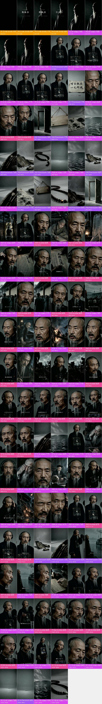

## What makes it work

- **The hook**: 0–7 s: the black title card "和血吞" and the credit "lyrics Claude, music Suno" sit over an old man's silhouette that slowly lights up; 7–16 s: his first line in the studio is "Reached the top rank, achi
- 20–29 s: after "cue the beat" come 16 still-life inserts, one per beat (wooden door, wooden sign, inked paper, black water, empty boat, charred wood, prayer beads); they carry no information and only 
- 29–135 s: every lyric line gets a matching history scene: "took the exam seven times" over a boy writing at a desk, "文理太浅" over a book page bearing those four characters, "the Xiang river was cold" ov
- 66–85 s: the chorus "swallow the broken teeth with the blood" goes back to the studio entirely, 9 rap close-ups in different sizes in a row; narrative blocks and studio performance alternate section b
- 145 s: after singing "my virtue is worth nothing" he says quietly "That take's good", like an engineer approving a take and like stamping a verdict on his own life; it mirrors the opening "I wrote tha

## At a glance: picture, packaging, sound

Any short video splits into three layers: the picture, what is laid on top of it (subtitles, styled text, stickers), and the sound. Remake it one layer at a time.

| Layer | In this video | How to make it | Detail |
|---|---|---|---|
| **Picture** (base) | AI-generated video 60 shots, AI avatar (talking head) 37 shots, still image + pan/zoom 17 shots, code / template render 4 shots | AI in 33 generations, repeated clips cut from the result; avatar talking head; screen recording / motion graphics in code; a single image held or moved | “Remake it yourself” |
| **Packaging** (on top) | graphic, text, subtitle | add in the editor: subtitles, styled text and stickers by the timeline | “Packaging layer” |
| **Sound** | voice（TTS voice-over）, music (178 BPM, to confirm) | voice: TTS voice-over; music: find a track with the same tempo and mood | “Sound” |

## Content and structure

- The narrative line below comes from reading each shot; the lines were not transcribed separately, subtitle text is under “Packaging layer”

**Narrative line**

Keep this line in a remake: same order, same job at each step, with the point refilled from your own cases, numbers and material, so it is more than a change of subject.

| Time | Shots | Job | What it says |
|---|---|---|---|
| 0.0–4.9s | #1–#4 | grab attention | The black title card shows the song title and that AI wrote the lyrics and music → The title sits over a silhouette that slowly lights up; the face is held back to build suspense |
| 4.9–7.2s | #5–#9 | set the mood | A few very short silhouette close-ups hit the drums and lay down a sombre mood |
| 7.2–13.0s | #10–#13 | grab attention | The lead opens by dismissing his whole life in one line, a jarring contrast |
| 13.0–15.8s | #14–#16 | set the scene | Adds "I wrote that myself": the verdict is his own |
| 15.8–18.1s | #17 | show evidence | The verdict he just spoke is shown written on paper so viewers read it again |
| 18.1–20.1s | #18–#20 | turn | Cuts from speech to a silent extreme close-up, leaving one beat before the rap → One line, "cue the beat", turns the speech into rap |
| 20.1–29.2s | #21–#36 | set the mood | Before the verse, a string of symbolic still-life inserts, one per beat, hits the drums |
| 29.2–31.6s | #37 | add information | A boy enters the exam hall: the exam story begins |
| 31.6–31.8s | #38 | set the mood | A flash of the wider studio framing reminds viewers where we are |
| 31.8–36.7s | #39–#41 | add information | Raps the count of his failed exams → Exam after exam failed: a boy studying at a desk over "took it seven times" → Father and son sat the same exam and the father passed: one more humiliation |
| 36.7–39.5s | #42 | show evidence | His name is posted for all to see; the red circle close-up is the evidence |
| 39.5–40.2s | #43 | set the mood | Holding the headphones while singing makes him look like he is really recording |
| 40.2–42.9s | #44 | show evidence | Puts the four characters 「文理太浅」 right in the picture as evidence |
| 42.9–43.6s | #45 | add information | Sings that the whole city saw his disgrace |
| 43.6–44.8s | #46 | show evidence | Pushes in once more so the four characters fill the frame |
| 44.8–64.7s | #47–#63 | add information | Rap close-ups bring the emotion nearer → Pushing through the crowd to read the results: he sat the top exam three more times → Three more tries at the jinshi exam → Ranked at the very bottom: the exam chapter closes → Only learned to lead troops after forty, and lost his first battle → (… 12 points, each shot in the shot list) |
| 64.7–65.4s | #64 | set the mood | A head-bowed pause between verses |
| 65.4–67.2s | #65 | add information | "Build solid forts, fight dull battles": trench-digging silhouettes picture the plodding method |
| 67.2–85.5s | #66–#74 | deliver the conclusion | The chorus states the theme: cursed everywhere, beaten everywhere, he swallows the broken teeth with the blood |
| 85.5–88.6s | #75–#77 | set the mood | After the chorus the same still-life inserts come back for a breather → A flash of the wider studio framing reminds viewers where we are |
| 88.6–93.3s | #78–#80 | add information | Losing the sight of his right eye in old age → Moving into his late years → Constant dizziness, worn down by illness |
| 93.3–94.0s | #81 | set the mood | A pause staring into the lens holds the emotion down |
| 94.0–106.1s | #82–#86 | turn | Sent to Tianjin while ill to settle the case, he ends up branded a traitor → A rap close-up leads into the section about his bad name → Singing with a hand on the headphones leads into the plaque being smashed → His home-town people smash his plaque: the bad name becomes real |
| 106.1–109.0s | #87–#89 | set the mood | A pained extreme close-up closes the bad-name section → Back to the studio medium shot for a breath before the chorus |
| 109.0–115.7s | #90–#92 | deliver the conclusion | The chorus again: he swallows the bad name with the blood too |
| 115.7–122.3s | #93–#95 | set the mood | After the chorus the same still-life inserts come back for a breather → Back in the studio after the inserts, leading into the reform section |
| 122.3–129.2s | #96–#100 | add information | Reform achievement: watching a Chinese-built steamship launch → Sings about what the reforms achieved → Signing the memorial that sent boys to study abroad |
| 129.2–131.0s | #101, #102 | set the mood | A silent pause between verses |
| 131.0–132.6s | #103, #104 | turn | An open-hand gesture sings out the regret |
| 132.6–143.0s | #105–#109 | deliver the conclusion | His deathbed verdict: the highest rank, and nothing achieved in learning |
| 143.0–144.0s | #110 | set the mood | A pause before the ending |
| 144.0–152.0s | #111–#114 | deliver the conclusion | A full-length shot carries the self-verdict to its last line → He says "that take's good" like an engineer, closing both his life's verdict and the recording → A last silent stare into the lens leaves the judgement to the viewer |
| 152.0–165.0s | #115–#118 | set the mood | The ending returns to the opening still-life inserts, closing the loop → The prayer beads close the film on a note of lifelong self-reflection |

## Shot list

Picture, Camera and Overlays are what is visible on screen; Made with and Material are the tools' inference, with the basis in the shot-by-shot appendix.

| # | Frames | Time | Length | What it says | Picture | Camera | Overlays | Made with (inferred) | Material (inferred) | Remake |
|---|---|---|---|---|---|---|---|---|---|---|
| 1 |  | 0:00.0 | 2.1s | grab attention: The black title card shows the s… | Title card on pure black: small text 「大清… | static | — | code / template render 93% | rendered by the creator | code render · Part 1 |
| 2 | 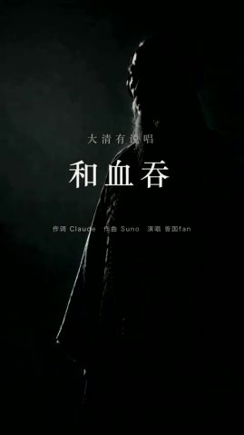 | 0:02.1 | 1.0s | grab attention: The title sits over a silhouette… | Side backlight on black: the profile of … | smooth move | — | code / template render 88% | rendered by the creator | code render · Part 1 |
| 3 | 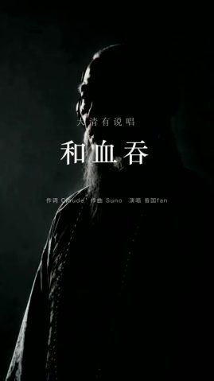 | 0:03.2 | 1.0s | grab attention: The title sits over a silhouette… | Side backlight on black: the profile of … | smooth move | — | code / template render 77% | rendered by the creator | code render · Part 1 |
| 4 | 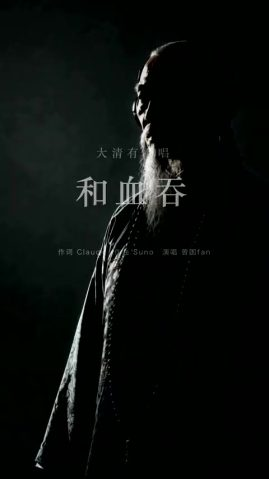 | 0:04.2 | 0.7s | grab attention: The title sits over a silhouette… | Side backlight on black: the profile of … | smooth move | — | code / template render 68% | rendered by the creator | code render · Part 1 |
| 5 | 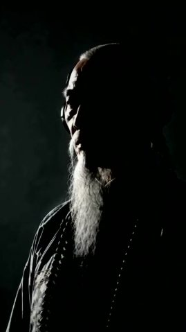 | 0:04.9 | 0.7s | set the mood: A few very short silhouette close-… | Close-up of the old man's backlit profil… | smooth move | — | AI-generated video 74% | AI-generated | AI generation · G1 |
| 6 | 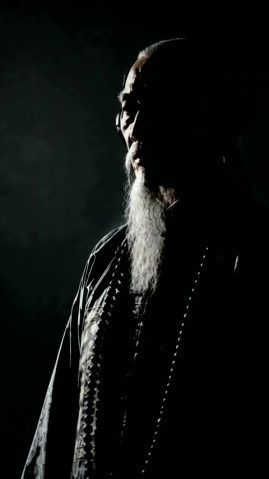 | 0:05.5 | 0.3s | set the mood: A few very short silhouette close-… | Close-up of the old man's backlit profil… | smooth move | — | AI-generated video 73% | AI-generated | AI generation · G1 |
| 7 | 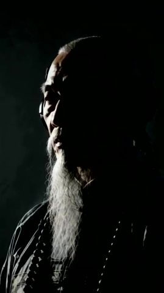 | 0:05.9 | 0.7s | set the mood: A few very short silhouette close-… | Close-up of the old man's backlit profil… | smooth move | — | AI-generated video 75% | AI-generated | AI generation · G1 |
| 8 | 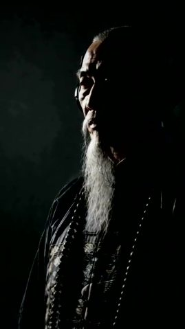 | 0:06.6 | 0.3s | set the mood: A few very short silhouette close-… | Close-up of the old man's backlit profil… | smooth move | graphic | AI-generated video 74% | AI-generated | AI generation · G1 |
| 9 | 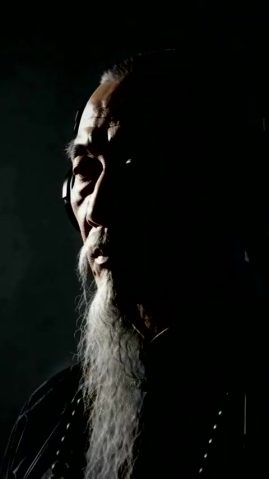 | 0:06.9 | 0.3s | set the mood: A few very short silhouette close-… | Close-up of the old man's backlit profil… | smooth move | — | AI-generated video 74% | AI-generated | AI generation · G1 |
| 10 |  | 0:07.2 | 1.4s | grab attention: The lead opens by dismissing his… | Studio medium shot: an old Qing man (Zen… | whole-frame zoom / pan | text, graphic | still image + pan/zoom 69% | AI-generated | local ffmpeg move |
| 11 | 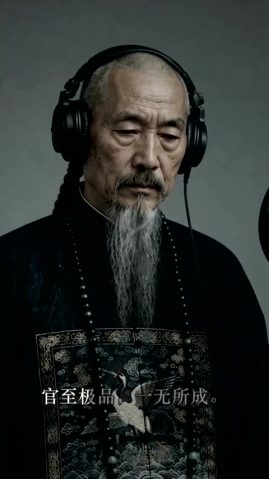 | 0:08.6 | 1.3s | grab attention: The lead opens by dismissing his… | Studio medium shot: an old Qing man (Zen… | whole-frame zoom / pan | text | AI-generated video 79% | AI-generated | AI generation · G2 |
| 12 | 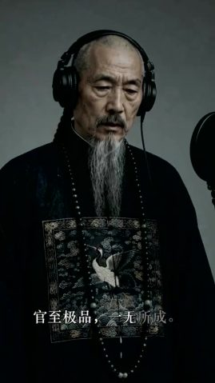 | 0:10.0 | 1.7s | grab attention: The lead opens by dismissing his… | Studio medium shot: an old Qing man (Zen… | whole-frame zoom / pan | text, graphic | AI-generated video 79% | AI-generated | AI generation · G2 |
| 13 | 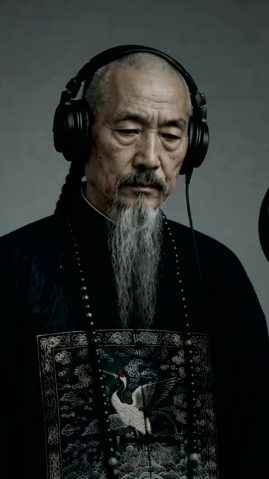 | 0:11.7 | 1.4s | grab attention: The lead opens by dismissing his… | Studio medium shot: an old Qing man (Zen… | whole-frame zoom / pan | graphic | AI-generated video 79% | AI-generated | AI generation · G2 |
| 14 | 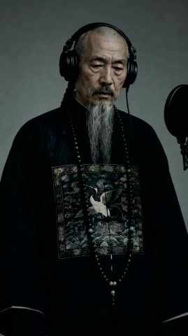 | 0:13.0 | 1.0s | set the scene: Adds "I wrote that myself": the v… | Studio medium shot: an old Qing man (Zen… | smooth move | text | AI-generated video 77% | AI-generated | AI generation · G2 |
| 15 | 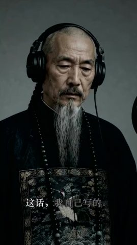 | 0:14.0 | 0.7s | set the scene: Adds "I wrote that myself": the v… | Studio medium shot: an old Qing man (Zen… | whole-frame zoom / pan | text | AI-generated video 79% | AI-generated | AI generation · G2 |
| 16 | 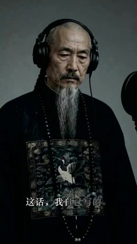 | 0:14.7 | 1.0s | set the scene: Adds "I wrote that myself": the v… | Studio medium shot: an old Qing man (Zen… | whole-frame zoom / pan | text, graphic | AI-generated video 77% | AI-generated | AI generation · G2 |
| 17 |  | 0:15.8 | 2.3s | show evidence: The verdict he just spoke is show… | A deckle-edged sheet of rice paper on a … | whole-frame zoom / pan | text | still image + pan/zoom 77% | AI-generated | local ffmpeg move |
| 18 | 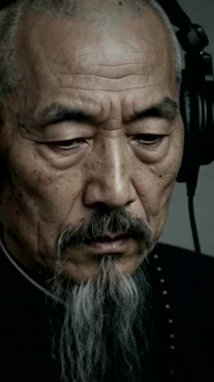 | 0:18.1 | 0.7s | turn: Cuts from speech to a silent extreme close… | Studio extreme close-up: the old man loo… | handheld shake | — | AI-generated video 86% | AI-generated | AI generation · G2 |
| 19 | 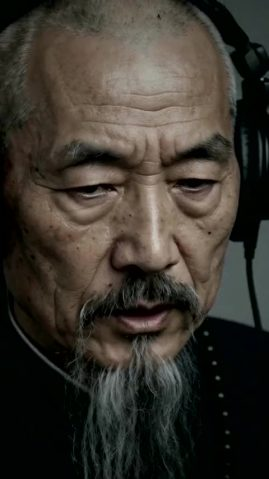 | 0:18.8 | 0.7s | turn: One line, "cue the beat", turns the speech… | Studio close-up: the old man goes from l… | smooth move | — | AI avatar (talking head) 85% | AI-generated | TTS + avatar |
| 20 | 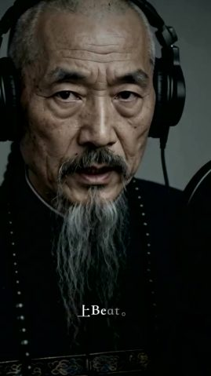 | 0:19.5 | 0.7s | turn: One line, "cue the beat", turns the speech… | Studio close-up: the old man goes from l… | smooth move | text, graphic | AI avatar (talking head) 85% | AI-generated | TTS + avatar |
| 21 | 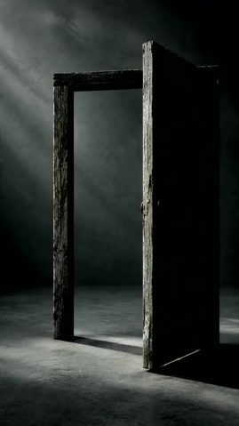 | 0:20.1 | 0.7s | set the mood: Before the verse, a string of symb… | A half-open old wooden door stands in an… | whole-frame zoom / pan | — | still image + pan/zoom 78% | AI-generated | local ffmpeg move |
| 22 |  | 0:20.8 | 0.7s | set the mood: Before the verse, a string of symb… | A blank weathered wooden sign hangs by a… | whole-frame zoom / pan | — | still image + pan/zoom 77% | AI-generated | local ffmpeg move |
| 23 | 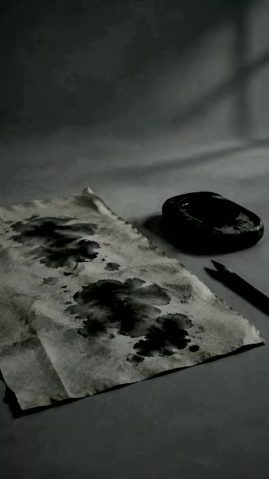 | 0:21.5 | 0.7s | set the mood: Before the verse, a string of symb… | A crumpled ink-stained sheet of rice pap… | smooth move | — | AI-generated video 82% | AI-generated | AI generation · G3 |
| 24 |  | 0:22.2 | 0.7s | set the mood: Before the verse, a string of symb… | Close-up of dark water in black and whit… | smooth move | graphic | AI-generated video 77% | AI-generated | AI generation · G33 (cut from #117) |
| 25 | 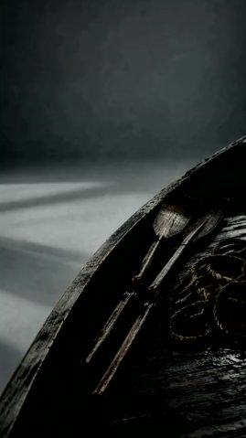 | 0:22.9 | 0.7s | set the mood: Before the verse, a string of symb… | The curved gunwale of an old black woode… | whole-frame zoom / pan | — | still image + pan/zoom 76% | AI-generated | local ffmpeg move |
| 26 | 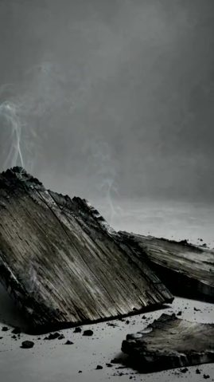 | 0:23.5 | 0.7s | set the mood: Before the verse, a string of symb… | A few charred, carbonised pieces of wood… | whole-frame zoom / pan | — | still image + pan/zoom 83% | AI-generated | local ffmpeg move |
| 27 | 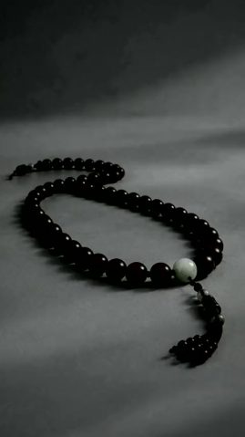 | 0:24.2 | 0.7s | set the mood: Before the verse, a string of symb… | A string of black prayer beads coiled in… | whole-frame zoom / pan | — | still image + pan/zoom 76% | AI-generated | local ffmpeg move |
| 28 | 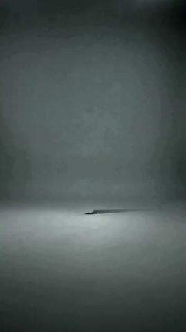 | 0:24.9 | 0.7s | set the mood: Before the verse, a string of symb… | An empty misty grey void; on the distant… | — | — | AI-generated video 70% | AI-generated | AI generation · G33 (cut from #115) |
| 29 |  | 0:25.6 | 0.7s | set the mood: Before the verse, a string of symb… | Close-up of dark water in black and whit… | smooth move | graphic | AI-generated video 78% | AI-generated | AI generation · G33 (cut from #117) |
| 30 | 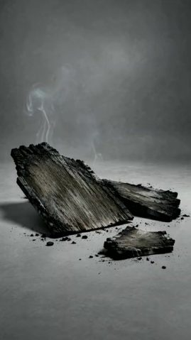 | 0:26.2 | 0.7s | set the mood: Before the verse, a string of symb… | A few charred, carbonised pieces of wood… | whole-frame zoom / pan | — | still image + pan/zoom 85% | AI-generated | local ffmpeg move |
| 31 | 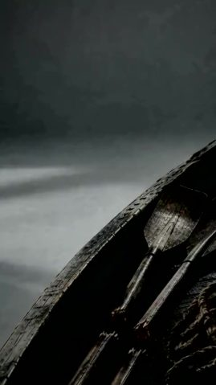 | 0:26.9 | 0.7s | set the mood: Before the verse, a string of symb… | The curved gunwale of an old black woode… | smooth move | graphic | AI-generated video 76% | AI-generated | AI generation · G19 (cut from #75) |
| 32 | 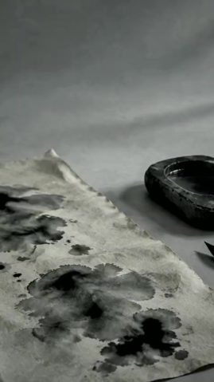 | 0:27.6 | 0.3s | set the mood: Before the verse, a string of symb… | A crumpled ink-stained sheet of rice pap… | whole-frame zoom / pan | — | still image + pan/zoom 77% | AI-generated | local ffmpeg move |
| 33 |  | 0:28.0 | 0.3s | set the mood: Before the verse, a string of symb… | A blank weathered wooden sign hangs by a… | whole-frame zoom / pan | — | still image + pan/zoom 78% | AI-generated | local ffmpeg move |
| 34 |  | 0:28.3 | 0.3s | set the mood: Before the verse, a string of symb… | A string of dark prayer beads snakes in … | smooth move | — | AI-generated video 78% | AI-generated | AI generation · G3 |
| 35 | 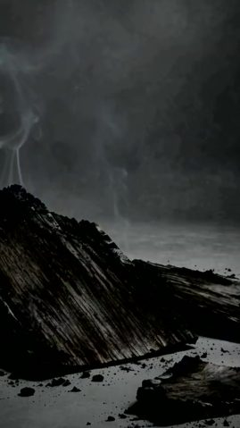 | 0:28.6 | 0.4s | set the mood: Before the verse, a string of symb… | A few charred, carbonised pieces of wood… | whole-frame zoom / pan | — | still image + pan/zoom 84% | AI-generated | local ffmpeg move |
| 36 | 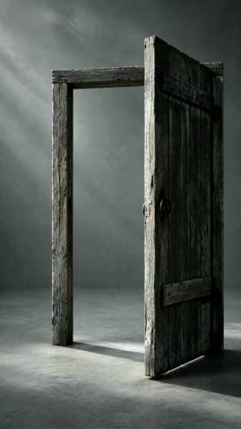 | 0:29.0 | 0.2s | set the mood: Before the verse, a string of symb… | A half-open old wooden door stands in an… | whole-frame zoom / pan | — | still image + pan/zoom 78% | AI-generated | local ffmpeg move |
| 37 | 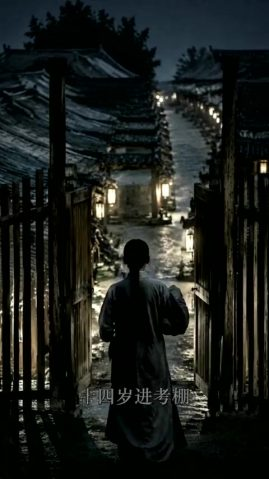 | 0:29.2 | 2.4s | add information: A boy enters the exam hall: the… | At night a boy with a long queue and a g… | smooth move | subtitle | AI-generated video 82% | AI-generated | AI generation · G4 |
| 38 | 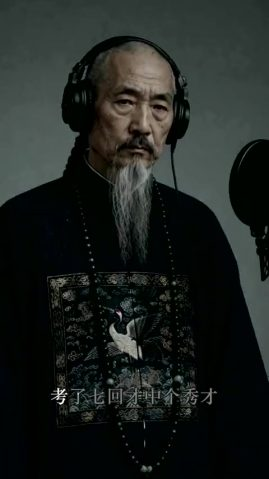 | 0:31.6 | 0.1s | set the mood: A flash of the wider studio framin… | Studio medium shot: the old man stands a… | smooth move | text | AI-generated video 84% | AI-generated | AI generation · G5 |
| 39 | 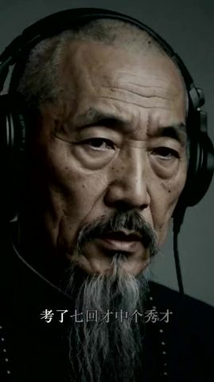 | 0:31.8 | 0.4s | add information: Raps the count of his failed ex… | Studio close-up: wearing headphones, the… | smooth move | text | AI avatar (talking head) 83% | AI-generated | TTS + avatar |
| 40 | 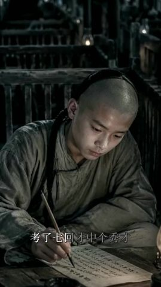 | 0:32.2 | 2.5s | add information: Exam after exam failed: a boy s… | In a dim exam cell a boy with a shaved f… | smooth move | text | AI-generated video 88% | AI-generated | AI generation · G6 |
| 41 | 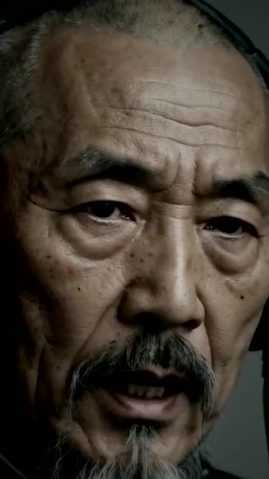 | 0:34.6 | 2.0s | add information: Father and son sat the same exa… | Studio extreme close-up: the old man's f… | smooth move | subtitle | AI avatar (talking head) 85% | AI-generated | TTS + avatar |
| 42 | 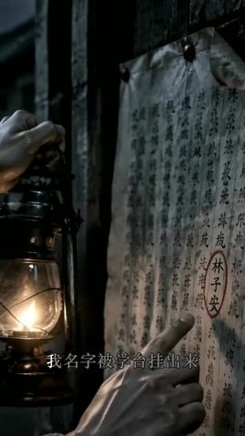 | 0:36.7 | 2.9s | show evidence: His name is posted for all to see… | At night one hand holds an oil lamp whil… | smooth move | subtitle | AI-generated video 81% | AI-generated | AI generation · G7 |
| 43 | 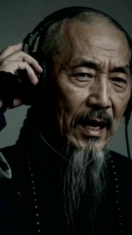 | 0:39.5 | 0.7s | set the mood: Holding the headphones while singi… | Studio close-up: the old man holds one h… | smooth move | — | AI-generated video 83% | AI-generated | AI generation · G8 |
| 44 | 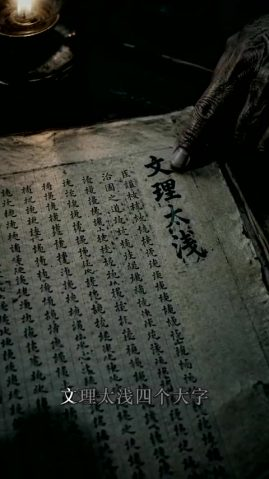 | 0:40.2 | 2.6s | show evidence: Puts the four characters 「文理太浅」 r… | Under a dim oil lamp an aged finger pres… | smooth move | subtitle | AI-generated video 74% | AI-generated | AI generation · G9 |
| 45 | 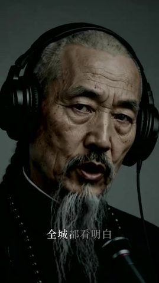 | 0:42.9 | 0.7s | add information: Sings that the whole city saw h… | Studio close-up: the old man sings 「全城都看… | smooth move | text | AI avatar (talking head) 84% | AI-generated | TTS + avatar |
| 46 | 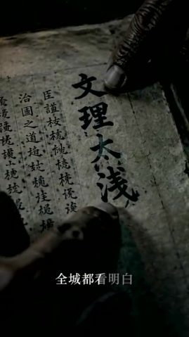 | 0:43.6 | 1.2s | show evidence: Pushes in once more so the four c… | A tighter close-up of the same old page,… | smooth move | text | AI-generated video 76% | AI-generated | AI generation · G10 |
| 47 | 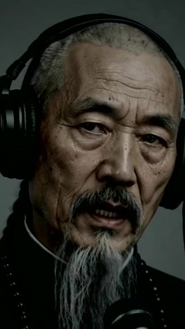 | 0:44.8 | 0.6s | add information: Rap close-ups bring the emotion… | Studio extreme close-up: the old man's f… | smooth move | — | AI avatar (talking head) 86% | AI-generated | TTS + avatar |
| 48 | 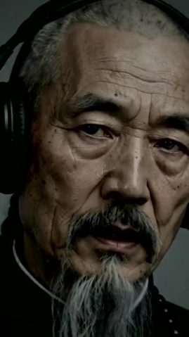 | 0:45.4 | 0.2s | add information: Rap close-ups bring the emotion… | Studio extreme close-up: the old man's f… | smooth move | text | AI avatar (talking head) 85% | AI-generated | TTS + avatar |
| 49 | 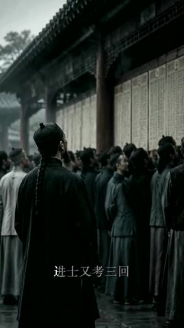 | 0:45.7 | 1.3s | add information: Pushing through the crowd to re… | Under the examination compound wall on a… | smooth move | text | AI-generated video 78% | AI-generated | AI generation · G11 |
| 50 | 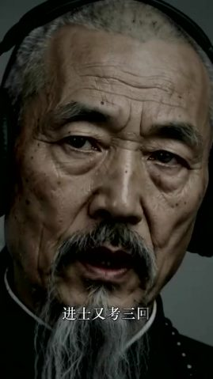 | 0:47.0 | 0.6s | add information: Three more tries at the jinshi … | Studio extreme close-up: the old man sin… | smooth move | text | AI avatar (talking head) 85% | AI-generated | TTS + avatar |
| 51 | 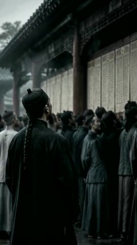 | 0:47.6 | 0.6s | add information: Pushing through the crowd to re… | Under the examination compound wall on a… | smooth move | — | AI-generated video 77% | AI-generated | AI generation · G12 |
| 52 | 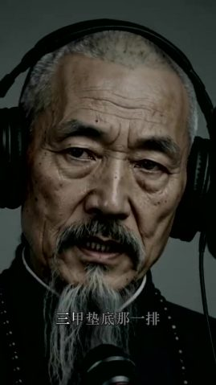 | 0:48.2 | 0.6s | add information: Ranked at the very bottom: the … | Studio close-up: the old man sings 「三甲垫底… | smooth move | text | AI avatar (talking head) 83% | AI-generated | TTS + avatar |
| 53 | 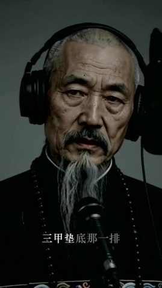 | 0:48.8 | 1.6s | add information: Ranked at the very bottom: the … | Studio close-up: the old man sings 「三甲垫底… | smooth move | text | AI avatar (talking head) 86% | AI-generated | TTS + avatar |
| 54 | 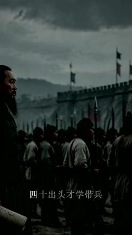 | 0:50.4 | 3.1s | add information: Only learned to lead troops aft… | Outside a city wall under heavy clouds, … | smooth move | subtitle, text | AI-generated video 78% | AI-generated | AI generation · G13 |
| 55 | 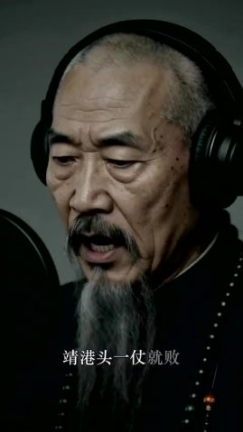 | 0:53.5 | 0.8s | add information: Defeated in his first battle as… | Studio close-up: the old man's profile t… | smooth move | text, graphic | AI avatar (talking head) 84% | AI-generated | TTS + avatar |
| 56 |  | 0:54.2 | 2.0s | add information: Fished out of the river by his … | A wooden boat on a night river: a drench… | smooth move | text | AI-generated video 86% | AI-generated | AI generation · G14 |
| 57 | 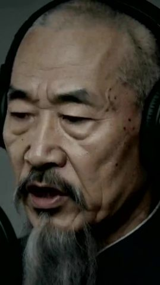 | 0:56.2 | 0.7s | add information: A rap close-up leads into the n… | Studio extreme close-up: the old man's p… | smooth move | text | AI avatar (talking head) 82% | AI-generated | TTS + avatar |
| 58 | 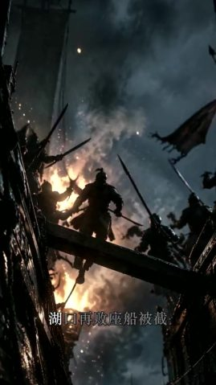 | 0:56.9 | 1.5s | add information: Beaten again at Hukou, his flag… | A night naval battle: silhouetted soldie… | smooth move | subtitle | AI-generated video 84% | AI-generated | AI generation · G15 |
| 59 |  | 0:58.4 | 0.5s | add information: Escapes death once more | Studio extreme close-up: the old man sin… | smooth move | text | AI avatar (talking head) 82% | AI-generated | TTS + avatar |
| 60 |  | 0:58.9 | 0.6s | add information: Escapes death once more | Studio extreme close-up: the old man sin… | smooth move | text, graphic | AI avatar (talking head) 83% | AI-generated | TTS + avatar |
| 61 |  | 0:59.5 | 0.1s | add information: Escapes death once more | Studio extreme close-up: the old man sin… | smooth move | text | AI avatar (talking head) 84% | AI-generated | TTS + avatar |
| 62 |  | 0:59.6 | 2.9s | add information: Besieged at Qimen, he writes hi… | In a dim army tent the white-bearded old… | smooth move | subtitle | AI-generated video 89% | AI-generated | AI generation · G16 |
| 63 |  | 1:02.5 | 2.1s | add information: "Build solid forts, fight dull … | Under a churning stormy sky, silhouetted… | smooth move | subtitle | AI-generated video 77% | AI-generated | AI generation · G16 |
| 64 |  | 1:04.7 | 0.7s | set the mood: A head-bowed pause between verses | Studio medium shot: the old man stands s… | smooth move | graphic | AI-generated video 84% | AI-generated | AI generation · G17 |
| 65 |  | 1:05.4 | 1.8s | add information: "Build solid forts, fight dull … | Under a churning stormy sky, silhouetted… | smooth move | text | AI-generated video 77% | AI-generated | AI generation · G18 |
| 66 |  | 1:07.2 | 2.8s | deliver the conclusion: The chorus states the th… | Studio close-up: in headphones the old m… | smooth move | subtitle | AI avatar (talking head) 86% | AI-generated | TTS + avatar |
| 67 |  | 1:10.0 | 0.5s | deliver the conclusion: The chorus states the th… | Studio close-up: in headphones the old m… | smooth move | text, graphic | AI avatar (talking head) 85% | AI-generated | TTS + avatar |
| 68 |  | 1:10.5 | 1.2s | deliver the conclusion: The chorus states the th… | Studio close-up: in headphones the old m… | smooth move | text, graphic | AI avatar (talking head) 84% | AI-generated | TTS + avatar |
| 69 |  | 1:11.8 | 2.8s | deliver the conclusion: The chorus states the th… | Studio close-up: in headphones the old m… | static (subject moves) | subtitle, graphic | AI avatar (talking head) 87% | AI-generated | TTS + avatar |
| 70 |  | 1:14.6 | 1.4s | deliver the conclusion: The chorus states the th… | Studio close-up: in headphones the old m… | smooth move | subtitle, graphic | AI avatar (talking head) 85% | AI-generated | TTS + avatar |
| 71 |  | 1:16.0 | 1.3s | deliver the conclusion: The chorus states the th… | Studio close-up: in headphones the old m… | smooth move | text | AI avatar (talking head) 84% | AI-generated | TTS + avatar |
| 72 |  | 1:17.3 | 2.9s | deliver the conclusion: The chorus states the th… | Studio close-up: in headphones the old m… | smooth move | subtitle, text, graphic | AI avatar (talking head) 86% | AI-generated | TTS + avatar |
| 73 |  | 1:20.2 | 1.0s | deliver the conclusion: The chorus states the th… | Studio close-up: in headphones the old m… | smooth move | — | AI avatar (talking head) 84% | AI-generated | TTS + avatar |
| 74 |  | 1:21.2 | 4.2s | deliver the conclusion: The chorus states the th… | Studio close-up: in headphones the old m… | smooth move | subtitle | AI avatar (talking head) 85% | AI-generated | TTS + avatar |
| 75 |  | 1:25.5 | 1.7s | set the mood: After the chorus the same still-li… | The curved gunwale of an old black woode… | smooth move | — | AI-generated video 77% | AI-generated | AI generation · G19 |
| 76 |  | 1:27.1 | 1.2s | set the mood: After the chorus the same still-li… | Close-up of dark water in black and whit… | smooth move | graphic | AI-generated video 80% | AI-generated | AI generation · G33 (cut from #117) |
| 77 |  | 1:28.3 | 0.2s | set the mood: A flash of the wider studio framin… | Studio medium shot: the old man stands a… | static | — | AI-generated video 71% | AI-generated | AI generation · G20 |
| 78 |  | 1:28.6 | 2.2s | add information: Losing the sight of his right e… | In a dim room the white-bearded old man … | smooth move | text | AI-generated video 80% | AI-generated | AI generation · G21 |
| 79 |  | 1:30.8 | 0.7s | add information: Moving into his late years | Studio close-up: the old man faces the l… | smooth move | — | AI avatar (talking head) 84% | AI-generated | TTS + avatar |
| 80 |  | 1:31.4 | 1.9s | add information: Constant dizziness, worn down b… | The white-bearded old man presses and ru… | smooth move | text | AI-generated video 80% | AI-generated | AI generation · G22 |
| 81 |  | 1:33.3 | 0.7s | set the mood: A pause staring into the lens hold… | Extreme close-up of the old man's face, … | smooth move | — | AI-generated video 84% | AI-generated | AI generation · G23 |
| 82 |  | 1:34.0 | 5.2s | turn: Sent to Tianjin while ill to settle the ca… | At a long Qing negotiation table, a whit… | smooth move | subtitle | AI-generated video 88% | AI-generated | AI generation · G24 |
| 83 |  | 1:39.2 | 1.1s | turn: A rap close-up leads into the section abou… | Studio close-up: the old man faces the l… | smooth move | — | AI avatar (talking head) 86% | AI-generated | TTS + avatar |
| 84 |  | 1:40.3 | 1.0s | turn: Singing with a hand on the headphones lead… | Studio medium shot: the old man holds on… | smooth move | text, graphic | AI-generated video 84% | AI-generated | AI generation · G25 |
| 85 |  | 1:41.3 | 1.8s | turn: Singing with a hand on the headphones lead… | Studio medium shot: the old man holds on… | smooth move | text, graphic | AI-generated video 84% | AI-generated | AI generation · G25 |
| 86 |  | 1:43.1 | 3.0s | turn: His home-town people smash his plaque: the… | At night outside a guild hall, villagers… | smooth move | subtitle | AI-generated video 82% | AI-generated | AI generation · G26 |
| 87 |  | 1:46.1 | 1.3s | set the mood: A pained extreme close-up closes t… | Studio extreme close-up: the old man squ… | smooth move | text | AI-generated video 86% | AI-generated | AI generation · G27 |
| 88 |  | 1:47.4 | 0.5s | set the mood: A pained extreme close-up closes t… | Studio extreme close-up: the old man squ… | smooth move | graphic | AI-generated video 81% | AI-generated | AI generation · G27 |
| 89 |  | 1:47.9 | 1.1s | set the mood: Back to the studio medium shot for… | Studio medium shot: the old man stands a… | smooth move | — | AI-generated video 76% | AI-generated | AI generation · G27 |
| 90 |  | 1:49.0 | 2.6s | deliver the conclusion: The chorus again: he swa… | Studio medium shot: crane badge on his c… | static | subtitle, graphic | AI avatar (talking head) 87% | AI-generated | TTS + avatar |
| 91 |  | 1:51.7 | 1.3s | deliver the conclusion: The chorus again: he swa… | Studio medium shot: crane badge on his c… | smooth move | text | AI avatar (talking head) 86% | AI-generated | TTS + avatar |
| 92 |  | 1:53.0 | 2.8s | deliver the conclusion: The chorus again: he swa… | Studio medium shot: crane badge on his c… | smooth move | text | AI avatar (talking head) 87% | AI-generated | TTS + avatar |
| 93 |  | 1:55.7 | 3.5s | set the mood: After the chorus the same still-li… | A few charred, carbonised pieces of wood… | whole-frame zoom / pan | — | still image + pan/zoom 85% | AI-generated | local ffmpeg move |
| 94 |  | 1:59.2 | 2.4s | set the mood: After the chorus the same still-li… | The curved gunwale of an old black woode… | whole-frame zoom / pan | — | still image + pan/zoom 73% | AI-generated | local ffmpeg move |
| 95 |  | 2:01.6 | 0.7s | set the mood: Back in the studio after the inser… | Studio side medium shot: the old man sta… | whole-frame zoom / pan | — | still image + pan/zoom 82% | AI-generated | local ffmpeg move |
| 96 |  | 2:02.3 | 1.9s | add information: Reform achievement: watching a … | On a misty riverbank the white-bearded o… | whole-frame zoom / pan | text | still image + pan/zoom 75% | AI-generated | local ffmpeg move |
| 97 |  | 2:04.2 | 0.6s | add information: Sings about what the reforms ac… | Studio profile close-up: the old man fac… | smooth move | text | AI avatar (talking head) 83% | AI-generated | TTS + avatar |
| 98 |  | 2:04.8 | 0.6s | add information: Reform achievement: watching a … | On a misty riverbank the white-bearded o… | smooth move | text | AI-generated video 76% | AI-generated | AI generation · G28 |
| 99 |  | 2:05.5 | 1.6s | add information: Sings about what the reforms ac… | Studio profile close-up: the old man fac… | smooth move | — | AI avatar (talking head) 78% | AI-generated | TTS + avatar |
| 100 |  | 2:07.1 | 2.1s | add information: Signing the memorial that sent … | An open memorial document full of small … | smooth move | text | AI-generated video 79% | AI-generated | AI generation · G29 |
| 101 |  | 2:09.2 | 0.9s | set the mood: A silent pause between verses | Studio close shot: the old man stands th… | smooth move | graphic | AI-generated video 71% | AI-generated | AI generation · G30 |
| 102 |  | 2:10.1 | 0.8s | set the mood: A silent pause between verses | Studio close shot: the old man stands th… | smooth move | — | AI-generated video 84% | AI-generated | AI generation · G30 |
| 103 |  | 2:11.0 | 0.7s | turn: An open-hand gesture sings out the regret | Studio medium shot: the old man stands a… | smooth move | graphic | AI-generated video 84% | AI-generated | AI generation · G30 |
| 104 |  | 2:11.6 | 1.0s | turn: An open-hand gesture sings out the regret | Studio medium shot: the old man stands a… | smooth move | text, graphic | AI-generated video 76% | AI-generated | AI generation · G30 |
| 105 |  | 2:12.6 | 1.4s | deliver the conclusion: His deathbed verdict: th… | Studio close shot: three-quarter on to t… | smooth move | — | AI avatar (talking head) 86% | AI-generated | TTS + avatar |
| 106 |  | 2:14.0 | 3.2s | deliver the conclusion: His deathbed verdict: th… | Studio close shot: three-quarter on to t… | smooth move | text | AI avatar (talking head) 85% | AI-generated | TTS + avatar |
| 107 |  | 2:17.2 | 1.6s | deliver the conclusion: His deathbed verdict: th… | Studio close shot: three-quarter on to t… | smooth move | text, graphic | AI avatar (talking head) 84% | AI-generated | TTS + avatar |
| 108 |  | 2:18.9 | 3.5s | deliver the conclusion: His deathbed verdict: th… | Studio close shot: three-quarter on to t… | smooth move | text | AI avatar (talking head) 86% | AI-generated | TTS + avatar |
| 109 |  | 2:22.3 | 0.7s | deliver the conclusion: His deathbed verdict: th… | Studio close shot: three-quarter on to t… | smooth move | text, graphic | AI avatar (talking head) 83% | AI-generated | TTS + avatar |
| 110 |  | 2:23.0 | 1.0s | set the mood: A pause before the ending | Studio close shot: the old man three-qua… | whole-frame zoom / pan | graphic | AI-generated video 70% | AI-generated | AI generation · G31 |
| 111 |  | 2:24.0 | 1.8s | deliver the conclusion: A full-length shot carri… | Studio full shot: the old man in a colou… | smooth move | text | AI-generated video 77% | AI-generated | AI generation · G31 |
| 112 |  | 2:25.8 | 2.2s | deliver the conclusion: He says "that take's goo… | Studio close shot: head bowed, the old m… | smooth move | subtitle, text | AI avatar (talking head) 86% | AI-generated | TTS + avatar |
| 113 |  | 2:28.0 | 1.1s | deliver the conclusion: A last silent stare into… | Studio extreme close-up: the old man loo… | smooth move | text | AI-generated video 84% | AI-generated | AI generation · G32 |
| 114 |  | 2:29.2 | 2.8s | deliver the conclusion: A last silent stare into… | Studio extreme close-up: the old man loo… | smooth move | — | AI-generated video 86% | AI-generated | AI generation · G32 |
| 115 |  | 2:32.0 | 3.0s | set the mood: The ending returns to the opening … | An empty misty grey void; on the distant… | — | — | AI-generated video 76% | AI-generated | AI generation · G33 |
| 116 |  | 2:35.0 | 3.1s | set the mood: The ending returns to the opening … | An empty misty grey void; on the distant… | whole-frame zoom / pan | — | still image + pan/zoom 84% | AI-generated | local ffmpeg move |
| 117 |  | 2:38.1 | 2.2s | set the mood: The ending returns to the opening … | Close-up of dark water in black and whit… | smooth move | graphic | AI-generated video 79% | AI-generated | AI generation · G33 |
| 118 |  | 2:40.4 | 4.6s | set the mood: The prayer beads close the film on… | A string of dark prayer beads snakes in … | smooth move | — | AI-generated video 77% | AI-generated | AI generation · G33 |

## Remake it yourself: do it in this order

Copy the method and the rhythm, not the pictures.

1. **Plan the content**: write your script on the narrative line under “Content and structure”
2. **Collect material**: see “What to prepare” below
3. **Generate**: 33 generations, see “AI generation” below
4. **Screen and motion graphics**: see “Code build” below
5. **Stills / moves**: see “Local rebuild” below
6. **Edit**: see “Edit” below
7. **Packaging**: the subtitle file `packaging/subtitles.srt` imports straight into an editor; styles and timeline under “Packaging layer”
8. **Sound**: see “Sound”; every effect can be played first
9. **Compare**: watch yours next to the original: shot lengths, subtitle positions, where the music comes in and drops

### What to prepare

- `@图片1` character reference images (one frontal face + one half-body per character) so the look stays consistent across shots: Zeng Guofan (old, the rapper), Young Zeng Guofan, Qing soldiers / his men, Western envoys

### AI generation

**55 AI video shots → 33 generation units, 33 Seedance 2.0 calls (plus 5 shots reusing the same clip, just cut)**

- Grouping: AI shots in the same scene joined by hard cuts are generated in one call; ≤15s per call; consecutive hard cuts inside a unit preferably ≤8s, at most 10s; split at dissolves / fades and scene changes
- Audio: the model can generate action sound effects and ambience along with the picture; voice-over is better done as separate TTS and mixed in, so copy and timing stay editable
- Packaging: the subtitle on the generated shots is post-production packaging: keep it out of the prompts, erase it from reference frames, and lay it back on from the packaging timeline after generation

A video model can take these inputs; each generation unit below lists which ones to feed and where they come from:
- **Text prompt**: always; describes the picture, action and camera
- **First frame**: locks the composition and subject of frame one. Without it this is plain text-to-video and framing changes every time
- **Last frame**: also locks the final frame so the model only fills in between. Suits a single shot with a camera move or action
- **Reference images**: how the product and people look, so they stay the same across shots (`@图片1` in the prompt)
- **Reference video**: copy the action, camera move and rhythm, not the picture (`@视频1`); not every model takes one

One generation per unit. The table lists what to feed the model; open a unit for where each input comes from and the prompt.

| Unit | Shots | Time | Duration | Mode | Feed | Continuity |
|---|---|---|---|---|---|---|
| G1 | #5–#9 | 4.9–7.2s | 2.4s | multi-shot | first frame + reference image + reference video | — |
| G2 | #11–#16, #18 | 8.6–15.8s, 18.1–18.8s | 7.8s | multi-shot | first frame + reference image + reference video | — |
| G3 | #23, #34 | 21.5–22.2s, 28.3–28.6s | 1.0s | multi-shot | first frame + reference image + reference video | — |
| G4 | #37 | 29.2–31.6s | 2.4s | single shot | first frame + reference image + reference video | — |
| G5 | #38 | 31.6–31.8s | 0.1s | single shot | first frame + reference image + reference video | — |
| G6 | #40 | 32.2–34.6s | 2.5s | single shot | first frame + reference image + reference video | — |
| G7 | #42 | 36.7–39.5s | 2.9s | single shot | first frame + reference image + reference video | — |
| G8 | #43 | 39.5–40.2s | 0.7s | single shot | first frame + reference image + reference video | — |
| G9 | #44 | 40.2–42.9s | 2.6s | single shot | first frame + reference image + reference video | — |
| G10 | #46 | 43.6–44.8s | 1.2s | single shot | first frame + reference image + reference video | — |
| G11 | #49 | 45.7–47.0s | 1.3s | single shot | first frame + reference image + reference video | — |
| G12 | #51 | 47.6–48.2s | 0.6s | single shot | first frame + reference image + reference video | — |
| G13 | #54 | 50.4–53.5s | 3.1s | single shot | first frame + reference image + reference video | — |
| G14 | #56 | 54.2–56.2s | 2.0s | single shot | first frame + reference image + reference video | — |
| G15 | #58 | 56.9–58.4s | 1.5s | single shot | first frame + reference image + reference video | — |
| G16 | #62–#63 | 59.6–64.7s | 5.0s | multi-shot | first frame + reference image + reference video | — |
| G17 | #64 | 64.7–65.4s | 0.7s | single shot | first frame + reference image + reference video | — |
| G18 | #65 | 65.4–67.2s | 1.8s | single shot | first frame + reference image + reference video | — |
| G19 | #75 | 85.5–87.1s | 1.7s | single shot | first frame + reference image + reference video | — |
| G20 | #77 | 88.3–88.6s | 0.2s | single shot | first frame + reference image + reference video | — |
| G21 | #78 | 88.6–90.8s | 2.2s | single shot | first frame + reference image + reference video | — |
| G22 | #80 | 91.4–93.3s | 1.9s | single shot | first frame + reference image + reference video | — |
| G23 | #81 | 93.3–94.0s | 0.7s | single shot | first frame + reference image + reference video | — |
| G24 | #82 | 94.0–99.2s | 5.2s | single shot | first frame + reference image + reference video | — |
| G25 | #84–#85 | 100.3–103.1s | 2.8s | multi-shot | first frame + reference image + reference video | — |
| G26 | #86 | 103.1–106.1s | 3.0s | single shot | first frame + reference image + reference video | — |
| G27 | #87–#89 | 106.1–109.0s | 2.9s | multi-shot | first frame + reference image + reference video | — |
| G28 | #98 | 124.8–125.5s | 0.6s | single shot | first frame + reference image + reference video | — |
| G29 | #100 | 127.1–129.2s | 2.1s | single shot | first frame + reference image + reference video | — |
| G30 | #101–#104 | 129.2–132.6s | 3.4s | multi-shot | first frame + reference image + reference video | — |
| G31 | #110–#111 | 143.0–145.8s | 2.8s | multi-shot | first frame + reference image + reference video | — |
| G32 | #113–#114 | 148.0–152.0s | 4.0s | multi-shot | first frame + reference image + reference video | — |
| G33 | #115, #117, #118 | 152.0–155.0s, 158.1–165.0s | 9.8s | multi-shot | first frame + reference image + reference video | — |

The same clip is used more than once (spotted by the image reader): generate it once and place it at each spot in the edit.
- #31 and #75 are the same footage: cut it from G19's result
- #24 and #117 are the same footage: cut it from G33's result
- #28 and #115 are the same footage: cut it from G33's result
- #29 and #117 are the same footage: cut it from G33's result
- #76 and #117 are the same footage: cut it from G33's result

<details><summary>G1 · shots #5–#9 · 2.4s · multi-reference generation</summary>

| Input | Needed | From | Why |
|---|---|---|---|
| text prompt | yes | see the prompt below | describes picture, action and camera; every other input only constrains it |
| first frame | worth it | source frame `shots/shot_005_first.jpg` (to change product, person or style, redraw it with an image model from the first-frame prompt below); this model takes frame inputs or references, not both: pass it as one more reference image and write “@图片2 as the first frame” in the prompt (Jimeng's omni-reference accepts this; most APIs do not, drop it if refused) | locks composition, shot size and subject position; with text alone every generation frames it differently |
| last frame | no | — | several shots in one call; a last frame would only constrain the final shot |
| reference image | yes | `@图片1` character reference images (one frontal face + one half-body per character) so the look stays consistent across shots | the first frame only fixes frame one; reference images keep the product and people consistent after it |
| reference video | worth it | `@视频1` source clip 4.9–7.2s | follow the action, camera move and cutting rhythm; reference only, the picture is not copied |

- First-frame image prompt: Close-up, eye level, the old man's profile facing left in the middle of frame, grey-white beard, black robe, pure black background, one-sided cool white rim light, low-key high contrast
- Generate 4s and trim to 2.4s (very short shots are unstable when generated on their own)

```text
Vertical 9:16; night / low-light ambient, no dedicated fill, soft light (wide lit-to-shadow ramp), neutral (about 5000K), background clearly blurred (shallow depth of field / portrait mode). Characters follow @图片1. Follow the action, camera movement and cutting rhythm of @视频1. Hard cuts between shots.
Shot 1 (0.0–0.7s): Close-up, eye level, the old man's profile in the middle of frame; he parts his lips and tilts his head slightly, locked-off camera
Shot 2 (0.7–1.0s): Close-up, eye level, the old man's profile in the middle of frame; he parts his lips and tilts his head slightly, locked-off camera
Shot 3 (1.0–1.7s): Close-up, eye level, the old man's profile in the middle of frame; he parts his lips and tilts his head slightly, locked-off camera
Shot 4 (1.7–2.0s): Close-up, eye level, the old man's profile in the middle of frame; he parts his lips and tilts his head slightly, locked-off camera
Shot 5 (2.0–2.4s): Close-up, eye level, the old man's profile in the middle of frame; he parts his lips and tilts his head slightly, locked-off camera
```

English prompt:

```text
Shot 1 (0.0-0.7s): Close-up, eye level, old man's backlit profile in the middle of frame; he parts his lips and tilts his head slightly, locked-off camera
Shot 2 (0.7-1.0s): Close-up, eye level, old man's backlit profile in the middle of frame; he parts his lips and tilts his head slightly, locked-off camera
Shot 3 (1.0-1.7s): Close-up, eye level, old man's backlit profile in the middle of frame; he parts his lips and tilts his head slightly, locked-off camera
Shot 4 (1.7-2.0s): Close-up, eye level, old man's backlit profile in the middle of frame; he parts his lips and tilts his head slightly, locked-off camera
Shot 5 (2.0-2.4s): Close-up, eye level, old man's backlit profile in the middle of frame; he parts his lips and tilts his head slightly, locked-off camera
```

</details>

<details><summary>G2 · shots #11–#16, #18 · 7.8s · multi-reference generation</summary>

| Input | Needed | From | Why |
|---|---|---|---|
| text prompt | yes | see the prompt below | describes picture, action and camera; every other input only constrains it |
| first frame | worth it | source frame `shots/shot_011_first.jpg` (to change product, person or style, redraw it with an image model from the first-frame prompt below); this model takes frame inputs or references, not both: pass it as one more reference image and write “@图片2 as the first frame” in the prompt (Jimeng's omni-reference accepts this; most APIs do not, drop it if refused) | locks composition, shot size and subject position; with text alone every generation frames it differently |
| last frame | no | — | several shots in one call; a last frame would only constrain the final shot |
| reference image | yes | `@图片1` character reference images (one frontal face + one half-body per character) so the look stays consistent across shots | the first frame only fixes frame one; reference images keep the product and people consistent after it |
| reference video | worth it | `@视频1` source clip 8.6–15.8s, 18.1–18.8s (inserted shots removed, pieces joined) | follow the action, camera move and cutting rhythm; reference only, the picture is not copied |

- First-frame image prompt: Medium shot, eye level, figure centred, an old Qing man (Zeng Guofan): shaved forehead, long queue, grey-white beard down to the chest, moustache, black stand-collar robe, black over-ear monitor headphones, first-rank crane badge, court beads, pop filter and studio mic on the right, grey seamless backdrop, soft front-side light, low-key realistic
- In the final cut these shots are separated by inserts: generate them back to back and put the inserts back in the edit

```text
Vertical 9:16; night / low-light ambient, no dedicated fill, soft light (wide lit-to-shadow ramp), neutral (about 5000K), background clearly blurred (shallow depth of field / portrait mode). Characters follow @图片1. Follow the action, camera movement and cutting rhythm of @视频1. Hard cuts between shots.
Shot 1 (0.0–1.3s): Medium shot, eye level, the old man centred at the mic; he looks down, then raises his eyes and speaks calmly into the mic with lip sync, body still, slow push-in
Shot 2 (1.3–3.0s): Medium shot, eye level, the old man centred at the mic; he looks down, then raises his eyes and speaks calmly into the mic with lip sync, body still, slow push-in
Shot 3 (3.0–4.4s): Medium shot, eye level, the old man centred at the mic; he looks down, then raises his eyes and speaks calmly into the mic with lip sync, body still, slow push-in
Shot 4 (4.4–5.4s): Medium shot, eye level, the old man centred at the mic; he looks down, then raises his eyes and speaks calmly into the mic with lip sync, body still, slow push-in
Shot 5 (5.4–6.1s): Medium shot, eye level, the old man centred at the mic; he looks down, then raises his eyes and speaks calmly into the mic with lip sync, body still, slow push-in
Shot 6 (6.1–7.1s): Medium shot, eye level, the old man centred at the mic; he looks down, then raises his eyes and speaks calmly into the mic with lip sync, body still, slow push-in
Shot 7 (7.1–7.8s): Extreme close-up, eye level, the old man's face fills the frame; he looks down and takes a quiet breath, locked-off camera
```

English prompt:

```text
Shot 1 (0.0-1.3s): Medium shot, eye level, the old man centered at a studio mic; he looks down, then raises his eyes and calmly speaks into the mic with lip sync, body still, slow push-in
Shot 2 (1.3-3.0s): Medium shot, eye level, the old man centered at a studio mic; he looks down, then raises his eyes and calmly speaks into the mic with lip sync, body still, slow push-in
Shot 3 (3.0-4.4s): Medium shot, eye level, the old man centered at a studio mic; he looks down, then raises his eyes and calmly speaks into the mic with lip sync, body still, slow push-in
Shot 4 (4.4-5.4s): Medium shot, eye level, the old man centered at a studio mic; he looks down, then raises his eyes and calmly speaks into the mic with lip sync, body still, slow push-in
Shot 5 (5.4-6.1s): Medium shot, eye level, the old man centered at a studio mic; he looks down, then raises his eyes and calmly speaks into the mic with lip sync, body still, slow push-in
Shot 6 (6.1-7.1s): Medium shot, eye level, the old man centered at a studio mic; he looks down, then raises his eyes and calmly speaks into the mic with lip sync, body still, slow push-in
Shot 7 (7.1-7.8s): Extreme close-up, eye level, the old man's face fills the frame; he looks down and takes a quiet breath, locked-off camera
```

</details>

<details><summary>G3 · shots #23, #34 · 1.0s · multi-reference generation</summary>

| Input | Needed | From | Why |
|---|---|---|---|
| text prompt | yes | see the prompt below | describes picture, action and camera; every other input only constrains it |
| first frame | worth it | source frame `shots/shot_023_first.jpg` (to change product, person or style, redraw it with an image model from the first-frame prompt below); this model takes frame inputs or references, not both: pass it as one more reference image and write “@图片2 as the first frame” in the prompt (Jimeng's omni-reference accepts this; most APIs do not, drop it if refused) | locks composition, shot size and subject position; with text alone every generation frames it differently |
| last frame | no | — | several shots in one call; a last frame would only constrain the final shot |
| reference image | yes | `@图片1` character reference images (one frontal face + one half-body per character) so the look stays consistent across shots | the first frame only fixes frame one; reference images keep the product and people consistent after it |
| reference video | worth it | `@视频1` source clip 21.5–22.2s, 28.3–28.6s (inserted shots removed, pieces joined) | follow the action, camera move and cutting rhythm; reference only, the picture is not copied |

- First-frame image prompt: Close shot, slightly high angle, a crumpled rice paper sheet covered in ink blots on a grey table, a black inkstone and brush at upper right, window-grid shadow on the wall behind, low-saturation still life
- Generate 4s and trim to 1.0s (very short shots are unstable when generated on their own); In the final cut these shots are separated by inserts: generate them back to back and put the inserts back in the edit

```text
Vertical 9:16; night / low-light ambient, no dedicated fill, soft light (wide lit-to-shadow ramp), neutral (about 5000K), background clearly blurred (shallow depth of field / portrait mode). Characters follow @图片1. Follow the action, camera movement and cutting rhythm of @视频1. Hard cuts between shots.
Shot 1 (0.0–0.7s): Close shot, slightly high angle, the paper filling the lower half; slow pan to the right
Shot 2 (0.7–1.0s): Macro close-up, low angle, the string running from foreground into the distance; the camera slides slowly along it past the cracked bead
```

English prompt:

```text
Shot 1 (0.0-0.7s): Close shot, slightly high angle, ink-stained crumpled rice paper with an inkstone; slow pan right
Shot 2 (0.7-1.0s): Macro close-up, low angle along a snaking string of dark prayer beads; the camera glides slowly along them past a cracked gold-veined bead
```

</details>

<details><summary>G4 · shots #37 · 2.4s · multi-reference generation</summary>

| Input | Needed | From | Why |
|---|---|---|---|
| text prompt | yes | see the prompt below | describes picture, action and camera; every other input only constrains it |
| first frame | worth it | source frame `shots/shot_037_first.jpg` (to change product, person or style, redraw it with an image model from the first-frame prompt below); this model takes frame inputs or references, not both: pass it as one more reference image and write “@图片2 as the first frame” in the prompt (Jimeng's omni-reference accepts this; most APIs do not, drop it if refused) | locks composition, shot size and subject position; with text alone every generation frames it differently |
| last frame | no | — | this unit uses references to keep the product and people; the model takes no last frame alongside them |
| reference image | yes | `@图片1` character reference images (one frontal face + one half-body per character) so the look stays consistent across shots | the first frame only fixes frame one; reference images keep the product and people consistent after it |
| reference video | worth it | `@视频1` source clip 29.2–31.6s | follow the action, camera move and cutting rhythm; reference only, the picture is not copied |

- First-frame image prompt: Wide shot, eye level, a boy seen from behind in the lower middle of frame, long queue and grey cloth robe, at a wooden gate, a night alley of exam cells lined with lanterns ahead, wet ground reflecting, cool dark tone against warm lamps
- Generate 4s and trim to 2.4s (very short shots are unstable when generated on their own)

```text
Vertical 9:16; night / low-light ambient, no dedicated fill, soft light (wide lit-to-shadow ramp), neutral (about 5000K), background clearly blurred (shallow depth of field / portrait mode). Characters follow @图片1. Follow the action, camera movement and cutting rhythm of @视频1.
Wide shot, eye level, the boy seen from behind in the centre; he walks slowly through the gate toward the end of the lantern alley, camera slowly following
```

English prompt:

```text
Wide shot, eye level, a boy in a grey robe with a queue seen from behind; he walks through a wooden gate into a lantern-lit exam alley at night, camera slowly follows
```

</details>

<details><summary>G5 · shots #38 · 0.1s · multi-reference generation</summary>

| Input | Needed | From | Why |
|---|---|---|---|
| text prompt | yes | see the prompt below | describes picture, action and camera; every other input only constrains it |
| first frame | worth it | source frame `shots/shot_038_first.jpg` (to change product, person or style, redraw it with an image model from the first-frame prompt below); this model takes frame inputs or references, not both: pass it as one more reference image and write “@图片2 as the first frame” in the prompt (Jimeng's omni-reference accepts this; most APIs do not, drop it if refused) | locks composition, shot size and subject position; with text alone every generation frames it differently |
| last frame | no | — | this unit uses references to keep the product and people; the model takes no last frame alongside them |
| reference image | yes | `@图片1` character reference images (one frontal face + one half-body per character) so the look stays consistent across shots | the first frame only fixes frame one; reference images keep the product and people consistent after it |
| reference video | worth it | `@视频1` source clip 31.6–31.8s | follow the action, camera move and cutting rhythm; reference only, the picture is not copied |

- First-frame image prompt: Medium shot, eye level, an old Qing man (Zeng Guofan): shaved forehead, long queue, grey-white beard down to the chest, moustache, black stand-collar robe, black over-ear monitor headphones, grey seamless backdrop, studio mic, soft front-side light, low-key realistic
- Generate 4s and trim to 0.1s (very short shots are unstable when generated on their own)

```text
Vertical 9:16; night / low-light ambient, no dedicated fill, soft light (wide lit-to-shadow ramp), neutral (about 5000K), background clearly blurred (shallow depth of field / portrait mode). Characters follow @图片1. Follow the action, camera movement and cutting rhythm of @视频1.
Medium shot, eye level, the old man centred at the mic, lifting his eyes slightly, locked-off camera
```

English prompt:

```text
Medium shot, eye level, the old man stands at the mic and lifts his eyes slightly, locked-off camera
```

</details>

<details><summary>G6 · shots #40 · 2.5s · multi-reference generation</summary>

| Input | Needed | From | Why |
|---|---|---|---|
| text prompt | yes | see the prompt below | describes picture, action and camera; every other input only constrains it |
| first frame | worth it | source frame `shots/shot_040_first.jpg` (to change product, person or style, redraw it with an image model from the first-frame prompt below); this model takes frame inputs or references, not both: pass it as one more reference image and write “@图片2 as the first frame” in the prompt (Jimeng's omni-reference accepts this; most APIs do not, drop it if refused) | locks composition, shot size and subject position; with text alone every generation frames it differently |
| last frame | no | — | this unit uses references to keep the product and people; the model takes no last frame alongside them |
| reference image | yes | `@图片1` character reference images (one frontal face + one half-body per character) so the look stays consistent across shots | the first frame only fixes frame one; reference images keep the product and people consistent after it |
| reference video | worth it | `@视频1` source clip 32.2–34.6s | follow the action, camera move and cutting rhythm; reference only, the picture is not copied |

- First-frame image prompt: Medium shot, slightly high angle, a boy with shaved forehead and queue sitting in the middle of frame writing with a brush, grey cloth robe, rows of wooden exam cells and small oil lamps behind, cool dark tone
- Generate 4s and trim to 2.5s (very short shots are unstable when generated on their own)

```text
Vertical 9:16; night / low-light ambient, no dedicated fill, soft light (wide lit-to-shadow ramp), neutral (about 5000K), background clearly blurred (shallow depth of field / portrait mode). Characters follow @图片1. Follow the action, camera movement and cutting rhythm of @视频1.
Medium shot, slightly high angle, the boy centred at the desk; he writes stroke by stroke, slow push-in
```

English prompt:

```text
Medium shot, slightly high angle, a boy with shaved forehead writing with a brush at an exam-cell desk; slow push-in
```

</details>

<details><summary>G7 · shots #42 · 2.9s · multi-reference generation</summary>

| Input | Needed | From | Why |
|---|---|---|---|
| text prompt | yes | see the prompt below | describes picture, action and camera; every other input only constrains it |
| first frame | worth it | source frame `shots/shot_042_first.jpg` (to change product, person or style, redraw it with an image model from the first-frame prompt below); this model takes frame inputs or references, not both: pass it as one more reference image and write “@图片2 as the first frame” in the prompt (Jimeng's omni-reference accepts this; most APIs do not, drop it if refused) | locks composition, shot size and subject position; with text alone every generation frames it differently |
| last frame | no | — | this unit uses references to keep the product and people; the model takes no last frame alongside them |
| reference image | yes | `@图片1` character reference images (one frontal face + one half-body per character) so the look stays consistent across shots | the first frame only fixes frame one; reference images keep the product and people consistent after it |
| reference video | worth it | `@视频1` source clip 36.7–39.5s | follow the action, camera move and cutting rhythm; reference only, the picture is not copied |

- First-frame image prompt: Close shot, eye level, a hand at lower left holding an old oil lamp, an index finger at lower right pointing at a vertical posted list on the wall, one name circled in red, warm lamplight on part of the frame, darkness around
- Generate 4s and trim to 2.9s (very short shots are unstable when generated on their own)

```text
Vertical 9:16; night / low-light ambient, no dedicated fill, soft light (wide lit-to-shadow ramp), neutral (about 5000K), background clearly blurred (shallow depth of field / portrait mode). Characters follow @图片1. Follow the action, camera movement and cutting rhythm of @视频1.
Close shot, eye level, the list filling the right half; the finger slides down the list and stops at the red circle, the lamp sways slightly, slow push-in
```

English prompt:

```text
Close shot, eye level, a hand holding an oil lamp and another finger pointing at a posted list with a name circled in red; slow push-in
```

</details>

<details><summary>G8 · shots #43 · 0.7s · multi-reference generation</summary>

| Input | Needed | From | Why |
|---|---|---|---|
| text prompt | yes | see the prompt below | describes picture, action and camera; every other input only constrains it |
| first frame | worth it | source frame `shots/shot_043_first.jpg` (to change product, person or style, redraw it with an image model from the first-frame prompt below); this model takes frame inputs or references, not both: pass it as one more reference image and write “@图片2 as the first frame” in the prompt (Jimeng's omni-reference accepts this; most APIs do not, drop it if refused) | locks composition, shot size and subject position; with text alone every generation frames it differently |
| last frame | no | — | this unit uses references to keep the product and people; the model takes no last frame alongside them |
| reference image | yes | `@图片1` character reference images (one frontal face + one half-body per character) so the look stays consistent across shots | the first frame only fixes frame one; reference images keep the product and people consistent after it |
| reference video | worth it | `@视频1` source clip 39.5–40.2s | follow the action, camera move and cutting rhythm; reference only, the picture is not copied |

- First-frame image prompt: Close-up, eye level, an old Qing man (Zeng Guofan): shaved forehead, long queue, grey-white beard down to the chest, moustache, black stand-collar robe, black over-ear monitor headphones, grey seamless backdrop, studio mic, soft front-side light, low-key realistic
- Generate 4s and trim to 0.7s (very short shots are unstable when generated on their own)

```text
Vertical 9:16; night / low-light ambient, no dedicated fill, soft light (wide lit-to-shadow ramp), neutral (about 5000K), background clearly blurred (shallow depth of field / portrait mode). Characters follow @图片1. Follow the action, camera movement and cutting rhythm of @视频1.
Close-up, eye level, the old man in the middle of frame; he raises a hand to his left headphone cup and starts rapping, slow push-in
```

English prompt:

```text
Close-up, eye level, the old man presses one headphone cup with his hand and starts rapping; slow push-in
```

</details>

<details><summary>G9 · shots #44 · 2.6s · multi-reference generation</summary>

| Input | Needed | From | Why |
|---|---|---|---|
| text prompt | yes | see the prompt below | describes picture, action and camera; every other input only constrains it |
| first frame | worth it | source frame `shots/shot_044_first.jpg` (to change product, person or style, redraw it with an image model from the first-frame prompt below); this model takes frame inputs or references, not both: pass it as one more reference image and write “@图片2 as the first frame” in the prompt (Jimeng's omni-reference accepts this; most APIs do not, drop it if refused) | locks composition, shot size and subject position; with text alone every generation frames it differently |
| last frame | no | — | this unit uses references to keep the product and people; the model takes no last frame alongside them |
| reference image | yes | `@图片1` character reference images (one frontal face + one half-body per character) so the look stays consistent across shots | the first frame only fixes frame one; reference images keep the product and people consistent after it |
| reference video | worth it | `@视频1` source clip 40.2–42.9s | follow the action, camera move and cutting rhythm; reference only, the picture is not copied |

- First-frame image prompt: Close-up, slightly high angle, an open old book page filling the frame, four large brush characters 「文理太浅」, small vertical script around them, an aged finger pressing the lower part of the page, oil lamp side light
- Generate 4s and trim to 2.6s (very short shots are unstable when generated on their own)

```text
Vertical 9:16; night / low-light ambient, no dedicated fill, soft light (wide lit-to-shadow ramp), neutral (about 5000K), background clearly blurred (shallow depth of field / portrait mode). Characters follow @图片1. Follow the action, camera movement and cutting rhythm of @视频1.
Close-up, slightly high angle, the page fills the frame; an aged finger slides slowly along the text, slow push-in toward 「文理太浅」
```

English prompt:

```text
Close-up, slightly high angle, an old book page with four large brush characters; an aged finger slides along the text, slow push-in
```

</details>

<details><summary>G10 · shots #46 · 1.2s · multi-reference generation</summary>

| Input | Needed | From | Why |
|---|---|---|---|
| text prompt | yes | see the prompt below | describes picture, action and camera; every other input only constrains it |
| first frame | worth it | source frame `shots/shot_046_first.jpg` (to change product, person or style, redraw it with an image model from the first-frame prompt below); this model takes frame inputs or references, not both: pass it as one more reference image and write “@图片2 as the first frame” in the prompt (Jimeng's omni-reference accepts this; most APIs do not, drop it if refused) | locks composition, shot size and subject position; with text alone every generation frames it differently |
| last frame | no | — | this unit uses references to keep the product and people; the model takes no last frame alongside them |
| reference image | yes | `@图片1` character reference images (one frontal face + one half-body per character) so the look stays consistent across shots | the first frame only fixes frame one; reference images keep the product and people consistent after it |
| reference video | worth it | `@视频1` source clip 43.6–44.8s | follow the action, camera move and cutting rhythm; reference only, the picture is not copied |

- First-frame image prompt: Close-up, slightly high angle, the four large characters 「文理太浅」 on an old page filling the upper half, small vertical text beside them, a hand's shadow below, oil lamp side light
- Generate 4s and trim to 1.2s (very short shots are unstable when generated on their own)

```text
Vertical 9:16; night / low-light ambient, no dedicated fill, soft light (wide lit-to-shadow ramp), neutral (about 5000K), background clearly blurred (shallow depth of field / portrait mode). Characters follow @图片1. Follow the action, camera movement and cutting rhythm of @视频1.
Close-up, slightly high angle, the four large characters fill the frame; the slow push-in continues
```

English prompt:

```text
Close-up, slightly high angle, the four large characters fill the frame; continued slow push-in
```

</details>

<details><summary>G11 · shots #49 · 1.3s · multi-reference generation</summary>

| Input | Needed | From | Why |
|---|---|---|---|
| text prompt | yes | see the prompt below | describes picture, action and camera; every other input only constrains it |
| first frame | worth it | source frame `shots/shot_049_first.jpg` (to change product, person or style, redraw it with an image model from the first-frame prompt below); this model takes frame inputs or references, not both: pass it as one more reference image and write “@图片2 as the first frame” in the prompt (Jimeng's omni-reference accepts this; most APIs do not, drop it if refused) | locks composition, shot size and subject position; with text alone every generation frames it differently |
| last frame | no | — | this unit uses references to keep the product and people; the model takes no last frame alongside them |
| reference image | yes | `@图片1` character reference images (one frontal face + one half-body per character) so the look stays consistent across shots | the first frame only fixes frame one; reference images keep the product and people consistent after it |
| reference video | worth it | `@视频1` source clip 45.7–47.0s | follow the action, camera move and cutting rhythm; reference only, the picture is not copied |

- First-frame image prompt: Wide shot, eye level, a Qing scholar in a skullcap with a queue seen from behind on the left in the foreground, a dense crowd ahead looking up at a long list on the wall, overcast, cool grey tone
- Generate 4s and trim to 1.3s (very short shots are unstable when generated on their own)

```text
Vertical 9:16; night / low-light ambient, no dedicated fill, soft light (wide lit-to-shadow ramp), neutral (about 5000K), background clearly blurred (shallow depth of field / portrait mode). Characters follow @图片1. Follow the action, camera movement and cutting rhythm of @视频1.
Wide shot, eye level, the foreground figure on the left; the crowd sways slightly looking up at the list, the foreground man slowly turns his head, slow push-in
```

English prompt:

```text
Wide shot, eye level, a Qing scholar in a skullcap seen from behind among a crowd reading a long exam list on a palace wall; slow push-in
```

</details>

<details><summary>G12 · shots #51 · 0.6s · multi-reference generation</summary>

| Input | Needed | From | Why |
|---|---|---|---|
| text prompt | yes | see the prompt below | describes picture, action and camera; every other input only constrains it |
| first frame | worth it | source frame `shots/shot_051_first.jpg` (to change product, person or style, redraw it with an image model from the first-frame prompt below); this model takes frame inputs or references, not both: pass it as one more reference image and write “@图片2 as the first frame” in the prompt (Jimeng's omni-reference accepts this; most APIs do not, drop it if refused) | locks composition, shot size and subject position; with text alone every generation frames it differently |
| last frame | no | — | this unit uses references to keep the product and people; the model takes no last frame alongside them |
| reference image | yes | `@图片1` character reference images (one frontal face + one half-body per character) so the look stays consistent across shots | the first frame only fixes frame one; reference images keep the product and people consistent after it |
| reference video | worth it | `@视频1` source clip 47.6–48.2s | follow the action, camera move and cutting rhythm; reference only, the picture is not copied |

- First-frame image prompt: Wide shot, eye level, a Qing scholar in a skullcap with a queue seen from behind on the left in the foreground, a dense crowd ahead looking up at a long list on the wall, overcast, cool grey tone
- Generate 4s and trim to 0.6s (very short shots are unstable when generated on their own)

```text
Vertical 9:16; night / low-light ambient, no dedicated fill, soft light (wide lit-to-shadow ramp), neutral (about 5000K), background clearly blurred (shallow depth of field / portrait mode). Characters follow @图片1. Follow the action, camera movement and cutting rhythm of @视频1.
Wide shot, eye level, the foreground figure on the left; the crowd sways slightly looking up at the list, the foreground man slowly turns his head, slow push-in
```

English prompt:

```text
Wide shot, eye level, a Qing scholar in a skullcap seen from behind among a crowd reading a long exam list on a palace wall; slow push-in
```

</details>

<details><summary>G13 · shots #54 · 3.1s · multi-reference generation</summary>

| Input | Needed | From | Why |
|---|---|---|---|
| text prompt | yes | see the prompt below | describes picture, action and camera; every other input only constrains it |
| first frame | worth it | source frame `shots/shot_054_first.jpg` (to change product, person or style, redraw it with an image model from the first-frame prompt below); this model takes frame inputs or references, not both: pass it as one more reference image and write “@图片2 as the first frame” in the prompt (Jimeng's omni-reference accepts this; most APIs do not, drop it if refused) | locks composition, shot size and subject position; with text alone every generation frames it differently |
| last frame | no | — | this unit uses references to keep the product and people; the model takes no last frame alongside them |
| reference image | yes | `@图片1` character reference images (one frontal face + one half-body per character) so the look stays consistent across shots | the first frame only fixes frame one; reference images keep the product and people consistent after it |
| reference video | worth it | `@视频1` source clip 50.4–53.5s | follow the action, camera move and cutting rhythm; reference only, the picture is not copied |

- First-frame image prompt: Wide shot, eye level, a bearded Qing commander side-on holding a scroll in the left foreground, ranks of spear-carrying Qing troops below a city wall behind, heavy clouds, low saturation
- Generate 4s and trim to 3.1s (very short shots are unstable when generated on their own)

```text
Vertical 9:16; night / low-light ambient, no dedicated fill, soft light (wide lit-to-shadow ramp), neutral (about 5000K), background clearly blurred (shallow depth of field / portrait mode). Characters follow @图片1. Follow the action, camera movement and cutting rhythm of @视频1.
Wide shot, eye level, the commander in the left foreground; troops march behind, flags fluttering, slow push-in
```

English prompt:

```text
Wide shot, eye level, a bearded Qing commander holding a scroll in the left foreground, ranks of spear-carrying soldiers marching below a city wall; slow push-in
```

</details>

<details><summary>G14 · shots #56 · 2.0s · multi-reference generation</summary>

| Input | Needed | From | Why |
|---|---|---|---|
| text prompt | yes | see the prompt below | describes picture, action and camera; every other input only constrains it |
| first frame | worth it | source frame `shots/shot_056_first.jpg` (to change product, person or style, redraw it with an image model from the first-frame prompt below); this model takes frame inputs or references, not both: pass it as one more reference image and write “@图片2 as the first frame” in the prompt (Jimeng's omni-reference accepts this; most APIs do not, drop it if refused) | locks composition, shot size and subject position; with text alone every generation frames it differently |
| last frame | no | — | this unit uses references to keep the product and people; the model takes no last frame alongside them |
| reference image | yes | `@图片1` character reference images (one frontal face + one half-body per character) so the look stays consistent across shots | the first frame only fixes frame one; reference images keep the product and people consistent after it |
| reference video | worth it | `@视频1` source clip 54.2–56.2s | follow the action, camera move and cutting rhythm; reference only, the picture is not copied |

- First-frame image prompt: Medium shot, eye level, an old Qing man (Zeng Guofan): shaved forehead, long queue, grey-white beard down to the chest, moustache, black stand-collar robe, drenched, braced with both hands on the deck of a wooden boat in the middle of frame, a man behind reaching to pull him, an oil lamp at the bow, waves on the night river, cool dark tone
- Generate 4s and trim to 2.0s (very short shots are unstable when generated on their own)

```text
Vertical 9:16; night / low-light ambient, no dedicated fill, soft light (wide lit-to-shadow ramp), neutral (about 5000K), background clearly blurred (shallow depth of field / portrait mode). Characters follow @图片1. Follow the action, camera movement and cutting rhythm of @视频1.
Medium shot, eye level, the old man centred, braced on the deck; panting, he lifts his head as a man behind grips his arm, waves slap the gunwale, slow push-in
```

English prompt:

```text
Medium shot, eye level, a drenched old Qing man braced on the deck of a wooden boat at night, crew pulling him up behind; slow push-in
```

</details>

<details><summary>G15 · shots #58 · 1.5s · multi-reference generation</summary>

| Input | Needed | From | Why |
|---|---|---|---|
| text prompt | yes | see the prompt below | describes picture, action and camera; every other input only constrains it |
| first frame | worth it | source frame `shots/shot_058_first.jpg` (to change product, person or style, redraw it with an image model from the first-frame prompt below); this model takes frame inputs or references, not both: pass it as one more reference image and write “@图片2 as the first frame” in the prompt (Jimeng's omni-reference accepts this; most APIs do not, drop it if refused) | locks composition, shot size and subject position; with text alone every generation frames it differently |
| last frame | no | — | this unit uses references to keep the product and people; the model takes no last frame alongside them |
| reference image | yes | `@图片1` character reference images (one frontal face + one half-body per character) so the look stays consistent across shots | the first frame only fixes frame one; reference images keep the product and people consistent after it |
| reference video | worth it | `@视频1` source clip 56.9–58.4s | follow the action, camera move and cutting rhythm; reference only, the picture is not copied |

- First-frame image prompt: Wide shot, slight low angle, silhouetted soldiers fighting with blades on the deck of a burning wooden warship at night, roaring fire and thick smoke behind, torn flags fluttering, high contrast
- Generate 4s and trim to 1.5s (very short shots are unstable when generated on their own)

```text
Vertical 9:16; night / low-light ambient, no dedicated fill, soft light (wide lit-to-shadow ramp), neutral (about 5000K), background clearly blurred (shallow depth of field / portrait mode). Characters follow @图片1. Follow the action, camera movement and cutting rhythm of @视频1.
Wide shot, slight low angle, silhouetted soldiers fighting on deck; flames flicker, smoke billows, slow push-in
```

English prompt:

```text
Wide shot, slight low angle, silhouetted soldiers fighting on a burning wooden warship at night; flames flicker, smoke billows, slow push-in
```

</details>

<details><summary>G16 · shots #62, #63 · 5.0s · multi-reference generation</summary>

| Input | Needed | From | Why |
|---|---|---|---|
| text prompt | yes | see the prompt below | describes picture, action and camera; every other input only constrains it |
| first frame | worth it | source frame `shots/shot_062_first.jpg` (to change product, person or style, redraw it with an image model from the first-frame prompt below); this model takes frame inputs or references, not both: pass it as one more reference image and write “@图片2 as the first frame” in the prompt (Jimeng's omni-reference accepts this; most APIs do not, drop it if refused) | locks composition, shot size and subject position; with text alone every generation frames it differently |
| last frame | no | — | several shots in one call; a last frame would only constrain the final shot |
| reference image | yes | `@图片1` character reference images (one frontal face + one half-body per character) so the look stays consistent across shots | the first frame only fixes frame one; reference images keep the product and people consistent after it |
| reference video | worth it | `@视频1` source clip 59.6–64.7s | follow the action, camera move and cutting rhythm; reference only, the picture is not copied |

- First-frame image prompt: Close shot, eye level, an old Qing man (Zeng Guofan): shaved forehead, long queue, grey-white beard down to the chest, moustache, black stand-collar robe, sitting in the middle of frame writing with a brush, head bowed, campfires in the night outside the tent flap, cool dark tone

```text
Vertical 9:16; night / low-light ambient, no dedicated fill, soft light (wide lit-to-shadow ramp), neutral (about 5000K), background clearly blurred (shallow depth of field / portrait mode). Characters follow @图片1. Follow the action, camera movement and cutting rhythm of @视频1. Hard cuts between shots.
Shot 1 (0.0–2.9s): Close shot, eye level, the old man centred; he writes stroke by stroke, face grave, slow push-in
Shot 2 (2.9–5.0s): Wide shot, low angle, silhouetted soldiers digging and driving stakes in the foreground; they swing their tools again and again under churning clouds, slow lateral move
```

English prompt:

```text
Shot 1 (0.0-2.9s): Close shot, eye level, the white-bearded old man writing with a brush in a dim army tent, campfires outside; slow push-in
Shot 2 (2.9-5.0s): Wide shot, low angle, silhouetted soldiers digging trenches and driving stakes under a stormy sky with watchtowers; slow lateral move
```

</details>

<details><summary>G17 · shots #64 · 0.7s · multi-reference generation</summary>

| Input | Needed | From | Why |
|---|---|---|---|
| text prompt | yes | see the prompt below | describes picture, action and camera; every other input only constrains it |
| first frame | worth it | source frame `shots/shot_064_first.jpg` (to change product, person or style, redraw it with an image model from the first-frame prompt below); this model takes frame inputs or references, not both: pass it as one more reference image and write “@图片2 as the first frame” in the prompt (Jimeng's omni-reference accepts this; most APIs do not, drop it if refused) | locks composition, shot size and subject position; with text alone every generation frames it differently |
| last frame | no | — | this unit uses references to keep the product and people; the model takes no last frame alongside them |
| reference image | yes | `@图片1` character reference images (one frontal face + one half-body per character) so the look stays consistent across shots | the first frame only fixes frame one; reference images keep the product and people consistent after it |
| reference video | worth it | `@视频1` source clip 64.7–65.4s | follow the action, camera move and cutting rhythm; reference only, the picture is not copied |

- First-frame image prompt: Medium shot, eye level, an old Qing man (Zeng Guofan): shaved forehead, long queue, grey-white beard down to the chest, moustache, black stand-collar robe, black over-ear monitor headphones, grey seamless backdrop, studio mic, soft front-side light, low-key realistic
- Generate 4s and trim to 0.7s (very short shots are unstable when generated on their own)

```text
Vertical 9:16; night / low-light ambient, no dedicated fill, soft light (wide lit-to-shadow ramp), neutral (about 5000K), background clearly blurred (shallow depth of field / portrait mode). Characters follow @图片1. Follow the action, camera movement and cutting rhythm of @视频1.
Medium shot, eye level, the old man behind the mic; he bows his head in silence and sighs softly, locked-off camera
```

English prompt:

```text
Medium shot, eye level, the old man stands behind the mic, head lowered in silence, locked-off camera
```

</details>

<details><summary>G18 · shots #65 · 1.8s · multi-reference generation</summary>

| Input | Needed | From | Why |
|---|---|---|---|
| text prompt | yes | see the prompt below | describes picture, action and camera; every other input only constrains it |
| first frame | worth it | source frame `shots/shot_065_first.jpg` (to change product, person or style, redraw it with an image model from the first-frame prompt below); this model takes frame inputs or references, not both: pass it as one more reference image and write “@图片2 as the first frame” in the prompt (Jimeng's omni-reference accepts this; most APIs do not, drop it if refused) | locks composition, shot size and subject position; with text alone every generation frames it differently |
| last frame | no | — | this unit uses references to keep the product and people; the model takes no last frame alongside them |
| reference image | yes | `@图片1` character reference images (one frontal face + one half-body per character) so the look stays consistent across shots | the first frame only fixes frame one; reference images keep the product and people consistent after it |
| reference video | worth it | `@视频1` source clip 65.4–67.2s | follow the action, camera move and cutting rhythm; reference only, the picture is not copied |

- First-frame image prompt: Wide shot, low angle slightly upward, silhouetted soldiers digging trenches and driving stakes on dark muddy ground, wooden watchtowers and a churning stormy sky behind, high contrast
- Generate 4s and trim to 1.8s (very short shots are unstable when generated on their own)

```text
Vertical 9:16; night / low-light ambient, no dedicated fill, soft light (wide lit-to-shadow ramp), neutral (about 5000K), background clearly blurred (shallow depth of field / portrait mode). Characters follow @图片1. Follow the action, camera movement and cutting rhythm of @视频1.
Wide shot, low angle, silhouetted soldiers digging and driving stakes in the foreground; they swing their tools again and again under churning clouds, slow lateral move
```

English prompt:

```text
Wide shot, low angle, silhouetted soldiers digging trenches and driving stakes under a stormy sky with watchtowers; slow lateral move
```

</details>

<details><summary>G19 · shots #75 · 1.7s · multi-reference generation</summary>

| Input | Needed | From | Why |
|---|---|---|---|
| text prompt | yes | see the prompt below | describes picture, action and camera; every other input only constrains it |
| first frame | worth it | source frame `shots/shot_075_first.jpg` (to change product, person or style, redraw it with an image model from the first-frame prompt below); this model takes frame inputs or references, not both: pass it as one more reference image and write “@图片2 as the first frame” in the prompt (Jimeng's omni-reference accepts this; most APIs do not, drop it if refused) | locks composition, shot size and subject position; with text alone every generation frames it differently |
| last frame | no | — | this unit uses references to keep the product and people; the model takes no last frame alongside them |
| reference image | yes | `@图片1` character reference images (one frontal face + one half-body per character) so the look stays consistent across shots | the first frame only fixes frame one; reference images keep the product and people consistent after it |
| reference video | worth it | `@视频1` source clip 85.5–87.1s | follow the action, camera move and cutting rhythm; reference only, the picture is not copied |

- First-frame image prompt: Close shot, slightly high angle, the curved gunwale of an old black wooden boat cutting from lower right to the top, two oars and a coil of rope inside, grey mist and slanted light stripes behind, low saturation
- Generate 4s and trim to 1.7s (very short shots are unstable when generated on their own)

```text
Vertical 9:16; night / low-light ambient, no dedicated fill, soft light (wide lit-to-shadow ramp), neutral (about 5000K), background clearly blurred (shallow depth of field / portrait mode). Characters follow @图片1. Follow the action, camera movement and cutting rhythm of @视频1.
Close shot, slightly high angle, the gunwale cutting across the right side; slow push-in
```

English prompt:

```text
Close shot, slightly high angle, the curved gunwale of an old black wooden boat with two oars inside; slow push-in
```

</details>

<details><summary>G20 · shots #77 · 0.2s · multi-reference generation</summary>

| Input | Needed | From | Why |
|---|---|---|---|
| text prompt | yes | see the prompt below | describes picture, action and camera; every other input only constrains it |
| first frame | worth it | source frame `shots/shot_077_first.jpg` (to change product, person or style, redraw it with an image model from the first-frame prompt below); this model takes frame inputs or references, not both: pass it as one more reference image and write “@图片2 as the first frame” in the prompt (Jimeng's omni-reference accepts this; most APIs do not, drop it if refused) | locks composition, shot size and subject position; with text alone every generation frames it differently |
| last frame | no | — | this unit uses references to keep the product and people; the model takes no last frame alongside them |
| reference image | yes | `@图片1` character reference images (one frontal face + one half-body per character) so the look stays consistent across shots | the first frame only fixes frame one; reference images keep the product and people consistent after it |
| reference video | worth it | `@视频1` source clip 88.3–88.6s | follow the action, camera move and cutting rhythm; reference only, the picture is not copied |

- First-frame image prompt: Medium shot, eye level, an old Qing man (Zeng Guofan): shaved forehead, long queue, grey-white beard down to the chest, moustache, black stand-collar robe, black over-ear monitor headphones, grey seamless backdrop, studio mic, soft front-side light, low-key realistic
- Generate 4s and trim to 0.2s (very short shots are unstable when generated on their own)

```text
Vertical 9:16; night / low-light ambient, no dedicated fill, soft light (wide lit-to-shadow ramp), neutral (about 5000K), background clearly blurred (shallow depth of field / portrait mode). Characters follow @图片1. Follow the action, camera movement and cutting rhythm of @视频1.
Medium shot, eye level, the old man centred at the mic, lifting his eyes slightly, locked-off camera
```

English prompt:

```text
Medium shot, eye level, the old man stands at the mic and lifts his eyes slightly, locked-off camera
```

</details>

<details><summary>G21 · shots #78 · 2.2s · multi-reference generation</summary>

| Input | Needed | From | Why |
|---|---|---|---|
| text prompt | yes | see the prompt below | describes picture, action and camera; every other input only constrains it |
| first frame | worth it | source frame `shots/shot_078_first.jpg` (to change product, person or style, redraw it with an image model from the first-frame prompt below); this model takes frame inputs or references, not both: pass it as one more reference image and write “@图片2 as the first frame” in the prompt (Jimeng's omni-reference accepts this; most APIs do not, drop it if refused) | locks composition, shot size and subject position; with text alone every generation frames it differently |
| last frame | no | — | this unit uses references to keep the product and people; the model takes no last frame alongside them |
| reference image | yes | `@图片1` character reference images (one frontal face + one half-body per character) so the look stays consistent across shots | the first frame only fixes frame one; reference images keep the product and people consistent after it |
| reference video | worth it | `@视频1` source clip 88.6–90.8s | follow the action, camera move and cutting rhythm; reference only, the picture is not copied |

- First-frame image prompt: Close shot, eye level, an old Qing man (Zeng Guofan): shaved forehead, long queue, grey-white beard down to the chest, moustache, black stand-collar robe, covering his right eye with his right hand in the middle of frame, eyes closed and brows knitted, dim room, cool dark tone
- Generate 4s and trim to 2.2s (very short shots are unstable when generated on their own)

```text
Vertical 9:16; night / low-light ambient, no dedicated fill, soft light (wide lit-to-shadow ramp), neutral (about 5000K), background clearly blurred (shallow depth of field / portrait mode). Characters follow @图片1. Follow the action, camera movement and cutting rhythm of @视频1.
Close shot, eye level, the old man centred; he slowly raises a hand to cover his right eye, brows knitted, slow push-in
```

English prompt:

```text
Close shot, eye level, the old man slowly covers his right eye with his hand, brows knitted; slow push-in
```

</details>

<details><summary>G22 · shots #80 · 1.9s · multi-reference generation</summary>

| Input | Needed | From | Why |
|---|---|---|---|
| text prompt | yes | see the prompt below | describes picture, action and camera; every other input only constrains it |
| first frame | worth it | source frame `shots/shot_080_first.jpg` (to change product, person or style, redraw it with an image model from the first-frame prompt below); this model takes frame inputs or references, not both: pass it as one more reference image and write “@图片2 as the first frame” in the prompt (Jimeng's omni-reference accepts this; most APIs do not, drop it if refused) | locks composition, shot size and subject position; with text alone every generation frames it differently |
| last frame | no | — | this unit uses references to keep the product and people; the model takes no last frame alongside them |
| reference image | yes | `@图片1` character reference images (one frontal face + one half-body per character) so the look stays consistent across shots | the first frame only fixes frame one; reference images keep the product and people consistent after it |
| reference video | worth it | `@视频1` source clip 91.4–93.3s | follow the action, camera move and cutting rhythm; reference only, the picture is not copied |

- First-frame image prompt: Close-up, eye level, the old man's face right of centre, one hand pressed on his forehead and eyes, eyes closed in pain, dim background, side light
- Generate 4s and trim to 1.9s (very short shots are unstable when generated on their own)

```text
Vertical 9:16; night / low-light ambient, no dedicated fill, soft light (wide lit-to-shadow ramp), neutral (about 5000K), background clearly blurred (shallow depth of field / portrait mode). Characters follow @图片1. Follow the action, camera movement and cutting rhythm of @视频1.
Close-up, eye level, the old man's face in the middle of frame; eyes closed, he rubs his temple and sways slightly, slow push-in
```

English prompt:

```text
Close-up, eye level, the old man presses his hand against his temple and eyes, swaying slightly in pain; slow push-in
```

</details>

<details><summary>G23 · shots #81 · 0.7s · multi-reference generation</summary>

| Input | Needed | From | Why |
|---|---|---|---|
| text prompt | yes | see the prompt below | describes picture, action and camera; every other input only constrains it |
| first frame | worth it | source frame `shots/shot_081_first.jpg` (to change product, person or style, redraw it with an image model from the first-frame prompt below); this model takes frame inputs or references, not both: pass it as one more reference image and write “@图片2 as the first frame” in the prompt (Jimeng's omni-reference accepts this; most APIs do not, drop it if refused) | locks composition, shot size and subject position; with text alone every generation frames it differently |
| last frame | no | — | this unit uses references to keep the product and people; the model takes no last frame alongside them |
| reference image | yes | `@图片1` character reference images (one frontal face + one half-body per character) so the look stays consistent across shots | the first frame only fixes frame one; reference images keep the product and people consistent after it |
| reference video | worth it | `@视频1` source clip 93.3–94.0s | follow the action, camera move and cutting rhythm; reference only, the picture is not copied |

- First-frame image prompt: Extreme close-up, eye level, the old man facing the lens, face filling the frame, grey-white beard, cool grey background, soft front-side light
- Generate 4s and trim to 0.7s (very short shots are unstable when generated on their own)

```text
Vertical 9:16; night / low-light ambient, no dedicated fill, soft light (wide lit-to-shadow ramp), neutral (about 5000K), background clearly blurred (shallow depth of field / portrait mode). Characters follow @图片1. Follow the action, camera movement and cutting rhythm of @视频1.
Extreme close-up, eye level, the old man centred facing the lens; he stares quietly into the lens, eyes heavy, slow push-in
```

English prompt:

```text
Extreme close-up, eye level, the old man stares straight into the lens; slow push-in
```

</details>

<details><summary>G24 · shots #82 · 5.2s · multi-reference generation</summary>

| Input | Needed | From | Why |
|---|---|---|---|
| text prompt | yes | see the prompt below | describes picture, action and camera; every other input only constrains it |
| first frame | worth it | source frame `shots/shot_082_first.jpg` (to change product, person or style, redraw it with an image model from the first-frame prompt below); this model takes frame inputs or references, not both: pass it as one more reference image and write “@图片2 as the first frame” in the prompt (Jimeng's omni-reference accepts this; most APIs do not, drop it if refused) | locks composition, shot size and subject position; with text alone every generation frames it differently |
| last frame | no | — | this unit uses references to keep the product and people; the model takes no last frame alongside them |
| reference image | yes | `@图片1` character reference images (one frontal face + one half-body per character) so the look stays consistent across shots | the first frame only fixes frame one; reference images keep the product and people consistent after it |
| reference video | worth it | `@视频1` source clip 94.0–99.2s | follow the action, camera move and cutting rhythm; reference only, the picture is not copied |

- First-frame image prompt: Medium shot, eye level, an old white-bearded official in a Qing court hat and first-rank badge robe sitting centred behind a long table, two or three Westerners seen from behind in the foreground, documents on the table, carved screens behind, cool dark side light

```text
Vertical 9:16; night / low-light ambient, no dedicated fill, soft light (wide lit-to-shadow ramp), neutral (about 5000K), background clearly blurred (shallow depth of field / portrait mode). Characters follow @图片1. Follow the action, camera movement and cutting rhythm of @视频1.
Medium shot, eye level, the old official centred; hands on the table, he stares in silence as the foreground Westerners turn their heads slightly, slow push-in
```

English prompt:

```text
Medium shot, eye level, the old Qing official in court hat at a long table facing Western envoys seen from behind; slow push-in
```

</details>

<details><summary>G25 · shots #84, #85 · 2.8s · multi-reference generation</summary>

| Input | Needed | From | Why |
|---|---|---|---|
| text prompt | yes | see the prompt below | describes picture, action and camera; every other input only constrains it |
| first frame | worth it | source frame `shots/shot_084_first.jpg` (to change product, person or style, redraw it with an image model from the first-frame prompt below); this model takes frame inputs or references, not both: pass it as one more reference image and write “@图片2 as the first frame” in the prompt (Jimeng's omni-reference accepts this; most APIs do not, drop it if refused) | locks composition, shot size and subject position; with text alone every generation frames it differently |
| last frame | no | — | several shots in one call; a last frame would only constrain the final shot |
| reference image | yes | `@图片1` character reference images (one frontal face + one half-body per character) so the look stays consistent across shots | the first frame only fixes frame one; reference images keep the product and people consistent after it |
| reference video | worth it | `@视频1` source clip 100.3–103.1s | follow the action, camera move and cutting rhythm; reference only, the picture is not copied |

- First-frame image prompt: Medium shot, eye level, an old Qing man (Zeng Guofan): shaved forehead, long queue, grey-white beard down to the chest, moustache, black stand-collar robe, black over-ear monitor headphones, grey seamless backdrop, studio mic, soft front-side light, low-key realistic
- Generate 4s and trim to 2.8s (very short shots are unstable when generated on their own)

```text
Vertical 9:16; night / low-light ambient, no dedicated fill, soft light (wide lit-to-shadow ramp), neutral (about 5000K), background clearly blurred (shallow depth of field / portrait mode). Characters follow @图片1. Follow the action, camera movement and cutting rhythm of @视频1. Hard cuts between shots.
Shot 1 (0.0–1.0s): Medium shot, eye level, the old man centred; he presses one headphone cup and tilts his head slightly, singing as he listens, slow push-in
Shot 2 (1.0–2.8s): Medium shot, eye level, the old man centred; he presses one headphone cup and tilts his head slightly, singing as he listens, slow push-in
```

English prompt:

```text
Shot 1 (0.0-1.0s): Medium shot, eye level, the old man holds one headphone cup, head tilted, singing; slow push-in
Shot 2 (1.0-2.8s): Medium shot, eye level, the old man holds one headphone cup, head tilted, singing; slow push-in
```

</details>

<details><summary>G26 · shots #86 · 3.0s · multi-reference generation</summary>

| Input | Needed | From | Why |
|---|---|---|---|
| text prompt | yes | see the prompt below | describes picture, action and camera; every other input only constrains it |
| first frame | worth it | source frame `shots/shot_086_first.jpg` (to change product, person or style, redraw it with an image model from the first-frame prompt below); this model takes frame inputs or references, not both: pass it as one more reference image and write “@图片2 as the first frame” in the prompt (Jimeng's omni-reference accepts this; most APIs do not, drop it if refused) | locks composition, shot size and subject position; with text alone every generation frames it differently |
| last frame | no | — | this unit uses references to keep the product and people; the model takes no last frame alongside them |
| reference image | yes | `@图片1` character reference images (one frontal face + one half-body per character) so the look stays consistent across shots | the first frame only fixes frame one; reference images keep the product and people consistent after it |
| reference video | worth it | `@视频1` source clip 103.1–106.1s | follow the action, camera move and cutting rhythm; reference only, the picture is not copied |

- First-frame image prompt: Close shot, slight low angle, a wooden plaque with gold characters smashed at an angle on the ground and burning, an old gatehouse and torch-bearing figures behind, night, warm firelight against cool tones
- Generate 4s and trim to 3.0s (very short shots are unstable when generated on their own)

```text
Vertical 9:16; night / low-light ambient, no dedicated fill, soft light (wide lit-to-shadow ramp), neutral (about 5000K), background clearly blurred (shallow depth of field / portrait mode). Characters follow @图片1. Follow the action, camera movement and cutting rhythm of @视频1.
Close shot, slight low angle, the burning plaque lying askew in the middle of frame; flames leap up, figures with torches walk past, slow push-in
```

English prompt:

```text
Close shot, slight low angle, a gilded wooden plaque smashed on the ground and burning, torch-bearing villagers behind; slow push-in
```

</details>

<details><summary>G27 · shots #87–#89 · 2.9s · multi-reference generation</summary>

| Input | Needed | From | Why |
|---|---|---|---|
| text prompt | yes | see the prompt below | describes picture, action and camera; every other input only constrains it |
| first frame | worth it | source frame `shots/shot_087_first.jpg` (to change product, person or style, redraw it with an image model from the first-frame prompt below); this model takes frame inputs or references, not both: pass it as one more reference image and write “@图片2 as the first frame” in the prompt (Jimeng's omni-reference accepts this; most APIs do not, drop it if refused) | locks composition, shot size and subject position; with text alone every generation frames it differently |
| last frame | no | — | several shots in one call; a last frame would only constrain the final shot |
| reference image | yes | `@图片1` character reference images (one frontal face + one half-body per character) so the look stays consistent across shots | the first frame only fixes frame one; reference images keep the product and people consistent after it |
| reference video | worth it | `@视频1` source clip 106.1–109.0s | follow the action, camera move and cutting rhythm; reference only, the picture is not copied |

- First-frame image prompt: Extreme close-up, eye level, an old Qing man (Zeng Guofan): shaved forehead, long queue, grey-white beard down to the chest, moustache, black stand-collar robe, black over-ear monitor headphones, grey seamless backdrop, studio mic, soft front-side light, low-key realistic
- Generate 4s and trim to 2.9s (very short shots are unstable when generated on their own)

```text
Vertical 9:16; night / low-light ambient, no dedicated fill, soft light (wide lit-to-shadow ramp), neutral (about 5000K), background clearly blurred (shallow depth of field / portrait mode). Characters follow @图片1. Follow the action, camera movement and cutting rhythm of @视频1. Hard cuts between shots.
Shot 1 (0.0–1.3s): Extreme close-up, eye level, the old man's face fills the frame; he squints and frowns in pain, hand on the headphones, slow push-in
Shot 2 (1.3–1.8s): Extreme close-up, eye level, the old man's face fills the frame; he squints and frowns in pain, hand on the headphones, slow push-in
Shot 3 (1.8–2.9s): Medium shot, eye level, the old man centred at the mic, lifting his eyes slightly, locked-off camera
```

English prompt:

```text
Shot 1 (0.0-1.3s): Extreme close-up, the old man squints and frowns in pain, hand pressed on the headphone; slow push-in
Shot 2 (1.3-1.8s): Extreme close-up, the old man squints and frowns in pain, hand pressed on the headphone; slow push-in
Shot 3 (1.8-2.9s): Medium shot, eye level, the old man stands at the mic and lifts his eyes slightly, locked-off camera
```

</details>

<details><summary>G28 · shots #98 · 0.6s · multi-reference generation</summary>

| Input | Needed | From | Why |
|---|---|---|---|
| text prompt | yes | see the prompt below | describes picture, action and camera; every other input only constrains it |
| first frame | worth it | source frame `shots/shot_098_first.jpg` (to change product, person or style, redraw it with an image model from the first-frame prompt below); this model takes frame inputs or references, not both: pass it as one more reference image and write “@图片2 as the first frame” in the prompt (Jimeng's omni-reference accepts this; most APIs do not, drop it if refused) | locks composition, shot size and subject position; with text alone every generation frames it differently |
| last frame | no | — | this unit uses references to keep the product and people; the model takes no last frame alongside them |
| reference image | yes | `@图片1` character reference images (one frontal face + one half-body per character) so the look stays consistent across shots | the first frame only fixes frame one; reference images keep the product and people consistent after it |
| reference video | worth it | `@视频1` source clip 124.8–125.5s | follow the action, camera move and cutting rhythm; reference only, the picture is not copied |

- First-frame image prompt: Wide shot, eye level, an old Qing man (Zeng Guofan): shaved forehead, long queue, grey-white beard down to the chest, moustache, black stand-collar robe, standing side-on on the bank at the left of frame gazing out, a paddle steamer with black smoke far away on the right, mist, cool blue-grey tone
- Generate 4s and trim to 0.6s (very short shots are unstable when generated on their own)

```text
Vertical 9:16; night / low-light ambient, no dedicated fill, soft light (wide lit-to-shadow ramp), neutral (about 5000K), background clearly blurred (shallow depth of field / portrait mode). Characters follow @图片1. Follow the action, camera movement and cutting rhythm of @视频1.
Wide shot, eye level, the old man in the left foreground; he gazes at the river as the distant steamer moves slowly, smoking, slow push-in
```

English prompt:

```text
Wide shot, eye level, the old man stands on the riverbank at left gazing at a smoking paddle steamer on a misty river; slow push-in
```

</details>

<details><summary>G29 · shots #100 · 2.1s · multi-reference generation</summary>

| Input | Needed | From | Why |
|---|---|---|---|
| text prompt | yes | see the prompt below | describes picture, action and camera; every other input only constrains it |
| first frame | worth it | source frame `shots/shot_100_first.jpg` (to change product, person or style, redraw it with an image model from the first-frame prompt below); this model takes frame inputs or references, not both: pass it as one more reference image and write “@图片2 as the first frame” in the prompt (Jimeng's omni-reference accepts this; most APIs do not, drop it if refused) | locks composition, shot size and subject position; with text alone every generation frames it differently |
| last frame | no | — | this unit uses references to keep the product and people; the model takes no last frame alongside them |
| reference image | yes | `@图片1` character reference images (one frontal face + one half-body per character) so the look stays consistent across shots | the first frame only fixes frame one; reference images keep the product and people consistent after it |
| reference video | worth it | `@视频1` source clip 127.1–129.2s | follow the action, camera move and cutting rhythm; reference only, the picture is not copied |

- First-frame image prompt: Close shot, slightly high angle, an open memorial full of small vertical characters on a dark desk, an aged hand resting on the right of the page, a lion-knob seal and red ink paste at upper left, cool dark side light
- Generate 4s and trim to 2.1s (very short shots are unstable when generated on their own)

```text
Vertical 9:16; night / low-light ambient, no dedicated fill, soft light (wide lit-to-shadow ramp), neutral (about 5000K), background clearly blurred (shallow depth of field / portrait mode). Characters follow @图片1. Follow the action, camera movement and cutting rhythm of @视频1.
Close shot, slightly high angle, the memorial filling the lower half; the aged hand moves across the paper and lifts, slow push-in
```

English prompt:

```text
Close shot, slightly high angle, an aged hand resting on an open memorial document beside a lion-knob seal and red ink paste; slow push-in
```

</details>

<details><summary>G30 · shots #101–#104 · 3.4s · multi-reference generation</summary>

| Input | Needed | From | Why |
|---|---|---|---|
| text prompt | yes | see the prompt below | describes picture, action and camera; every other input only constrains it |
| first frame | worth it | source frame `shots/shot_101_first.jpg` (to change product, person or style, redraw it with an image model from the first-frame prompt below); this model takes frame inputs or references, not both: pass it as one more reference image and write “@图片2 as the first frame” in the prompt (Jimeng's omni-reference accepts this; most APIs do not, drop it if refused) | locks composition, shot size and subject position; with text alone every generation frames it differently |
| last frame | no | — | several shots in one call; a last frame would only constrain the final shot |
| reference image | yes | `@图片1` character reference images (one frontal face + one half-body per character) so the look stays consistent across shots | the first frame only fixes frame one; reference images keep the product and people consistent after it |
| reference video | worth it | `@视频1` source clip 129.2–132.6s | follow the action, camera move and cutting rhythm; reference only, the picture is not copied |

- First-frame image prompt: Close shot, eye level, an old Qing man (Zeng Guofan): shaved forehead, long queue, grey-white beard down to the chest, moustache, black stand-collar robe, black over-ear monitor headphones, grey seamless backdrop, studio mic, soft front-side light, low-key realistic
- Generate 4s and trim to 3.4s (very short shots are unstable when generated on their own)

```text
Vertical 9:16; night / low-light ambient, no dedicated fill, soft light (wide lit-to-shadow ramp), neutral (about 5000K), background clearly blurred (shallow depth of field / portrait mode). Characters follow @图片1. Follow the action, camera movement and cutting rhythm of @视频1. Hard cuts between shots.
Shot 1 (0.0–0.9s): Close shot, eye level, the old man three-quarter on in the middle of frame; he looks quietly off to the right and blinks, slow push-in
Shot 2 (0.9–1.8s): Close shot, eye level, the old man three-quarter on in the middle of frame; he looks quietly off to the right and blinks, slow push-in
Shot 3 (1.8–2.4s): Medium shot, eye level, the old man centred at the mic; he raises one hand and opens it in a gesture, singing while looking aside, slow push-in
Shot 4 (2.4–3.4s): Medium shot, eye level, the old man centred at the mic; he raises one hand and opens it in a gesture, singing while looking aside, slow push-in
```

English prompt:

```text
Shot 1 (0.0-0.9s): Close shot, three-quarter view, the old man silently looks off to the right and blinks; slow push-in
Shot 2 (0.9-1.8s): Close shot, three-quarter view, the old man silently looks off to the right and blinks; slow push-in
Shot 3 (1.8-2.4s): Medium shot, the old man at the mic opens one hand in a gesture while singing; slow push-in
Shot 4 (2.4-3.4s): Medium shot, the old man at the mic opens one hand in a gesture while singing; slow push-in
```

</details>

<details><summary>G31 · shots #110, #111 · 2.8s · multi-reference generation</summary>

| Input | Needed | From | Why |
|---|---|---|---|
| text prompt | yes | see the prompt below | describes picture, action and camera; every other input only constrains it |
| first frame | worth it | source frame `shots/shot_110_first.jpg` (to change product, person or style, redraw it with an image model from the first-frame prompt below); this model takes frame inputs or references, not both: pass it as one more reference image and write “@图片2 as the first frame” in the prompt (Jimeng's omni-reference accepts this; most APIs do not, drop it if refused) | locks composition, shot size and subject position; with text alone every generation frames it differently |
| last frame | no | — | several shots in one call; a last frame would only constrain the final shot |
| reference image | yes | `@图片1` character reference images (one frontal face + one half-body per character) so the look stays consistent across shots | the first frame only fixes frame one; reference images keep the product and people consistent after it |
| reference video | worth it | `@视频1` source clip 143.0–145.8s | follow the action, camera move and cutting rhythm; reference only, the picture is not copied |

- First-frame image prompt: Close shot, eye level, an old Qing man (Zeng Guofan): shaved forehead, long queue, grey-white beard down to the chest, moustache, black stand-collar robe, black over-ear monitor headphones, grey seamless backdrop, studio mic, soft front-side light, low-key realistic
- Generate 4s and trim to 2.8s (very short shots are unstable when generated on their own)

```text
Vertical 9:16; night / low-light ambient, no dedicated fill, soft light (wide lit-to-shadow ramp), neutral (about 5000K), background clearly blurred (shallow depth of field / portrait mode). Characters follow @图片1. Follow the action, camera movement and cutting rhythm of @视频1. Hard cuts between shots.
Shot 1 (0.0–1.0s): Close shot, eye level, the old man three-quarter on; he bows his head in silence, slow push-in
Shot 2 (1.0–2.8s): Full shot, eye level, the old man standing full length in the middle of frame, a vintage mic on the right; he stands still with his head bowed, slow push-in
```

English prompt:

```text
Shot 1 (0.0-1.0s): Close shot, three-quarter view, the old man lowers his head in silence; slow push-in
Shot 2 (1.0-2.8s): Full shot, eye level, the old man stands at a vintage mic, head bowed; slow push-in
```

</details>

<details><summary>G32 · shots #113, #114 · 4.0s · multi-reference generation</summary>

| Input | Needed | From | Why |
|---|---|---|---|
| text prompt | yes | see the prompt below | describes picture, action and camera; every other input only constrains it |
| first frame | worth it | source frame `shots/shot_113_first.jpg` (to change product, person or style, redraw it with an image model from the first-frame prompt below); this model takes frame inputs or references, not both: pass it as one more reference image and write “@图片2 as the first frame” in the prompt (Jimeng's omni-reference accepts this; most APIs do not, drop it if refused) | locks composition, shot size and subject position; with text alone every generation frames it differently |
| last frame | no | — | several shots in one call; a last frame would only constrain the final shot |
| reference image | yes | `@图片1` character reference images (one frontal face + one half-body per character) so the look stays consistent across shots | the first frame only fixes frame one; reference images keep the product and people consistent after it |
| reference video | worth it | `@视频1` source clip 148.0–152.0s | follow the action, camera move and cutting rhythm; reference only, the picture is not copied |

- First-frame image prompt: Extreme close-up, eye level, an old Qing man (Zeng Guofan): shaved forehead, long queue, grey-white beard down to the chest, moustache, black stand-collar robe, black over-ear monitor headphones, grey seamless backdrop, studio mic, soft front-side light, low-key realistic

```text
Vertical 9:16; night / low-light ambient, no dedicated fill, soft light (wide lit-to-shadow ramp), neutral (about 5000K), background clearly blurred (shallow depth of field / portrait mode). Characters follow @图片1. Follow the action, camera movement and cutting rhythm of @视频1. Hard cuts between shots.
Shot 1 (0.0–1.1s): Extreme close-up, eye level, the old man's face fills the frame; he slowly raises his eyes from looking down to stare into the lens, locked-off camera
Shot 2 (1.1–4.0s): Extreme close-up, eye level, the old man's face fills the frame; he slowly raises his eyes from looking down to stare into the lens, locked-off camera
```

English prompt:

```text
Shot 1 (0.0-1.1s): Extreme close-up, the old man slowly raises his eyes from looking down to stare into the lens, locked-off camera
Shot 2 (1.1-4.0s): Extreme close-up, the old man slowly raises his eyes from looking down to stare into the lens, locked-off camera
```

</details>

<details><summary>G33 · shots #115, #117, #118 · 9.8s · multi-reference generation</summary>

| Input | Needed | From | Why |
|---|---|---|---|
| text prompt | yes | see the prompt below | describes picture, action and camera; every other input only constrains it |
| first frame | worth it | source frame `shots/shot_115_first.jpg` (to change product, person or style, redraw it with an image model from the first-frame prompt below); this model takes frame inputs or references, not both: pass it as one more reference image and write “@图片2 as the first frame” in the prompt (Jimeng's omni-reference accepts this; most APIs do not, drop it if refused) | locks composition, shot size and subject position; with text alone every generation frames it differently |
| last frame | no | — | several shots in one call; a last frame would only constrain the final shot |
| reference image | yes | `@图片1` character reference images (one frontal face + one half-body per character) so the look stays consistent across shots | the first frame only fixes frame one; reference images keep the product and people consistent after it |
| reference video | worth it | `@视频1` source clip 152.0–155.0s, 158.1–165.0s (inserted shots removed, pieces joined) | follow the action, camera move and cutting rhythm; reference only, the picture is not copied |

- First-frame image prompt: Extreme wide shot, eye level, an empty misty grey void, a tiny dark wooden boat with a long shadow on the horizon in the middle of frame, large empty space above, minimal low saturation
- In the final cut these shots are separated by inserts: generate them back to back and put the inserts back in the edit

```text
Vertical 9:16; night / low-light ambient, no dedicated fill, soft light (wide lit-to-shadow ramp), neutral (about 5000K), background clearly blurred (shallow depth of field / portrait mode). Characters follow @图片1. Follow the action, camera movement and cutting rhythm of @视频1. Hard cuts between shots.
Shot 1 (0.0–3.0s): Extreme wide shot, eye level, the boat left of centre; it drifts slowly from left to right, locked-off camera
Shot 2 (3.0–5.2s): Close shot, low angle, water filling the lower half; ripples keep rolling, slow push forward
Shot 3 (5.2–9.8s): Macro close-up, low angle, the string running from foreground into the distance; the camera slides slowly along it past the cracked bead
```

English prompt:

```text
Shot 1 (0.0-3.0s): Extreme wide shot, eye level, an empty grey misty void; a tiny dark boat with a long shadow drifts slowly from left to right, locked-off camera
Shot 2 (3.0-5.2s): Close shot, low angle near the water surface; dark ripples keep rolling toward the lens, slow push forward
Shot 3 (5.2-9.8s): Macro close-up, low angle along a snaking string of dark prayer beads; the camera glides slowly along them past a cracked gold-veined bead
```

</details>

### Code build

One Remotion / HTML project rebuilt from the text tracks and layout (text and UI are 100% controllable; changing copy is a data change). An LLM can write this project directly.

- Part 1: shots #1–#4 (0.0–4.9s)

Remake assets (all in the report folder; hand them over together with the data below to whoever writes the code, or to an LLM):
- `shots/shot_XXX_first.jpg` / `_last.jpg`: first / last frame of each shot at full size, for layout, type size and margins
- `shots/shot_XXX_strip.jpg`: key frames about every 0.5 s, to follow the animation
- `shots/shot_XXX_elements.jpg` and `_el_NN.jpg` / `_st_NN.jpg` / `_ly_NN.jpg`: full-size crop of every element once settled, numbered as in the motion timeline; redraw shapes from them, cut out icons, logos and illustrations that cannot be redrawn
- `packaging/overlays.ass`, `packaging/timeline.json`: timing, position and colour of the text

How to build the pictures (by the measured picture type):
- particles / point cloud: Three.js particle system (points sampled on the target shape, morph between shapes, bloom), rendered frame by frame with @remotion/three

Particle shots: what shape the particles form in each shot and how it moves decides whether the remake works; chapter cards, labels and counters go in an HTML layer on top. Build shot by shot from the table below, not one shared background.

| Shot | Time | Build | Picture | Camera | Colours | On-screen text |
|---|---|---|---|---|---|---|
| #1 | 0.0–2.1s | particles / point cloud | Title card on pure black: small text 「大清有说唱」 on top, large 「和血吞」 in the middle, a small credit line 「作词 Claude 作曲 Suno 演唱 曾国fan」 below; the three white lines fade in. | static | ground #000100 ·  | 大清有说唱 / 和血吞 / 作词Claude作曲Suno演唱曾国fan |
| #2 | 2.1–3.2s | particles / point cloud | Side backlight on black: the profile of an old man with a long beard slowly emerges from the dark, only his forehead, beard and shoulders traced by cool white rim light; the title text sits in the middle, then fades out. | push in 1%/s | ground #000100 · #030d0b #0f1815 #17201d #303734 | 大清有说唱 / 和血吞 |
| #3 | 3.2–4.2s | particles / point cloud | Side backlight on black: the profile of an old man with a long beard slowly emerges from the dark, only his forehead, beard and shoulders traced by cool white rim light; the title text sits in the middle, then fades out. | push in 13%/s, picture drifts left | ground #000100 · #111a17 #030d0b #2f3431 #4e5451 | 和血吞 |
| #4 | 4.2–4.9s | particles / point cloud | Side backlight on black: the profile of an old man with a long beard slowly emerges from the dark, only his forehead, beard and shoulders traced by cool white rim light; the title text sits in the middle, then fades out. | push in 14%/s, picture drifts left | ground #000100 · #030d0b #0d1814 #17201d #525855 | 大清有唱 / 和血吞 |

Per-shot motion timeline (measured: positions in % of frame width / height, colours sampled once the element settles; read together with the key-frame strip)

<details class="ref"><summary>Motion #1 0.0–2.1s · 1 events</summary>


- Ground #000100; other main colours —
Element crops (numbers match the motion list below; L = the continuously moving layer mid-shot and at the end, S = elements that never move), full-size files in `shots/`:


- Continuous layer: 3% of the frame moves through the whole shot (x 22%–78%, y 31%–54%), e.g. drifting gradients, particle flow, breathing glow
1. 0.40–0.80s · middle (x 29%–56%, y 39%–44%) · appears, ease-in-out · #777b77 · text “和血吞” · [crop](shots/shot_001_el_01.jpg)

</details>

<details class="ref"><summary>Motion #2 2.1–3.2s · 0 events</summary>


- Ground #000100; other main colours #030d0b #0f1815 #17201d #303734
Element crops (numbers match the motion list below; L = the continuously moving layer mid-shot and at the end, S = elements that never move), full-size files in `shots/`:


- S1. never moves: shape / text block · x 0%–51%, y 16%–49% · #18211e · text “大清有说唱 / 和血吞” · [crop](shots/shot_002_st_01.jpg)
- S2. never moves: shape / text block · x 60%–63%, y 31%–33% · #565956 · [crop](shots/shot_002_st_02.jpg)
- S3. never moves: shape / text block · x 57%–70%, y 37%–44% · #e0e3e0 · [crop](shots/shot_002_st_03.jpg)
- S4. never moves: shape / text block · x 44%–55%, y 38%–43% · #f2f5f2 · text “和血吞” · [crop](shots/shot_002_st_04.jpg)
- S5. never moves: shape / text block · x 21%–33%, y 52%–54% · #48504b · [crop](shots/shot_002_st_05.jpg)
- S6. never moves: shape / text block · x 49%–58%, y 52%–54% · #3f433f · text “作词Claude作曲Suno演唱曾国fan / 作词ClauAe作曲Suno演唱曾国fan” · [crop](shots/shot_002_st_06.jpg)
- S7. never moves: shape / text block · x 60%–66%, y 52%–54% · #4c504c · [crop](shots/shot_002_st_07.jpg)
- S8. never moves: shape / text block · x 67%–79%, y 52%–54% · #4b4f4b · [crop](shots/shot_002_st_08.jpg)
- Continuous layer: 2% of the frame moves through the whole shot (x 22%–58%, y 10%–79%), e.g. drifting gradients, particle flow, breathing glow

</details>

<details class="ref"><summary>Motion #3 3.2–4.2s · 2 events</summary>


- Ground #000100; other main colours #111a17 #030d0b #2f3431 #4e5451
Element crops (numbers match the motion list below; L = the continuously moving layer mid-shot and at the end, S = elements that never move), full-size files in `shots/`:


- S1. never moves: shape / text block · x 0%–29%, y 27%–67% · #111b18 · [crop](shots/shot_003_st_01.jpg)
- S2. never moves: shape / text block · x 47%–52%, y 30%–33% · #626763 · text “大清有说唱 / 情有说唱” · [crop](shots/shot_003_st_02.jpg)
- S3. never moves: shape / text block · x 53%–58%, y 31%–33% · #50534e · text “情有说唱” · [crop](shots/shot_003_st_03.jpg)
- S4. never moves: shape / text block · x 58%–63%, y 31%–33% · #505350 · [crop](shots/shot_003_st_04.jpg)
- S5. never moves: shape / text block · x 33%–38%, y 42%–49% · #131a18 · [crop](shots/shot_003_st_05.jpg)
- S6. never moves: shape / text block · x 21%–29%, y 50%–55% · #3c4440 · [crop](shots/shot_003_st_06.jpg)
- S7. never moves: shape / text block · x 60%–66%, y 52%–54% · #464a46 · [crop](shots/shot_003_st_07.jpg)
- S8. never moves: shape / text block · x 67%–79%, y 52%–54% · #4c504c · [crop](shots/shot_003_st_08.jpg)
- [crop L1](shots/shot_003_ly_01.jpg) [crop L2](shots/shot_003_ly_02.jpg) · Continuous layer: 7% of the frame moves through the whole shot (x 2%–58%, y 12%–100%), e.g. drifting gradients, particle flow, breathing glow
1. 3.23–4.17s · middle (x 20%–62%, y 45%–81%) · appears, slides rightward, ease-in · #333734 · text “作词Cude作曲Suno演唱曾国fan / 作词Claude由Suno演唱曾国fan” · [crop](shots/shot_003_el_01.jpg)
2. 3.83–4.17s · middle (x 29%–69%, y 36%–44%) · changes, moves rightward, ease-in · #999c97 · text “和血吞” · [crop](shots/shot_003_el_02.jpg)

</details>

<details class="ref"><summary>Motion #4 4.2–4.9s · 3 events</summary>


- Ground #000100; other main colours #030d0b #0d1814 #17201d #525855
Element crops (numbers match the motion list below; L = the continuously moving layer mid-shot and at the end, S = elements that never move), full-size files in `shots/`:


- S1. never moves: shape / text block · x 0%–41%, y 18%–50% · #161f1c · [crop](shots/shot_004_st_01.jpg)
- S2. never moves: shape / text block · x 38%–42%, y 29%–31% · #0f1916 · [crop](shots/shot_004_st_02.jpg)
- S3. never moves: shape / text block · x 32%–38%, y 47%–51% · #101a17 · [crop](shots/shot_004_st_03.jpg)
- [crop L1](shots/shot_004_ly_01.jpg) [crop L2](shots/shot_004_ly_02.jpg) · Continuous layer: 9% of the frame moves through the whole shot (x 11%–71%, y 11%–100%), e.g. drifting gradients, particle flow, breathing glow
1. 4.27–4.81s · bottom (x 31%–49%, y 90%–100%) · appears, slides leftward, ease-in · #2c3533 · [crop](shots/shot_004_el_01.jpg)
2. 4.27–4.81s · bottom (x 44%–49%, y 94%–100%) · appears, slides downward, ease-in-out · #0b120e · [crop](shots/shot_004_el_02.jpg)
3. 4.34–4.54s · top (x 36%–51%, y 30%–34%) · disappears, ease-in-out · #2e3835 · text “大清有唱” · [crop](shots/shot_004_el_03.jpg)

</details>

### Local rebuild

- #10 still image + pan/zoom 1.4s; #17 still image + pan/zoom 2.3s; #21 still image + pan/zoom 0.7s; #22 still image + pan/zoom 0.7s; #25 still image + pan/zoom 0.7s; #26 still image + pan/zoom 0.7s; #27 still image + pan/zoom 0.7s; #30 still image + pan/zoom 0.7s; #32 still image + pan/zoom 0.3s; #33 still image + pan/zoom 0.3s; #35 still image + pan/zoom 0.4s; #36 still image + pan/zoom 0.2s; #93 still image + pan/zoom 3.5s; #94 still image + pan/zoom 2.4s; #95 still image + pan/zoom 0.7s; #96 still image + pan/zoom 1.9s; #116 still image + pan/zoom 3.1s: one image + the measured zoom / pan parameters, rendered straight from ffmpeg

### Edit

- Cut in the order and lengths of the shot list
- Approach: Hard cuts on the beat; verses alternate narrative scenes with studio rapping, the chorus uses only studio close-ups, still-life inserts change every beat and come back mid-song and at the end
- Rhythm: 42.6 cuts per minute, 1.42s average live-action shot; 2 camera set-up(s) / location(s); 0 jump cut(s) and 0 punch-in(s) within the same set-up; inserts (screenshots / screen recordings / cards / stock) take 68%; 95% of cuts land in pauses of the speech (cutting on breaths); transitions cut×88, jump cut×29

## Cast, scenes and props

| Id | Name | Kind | Look | Role | Voice | Shots |
|---|---|---|---|---|---|---|
| A | Zeng Guofan (old, the rapper) | person | A Qing man of about sixty: shaved forehead, a long queue at the back, a grey-white beard down to his chest, a thick moustache, heavy eye bags, age spots; black stand-collar robe with a first-rank civil official's crane badge on the chest and court beads; in the studio he wears black over-ear monitor | Raps his own life in the first person, and is the lead in the history scenes | Low, husky old male voice; calm when speaking, heavy diction when rapping | #2–#20, #38, #39, #41, #43, #45, #47, #48, #50, #52, #53, #55–#57, #59–#62, #64, #66–#74, #77–#85, #87–#92, #95–#99, #101–#114 |
| B | Young Zeng Guofan | person | A boy of about fourteen with a shaved forehead and a long queue, in a grey cloth robe | His boyhood in the exam section | — | #37, #40 |
| C | Qing soldiers / his men | person | Qing militiamen in short jackets and head cloths, holding spears or shovels, mostly seen as silhouettes | Crowds in the army, river-battle and trench sections | — | #54, #56, #58, #63, #65 |
| D | Western envoys | person | Blond Western men in suits, seen only from behind | The other side at the Tianjin Incident negotiations | — | #82 |

**Scenes**

| Scene | Where | When | Set / light | Shots |
|---|---|---|---|---|
| S1 | Pure black space | — | Pure black backdrop; a single cool white backlight only outlines the figure | #1–#9 |
| S2 | Recording studio | — | Grey seamless backdrop, pop filter and condenser mic, soft light from the front side, low-key cool grey | #10–#16, #18–#20, #38, #39, #41, #43, #45, #47, #48, #50, #52, #53, #55, #57, #59–#61, #64, #66–#74, #77, #79, #81, #83–#85, #87–#92, #95, #97, #99, #101–#114 |
| S3 | Grey still-life table / misty void | — | Grey tabletop and grey haze, slanted light, one symbolic object in the middle: wooden door, wooden sign, inked paper, black water, empty boat, charred wood, prayer beads, a tiny boat far away | #17, #21–#36, #75, #76, #93, #94, #115–#118 |
| S4 | Qing exam halls and the examination compound | Night / overcast | Lantern-lit alley, wooden exam cells, a crowd reading the results list under the compound wall | #37, #40, #42, #44, #46, #49, #51 |
| S5 | Battlefield and army camp | Overcast / night | Qing troops lined up below a city wall, a wooden boat on a night river, burning warships, an army tent, a trench-digging site | #54, #56, #58, #62, #63, #65 |
| S6 | Late life: an inner room, the Tianjin negotiation hall, outside a guild hall, a  | Night / fog | Dim inner room, a negotiation hall with carved screens, torches and a burning plaque, a steamship on a misty river, a memorial document on a desk | #78, #80, #82, #86, #96, #98, #100 |

**Props / products / logos**

- Monitor headphones and studio mic (shots #10, #19, #43, #84, #95, #111): The core prop of the ancient-man-in-a-studio contrast
- First-rank official robe with crane badge (shots #10, #89, #90, #111): The badge on the chest shows he reached the top rank
- Rice paper reading 「官至极品 一无所成」 (shots #17): The opening turns his self-verdict into written words
- Old book page reading 「文理太浅」 (shots #44, #46): Evidence of the examiners' humiliating verdict
- Prayer beads (shots #27, #34, #118): Still-life inserts and the closing shot
- The steamship Huanghu (shots #96, #98): Achievement of the Self-Strengthening reforms

## Camera and lighting

- Visual style: Low-saturation cool grey, close to black and white, realistic film look; the studio uses a grey seamless backdrop and one-sided soft light, the history scenes are mostly night, overcast and firelight.
- Framing: shot size extreme close-up 68%, close-up 27%, medium close-up 5%; camera angle eye level; subject is a face (shot size from face height)
- Camera: moving camera (gimbal / handheld pan) 90%, fixed camera (tripod / mount / on the desk) 10%; typical move pan / track
- Lighting: Studio: one large softbox key from the front side + grey backdrop + faint rim light; the opening is side backlight on black; history scenes use warm night lamps, firelight and overcast cool light (image reading; pixel measurements in the fold below)
- Grade: dark and desaturated (cinematic); low saturation, normal contrast, normal blacks, overall cool
- Format: talking head (face as subject 97%, objects / hands as subject 3%, handheld 90%); image readers: Vertical 9:16 AI historical rap MV with line-by-line lyric captions at the bottom

<details class="ref"><summary>Per-item measurements and image readings (22)</summary>

| Aspect | Item | Verdict | Sources |
|---|---|---|---|
| Framing | shot size | extreme close-up | measured; agent review: close-up |
| Framing | camera angle | eye level | agent review |
| Framing | composition | Vertical; figure centred or slightly left, pop filter / mic visible on the right | agent review |
| Camera | camera support | tripod / mount | measured: moving camera (gimbal / handheld pan); agent review |
| Camera | lens | camera portrait / telephoto | agent review |
| Camera | speed | normal | agent review |
| Camera | set-ups / locations | Every shot is generated: fixed studio setups (medium, close, close-up and extreme close-up in rotation) + history scenes (mostly wide and close shots) + still-life inserts; almost every shot is a slow push-in | agent review |
| Camera | likely gear | No real camera; an AI image fixes the character, then image-to-video / avatar lip-sync drives it | agent review |
| Lighting | location | Indoors; recording studio; grey seamless backdrop | agent review |
| Lighting | key light | Large softbox front-left of frame, about 45°, slightly high | agent review |
| Lighting | soft / hard | soft light (wide lit-to-shadow ramp) | measured; agent review: soft |
| Lighting | fill | Very little fill; shadows are deep | agent review |
| Lighting | rim / backlight | Faint rim light on the head and shoulders | agent review |
| Lighting | catchlight | Small square catchlight (softbox) | agent review |
| Lighting | practicals | none | agent review |
| Lighting | colour temperature | neutral (about 5000K) | measured; agent review: cool |
| Lighting | lighting set-up | One large softbox key from the front side + grey backdrop + faint rim light, low-key portrait | agent review |
| Lighting | overall lighting | Studio: one large softbox key from the front side + grey backdrop + faint rim light; the opening is side backlight on black; history scenes use warm night lamps, firelight and overcast cool light | agent review |
| Grade | colour grade | dark and desaturated (cinematic) | measured; agent review: Low-key, low-saturation cool grey, crushed blacks, close to black and white |
| Grade | overall grade | Low-saturation cool grey low-key look across the whole piece, close to black and white; only oil lamps and fire keep warm colour | agent review |
| Editing | editing style | Hard cuts on the beat; verses alternate narrative scenes with studio rapping, the chorus uses only studio close-ups, still-life inserts change every beat and come back mid-song and at the end | agent review |
| Format | video format | Vertical 9:16 AI historical rap MV with line-by-line lyric captions at the bottom | measured: talking head; agent review |

</details>

- Note: lighting ratio, soft / hard, colour temperature and shot size are measured on the subject's pixels (the face when there is one, otherwise the in-focus region, which is an estimate); platform transcodes crush the shadows, so hardness and fill read conservative; camera angle, light source, catchlight and rim light follow the image readers. Where measurement and readers disagree, both are listed.

## Packaging layer (subtitles / styled text / stickers / sound-effect hits)

- 43 subtitle lines (bottom, up to 1 rows): black text, keywords highlighted in white, line height 3.9%; entrance: hard in×25, fade in×6, slide in×2, scale pop×1; keywords change colour as they are spoken
- Exports: `packaging/subtitles.srt`, `packaging/overlays.ass`, `packaging/timeline.json` (SRT is the subtitle timeline; ASS carries colour, outline, position and entrance animation, swap in the original font; timeline.json is the full timeline)

<details class="ref"><summary>text timeline (43 rows)</summary>

| Time | Kind | Text | Style | In / out | SFX |
|---|---|---|---|---|---|
| 7.60–11.30s | subtitle | 官至极品，一无所成。 | black text, keywords highlighted in white, line height 4.3% (about 37px) | fade in / fade out | — |
| 13.10–16.80s | subtitle | 这话，我自己写的。 | black text, keywords highlighted in white, line height 4.2% (about 36px) | pop / fade out | — |
| 19.20–19.30s | subtitle | 上Beat. | black text, line height 4.0% (about 34px) | hard in / hard out | — |
| 29.30–31.30s | subtitle | 十四岁进考棚 | black text, keywords highlighted in white, line height 3.8% (about 32px) | hard in / hard out | — |
| 31.60–34.00s | subtitle | 考了七回才中个秀才 | black text, keywords highlighted in white, line height 4.1% (about 35px) | hard in / fade out | — |
| 35.00–35.80s | subtitle | 同一场我参上了榜 | black text, keywords highlighted in white, line height 3.8% (about 32px) | hard in / hard out | — |
| 36.40–39.50s | subtitle | 我名字被学合挂出来 | black text, keywords highlighted in white, line height 3.8% (about 32px) | hard out | — |
| 40.60–41.30s | subtitle | 文理太浅四个大字 | black text, white outline, line height 4.0% (about 34px) | hard in / slide out | — |
| 41.90–44.80s | subtitle | 全城都看明白 | black text, grey outline, line height 4.0% (about 34px) | hard out | — |
| 45.70–47.00s | subtitle | 进士又考三回 | black text, grey outline, line height 3.9% (about 34px) | hard in / hard out | — |
| 48.10–49.60s | subtitle | 三甲垫底那一排 | black text, keywords highlighted in white, line height 4.3% (about 37px) | hard in / hard out | — |
| 50.20–52.30s | subtitle | 四十出头才学带兵 | black text, line height 3.6% (about 31px) | hard out | — |
| 52.20–54.20s | subtitle | 靖港头一仗就败 | black text, line height 3.8% (about 32px) | hard out | — |
| 54.20–55.70s | subtitle | 湘江水冷是部下把我捞上来 | black text, keywords highlighted in grey, line height 3.8% (about 32px) | hard in / fade out | — |
| 57.00–57.40s | subtitle | 湖口再败座船被截 | black text, keywords highlighted in white, line height 3.5% (about 30px) | hard in / fade out | — |
| 57.70–59.70s | subtitle | 我又被拉回来 | black text, keywords highlighted in white, line height 3.8% (about 32px) | hard out | — |
| 59.70–60.90s | subtitle | 祁门被围遗嘱写好 | black text, white outline, line height 3.6% (about 31px) | hard in / hard out | — |
| 60.90–62.50s | subtitle | 不肯退营等最坏 | black text, white outline, line height 3.6% (about 31px) | hard in / hard out | — |
| 62.50–64.70s | subtitle | 结硬寨打呆仗 | black text, line height 4.1% (about 35px) | hard out | — |
| 65.70–67.30s | subtitle | 笨人只会慢慢挨 | black text, grey outline, line height 4.2% (about 36px) | hard in | — |
| 67.30–70.00s | subtitle | 打脱牙和血吞 | black text, grey outline, keywords highlighted in white, line height 4.0% (about 35px) | hard in / hard out | — |
| 70.00–72.70s | subtitle | 京城骂完长沙骂 | black text, grey outline, line height 3.9% (about 33px) | hard in / hard out | — |
| 72.70–75.70s | subtitle | 打脱牙和血吞 | black text, grey outline, line height 4.1% (about 35px) | hard in / hard out | — |
| 75.60–77.80s | subtitle | 长沙骂完江西骂 | black text, grey outline, keywords highlighted in grey, line height 3.9% (about 33px) | — | — |
| 78.30–79.80s | subtitle | 岳州败靖港败湖口败 | black text, grey outline, bold, line height 3.8% (about 32px) | hard in / hard out | — |
| 79.60–79.80s | subtitle | D | black text, grey outline, bold, line height 2.9% (about 25px) | slide in / hard out | — |
| 82.50–85.00s | subtitle | 一口一口和血吞 | black text, keywords highlighted in white, line height 3.8% (about 32px) | hard in / fade out | — |
| 88.60–90.70s | subtitle | 同治九年右眼失明 | black text, keywords highlighted in white, line height 3.9% (about 33px) | hard in / hard out | — |
| 91.70–93.30s | subtitle | 床在转头晕个不停 | black text, keywords highlighted in white, line height 3.6% (about 31px) | fade in | — |
| 94.10–96.10s | subtitle | 带着病被派去天津 | black text, keywords highlighted in white, line height 3.6% (about 31px) | hard in / shrink out | — |
| 96.80–99.30s | subtitle | 案子一结卖国贼成了我的名 | black text, keywords highlighted in grey, line height 3.8% (about 32px) | hard in / fade out | — |
| 100.30–103.10s | subtitle | 湖广会馆挂我的匾 | black text, keywords highlighted in white, line height 4.0% (about 34px) | hard in / hard out | — |
| 103.10–104.60s | subtitle | 老乡砸了烧成灰烟 | black text, line height 4.0% (about 34px) | fade out | — |
| 105.10–106.00s | subtitle | 外惭清议 | black text, grey box, line height 4.3% (about 37px) | slide in / fade out | — |
| 109.00–110.70s | subtitle | 内疾神明 | black text, keywords highlighted in grey, line height 4.3% (about 37px) | hard in / fade out | — |
| 111.30–115.50s | subtitle | 打脱牙和血吞 | black text, keywords highlighted in white, line height 3.6% (about 31px) | fade in / hard out | — |
| 122.30–125.40s | subtitle | 黄号下了水 | black text, keywords highlighted in grey, line height 4.1% (about 35px) | hard in / hard out | — |
| 127.20–129.30s | subtitle | 幼童出洋的折子我签了 | black text, keywords highlighted in grey, line height 3.8% (about 32px) | fade in / slide out | — |
| 131.30–132.30s | subtitle | 船开那天我没等到 | black text, line height 3.6% (about 31px) | hard in / hard out | — |
| 135.40–136.80s | subtitle | 通籍三十年官至极品 | black text, keywords highlighted in grey, line height 4.1% (about 35px) | fade in / hard out | — |
| 140.80–142.70s | subtitle | 学业一无所成 | black text, keywords highlighted in white, line height 4.2% (about 36px) | hard in / fade out | — |
| 144.30–146.80s | subtitle | 德行一无可许 | black text, keywords highlighted in white, line height 3.8% (about 33px) | fade in (bounces / changes colour midway) | — |
| 146.80–149.00s | subtitle | 这条，过了。 | black text, keywords highlighted in white, line height 4.3% (about 37px) | slide out | — |

</details>

Remake: burn subtitles and styled text in with `packaging/overlays.ass` (ffmpeg -vf ass=overlays.ass), or rebuild them from timeline.json in CapCut / Remotion; stickers and GIFs need matching assets (meme / GIF libraries), crops are under packaging/.

## Sound


- loudness -17.4 dBFS, peak -0.1 dBFS; sound runs across cuts, laid in post as one bed (background changes 6.2dB at cuts vs 5.7dB within shots)
- Sources: Video type: voice-over / talking head + music → voice: TTS voice-over; music: stock library music (leaning, to confirm)

**Voice**

- 22% of the duration; pitch about 127.5Hz (male-leaning)
- Source: TTS voice-over (TTS voice-over 64%, human recording 27%, native dialogue from the AI video model 9%)
  - Voice and background sound run across cuts: the voice-over was laid on separately in post (TTS or a human voice-over)
- Remake: TTS voice-over: CapCut text-to-speech or another TTS tool, with a similar voice and pace

**Music**

- Tempo: 178.2 BPM (or 89.1/356.4); key A minor (confidence 0.669); 100% of the duration (0.0–164.5s); section changes at 4.0s, 19.0s, 63.5s, 68.0s, 107.5s, 111.5s, 123.0s, 133.5s; ending: ends_with_video
- Cuts vs beat: 41% of cuts land on a beat (chance: about 42%)
- Source: to confirm (stock library music 52%, AI-generated music 30%, well-known song 17%)
  - The music is a bed under the picture: in a regular video the bed usually comes from a stock library (prior)
  - The voice is speech / narration, not singing (sustained-pitch ratio 0.29): a regular "voice-over + music bed" video
  - Music and video end together: edited to length or custom-made (either source possible, weak evidence)
  - Nothing about this track beyond the format prior and weak cues like the ending (no source heard, no platform music tag): source to confirm; an AI-generated bed cannot be told from a library bed here
  - How to confirm: Check the music tag on the original Douyin / Xiaohongshu / TikTok post: a song title → existing track; "original sound - @creator" → uploaded by the creator (for music videos, usually an AI song)
  - How to confirm: Run it through Shazam / ACRCloud or another song-ID service: a hit means an existing song
- Remake: The original track leans stock library music: search a library by BPM / mood / key for a similar track, or generate a royalty-free track in a similar style with AI

**Sound effects**

- No clear sound effects found (very quiet ones under the voice and music may be missed)

- Separated stems: `stems/original.wav` (original), `stems/vocals.wav` (dry voice), `stems/music.wav` (music + ambience), `stems/effects.wav` (effects track)
<!--stems-->

## Open questions

- No AI listened to the soundtrack (the review covered the picture only): real voice versus TTS is inferred from the waveform; the effects were found on the separated effects track and their types are estimated from the sound. Play the stems and each effect under “Sound” to check
- music source to confirm: most likely stock library music (52%); how to check is under “Sound”

## Appendix

### Shot by shot

Each shot has two parts: what is visible on screen, and how the tools infer it was made (with the basis); remake prompts last. Folded by default.

<details class="ref"><summary>#1 00:00.000–00:02.125 · code / template render</summary>


**Visible on screen** (check against the frames)
- Picture: Title card on pure black: small text 「大清有说唱」 on top, large 「和血吞」 in the middle, a small credit line 「作词 Claude 作曲 Suno 演唱 曾国fan」 below; the three white lines fade in.
- Text track (text in the picture/middle): 大清有说唱
- Text track (text in the picture/middle): 和血吞
- Text track (text in the picture/middle): 作词Claude作曲Suno演唱曾国fan
- [AI assistant review] Only three centred lines of text fade in on pure black; no picture content
- [AI assistant review] The text is typeset in post in a serif font, with clean undistorted edges

**How it was made, as inferred by the tools** (inferred, not seen)
- Inference: code / template render 89%, 2D animation 2%, 3D render 2% (fused_agent)
- Material: rendered by the creator
- Basis (tool measurements, not necessarily visible to the eye):
  - 80% of adjacent frames are exact duplicates, only local elements move (typical of template / motion-graphics animation, or a hold with local motion)
  - On a dark ground the lit part is almost all fine dots / thin lines (only 13% of lit pixels shade gently, 24 bright peaks per 100 lit pixels): particle / point-cloud / wireframe graphics, not a shaded photo, 3D surface or AI picture
  - Rendered texture: 96% flat colour blocks, 95% of pixels use only 1 colours, 40% axis-aligned edges
  - 100% of background pixels never change frame to frame while local elements move: 2D compositing / code-driven motion graphics

- Remake: Code render: rebuild in Remotion / HTML from the text tracks and layout, 100% controllable, no generative model needed

</details>

<details class="ref"><summary>#2 00:02.125–00:03.167 · code / template render</summary>


**Visible on screen** (check against the frames)
- Picture: Side backlight on black: the profile of an old man with a long beard slowly emerges from the dark, only his forehead, beard and shoulders traced by cool white rim light; the title text sits in the middle, then fades out.
- Text track (text in the picture/middle): 大清有说唱
- Text track (text in the picture/middle): 和血吞
- Text track (text in the picture/middle): 作词Claude作曲Suno演唱曾国fan / 作词ClauAe作曲Suno演唱曾国fan
- [AI assistant review] On black, a figure's profile is gradually lit by side backlight; the beard and robe folds move slightly and continuously
- [AI assistant review] The title text sits over the picture and fades out in shot 4

**How it was made, as inferred by the tools** (inferred, not seen)
- Inference: code / template render 88%, 3D render 4%, screen recording / screenshot 4% (fused_agent)
- Material: rendered by the creator
- Basis (tool measurements, not necessarily visible to the eye):
  - On a dark ground the lit part is almost all fine dots / thin lines (only 8% of lit pixels shade gently, 14 bright peaks per 100 lit pixels): particle / point-cloud / wireframe graphics, not a shaded photo, 3D surface or AI picture
  - Rendered texture: 79% flat colour blocks, 95% of pixels use only 4 colours, 25% axis-aligned edges
  - 96% of background pixels never change frame to frame while local elements move: 2D compositing / code-driven motion graphics

- Remake: Code render: rebuild in Remotion / HTML from the text tracks and layout, 100% controllable, no generative model needed

</details>

<details class="ref"><summary>#3 00:03.167–00:04.208 · code / template render</summary>


**Visible on screen** (check against the frames)
- Picture: Side backlight on black: the profile of an old man with a long beard slowly emerges from the dark, only his forehead, beard and shoulders traced by cool white rim light; the title text sits in the middle, then fades out.
- Text track (text in the picture/middle): 大清有说唱 / 情有说唱
- Text track (text in the picture/middle): 和血吞
- Text track (text in the picture/middle): 作词Cude作曲Suno演唱曾国fan / 作词Claude由Suno演唱曾国fan
- [AI assistant review] On black, a figure's profile is gradually lit by side backlight; the beard and robe folds move slightly and continuously
- [AI assistant review] The title text sits over the picture and fades out in shot 4

**How it was made, as inferred by the tools** (inferred, not seen)
- Inference: code / template render 77%, 3D render 11%, screen recording / screenshot 6% (fused_agent)
- Material: rendered by the creator
- Basis (tool measurements, not necessarily visible to the eye):
  - On a dark ground the lit part is almost all fine dots / thin lines (only 9% of lit pixels shade gently, 9 bright peaks per 100 lit pixels): particle / point-cloud / wireframe graphics, not a shaded photo, 3D surface or AI picture
  - Rendered texture: 75% flat colour blocks, 95% of pixels use only 5 colours, 20% axis-aligned edges

- Remake: Code render: rebuild in Remotion / HTML from the text tracks and layout, 100% controllable, no generative model needed

</details>

<details class="ref"><summary>#4 00:04.208–00:04.875 · code / template render</summary>


**Visible on screen** (check against the frames)
- Picture: Side backlight on black: the profile of an old man with a long beard slowly emerges from the dark, only his forehead, beard and shoulders traced by cool white rim light; the title text sits in the middle, then fades out.
- Text track (text in the picture/middle): 大清有唱
- Text track (text in the picture/middle): 和血吞
- Text track (text in the picture/middle): 作词Clauo / ‘Suno演唱曾国fan
- [AI assistant review] On black, a figure's profile is gradually lit by side backlight; the beard and robe folds move slightly and continuously
- [AI assistant review] The title text sits over the picture and fades out in shot 4

**How it was made, as inferred by the tools** (inferred, not seen)
- Inference: code / template render 68%, 3D render 15%, AI-generated video 6% (fused_agent)
- Material: rendered by the creator
- Basis (tool measurements, not necessarily visible to the eye):
  - On a dark ground the lit part is almost all fine dots / thin lines (only 8% of lit pixels shade gently, 6 bright peaks per 100 lit pixels): particle / point-cloud / wireframe graphics, not a shaded photo, 3D surface or AI picture
  - Rendered texture: 73% flat colour blocks, 95% of pixels use only 7 colours, 14% axis-aligned edges

- Remake: Code render: rebuild in Remotion / HTML from the text tracks and layout, 100% controllable, no generative model needed

</details>

<details class="ref"><summary>#5 00:04.875–00:05.542 · AI-generated video</summary>


**Visible on screen** (check against the frames)
- Picture: Close-up of the old man's backlit profile on black: white beard and forehead caught by the rim light, he parts his lips and tilts his head; several short cuts in different sizes.
- Camera / lighting: close-up; moving camera (gimbal / handheld pan); night / low-light ambient, no dedicated fill; key light frame right (side light); lighting ratio about 3.2:1 (1.7 stops); hard light (sharp shadow edge)
- [AI assistant review] The same backlit figure; head and lips move slightly and continuously, not a whole-image move
- [AI assistant review] Each cut is under 1 second, switching shot size on the beat

**How it was made, as inferred by the tools** (inferred, not seen)
- Inference: AI-generated video 67%, AI avatar (talking head) 8%, 3D render 6% (fused_agent)
- Material: AI-generated
- Basis (tool measurements, not necessarily visible to the eye):
  - On a dark ground the lit part is almost all fine dots / thin lines (only 14% of lit pixels shade gently, 4 bright peaks per 100 lit pixels): particle / point-cloud / wireframe graphics, not a shaded photo, 3D surface or AI picture
  - Rendered texture: 72% flat colour blocks, 95% of pixels use only 17 colours, 12% axis-aligned edges

- Remake: Source is AI-generated: use the shot's first and last frames for first/last-frame generation to closely match composition and motion; to change the subject, edit the first frame with an image model first
  - First-frame image prompt: close-up, subject in the left of the frame. Close-up, eye level, the old man's profile facing left in the middle of frame, grey-white beard, black robe, pure black background, one-sided cool white rim light, low-key high contrast
  - Video prompt: close-up, subject in the left of the frame, camera push-in. Close-up, eye level, the old man's profile in the middle of frame; he parts his lips and tilts his head slightly, locked-off camera

</details>

<details class="ref"><summary>#6 00:05.542–00:05.875 · AI-generated video</summary>


**Visible on screen** (check against the frames)
- Picture: Close-up of the old man's backlit profile on black: white beard and forehead caught by the rim light, he parts his lips and tilts his head; several short cuts in different sizes.
- Camera / lighting: close-up; moving camera (gimbal / handheld pan); night / low-light ambient, no dedicated fill; key light frame right, three-quarter front; lighting ratio about 1.7:1 (0.8 stops); soft light (wide lit-to-shadow ramp)
- [AI assistant review] The same backlit figure; head and lips move slightly and continuously, not a whole-image move
- [AI assistant review] Each cut is under 1 second, switching shot size on the beat

**How it was made, as inferred by the tools** (inferred, not seen)
- Inference: AI-generated video 66%, AI avatar (talking head) 8%, code / template render 7% (fused_agent)
- Material: AI-generated
- Basis (tool measurements, not necessarily visible to the eye):
  - On a dark ground the lit part is almost all fine dots / thin lines (only 11% of lit pixels shade gently, 5 bright peaks per 100 lit pixels): particle / point-cloud / wireframe graphics, not a shaded photo, 3D surface or AI picture
  - Rendered texture: 71% flat colour blocks, 95% of pixels use only 14 colours, 12% axis-aligned edges

- Remake: Source is AI-generated: use the shot's first and last frames for first/last-frame generation to closely match composition and motion; to change the subject, edit the first frame with an image model first
  - First-frame image prompt: close-up, subject in the left of the frame. Close-up, eye level, the old man's profile facing left in the middle of frame, grey-white beard, black robe, pure black background, one-sided cool white rim light, low-key high contrast
  - Video prompt: close-up, subject in the left of the frame, camera push-in. Close-up, eye level, the old man's profile in the middle of frame; he parts his lips and tilts his head slightly, locked-off camera

</details>

<details class="ref"><summary>#7 00:05.875–00:06.583 · AI-generated video</summary>


**Visible on screen** (check against the frames)
- Picture: Close-up of the old man's backlit profile on black: white beard and forehead caught by the rim light, he parts his lips and tilts his head; several short cuts in different sizes.
- Camera / lighting: medium close-up; moving camera (gimbal / handheld pan); night / low-light ambient, no dedicated fill; key light frame right (side light); lighting ratio about 5.5:1 (2.5 stops); hard light (sharp shadow edge)
- [AI assistant review] The same backlit figure; head and lips move slightly and continuously, not a whole-image move
- [AI assistant review] Each cut is under 1 second, switching shot size on the beat

**How it was made, as inferred by the tools** (inferred, not seen)
- Inference: AI-generated video 67%, AI avatar (talking head) 8%, 3D render 6% (fused_agent)
- Material: AI-generated
- Basis (tool measurements, not necessarily visible to the eye):
  - Rendered texture: 72% flat colour blocks, 95% of pixels use only 21 colours, 11% axis-aligned edges

- Remake: Source is AI-generated: use the shot's first and last frames for first/last-frame generation to closely match composition and motion; to change the subject, edit the first frame with an image model first
  - First-frame image prompt: medium close-up, subject in the left of the frame. Close-up, eye level, the old man's profile facing left in the middle of frame, grey-white beard, black robe, pure black background, one-sided cool white rim light, low-key high contrast
  - Video prompt: medium close-up, subject in the left of the frame, camera push-in. Close-up, eye level, the old man's profile in the middle of frame; he parts his lips and tilts his head slightly, locked-off camera

</details>

<details class="ref"><summary>#8 00:06.583–00:06.917 · AI-generated video + code / editor overlays (static graphics)</summary>


**Visible on screen** (check against the frames)
- Picture: Close-up of the old man's backlit profile on black: white beard and forehead caught by the rim light, he parts his lips and tilts his head; several short cuts in different sizes.
- Camera / lighting: medium close-up; moving camera (gimbal / handheld pan); night / low-light ambient, no dedicated fill; key light frame right (side light); lighting ratio about 4.6:1 (2.2 stops); hard light (sharp shadow edge)
- [AI assistant review] The same backlit figure; head and lips move slightly and continuously, not a whole-image move
- [AI assistant review] Each cut is under 1 second, switching shot size on the beat

**How it was made, as inferred by the tools** (inferred, not seen)
- Inference: AI-generated video 66%, AI avatar (talking head) 8%, code / template render 7% (fused_agent)
- Material: AI-generated
- Basis (tool measurements, not necessarily visible to the eye):
  - On a dark ground the lit part is almost all fine dots / thin lines (only 13% of lit pixels shade gently, 6 bright peaks per 100 lit pixels): particle / point-cloud / wireframe graphics, not a shaded photo, 3D surface or AI picture
  - Rendered texture: 71% flat colour blocks, 95% of pixels use only 15 colours, 11% axis-aligned edges

- Remake: Source is AI-generated: use the shot's first and last frames for first/last-frame generation to closely match composition and motion; to change the subject, edit the first frame with an image model first
  - First-frame image prompt: medium close-up, subject centred in frame. Close-up, eye level, the old man's profile facing left in the middle of frame, grey-white beard, black robe, pure black background, one-sided cool white rim light, low-key high contrast
  - Video prompt: medium close-up, subject centred in frame, camera push-in. Close-up, eye level, the old man's profile in the middle of frame; he parts his lips and tilts his head slightly, locked-off camera

</details>

<details class="ref"><summary>#9 00:06.917–00:07.250 · AI-generated video</summary>


**Visible on screen** (check against the frames)
- Picture: Close-up of the old man's backlit profile on black: white beard and forehead caught by the rim light, he parts his lips and tilts his head; several short cuts in different sizes.
- Camera / lighting: medium close-up; moving camera (gimbal / handheld pan); night / low-light ambient, no dedicated fill; key light frame left (side light); lighting ratio about 2.6:1 (1.4 stops); hard light (sharp shadow edge)
- [AI assistant review] The same backlit figure; head and lips move slightly and continuously, not a whole-image move
- [AI assistant review] Each cut is under 1 second, switching shot size on the beat

**How it was made, as inferred by the tools** (inferred, not seen)
- Inference: AI-generated video 67%, 3D render 8%, AI avatar (talking head) 7% (fused_agent)
- Material: AI-generated
- Basis (tool measurements, not necessarily visible to the eye):
  - Rendered texture: 75% flat colour blocks, 95% of pixels use only 20 colours, 12% axis-aligned edges

- Remake: Source is AI-generated: use the shot's first and last frames for first/last-frame generation to closely match composition and motion; to change the subject, edit the first frame with an image model first
  - First-frame image prompt: medium close-up, subject in the left of the frame. Close-up, eye level, the old man's profile facing left in the middle of frame, grey-white beard, black robe, pure black background, one-sided cool white rim light, low-key high contrast
  - Video prompt: medium close-up, subject in the left of the frame, camera push-in. Close-up, eye level, the old man's profile in the middle of frame; he parts his lips and tilts his head slightly, locked-off camera

</details>

<details class="ref"><summary>#10 00:07.250–00:08.625 · still image + pan/zoom (AI-generated image) + code / editor overlays (text labels, static graphics)</summary>


**Visible on screen** (check against the frames)
- Picture: Studio medium shot: an old Qing man (Zeng Guofan): shaved forehead, long queue, grey-white beard down to the chest, moustache, black stand-collar robe, black over-ear monitor headphones, first-rank crane badge on the chest, court beads, pop filter and mic on the right; he looks down, then raises his eyes and calmly says 「官至极品，一无所成。这话，我自己写的。」
- Text track (text/bottom): 官至极品，一无所成。
- [AI assistant review] Eyelids and lips open and close with the speech while the body barely moves: a portrait driven by audio
- [AI assistant review] A very slow push-in; the grey backdrop and pop filter do not warp
- [AI assistant review] The embroidery of the first-rank crane badge drifts slightly between frames, typical of generated footage

**How it was made, as inferred by the tools** (inferred, not seen)
- Inference: still image + pan/zoom 69%, screen recording / screenshot 15%, AI-generated video 11% (fused_agent)
- Still source: ai_image
- Material: AI-generated
- Basis (tool measurements, not necessarily visible to the eye):
  - Whole frame moves as one rigid transform (100% inliers, 0.09px residual, no local motion) → pan/zoom on a still image: zoom -0.1%/s, pan 5px/s
  - Rendered texture: 52% flat colour blocks, 95% of pixels use only 23 colours, 14% axis-aligned edges

- Remake: Still-image move: one image + the measured zoom / pan parameters, reproduced exactly with local ffmpeg

</details>

<details class="ref"><summary>#11 00:08.625–00:09.958 · AI-generated video + code / editor overlays (text labels)</summary>


**Visible on screen** (check against the frames)
- Picture: Studio medium shot: an old Qing man (Zeng Guofan): shaved forehead, long queue, grey-white beard down to the chest, moustache, black stand-collar robe, black over-ear monitor headphones, first-rank crane badge on the chest, court beads, pop filter and mic on the right; he looks down, then raises his eyes and calmly says 「官至极品，一无所成。这话，我自己写的。」
- Camera / lighting: close-up; eye level; tripod / mount; night / low-light ambient, no dedicated fill; key light frame right, three-quarter front; lighting ratio about 1.9:1 (1.0 stops); soft light (wide lit-to-shadow ramp)
- Text track (text/bottom): 官至极品，一无所成。
- [AI assistant review] Eyelids and lips open and close with the speech while the body barely moves: a portrait driven by audio
- [AI assistant review] A very slow push-in; the grey backdrop and pop filter do not warp
- [AI assistant review] The embroidery of the first-rank crane badge drifts slightly between frames, typical of generated footage

**How it was made, as inferred by the tools** (inferred, not seen)
- Inference: AI-generated video 77%, still image + pan/zoom 7%, screen recording / screenshot 5% (fused_agent)
- Material: AI-generated
- Basis (tool measurements, not necessarily visible to the eye):
  - Whole frame moves as one rigid transform (100% inliers, 0.13px residual, no local motion) → pan/zoom on a still image: zoom -0.1%/s, pan 3px/s
  - Rendered texture: 43% flat colour blocks, 95% of pixels use only 32 colours, 14% axis-aligned edges

- Remake: Source is AI-generated: use the shot's first and last frames for first/last-frame generation to closely match composition and motion; to change the subject, edit the first frame with an image model first
  - First-frame image prompt: close-up, Vertical; figure centred or slightly left, pop filter / mic visible on the right. Medium shot, eye level, figure centred, an old Qing man (Zeng Guofan): shaved forehead, long queue, grey-white beard down to the chest, moustache, black stand-collar robe, black over-ear monitor headphones, first-rank crane badge, court beads, pop filter and studio mic on the right, grey seamless backdrop, soft front-side light, low-key realistic
  - Video prompt: close-up, Vertical; figure centred or slightly left, pop filter / mic visible on the right. Medium shot, eye level, the old man centred at the mic; he looks down, then raises his eyes and speaks calmly into the mic with lip sync, body still, slow push-in

</details>

<details class="ref"><summary>#12 00:09.958–00:11.667 · AI-generated video + code / editor overlays (text labels, static graphics)</summary>


**Visible on screen** (check against the frames)
- Picture: Studio medium shot: an old Qing man (Zeng Guofan): shaved forehead, long queue, grey-white beard down to the chest, moustache, black stand-collar robe, black over-ear monitor headphones, first-rank crane badge on the chest, court beads, pop filter and mic on the right; he looks down, then raises his eyes and calmly says 「官至极品，一无所成。这话，我自己写的。」
- Camera / lighting: medium close-up; eye level; tripod / mount; night / low-light ambient, no dedicated fill; key light frame right, three-quarter front; lighting ratio about 2.4:1 (1.2 stops); soft light (wide lit-to-shadow ramp)
- Text track (text/bottom): 官至极品，一无所成。
- [AI assistant review] Eyelids and lips open and close with the speech while the body barely moves: a portrait driven by audio
- [AI assistant review] A very slow push-in; the grey backdrop and pop filter do not warp
- [AI assistant review] The embroidery of the first-rank crane badge drifts slightly between frames, typical of generated footage

**How it was made, as inferred by the tools** (inferred, not seen)
- Inference: AI-generated video 78%, still image + pan/zoom 7%, screen recording / screenshot 5% (fused_agent)
- Material: AI-generated
- Basis (tool measurements, not necessarily visible to the eye):
  - Whole frame moves as one rigid transform (100% inliers, 0.10px residual, no local motion) → pan/zoom on a still image: zoom +0.1%/s, pan 3px/s
  - Rendered texture: 47% flat colour blocks, 95% of pixels use only 29 colours, 14% axis-aligned edges

- Remake: Source is AI-generated: use the shot's first and last frames for first/last-frame generation to closely match composition and motion; to change the subject, edit the first frame with an image model first
  - First-frame image prompt: medium close-up, Vertical; figure centred or slightly left, pop filter / mic visible on the right. Medium shot, eye level, figure centred, an old Qing man (Zeng Guofan): shaved forehead, long queue, grey-white beard down to the chest, moustache, black stand-collar robe, black over-ear monitor headphones, first-rank crane badge, court beads, pop filter and studio mic on the right, grey seamless backdrop, soft front-side light, low-key realistic
  - Video prompt: medium close-up, Vertical; figure centred or slightly left, pop filter / mic visible on the right. Medium shot, eye level, the old man centred at the mic; he looks down, then raises his eyes and speaks calmly into the mic with lip sync, body still, slow push-in

</details>

<details class="ref"><summary>#13 00:11.667–00:13.042 · AI-generated video + code / editor overlays (static graphics)</summary>


**Visible on screen** (check against the frames)
- Picture: Studio medium shot: an old Qing man (Zeng Guofan): shaved forehead, long queue, grey-white beard down to the chest, moustache, black stand-collar robe, black over-ear monitor headphones, first-rank crane badge on the chest, court beads, pop filter and mic on the right; he looks down, then raises his eyes and calmly says 「官至极品，一无所成。这话，我自己写的。」
- Camera / lighting: close-up; eye level; tripod / mount; night / low-light ambient, no dedicated fill; key light frame right, three-quarter front; lighting ratio about 2.0:1 (1.0 stops); soft light (wide lit-to-shadow ramp)
- [AI assistant review] Eyelids and lips open and close with the speech while the body barely moves: a portrait driven by audio
- [AI assistant review] A very slow push-in; the grey backdrop and pop filter do not warp
- [AI assistant review] The embroidery of the first-rank crane badge drifts slightly between frames, typical of generated footage

**How it was made, as inferred by the tools** (inferred, not seen)
- Inference: AI-generated video 78%, still image + pan/zoom 8%, 2D animation 4% (fused_agent)
- Material: AI-generated
- Basis (tool measurements, not necessarily visible to the eye):
  - Whole frame moves as one rigid transform (100% inliers, 0.08px residual, no local motion) → pan/zoom on a still image: zoom -0.6%/s, pan 2px/s
  - Rendered texture: 43% flat colour blocks, 95% of pixels use only 32 colours, 13% axis-aligned edges

- Remake: Source is AI-generated: use the shot's first and last frames for first/last-frame generation to closely match composition and motion; to change the subject, edit the first frame with an image model first
  - First-frame image prompt: close-up, Vertical; figure centred or slightly left, pop filter / mic visible on the right. Medium shot, eye level, figure centred, an old Qing man (Zeng Guofan): shaved forehead, long queue, grey-white beard down to the chest, moustache, black stand-collar robe, black over-ear monitor headphones, first-rank crane badge, court beads, pop filter and studio mic on the right, grey seamless backdrop, soft front-side light, low-key realistic
  - Video prompt: close-up, Vertical; figure centred or slightly left, pop filter / mic visible on the right. Medium shot, eye level, the old man centred at the mic; he looks down, then raises his eyes and speaks calmly into the mic with lip sync, body still, slow push-in

</details>

<details class="ref"><summary>#14 00:13.042–00:14.042 · AI-generated video + code / editor overlays (text labels)</summary>


**Visible on screen** (check against the frames)
- Picture: Studio medium shot: an old Qing man (Zeng Guofan): shaved forehead, long queue, grey-white beard down to the chest, moustache, black stand-collar robe, black over-ear monitor headphones, first-rank crane badge on the chest, court beads, pop filter and mic on the right; he looks down, then raises his eyes and calmly says 「官至极品，一无所成。这话，我自己写的。」
- Camera / lighting: medium close-up; eye level; tripod / mount; night / low-light ambient, no dedicated fill; key light frame right, three-quarter front; lighting ratio about 2.2:1 (1.1 stops); soft light (wide lit-to-shadow ramp)
- Text track (text/bottom): 这话，我自己写的。
- [AI assistant review] Eyelids and lips open and close with the speech while the body barely moves: a portrait driven by audio
- [AI assistant review] A very slow push-in; the grey backdrop and pop filter do not warp
- [AI assistant review] The embroidery of the first-rank crane badge drifts slightly between frames, typical of generated footage

**How it was made, as inferred by the tools** (inferred, not seen)
- Inference: AI-generated video 70%, 3D render 8%, AI avatar (talking head) 7% (fused_agent)
- Material: AI-generated
- Basis (tool measurements, not necessarily visible to the eye):
  - Rendered texture: 51% flat colour blocks, 95% of pixels use only 24 colours, 14% axis-aligned edges

- Remake: Source is AI-generated: use the shot's first and last frames for first/last-frame generation to closely match composition and motion; to change the subject, edit the first frame with an image model first
  - First-frame image prompt: medium close-up, Vertical; figure centred or slightly left, pop filter / mic visible on the right. Medium shot, eye level, figure centred, an old Qing man (Zeng Guofan): shaved forehead, long queue, grey-white beard down to the chest, moustache, black stand-collar robe, black over-ear monitor headphones, first-rank crane badge, court beads, pop filter and studio mic on the right, grey seamless backdrop, soft front-side light, low-key realistic
  - Video prompt: medium close-up, Vertical; figure centred or slightly left, pop filter / mic visible on the right. Medium shot, eye level, the old man centred at the mic; he looks down, then raises his eyes and speaks calmly into the mic with lip sync, body still, slow push-in

</details>

<details class="ref"><summary>#15 00:14.042–00:14.708 · AI-generated video + code / editor overlays (text labels)</summary>


**Visible on screen** (check against the frames)
- Picture: Studio medium shot: an old Qing man (Zeng Guofan): shaved forehead, long queue, grey-white beard down to the chest, moustache, black stand-collar robe, black over-ear monitor headphones, first-rank crane badge on the chest, court beads, pop filter and mic on the right; he looks down, then raises his eyes and calmly says 「官至极品，一无所成。这话，我自己写的。」
- Camera / lighting: close-up; eye level; tripod / mount; night / low-light ambient, no dedicated fill; key light frame right, three-quarter front; lighting ratio about 2.2:1 (1.1 stops); soft light (wide lit-to-shadow ramp)
- Text track (text/bottom): 这话，我自己写的。
- [AI assistant review] Eyelids and lips open and close with the speech while the body barely moves: a portrait driven by audio
- [AI assistant review] A very slow push-in; the grey backdrop and pop filter do not warp
- [AI assistant review] The embroidery of the first-rank crane badge drifts slightly between frames, typical of generated footage

**How it was made, as inferred by the tools** (inferred, not seen)
- Inference: AI-generated video 77%, still image + pan/zoom 7%, screen recording / screenshot 5% (fused_agent)
- Material: AI-generated
- Basis (tool measurements, not necessarily visible to the eye):
  - Whole frame moves as one rigid transform (100% inliers, 0.13px residual, no local motion) → pan/zoom on a still image: zoom +0.1%/s, pan 3px/s
  - Rendered texture: 42% flat colour blocks, 95% of pixels use only 32 colours, 14% axis-aligned edges

- Remake: Source is AI-generated: use the shot's first and last frames for first/last-frame generation to closely match composition and motion; to change the subject, edit the first frame with an image model first
  - First-frame image prompt: close-up, Vertical; figure centred or slightly left, pop filter / mic visible on the right. Medium shot, eye level, figure centred, an old Qing man (Zeng Guofan): shaved forehead, long queue, grey-white beard down to the chest, moustache, black stand-collar robe, black over-ear monitor headphones, first-rank crane badge, court beads, pop filter and studio mic on the right, grey seamless backdrop, soft front-side light, low-key realistic
  - Video prompt: close-up, Vertical; figure centred or slightly left, pop filter / mic visible on the right. Medium shot, eye level, the old man centred at the mic; he looks down, then raises his eyes and speaks calmly into the mic with lip sync, body still, slow push-in

</details>

<details class="ref"><summary>#16 00:14.708–00:15.750 · AI-generated video + code / editor overlays (text labels, static graphics)</summary>


**Visible on screen** (check against the frames)
- Picture: Studio medium shot: an old Qing man (Zeng Guofan): shaved forehead, long queue, grey-white beard down to the chest, moustache, black stand-collar robe, black over-ear monitor headphones, first-rank crane badge on the chest, court beads, pop filter and mic on the right; he looks down, then raises his eyes and calmly says 「官至极品，一无所成。这话，我自己写的。」
- Camera / lighting: medium close-up; eye level; tripod / mount; night / low-light ambient, no dedicated fill; key light frame right, three-quarter front; lighting ratio about 2.3:1 (1.2 stops); soft light (wide lit-to-shadow ramp)
- Text track (text/bottom): 这话，我自己写的。
- [AI assistant review] Eyelids and lips open and close with the speech while the body barely moves: a portrait driven by audio
- [AI assistant review] A very slow push-in; the grey backdrop and pop filter do not warp
- [AI assistant review] The embroidery of the first-rank crane badge drifts slightly between frames, typical of generated footage

**How it was made, as inferred by the tools** (inferred, not seen)
- Inference: AI-generated video 76%, still image + pan/zoom 9%, screen recording / screenshot 5% (fused_agent)
- Material: AI-generated
- Basis (tool measurements, not necessarily visible to the eye):
  - Whole frame moves as one rigid transform (100% inliers, 0.10px residual, no local motion) → pan/zoom on a still image: zoom -0.1%/s, pan 5px/s
  - Rendered texture: 48% flat colour blocks, 95% of pixels use only 29 colours, 14% axis-aligned edges

- Remake: Source is AI-generated: use the shot's first and last frames for first/last-frame generation to closely match composition and motion; to change the subject, edit the first frame with an image model first
  - First-frame image prompt: medium close-up, Vertical; figure centred or slightly left, pop filter / mic visible on the right. Medium shot, eye level, figure centred, an old Qing man (Zeng Guofan): shaved forehead, long queue, grey-white beard down to the chest, moustache, black stand-collar robe, black over-ear monitor headphones, first-rank crane badge, court beads, pop filter and studio mic on the right, grey seamless backdrop, soft front-side light, low-key realistic
  - Video prompt: medium close-up, Vertical; figure centred or slightly left, pop filter / mic visible on the right. Medium shot, eye level, the old man centred at the mic; he looks down, then raises his eyes and speaks calmly into the mic with lip sync, body still, slow push-in

</details>

<details class="ref"><summary>#17 00:15.750–00:18.083 · still image + pan/zoom (AI-generated image) + code / editor overlays (text labels)</summary>


**Visible on screen** (check against the frames)
- Picture: A deckle-edged sheet of rice paper on a grey table, brushed with large characters 「官至极品 一无所成」, slow push-in; the caption 「这话，我自己写的。」 at the bottom
- Text track (text/bottom): 这话，我自己写的。
- [AI assistant review] The whole sheet scales and shifts as one rigid image; paper and background never move relative to each other
- [AI assistant review] The brush characters and deckle-edged paper are crisp and correctly formed: text generated in the image, not a caption added in post

**How it was made, as inferred by the tools** (inferred, not seen)
- Inference: still image + pan/zoom 77%, AI-generated video 16%, 2D animation 2% (fused_agent)
- Still source: ai_image
- Material: AI-generated
- Basis (tool measurements, not necessarily visible to the eye):
  - Whole frame moves as one rigid transform (98% inliers, 0.12px residual, no local motion) → pan/zoom on a still image: zoom +10.9%/s, pan 54px/s

- Remake: Still-image move: one image + the measured zoom / pan parameters, reproduced exactly with local ffmpeg

</details>

<details class="ref"><summary>#18 00:18.083–00:18.792 · AI-generated video</summary>


**Visible on screen** (check against the frames)
- Picture: Studio extreme close-up: the old man looks down with lowered eyes, wearing monitor headphones; wrinkles and age spots are clear, cool grey background.
- Camera / lighting: extreme close-up; eye level; tripod / mount; night / low-light ambient, no dedicated fill; key light frame right, three-quarter front; lighting ratio about 1.7:1 (0.8 stops); soft light (wide lit-to-shadow ramp)
- [AI assistant review] Extreme close-up of the face; eyelids and head move slightly and continuously, skin texture and age spots stay stable between frames
- [AI assistant review] No lip sync, he just looks down in silence

**How it was made, as inferred by the tools** (inferred, not seen)
- Inference: AI-generated video 78%, AI avatar (talking head) 8%, film / TV footage 3% (fused_agent)
- Material: AI-generated
- Basis (tool measurements, not necessarily visible to the eye):
  - Low-light shot: 38% of the frame is near-black but grainy (not a solid fill), flat blocks cover only 4% of the lit part, and there is a face: the flat blocks / small palette come from crushed shadows, not counted as rendered texture
  - Photographic texture: noise σ=0.36, 40 colours, 21% flat blocks

- Remake: Source is AI-generated: use the shot's first and last frames for first/last-frame generation to closely match composition and motion; to change the subject, edit the first frame with an image model first
  - First-frame image prompt: extreme close-up, Vertical; figure centred or slightly left, pop filter / mic visible on the right. Extreme close-up, eye level slightly from above, the old man's face fills the frame, looking down, an old Qing man (Zeng Guofan): shaved forehead, long queue, grey-white beard down to the chest, moustache, black stand-collar robe, black over-ear monitor headphones, grey background, soft front-side light, realistic skin texture
  - Video prompt: extreme close-up, Vertical; figure centred or slightly left, pop filter / mic visible on the right. Extreme close-up, eye level, the old man's face fills the frame; he looks down and takes a quiet breath, locked-off camera

</details>

<details class="ref"><summary>#19 00:18.792–00:19.458 · AI avatar (talking head)</summary>


**Visible on screen** (check against the frames)
- Picture: Studio close-up: the old man goes from looking down to looking straight into the lens and says 「上Beat。」
- Camera / lighting: extreme close-up; eye level; tripod / mount; night / low-light ambient, no dedicated fill; key light frame right, three-quarter front; lighting ratio about 1.8:1 (0.9 stops); soft light (wide lit-to-shadow ramp)
- [AI assistant review] He lifts his head, looks into the lens and speaks, lips matching "cue the beat"
- [AI assistant review] Head and beard move continuously; the background does not warp

**How it was made, as inferred by the tools** (inferred, not seen)
- Inference: AI avatar (talking head) 46%, AI-generated video 39%, film / TV footage 3% (fused_agent)
- Material: AI-generated
- Basis (tool measurements, not necessarily visible to the eye):
  - Low-light shot: 38% of the frame is near-black but grainy (not a solid fill), flat blocks cover only 3% of the lit part, and there is a face: the flat blocks / small palette come from crushed shadows, not counted as rendered texture
  - Photographic texture: noise σ=0.32, 40 colours, 20% flat blocks

- Remake: Digital-avatar talking head: clone or synthesize the voice first, then drive an avatar model from a portrait + the audio
  - First-frame image prompt: extreme close-up, Vertical; figure centred or slightly left, pop filter / mic visible on the right. Close-up, eye level, the old man facing the lens in the centre of frame, an old Qing man (Zeng Guofan): shaved forehead, long queue, grey-white beard down to the chest, moustache, black stand-collar robe, black over-ear monitor headphones, grey background, soft front-side light, low-key realistic
  - Video prompt: extreme close-up, Vertical; figure centred or slightly left, pop filter / mic visible on the right, camera push-in. Close-up, eye level, the old man centred; he slowly lifts his head, looks straight into the lens and says a short line, locked-off camera

</details>

<details class="ref"><summary>#20 00:19.458–00:20.125 · AI avatar (talking head) + code / editor overlays (text labels, static graphics)</summary>


**Visible on screen** (check against the frames)
- Picture: Studio close-up: the old man goes from looking down to looking straight into the lens and says 「上Beat。」
- Camera / lighting: extreme close-up; eye level; tripod / mount; night / low-light ambient, no dedicated fill; key light frame right, three-quarter front; lighting ratio about 1.9:1 (0.9 stops); soft light (wide lit-to-shadow ramp)
- Text track (text/bottom): 上Beat.
- [AI assistant review] He lifts his head, looks into the lens and speaks, lips matching "cue the beat"
- [AI assistant review] Head and beard move continuously; the background does not warp

**How it was made, as inferred by the tools** (inferred, not seen)
- Inference: AI avatar (talking head) 46%, AI-generated video 39%, 3D render 5% (fused_agent)
- Material: AI-generated
- Basis (tool measurements, not necessarily visible to the eye):
  - A face covers 30% of the frame and appears in 100% of sampled frames: a close-up of a person, flat colour blocks mostly come from walls / clothing, rendered-texture cues down-weighted
  - Photographic texture: noise σ=0.10, 34 colours, 41% flat blocks

- Remake: Digital-avatar talking head: clone or synthesize the voice first, then drive an avatar model from a portrait + the audio
  - First-frame image prompt: extreme close-up, Vertical; figure centred or slightly left, pop filter / mic visible on the right. Close-up, eye level, the old man facing the lens in the centre of frame, an old Qing man (Zeng Guofan): shaved forehead, long queue, grey-white beard down to the chest, moustache, black stand-collar robe, black over-ear monitor headphones, grey background, soft front-side light, low-key realistic
  - Video prompt: extreme close-up, Vertical; figure centred or slightly left, pop filter / mic visible on the right, camera pan / track. Close-up, eye level, the old man centred; he slowly lifts his head, looks straight into the lens and says a short line, locked-off camera

</details>

<details class="ref"><summary>#21 00:20.125–00:20.833 · still image + pan/zoom (AI-generated image)</summary>


**Visible on screen** (check against the frames)
- Picture: A half-open old wooden door stands in an empty grey space, a shaft of cool light slanting in from the upper left, slow push-in.
- [AI assistant review] Door, frame and floor shadow scale together; nothing moves inside the picture

**How it was made, as inferred by the tools** (inferred, not seen)
- Inference: still image + pan/zoom 78%, AI-generated video 14%, 2D animation 2% (fused_agent)
- Still source: ai_image
- Material: AI-generated
- Basis (tool measurements, not necessarily visible to the eye):
  - Whole frame moves as one rigid transform (100% inliers, 0.07px residual, no local motion) → pan/zoom on a still image: zoom +2.4%/s, pan 11px/s
  - Rendered texture: 30% flat colour blocks, 95% of pixels use only 26 colours, 28% axis-aligned edges

- Remake: Still-image move: one image + the measured zoom / pan parameters, reproduced exactly with local ffmpeg

</details>

<details class="ref"><summary>#22 00:20.833–00:21.500 · still image + pan/zoom (AI-generated image)</summary>


**Visible on screen** (check against the frames)
- Picture: A blank weathered wooden sign hangs by a rope on a grey wall, slanted light from the upper left, slow push-in.
- [AI assistant review] Sign, rope and wall shift together as one rigid image; the sign itself does not swing

**How it was made, as inferred by the tools** (inferred, not seen)
- Inference: still image + pan/zoom 77%, AI-generated video 15%, 2D animation 2% (fused_agent)
- Still source: ai_image
- Material: AI-generated
- Basis (tool measurements, not necessarily visible to the eye):
  - Whole frame moves as one rigid transform (100% inliers, 0.06px residual, no local motion) → pan/zoom on a still image: zoom +1.2%/s, pan 7px/s
  - Rendered texture: 27% flat colour blocks, 95% of pixels use only 40 colours, 19% axis-aligned edges

- Remake: Still-image move: one image + the measured zoom / pan parameters, reproduced exactly with local ffmpeg

</details>

<details class="ref"><summary>#23 00:21.500–00:22.167 · AI-generated video</summary>


**Visible on screen** (check against the frames)
- Picture: A crumpled ink-stained sheet of rice paper on a grey table with a black inkstone and a brush beside it, a window-grid shadow on the wall behind, slow pan.
- Camera / lighting: medium close-up; moving camera (gimbal / handheld pan); soft frontal light (flat light); key light frontal (from the camera side; both sides of the subject about equally bright); lighting ratio about 1.1:1 (0.1 stops); soft light (almost no lit / shadow edge)
- [AI assistant review] Slight parallax between the paper, the inkstone and the window shadow behind: not a single image being moved
- [AI assistant review] The ink texture drifts slightly between frames: generated footage

**How it was made, as inferred by the tools** (inferred, not seen)
- Inference: AI-generated video 80%, 3D render 6%, 2D animation 4% (fused_agent)
- Material: AI-generated

- Remake: Source is AI-generated: use the shot's first and last frames for first/last-frame generation to closely match composition and motion; to change the subject, edit the first frame with an image model first
  - First-frame image prompt: medium close-up, subject centred in frame. Close shot, slightly high angle, a crumpled rice paper sheet covered in ink blots on a grey table, a black inkstone and brush at upper right, window-grid shadow on the wall behind, low-saturation still life
  - Video prompt: medium close-up, subject centred in frame, camera pan / track. Close shot, slightly high angle, the paper filling the lower half; slow pan to the right

</details>

<details class="ref"><summary>#24 00:22.167–00:22.875 · AI-generated video + code / editor overlays (static graphics)</summary>


**Visible on screen** (check against the frames)
- Picture: Close-up of dark water in black and white tones, fine ripples rolling continuously, a curved horizon in the distance, a gloomy sky casting slanted light.
- Camera / lighting: medium shot; moving camera (gimbal / handheld pan); soft frontal light (flat light); key light frontal (from the camera side; both sides of the subject about equally bright); lighting ratio about 1.2:1 (0.3 stops); soft light (almost no lit / shadow edge)
- [AI assistant review] The ripples keep flowing naturally and highlights glint on them: not a whole-image move
- [AI assistant review] The curved horizon and the light patches in the sky stay stable

**How it was made, as inferred by the tools** (inferred, not seen)
- Inference: AI-generated video 71%, 3D render 7%, AI avatar (talking head) 7% (fused_agent)
- Material: AI-generated

- Remake: Source is AI-generated: use the shot's first and last frames for first/last-frame generation to closely match composition and motion; to change the subject, edit the first frame with an image model first
  - First-frame image prompt: medium shot, subject in the lower left of the frame. Close shot, low angle close to the water, dark water filling the lower two thirds, a curved horizon far away, a dim sky with slanted light patches above, black and white low saturation
  - Video prompt: medium shot, subject in the lower left of the frame, camera pull-out. Close shot, low angle, water filling the lower half; ripples keep rolling, slow push forward

</details>

<details class="ref"><summary>#25 00:22.875–00:23.542 · still image + pan/zoom (AI-generated image)</summary>


**Visible on screen** (check against the frames)
- Picture: The curved gunwale of an old black wooden boat cuts diagonally across the frame, two oars and a coil of rope inside, grey mist and slanted light stripes behind, slow move.
- [AI assistant review] Gunwale, oars and background light shift and scale together; nothing moves inside the picture

**How it was made, as inferred by the tools** (inferred, not seen)
- Inference: still image + pan/zoom 76%, AI-generated video 16%, 2D animation 2% (fused_agent)
- Still source: ai_image
- Material: AI-generated
- Basis (tool measurements, not necessarily visible to the eye):
  - Whole frame moves as one rigid transform (99% inliers, 0.14px residual, no local motion) → pan/zoom on a still image: zoom +5.7%/s, pan 29px/s
  - Rendered texture: 37% flat colour blocks, 95% of pixels use only 27 colours, 9% axis-aligned edges

- Remake: Still-image move: one image + the measured zoom / pan parameters, reproduced exactly with local ffmpeg

</details>

<details class="ref"><summary>#26 00:23.542–00:24.208 · still image + pan/zoom (AI-generated image)</summary>


**Visible on screen** (check against the frames)
- Picture: A few charred, carbonised pieces of wooden board on a grey table, wisps of white smoke rising, grey haze behind.
- [AI assistant review] The white smoke above the charred wood keeps drifting and changing shape, moving relative to the wood: not a still image being moved

**How it was made, as inferred by the tools** (inferred, not seen)
- Inference: still image + pan/zoom 83%, AI-generated video 10%, screen recording / screenshot 2% (fused_agent)
- Still source: ai_image
- Material: AI-generated
- Basis (tool measurements, not necessarily visible to the eye):
  - Whole frame moves as one rigid transform (100% inliers, 0.07px residual, no local motion) → pan/zoom on a still image: zoom +1.4%/s, pan 7px/s

- Remake: Still-image move: one image + the measured zoom / pan parameters, reproduced exactly with local ffmpeg

</details>

<details class="ref"><summary>#27 00:24.208–00:24.917 · still image + pan/zoom (AI-generated image)</summary>


**Visible on screen** (check against the frames)
- Picture: A string of black prayer beads coiled into a loop on a grey table, with a pale guru bead and a tassel, slow push-in.
- [AI assistant review] The whole string of beads and the tabletop scale as one rigid image; the beads themselves do not move

**How it was made, as inferred by the tools** (inferred, not seen)
- Inference: still image + pan/zoom 76%, AI-generated video 16%, 2D animation 2% (fused_agent)
- Still source: ai_image
- Material: AI-generated
- Basis (tool measurements, not necessarily visible to the eye):
  - Whole frame moves as one rigid transform (99% inliers, 0.16px residual, no local motion) → pan/zoom on a still image: zoom +14.1%/s, pan 60px/s
  - Rendered texture: 26% flat colour blocks, 95% of pixels use only 18 colours, 11% axis-aligned edges

- Remake: Still-image move: one image + the measured zoom / pan parameters, reproduced exactly with local ffmpeg

</details>

<details class="ref"><summary>#28 00:24.917–00:25.583 · AI-generated video</summary>


**Visible on screen** (check against the frames)
- Picture: An empty misty grey void; on the distant horizon a tiny dark wooden boat (or plank) with a long shadow drifts slowly from left to right, lots of empty space.
- Camera / lighting: medium close-up; soft frontal light (flat light); key light frontal (from the camera side; both sides of the subject about equally bright); lighting ratio about 1.2:1 (0.2 stops); soft light (almost no lit / shadow edge)
- [AI assistant review] The small object far away and its shadow move from left to right between frames while the background stays still: motion inside the picture

**How it was made, as inferred by the tools** (inferred, not seen)
- Inference: AI-generated video 61%, 3D render 10%, AI avatar (talking head) 9% (fused_agent)
- Material: AI-generated
- Basis (tool measurements, not necessarily visible to the eye):
  - Rendered texture: 28% flat colour blocks, 95% of pixels use only 21 colours, 56% axis-aligned edges

- Remake: Source is AI-generated: use the shot's first and last frames for first/last-frame generation to closely match composition and motion; to change the subject, edit the first frame with an image model first
  - First-frame image prompt: medium close-up, subject in the lower middle of the frame. Extreme wide shot, eye level, an empty misty grey void, a tiny dark wooden boat with a long shadow on the horizon in the middle of frame, large empty space above, minimal low saturation
  - Video prompt: medium close-up, subject in the lower middle of the frame. Extreme wide shot, eye level, the boat left of centre; it drifts slowly from left to right, locked-off camera

</details>

<details class="ref"><summary>#29 00:25.583–00:26.250 · AI-generated video + code / editor overlays (static graphics)</summary>


**Visible on screen** (check against the frames)
- Picture: Close-up of dark water in black and white tones, fine ripples rolling continuously, a curved horizon in the distance, a gloomy sky casting slanted light.
- Camera / lighting: medium shot; moving camera (gimbal / handheld pan); three-quarter key + fill (standard set-up); key light frame left, three-quarter front; lighting ratio about 1.5:1 (0.6 stops); medium-soft
- [AI assistant review] The ripples keep flowing naturally and highlights glint on them: not a whole-image move
- [AI assistant review] The curved horizon and the light patches in the sky stay stable

**How it was made, as inferred by the tools** (inferred, not seen)
- Inference: AI-generated video 71%, 3D render 7%, AI avatar (talking head) 7% (fused_agent)
- Material: AI-generated

- Remake: Source is AI-generated: use the shot's first and last frames for first/last-frame generation to closely match composition and motion; to change the subject, edit the first frame with an image model first
  - First-frame image prompt: medium shot, subject in the lower left of the frame. Close shot, low angle close to the water, dark water filling the lower two thirds, a curved horizon far away, a dim sky with slanted light patches above, black and white low saturation
  - Video prompt: medium shot, subject in the lower left of the frame, camera pull-out. Close shot, low angle, water filling the lower half; ripples keep rolling, slow push forward

</details>

<details class="ref"><summary>#30 00:26.250–00:26.917 · still image + pan/zoom (AI-generated image)</summary>


**Visible on screen** (check against the frames)
- Picture: A few charred, carbonised pieces of wooden board on a grey table, wisps of white smoke rising, grey haze behind.
- [AI assistant review] The white smoke above the charred wood keeps drifting and changing shape, moving relative to the wood: not a still image being moved

**How it was made, as inferred by the tools** (inferred, not seen)
- Inference: still image + pan/zoom 85%, AI-generated video 9%, screen recording / screenshot 2% (fused_agent)
- Still source: ai_image
- Material: AI-generated
- Basis (tool measurements, not necessarily visible to the eye):
  - Whole frame moves as one rigid transform (100% inliers, 0.07px residual, no local motion) → pan/zoom on a still image: zoom +1.9%/s, pan 9px/s

- Remake: Still-image move: one image + the measured zoom / pan parameters, reproduced exactly with local ffmpeg

</details>

<details class="ref"><summary>#31 00:26.917–00:27.625 · AI-generated video + code / editor overlays (static graphics)</summary>


**Visible on screen** (check against the frames)
- Picture: The curved gunwale of an old black wooden boat cuts diagonally across the frame, two oars and a coil of rope inside, grey mist and slanted light stripes behind, slow move.
- Camera / lighting: close-up; moving camera (gimbal / handheld pan); night / low-light ambient, no dedicated fill; key light frame left (side light); lighting ratio about 3.6:1 (1.9 stops); soft light (wide lit-to-shadow ramp)
- [AI assistant review] Parallax between gunwale, oars and background light, a real sense of the camera pushing forward: not a single image being moved
- [AI assistant review] The rope texture inside the boat drifts slightly between frames: generated footage

**How it was made, as inferred by the tools** (inferred, not seen)
- Inference: AI-generated video 73%, 3D render 9%, 2D animation 4% (fused_agent)
- Material: AI-generated
- Basis (tool measurements, not necessarily visible to the eye):
  - Rendered texture: 42% flat colour blocks, 95% of pixels use only 28 colours, 6% axis-aligned edges

- Remake: Source is AI-generated: use the shot's first and last frames for first/last-frame generation to closely match composition and motion; to change the subject, edit the first frame with an image model first
  - First-frame image prompt: close-up, subject in the lower middle of the frame. Close shot, slightly high angle, the curved gunwale of an old black wooden boat cutting from lower right to the top, two oars and a coil of rope inside, grey mist and slanted light stripes behind, low saturation
  - Video prompt: close-up, subject in the lower middle of the frame, camera push-in. Close shot, slightly high angle, the gunwale cutting across the right side; slow push-in

</details>

<details class="ref"><summary>#32 00:27.625–00:27.958 · still image + pan/zoom (AI-generated image)</summary>


**Visible on screen** (check against the frames)
- Picture: A crumpled ink-stained sheet of rice paper on a grey table with a black inkstone and a brush beside it, a window-grid shadow on the wall behind, slow pan.
- [AI assistant review] Paper, inkstone and window shadow move as one; no ink spreading or other local motion

**How it was made, as inferred by the tools** (inferred, not seen)
- Inference: still image + pan/zoom 77%, AI-generated video 15%, screen recording / screenshot 2% (fused_agent)
- Still source: ai_image
- Material: AI-generated
- Basis (tool measurements, not necessarily visible to the eye):
  - Whole frame moves as one rigid transform (100% inliers, 0.10px residual, no local motion) → pan/zoom on a still image: zoom +0.3%/s, pan 9px/s

- Remake: Still-image move: one image + the measured zoom / pan parameters, reproduced exactly with local ffmpeg

</details>

<details class="ref"><summary>#33 00:27.958–00:28.292 · still image + pan/zoom (AI-generated image)</summary>


**Visible on screen** (check against the frames)
- Picture: A blank weathered wooden sign hangs by a rope on a grey wall, slanted light from the upper left, slow push-in.
- [AI assistant review] Sign, rope and wall shift together as one rigid image; the sign itself does not swing

**How it was made, as inferred by the tools** (inferred, not seen)
- Inference: still image + pan/zoom 78%, AI-generated video 15%, 2D animation 2% (fused_agent)
- Still source: ai_image
- Material: AI-generated
- Basis (tool measurements, not necessarily visible to the eye):
  - Whole frame moves as one rigid transform (100% inliers, 0.11px residual, no local motion) → pan/zoom on a still image: zoom +2.9%/s, pan 16px/s

- Remake: Still-image move: one image + the measured zoom / pan parameters, reproduced exactly with local ffmpeg

</details>

<details class="ref"><summary>#34 00:28.292–00:28.625 · AI-generated video</summary>


**Visible on screen** (check against the frames)
- Picture: A string of dark prayer beads snakes in an S across a grey table; the camera glides along it past a bead with gold cracks and a pale green bead.
- Camera / lighting: medium close-up; moving camera (gimbal / handheld pan); three-quarter key + fill (standard set-up); key light frame right, three-quarter front; lighting ratio about 1.4:1 (0.5 stops); soft light (wide lit-to-shadow ramp)
- [AI assistant review] Near and far beads show parallax as the camera moves along the string: not a single image being moved
- [AI assistant review] One bead with gold cracks and one pale green bead as accents

**How it was made, as inferred by the tools** (inferred, not seen)
- Inference: AI-generated video 71%, 3D render 8%, AI avatar (talking head) 7% (fused_agent)
- Material: AI-generated
- Basis (tool measurements, not necessarily visible to the eye):
  - Rendered texture: 23% flat colour blocks, 95% of pixels use only 24 colours, 11% axis-aligned edges

- Remake: Source is AI-generated: use the shot's first and last frames for first/last-frame generation to closely match composition and motion; to change the subject, edit the first frame with an image model first
  - First-frame image prompt: medium close-up, subject in the lower middle of the frame. Macro close-up, low angle near the table, dark wooden prayer beads snaking in an S from foreground into the distance, a gold-veined cracked bead in the foreground, shallow depth of field, grey background, low saturation
  - Video prompt: medium close-up, subject in the lower middle of the frame, camera push-in. Macro close-up, low angle, the string running from foreground into the distance; the camera slides slowly along it past the cracked bead

</details>

<details class="ref"><summary>#35 00:28.625–00:29.000 · still image + pan/zoom (AI-generated image)</summary>


**Visible on screen** (check against the frames)
- Picture: A few charred, carbonised pieces of wooden board on a grey table, wisps of white smoke rising, grey haze behind.
- [AI assistant review] The white smoke above the charred wood keeps drifting and changing shape, moving relative to the wood: not a still image being moved

**How it was made, as inferred by the tools** (inferred, not seen)
- Inference: still image + pan/zoom 84%, AI-generated video 10%, screen recording / screenshot 2% (fused_agent)
- Still source: ai_image
- Material: AI-generated
- Basis (tool measurements, not necessarily visible to the eye):
  - Whole frame moves as one rigid transform (100% inliers, 0.08px residual, no local motion) → pan/zoom on a still image: zoom +1.7%/s, pan 9px/s

- Remake: Still-image move: one image + the measured zoom / pan parameters, reproduced exactly with local ffmpeg

</details>

<details class="ref"><summary>#36 00:29.000–00:29.250 · still image + pan/zoom (AI-generated image)</summary>


**Visible on screen** (check against the frames)
- Picture: A half-open old wooden door stands in an empty grey space, a shaft of cool light slanting in from the upper left, slow push-in.
- [AI assistant review] Door, frame and floor shadow scale together; nothing moves inside the picture

**How it was made, as inferred by the tools** (inferred, not seen)
- Inference: still image + pan/zoom 78%, AI-generated video 15%, 2D animation 2% (fused_agent)
- Still source: ai_image
- Material: AI-generated
- Basis (tool measurements, not necessarily visible to the eye):
  - Whole frame moves as one rigid transform (100% inliers, 0.11px residual, no local motion) → pan/zoom on a still image: zoom +3.0%/s, pan 16px/s

- Remake: Still-image move: one image + the measured zoom / pan parameters, reproduced exactly with local ffmpeg

</details>

<details class="ref"><summary>#37 00:29.250–00:31.625 · AI-generated video + code / editor overlays (subtitles)</summary>


**Visible on screen** (check against the frames)
- Picture: At night a boy with a long queue and a grey robe, seen from behind, walks through a wooden gate into a long exam-cell alley lined with lanterns; the camera slowly follows.
- Camera / lighting: medium close-up; moving camera (gimbal / handheld pan); night / low-light ambient, no dedicated fill; key light frontal (from the camera side; both sides of the subject about equally bright); lighting ratio about 1.2:1 (0.2 stops); hard light (sharp shadow edge)
- Text track (subtitle/bottom): 十四岁进考棚 / 考了七回才中个秀才
- [AI assistant review] Robe and queue move coherently as he walks; the lanterns line up neatly but far details melt together
- [AI assistant review] The cool dark tone with warm lamps is a common generated look

**How it was made, as inferred by the tools** (inferred, not seen)
- Inference: AI-generated video 75%, AI avatar (talking head) 6%, 3D render 6% (fused_agent)
- Material: AI-generated
- Basis (tool measurements, not necessarily visible to the eye):
  - Per-frame sharpness oscillates periodically (period 4 frames, correlation 0.60) with no duplicate frames: frame interpolation / rate conversion, or just the rhythm of a re-encode (transcodes whose platform tags were stripped show it too); not enough on its own to call AI

- Remake: Source is AI-generated: use the shot's first and last frames for first/last-frame generation to closely match composition and motion; to change the subject, edit the first frame with an image model first
  - First-frame image prompt: medium close-up, subject in the lower middle of the frame. Wide shot, eye level, a boy seen from behind in the lower middle of frame, long queue and grey cloth robe, at a wooden gate, a night alley of exam cells lined with lanterns ahead, wet ground reflecting, cool dark tone against warm lamps
  - Video prompt: medium close-up, subject in the lower middle of the frame, camera push-in. Wide shot, eye level, the boy seen from behind in the centre; he walks slowly through the gate toward the end of the lantern alley, camera slowly following

</details>

<details class="ref"><summary>#38 00:31.625–00:31.750 · AI-generated video + code / editor overlays (text labels)</summary>


**Visible on screen** (check against the frames)
- Picture: Studio medium shot: the old man stands at the mic, crane badge on his chest, held on screen for a moment.
- Camera / lighting: medium close-up; eye level; tripod / mount; night / low-light ambient, no dedicated fill; key light frame right, three-quarter front; lighting ratio about 2.4:1 (1.2 stops); soft light (wide lit-to-shadow ramp)
- Text track (text/bottom): 考了七回才中介秀才
- [AI assistant review] Same character and set as the opening studio medium shot, with slight movement
- [AI assistant review] A very short cut used to hit the beat

**How it was made, as inferred by the tools** (inferred, not seen)
- Inference: AI-generated video 76%, AI avatar (talking head) 8%, 3D render 5% (fused_agent)
- Material: AI-generated
- Basis (tool measurements, not necessarily visible to the eye):
  - A face covers 7% of the frame and appears in 100% of sampled frames: a close-up of a person, flat colour blocks mostly come from walls / clothing, rendered-texture cues down-weighted
  - Photographic texture: noise σ=0.01, 25 colours, 52% flat blocks

- Remake: Source is AI-generated: use the shot's first and last frames for first/last-frame generation to closely match composition and motion; to change the subject, edit the first frame with an image model first
  - First-frame image prompt: medium close-up, Vertical; figure centred or slightly left, pop filter / mic visible on the right. Medium shot, eye level, an old Qing man (Zeng Guofan): shaved forehead, long queue, grey-white beard down to the chest, moustache, black stand-collar robe, black over-ear monitor headphones, grey seamless backdrop, studio mic, soft front-side light, low-key realistic
  - Video prompt: medium close-up, Vertical; figure centred or slightly left, pop filter / mic visible on the right, camera pan / track. Medium shot, eye level, the old man centred at the mic, lifting his eyes slightly, locked-off camera

</details>

<details class="ref"><summary>#39 00:31.750–00:32.167 · AI avatar (talking head) + code / editor overlays (text labels)</summary>


**Visible on screen** (check against the frames)
- Picture: Studio close-up: wearing headphones, the old man raps 「考了七回才中个秀才」 into the mic.
- Camera / lighting: extreme close-up; eye level; tripod / mount; night / low-light ambient, no dedicated fill; key light frame right, three-quarter front; lighting ratio about 1.8:1 (0.8 stops); soft light (wide lit-to-shadow ramp)
- Text track (text/bottom): 考了七回才中个秀才
- [AI assistant review] Lips open and close with the lyrics, eyes and head sway slightly, the body barely moves: a portrait driven by the vocal
- [AI assistant review] The grey backdrop, headphones and mic do not warp between frames; skin and beard detail have the even look of generated footage

**How it was made, as inferred by the tools** (inferred, not seen)
- Inference: AI avatar (talking head) 46%, AI-generated video 37%, 3D render 5% (fused_agent)
- Material: AI-generated
- Basis (tool measurements, not necessarily visible to the eye):
  - A face covers 34% of the frame and appears in 100% of sampled frames: a close-up of a person, flat colour blocks mostly come from walls / clothing, rendered-texture cues down-weighted
  - Photographic texture: noise σ=0.15, 37 colours, 36% flat blocks

- Remake: Digital-avatar talking head: clone or synthesize the voice first, then drive an avatar model from a portrait + the audio
  - First-frame image prompt: extreme close-up, Vertical; figure centred or slightly left, pop filter / mic visible on the right. Close-up, eye level, an old Qing man (Zeng Guofan): shaved forehead, long queue, grey-white beard down to the chest, moustache, black stand-collar robe, black over-ear monitor headphones, figure centred, grey seamless backdrop, studio mic in the foreground or at the side, soft front-side light, low-key realistic
  - Video prompt: extreme close-up, Vertical; figure centred or slightly left, pop filter / mic visible on the right, camera pan / track. Close-up, eye level, the old man centred rapping into the mic with lip sync, expression following the lyrics, body still, slow push-in

</details>

<details class="ref"><summary>#40 00:32.167–00:34.625 · AI-generated video + code / editor overlays (text labels)</summary>


**Visible on screen** (check against the frames)
- Picture: In a dim exam cell a boy with a shaved forehead writes with a brush at a desk, rows of wooden cells and oil lamps behind, slow push-in.
- Camera / lighting: medium close-up; moving camera (gimbal / handheld pan); night / low-light ambient, no dedicated fill; key light frontal (from the camera side; both sides of the subject about equally bright); lighting ratio about 1.3:1 (0.4 stops); soft light (almost no lit / shadow edge)
- Text track (text/bottom): 考了七回才中个秀才
- [AI assistant review] The brush tip deforms slightly where it meets the paper; the small characters are meaningless shapes
- [AI assistant review] The exam cells behind are regular but blurry

**How it was made, as inferred by the tools** (inferred, not seen)
- Inference: AI-generated video 79%, AI avatar (talking head) 8%, film / TV footage 3% (fused_agent)
- Material: AI-generated
- Basis (tool measurements, not necessarily visible to the eye):
  - Low-light shot: 43% of the frame is near-black but grainy (not a solid fill), flat blocks cover only 0% of the lit part, and there is a face: the flat blocks / small palette come from crushed shadows, not counted as rendered texture
  - Photographic texture: noise σ=0.43, 32 colours, 6% flat blocks
  - Per-frame sharpness oscillates periodically (period None frames, correlation 0.00) with no duplicate frames: frame interpolation / rate conversion, or just the rhythm of a re-encode (transcodes whose platform tags were stripped show it too); not enough on its own to call AI

- Remake: Source is AI-generated: use the shot's first and last frames for first/last-frame generation to closely match composition and motion; to change the subject, edit the first frame with an image model first
  - First-frame image prompt: medium close-up, subject in the right of the frame. Medium shot, slightly high angle, a boy with shaved forehead and queue sitting in the middle of frame writing with a brush, grey cloth robe, rows of wooden exam cells and small oil lamps behind, cool dark tone
  - Video prompt: medium close-up, subject in the right of the frame, camera push-in. Medium shot, slightly high angle, the boy centred at the desk; he writes stroke by stroke, slow push-in

</details>

<details class="ref"><summary>#41 00:34.625–00:36.667 · AI avatar (talking head) + code / editor overlays (subtitles)</summary>


**Visible on screen** (check against the frames)
- Picture: Studio extreme close-up: the old man's face fills the frame, lip-syncing 「同一场我爹上了榜」.
- Camera / lighting: extreme close-up; eye level; tripod / mount; night / low-light ambient, no dedicated fill; key light frame right, three-quarter front; lighting ratio about 1.7:1 (0.8 stops); soft light (wide lit-to-shadow ramp)
- Text track (subtitle/bottom): 同一场我参上了榜 / 同一场我爹上了榜
- [AI assistant review] Lips open and close with the lyrics, eyes and head sway slightly, the body barely moves: a portrait driven by the vocal
- [AI assistant review] The grey backdrop, headphones and mic do not warp between frames; skin and beard detail have the even look of generated footage

**How it was made, as inferred by the tools** (inferred, not seen)
- Inference: AI avatar (talking head) 46%, AI-generated video 39%, film / TV footage 3% (fused_agent)
- Material: AI-generated
- Basis (tool measurements, not necessarily visible to the eye):
  - Low-light shot: 28% of the frame is near-black but grainy (not a solid fill), flat blocks cover only 5% of the lit part, and there is a face: the flat blocks / small palette come from crushed shadows, not counted as rendered texture
  - Photographic texture: noise σ=0.36, 39 colours, 12% flat blocks

- Remake: Digital-avatar talking head: clone or synthesize the voice first, then drive an avatar model from a portrait + the audio
  - First-frame image prompt: extreme close-up, Vertical; figure centred or slightly left, pop filter / mic visible on the right. Extreme close-up, eye level, an old Qing man (Zeng Guofan): shaved forehead, long queue, grey-white beard down to the chest, moustache, black stand-collar robe, black over-ear monitor headphones, figure centred, grey seamless backdrop, studio mic in the foreground or at the side, soft front-side light, low-key realistic
  - Video prompt: extreme close-up, Vertical; figure centred or slightly left, pop filter / mic visible on the right, camera pan / track. Extreme close-up, eye level, the old man centred rapping into the mic with lip sync, expression following the lyrics, body still, slow push-in

</details>

<details class="ref"><summary>#42 00:36.667–00:39.542 · AI-generated video + code / editor overlays (subtitles)</summary>


**Visible on screen** (check against the frames)
- Picture: At night one hand holds an oil lamp while a finger of the other points at a list posted on the wall, one name circled in red; close shot with a slow move.
- Camera / lighting: close-up; moving camera (gimbal / handheld pan); night / low-light ambient, no dedicated fill; key light frontal (from the camera side; both sides of the subject about equally bright); lighting ratio about 1.3:1 (0.4 stops); soft light (almost no lit / shadow edge)
- Text on objects in the scene (not subtitles): 环来驳范烧林子安, 聚流棒烧林子安, 汽, 汽烧林子安, 光港, 茶
- Text track (subtitle/bottom): 我名字被学合挂出来 / 我名字被学台挂出来
- [AI assistant review] Most of the small vertical text on the list is not real characters, and the circled name matches no real name: text generated in the picture
- [AI assistant review] Finger joints deform slightly between frames

**How it was made, as inferred by the tools** (inferred, not seen)
- Inference: AI-generated video 75%, AI avatar (talking head) 6%, 3D render 5% (fused_agent)
- Material: AI-generated
- Basis (tool measurements, not necessarily visible to the eye):
  - Photographic texture: noise σ=0.40, 70 colours, 10% flat blocks

- Remake: Source is AI-generated: use the shot's first and last frames for first/last-frame generation to closely match composition and motion; to change the subject, edit the first frame with an image model first
  - First-frame image prompt: close-up, subject in the lower middle of the frame. Close shot, eye level, a hand at lower left holding an old oil lamp, an index finger at lower right pointing at a vertical posted list on the wall, one name circled in red, warm lamplight on part of the frame, darkness around
  - Video prompt: close-up, subject in the lower middle of the frame, camera push-in. Close shot, eye level, the list filling the right half; the finger slides down the list and stops at the red circle, the lamp sways slightly, slow push-in

</details>

<details class="ref"><summary>#43 00:39.542–00:40.250 · AI-generated video</summary>


**Visible on screen** (check against the frames)
- Picture: Studio close-up: the old man holds one headphone cup and starts singing as he listens.
- Camera / lighting: extreme close-up; eye level; tripod / mount; night / low-light ambient, no dedicated fill; key light frame right, three-quarter front; lighting ratio about 1.9:1 (0.9 stops); medium-soft
- [AI assistant review] Bigger body movement such as raising a hand or turning the head: not an avatar that only drives the mouth
- [AI assistant review] Background and headphone detail are stable, skin and beard texture even: generated video

**How it was made, as inferred by the tools** (inferred, not seen)
- Inference: AI-generated video 75%, AI avatar (talking head) 8%, 3D render 5% (fused_agent)
- Material: AI-generated
- Basis (tool measurements, not necessarily visible to the eye):
  - A face covers 27% of the frame and appears in 100% of sampled frames: a close-up of a person, flat colour blocks mostly come from walls / clothing, rendered-texture cues down-weighted
  - Photographic texture: noise σ=0.07, 35 colours, 43% flat blocks

- Remake: Source is AI-generated: use the shot's first and last frames for first/last-frame generation to closely match composition and motion; to change the subject, edit the first frame with an image model first
  - First-frame image prompt: extreme close-up, Vertical; figure centred or slightly left, pop filter / mic visible on the right. Close-up, eye level, an old Qing man (Zeng Guofan): shaved forehead, long queue, grey-white beard down to the chest, moustache, black stand-collar robe, black over-ear monitor headphones, grey seamless backdrop, studio mic, soft front-side light, low-key realistic
  - Video prompt: extreme close-up, Vertical; figure centred or slightly left, pop filter / mic visible on the right, camera pan / track. Close-up, eye level, the old man in the middle of frame; he raises a hand to his left headphone cup and starts rapping, slow push-in

</details>

<details class="ref"><summary>#44 00:40.250–00:42.875 · AI-generated video + code / editor overlays (subtitles)</summary>


**Visible on screen** (check against the frames)
- Picture: Under a dim oil lamp an aged finger presses on an open old book page bearing four large characters 「文理太浅」 surrounded by small vertical text, slow push-in.
- Camera / lighting: medium shot; moving camera (gimbal / handheld pan); night / low-light ambient, no dedicated fill; key light frontal (from the camera side; both sides of the subject about equally bright); lighting ratio about 1.2:1 (0.2 stops); soft light (almost no lit / shadow edge)
- Text on objects in the scene (not subtitles): 治国之道道捷栏, 榄税, 梭小, 枝协憶虎花杨, 植施清地提上文
- Text track (subtitle/bottom): 理太浅四个 / 文理太浅四个大字 / 全城都看明白
- Text track (subtitle/middle): 文理太浅
- [AI assistant review] The four large characters are readable, the small ones around them are mostly garbled strokes: a typical generation flaw
- [AI assistant review] The finger outline drifts between frames

**How it was made, as inferred by the tools** (inferred, not seen)
- Inference: AI-generated video 67%, 3D render 9%, AI avatar (talking head) 7% (fused_agent)
- Material: AI-generated
- Basis (tool measurements, not necessarily visible to the eye):
  - Rendered texture: 34% flat colour blocks, 95% of pixels use only 26 colours, 12% axis-aligned edges
  - Per-frame sharpness oscillates periodically (period None frames, correlation 0.00) with no duplicate frames: frame interpolation / rate conversion, or just the rhythm of a re-encode (transcodes whose platform tags were stripped show it too); not enough on its own to call AI

- Remake: Source is AI-generated: use the shot's first and last frames for first/last-frame generation to closely match composition and motion; to change the subject, edit the first frame with an image model first
  - First-frame image prompt: medium shot, subject in the left of the frame. Close-up, slightly high angle, an open old book page filling the frame, four large brush characters 「文理太浅」, small vertical script around them, an aged finger pressing the lower part of the page, oil lamp side light
  - Video prompt: medium shot, subject in the left of the frame, camera push-in. Close-up, slightly high angle, the page fills the frame; an aged finger slides slowly along the text, slow push-in toward 「文理太浅」

</details>

<details class="ref"><summary>#45 00:42.875–00:43.583 · AI avatar (talking head) + code / editor overlays (text labels)</summary>


**Visible on screen** (check against the frames)
- Picture: Studio close-up: the old man sings 「全城都看明白」 with a bitter look.
- Camera / lighting: extreme close-up; eye level; tripod / mount; night / low-light ambient, no dedicated fill; key light frame right, three-quarter front; lighting ratio about 1.5:1 (0.6 stops); soft light (wide lit-to-shadow ramp)
- Text track (text/bottom): 全城都看明白
- [AI assistant review] Lips open and close with the lyrics, eyes and head sway slightly, the body barely moves: a portrait driven by the vocal
- [AI assistant review] The grey backdrop, headphones and mic do not warp between frames; skin and beard detail have the even look of generated footage

**How it was made, as inferred by the tools** (inferred, not seen)
- Inference: AI avatar (talking head) 46%, AI-generated video 38%, 3D render 5% (fused_agent)
- Material: AI-generated
- Basis (tool measurements, not necessarily visible to the eye):
  - A face covers 26% of the frame and appears in 100% of sampled frames: a close-up of a person, flat colour blocks mostly come from walls / clothing, rendered-texture cues down-weighted
  - Photographic texture: noise σ=0.09, 31 colours, 40% flat blocks

- Remake: Digital-avatar talking head: clone or synthesize the voice first, then drive an avatar model from a portrait + the audio
  - First-frame image prompt: extreme close-up, Vertical; figure centred or slightly left, pop filter / mic visible on the right. Close-up, eye level, an old Qing man (Zeng Guofan): shaved forehead, long queue, grey-white beard down to the chest, moustache, black stand-collar robe, black over-ear monitor headphones, figure centred, grey seamless backdrop, studio mic in the foreground or at the side, soft front-side light, low-key realistic
  - Video prompt: extreme close-up, Vertical; figure centred or slightly left, pop filter / mic visible on the right, camera pan / track. Close-up, eye level, the old man centred rapping into the mic with lip sync, expression following the lyrics, body still, slow push-in

</details>

<details class="ref"><summary>#46 00:43.583–00:44.792 · AI-generated video + code / editor overlays (text labels)</summary>


**Visible on screen** (check against the frames)
- Picture: A tighter close-up of the same old page, the four large characters 「文理太浅」 dominating the frame, the finger moving below.
- Camera / lighting: medium close-up; moving camera (gimbal / handheld pan); night / low-light ambient, no dedicated fill; key light frontal (from the camera side; both sides of the subject about equally bright); lighting ratio about 1.0:1 (0.0 stops); soft light (almost no lit / shadow edge)
- Text on objects in the scene (not subtitles): 文理太浅, 臣枝槎徳协, 治国之道趙焚洼播, 台国之道随挞洼
- Text track (text/bottom): 全城都看明白
- [AI assistant review] The small characters are still not real characters
- [AI assistant review] Same scene as shot 44, tighter

**How it was made, as inferred by the tools** (inferred, not seen)
- Inference: AI-generated video 69%, 3D render 7%, AI avatar (talking head) 7% (fused_agent)
- Material: AI-generated

- Remake: Source is AI-generated: use the shot's first and last frames for first/last-frame generation to closely match composition and motion; to change the subject, edit the first frame with an image model first
  - First-frame image prompt: medium close-up, subject in the left of the frame. Close-up, slightly high angle, the four large characters 「文理太浅」 on an old page filling the upper half, small vertical text beside them, a hand's shadow below, oil lamp side light
  - Video prompt: medium close-up, subject in the left of the frame, camera push-in. Close-up, slightly high angle, the four large characters fill the frame; the slow push-in continues

</details>

<details class="ref"><summary>#47 00:44.792–00:45.417 · AI avatar (talking head)</summary>


**Visible on screen** (check against the frames)
- Picture: Studio extreme close-up: the old man's face fills the frame, frowning as he sings.
- Camera / lighting: extreme close-up; eye level; tripod / mount; night / low-light ambient, no dedicated fill; key light frame right, three-quarter front; lighting ratio about 1.6:1 (0.6 stops); soft light (wide lit-to-shadow ramp)
- [AI assistant review] Lips open and close with the lyrics, eyes and head sway slightly, the body barely moves: a portrait driven by the vocal
- [AI assistant review] The grey backdrop, headphones and mic do not warp between frames; skin and beard detail have the even look of generated footage

**How it was made, as inferred by the tools** (inferred, not seen)
- Inference: AI avatar (talking head) 46%, AI-generated video 39%, 3D render 3% (fused_agent)
- Material: AI-generated
- Basis (tool measurements, not necessarily visible to the eye):
  - Low-light shot: 42% of the frame is near-black but grainy (not a solid fill), flat blocks cover only 17% of the lit part, and there is a face: the flat blocks / small palette come from crushed shadows, not counted as rendered texture
  - A face covers 38% of the frame and appears in 100% of sampled frames: a close-up of a person, flat colour blocks mostly come from walls / clothing, rendered-texture cues down-weighted
  - Photographic texture: noise σ=0.21, 33 colours, 30% flat blocks

- Remake: Digital-avatar talking head: clone or synthesize the voice first, then drive an avatar model from a portrait + the audio
  - First-frame image prompt: extreme close-up, Vertical; figure centred or slightly left, pop filter / mic visible on the right. Extreme close-up, eye level, an old Qing man (Zeng Guofan): shaved forehead, long queue, grey-white beard down to the chest, moustache, black stand-collar robe, black over-ear monitor headphones, figure centred, grey seamless backdrop, studio mic in the foreground or at the side, soft front-side light, low-key realistic
  - Video prompt: extreme close-up, Vertical; figure centred or slightly left, pop filter / mic visible on the right, camera pull-out. Extreme close-up, eye level, the old man centred rapping into the mic with lip sync, expression following the lyrics, body still, slow push-in

</details>

<details class="ref"><summary>#48 00:45.417–00:45.667 · AI avatar (talking head) + code / editor overlays (text labels)</summary>


**Visible on screen** (check against the frames)
- Picture: Studio extreme close-up: the old man's face fills the frame, frowning as he sings.
- Camera / lighting: extreme close-up; eye level; tripod / mount; night / low-light ambient, no dedicated fill; key light frame right, three-quarter front; lighting ratio about 1.5:1 (0.6 stops); hard light (sharp shadow edge)
- Text track (text/middle): 18
- [AI assistant review] Lips open and close with the lyrics, eyes and head sway slightly, the body barely moves: a portrait driven by the vocal
- [AI assistant review] The grey backdrop, headphones and mic do not warp between frames; skin and beard detail have the even look of generated footage

**How it was made, as inferred by the tools** (inferred, not seen)
- Inference: AI avatar (talking head) 46%, AI-generated video 39%, film / TV footage 3% (fused_agent)
- Material: AI-generated
- Basis (tool measurements, not necessarily visible to the eye):
  - Low-light shot: 37% of the frame is near-black but grainy (not a solid fill), flat blocks cover only 5% of the lit part, and there is a face: the flat blocks / small palette come from crushed shadows, not counted as rendered texture
  - Photographic texture: noise σ=0.32, 34 colours, 18% flat blocks

- Remake: Digital-avatar talking head: clone or synthesize the voice first, then drive an avatar model from a portrait + the audio
  - First-frame image prompt: extreme close-up, Vertical; figure centred or slightly left, pop filter / mic visible on the right. Extreme close-up, eye level, an old Qing man (Zeng Guofan): shaved forehead, long queue, grey-white beard down to the chest, moustache, black stand-collar robe, black over-ear monitor headphones, figure centred, grey seamless backdrop, studio mic in the foreground or at the side, soft front-side light, low-key realistic
  - Video prompt: extreme close-up, Vertical; figure centred or slightly left, pop filter / mic visible on the right, camera pan / track. Extreme close-up, eye level, the old man centred rapping into the mic with lip sync, expression following the lyrics, body still, slow push-in

</details>

<details class="ref"><summary>#49 00:45.667–00:46.958 · AI-generated video + code / editor overlays (text labels)</summary>


**Visible on screen** (check against the frames)
- Picture: Under the examination compound wall on an overcast day, scholars in long robes crowd to read the list; in the foreground a man in a skullcap with a queue stands with his back to the camera, slow push-in.
- Camera / lighting: full shot; moving camera (gimbal / handheld pan); night / low-light ambient, no dedicated fill; key light frame left, three-quarter front; lighting ratio about 2.4:1 (1.3 stops); soft light (wide lit-to-shadow ramp)
- Text track (text/bottom): 进士又考三回
- [AI assistant review] Faces and bodies in the distant crowd melt together, with repeated shapes
- [AI assistant review] The list on the wall has no readable text

**How it was made, as inferred by the tools** (inferred, not seen)
- Inference: AI-generated video 71%, 3D render 7%, AI avatar (talking head) 7% (fused_agent)
- Material: AI-generated

- Remake: Source is AI-generated: use the shot's first and last frames for first/last-frame generation to closely match composition and motion; to change the subject, edit the first frame with an image model first
  - First-frame image prompt: full shot, subject in the lower middle of the frame. Wide shot, eye level, a Qing scholar in a skullcap with a queue seen from behind on the left in the foreground, a dense crowd ahead looking up at a long list on the wall, overcast, cool grey tone
  - Video prompt: full shot, subject in the lower middle of the frame, camera push-in. Wide shot, eye level, the foreground figure on the left; the crowd sways slightly looking up at the list, the foreground man slowly turns his head, slow push-in

</details>

<details class="ref"><summary>#50 00:46.958–00:47.583 · AI avatar (talking head) + code / editor overlays (text labels)</summary>


**Visible on screen** (check against the frames)
- Picture: Studio extreme close-up: the old man sings 「进士又考三回」.
- Camera / lighting: extreme close-up; eye level; tripod / mount; night / low-light ambient, no dedicated fill; key light frame right, three-quarter front; lighting ratio about 1.4:1 (0.5 stops); hard light (sharp shadow edge)
- Text track (text/bottom): 进士又考三回
- [AI assistant review] Lips open and close with the lyrics, eyes and head sway slightly, the body barely moves: a portrait driven by the vocal
- [AI assistant review] The grey backdrop, headphones and mic do not warp between frames; skin and beard detail have the even look of generated footage

**How it was made, as inferred by the tools** (inferred, not seen)
- Inference: AI avatar (talking head) 46%, AI-generated video 38%, film / TV footage 3% (fused_agent)
- Material: AI-generated
- Basis (tool measurements, not necessarily visible to the eye):
  - Low-light shot: 33% of the frame is near-black but grainy (not a solid fill), flat blocks cover only 7% of the lit part, and there is a face: the flat blocks / small palette come from crushed shadows, not counted as rendered texture
  - Photographic texture: noise σ=0.34, 35 colours, 17% flat blocks

- Remake: Digital-avatar talking head: clone or synthesize the voice first, then drive an avatar model from a portrait + the audio
  - First-frame image prompt: extreme close-up, Vertical; figure centred or slightly left, pop filter / mic visible on the right. Extreme close-up, eye level, an old Qing man (Zeng Guofan): shaved forehead, long queue, grey-white beard down to the chest, moustache, black stand-collar robe, black over-ear monitor headphones, figure centred, grey seamless backdrop, studio mic in the foreground or at the side, soft front-side light, low-key realistic
  - Video prompt: extreme close-up, Vertical; figure centred or slightly left, pop filter / mic visible on the right, camera pan / track. Extreme close-up, eye level, the old man centred rapping into the mic with lip sync, expression following the lyrics, body still, slow push-in

</details>

<details class="ref"><summary>#51 00:47.583–00:48.208 · AI-generated video</summary>


**Visible on screen** (check against the frames)
- Picture: Under the examination compound wall on an overcast day, scholars in long robes crowd to read the list; in the foreground a man in a skullcap with a queue stands with his back to the camera, slow push-in.
- Camera / lighting: medium shot; moving camera (gimbal / handheld pan); night / low-light ambient, no dedicated fill; key light frontal (from the camera side; both sides of the subject about equally bright); lighting ratio about 1.0:1 (0.0 stops); soft light (almost no lit / shadow edge)
- [AI assistant review] Faces and bodies in the distant crowd melt together, with repeated shapes
- [AI assistant review] The list on the wall has no readable text

**How it was made, as inferred by the tools** (inferred, not seen)
- Inference: AI-generated video 70%, 3D render 8%, AI avatar (talking head) 7% (fused_agent)
- Material: AI-generated
- Basis (tool measurements, not necessarily visible to the eye):
  - Rendered texture: 23% flat colour blocks, 95% of pixels use only 36 colours, 27% axis-aligned edges

- Remake: Source is AI-generated: use the shot's first and last frames for first/last-frame generation to closely match composition and motion; to change the subject, edit the first frame with an image model first
  - First-frame image prompt: medium shot, subject in the left of the frame. Wide shot, eye level, a Qing scholar in a skullcap with a queue seen from behind on the left in the foreground, a dense crowd ahead looking up at a long list on the wall, overcast, cool grey tone
  - Video prompt: medium shot, subject in the left of the frame, camera push-in. Wide shot, eye level, the foreground figure on the left; the crowd sways slightly looking up at the list, the foreground man slowly turns his head, slow push-in

</details>

<details class="ref"><summary>#52 00:48.208–00:48.792 · AI avatar (talking head) + code / editor overlays (text labels)</summary>


**Visible on screen** (check against the frames)
- Picture: Studio close-up: the old man sings 「三甲垫底那一排」 into a foreground mic.
- Camera / lighting: extreme close-up; eye level; tripod / mount; night / low-light ambient, no dedicated fill; key light frame right, three-quarter front; lighting ratio about 1.5:1 (0.5 stops); soft light (wide lit-to-shadow ramp)
- Text track (text/bottom): 三甲垫底那一排
- [AI assistant review] Lips open and close with the lyrics, eyes and head sway slightly, the body barely moves: a portrait driven by the vocal
- [AI assistant review] The grey backdrop, headphones and mic do not warp between frames; skin and beard detail have the even look of generated footage

**How it was made, as inferred by the tools** (inferred, not seen)
- Inference: AI avatar (talking head) 46%, AI-generated video 37%, 3D render 5% (fused_agent)
- Material: AI-generated
- Basis (tool measurements, not necessarily visible to the eye):
  - A face covers 39% of the frame and appears in 100% of sampled frames: a close-up of a person, flat colour blocks mostly come from walls / clothing, rendered-texture cues down-weighted
  - Photographic texture: noise σ=0.18, 35 colours, 32% flat blocks

- Remake: Digital-avatar talking head: clone or synthesize the voice first, then drive an avatar model from a portrait + the audio
  - First-frame image prompt: extreme close-up, Vertical; figure centred or slightly left, pop filter / mic visible on the right. Close-up, eye level, an old Qing man (Zeng Guofan): shaved forehead, long queue, grey-white beard down to the chest, moustache, black stand-collar robe, black over-ear monitor headphones, figure centred, grey seamless backdrop, studio mic in the foreground or at the side, soft front-side light, low-key realistic
  - Video prompt: extreme close-up, Vertical; figure centred or slightly left, pop filter / mic visible on the right, camera pan / track. Close-up, eye level, the old man centred rapping into the mic with lip sync, expression following the lyrics, body still, slow push-in

</details>

<details class="ref"><summary>#53 00:48.792–00:50.375 · AI avatar (talking head) + code / editor overlays (text labels)</summary>


**Visible on screen** (check against the frames)
- Picture: Studio close-up: the old man sings 「三甲垫底那一排」 into a foreground mic.
- Camera / lighting: extreme close-up; eye level; tripod / mount; night / low-light ambient, no dedicated fill; key light frame right, three-quarter front; lighting ratio about 1.5:1 (0.6 stops); soft light (wide lit-to-shadow ramp)
- Text track (text/bottom): 三甲垫底那一排
- [AI assistant review] Lips open and close with the lyrics, eyes and head sway slightly, the body barely moves: a portrait driven by the vocal
- [AI assistant review] The grey backdrop, headphones and mic do not warp between frames; skin and beard detail have the even look of generated footage

**How it was made, as inferred by the tools** (inferred, not seen)
- Inference: AI avatar (talking head) 47%, AI-generated video 39%, 3D render 5% (fused_agent)
- Material: AI-generated
- Basis (tool measurements, not necessarily visible to the eye):
  - A face covers 21% of the frame and appears in 100% of sampled frames: a close-up of a person, flat colour blocks mostly come from walls / clothing, rendered-texture cues down-weighted
  - Photographic texture: noise σ=0.02, 31 colours, 50% flat blocks
  - Per-frame sharpness oscillates periodically (period 4 frames, correlation 0.50) with no duplicate frames: frame interpolation / rate conversion, or just the rhythm of a re-encode (transcodes whose platform tags were stripped show it too); not enough on its own to call AI

- Remake: Digital-avatar talking head: clone or synthesize the voice first, then drive an avatar model from a portrait + the audio
  - First-frame image prompt: extreme close-up, Vertical; figure centred or slightly left, pop filter / mic visible on the right. Close-up, eye level, an old Qing man (Zeng Guofan): shaved forehead, long queue, grey-white beard down to the chest, moustache, black stand-collar robe, black over-ear monitor headphones, figure centred, grey seamless backdrop, studio mic in the foreground or at the side, soft front-side light, low-key realistic
  - Video prompt: extreme close-up, Vertical; figure centred or slightly left, pop filter / mic visible on the right. Close-up, eye level, the old man centred rapping into the mic with lip sync, expression following the lyrics, body still, slow push-in

</details>

<details class="ref"><summary>#54 00:50.375–00:53.458 · AI-generated video + code / editor overlays (subtitles, text labels)</summary>


**Visible on screen** (check against the frames)
- Picture: Outside a city wall under heavy clouds, a bearded commander holding a scroll stands sideways in the left foreground while ranks of spear-carrying Qing troops march behind, slow push-in.
- Camera / lighting: medium shot; moving camera (gimbal / handheld pan); night / low-light ambient, no dedicated fill; key light frame left, three-quarter front; lighting ratio about 1.8:1 (0.9 stops); soft light (wide lit-to-shadow ramp)
- Text track (subtitle/bottom): 四十出头才学带兵 / 靖港头一仗就败
- Text track (text/middle): A
- [AI assistant review] Distant soldiers repeat in shape and move in sync; details are mushy
- [AI assistant review] Flags and spear outlines flicker slightly between frames

**How it was made, as inferred by the tools** (inferred, not seen)
- Inference: AI-generated video 71%, 3D render 9%, AI avatar (talking head) 7% (fused_agent)
- Material: AI-generated
- Basis (tool measurements, not necessarily visible to the eye):
  - Rendered texture: 29% flat colour blocks, 95% of pixels use only 24 colours, 21% axis-aligned edges
  - Per-frame sharpness oscillates periodically (period None frames, correlation 0.00) with no duplicate frames: frame interpolation / rate conversion, or just the rhythm of a re-encode (transcodes whose platform tags were stripped show it too); not enough on its own to call AI

- Remake: Source is AI-generated: use the shot's first and last frames for first/last-frame generation to closely match composition and motion; to change the subject, edit the first frame with an image model first
  - First-frame image prompt: medium shot, subject in the lower middle of the frame. Wide shot, eye level, a bearded Qing commander side-on holding a scroll in the left foreground, ranks of spear-carrying Qing troops below a city wall behind, heavy clouds, low saturation
  - Video prompt: medium shot, subject in the lower middle of the frame, camera push-in. Wide shot, eye level, the commander in the left foreground; troops march behind, flags fluttering, slow push-in

</details>

<details class="ref"><summary>#55 00:53.458–00:54.208 · AI avatar (talking head) + code / editor overlays (text labels, static graphics)</summary>


**Visible on screen** (check against the frames)
- Picture: Studio close-up: the old man's profile to the mic as he sings 「靖港头一仗就败」.
- Camera / lighting: extreme close-up; eye level; tripod / mount; night / low-light ambient, no dedicated fill; key light frontal (from the camera side; both sides of the subject about equally bright); lighting ratio about 1.1:1 (0.2 stops); soft light (almost no lit / shadow edge)
- Text track (text/bottom): 靖港头一仗就败
- [AI assistant review] Lips open and close with the lyrics, eyes and head sway slightly, the body barely moves: a portrait driven by the vocal
- [AI assistant review] The grey backdrop, headphones and mic do not warp between frames; skin and beard detail have the even look of generated footage

**How it was made, as inferred by the tools** (inferred, not seen)
- Inference: AI avatar (talking head) 46%, AI-generated video 38%, 3D render 5% (fused_agent)
- Material: AI-generated
- Basis (tool measurements, not necessarily visible to the eye):
  - A face covers 23% of the frame and appears in 100% of sampled frames: a close-up of a person, flat colour blocks mostly come from walls / clothing, rendered-texture cues down-weighted
  - Photographic texture: noise σ=0.06, 36 colours, 45% flat blocks

- Remake: Digital-avatar talking head: clone or synthesize the voice first, then drive an avatar model from a portrait + the audio
  - First-frame image prompt: extreme close-up, Vertical; figure centred or slightly left, pop filter / mic visible on the right. Close-up, eye level, an old Qing man (Zeng Guofan): shaved forehead, long queue, grey-white beard down to the chest, moustache, black stand-collar robe, black over-ear monitor headphones, figure centred, grey seamless backdrop, studio mic in the foreground or at the side, soft front-side light, low-key realistic
  - Video prompt: extreme close-up, Vertical; figure centred or slightly left, pop filter / mic visible on the right, camera push-in. Close-up, eye level, the old man centred rapping into the mic with lip sync, expression following the lyrics, body still, slow push-in

</details>

<details class="ref"><summary>#56 00:54.208–00:56.208 · AI-generated video + code / editor overlays (text labels)</summary>


**Visible on screen** (check against the frames)
- Picture: A wooden boat on a night river: a drenched white-bearded old man braced on the deck with both hands as his men haul him out of the water, an oil lamp at the bow, waves churning behind.
- Camera / lighting: medium close-up; moving camera (gimbal / handheld pan); night / low-light ambient, no dedicated fill; key light frontal (from the camera side; both sides of the subject about equally bright); lighting ratio about 1.3:1 (0.3 stops); hard light (sharp shadow edge)
- Text track (text/bottom): 湘江水冷是部下把我捞上来
- [AI assistant review] Reflections on the wet clothes and the water drops are too uniform
- [AI assistant review] The hands and faces of the men behind are cropped and unstable

**How it was made, as inferred by the tools** (inferred, not seen)
- Inference: AI-generated video 78%, AI avatar (talking head) 8%, film / TV footage 3% (fused_agent)
- Material: AI-generated
- Basis (tool measurements, not necessarily visible to the eye):
  - Low-light shot: 50% of the frame is near-black but grainy (not a solid fill), flat blocks cover only 3% of the lit part, and there is a face: the flat blocks / small palette come from crushed shadows, not counted as rendered texture
  - Photographic texture: noise σ=0.41, 39 colours, 8% flat blocks
  - Per-frame sharpness oscillates periodically (period 2 frames, correlation 0.04) with no duplicate frames: frame interpolation / rate conversion, or just the rhythm of a re-encode (transcodes whose platform tags were stripped show it too); not enough on its own to call AI

- Remake: Source is AI-generated: use the shot's first and last frames for first/last-frame generation to closely match composition and motion; to change the subject, edit the first frame with an image model first
  - First-frame image prompt: medium close-up, subject in the upper right of the frame. Medium shot, eye level, an old Qing man (Zeng Guofan): shaved forehead, long queue, grey-white beard down to the chest, moustache, black stand-collar robe, drenched, braced with both hands on the deck of a wooden boat in the middle of frame, a man behind reaching to pull him, an oil lamp at the bow, waves on the night river, cool dark tone
  - Video prompt: medium close-up, subject in the upper right of the frame, camera push-in. Medium shot, eye level, the old man centred, braced on the deck; panting, he lifts his head as a man behind grips his arm, waves slap the gunwale, slow push-in

</details>

<details class="ref"><summary>#57 00:56.208–00:56.917 · AI avatar (talking head) + code / editor overlays (text labels)</summary>


**Visible on screen** (check against the frames)
- Picture: Studio extreme close-up: the old man's profile, head lowered as he sings, heavy expression.
- Camera / lighting: extreme close-up; eye level; tripod / mount; night / low-light ambient, no dedicated fill; key light frontal (from the camera side; both sides of the subject about equally bright); lighting ratio about 1.2:1 (0.3 stops); soft light (almost no lit / shadow edge)
- Text track (text/middle): 天
- [AI assistant review] Lips open and close with the lyrics, eyes and head sway slightly, the body barely moves: a portrait driven by the vocal
- [AI assistant review] The grey backdrop, headphones and mic do not warp between frames; skin and beard detail have the even look of generated footage

**How it was made, as inferred by the tools** (inferred, not seen)
- Inference: AI avatar (talking head) 45%, AI-generated video 36%, 3D render 4% (fused_agent)
- Material: AI-generated
- Basis (tool measurements, not necessarily visible to the eye):
  - A face covers 44% of the frame and appears in 100% of sampled frames: a close-up of a person, flat colour blocks mostly come from walls / clothing, rendered-texture cues down-weighted
  - Photographic texture: noise σ=0.21, 42 colours, 22% flat blocks

- Remake: Digital-avatar talking head: clone or synthesize the voice first, then drive an avatar model from a portrait + the audio
  - First-frame image prompt: extreme close-up, Vertical; figure centred or slightly left, pop filter / mic visible on the right. Extreme close-up, eye level, an old Qing man (Zeng Guofan): shaved forehead, long queue, grey-white beard down to the chest, moustache, black stand-collar robe, black over-ear monitor headphones, figure centred, grey seamless backdrop, studio mic in the foreground or at the side, soft front-side light, low-key realistic
  - Video prompt: extreme close-up, Vertical; figure centred or slightly left, pop filter / mic visible on the right, camera push-in. Extreme close-up, eye level, the old man centred rapping into the mic with lip sync, expression following the lyrics, body still, slow push-in

</details>

<details class="ref"><summary>#58 00:56.917–00:58.417 · AI-generated video + code / editor overlays (subtitles)</summary>


**Visible on screen** (check against the frames)
- Picture: A night naval battle: silhouetted soldiers fighting with blades on a burning warship, fire and thick smoke behind, flags fluttering.
- Camera / lighting: close-up; moving camera (gimbal / handheld pan); night / low-light ambient, no dedicated fill; key light frame left, three-quarter front; lighting ratio about 1.8:1 (0.9 stops); medium-soft
- Text track (subtitle/bottom): 湖口再败座船被截 / 我又被拉回来
- [AI assistant review] Silhouetted limbs and weapons stick together and deform between frames
- [AI assistant review] The flames and smoke have the fluid motion common in generated video

**How it was made, as inferred by the tools** (inferred, not seen)
- Inference: AI-generated video 78%, AI avatar (talking head) 6%, 3D render 4% (fused_agent)
- Material: AI-generated
- Basis (tool measurements, not necessarily visible to the eye):
  - Photographic texture: noise σ=0.35, 82 colours, 8% flat blocks
  - Per-frame sharpness oscillates periodically (period None frames, correlation 0.00) with no duplicate frames: frame interpolation / rate conversion, or just the rhythm of a re-encode (transcodes whose platform tags were stripped show it too); not enough on its own to call AI

- Remake: Source is AI-generated: use the shot's first and last frames for first/last-frame generation to closely match composition and motion; to change the subject, edit the first frame with an image model first
  - First-frame image prompt: close-up, subject in the lower middle of the frame. Wide shot, slight low angle, silhouetted soldiers fighting with blades on the deck of a burning wooden warship at night, roaring fire and thick smoke behind, torn flags fluttering, high contrast
  - Video prompt: close-up, subject in the lower middle of the frame, camera push-in. Wide shot, slight low angle, silhouetted soldiers fighting on deck; flames flicker, smoke billows, slow push-in

</details>

<details class="ref"><summary>#59 00:58.417–00:58.917 · AI avatar (talking head) + code / editor overlays (text labels)</summary>


**Visible on screen** (check against the frames)
- Picture: Studio extreme close-up: the old man sings 「我又被拉回来」 with his mouth wide open, agitated.
- Camera / lighting: extreme close-up; eye level; tripod / mount; night / low-light ambient, no dedicated fill; key light frontal (from the camera side; both sides of the subject about equally bright); lighting ratio about 1.2:1 (0.2 stops); soft light (almost no lit / shadow edge)
- Text track (text/bottom): 我又被拉回来
- [AI assistant review] Lips open and close with the lyrics, eyes and head sway slightly, the body barely moves: a portrait driven by the vocal
- [AI assistant review] The grey backdrop, headphones and mic do not warp between frames; skin and beard detail have the even look of generated footage

**How it was made, as inferred by the tools** (inferred, not seen)
- Inference: AI avatar (talking head) 45%, AI-generated video 37%, 3D render 4% (fused_agent)
- Material: AI-generated
- Basis (tool measurements, not necessarily visible to the eye):
  - A face covers 47% of the frame and appears in 100% of sampled frames: a close-up of a person, flat colour blocks mostly come from walls / clothing, rendered-texture cues down-weighted
  - Photographic texture: noise σ=0.27, 45 colours, 19% flat blocks

- Remake: Digital-avatar talking head: clone or synthesize the voice first, then drive an avatar model from a portrait + the audio
  - First-frame image prompt: extreme close-up, Vertical; figure centred or slightly left, pop filter / mic visible on the right. Extreme close-up, eye level, an old Qing man (Zeng Guofan): shaved forehead, long queue, grey-white beard down to the chest, moustache, black stand-collar robe, black over-ear monitor headphones, figure centred, grey seamless backdrop, studio mic in the foreground or at the side, soft front-side light, low-key realistic
  - Video prompt: extreme close-up, Vertical; figure centred or slightly left, pop filter / mic visible on the right, camera pan / track. Extreme close-up, eye level, the old man centred rapping into the mic with lip sync, expression following the lyrics, body still, slow push-in

</details>

<details class="ref"><summary>#60 00:58.917–00:59.500 · AI avatar (talking head) + code / editor overlays (text labels, static graphics)</summary>


**Visible on screen** (check against the frames)
- Picture: Studio extreme close-up: the old man sings 「我又被拉回来」 with his mouth wide open, agitated.
- Camera / lighting: extreme close-up; eye level; tripod / mount; night / low-light ambient, no dedicated fill; key light frontal (from the camera side; both sides of the subject about equally bright); lighting ratio about 1.1:1 (0.1 stops); soft light (almost no lit / shadow edge)
- Text track (text/bottom): 我又被拉回来
- [AI assistant review] Lips open and close with the lyrics, eyes and head sway slightly, the body barely moves: a portrait driven by the vocal
- [AI assistant review] The grey backdrop, headphones and mic do not warp between frames; skin and beard detail have the even look of generated footage

**How it was made, as inferred by the tools** (inferred, not seen)
- Inference: AI avatar (talking head) 46%, AI-generated video 37%, 3D render 5% (fused_agent)
- Material: AI-generated
- Basis (tool measurements, not necessarily visible to the eye):
  - A face covers 31% of the frame and appears in 100% of sampled frames: a close-up of a person, flat colour blocks mostly come from walls / clothing, rendered-texture cues down-weighted
  - Photographic texture: noise σ=0.17, 42 colours, 31% flat blocks

- Remake: Digital-avatar talking head: clone or synthesize the voice first, then drive an avatar model from a portrait + the audio
  - First-frame image prompt: extreme close-up, Vertical; figure centred or slightly left, pop filter / mic visible on the right. Extreme close-up, eye level, an old Qing man (Zeng Guofan): shaved forehead, long queue, grey-white beard down to the chest, moustache, black stand-collar robe, black over-ear monitor headphones, figure centred, grey seamless backdrop, studio mic in the foreground or at the side, soft front-side light, low-key realistic
  - Video prompt: extreme close-up, Vertical; figure centred or slightly left, pop filter / mic visible on the right, camera push-in. Extreme close-up, eye level, the old man centred rapping into the mic with lip sync, expression following the lyrics, body still, slow push-in

</details>

<details class="ref"><summary>#61 00:59.500–00:59.625 · AI avatar (talking head) + code / editor overlays (text labels)</summary>


**Visible on screen** (check against the frames)
- Picture: Studio extreme close-up: the old man sings 「我又被拉回来」 with his mouth wide open, agitated.
- Camera / lighting: extreme close-up; eye level; tripod / mount; night / low-light ambient, no dedicated fill; key light frontal (from the camera side; both sides of the subject about equally bright); lighting ratio about 1.1:1 (0.1 stops); soft light (almost no lit / shadow edge)
- Text track (text/bottom): 我又被拉回来
- [AI assistant review] Lips open and close with the lyrics, eyes and head sway slightly, the body barely moves: a portrait driven by the vocal
- [AI assistant review] The grey backdrop, headphones and mic do not warp between frames; skin and beard detail have the even look of generated footage

**How it was made, as inferred by the tools** (inferred, not seen)
- Inference: AI avatar (talking head) 46%, AI-generated video 38%, 3D render 5% (fused_agent)
- Material: AI-generated
- Basis (tool measurements, not necessarily visible to the eye):
  - A face covers 21% of the frame and appears in 100% of sampled frames: a close-up of a person, flat colour blocks mostly come from walls / clothing, rendered-texture cues down-weighted
  - Photographic texture: noise σ=0.03, 33 colours, 47% flat blocks

- Remake: Digital-avatar talking head: clone or synthesize the voice first, then drive an avatar model from a portrait + the audio
  - First-frame image prompt: extreme close-up, Vertical; figure centred or slightly left, pop filter / mic visible on the right. Extreme close-up, eye level, an old Qing man (Zeng Guofan): shaved forehead, long queue, grey-white beard down to the chest, moustache, black stand-collar robe, black over-ear monitor headphones, figure centred, grey seamless backdrop, studio mic in the foreground or at the side, soft front-side light, low-key realistic
  - Video prompt: extreme close-up, Vertical; figure centred or slightly left, pop filter / mic visible on the right, camera pull-out. Extreme close-up, eye level, the old man centred rapping into the mic with lip sync, expression following the lyrics, body still, slow push-in

</details>

<details class="ref"><summary>#62 00:59.625–01:02.542 · AI-generated video + code / editor overlays (subtitles)</summary>


**Visible on screen** (check against the frames)
- Picture: In a dim army tent the white-bearded old man writes with a brush, head bowed, campfires in the night outside the tent flap, slow push-in.
- Camera / lighting: close-up; moving camera (gimbal / handheld pan); night / low-light ambient, no dedicated fill; key light frame right, three-quarter front; lighting ratio about 1.8:1 (0.9 stops); soft light (wide lit-to-shadow ramp)
- Text track (subtitle/bottom): 祁门被围遗瞩写好 / 祁门被围遗嘱写好 / 不肯退营等最坏
- [AI assistant review] The brush shaft and fingers blend slightly where they meet
- [AI assistant review] The campfires behind are blurry points of light

**How it was made, as inferred by the tools** (inferred, not seen)
- Inference: AI-generated video 81%, AI avatar (talking head) 8%, 2D animation 2% (fused_agent)
- Material: AI-generated
- Basis (tool measurements, not necessarily visible to the eye):
  - Low-light shot: 45% of the frame is near-black but grainy (not a solid fill), flat blocks cover only 0% of the lit part, and there is a face: the flat blocks / small palette come from crushed shadows, not counted as rendered texture
  - Photographic texture: noise σ=0.39, 38 colours, 8% flat blocks
  - Per-frame sharpness oscillates periodically (period None frames, correlation 0.00) with no duplicate frames: frame interpolation / rate conversion, or just the rhythm of a re-encode (transcodes whose platform tags were stripped show it too); not enough on its own to call AI

- Remake: Source is AI-generated: use the shot's first and last frames for first/last-frame generation to closely match composition and motion; to change the subject, edit the first frame with an image model first
  - First-frame image prompt: close-up, subject in the upper middle of the frame. Close shot, eye level, an old Qing man (Zeng Guofan): shaved forehead, long queue, grey-white beard down to the chest, moustache, black stand-collar robe, sitting in the middle of frame writing with a brush, head bowed, campfires in the night outside the tent flap, cool dark tone
  - Video prompt: close-up, subject in the upper middle of the frame. Close shot, eye level, the old man centred; he writes stroke by stroke, face grave, slow push-in

</details>

<details class="ref"><summary>#63 01:02.542–01:04.667 · AI-generated video + code / editor overlays (subtitles)</summary>


**Visible on screen** (check against the frames)
- Picture: Under a churning stormy sky, silhouetted soldiers swing shovels and hammers digging trenches and building a fort, wooden watchtowers behind, low angle.
- Camera / lighting: medium shot; moving camera (gimbal / handheld pan); night / low-light ambient, no dedicated fill; key light frontal (from the camera side; both sides of the subject about equally bright); lighting ratio about 1.3:1 (0.4 stops); soft light (wide lit-to-shadow ramp)
- Text track (subtitle/bottom): 结硬寨打呆仗 / 结硬寨打果仗
- [AI assistant review] Silhouetted tools and arms stick together between frames
- [AI assistant review] The movements repeat at the same rhythm, like a generated loop

**How it was made, as inferred by the tools** (inferred, not seen)
- Inference: AI-generated video 70%, 3D render 9%, AI avatar (talking head) 7% (fused_agent)
- Material: AI-generated
- Basis (tool measurements, not necessarily visible to the eye):
  - Rendered texture: 37% flat colour blocks, 95% of pixels use only 26 colours, 13% axis-aligned edges
  - Per-frame sharpness oscillates periodically (period 4 frames, correlation 0.68) with no duplicate frames: frame interpolation / rate conversion, or just the rhythm of a re-encode (transcodes whose platform tags were stripped show it too); not enough on its own to call AI

- Remake: Source is AI-generated: use the shot's first and last frames for first/last-frame generation to closely match composition and motion; to change the subject, edit the first frame with an image model first
  - First-frame image prompt: medium shot, subject in the lower middle of the frame. Wide shot, low angle slightly upward, silhouetted soldiers digging trenches and driving stakes on dark muddy ground, wooden watchtowers and a churning stormy sky behind, high contrast
  - Video prompt: medium shot, subject in the lower middle of the frame, camera pan / track. Wide shot, low angle, silhouetted soldiers digging and driving stakes in the foreground; they swing their tools again and again under churning clouds, slow lateral move

</details>

<details class="ref"><summary>#64 01:04.667–01:05.375 · AI-generated video + code / editor overlays (static graphics)</summary>


**Visible on screen** (check against the frames)
- Picture: Studio medium shot: the old man stands silent behind the mic, head bowed, not singing.
- Camera / lighting: close-up; eye level; tripod / mount; night / low-light ambient, no dedicated fill; key light frame right, three-quarter front; lighting ratio about 1.5:1 (0.6 stops); soft light (wide lit-to-shadow ramp)
- [AI assistant review] Bigger body movement such as raising a hand or turning the head: not an avatar that only drives the mouth
- [AI assistant review] Background and headphone detail are stable, skin and beard texture even: generated video

**How it was made, as inferred by the tools** (inferred, not seen)
- Inference: AI-generated video 76%, AI avatar (talking head) 8%, 3D render 5% (fused_agent)
- Material: AI-generated
- Basis (tool measurements, not necessarily visible to the eye):
  - A face covers 12% of the frame and appears in 100% of sampled frames: a close-up of a person, flat colour blocks mostly come from walls / clothing, rendered-texture cues down-weighted
  - Photographic texture: noise σ=0.01, 26 colours, 52% flat blocks

- Remake: Source is AI-generated: use the shot's first and last frames for first/last-frame generation to closely match composition and motion; to change the subject, edit the first frame with an image model first
  - First-frame image prompt: close-up, Vertical; figure centred or slightly left, pop filter / mic visible on the right. Medium shot, eye level, an old Qing man (Zeng Guofan): shaved forehead, long queue, grey-white beard down to the chest, moustache, black stand-collar robe, black over-ear monitor headphones, grey seamless backdrop, studio mic, soft front-side light, low-key realistic
  - Video prompt: close-up, Vertical; figure centred or slightly left, pop filter / mic visible on the right, camera push-in. Medium shot, eye level, the old man behind the mic; he bows his head in silence and sighs softly, locked-off camera

</details>

<details class="ref"><summary>#65 01:05.375–01:07.167 · AI-generated video + code / editor overlays (text labels)</summary>


**Visible on screen** (check against the frames)
- Picture: Under a churning stormy sky, silhouetted soldiers swing shovels and hammers digging trenches and building a fort, wooden watchtowers behind, low angle.
- Camera / lighting: medium shot; moving camera (gimbal / handheld pan); night / low-light ambient, no dedicated fill; key light frame left, three-quarter front; lighting ratio about 2.3:1 (1.2 stops); soft light (wide lit-to-shadow ramp)
- Text track (text/bottom): 笨人只会慢慢挨
- [AI assistant review] Silhouetted tools and arms stick together between frames
- [AI assistant review] The movements repeat at the same rhythm, like a generated loop

**How it was made, as inferred by the tools** (inferred, not seen)
- Inference: AI-generated video 69%, 3D render 9%, AI avatar (talking head) 7% (fused_agent)
- Material: AI-generated
- Basis (tool measurements, not necessarily visible to the eye):
  - Rendered texture: 37% flat colour blocks, 95% of pixels use only 25 colours, 13% axis-aligned edges
  - Per-frame sharpness oscillates periodically (period 6 frames, correlation 0.18) with no duplicate frames: frame interpolation / rate conversion, or just the rhythm of a re-encode (transcodes whose platform tags were stripped show it too); not enough on its own to call AI

- Remake: Source is AI-generated: use the shot's first and last frames for first/last-frame generation to closely match composition and motion; to change the subject, edit the first frame with an image model first
  - First-frame image prompt: medium shot, subject in the lower middle of the frame. Wide shot, low angle slightly upward, silhouetted soldiers digging trenches and driving stakes on dark muddy ground, wooden watchtowers and a churning stormy sky behind, high contrast
  - Video prompt: medium shot, subject in the lower middle of the frame, camera pan / track. Wide shot, low angle, silhouetted soldiers digging and driving stakes in the foreground; they swing their tools again and again under churning clouds, slow lateral move

</details>

<details class="ref"><summary>#66 01:07.167–01:10.000 · AI avatar (talking head) + code / editor overlays (subtitles)</summary>


**Visible on screen** (check against the frames)
- Picture: Studio close-up: in headphones the old man sings the chorus into the mic: 「打脱牙和血吞」「京城骂完长沙骂」「长沙骂完江西骂」「岳州败靖港败湖口败」「一口一口和血吞」, with shot size and angle rotating across the cuts.
- Camera / lighting: extreme close-up; eye level; tripod / mount; night / low-light ambient, no dedicated fill; key light frame right, three-quarter front; lighting ratio about 2.3:1 (1.2 stops); soft light (wide lit-to-shadow ramp)
- Text track (subtitle/bottom): 笨人只会慢慢挨 / 打脱牙和血吞
- [AI assistant review] Lips open and close with the lyrics, eyes and head sway slightly, the body barely moves: a portrait driven by the vocal
- [AI assistant review] The grey backdrop, headphones and mic do not warp between frames; skin and beard detail have the even look of generated footage

**How it was made, as inferred by the tools** (inferred, not seen)
- Inference: AI avatar (talking head) 47%, AI-generated video 39%, 3D render 5% (fused_agent)
- Material: AI-generated
- Basis (tool measurements, not necessarily visible to the eye):
  - A face covers 23% of the frame and appears in 100% of sampled frames: a close-up of a person, flat colour blocks mostly come from walls / clothing, rendered-texture cues down-weighted
  - Photographic texture: noise σ=0.03, 33 colours, 48% flat blocks
  - Per-frame sharpness oscillates periodically (period 4 frames, correlation 0.30) with no duplicate frames: frame interpolation / rate conversion, or just the rhythm of a re-encode (transcodes whose platform tags were stripped show it too); not enough on its own to call AI

- Remake: Digital-avatar talking head: clone or synthesize the voice first, then drive an avatar model from a portrait + the audio
  - First-frame image prompt: extreme close-up, Vertical; figure centred or slightly left, pop filter / mic visible on the right. Close-up, eye level, an old Qing man (Zeng Guofan): shaved forehead, long queue, grey-white beard down to the chest, moustache, black stand-collar robe, black over-ear monitor headphones, figure centred, grey seamless backdrop, studio mic in the foreground or at the side, soft front-side light, low-key realistic
  - Video prompt: extreme close-up, Vertical; figure centred or slightly left, pop filter / mic visible on the right, camera push-in. Close-up, eye level, the old man centred rapping into the mic with lip sync, expression following the lyrics, body still, slow push-in

</details>

<details class="ref"><summary>#67 01:10.000–01:10.542 · AI avatar (talking head) + code / editor overlays (text labels, static graphics)</summary>


**Visible on screen** (check against the frames)
- Picture: Studio close-up: in headphones the old man sings the chorus into the mic: 「打脱牙和血吞」「京城骂完长沙骂」「长沙骂完江西骂」「岳州败靖港败湖口败」「一口一口和血吞」, with shot size and angle rotating across the cuts.
- Camera / lighting: close-up; eye level; tripod / mount; night / low-light ambient, no dedicated fill; key light frame right, three-quarter front; lighting ratio about 1.8:1 (0.8 stops); hard light (sharp shadow edge)
- Text track (text/bottom): 京城骂完长沙骂
- [AI assistant review] Lips open and close with the lyrics, eyes and head sway slightly, the body barely moves: a portrait driven by the vocal
- [AI assistant review] The grey backdrop, headphones and mic do not warp between frames; skin and beard detail have the even look of generated footage

**How it was made, as inferred by the tools** (inferred, not seen)
- Inference: AI avatar (talking head) 46%, AI-generated video 38%, 3D render 5% (fused_agent)
- Material: AI-generated
- Basis (tool measurements, not necessarily visible to the eye):
  - A face covers 16% of the frame and appears in 100% of sampled frames: a close-up of a person, flat colour blocks mostly come from walls / clothing, rendered-texture cues down-weighted
  - Photographic texture: noise σ=0.03, 28 colours, 50% flat blocks

- Remake: Digital-avatar talking head: clone or synthesize the voice first, then drive an avatar model from a portrait + the audio
  - First-frame image prompt: close-up, Vertical; figure centred or slightly left, pop filter / mic visible on the right. Close-up, eye level, an old Qing man (Zeng Guofan): shaved forehead, long queue, grey-white beard down to the chest, moustache, black stand-collar robe, black over-ear monitor headphones, figure centred, grey seamless backdrop, studio mic in the foreground or at the side, soft front-side light, low-key realistic
  - Video prompt: close-up, Vertical; figure centred or slightly left, pop filter / mic visible on the right, camera pull-out. Close-up, eye level, the old man centred rapping into the mic with lip sync, expression following the lyrics, body still, slow push-in

</details>

<details class="ref"><summary>#68 01:10.542–01:11.792 · AI avatar (talking head) + code / editor overlays (text labels, static graphics)</summary>


**Visible on screen** (check against the frames)
- Picture: Studio close-up: in headphones the old man sings the chorus into the mic: 「打脱牙和血吞」「京城骂完长沙骂」「长沙骂完江西骂」「岳州败靖港败湖口败」「一口一口和血吞」, with shot size and angle rotating across the cuts.
- Camera / lighting: extreme close-up; eye level; tripod / mount; night / low-light ambient, no dedicated fill; key light frontal (from the camera side; both sides of the subject about equally bright); lighting ratio about 1.1:1 (0.2 stops); soft light (almost no lit / shadow edge)
- Text track (text/bottom): 京城骂完长沙骂
- [AI assistant review] Lips open and close with the lyrics, eyes and head sway slightly, the body barely moves: a portrait driven by the vocal
- [AI assistant review] The grey backdrop, headphones and mic do not warp between frames; skin and beard detail have the even look of generated footage

**How it was made, as inferred by the tools** (inferred, not seen)
- Inference: AI avatar (talking head) 46%, AI-generated video 38%, 3D render 5% (fused_agent)
- Material: AI-generated
- Basis (tool measurements, not necessarily visible to the eye):
  - A face covers 24% of the frame and appears in 100% of sampled frames: a close-up of a person, flat colour blocks mostly come from walls / clothing, rendered-texture cues down-weighted
  - Photographic texture: noise σ=0.10, 34 colours, 40% flat blocks

- Remake: Digital-avatar talking head: clone or synthesize the voice first, then drive an avatar model from a portrait + the audio
  - First-frame image prompt: extreme close-up, Vertical; figure centred or slightly left, pop filter / mic visible on the right. Close-up, eye level, an old Qing man (Zeng Guofan): shaved forehead, long queue, grey-white beard down to the chest, moustache, black stand-collar robe, black over-ear monitor headphones, figure centred, grey seamless backdrop, studio mic in the foreground or at the side, soft front-side light, low-key realistic
  - Video prompt: extreme close-up, Vertical; figure centred or slightly left, pop filter / mic visible on the right, camera pan / track. Close-up, eye level, the old man centred rapping into the mic with lip sync, expression following the lyrics, body still, slow push-in

</details>

<details class="ref"><summary>#69 01:11.792–01:14.583 · AI avatar (talking head) + code / editor overlays (subtitles, static graphics)</summary>


**Visible on screen** (check against the frames)
- Picture: Studio close-up: in headphones the old man sings the chorus into the mic: 「打脱牙和血吞」「京城骂完长沙骂」「长沙骂完江西骂」「岳州败靖港败湖口败」「一口一口和血吞」, with shot size and angle rotating across the cuts.
- Camera / lighting: close-up; eye level; tripod / mount; night / low-light ambient, no dedicated fill; key light frontal (from the camera side; both sides of the subject about equally bright); lighting ratio about 1.1:1 (0.2 stops); soft light (almost no lit / shadow edge)
- Text track (subtitle/bottom): 京城骂完长沙骂 / 打脱牙和血吞
- Text track (subtitle/bottom): 2 / COD
- [AI assistant review] Lips open and close with the lyrics, eyes and head sway slightly, the body barely moves: a portrait driven by the vocal
- [AI assistant review] The grey backdrop, headphones and mic do not warp between frames; skin and beard detail have the even look of generated footage

**How it was made, as inferred by the tools** (inferred, not seen)
- Inference: AI avatar (talking head) 53%, AI-generated video 34%, 3D render 5% (fused_agent)
- Material: AI-generated
- Basis (tool measurements, not necessarily visible to the eye):
  - A face covers 15% of the frame and appears in 100% of sampled frames: a close-up of a person, flat colour blocks mostly come from walls / clothing, rendered-texture cues down-weighted
  - Photographic texture: noise σ=0.03, 34 colours, 46% flat blocks
  - Per-frame sharpness oscillates periodically (period None frames, correlation 0.00) with no duplicate frames: frame interpolation / rate conversion, or just the rhythm of a re-encode (transcodes whose platform tags were stripped show it too); not enough on its own to call AI
  - 100% of sampled frames show a frontal face on a fixed camera, voice on the audio track

- Remake: Digital-avatar talking head: clone or synthesize the voice first, then drive an avatar model from a portrait + the audio
  - First-frame image prompt: close-up, Vertical; figure centred or slightly left, pop filter / mic visible on the right. Close-up, eye level, an old Qing man (Zeng Guofan): shaved forehead, long queue, grey-white beard down to the chest, moustache, black stand-collar robe, black over-ear monitor headphones, figure centred, grey seamless backdrop, studio mic in the foreground or at the side, soft front-side light, low-key realistic
  - Video prompt: close-up, Vertical; figure centred or slightly left, pop filter / mic visible on the right. Close-up, eye level, the old man centred rapping into the mic with lip sync, expression following the lyrics, body still, slow push-in

</details>

<details class="ref"><summary>#70 01:14.583–01:16.000 · AI avatar (talking head) + code / editor overlays (subtitles, static graphics)</summary>


**Visible on screen** (check against the frames)
- Picture: Studio close-up: in headphones the old man sings the chorus into the mic: 「打脱牙和血吞」「京城骂完长沙骂」「长沙骂完江西骂」「岳州败靖港败湖口败」「一口一口和血吞」, with shot size and angle rotating across the cuts.
- Camera / lighting: extreme close-up; eye level; tripod / mount; night / low-light ambient, no dedicated fill; key light frontal (from the camera side; both sides of the subject about equally bright); lighting ratio about 1.3:1 (0.4 stops); soft light (wide lit-to-shadow ramp)
- Text track (subtitle/bottom): 打脱牙和血吞 / 长沙骂完江西骂
- [AI assistant review] Lips open and close with the lyrics, eyes and head sway slightly, the body barely moves: a portrait driven by the vocal
- [AI assistant review] The grey backdrop, headphones and mic do not warp between frames; skin and beard detail have the even look of generated footage

**How it was made, as inferred by the tools** (inferred, not seen)
- Inference: AI avatar (talking head) 46%, AI-generated video 39%, 3D render 5% (fused_agent)
- Material: AI-generated
- Basis (tool measurements, not necessarily visible to the eye):
  - A face covers 23% of the frame and appears in 100% of sampled frames: a close-up of a person, flat colour blocks mostly come from walls / clothing, rendered-texture cues down-weighted
  - Photographic texture: noise σ=0.10, 35 colours, 40% flat blocks
  - Per-frame sharpness oscillates periodically (period 2 frames, correlation 0.51) with no duplicate frames: frame interpolation / rate conversion, or just the rhythm of a re-encode (transcodes whose platform tags were stripped show it too); not enough on its own to call AI

- Remake: Digital-avatar talking head: clone or synthesize the voice first, then drive an avatar model from a portrait + the audio
  - First-frame image prompt: extreme close-up, Vertical; figure centred or slightly left, pop filter / mic visible on the right. Close-up, eye level, an old Qing man (Zeng Guofan): shaved forehead, long queue, grey-white beard down to the chest, moustache, black stand-collar robe, black over-ear monitor headphones, figure centred, grey seamless backdrop, studio mic in the foreground or at the side, soft front-side light, low-key realistic
  - Video prompt: extreme close-up, Vertical; figure centred or slightly left, pop filter / mic visible on the right. Close-up, eye level, the old man centred rapping into the mic with lip sync, expression following the lyrics, body still, slow push-in

</details>

<details class="ref"><summary>#71 01:16.000–01:17.292 · AI avatar (talking head) + code / editor overlays (text labels)</summary>


**Visible on screen** (check against the frames)
- Picture: Studio close-up: in headphones the old man sings the chorus into the mic: 「打脱牙和血吞」「京城骂完长沙骂」「长沙骂完江西骂」「岳州败靖港败湖口败」「一口一口和血吞」, with shot size and angle rotating across the cuts.
- Camera / lighting: extreme close-up; eye level; tripod / mount; night / low-light ambient, no dedicated fill; key light frontal (from the camera side; both sides of the subject about equally bright); lighting ratio about 1.3:1 (0.4 stops); soft light (almost no lit / shadow edge)
- Text track (text/bottom): 长沙骂完江西骂
- [AI assistant review] Lips open and close with the lyrics, eyes and head sway slightly, the body barely moves: a portrait driven by the vocal
- [AI assistant review] The grey backdrop, headphones and mic do not warp between frames; skin and beard detail have the even look of generated footage

**How it was made, as inferred by the tools** (inferred, not seen)
- Inference: AI avatar (talking head) 46%, AI-generated video 38%, 3D render 5% (fused_agent)
- Material: AI-generated
- Basis (tool measurements, not necessarily visible to the eye):
  - A face covers 27% of the frame and appears in 100% of sampled frames: a close-up of a person, flat colour blocks mostly come from walls / clothing, rendered-texture cues down-weighted
  - Photographic texture: noise σ=0.08, 35 colours, 41% flat blocks

- Remake: Digital-avatar talking head: clone or synthesize the voice first, then drive an avatar model from a portrait + the audio
  - First-frame image prompt: extreme close-up, Vertical; figure centred or slightly left, pop filter / mic visible on the right. Close-up, eye level, an old Qing man (Zeng Guofan): shaved forehead, long queue, grey-white beard down to the chest, moustache, black stand-collar robe, black over-ear monitor headphones, figure centred, grey seamless backdrop, studio mic in the foreground or at the side, soft front-side light, low-key realistic
  - Video prompt: extreme close-up, Vertical; figure centred or slightly left, pop filter / mic visible on the right. Close-up, eye level, the old man centred rapping into the mic with lip sync, expression following the lyrics, body still, slow push-in

</details>

<details class="ref"><summary>#72 01:17.292–01:20.208 · AI avatar (talking head) + code / editor overlays (subtitles, text labels, static graphics)</summary>


**Visible on screen** (check against the frames)
- Picture: Studio close-up: in headphones the old man sings the chorus into the mic: 「打脱牙和血吞」「京城骂完长沙骂」「长沙骂完江西骂」「岳州败靖港败湖口败」「一口一口和血吞」, with shot size and angle rotating across the cuts.
- Camera / lighting: close-up; eye level; tripod / mount; night / low-light ambient, no dedicated fill; key light frame left, three-quarter front; lighting ratio about 1.5:1 (0.6 stops); hard light (sharp shadow edge)
- Text track (subtitle/bottom): 长沙骂完江西骂 / 岳州败靖港败湖口败 / D
- Text track (text/bottom): C
- [AI assistant review] Lips open and close with the lyrics, eyes and head sway slightly, the body barely moves: a portrait driven by the vocal
- [AI assistant review] The grey backdrop, headphones and mic do not warp between frames; skin and beard detail have the even look of generated footage

**How it was made, as inferred by the tools** (inferred, not seen)
- Inference: AI avatar (talking head) 47%, AI-generated video 39%, 3D render 5% (fused_agent)
- Material: AI-generated
- Basis (tool measurements, not necessarily visible to the eye):
  - A face covers 16% of the frame and appears in 100% of sampled frames: a close-up of a person, flat colour blocks mostly come from walls / clothing, rendered-texture cues down-weighted
  - Photographic texture: noise σ=0.04, 35 colours, 44% flat blocks
  - Per-frame sharpness oscillates periodically (period None frames, correlation 0.00) with no duplicate frames: frame interpolation / rate conversion, or just the rhythm of a re-encode (transcodes whose platform tags were stripped show it too); not enough on its own to call AI

- Remake: Digital-avatar talking head: clone or synthesize the voice first, then drive an avatar model from a portrait + the audio
  - First-frame image prompt: close-up, Vertical; figure centred or slightly left, pop filter / mic visible on the right. Close-up, eye level, an old Qing man (Zeng Guofan): shaved forehead, long queue, grey-white beard down to the chest, moustache, black stand-collar robe, black over-ear monitor headphones, figure centred, grey seamless backdrop, studio mic in the foreground or at the side, soft front-side light, low-key realistic
  - Video prompt: close-up, Vertical; figure centred or slightly left, pop filter / mic visible on the right. Close-up, eye level, the old man centred rapping into the mic with lip sync, expression following the lyrics, body still, slow push-in

</details>

<details class="ref"><summary>#73 01:20.208–01:21.208 · AI avatar (talking head)</summary>


**Visible on screen** (check against the frames)
- Picture: Studio close-up: in headphones the old man sings the chorus into the mic: 「打脱牙和血吞」「京城骂完长沙骂」「长沙骂完江西骂」「岳州败靖港败湖口败」「一口一口和血吞」, with shot size and angle rotating across the cuts.
- Camera / lighting: extreme close-up; eye level; tripod / mount; night / low-light ambient, no dedicated fill; key light frontal (from the camera side; both sides of the subject about equally bright); lighting ratio about 1.3:1 (0.4 stops); soft light (almost no lit / shadow edge)
- [AI assistant review] Lips open and close with the lyrics, eyes and head sway slightly, the body barely moves: a portrait driven by the vocal
- [AI assistant review] The grey backdrop, headphones and mic do not warp between frames; skin and beard detail have the even look of generated footage

**How it was made, as inferred by the tools** (inferred, not seen)
- Inference: AI avatar (talking head) 46%, AI-generated video 38%, 3D render 3% (fused_agent)
- Material: AI-generated
- Basis (tool measurements, not necessarily visible to the eye):
  - Low-light shot: 37% of the frame is near-black but grainy (not a solid fill), flat blocks cover only 19% of the lit part, and there is a face: the flat blocks / small palette come from crushed shadows, not counted as rendered texture
  - A face covers 36% of the frame and appears in 100% of sampled frames: a close-up of a person, flat colour blocks mostly come from walls / clothing, rendered-texture cues down-weighted
  - Photographic texture: noise σ=0.19, 36 colours, 29% flat blocks

- Remake: Digital-avatar talking head: clone or synthesize the voice first, then drive an avatar model from a portrait + the audio
  - First-frame image prompt: extreme close-up, Vertical; figure centred or slightly left, pop filter / mic visible on the right. Close-up, eye level, an old Qing man (Zeng Guofan): shaved forehead, long queue, grey-white beard down to the chest, moustache, black stand-collar robe, black over-ear monitor headphones, figure centred, grey seamless backdrop, studio mic in the foreground or at the side, soft front-side light, low-key realistic
  - Video prompt: extreme close-up, Vertical; figure centred or slightly left, pop filter / mic visible on the right, camera pan / track. Close-up, eye level, the old man centred rapping into the mic with lip sync, expression following the lyrics, body still, slow push-in

</details>

<details class="ref"><summary>#74 01:21.208–01:25.458 · AI avatar (talking head) + code / editor overlays (subtitles)</summary>


**Visible on screen** (check against the frames)
- Picture: Studio close-up: in headphones the old man sings the chorus into the mic: 「打脱牙和血吞」「京城骂完长沙骂」「长沙骂完江西骂」「岳州败靖港败湖口败」「一口一口和血吞」, with shot size and angle rotating across the cuts.
- Camera / lighting: extreme close-up; eye level; tripod / mount; night / low-light ambient, no dedicated fill; key light frontal (from the camera side; both sides of the subject about equally bright); lighting ratio about 1.1:1 (0.1 stops); hard light (sharp shadow edge)
- Text track (subtitle/bottom): 口一口和血吞 / 一口一口和血吞
- [AI assistant review] Lips open and close with the lyrics, eyes and head sway slightly, the body barely moves: a portrait driven by the vocal
- [AI assistant review] The grey backdrop, headphones and mic do not warp between frames; skin and beard detail have the even look of generated footage

**How it was made, as inferred by the tools** (inferred, not seen)
- Inference: AI avatar (talking head) 47%, AI-generated video 39%, 3D render 5% (fused_agent)
- Material: AI-generated
- Basis (tool measurements, not necessarily visible to the eye):
  - A face covers 25% of the frame and appears in 100% of sampled frames: a close-up of a person, flat colour blocks mostly come from walls / clothing, rendered-texture cues down-weighted
  - Photographic texture: noise σ=0.08, 34 colours, 41% flat blocks
  - Per-frame sharpness oscillates periodically (period None frames, correlation 0.00) with no duplicate frames: frame interpolation / rate conversion, or just the rhythm of a re-encode (transcodes whose platform tags were stripped show it too); not enough on its own to call AI

- Remake: Digital-avatar talking head: clone or synthesize the voice first, then drive an avatar model from a portrait + the audio
  - First-frame image prompt: extreme close-up, Vertical; figure centred or slightly left, pop filter / mic visible on the right. Close-up, eye level, an old Qing man (Zeng Guofan): shaved forehead, long queue, grey-white beard down to the chest, moustache, black stand-collar robe, black over-ear monitor headphones, figure centred, grey seamless backdrop, studio mic in the foreground or at the side, soft front-side light, low-key realistic
  - Video prompt: extreme close-up, Vertical; figure centred or slightly left, pop filter / mic visible on the right, camera pull-out. Close-up, eye level, the old man centred rapping into the mic with lip sync, expression following the lyrics, body still, slow push-in

</details>

<details class="ref"><summary>#75 01:25.458–01:27.125 · AI-generated video</summary>


**Visible on screen** (check against the frames)
- Picture: The curved gunwale of an old black wooden boat cuts diagonally across the frame, two oars and a coil of rope inside, grey mist and slanted light stripes behind, slow move.
- Camera / lighting: medium close-up; moving camera (gimbal / handheld pan); night / low-light ambient, no dedicated fill; key light frame left (side light); lighting ratio about 5.1:1 (2.4 stops); soft light (wide lit-to-shadow ramp)
- [AI assistant review] Parallax between gunwale, oars and background light, a real sense of the camera pushing forward: not a single image being moved
- [AI assistant review] The rope texture inside the boat drifts slightly between frames: generated footage

**How it was made, as inferred by the tools** (inferred, not seen)
- Inference: AI-generated video 74%, 3D render 9%, 2D animation 4% (fused_agent)
- Material: AI-generated
- Basis (tool measurements, not necessarily visible to the eye):
  - Rendered texture: 41% flat colour blocks, 95% of pixels use only 26 colours, 8% axis-aligned edges
  - Per-frame sharpness oscillates periodically (period 4 frames, correlation 0.95) with no duplicate frames: frame interpolation / rate conversion, or just the rhythm of a re-encode (transcodes whose platform tags were stripped show it too); not enough on its own to call AI

- Remake: Source is AI-generated: use the shot's first and last frames for first/last-frame generation to closely match composition and motion; to change the subject, edit the first frame with an image model first
  - First-frame image prompt: medium close-up, subject in the lower middle of the frame. Close shot, slightly high angle, the curved gunwale of an old black wooden boat cutting from lower right to the top, two oars and a coil of rope inside, grey mist and slanted light stripes behind, low saturation
  - Video prompt: medium close-up, subject in the lower middle of the frame, camera push-in. Close shot, slightly high angle, the gunwale cutting across the right side; slow push-in

</details>

<details class="ref"><summary>#76 01:27.125–01:28.333 · AI-generated video + code / editor overlays (static graphics)</summary>


**Visible on screen** (check against the frames)
- Picture: Close-up of dark water in black and white tones, fine ripples rolling continuously, a curved horizon in the distance, a gloomy sky casting slanted light.
- Camera / lighting: medium close-up; moving camera (gimbal / handheld pan); three-quarter key + fill (standard set-up); key light frame left, three-quarter front; lighting ratio about 1.6:1 (0.7 stops); soft light (wide lit-to-shadow ramp)
- [AI assistant review] The ripples keep flowing naturally and highlights glint on them: not a whole-image move
- [AI assistant review] The curved horizon and the light patches in the sky stay stable

**How it was made, as inferred by the tools** (inferred, not seen)
- Inference: AI-generated video 74%, 3D render 7%, AI avatar (talking head) 6% (fused_agent)
- Material: AI-generated
- Basis (tool measurements, not necessarily visible to the eye):
  - Per-frame sharpness oscillates periodically (period 4 frames, correlation 0.53) with no duplicate frames: frame interpolation / rate conversion, or just the rhythm of a re-encode (transcodes whose platform tags were stripped show it too); not enough on its own to call AI

- Remake: Source is AI-generated: use the shot's first and last frames for first/last-frame generation to closely match composition and motion; to change the subject, edit the first frame with an image model first
  - First-frame image prompt: medium close-up, subject in the lower middle of the frame. Close shot, low angle close to the water, dark water filling the lower two thirds, a curved horizon far away, a dim sky with slanted light patches above, black and white low saturation
  - Video prompt: medium close-up, subject in the lower middle of the frame, camera pull-out. Close shot, low angle, water filling the lower half; ripples keep rolling, slow push forward

</details>

<details class="ref"><summary>#77 01:28.333–01:28.583 · AI-generated video</summary>


**Visible on screen** (check against the frames)
- Picture: Studio medium shot: the old man stands at the mic, crane badge on his chest, held on screen for a moment.
- Camera / lighting: medium close-up; eye level; tripod / mount; night / low-light ambient, no dedicated fill; key light frame right, three-quarter front; lighting ratio about 2.5:1 (1.3 stops); soft light (wide lit-to-shadow ramp)
- [AI assistant review] Same character and set as the opening studio medium shot, with slight movement
- [AI assistant review] A very short cut used to hit the beat

**How it was made, as inferred by the tools** (inferred, not seen)
- Inference: AI-generated video 63%, AI avatar (talking head) 8%, code / template render 7% (fused_agent)
- Material: AI-generated
- Basis (tool measurements, not necessarily visible to the eye):
  - 75% of adjacent frames are exact duplicates, only local elements move (typical of template / motion-graphics animation, or a hold with local motion)
  - Rendered texture: 59% flat colour blocks, 95% of pixels use only 21 colours, 13% axis-aligned edges
  - 97% of background pixels never change frame to frame while local elements move: 2D compositing / code-driven motion graphics
  - 100% of sampled frames show a frontal face on a fixed camera, voice on the audio track

- Remake: Source is AI-generated: use the shot's first and last frames for first/last-frame generation to closely match composition and motion; to change the subject, edit the first frame with an image model first
  - First-frame image prompt: medium close-up, Vertical; figure centred or slightly left, pop filter / mic visible on the right. Medium shot, eye level, an old Qing man (Zeng Guofan): shaved forehead, long queue, grey-white beard down to the chest, moustache, black stand-collar robe, black over-ear monitor headphones, grey seamless backdrop, studio mic, soft front-side light, low-key realistic
  - Video prompt: medium close-up, Vertical; figure centred or slightly left, pop filter / mic visible on the right. Medium shot, eye level, the old man centred at the mic, lifting his eyes slightly, locked-off camera

</details>

<details class="ref"><summary>#78 01:28.583–01:30.750 · AI-generated video + code / editor overlays (text labels)</summary>


**Visible on screen** (check against the frames)
- Picture: In a dim room the white-bearded old man in official robes covers his right eye with his right hand, tired and aged, slow push-in.
- Camera / lighting: medium close-up; moving camera (gimbal / handheld pan); night / low-light ambient, no dedicated fill; key light frontal (from the camera side; both sides of the subject about equally bright); lighting ratio about 1.3:1 (0.4 stops); medium-soft
- Text track (text/bottom): 同治九年右眼失明
- [AI assistant review] Fingers and eye socket merge slightly where they meet
- [AI assistant review] Skin texture is too even

**How it was made, as inferred by the tools** (inferred, not seen)
- Inference: AI-generated video 73%, AI avatar (talking head) 6%, 3D render 6% (fused_agent)
- Material: AI-generated
- Basis (tool measurements, not necessarily visible to the eye):
  - Per-frame sharpness oscillates periodically (period 4 frames, correlation 0.73) with no duplicate frames: frame interpolation / rate conversion, or just the rhythm of a re-encode (transcodes whose platform tags were stripped show it too); not enough on its own to call AI

- Remake: Source is AI-generated: use the shot's first and last frames for first/last-frame generation to closely match composition and motion; to change the subject, edit the first frame with an image model first
  - First-frame image prompt: medium close-up, subject centred in frame. Close shot, eye level, an old Qing man (Zeng Guofan): shaved forehead, long queue, grey-white beard down to the chest, moustache, black stand-collar robe, covering his right eye with his right hand in the middle of frame, eyes closed and brows knitted, dim room, cool dark tone
  - Video prompt: medium close-up, subject centred in frame, camera push-in. Close shot, eye level, the old man centred; he slowly raises a hand to cover his right eye, brows knitted, slow push-in

</details>

<details class="ref"><summary>#79 01:30.750–01:31.417 · AI avatar (talking head)</summary>


**Visible on screen** (check against the frames)
- Picture: Studio close-up: the old man faces the lens and sings, heavy expression.
- Camera / lighting: extreme close-up; eye level; tripod / mount; night / low-light ambient, no dedicated fill; key light frame right, three-quarter front; lighting ratio about 2.1:1 (1.1 stops); soft light (wide lit-to-shadow ramp)
- [AI assistant review] Lips open and close with the lyrics, eyes and head sway slightly, the body barely moves: a portrait driven by the vocal
- [AI assistant review] The grey backdrop, headphones and mic do not warp between frames; skin and beard detail have the even look of generated footage

**How it was made, as inferred by the tools** (inferred, not seen)
- Inference: AI avatar (talking head) 46%, AI-generated video 38%, 3D render 4% (fused_agent)
- Material: AI-generated
- Basis (tool measurements, not necessarily visible to the eye):
  - Low-light shot: 43% of the frame is near-black but grainy (not a solid fill), flat blocks cover only 14% of the lit part, and there is a face: the flat blocks / small palette come from crushed shadows, not counted as rendered texture
  - Photographic texture: noise σ=0.18, 35 colours, 30% flat blocks

- Remake: Digital-avatar talking head: clone or synthesize the voice first, then drive an avatar model from a portrait + the audio
  - First-frame image prompt: extreme close-up, Vertical; figure centred or slightly left, pop filter / mic visible on the right. Close-up, eye level, an old Qing man (Zeng Guofan): shaved forehead, long queue, grey-white beard down to the chest, moustache, black stand-collar robe, black over-ear monitor headphones, figure centred, grey seamless backdrop, studio mic in the foreground or at the side, soft front-side light, low-key realistic
  - Video prompt: extreme close-up, Vertical; figure centred or slightly left, pop filter / mic visible on the right, camera pan / track. Close-up, eye level, the old man centred rapping into the mic with lip sync, expression following the lyrics, body still, slow push-in

</details>

<details class="ref"><summary>#80 01:31.417–01:33.333 · AI-generated video + code / editor overlays (text labels)</summary>


**Visible on screen** (check against the frames)
- Picture: The white-bearded old man presses and rubs his temple and eyes with eyes closed, dizzy and in pain, slow push-in.
- Camera / lighting: medium close-up; moving camera (gimbal / handheld pan); night / low-light ambient, no dedicated fill; key light frame left, three-quarter front; lighting ratio about 1.7:1 (0.8 stops); medium-soft
- Text track (text/bottom): 床在转头晕个不停
- [AI assistant review] The fingers stick to the skin slightly as they slide across the face
- [AI assistant review] Beard texture drifts between frames

**How it was made, as inferred by the tools** (inferred, not seen)
- Inference: AI-generated video 73%, AI avatar (talking head) 6%, 3D render 6% (fused_agent)
- Material: AI-generated
- Basis (tool measurements, not necessarily visible to the eye):
  - Per-frame sharpness oscillates periodically (period 4 frames, correlation 0.34) with no duplicate frames: frame interpolation / rate conversion, or just the rhythm of a re-encode (transcodes whose platform tags were stripped show it too); not enough on its own to call AI

- Remake: Source is AI-generated: use the shot's first and last frames for first/last-frame generation to closely match composition and motion; to change the subject, edit the first frame with an image model first
  - First-frame image prompt: medium close-up, subject in the lower middle of the frame. Close-up, eye level, the old man's face right of centre, one hand pressed on his forehead and eyes, eyes closed in pain, dim background, side light
  - Video prompt: medium close-up, subject in the lower middle of the frame, camera push-in. Close-up, eye level, the old man's face in the middle of frame; eyes closed, he rubs his temple and sways slightly, slow push-in

</details>

<details class="ref"><summary>#81 01:33.333–01:34.000 · AI-generated video</summary>


**Visible on screen** (check against the frames)
- Picture: Extreme close-up of the old man's face, a realistic portrait without headphones, staring heavily into the lens, slow push-in.
- Camera / lighting: extreme close-up; moving camera (gimbal / handheld pan); three-quarter key + fill (standard set-up); key light frame right, three-quarter front; lighting ratio about 1.7:1 (0.7 stops); soft light (wide lit-to-shadow ramp)
- [AI assistant review] Pores and wrinkles are too regular
- [AI assistant review] No lip movement, only blinking and slight breathing

**How it was made, as inferred by the tools** (inferred, not seen)
- Inference: AI-generated video 76%, AI avatar (talking head) 8%, film / TV footage 4% (fused_agent)
- Material: AI-generated
- Basis (tool measurements, not necessarily visible to the eye):
  - Low-light shot: 21% of the frame is near-black but grainy (not a solid fill), flat blocks cover only 4% of the lit part, and there is a face: the flat blocks / small palette come from crushed shadows, not counted as rendered texture
  - Photographic texture: noise σ=0.38, 41 colours, 8% flat blocks

- Remake: Source is AI-generated: use the shot's first and last frames for first/last-frame generation to closely match composition and motion; to change the subject, edit the first frame with an image model first
  - First-frame image prompt: extreme close-up, subject centred in frame. Extreme close-up, eye level, the old man facing the lens, face filling the frame, grey-white beard, cool grey background, soft front-side light
  - Video prompt: extreme close-up, subject centred in frame, camera pull-out. Extreme close-up, eye level, the old man centred facing the lens; he stares quietly into the lens, eyes heavy, slow push-in

</details>

<details class="ref"><summary>#82 01:34.000–01:39.208 · AI-generated video + code / editor overlays (subtitles)</summary>


**Visible on screen** (check against the frames)
- Picture: At a long Qing negotiation table, a white-bearded official in a court hat and first-rank robe stares ahead heavily, several Westerners seen from behind in the foreground, documents on the table, cool side light, slow push-in.
- Camera / lighting: medium close-up; moving camera (gimbal / handheld pan); three-quarter key + fill (standard set-up); key light frame right, three-quarter front; lighting ratio about 1.7:1 (0.8 stops); soft light (wide lit-to-shadow ramp)
- Text track (subtitle/bottom): 带着病被派去天津 / 案子一结卖国贼成了我的名
- [AI assistant review] The back of the foreground Westerners' heads and shoulders blur and warp
- [AI assistant review] Table reflections and document text are unreadable

**How it was made, as inferred by the tools** (inferred, not seen)
- Inference: AI-generated video 79%, AI avatar (talking head) 8%, film / TV footage 3% (fused_agent)
- Material: AI-generated
- Basis (tool measurements, not necessarily visible to the eye):
  - Low-light shot: 33% of the frame is near-black but grainy (not a solid fill), flat blocks cover only 1% of the lit part, and there is a face: the flat blocks / small palette come from crushed shadows, not counted as rendered texture
  - Photographic texture: noise σ=0.44, 55 colours, 3% flat blocks
  - Per-frame sharpness oscillates periodically (period None frames, correlation 0.00) with no duplicate frames: frame interpolation / rate conversion, or just the rhythm of a re-encode (transcodes whose platform tags were stripped show it too); not enough on its own to call AI

- Remake: Source is AI-generated: use the shot's first and last frames for first/last-frame generation to closely match composition and motion; to change the subject, edit the first frame with an image model first
  - First-frame image prompt: medium close-up, subject in the upper middle of the frame. Medium shot, eye level, an old white-bearded official in a Qing court hat and first-rank badge robe sitting centred behind a long table, two or three Westerners seen from behind in the foreground, documents on the table, carved screens behind, cool dark side light
  - Video prompt: medium close-up, subject in the upper middle of the frame, camera push-in. Medium shot, eye level, the old official centred; hands on the table, he stares in silence as the foreground Westerners turn their heads slightly, slow push-in

</details>

<details class="ref"><summary>#83 01:39.208–01:40.333 · AI avatar (talking head)</summary>


**Visible on screen** (check against the frames)
- Picture: Studio close-up: the old man faces the lens lip-syncing, brows knitted.
- Camera / lighting: extreme close-up; eye level; tripod / mount; night / low-light ambient, no dedicated fill; key light frame right, three-quarter front; lighting ratio about 1.6:1 (0.7 stops); soft light (wide lit-to-shadow ramp)
- [AI assistant review] Lips open and close with the lyrics, eyes and head sway slightly, the body barely moves: a portrait driven by the vocal
- [AI assistant review] The grey backdrop, headphones and mic do not warp between frames; skin and beard detail have the even look of generated footage

**How it was made, as inferred by the tools** (inferred, not seen)
- Inference: AI avatar (talking head) 46%, AI-generated video 39%, 3D render 3% (fused_agent)
- Material: AI-generated
- Basis (tool measurements, not necessarily visible to the eye):
  - Low-light shot: 53% of the frame is near-black but grainy (not a solid fill), flat blocks cover only 10% of the lit part, and there is a face: the flat blocks / small palette come from crushed shadows, not counted as rendered texture
  - Photographic texture: noise σ=0.16, 35 colours, 34% flat blocks

- Remake: Digital-avatar talking head: clone or synthesize the voice first, then drive an avatar model from a portrait + the audio
  - First-frame image prompt: extreme close-up, Vertical; figure centred or slightly left, pop filter / mic visible on the right. Close-up, eye level, an old Qing man (Zeng Guofan): shaved forehead, long queue, grey-white beard down to the chest, moustache, black stand-collar robe, black over-ear monitor headphones, figure centred, grey seamless backdrop, studio mic in the foreground or at the side, soft front-side light, low-key realistic
  - Video prompt: extreme close-up, Vertical; figure centred or slightly left, pop filter / mic visible on the right, camera push-in. Close-up, eye level, the old man centred rapping into the mic with lip sync, expression following the lyrics, body still, slow push-in

</details>

<details class="ref"><summary>#84 01:40.333–01:41.333 · AI-generated video + code / editor overlays (text labels, static graphics)</summary>


**Visible on screen** (check against the frames)
- Picture: Studio medium shot: the old man holds one headphone cup, head tilted as he listens, singing 「湖广会馆挂我的匾」.
- Camera / lighting: close-up; eye level; tripod / mount; night / low-light ambient, no dedicated fill; key light frontal (from the camera side; both sides of the subject about equally bright); lighting ratio about 1.3:1 (0.4 stops); soft light (wide lit-to-shadow ramp)
- Text track (text/bottom): 湖广会馆挂我的匾
- [AI assistant review] Bigger body movement such as raising a hand or turning the head: not an avatar that only drives the mouth
- [AI assistant review] Background and headphone detail are stable, skin and beard texture even: generated video

**How it was made, as inferred by the tools** (inferred, not seen)
- Inference: AI-generated video 76%, AI avatar (talking head) 8%, 3D render 5% (fused_agent)
- Material: AI-generated
- Basis (tool measurements, not necessarily visible to the eye):
  - A face covers 9% of the frame and appears in 100% of sampled frames: a close-up of a person, flat colour blocks mostly come from walls / clothing, rendered-texture cues down-weighted
  - Photographic texture: noise σ=0.02, 28 colours, 49% flat blocks

- Remake: Source is AI-generated: use the shot's first and last frames for first/last-frame generation to closely match composition and motion; to change the subject, edit the first frame with an image model first
  - First-frame image prompt: close-up, Vertical; figure centred or slightly left, pop filter / mic visible on the right. Medium shot, eye level, an old Qing man (Zeng Guofan): shaved forehead, long queue, grey-white beard down to the chest, moustache, black stand-collar robe, black over-ear monitor headphones, grey seamless backdrop, studio mic, soft front-side light, low-key realistic
  - Video prompt: close-up, Vertical; figure centred or slightly left, pop filter / mic visible on the right. Medium shot, eye level, the old man centred; he presses one headphone cup and tilts his head slightly, singing as he listens, slow push-in

</details>

<details class="ref"><summary>#85 01:41.333–01:43.125 · AI-generated video + code / editor overlays (text labels, static graphics)</summary>


**Visible on screen** (check against the frames)
- Picture: Studio medium shot: the old man holds one headphone cup, head tilted as he listens, singing 「湖广会馆挂我的匾」.
- Camera / lighting: close-up; eye level; tripod / mount; night / low-light ambient, no dedicated fill; key light frontal (from the camera side; both sides of the subject about equally bright); lighting ratio about 1.3:1 (0.4 stops); soft light (wide lit-to-shadow ramp)
- Text track (text/bottom): 湖广会馆挂我的匾
- [AI assistant review] Bigger body movement such as raising a hand or turning the head: not an avatar that only drives the mouth
- [AI assistant review] Background and headphone detail are stable, skin and beard texture even: generated video

**How it was made, as inferred by the tools** (inferred, not seen)
- Inference: AI-generated video 76%, AI avatar (talking head) 8%, 3D render 5% (fused_agent)
- Material: AI-generated
- Basis (tool measurements, not necessarily visible to the eye):
  - A face covers 12% of the frame and appears in 100% of sampled frames: a close-up of a person, flat colour blocks mostly come from walls / clothing, rendered-texture cues down-weighted
  - Photographic texture: noise σ=0.04, 30 colours, 47% flat blocks

- Remake: Source is AI-generated: use the shot's first and last frames for first/last-frame generation to closely match composition and motion; to change the subject, edit the first frame with an image model first
  - First-frame image prompt: close-up, Vertical; figure centred or slightly left, pop filter / mic visible on the right. Medium shot, eye level, an old Qing man (Zeng Guofan): shaved forehead, long queue, grey-white beard down to the chest, moustache, black stand-collar robe, black over-ear monitor headphones, grey seamless backdrop, studio mic, soft front-side light, low-key realistic
  - Video prompt: close-up, Vertical; figure centred or slightly left, pop filter / mic visible on the right. Medium shot, eye level, the old man centred; he presses one headphone cup and tilts his head slightly, singing as he listens, slow push-in

</details>

<details class="ref"><summary>#86 01:43.125–01:46.125 · AI-generated video + code / editor overlays (subtitles)</summary>


**Visible on screen** (check against the frames)
- Picture: At night outside a guild hall, villagers with torches smash a plaque with gold characters to the ground and it bursts into flames.
- Camera / lighting: medium close-up; moving camera (gimbal / handheld pan); night / low-light ambient, no dedicated fill; key light frame right, three-quarter front; lighting ratio about 1.6:1 (0.7 stops); medium-soft
- Text track (subtitle/bottom): 老乡砸了烧成灰烟 / 外惭清议
- [AI assistant review] The gold characters on the plaque are not real characters
- [AI assistant review] The figures' hands and torches merge between frames

**How it was made, as inferred by the tools** (inferred, not seen)
- Inference: AI-generated video 76%, AI avatar (talking head) 6%, 3D render 5% (fused_agent)
- Material: AI-generated
- Basis (tool measurements, not necessarily visible to the eye):
  - Photographic texture: noise σ=0.46, 70 colours, 8% flat blocks
  - Per-frame sharpness oscillates periodically (period None frames, correlation 0.00) with no duplicate frames: frame interpolation / rate conversion, or just the rhythm of a re-encode (transcodes whose platform tags were stripped show it too); not enough on its own to call AI

- Remake: Source is AI-generated: use the shot's first and last frames for first/last-frame generation to closely match composition and motion; to change the subject, edit the first frame with an image model first
  - First-frame image prompt: medium close-up, subject centred in frame. Close shot, slight low angle, a wooden plaque with gold characters smashed at an angle on the ground and burning, an old gatehouse and torch-bearing figures behind, night, warm firelight against cool tones
  - Video prompt: medium close-up, subject centred in frame, camera pan / track. Close shot, slight low angle, the burning plaque lying askew in the middle of frame; flames leap up, figures with torches walk past, slow push-in

</details>

<details class="ref"><summary>#87 01:46.125–01:47.417 · AI-generated video + code / editor overlays (text labels)</summary>


**Visible on screen** (check against the frames)
- Picture: Studio extreme close-up: the old man squints and frowns in pain, one hand on the headphones, singing 「外惭清议」.
- Camera / lighting: extreme close-up; eye level; tripod / mount; night / low-light ambient, no dedicated fill; key light frame right, three-quarter front; lighting ratio about 2.1:1 (1.1 stops); soft light (wide lit-to-shadow ramp)
- Text track (text/bottom): 外惭清议
- [AI assistant review] Bigger body movement such as raising a hand or turning the head: not an avatar that only drives the mouth
- [AI assistant review] Background and headphone detail are stable, skin and beard texture even: generated video

**How it was made, as inferred by the tools** (inferred, not seen)
- Inference: AI-generated video 78%, AI avatar (talking head) 8%, film / TV footage 3% (fused_agent)
- Material: AI-generated
- Basis (tool measurements, not necessarily visible to the eye):
  - Low-light shot: 29% of the frame is near-black but grainy (not a solid fill), flat blocks cover only 0% of the lit part, and there is a face: the flat blocks / small palette come from crushed shadows, not counted as rendered texture
  - Photographic texture: noise σ=0.34, 41 colours, 12% flat blocks
  - Per-frame sharpness oscillates periodically (period 2 frames, correlation 0.04) with no duplicate frames: frame interpolation / rate conversion, or just the rhythm of a re-encode (transcodes whose platform tags were stripped show it too); not enough on its own to call AI

- Remake: Source is AI-generated: use the shot's first and last frames for first/last-frame generation to closely match composition and motion; to change the subject, edit the first frame with an image model first
  - First-frame image prompt: extreme close-up, Vertical; figure centred or slightly left, pop filter / mic visible on the right. Extreme close-up, eye level, an old Qing man (Zeng Guofan): shaved forehead, long queue, grey-white beard down to the chest, moustache, black stand-collar robe, black over-ear monitor headphones, grey seamless backdrop, studio mic, soft front-side light, low-key realistic
  - Video prompt: extreme close-up, Vertical; figure centred or slightly left, pop filter / mic visible on the right, camera push-in. Extreme close-up, eye level, the old man's face fills the frame; he squints and frowns in pain, hand on the headphones, slow push-in

</details>

<details class="ref"><summary>#88 01:47.417–01:47.917 · AI-generated video + code / editor overlays (static graphics)</summary>


**Visible on screen** (check against the frames)
- Picture: Studio extreme close-up: the old man squints and frowns in pain, one hand on the headphones, singing 「外惭清议」.
- Camera / lighting: extreme close-up; eye level; tripod / mount; night / low-light ambient, no dedicated fill; key light frame right, three-quarter front; lighting ratio about 1.5:1 (0.6 stops); soft light (wide lit-to-shadow ramp)
- [AI assistant review] Bigger body movement such as raising a hand or turning the head: not an avatar that only drives the mouth
- [AI assistant review] Background and headphone detail are stable, skin and beard texture even: generated video

**How it was made, as inferred by the tools** (inferred, not seen)
- Inference: AI-generated video 73%, AI avatar (talking head) 8%, 3D render 5% (fused_agent)
- Material: AI-generated
- Basis (tool measurements, not necessarily visible to the eye):
  - A face covers 47% of the frame and appears in 100% of sampled frames: a close-up of a person, flat colour blocks mostly come from walls / clothing, rendered-texture cues down-weighted
  - Photographic texture: noise σ=0.26, 39 colours, 25% flat blocks

- Remake: Source is AI-generated: use the shot's first and last frames for first/last-frame generation to closely match composition and motion; to change the subject, edit the first frame with an image model first
  - First-frame image prompt: extreme close-up, Vertical; figure centred or slightly left, pop filter / mic visible on the right. Extreme close-up, eye level, an old Qing man (Zeng Guofan): shaved forehead, long queue, grey-white beard down to the chest, moustache, black stand-collar robe, black over-ear monitor headphones, grey seamless backdrop, studio mic, soft front-side light, low-key realistic
  - Video prompt: extreme close-up, Vertical; figure centred or slightly left, pop filter / mic visible on the right, camera pull-out. Extreme close-up, eye level, the old man's face fills the frame; he squints and frowns in pain, hand on the headphones, slow push-in

</details>

<details class="ref"><summary>#89 01:47.917–01:49.042 · AI-generated video</summary>


**Visible on screen** (check against the frames)
- Picture: Studio medium shot: the old man stands at the mic, crane badge on his chest, held on screen for a moment.
- Camera / lighting: medium close-up; eye level; tripod / mount; night / low-light ambient, no dedicated fill; key light frame right, three-quarter front; lighting ratio about 2.4:1 (1.3 stops); soft light (wide lit-to-shadow ramp)
- [AI assistant review] Same character and set as the opening studio medium shot, with slight movement
- [AI assistant review] A very short cut used to hit the beat

**How it was made, as inferred by the tools** (inferred, not seen)
- Inference: AI-generated video 67%, AI avatar (talking head) 9%, 3D render 9% (fused_agent)
- Material: AI-generated
- Basis (tool measurements, not necessarily visible to the eye):
  - Rendered texture: 55% flat colour blocks, 95% of pixels use only 22 colours, 12% axis-aligned edges

- Remake: Source is AI-generated: use the shot's first and last frames for first/last-frame generation to closely match composition and motion; to change the subject, edit the first frame with an image model first
  - First-frame image prompt: medium close-up, Vertical; figure centred or slightly left, pop filter / mic visible on the right. Medium shot, eye level, an old Qing man (Zeng Guofan): shaved forehead, long queue, grey-white beard down to the chest, moustache, black stand-collar robe, black over-ear monitor headphones, grey seamless backdrop, studio mic, soft front-side light, low-key realistic
  - Video prompt: medium close-up, Vertical; figure centred or slightly left, pop filter / mic visible on the right. Medium shot, eye level, the old man centred at the mic, lifting his eyes slightly, locked-off camera

</details>

<details class="ref"><summary>#90 01:49.042–01:51.667 · AI avatar (talking head) + code / editor overlays (subtitles, static graphics)</summary>


**Visible on screen** (check against the frames)
- Picture: Studio medium shot: crane badge on his chest, the old man sings 「内疚神明」「打脱牙和血吞」 into the mic, then lowers his head.
- Camera / lighting: medium close-up; eye level; tripod / mount; night / low-light ambient, no dedicated fill; key light frame right, three-quarter front; lighting ratio about 2.4:1 (1.3 stops); soft light (wide lit-to-shadow ramp)
- Text track (subtitle/bottom): 内疚神明 / 打脱牙和血吞
- [AI assistant review] Lips open and close with the lyrics, eyes and head sway slightly, the body barely moves: a portrait driven by the vocal
- [AI assistant review] The grey backdrop, headphones and mic do not warp between frames; skin and beard detail have the even look of generated footage

**How it was made, as inferred by the tools** (inferred, not seen)
- Inference: AI avatar (talking head) 53%, AI-generated video 34%, 3D render 5% (fused_agent)
- Material: AI-generated
- Basis (tool measurements, not necessarily visible to the eye):
  - A face covers 7% of the frame and appears in 100% of sampled frames: a close-up of a person, flat colour blocks mostly come from walls / clothing, rendered-texture cues down-weighted
  - Photographic texture: noise σ=0.04, 27 colours, 46% flat blocks
  - Per-frame sharpness oscillates periodically (period 2 frames, correlation 0.03) with no duplicate frames: frame interpolation / rate conversion, or just the rhythm of a re-encode (transcodes whose platform tags were stripped show it too); not enough on its own to call AI
  - 100% of sampled frames show a frontal face on a fixed camera, voice on the audio track

- Remake: Digital-avatar talking head: clone or synthesize the voice first, then drive an avatar model from a portrait + the audio
  - First-frame image prompt: medium close-up, Vertical; figure centred or slightly left, pop filter / mic visible on the right. Medium shot, eye level, an old Qing man (Zeng Guofan): shaved forehead, long queue, grey-white beard down to the chest, moustache, black stand-collar robe, black over-ear monitor headphones, figure centred, grey seamless backdrop, studio mic in the foreground or at the side, soft front-side light, low-key realistic
  - Video prompt: medium close-up, Vertical; figure centred or slightly left, pop filter / mic visible on the right. Medium shot, eye level, the old man centred rapping into the mic with lip sync, expression following the lyrics, body still, slow push-in

</details>

<details class="ref"><summary>#91 01:51.667–01:52.958 · AI avatar (talking head) + code / editor overlays (text labels)</summary>


**Visible on screen** (check against the frames)
- Picture: Studio medium shot: crane badge on his chest, the old man sings 「内疚神明」「打脱牙和血吞」 into the mic, then lowers his head.
- Camera / lighting: close-up; eye level; tripod / mount; night / low-light ambient, no dedicated fill; key light frame right, three-quarter front; lighting ratio about 2.2:1 (1.1 stops); soft light (wide lit-to-shadow ramp)
- Text track (text/bottom): 打脱牙和血吞
- [AI assistant review] Lips open and close with the lyrics, eyes and head sway slightly, the body barely moves: a portrait driven by the vocal
- [AI assistant review] The grey backdrop, headphones and mic do not warp between frames; skin and beard detail have the even look of generated footage

**How it was made, as inferred by the tools** (inferred, not seen)
- Inference: AI avatar (talking head) 47%, AI-generated video 39%, 3D render 5% (fused_agent)
- Material: AI-generated
- Basis (tool measurements, not necessarily visible to the eye):
  - A face covers 11% of the frame and appears in 100% of sampled frames: a close-up of a person, flat colour blocks mostly come from walls / clothing, rendered-texture cues down-weighted
  - Photographic texture: noise σ=0.09, 32 colours, 41% flat blocks
  - Per-frame sharpness oscillates periodically (period 4 frames, correlation 0.72) with no duplicate frames: frame interpolation / rate conversion, or just the rhythm of a re-encode (transcodes whose platform tags were stripped show it too); not enough on its own to call AI

- Remake: Digital-avatar talking head: clone or synthesize the voice first, then drive an avatar model from a portrait + the audio
  - First-frame image prompt: close-up, Vertical; figure centred or slightly left, pop filter / mic visible on the right. Medium shot, eye level, an old Qing man (Zeng Guofan): shaved forehead, long queue, grey-white beard down to the chest, moustache, black stand-collar robe, black over-ear monitor headphones, figure centred, grey seamless backdrop, studio mic in the foreground or at the side, soft front-side light, low-key realistic
  - Video prompt: close-up, Vertical; figure centred or slightly left, pop filter / mic visible on the right. Medium shot, eye level, the old man centred rapping into the mic with lip sync, expression following the lyrics, body still, slow push-in

</details>

<details class="ref"><summary>#92 01:52.958–01:55.708 · AI avatar (talking head) + code / editor overlays (text labels)</summary>


**Visible on screen** (check against the frames)
- Picture: Studio medium shot: crane badge on his chest, the old man sings 「内疚神明」「打脱牙和血吞」 into the mic, then lowers his head.
- Camera / lighting: close-up; eye level; tripod / mount; night / low-light ambient, no dedicated fill; key light frame right, three-quarter front; lighting ratio about 2.2:1 (1.2 stops); soft light (wide lit-to-shadow ramp)
- Text track (text/bottom): 打脱牙和血吞
- [AI assistant review] Lips open and close with the lyrics, eyes and head sway slightly, the body barely moves: a portrait driven by the vocal
- [AI assistant review] The grey backdrop, headphones and mic do not warp between frames; skin and beard detail have the even look of generated footage

**How it was made, as inferred by the tools** (inferred, not seen)
- Inference: AI avatar (talking head) 47%, AI-generated video 40%, 3D render 4% (fused_agent)
- Material: AI-generated
- Basis (tool measurements, not necessarily visible to the eye):
  - Low-light shot: 42% of the frame is near-black but grainy (not a solid fill), flat blocks cover only 27% of the lit part, and there is a face: the flat blocks / small palette come from crushed shadows, not counted as rendered texture
  - A face covers 17% of the frame and appears in 100% of sampled frames: a close-up of a person, flat colour blocks mostly come from walls / clothing, rendered-texture cues down-weighted
  - Photographic texture: noise σ=0.12, 36 colours, 36% flat blocks
  - Per-frame sharpness oscillates periodically (period 4 frames, correlation 0.48) with no duplicate frames: frame interpolation / rate conversion, or just the rhythm of a re-encode (transcodes whose platform tags were stripped show it too); not enough on its own to call AI

- Remake: Digital-avatar talking head: clone or synthesize the voice first, then drive an avatar model from a portrait + the audio
  - First-frame image prompt: close-up, Vertical; figure centred or slightly left, pop filter / mic visible on the right. Medium shot, eye level, an old Qing man (Zeng Guofan): shaved forehead, long queue, grey-white beard down to the chest, moustache, black stand-collar robe, black over-ear monitor headphones, figure centred, grey seamless backdrop, studio mic in the foreground or at the side, soft front-side light, low-key realistic
  - Video prompt: close-up, Vertical; figure centred or slightly left, pop filter / mic visible on the right, camera pan / track. Medium shot, eye level, the old man centred rapping into the mic with lip sync, expression following the lyrics, body still, slow push-in

</details>

<details class="ref"><summary>#93 01:55.708–01:59.208 · still image + pan/zoom (AI-generated image)</summary>


**Visible on screen** (check against the frames)
- Picture: A few charred, carbonised pieces of wooden board on a grey table, wisps of white smoke rising, grey haze behind.
- [AI assistant review] The white smoke above the charred wood keeps drifting and changing shape, moving relative to the wood: not a still image being moved

**How it was made, as inferred by the tools** (inferred, not seen)
- Inference: still image + pan/zoom 85%, AI-generated video 9%, screen recording / screenshot 2% (fused_agent)
- Still source: ai_image
- Material: AI-generated
- Basis (tool measurements, not necessarily visible to the eye):
  - Whole frame moves as one rigid transform (100% inliers, 0.06px residual, no local motion) → pan/zoom on a still image: zoom +1.9%/s, pan 9px/s

- Remake: Still-image move: one image + the measured zoom / pan parameters, reproduced exactly with local ffmpeg

</details>

<details class="ref"><summary>#94 01:59.208–02:01.583 · still image + pan/zoom (AI-generated image)</summary>


**Visible on screen** (check against the frames)
- Picture: The curved gunwale of an old black wooden boat cuts diagonally across the frame, two oars and a coil of rope inside, grey mist and slanted light stripes behind, slow move.
- [AI assistant review] Gunwale, oars and background light shift and scale together; nothing moves inside the picture

**How it was made, as inferred by the tools** (inferred, not seen)
- Inference: still image + pan/zoom 73%, AI-generated video 18%, 2D animation 3% (fused_agent)
- Still source: ai_image
- Material: AI-generated
- Basis (tool measurements, not necessarily visible to the eye):
  - Whole frame moves as one rigid transform (97% inliers, 0.17px residual, no local motion) → pan/zoom on a still image: zoom +6.6%/s, pan 38px/s
  - Rendered texture: 40% flat colour blocks, 95% of pixels use only 28 colours, 7% axis-aligned edges

- Remake: Still-image move: one image + the measured zoom / pan parameters, reproduced exactly with local ffmpeg

</details>

<details class="ref"><summary>#95 02:01.583–02:02.292 · still image + pan/zoom (AI-generated image)</summary>


**Visible on screen** (check against the frames)
- Picture: Studio side medium shot: the old man stands at a mic stand, one hand on his headphones, head down, listening.
- [AI assistant review] Bigger body movement such as raising a hand or turning the head: not an avatar that only drives the mouth
- [AI assistant review] Background and headphone detail are stable, skin and beard texture even: generated video

**How it was made, as inferred by the tools** (inferred, not seen)
- Inference: still image + pan/zoom 82%, AI-generated video 10%, screen recording / screenshot 3% (fused_agent)
- Still source: ai_image
- Material: AI-generated
- Basis (tool measurements, not necessarily visible to the eye):
  - Whole frame moves as one rigid transform (100% inliers, 0.09px residual, no local motion) → pan/zoom on a still image: zoom -0.3%/s, pan 3px/s
  - Rendered texture: 57% flat colour blocks, 95% of pixels use only 15 colours, 23% axis-aligned edges

- Remake: Still-image move: one image + the measured zoom / pan parameters, reproduced exactly with local ffmpeg

</details>

<details class="ref"><summary>#96 02:02.292–02:04.208 · still image + pan/zoom (AI-generated image) + code / editor overlays (text labels)</summary>


**Visible on screen** (check against the frames)
- Picture: On a misty riverbank the white-bearded old man stands in the left foreground gazing out, a paddle steamer belching black smoke on the river far away, cool blue-grey tone.
- Text track (text/bottom): 黄号下了水
- [AI assistant review] The steamship's structure melts together
- [AI assistant review] River reflections and mist are too uniform

**How it was made, as inferred by the tools** (inferred, not seen)
- Inference: still image + pan/zoom 75%, AI-generated video 14%, screen recording / screenshot 4% (fused_agent)
- Still source: ai_image
- Material: AI-generated
- Basis (tool measurements, not necessarily visible to the eye):
  - Whole frame moves as one rigid transform (97% inliers, 0.21px residual, no local motion) → pan/zoom on a still image: zoom +2.8%/s, pan 14px/s
  - Rendered texture: 28% flat colour blocks, 95% of pixels use only 19 colours, 24% axis-aligned edges

- Remake: Still-image move: one image + the measured zoom / pan parameters, reproduced exactly with local ffmpeg

</details>

<details class="ref"><summary>#97 02:04.208–02:04.833 · AI avatar (talking head) + code / editor overlays (text labels)</summary>


**Visible on screen** (check against the frames)
- Picture: Studio profile close-up: the old man faces frame right singing 「黄鹄号下了水」.
- Camera / lighting: extreme close-up; eye level; tripod / mount
- Text track (text/bottom): 黄号下了水
- [AI assistant review] Lips open and close with the lyrics, eyes and head sway slightly, the body barely moves: a portrait driven by the vocal
- [AI assistant review] The grey backdrop, headphones and mic do not warp between frames; skin and beard detail have the even look of generated footage

**How it was made, as inferred by the tools** (inferred, not seen)
- Inference: AI avatar (talking head) 46%, AI-generated video 37%, 3D render 5% (fused_agent)
- Material: AI-generated
- Basis (tool measurements, not necessarily visible to the eye):
  - A face covers 19% of the frame and appears in 100% of sampled frames: a close-up of a person, flat colour blocks mostly come from walls / clothing, rendered-texture cues down-weighted
  - Photographic texture: noise σ=0.14, 39 colours, 37% flat blocks

- Remake: Digital-avatar talking head: clone or synthesize the voice first, then drive an avatar model from a portrait + the audio
  - First-frame image prompt: extreme close-up, Vertical; figure centred or slightly left, pop filter / mic visible on the right. Close-up, eye level, an old Qing man (Zeng Guofan): shaved forehead, long queue, grey-white beard down to the chest, moustache, black stand-collar robe, black over-ear monitor headphones, figure centred, grey seamless backdrop, studio mic in the foreground or at the side, soft front-side light, low-key realistic
  - Video prompt: extreme close-up, Vertical; figure centred or slightly left, pop filter / mic visible on the right, camera push-in. Close-up, eye level, the old man centred rapping into the mic with lip sync, expression following the lyrics, body still, slow push-in

</details>

<details class="ref"><summary>#98 02:04.833–02:05.458 · AI-generated video + code / editor overlays (text labels)</summary>


**Visible on screen** (check against the frames)
- Picture: On a misty riverbank the white-bearded old man stands in the left foreground gazing out, a paddle steamer belching black smoke on the river far away, cool blue-grey tone.
- Camera / lighting: medium shot; moving camera (gimbal / handheld pan)
- Text track (text/bottom): 黄号下了水
- [AI assistant review] The steamship's structure melts together
- [AI assistant review] River reflections and mist are too uniform

**How it was made, as inferred by the tools** (inferred, not seen)
- Inference: AI-generated video 67%, AI avatar (talking head) 9%, 3D render 9% (fused_agent)
- Material: AI-generated
- Basis (tool measurements, not necessarily visible to the eye):
  - Rendered texture: 34% flat colour blocks, 95% of pixels use only 17 colours, 25% axis-aligned edges

- Remake: Source is AI-generated: use the shot's first and last frames for first/last-frame generation to closely match composition and motion; to change the subject, edit the first frame with an image model first
  - First-frame image prompt: medium shot, subject in the upper left of the frame. Wide shot, eye level, an old Qing man (Zeng Guofan): shaved forehead, long queue, grey-white beard down to the chest, moustache, black stand-collar robe, standing side-on on the bank at the left of frame gazing out, a paddle steamer with black smoke far away on the right, mist, cool blue-grey tone
  - Video prompt: medium shot, subject in the upper left of the frame, camera push-in. Wide shot, eye level, the old man in the left foreground; he gazes at the river as the distant steamer moves slowly, smoking, slow push-in

</details>

<details class="ref"><summary>#99 02:05.458–02:07.083 · AI avatar (talking head)</summary>


**Visible on screen** (check against the frames)
- Picture: Studio profile close-up: the old man faces frame right singing 「黄鹄号下了水」.
- Camera / lighting: close-up; eye level; tripod / mount; night / low-light ambient, no dedicated fill; key light frontal (from the camera side; both sides of the subject about equally bright); lighting ratio about 1.3:1 (0.4 stops); hard light (sharp shadow edge)
- [AI assistant review] Lips open and close with the lyrics, eyes and head sway slightly, the body barely moves: a portrait driven by the vocal
- [AI assistant review] The grey backdrop, headphones and mic do not warp between frames; skin and beard detail have the even look of generated footage

**How it was made, as inferred by the tools** (inferred, not seen)
- Inference: AI avatar (talking head) 40%, AI-generated video 37%, 3D render 8% (fused_agent)
- Material: AI-generated
- Basis (tool measurements, not necessarily visible to the eye):
  - Rendered texture: 25% flat colour blocks, 95% of pixels use only 38 colours, 12% axis-aligned edges
  - Per-frame sharpness oscillates periodically (period 4 frames, correlation 0.60) with no duplicate frames: frame interpolation / rate conversion, or just the rhythm of a re-encode (transcodes whose platform tags were stripped show it too); not enough on its own to call AI

- Remake: Digital-avatar talking head: clone or synthesize the voice first, then drive an avatar model from a portrait + the audio
  - First-frame image prompt: close-up, Vertical; figure centred or slightly left, pop filter / mic visible on the right. Close-up, eye level, an old Qing man (Zeng Guofan): shaved forehead, long queue, grey-white beard down to the chest, moustache, black stand-collar robe, black over-ear monitor headphones, figure centred, grey seamless backdrop, studio mic in the foreground or at the side, soft front-side light, low-key realistic
  - Video prompt: close-up, Vertical; figure centred or slightly left, pop filter / mic visible on the right, camera pan / track. Close-up, eye level, the old man centred rapping into the mic with lip sync, expression following the lyrics, body still, slow push-in

</details>

<details class="ref"><summary>#100 02:07.083–02:09.208 · AI-generated video + code / editor overlays (text labels)</summary>


**Visible on screen** (check against the frames)
- Picture: An open memorial document full of small characters on a dark desk, an aged hand resting on it, a lion-knob seal and red ink paste beside it, slow push-in.
- Camera / lighting: medium shot; moving camera (gimbal / handheld pan); night / low-light ambient, no dedicated fill; key light frame left (side light); lighting ratio about 4.0:1 (2.0 stops); soft light (wide lit-to-shadow ramp)
- Text track (text/bottom): 幼童出洋的折子我签了
- [AI assistant review] The small text on the paper is not real characters
- [AI assistant review] Veins and fingers on the back of the hand deform slightly between frames

**How it was made, as inferred by the tools** (inferred, not seen)
- Inference: AI-generated video 73%, 3D render 7%, AI avatar (talking head) 6% (fused_agent)
- Material: AI-generated
- Basis (tool measurements, not necessarily visible to the eye):
  - Per-frame sharpness oscillates periodically (period 4 frames, correlation 0.75) with no duplicate frames: frame interpolation / rate conversion, or just the rhythm of a re-encode (transcodes whose platform tags were stripped show it too); not enough on its own to call AI

- Remake: Source is AI-generated: use the shot's first and last frames for first/last-frame generation to closely match composition and motion; to change the subject, edit the first frame with an image model first
  - First-frame image prompt: medium shot, subject in the lower middle of the frame. Close shot, slightly high angle, an open memorial full of small vertical characters on a dark desk, an aged hand resting on the right of the page, a lion-knob seal and red ink paste at upper left, cool dark side light
  - Video prompt: medium shot, subject in the lower middle of the frame, camera push-in. Close shot, slightly high angle, the memorial filling the lower half; the aged hand moves across the paper and lifts, slow push-in

</details>

<details class="ref"><summary>#101 02:09.208–02:10.125 · AI-generated video + code / editor overlays (static graphics)</summary>


**Visible on screen** (check against the frames)
- Picture: Studio close shot: the old man stands three-quarter on before the pop filter, silently looking off to the right.
- Camera / lighting: close-up; eye level; tripod / mount; night / low-light ambient, no dedicated fill; key light frontal (from the camera side; both sides of the subject about equally bright); lighting ratio about 1.1:1 (0.1 stops); soft light (almost no lit / shadow edge)
- [AI assistant review] Bigger body movement such as raising a hand or turning the head: not an avatar that only drives the mouth
- [AI assistant review] Background and headphone detail are stable, skin and beard texture even: generated video

**How it was made, as inferred by the tools** (inferred, not seen)
- Inference: AI-generated video 70%, still image + pan/zoom 17%, 2D animation 4% (fused_agent)
- Material: AI-generated
- Basis (tool measurements, not necessarily visible to the eye):
  - Whole frame moves as one rigid transform (94% inliers, 0.21px residual, no local motion) → pan/zoom on a still image: zoom -3.6%/s, pan 37px/s
  - Rendered texture: 55% flat colour blocks, 95% of pixels use only 24 colours, 14% axis-aligned edges

- Remake: Source is AI-generated: use the shot's first and last frames for first/last-frame generation to closely match composition and motion; to change the subject, edit the first frame with an image model first
  - First-frame image prompt: close-up, Vertical; figure centred or slightly left, pop filter / mic visible on the right. Close shot, eye level, an old Qing man (Zeng Guofan): shaved forehead, long queue, grey-white beard down to the chest, moustache, black stand-collar robe, black over-ear monitor headphones, grey seamless backdrop, studio mic, soft front-side light, low-key realistic
  - Video prompt: close-up, Vertical; figure centred or slightly left, pop filter / mic visible on the right, camera pull-out. Close shot, eye level, the old man three-quarter on in the middle of frame; he looks quietly off to the right and blinks, slow push-in

</details>

<details class="ref"><summary>#102 02:10.125–02:10.958 · AI-generated video</summary>


**Visible on screen** (check against the frames)
- Picture: Studio close shot: the old man stands three-quarter on before the pop filter, silently looking off to the right.
- Camera / lighting: close-up; eye level; tripod / mount; night / low-light ambient, no dedicated fill; key light frontal (from the camera side; both sides of the subject about equally bright); lighting ratio about 1.1:1 (0.1 stops); soft light (almost no lit / shadow edge)
- [AI assistant review] Bigger body movement such as raising a hand or turning the head: not an avatar that only drives the mouth
- [AI assistant review] Background and headphone detail are stable, skin and beard texture even: generated video

**How it was made, as inferred by the tools** (inferred, not seen)
- Inference: AI-generated video 76%, AI avatar (talking head) 8%, 3D render 5% (fused_agent)
- Material: AI-generated
- Basis (tool measurements, not necessarily visible to the eye):
  - A face covers 14% of the frame and appears in 100% of sampled frames: a close-up of a person, flat colour blocks mostly come from walls / clothing, rendered-texture cues down-weighted
  - Photographic texture: noise σ=0.01, 27 colours, 55% flat blocks

- Remake: Source is AI-generated: use the shot's first and last frames for first/last-frame generation to closely match composition and motion; to change the subject, edit the first frame with an image model first
  - First-frame image prompt: close-up, Vertical; figure centred or slightly left, pop filter / mic visible on the right. Close shot, eye level, an old Qing man (Zeng Guofan): shaved forehead, long queue, grey-white beard down to the chest, moustache, black stand-collar robe, black over-ear monitor headphones, grey seamless backdrop, studio mic, soft front-side light, low-key realistic
  - Video prompt: close-up, Vertical; figure centred or slightly left, pop filter / mic visible on the right, camera pull-out. Close shot, eye level, the old man three-quarter on in the middle of frame; he looks quietly off to the right and blinks, slow push-in

</details>

<details class="ref"><summary>#103 02:10.958–02:11.625 · AI-generated video + code / editor overlays (static graphics)</summary>


**Visible on screen** (check against the frames)
- Picture: Studio medium shot: the old man stands at the mic, opening one hand in a gesture as he sings 「船开那天我没等到」.
- Camera / lighting: close-up; eye level; tripod / mount; night / low-light ambient, no dedicated fill; key light frontal (from the camera side; both sides of the subject about equally bright); lighting ratio about 1.1:1 (0.2 stops); soft light (almost no lit / shadow edge)
- [AI assistant review] Bigger body movement such as raising a hand or turning the head: not an avatar that only drives the mouth
- [AI assistant review] Background and headphone detail are stable, skin and beard texture even: generated video

**How it was made, as inferred by the tools** (inferred, not seen)
- Inference: AI-generated video 76%, AI avatar (talking head) 8%, 3D render 5% (fused_agent)
- Material: AI-generated
- Basis (tool measurements, not necessarily visible to the eye):
  - A face covers 9% of the frame and appears in 100% of sampled frames: a close-up of a person, flat colour blocks mostly come from walls / clothing, rendered-texture cues down-weighted
  - Photographic texture: noise σ=0.02, 26 colours, 51% flat blocks

- Remake: Source is AI-generated: use the shot's first and last frames for first/last-frame generation to closely match composition and motion; to change the subject, edit the first frame with an image model first
  - First-frame image prompt: close-up, Vertical; figure centred or slightly left, pop filter / mic visible on the right. Medium shot, eye level, an old Qing man (Zeng Guofan): shaved forehead, long queue, grey-white beard down to the chest, moustache, black stand-collar robe, black over-ear monitor headphones, grey seamless backdrop, studio mic, soft front-side light, low-key realistic
  - Video prompt: close-up, Vertical; figure centred or slightly left, pop filter / mic visible on the right, camera pan / track. Medium shot, eye level, the old man centred at the mic; he raises one hand and opens it in a gesture, singing while looking aside, slow push-in

</details>

<details class="ref"><summary>#104 02:11.625–02:12.583 · AI-generated video + code / editor overlays (text labels, static graphics)</summary>


**Visible on screen** (check against the frames)
- Picture: Studio medium shot: the old man stands at the mic, opening one hand in a gesture as he sings 「船开那天我没等到」.
- Camera / lighting: medium close-up; eye level; tripod / mount; night / low-light ambient, no dedicated fill; key light frontal (from the camera side; both sides of the subject about equally bright); lighting ratio about 1.1:1 (0.1 stops); soft light (almost no lit / shadow edge)
- Text track (text/bottom): 船开那天我没等到
- Text track (text/bottom): C
- [AI assistant review] Bigger body movement such as raising a hand or turning the head: not an avatar that only drives the mouth
- [AI assistant review] Background and headphone detail are stable, skin and beard texture even: generated video

**How it was made, as inferred by the tools** (inferred, not seen)
- Inference: AI-generated video 67%, AI avatar (talking head) 9%, 3D render 9% (fused_agent)
- Material: AI-generated
- Basis (tool measurements, not necessarily visible to the eye):
  - Rendered texture: 53% flat colour blocks, 95% of pixels use only 22 colours, 18% axis-aligned edges

- Remake: Source is AI-generated: use the shot's first and last frames for first/last-frame generation to closely match composition and motion; to change the subject, edit the first frame with an image model first
  - First-frame image prompt: medium close-up, Vertical; figure centred or slightly left, pop filter / mic visible on the right. Medium shot, eye level, an old Qing man (Zeng Guofan): shaved forehead, long queue, grey-white beard down to the chest, moustache, black stand-collar robe, black over-ear monitor headphones, grey seamless backdrop, studio mic, soft front-side light, low-key realistic
  - Video prompt: medium close-up, Vertical; figure centred or slightly left, pop filter / mic visible on the right, camera pan / track. Medium shot, eye level, the old man centred at the mic; he raises one hand and opens it in a gesture, singing while looking aside, slow push-in

</details>

<details class="ref"><summary>#105 02:12.583–02:14.000 · AI avatar (talking head)</summary>


**Visible on screen** (check against the frames)
- Picture: Studio close shot: three-quarter on to the mic, the old man sings 「通籍三十年官至极品」「学业一无所成」 in a calm voice.
- Camera / lighting: extreme close-up; eye level; tripod / mount; night / low-light ambient, no dedicated fill; key light frame right, three-quarter front; lighting ratio about 1.4:1 (0.4 stops); hard light (sharp shadow edge)
- [AI assistant review] Lips open and close with the lyrics, eyes and head sway slightly, the body barely moves: a portrait driven by the vocal
- [AI assistant review] The grey backdrop, headphones and mic do not warp between frames; skin and beard detail have the even look of generated footage

**How it was made, as inferred by the tools** (inferred, not seen)
- Inference: AI avatar (talking head) 47%, AI-generated video 39%, 3D render 5% (fused_agent)
- Material: AI-generated
- Basis (tool measurements, not necessarily visible to the eye):
  - A face covers 21% of the frame and appears in 100% of sampled frames: a close-up of a person, flat colour blocks mostly come from walls / clothing, rendered-texture cues down-weighted
  - Photographic texture: noise σ=0.04, 30 colours, 47% flat blocks
  - Per-frame sharpness oscillates periodically (period 4 frames, correlation 0.66) with no duplicate frames: frame interpolation / rate conversion, or just the rhythm of a re-encode (transcodes whose platform tags were stripped show it too); not enough on its own to call AI

- Remake: Digital-avatar talking head: clone or synthesize the voice first, then drive an avatar model from a portrait + the audio
  - First-frame image prompt: extreme close-up, Vertical; figure centred or slightly left, pop filter / mic visible on the right. Close shot, eye level, an old Qing man (Zeng Guofan): shaved forehead, long queue, grey-white beard down to the chest, moustache, black stand-collar robe, black over-ear monitor headphones, figure centred, grey seamless backdrop, studio mic in the foreground or at the side, soft front-side light, low-key realistic
  - Video prompt: extreme close-up, Vertical; figure centred or slightly left, pop filter / mic visible on the right. Close shot, eye level, the old man centred rapping into the mic with lip sync, expression following the lyrics, body still, slow push-in

</details>

<details class="ref"><summary>#106 02:14.000–02:17.250 · AI avatar (talking head) + code / editor overlays (text labels)</summary>


**Visible on screen** (check against the frames)
- Picture: Studio close shot: three-quarter on to the mic, the old man sings 「通籍三十年官至极品」「学业一无所成」 in a calm voice.
- Camera / lighting: extreme close-up; eye level; tripod / mount; night / low-light ambient, no dedicated fill; key light frontal (from the camera side; both sides of the subject about equally bright); lighting ratio about 1.1:1 (0.1 stops); soft light (almost no lit / shadow edge)
- Text track (text/bottom): 通籍三十年官至极品
- Text track (text/middle): 大
- [AI assistant review] Lips open and close with the lyrics, eyes and head sway slightly, the body barely moves: a portrait driven by the vocal
- [AI assistant review] The grey backdrop, headphones and mic do not warp between frames; skin and beard detail have the even look of generated footage

**How it was made, as inferred by the tools** (inferred, not seen)
- Inference: AI avatar (talking head) 46%, AI-generated video 39%, 3D render 5% (fused_agent)
- Material: AI-generated
- Basis (tool measurements, not necessarily visible to the eye):
  - A face covers 24% of the frame and appears in 100% of sampled frames: a close-up of a person, flat colour blocks mostly come from walls / clothing, rendered-texture cues down-weighted
  - Photographic texture: noise σ=0.11, 32 colours, 39% flat blocks
  - Per-frame sharpness oscillates periodically (period None frames, correlation 0.00) with no duplicate frames: frame interpolation / rate conversion, or just the rhythm of a re-encode (transcodes whose platform tags were stripped show it too); not enough on its own to call AI

- Remake: Digital-avatar talking head: clone or synthesize the voice first, then drive an avatar model from a portrait + the audio
  - First-frame image prompt: extreme close-up, Vertical; figure centred or slightly left, pop filter / mic visible on the right. Close shot, eye level, an old Qing man (Zeng Guofan): shaved forehead, long queue, grey-white beard down to the chest, moustache, black stand-collar robe, black over-ear monitor headphones, figure centred, grey seamless backdrop, studio mic in the foreground or at the side, soft front-side light, low-key realistic
  - Video prompt: extreme close-up, Vertical; figure centred or slightly left, pop filter / mic visible on the right, camera pull-out. Close shot, eye level, the old man centred rapping into the mic with lip sync, expression following the lyrics, body still, slow push-in

</details>

<details class="ref"><summary>#107 02:17.250–02:18.875 · AI avatar (talking head) + code / editor overlays (text labels, static graphics)</summary>


**Visible on screen** (check against the frames)
- Picture: Studio close shot: three-quarter on to the mic, the old man sings 「通籍三十年官至极品」「学业一无所成」 in a calm voice.
- Camera / lighting: extreme close-up; eye level; tripod / mount; night / low-light ambient, no dedicated fill; key light frame right, three-quarter front; lighting ratio about 1.5:1 (0.6 stops); medium-soft
- Text track (text/middle): 大
- [AI assistant review] Lips open and close with the lyrics, eyes and head sway slightly, the body barely moves: a portrait driven by the vocal
- [AI assistant review] The grey backdrop, headphones and mic do not warp between frames; skin and beard detail have the even look of generated footage

**How it was made, as inferred by the tools** (inferred, not seen)
- Inference: AI avatar (talking head) 46%, AI-generated video 38%, 3D render 5% (fused_agent)
- Material: AI-generated
- Basis (tool measurements, not necessarily visible to the eye):
  - A face covers 27% of the frame and appears in 100% of sampled frames: a close-up of a person, flat colour blocks mostly come from walls / clothing, rendered-texture cues down-weighted
  - Photographic texture: noise σ=0.19, 34 colours, 32% flat blocks
  - Per-frame sharpness oscillates periodically (period 4 frames, correlation 0.47) with no duplicate frames: frame interpolation / rate conversion, or just the rhythm of a re-encode (transcodes whose platform tags were stripped show it too); not enough on its own to call AI

- Remake: Digital-avatar talking head: clone or synthesize the voice first, then drive an avatar model from a portrait + the audio
  - First-frame image prompt: extreme close-up, Vertical; figure centred or slightly left, pop filter / mic visible on the right. Close shot, eye level, an old Qing man (Zeng Guofan): shaved forehead, long queue, grey-white beard down to the chest, moustache, black stand-collar robe, black over-ear monitor headphones, figure centred, grey seamless backdrop, studio mic in the foreground or at the side, soft front-side light, low-key realistic
  - Video prompt: extreme close-up, Vertical; figure centred or slightly left, pop filter / mic visible on the right, camera pan / track. Close shot, eye level, the old man centred rapping into the mic with lip sync, expression following the lyrics, body still, slow push-in

</details>

<details class="ref"><summary>#108 02:18.875–02:22.333 · AI avatar (talking head) + code / editor overlays (text labels)</summary>


**Visible on screen** (check against the frames)
- Picture: Studio close shot: three-quarter on to the mic, the old man sings 「通籍三十年官至极品」「学业一无所成」 in a calm voice.
- Camera / lighting: extreme close-up; eye level; tripod / mount; night / low-light ambient, no dedicated fill; key light frame right, three-quarter front; lighting ratio about 1.4:1 (0.5 stops); medium-soft
- Text track (text/bottom): 学业一无所成
- [AI assistant review] Lips open and close with the lyrics, eyes and head sway slightly, the body barely moves: a portrait driven by the vocal
- [AI assistant review] The grey backdrop, headphones and mic do not warp between frames; skin and beard detail have the even look of generated footage

**How it was made, as inferred by the tools** (inferred, not seen)
- Inference: AI avatar (talking head) 46%, AI-generated video 40%, film / TV footage 3% (fused_agent)
- Material: AI-generated
- Basis (tool measurements, not necessarily visible to the eye):
  - Low-light shot: 38% of the frame is near-black but grainy (not a solid fill), flat blocks cover only 7% of the lit part, and there is a face: the flat blocks / small palette come from crushed shadows, not counted as rendered texture
  - Photographic texture: noise σ=0.30, 33 colours, 20% flat blocks
  - Per-frame sharpness oscillates periodically (period 2 frames, correlation 0.14) with no duplicate frames: frame interpolation / rate conversion, or just the rhythm of a re-encode (transcodes whose platform tags were stripped show it too); not enough on its own to call AI

- Remake: Digital-avatar talking head: clone or synthesize the voice first, then drive an avatar model from a portrait + the audio
  - First-frame image prompt: extreme close-up, Vertical; figure centred or slightly left, pop filter / mic visible on the right. Close shot, eye level, an old Qing man (Zeng Guofan): shaved forehead, long queue, grey-white beard down to the chest, moustache, black stand-collar robe, black over-ear monitor headphones, figure centred, grey seamless backdrop, studio mic in the foreground or at the side, soft front-side light, low-key realistic
  - Video prompt: extreme close-up, Vertical; figure centred or slightly left, pop filter / mic visible on the right, camera pan / track. Close shot, eye level, the old man centred rapping into the mic with lip sync, expression following the lyrics, body still, slow push-in

</details>

<details class="ref"><summary>#109 02:22.333–02:23.042 · AI avatar (talking head) + code / editor overlays (text labels, static graphics)</summary>


**Visible on screen** (check against the frames)
- Picture: Studio close shot: three-quarter on to the mic, the old man sings 「通籍三十年官至极品」「学业一无所成」 in a calm voice.
- Camera / lighting: extreme close-up; eye level; tripod / mount; night / low-light ambient, no dedicated fill; key light frontal (from the camera side; both sides of the subject about equally bright); lighting ratio about 1.3:1 (0.3 stops); soft light (almost no lit / shadow edge)
- Text track (text/bottom): 学业一无所成
- [AI assistant review] Lips open and close with the lyrics, eyes and head sway slightly, the body barely moves: a portrait driven by the vocal
- [AI assistant review] The grey backdrop, headphones and mic do not warp between frames; skin and beard detail have the even look of generated footage

**How it was made, as inferred by the tools** (inferred, not seen)
- Inference: AI avatar (talking head) 46%, AI-generated video 37%, 3D render 5% (fused_agent)
- Material: AI-generated
- Basis (tool measurements, not necessarily visible to the eye):
  - A face covers 26% of the frame and appears in 100% of sampled frames: a close-up of a person, flat colour blocks mostly come from walls / clothing, rendered-texture cues down-weighted
  - Photographic texture: noise σ=0.16, 33 colours, 34% flat blocks

- Remake: Digital-avatar talking head: clone or synthesize the voice first, then drive an avatar model from a portrait + the audio
  - First-frame image prompt: extreme close-up, Vertical; figure centred or slightly left, pop filter / mic visible on the right. Close shot, eye level, an old Qing man (Zeng Guofan): shaved forehead, long queue, grey-white beard down to the chest, moustache, black stand-collar robe, black over-ear monitor headphones, figure centred, grey seamless backdrop, studio mic in the foreground or at the side, soft front-side light, low-key realistic
  - Video prompt: extreme close-up, Vertical; figure centred or slightly left, pop filter / mic visible on the right, camera push-in. Close shot, eye level, the old man centred rapping into the mic with lip sync, expression following the lyrics, body still, slow push-in

</details>

<details class="ref"><summary>#110 02:23.042–02:24.000 · AI-generated video + code / editor overlays (static graphics)</summary>


**Visible on screen** (check against the frames)
- Picture: Studio close shot: the old man three-quarter on, head bowed, not singing.
- Camera / lighting: close-up; eye level; tripod / mount; night / low-light ambient, no dedicated fill; key light frame right, three-quarter front; lighting ratio about 1.5:1 (0.5 stops); medium-soft
- [AI assistant review] Bigger body movement such as raising a hand or turning the head: not an avatar that only drives the mouth
- [AI assistant review] Background and headphone detail are stable, skin and beard texture even: generated video

**How it was made, as inferred by the tools** (inferred, not seen)
- Inference: AI-generated video 68%, still image + pan/zoom 17%, screen recording / screenshot 5% (fused_agent)
- Material: AI-generated
- Basis (tool measurements, not necessarily visible to the eye):
  - Whole frame moves as one rigid transform (96% inliers, 0.19px residual, no local motion) → pan/zoom on a still image: zoom +0.1%/s, pan 15px/s
  - Rendered texture: 52% flat colour blocks, 95% of pixels use only 30 colours, 16% axis-aligned edges

- Remake: Source is AI-generated: use the shot's first and last frames for first/last-frame generation to closely match composition and motion; to change the subject, edit the first frame with an image model first
  - First-frame image prompt: close-up, Vertical; figure centred or slightly left, pop filter / mic visible on the right. Close shot, eye level, an old Qing man (Zeng Guofan): shaved forehead, long queue, grey-white beard down to the chest, moustache, black stand-collar robe, black over-ear monitor headphones, grey seamless backdrop, studio mic, soft front-side light, low-key realistic
  - Video prompt: close-up, Vertical; figure centred or slightly left, pop filter / mic visible on the right, camera pan / track. Close shot, eye level, the old man three-quarter on; he bows his head in silence, slow push-in

</details>

<details class="ref"><summary>#111 02:24.000–02:25.833 · AI-generated video + code / editor overlays (text labels)</summary>


**Visible on screen** (check against the frames)
- Picture: Studio full shot: the old man in a colourful crane-badge robe stands head bowed before a vintage mic, singing 「德行一无可许」.
- Camera / lighting: medium shot; eye level; tripod / mount; night / low-light ambient, no dedicated fill; key light frontal (from the camera side; both sides of the subject about equally bright); lighting ratio about 1.1:1 (0.1 stops); soft light (almost no lit / shadow edge)
- Text track (text/bottom): 德行一无可许
- [AI assistant review] Bigger body movement such as raising a hand or turning the head: not an avatar that only drives the mouth
- [AI assistant review] Background and headphone detail are stable, skin and beard texture even: generated video

**How it was made, as inferred by the tools** (inferred, not seen)
- Inference: AI-generated video 68%, 3D render 9%, AI avatar (talking head) 9% (fused_agent)
- Material: AI-generated
- Basis (tool measurements, not necessarily visible to the eye):
  - Rendered texture: 49% flat colour blocks, 95% of pixels use only 26 colours, 17% axis-aligned edges
  - Per-frame sharpness oscillates periodically (period 4 frames, correlation 0.91) with no duplicate frames: frame interpolation / rate conversion, or just the rhythm of a re-encode (transcodes whose platform tags were stripped show it too); not enough on its own to call AI

- Remake: Source is AI-generated: use the shot's first and last frames for first/last-frame generation to closely match composition and motion; to change the subject, edit the first frame with an image model first
  - First-frame image prompt: medium shot, Vertical; figure centred or slightly left, pop filter / mic visible on the right. Full shot, eye level, an old Qing man (Zeng Guofan): shaved forehead, long queue, grey-white beard down to the chest, moustache, black stand-collar robe, black over-ear monitor headphones, grey seamless backdrop, studio mic, soft front-side light, low-key realistic
  - Video prompt: medium shot, Vertical; figure centred or slightly left, pop filter / mic visible on the right, camera push-in. Full shot, eye level, the old man standing full length in the middle of frame, a vintage mic on the right; he stands still with his head bowed, slow push-in

</details>

<details class="ref"><summary>#112 02:25.833–02:28.042 · AI avatar (talking head) + code / editor overlays (subtitles, text labels)</summary>


**Visible on screen** (check against the frames)
- Picture: Studio close shot: head bowed, the old man says 「德行一无可许」, then softly 「这条，过了。」
- Camera / lighting: close-up; eye level; tripod / mount; night / low-light ambient, no dedicated fill; key light frontal (from the camera side; both sides of the subject about equally bright); lighting ratio about 1.3:1 (0.3 stops); hard light (sharp shadow edge)
- Text track (subtitle/bottom): 德行一无可许 / 这条，过了。 / 这条，过了
- Text track (text/bottom): 福
- [AI assistant review] Lips open and close with the lyrics, eyes and head sway slightly, the body barely moves: a portrait driven by the vocal
- [AI assistant review] The grey backdrop, headphones and mic do not warp between frames; skin and beard detail have the even look of generated footage

**How it was made, as inferred by the tools** (inferred, not seen)
- Inference: AI avatar (talking head) 47%, AI-generated video 39%, 3D render 5% (fused_agent)
- Material: AI-generated
- Basis (tool measurements, not necessarily visible to the eye):
  - A face covers 11% of the frame and appears in 100% of sampled frames: a close-up of a person, flat colour blocks mostly come from walls / clothing, rendered-texture cues down-weighted
  - Photographic texture: noise σ=0.02, 29 colours, 54% flat blocks
  - Per-frame sharpness oscillates periodically (period 2 frames, correlation 0.03) with no duplicate frames: frame interpolation / rate conversion, or just the rhythm of a re-encode (transcodes whose platform tags were stripped show it too); not enough on its own to call AI

- Remake: Digital-avatar talking head: clone or synthesize the voice first, then drive an avatar model from a portrait + the audio
  - First-frame image prompt: close-up, Vertical; figure centred or slightly left, pop filter / mic visible on the right. Close shot, eye level, an old Qing man (Zeng Guofan): shaved forehead, long queue, grey-white beard down to the chest, moustache, black stand-collar robe, black over-ear monitor headphones, figure centred, grey seamless backdrop, studio mic in the foreground or at the side, soft front-side light, low-key realistic
  - Video prompt: close-up, Vertical; figure centred or slightly left, pop filter / mic visible on the right, camera push-in. Close shot, eye level, the old man centred rapping into the mic with lip sync, expression following the lyrics, body still, slow push-in

</details>

<details class="ref"><summary>#113 02:28.042–02:29.167 · AI-generated video + code / editor overlays (text labels)</summary>


**Visible on screen** (check against the frames)
- Picture: Studio extreme close-up: the old man looks down, then raises his eyes to the lens and says nothing more.
- Camera / lighting: extreme close-up; eye level; tripod / mount; night / low-light ambient, no dedicated fill; key light frontal (from the camera side; both sides of the subject about equally bright); lighting ratio about 1.0:1 (0.1 stops); soft light (almost no lit / shadow edge)
- Text track (text/bottom): 这条，过了。
- [AI assistant review] Bigger body movement such as raising a hand or turning the head: not an avatar that only drives the mouth
- [AI assistant review] Background and headphone detail are stable, skin and beard texture even: generated video

**How it was made, as inferred by the tools** (inferred, not seen)
- Inference: AI-generated video 76%, AI avatar (talking head) 8%, 3D render 4% (fused_agent)
- Material: AI-generated
- Basis (tool measurements, not necessarily visible to the eye):
  - Low-light shot: 27% of the frame is near-black but grainy (not a solid fill), flat blocks cover only 20% of the lit part, and there is a face: the flat blocks / small palette come from crushed shadows, not counted as rendered texture
  - A face covers 43% of the frame and appears in 100% of sampled frames: a close-up of a person, flat colour blocks mostly come from walls / clothing, rendered-texture cues down-weighted
  - Photographic texture: noise σ=0.28, 32 colours, 23% flat blocks

- Remake: Source is AI-generated: use the shot's first and last frames for first/last-frame generation to closely match composition and motion; to change the subject, edit the first frame with an image model first
  - First-frame image prompt: extreme close-up, Vertical; figure centred or slightly left, pop filter / mic visible on the right. Extreme close-up, eye level, an old Qing man (Zeng Guofan): shaved forehead, long queue, grey-white beard down to the chest, moustache, black stand-collar robe, black over-ear monitor headphones, grey seamless backdrop, studio mic, soft front-side light, low-key realistic
  - Video prompt: extreme close-up, Vertical; figure centred or slightly left, pop filter / mic visible on the right, camera pan / track. Extreme close-up, eye level, the old man's face fills the frame; he slowly raises his eyes from looking down to stare into the lens, locked-off camera

</details>

<details class="ref"><summary>#114 02:29.167–02:32.000 · AI-generated video</summary>


**Visible on screen** (check against the frames)
- Picture: Studio extreme close-up: the old man looks down, then raises his eyes to the lens and says nothing more.
- Camera / lighting: extreme close-up; eye level; tripod / mount; night / low-light ambient, no dedicated fill; key light frontal (from the camera side; both sides of the subject about equally bright); lighting ratio about 1.3:1 (0.4 stops); hard light (sharp shadow edge)
- [AI assistant review] Bigger body movement such as raising a hand or turning the head: not an avatar that only drives the mouth
- [AI assistant review] Background and headphone detail are stable, skin and beard texture even: generated video

**How it was made, as inferred by the tools** (inferred, not seen)
- Inference: AI-generated video 78%, AI avatar (talking head) 8%, 3D render 4% (fused_agent)
- Material: AI-generated
- Basis (tool measurements, not necessarily visible to the eye):
  - Low-light shot: 34% of the frame is near-black but grainy (not a solid fill), flat blocks cover only 23% of the lit part, and there is a face: the flat blocks / small palette come from crushed shadows, not counted as rendered texture
  - A face covers 29% of the frame and appears in 100% of sampled frames: a close-up of a person, flat colour blocks mostly come from walls / clothing, rendered-texture cues down-weighted
  - Photographic texture: noise σ=0.26, 34 colours, 30% flat blocks
  - Per-frame sharpness oscillates periodically (period 4 frames, correlation 0.07) with no duplicate frames: frame interpolation / rate conversion, or just the rhythm of a re-encode (transcodes whose platform tags were stripped show it too); not enough on its own to call AI

- Remake: Source is AI-generated: use the shot's first and last frames for first/last-frame generation to closely match composition and motion; to change the subject, edit the first frame with an image model first
  - First-frame image prompt: extreme close-up, Vertical; figure centred or slightly left, pop filter / mic visible on the right. Extreme close-up, eye level, an old Qing man (Zeng Guofan): shaved forehead, long queue, grey-white beard down to the chest, moustache, black stand-collar robe, black over-ear monitor headphones, grey seamless backdrop, studio mic, soft front-side light, low-key realistic
  - Video prompt: extreme close-up, Vertical; figure centred or slightly left, pop filter / mic visible on the right. Extreme close-up, eye level, the old man's face fills the frame; he slowly raises his eyes from looking down to stare into the lens, locked-off camera

</details>

<details class="ref"><summary>#115 02:32.000–02:35.000 · AI-generated video</summary>


**Visible on screen** (check against the frames)
- Picture: An empty misty grey void; on the distant horizon a tiny dark wooden boat (or plank) with a long shadow drifts slowly from left to right, lots of empty space.
- Camera / lighting: medium close-up; soft frontal light (flat light); key light frontal (from the camera side; both sides of the subject about equally bright); lighting ratio about 1.1:1 (0.2 stops); medium-soft
- [AI assistant review] The small object far away and its shadow move from left to right between frames while the background stays still: motion inside the picture

**How it was made, as inferred by the tools** (inferred, not seen)
- Inference: AI-generated video 68%, 3D render 9%, AI avatar (talking head) 8% (fused_agent)
- Material: AI-generated
- Basis (tool measurements, not necessarily visible to the eye):
  - Rendered texture: 21% flat colour blocks, 95% of pixels use only 21 colours, 46% axis-aligned edges
  - Per-frame sharpness oscillates periodically (period 4 frames, correlation 0.63) with no duplicate frames: frame interpolation / rate conversion, or just the rhythm of a re-encode (transcodes whose platform tags were stripped show it too); not enough on its own to call AI

- Remake: Source is AI-generated: use the shot's first and last frames for first/last-frame generation to closely match composition and motion; to change the subject, edit the first frame with an image model first
  - First-frame image prompt: medium close-up, subject in the lower middle of the frame. Extreme wide shot, eye level, an empty misty grey void, a tiny dark wooden boat with a long shadow on the horizon in the middle of frame, large empty space above, minimal low saturation
  - Video prompt: medium close-up, subject in the lower middle of the frame. Extreme wide shot, eye level, the boat left of centre; it drifts slowly from left to right, locked-off camera

</details>

<details class="ref"><summary>#116 02:35.000–02:38.125 · still image + pan/zoom (AI-generated image)</summary>


**Visible on screen** (check against the frames)
- Picture: An empty misty grey void; on the distant horizon a tiny dark wooden boat (or plank) with a long shadow drifts slowly from left to right, lots of empty space.
- [AI assistant review] The small object far away and its shadow move from left to right between frames while the background stays still: motion inside the picture

**How it was made, as inferred by the tools** (inferred, not seen)
- Inference: still image + pan/zoom 84%, AI-generated video 9%, screen recording / screenshot 3% (fused_agent)
- Still source: ai_image
- Material: AI-generated
- Basis (tool measurements, not necessarily visible to the eye):
  - Whole frame moves as one rigid transform (100% inliers, 0.10px residual, no local motion) → pan/zoom on a still image: zoom -8.8%/s, pan 72px/s
  - Rendered texture: 31% flat colour blocks, 95% of pixels use only 18 colours, 49% axis-aligned edges

- Remake: Still-image move: one image + the measured zoom / pan parameters, reproduced exactly with local ffmpeg

</details>

<details class="ref"><summary>#117 02:38.125–02:40.375 · AI-generated video + code / editor overlays (static graphics)</summary>


**Visible on screen** (check against the frames)
- Picture: Close-up of dark water in black and white tones, fine ripples rolling continuously, a curved horizon in the distance, a gloomy sky casting slanted light.
- Camera / lighting: medium close-up; moving camera (gimbal / handheld pan); night / low-light ambient, no dedicated fill; key light frame left, three-quarter front; lighting ratio about 1.6:1 (0.7 stops); soft light (wide lit-to-shadow ramp)
- [AI assistant review] The ripples keep flowing naturally and highlights glint on them: not a whole-image move
- [AI assistant review] The curved horizon and the light patches in the sky stay stable

**How it was made, as inferred by the tools** (inferred, not seen)
- Inference: AI-generated video 72%, 3D render 8%, AI avatar (talking head) 7% (fused_agent)
- Material: AI-generated
- Basis (tool measurements, not necessarily visible to the eye):
  - Rendered texture: 20% flat colour blocks, 95% of pixels use only 21 colours, 32% axis-aligned edges
  - Per-frame sharpness oscillates periodically (period 4 frames, correlation 0.47) with no duplicate frames: frame interpolation / rate conversion, or just the rhythm of a re-encode (transcodes whose platform tags were stripped show it too); not enough on its own to call AI

- Remake: Source is AI-generated: use the shot's first and last frames for first/last-frame generation to closely match composition and motion; to change the subject, edit the first frame with an image model first
  - First-frame image prompt: medium close-up, subject centred in frame. Close shot, low angle close to the water, dark water filling the lower two thirds, a curved horizon far away, a dim sky with slanted light patches above, black and white low saturation
  - Video prompt: medium close-up, subject centred in frame, camera pull-out. Close shot, low angle, water filling the lower half; ripples keep rolling, slow push forward

</details>

<details class="ref"><summary>#118 02:40.375–02:44.958 · AI-generated video</summary>


**Visible on screen** (check against the frames)
- Picture: A string of dark prayer beads snakes in an S across a grey table; the camera glides along it past a bead with gold cracks and a pale green bead.
- Camera / lighting: medium close-up; moving camera (gimbal / handheld pan); three-quarter key + fill (standard set-up); key light frame right, three-quarter front; lighting ratio about 1.6:1 (0.7 stops); medium-soft
- [AI assistant review] Near and far beads show parallax as the camera moves along the string: not a single image being moved
- [AI assistant review] One bead with gold cracks and one pale green bead as accents

**How it was made, as inferred by the tools** (inferred, not seen)
- Inference: AI-generated video 70%, 3D render 9%, AI avatar (talking head) 7% (fused_agent)
- Material: AI-generated
- Basis (tool measurements, not necessarily visible to the eye):
  - Rendered texture: 28% flat colour blocks, 95% of pixels use only 15 colours, 12% axis-aligned edges
  - Per-frame sharpness oscillates periodically (period 4 frames, correlation 0.83) with no duplicate frames: frame interpolation / rate conversion, or just the rhythm of a re-encode (transcodes whose platform tags were stripped show it too); not enough on its own to call AI

- Remake: Source is AI-generated: use the shot's first and last frames for first/last-frame generation to closely match composition and motion; to change the subject, edit the first frame with an image model first
  - First-frame image prompt: medium close-up, subject in the lower middle of the frame. Macro close-up, low angle near the table, dark wooden prayer beads snaking in an S from foreground into the distance, a gold-veined cracked bead in the foreground, shallow depth of field, grey background, low saturation
  - Video prompt: medium close-up, subject in the lower middle of the frame, camera push-in. Macro close-up, low angle, the string running from foreground into the distance; the camera slides slowly along it past the cracked bead

</details>

### Metadata clues

- Encoder: `Lavf61.7.100`

### Notes

- Deterministic forensics is reliable on motion, whole-frame pan/zoom, rendered texture and 24→30 fps conversion; telling live action from AI from 3D needs image reading (a VLM or an AI assistant's review), and a look at the frames yourself.
- Platform transcoding usually strips metadata; missing metadata proves nothing.
- The full data is in `breakdown.json`; the package for models starts at `REEL.md`.
