# この動画はどう作られたか：qing_mv.mp4

> これは rea-video がこの動画に対して生成した Markdown レポート [report.md](report.md) の日本語訳です。セクションの順序と内容はツールの出力に従います。画面上のテキスト（字幕・画面内の文字）と歌詞は、画面に現れるままの中国語で残しています。プロンプトのコードブロックは翻訳していません。

**ひとことで**：AI で作った歴史ラップ MV。曽国藩がヘッドホンをつけてレコーディングスタジオに入り、科挙に落ち続け、戦に負け続け、晩年は売国奴と罵られた自分の一生を一人称で「打脱牙和血吞」（折れた歯を血ごと飲み込む）と歌う。古人がスタジオにいるというギャップと、歌詞の一行ごとに対応する歴史シーンを当てる構成で引き込む。
**どう作られたか**：混合制作：AI 生成動画 53% + デジタルヒューマン（話者） 32% + 静止画 + ズーム・パン効果 13% + コード／テンプレートレンダリング 3%

- 2:44 · 縦型 9:16 · ショット 118 個、平均 1.4 秒に 1 カット
- 判定の信頼度 82%、根拠：ツールの計測 + AI アシスタントによる画像での再確認 118 ショット
- ⚠️ 判断しきれない点が 2 つあります。「不確定な点」を参照

<!--mix-->

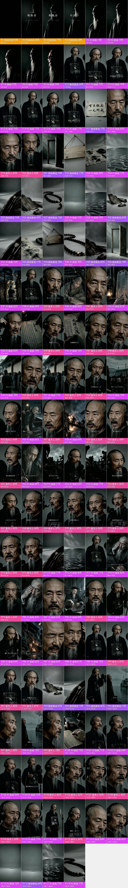

## 見どころ

- **冒頭のつかみ**：0–7 秒、黒地のタイトル「和血吞」とクレジット「作词 Claude 作曲 Suno」が、少しずつ明るくなる老人のシルエットに重なる。7–16 秒、スタジオで口を開いた第一声が「官至极品，一无所成」（位は人臣を極め、何も成し遂げなかった）、続けて「这话，我自己写的」（この言葉は自分で書いた）。17 秒でその八文字を宣紙に書いた形で見せる。
- 20–29 秒、「上 Beat」のあとに 1 拍 1 カットの静物インサートを 16 個連続で切る（木の扉、木札、墨の紙、黒い水、空の舟、焦げた木、数珠）。情報は何も足さず、ドラムに合わせるだけで、語りからラップへ空気を切り替える。同じ静物群は 85 秒、116 秒、152 秒からのエンディングでも繰り返され、曲全体の映像上の韻になっている。
- 29–135 秒、歌詞の一行ごとに対応する歴史シーンを当てる：「考了七回」には机に向かう少年、「文理太浅」にはその四文字が書かれた本のページ、「湘江水冷」には部下に川から船へ引き上げられる場面、「老乡砸了」には燃える扁額。歴史を知らなくても何を歌っているかがわかる。
- 66–85 秒、サビ「打脱牙和血吞」はすべてスタジオに戻り、ショットサイズを変えたラップのクローズアップ 9 カットで歌い切る。物語パートとスタジオでのパフォーマンスがブロックごとに交互に来るので、構成がわかりやすい。
- 145 秒、「德行一无可许」（徳行は何ひとつ認められない）を歌い終えたあと、小声で「这条，过了。」（このテイク、OK）と言う。エンジニアがテイクを確定するようでもあり、自分の一生に判を押すようでもある。冒頭の「这话，我自己写的」と前後で呼応している。

## ひと目でわかる：画面・パッケージング・音声の 3 層

ショート動画は 3 層に分けられる：いちばん下が画面そのもの、その上に字幕・装飾テキスト・ステッカーが重なり、さらに音声がつく。再現するときは 1 層ずつ作る。

| 層 | この動画では何か | どう作るか | 詳細 |
|---|---|---|---|
| **画面**（ベース） | AI 生成動画 60 ショット、デジタルヒューマン（話者） 37 ショット、静止画 + ズーム・パン効果 17 ショット、コード／テンプレートレンダリング 4 ショット | AI で 33 回に分けて生成、繰り返し出てくる部分は完成した映像から切り出す；デジタルヒューマン；画面収録／コードで動きをつける；1 枚の画像で静止フレームかズーム・パン | 「自分で再現する」 |
| **パッケージング**（画面の上に重ねる） | グラフィック貼り付け、テキスト、字幕 | 編集ソフトで追加：字幕、装飾テキスト、ステッカーをタイムラインどおりに配置 | 「編集パッケージング層」 |
| **音声** | ボーカル（TTS ナレーション）、BGM（178 BPM、要確認） | ボーカル：TTS ナレーション；BGM：テンポと雰囲気で似た曲を探す | 「サウンド」 |

## 内容と構成

- 以下のストーリーラインはショットごとの画像確認によるもの。セリフは別途整理しておらず、字幕の原文は「編集パッケージング層」を参照

**ストーリーライン**

再現するときはこの流れを残す：各ステップの順序と役割はそのまま使い、語っている中身を自分の事例・データ・素材に置き換えれば、単に主役を入れ替えただけにはならない。

| 時間 | ショット | 役割 | 何を語っているか |
|---|---|---|---|
| 0.0–4.9s | #1–#4 | つかみ | 黒地のタイトルでまず曲名と「AI が作詞作曲した」ことを見せる → 少しずつ明るくなるシルエットにタイトルを重ね、正面の顔を見せずに引っ張る |
| 4.9–7.2s | #5–#9 | ムード演出 | ごく短いシルエットのクローズアップ数カットをドラムに合わせ、重苦しい空気を敷く |
| 7.2–13.0s | #10–#13 | つかみ | 主人公が口を開くなり自分の一生を否定する一言を放ち、ギャップを作る |
| 13.0–15.8s | #14–#16 | 背景説明 | 「这话我自己写的」と付け加え、これが本人による自己評価だと示す |
| 15.8–18.1s | #17 | 根拠提示 | 口にしたばかりの評価を紙に書かれた文字として見せ、もう一度読ませる |
| 18.1–20.1s | #18–#20 | 転換 | 語りから沈黙の超クローズアップに切り替え、ラップに入る前に一拍置く → 「上 Beat」の一言で語りからラップへ |
| 20.1–29.2s | #21–#36 | ムード演出 | 1 番に入る前に、1 拍ごとに変わる象徴的な静物インサートを連ねてドラムに合わせる |
| 29.2–31.6s | #37 | 情報補足 | 少年が試験場に入り、科挙の話が始まる |
| 31.6–31.8s | #38 | ムード演出 | 一瞬だけ映る引きのスタジオショットで、スタジオに戻ったことを思い出させる |
| 31.8–36.7s | #39–#41 | 情報補足 | 落第の回数を歌う → 落ち続ける様子を、机に向かう姿で「考了七回」に合わせる → 父子が同じ試験を受けて父が合格、屈辱がもう一段重なる |
| 36.7–39.5s | #42 | 根拠提示 | 名前が貼り出されてさらし者に。赤丸のクローズアップが根拠 |
| 39.5–40.2s | #43 | ムード演出 | ヘッドホンを押さえて歌う動作で、本当に録音しているように見せる |
| 40.2–42.9s | #44 | 根拠提示 | 「文理太浅」の四文字をそのまま画面に入れて根拠にする |
| 42.9–43.6s | #45 | 情報補足 | 恥が町中に知れ渡ったと歌う |
| 43.6–44.8s | #46 | 根拠提示 | もう一度寄って、四文字で画面を埋める |
| 44.8–64.7s | #47–#63 | 情報補足 | ラップのクローズアップで感情を近づける → 合格発表の人混みで順位を見る、さらに三回受けたと示す → 進士試験もまた三回 → 順位は最下位、科挙のパートを締める → 四十歳を過ぎてから兵を率い、初戦で敗れる →（計 12 点、各ショットは「絵コンテ表」を参照） |
| 64.7–65.4s | #64 | ムード演出 | 歌のあいだにうつむいて間を取る |
| 65.4–67.2s | #65 | 情報補足 | 「结硬寨、打呆仗」、塹壕を掘るシルエットで愚直なやり方を描く |
| 67.2–85.5s | #66–#74 | 結論 | サビでテーマを示す：行く先々で罵られ、負け続け、折れた歯を血ごと飲み込む |
| 85.5–88.6s | #75–#77 | ムード演出 | サビのあとに同じ静物インサートを挟んで一息つく → 一瞬だけ映る引きのスタジオショットで、スタジオに戻ったことを思い出させる |
| 88.6–93.3s | #78–#80 | 情報補足 | 晩年、右目を失明 → 晩年のパートへ → めまいが止まらず、病に苦しむ |
| 93.3–94.0s | #81 | ムード演出 | カメラを見据える間で感情を抑え込む |
| 94.0–106.1s | #82–#86 | 転換 | 病を押して天津の事件の処理に送られ、結果として売国奴の汚名を着る → ラップのクローズアップで汚名のパートにつなぐ → ヘッドホンを押さえて歌う動作から、会館の扁額が壊される場面へ → 同郷の人々に扁額を壊され、汚名が現実になる |
| 106.1–109.0s | #87–#89 | ムード演出 | 苦しげな超クローズアップで汚名のパートを締める → サビの前にスタジオのミディアムショットに戻って一息つく |
| 109.0–115.7s | #90–#92 | 結論 | サビをもう一度、汚名も血ごと飲み込む |
| 115.7–122.3s | #93–#95 | ムード演出 | サビのあとに同じ静物インサートを挟んで一息つく → インサートのあとスタジオに戻り、洋務運動のパートへつなぐ |
| 122.3–129.2s | #96–#100 | 情報補足 | 洋務運動の成果：中国で造った蒸気船の進水を見届ける → 洋務運動の成果を歌う → 少年たちを留学させる上奏文に署名する |
| 129.2–131.0s | #101、#102 | ムード演出 | 歌のあいだの沈黙の間 |
| 131.0–132.6s | #103、#104 | 転換 | 手を広げる動作で心残りを歌う |
| 132.6–143.0s | #105–#109 | 結論 | 臨終の自己評価：官位は極めたが、学問は何も成し遂げなかった |
| 143.0–144.0s | #110 | ムード演出 | 締めの前の間 |
| 144.0–152.0s | #111–#114 | 結論 | 全身ショットで自己評価を最後の一行まで歌う → エンジニアのように「这条过了」と言い、一生の評価と録音をまとめて締める → 最後にカメラを見据える沈黙で、評価を観客に委ねる |
| 152.0–165.0s | #115–#118 | ムード演出 | エンディングで冒頭の静物インサートに戻り、前後を呼応させる → 数珠で締め、生涯の自省という余韻に落とす |

## 絵コンテ表

「画面」「カメラワーク」「オーバーレイ」は画面上で確認できる内容。「制作方式」「素材の出所」はツールによる推定で、根拠は付録のショット別の根拠を参照。

| # | スクショ | 時間 | 長さ | 何を伝えているか | 画面 | カメラワーク | オーバーレイ | 制作方式（推定） | 素材の出所（推定） | 再現 |
|---|---|---|---|---|---|---|---|---|---|---|
| 1 |  | 0:00.0 | 2.1s | つかみ：黒背景のタイトルで、まず曲名と「AI 作词作曲」という素性を見せる | 真っ黒な背景のタイトルカード：上に小さく「大清有说唱」、中央に大きく「和血吞」、下に小さくクレジット「作词 C… | 固定 | — | コード／テンプレートレンダリング 93% | 制作側でレンダリング | コードレンダリング · セグメント1 |
| 2 | 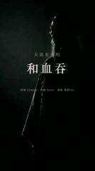 | 0:02.1 | 1.0s | つかみ：徐々に明るくなる人物シルエットにタイトルを重ね、まだ正面の顔を見せずに引きを作る | 黒背景にサイド逆光：長いひげの老人の横顔シルエットが闇からゆっくり浮かび上がり、額・ひげ・肩だけが冷たい白のリム… | スムーズなカメラワーク | — | コード／テンプレートレンダリング 88% | 制作側でレンダリング | コードレンダリング · セグメント1 |
| 3 | 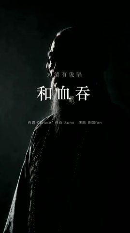 | 0:03.2 | 1.0s | つかみ：徐々に明るくなる人物シルエットにタイトルを重ね、まだ正面の顔を見せずに引きを作る | 黒背景にサイド逆光：長いひげの老人の横顔シルエットが闇からゆっくり浮かび上がり、額・ひげ・肩だけが冷たい白のリム… | スムーズなカメラワーク | — | コード／テンプレートレンダリング 77% | 制作側でレンダリング | コードレンダリング · セグメント1 |
| 4 | 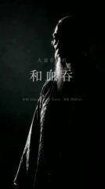 | 0:04.2 | 0.7s | つかみ：徐々に明るくなる人物シルエットにタイトルを重ね、まだ正面の顔を見せずに引きを作る | 黒背景にサイド逆光：長いひげの老人の横顔シルエットが闇からゆっくり浮かび上がり、額・ひげ・肩だけが冷たい白のリム… | スムーズなカメラワーク | — | コード／テンプレートレンダリング 68% | 制作側でレンダリング | コードレンダリング · セグメント1 |
| 5 | 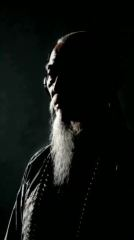 | 0:04.9 | 0.7s | ムード演出：ごく短いシルエットのクローズアップを数カット重ねてドラムに合わせ、重苦しい空気を敷く | 黒背景・サイド逆光の老人の横顔クローズアップ：白く長いひげと額がリムライトに照らされ、老人はわずかに口を開いて首をかしげる。いくつかの異なる… | スムーズなカメラワーク | — | AI 生成動画 74% | AI 生成 | AI 生成 · G1 |
| 6 | 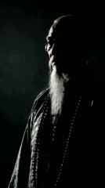 | 0:05.5 | 0.3s | ムード演出：ごく短いシルエットのクローズアップを数カット重ねてドラムに合わせ、重苦しい空気を敷く | 黒背景・サイド逆光の老人の横顔クローズアップ：白く長いひげと額がリムライトに照らされ、老人はわずかに口を開いて首をかしげる。いくつかの異なる… | スムーズなカメラワーク | — | AI 生成動画 73% | AI 生成 | AI 生成 · G1 |
| 7 | 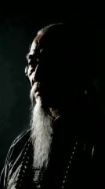 | 0:05.9 | 0.7s | ムード演出：ごく短いシルエットのクローズアップを数カット重ねてドラムに合わせ、重苦しい空気を敷く | 黒背景・サイド逆光の老人の横顔クローズアップ：白く長いひげと額がリムライトに照らされ、老人はわずかに口を開いて首をかしげる。いくつかの異なる… | スムーズなカメラワーク | — | AI 生成動画 75% | AI 生成 | AI 生成 · G1 |
| 8 | 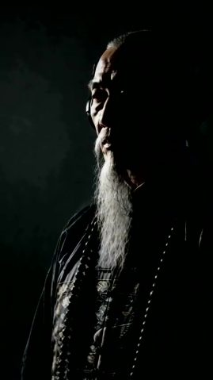 | 0:06.6 | 0.3s | ムード演出：ごく短いシルエットのクローズアップを数カット重ねてドラムに合わせ、重苦しい空気を敷く | 黒背景・サイド逆光の老人の横顔クローズアップ：白く長いひげと額がリムライトに照らされ、老人はわずかに口を開いて首をかしげる。いくつかの異なる… | スムーズなカメラワーク | グラフィック貼り付け | AI 生成動画 74% | AI 生成 | AI 生成 · G1 |
| 9 | 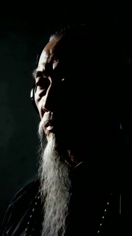 | 0:06.9 | 0.3s | ムード演出：ごく短いシルエットのクローズアップを数カット重ねてドラムに合わせ、重苦しい空気を敷く | 黒背景・サイド逆光の老人の横顔クローズアップ：白く長いひげと額がリムライトに照らされ、老人はわずかに口を開いて首をかしげる。いくつかの異なる… | スムーズなカメラワーク | — | AI 生成動画 74% | AI 生成 | AI 生成 · G1 |
| 10 |  | 0:07.2 | 1.4s | つかみ：主人公が口を開くなり自分の一生を否定する一言を放ち、ギャップを作る | レコーディングスタジオのミディアムショット：清代の老人（曽国藩）：前頭部を剃り上げ後ろに長い辮髪、胸まで垂れる白髪まじりの長いひげ、八の字ひげ、黒… | 全体ズーム・パン | テキスト、グラフィック貼り付け | 静止画 + ズーム・パン効果 69% | AI 生成 | ローカル ffmpeg でズーム・パン |
| 11 | 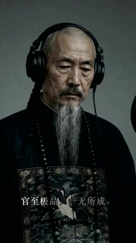 | 0:08.6 | 1.3s | つかみ：主人公が口を開くなり自分の一生を否定する一言を放ち、ギャップを作る | レコーディングスタジオのミディアムショット：清代の老人（曽国藩）：前頭部を剃り上げ後ろに長い辮髪、胸まで垂れる白髪まじりの長いひげ、八の字ひげ、黒… | 全体ズーム・パン | テキスト | AI 生成動画 79% | AI 生成 | AI 生成 · G2 |
| 12 | 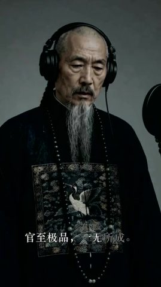 | 0:10.0 | 1.7s | つかみ：主人公が口を開くなり自分の一生を否定する一言を放ち、ギャップを作る | レコーディングスタジオのミディアムショット：清代の老人（曽国藩）：前頭部を剃り上げ後ろに長い辮髪、胸まで垂れる白髪まじりの長いひげ、八の字ひげ、黒… | 全体ズーム・パン | テキスト、グラフィック貼り付け | AI 生成動画 79% | AI 生成 | AI 生成 · G2 |
| 13 | 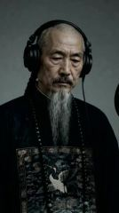 | 0:11.7 | 1.4s | つかみ：主人公が口を開くなり自分の一生を否定する一言を放ち、ギャップを作る | レコーディングスタジオのミディアムショット：清代の老人（曽国藩）：前頭部を剃り上げ後ろに長い辮髪、胸まで垂れる白髪まじりの長いひげ、八の字ひげ、黒… | 全体ズーム・パン | グラフィック貼り付け | AI 生成動画 79% | AI 生成 | AI 生成 · G2 |
| 14 | 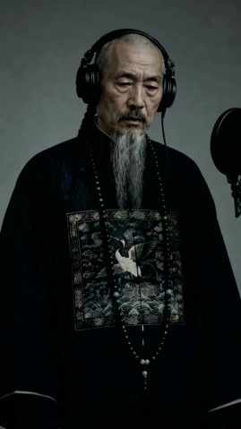 | 0:13.0 | 1.0s | 背景説明：「这话我自己写的」と一言添え、これが本人による自己評価だと示す | レコーディングスタジオのミディアムショット：清代の老人（曽国藩）：前頭部を剃り上げ後ろに長い辮髪、胸まで垂れる白髪まじりの長いひげ、八の字ひげ、黒… | スムーズなカメラワーク | テキスト | AI 生成動画 77% | AI 生成 | AI 生成 · G2 |
| 15 | 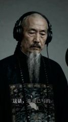 | 0:14.0 | 0.7s | 背景説明：「这话我自己写的」と一言添え、これが本人による自己評価だと示す | レコーディングスタジオのミディアムショット：清代の老人（曽国藩）：前頭部を剃り上げ後ろに長い辮髪、胸まで垂れる白髪まじりの長いひげ、八の字ひげ、黒… | 全体ズーム・パン | テキスト | AI 生成動画 79% | AI 生成 | AI 生成 · G2 |
| 16 | 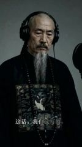 | 0:14.7 | 1.0s | 背景説明：「这话我自己写的」と一言添え、これが本人による自己評価だと示す | レコーディングスタジオのミディアムショット：清代の老人（曽国藩）：前頭部を剃り上げ後ろに長い辮髪、胸まで垂れる白髪まじりの長いひげ、八の字ひげ、黒… | 全体ズーム・パン | テキスト、グラフィック貼り付け | AI 生成動画 77% | AI 生成 | AI 生成 · G2 |
| 17 |  | 0:15.8 | 2.3s | 根拠提示：口にしたばかりの評語を紙の文字にして、観客にもう一度見せる | 灰色の台の上に耳付きの宣紙、毛筆の大きな文字で「官至极品 一无所成」、画面はゆっくりプッシュイン。下部は… | 全体ズーム・パン | テキスト | 静止画 + ズーム・パン効果 77% | AI 生成 | ローカル ffmpeg でズーム・パン |
| 18 | 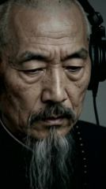 | 0:18.1 | 0.7s | 転換：語りから無言の超クローズアップに切り替え、ラップに入る前に一拍置く | レコーディングスタジオの超クローズアップ：老人がうつむいて目を伏せ、モニターヘッドホンを着用。顔のしわや老人斑がはっきり見え、冷たいグレーの背景。 | 手持ちの揺れ | — | AI 生成動画 86% | AI 生成 | AI 生成 · G2 |
| 19 | 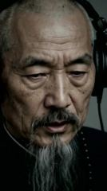 | 0:18.8 | 0.7s | 転換：「上 Beat」の一言で語りからラップへ移る | レコーディングスタジオのクローズアップ：老人がうつむいた状態から顔を上げてカメラを正視し、「上Beat。」と言う | スムーズなカメラワーク | — | デジタルヒューマン（話者） 85% | AI 生成 | TTS + デジタルヒューマン |
| 20 | 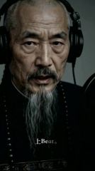 | 0:19.5 | 0.7s | 転換：「上 Beat」の一言で語りからラップへ移る | レコーディングスタジオのクローズアップ：老人がうつむいた状態から顔を上げてカメラを正視し、「上Beat。」と言う | スムーズなカメラワーク | テキスト、グラフィック貼り付け | デジタルヒューマン（話者） 85% | AI 生成 | TTS + デジタルヒューマン |
| 21 | 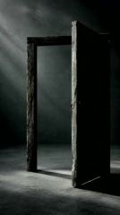 | 0:20.1 | 0.7s | ムード演出：ヴァースの前に、1 拍ごとに切り替わる象徴的な静物の空ショットを連ねてドラムに合わせる | がらんとした灰色の空間に半開きの古い木の扉が立ち、左上から冷たい光が斜めに差し込む。画面はゆっくりプッシュイン。 | 全体ズーム・パン | — | 静止画 + ズーム・パン効果 78% | AI 生成 | ローカル ffmpeg でズーム・パン |
| 22 |  | 0:20.8 | 0.7s | ムード演出：ヴァースの前に、1 拍ごとに切り替わる象徴的な静物の空ショットを連ねてドラムに合わせる | 灰色の壁に麻縄で吊るされた無地のエイジング加工の木札、左上から斜光、画面はゆっくりプッシュイン。 | 全体ズーム・パン | — | 静止画 + ズーム・パン効果 77% | AI 生成 | ローカル ffmpeg でズーム・パン |
| 23 | 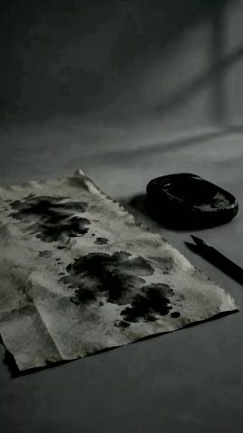 | 0:21.5 | 0.7s | ムード演出：ヴァースの前に、1 拍ごとに切り替わる象徴的な静物の空ショットを連ねてドラムに合わせる | 灰色の机に墨だらけのしわくちゃの宣紙が広げられ、横に黒い硯と筆、背景の壁に格子窓の影、カメラ… | スムーズなカメラワーク | — | AI 生成動画 82% | AI 生成 | AI 生成 · G3 |
| 24 |  | 0:22.2 | 0.7s | ムード演出：ヴァースの前に、1 拍ごとに切り替わる象徴的な静物の空ショットを連ねてドラムに合わせる | モノクロ調の暗い水面のクローズアップ、細かな波紋が揺れ続け、遠くに弧を描く水平線、上空の曇天から斜めに… | スムーズなカメラワーク | グラフィック貼り付け | AI 生成動画 77% | AI 生成 | AI 生成 · G33（#117 から切り出し） |
| 25 | 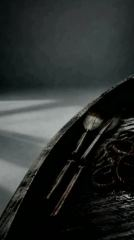 | 0:22.9 | 0.7s | ムード演出：ヴァースの前に、1 拍ごとに切り替わる象徴的な静物の空ショットを連ねてドラムに合わせる | 黒い古い木造船の舷側の弧が画面を斜めに横切り、船内に櫂 2 本と麻縄の束が横たわる。背景は灰色の霧と斜めの… | 全体ズーム・パン | — | 静止画 + ズーム・パン効果 76% | AI 生成 | ローカル ffmpeg でズーム・パン |
| 26 | 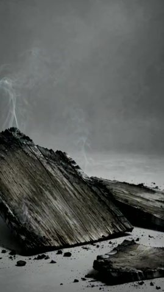 | 0:23.5 | 0.7s | ムード演出：ヴァースの前に、1 拍ごとに切り替わる象徴的な静物の空ショットを連ねてドラムに合わせる | 灰色の台の上に焼け焦げて炭化した板の破片がいくつか、上に数筋の白煙が立ち上る。背景は灰色の霧。 | 全体ズーム・パン | — | 静止画 + ズーム・パン効果 83% | AI 生成 | ローカル ffmpeg でズーム・パン |
| 27 | 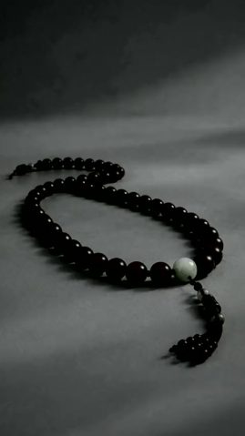 | 0:24.2 | 0.7s | ムード演出：ヴァースの前に、1 拍ごとに切り替わる象徴的な静物の空ショットを連ねてドラムに合わせる | 灰色の台の上に黒い数珠が輪になって置かれ、淡い色の親玉と房付き。画面はゆっくりプッシュイン。 | 全体ズーム・パン | — | 静止画 + ズーム・パン効果 76% | AI 生成 | ローカル ffmpeg でズーム・パン |
| 28 | 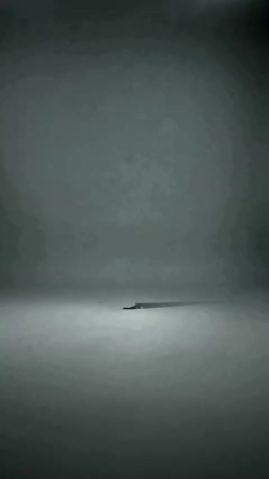 | 0:24.9 | 0.7s | ムード演出：ヴァースの前に、1 拍ごとに切り替わる象徴的な静物の空ショットを連ねてドラムに合わせる | がらんとした灰色の霧の空間、遠くの地平線上を小さな黒い木の舟（または板）が長い影を引きながらゆっくりと… | — | — | AI 生成動画 70% | AI 生成 | AI 生成 · G33（#115 から切り出し） |
| 29 |  | 0:25.6 | 0.7s | ムード演出：ヴァースの前に、1 拍ごとに切り替わる象徴的な静物の空ショットを連ねてドラムに合わせる | モノクロ調の暗い水面のクローズアップ、細かな波紋が揺れ続け、遠くに弧を描く水平線、上空の曇天から斜めに… | スムーズなカメラワーク | グラフィック貼り付け | AI 生成動画 78% | AI 生成 | AI 生成 · G33（#117 から切り出し） |
| 30 | 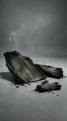 | 0:26.2 | 0.7s | ムード演出：ヴァースの前に、1 拍ごとに切り替わる象徴的な静物の空ショットを連ねてドラムに合わせる | 灰色の台の上に焼け焦げて炭化した板の破片がいくつか、上に数筋の白煙が立ち上る。背景は灰色の霧。 | 全体ズーム・パン | — | 静止画 + ズーム・パン効果 85% | AI 生成 | ローカル ffmpeg でズーム・パン |
| 31 |  | 0:26.9 | 0.7s | ムード演出：ヴァースの前に、1 拍ごとに切り替わる象徴的な静物の空ショットを連ねてドラムに合わせる | 黒い古い木造船の舷側の弧が画面を斜めに横切り、船内に櫂 2 本と麻縄の束が横たわる。背景は灰色の霧と斜めの… | スムーズなカメラワーク | グラフィック貼り付け | AI 生成動画 76% | AI 生成 | AI 生成 · G19（#75 から切り出し） |
| 32 | 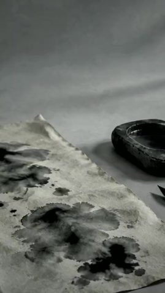 | 0:27.6 | 0.3s | ムード演出：ヴァースの前に、1 拍ごとに切り替わる象徴的な静物の空ショットを連ねてドラムに合わせる | 灰色の机に墨だらけのしわくちゃの宣紙が広げられ、横に黒い硯と筆、背景の壁に格子窓の影、カメラ… | 全体ズーム・パン | — | 静止画 + ズーム・パン効果 77% | AI 生成 | ローカル ffmpeg でズーム・パン |
| 33 |  | 0:28.0 | 0.3s | ムード演出：ヴァースの前に、1 拍ごとに切り替わる象徴的な静物の空ショットを連ねてドラムに合わせる | 灰色の壁に麻縄で吊るされた無地のエイジング加工の木札、左上から斜光、画面はゆっくりプッシュイン。 | 全体ズーム・パン | — | 静止画 + ズーム・パン効果 78% | AI 生成 | ローカル ffmpeg でズーム・パン |
| 34 |  | 0:28.3 | 0.3s | ムード演出：ヴァースの前に、1 拍ごとに切り替わる象徴的な静物の空ショットを連ねてドラムに合わせる | 灰色の台の上に暗い色の数珠が S 字にうねり、カメラが数珠に沿ってゆっくり移動し、金色のひびが入った… | スムーズなカメラワーク | — | AI 生成動画 78% | AI 生成 | AI 生成 · G3 |
| 35 | 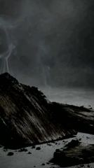 | 0:28.6 | 0.4s | ムード演出：ヴァースの前に、1 拍ごとに切り替わる象徴的な静物の空ショットを連ねてドラムに合わせる | 灰色の台の上に焼け焦げて炭化した板の破片がいくつか、上に数筋の白煙が立ち上る。背景は灰色の霧。 | 全体ズーム・パン | — | 静止画 + ズーム・パン効果 84% | AI 生成 | ローカル ffmpeg でズーム・パン |
| 36 | 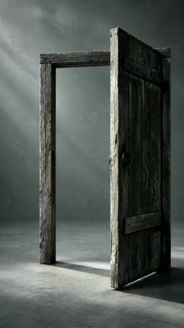 | 0:29.0 | 0.2s | ムード演出：ヴァースの前に、1 拍ごとに切り替わる象徴的な静物の空ショットを連ねてドラムに合わせる | がらんとした灰色の空間に半開きの古い木の扉が立ち、左上から冷たい光が斜めに差し込む。画面はゆっくりプッシュイン。 | 全体ズーム・パン | — | 静止画 + ズーム・パン効果 78% | AI 生成 | ローカル ffmpeg でズーム・パン |
| 37 | 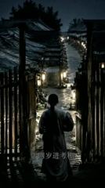 | 0:29.2 | 2.4s | 情報補足：少年が試験場に入り、科挙の経歴を語り始める | 夜、長い辮髪に灰色の長衫の少年がカメラに背を向け、木の柵門を抜けて両側に提灯が下がる試験場の長い路地へ入っていく… | スムーズなカメラワーク | 字幕 | AI 生成動画 82% | AI 生成 | AI 生成 · G4 |
| 38 | 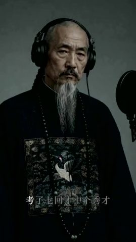 | 0:31.6 | 0.1s | ムード演出：一瞬だけの全身の位置確認ショットで、レコーディングスタジオに戻ったことを示す | レコーディングスタジオのミディアムショット：マイクの前に立つ老人、胸に仙鶴の補子、画面に短くとどまる。 | スムーズなカメラワーク | テキスト | AI 生成動画 84% | AI 生成 | AI 生成 · G5 |
| 39 | 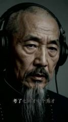 | 0:31.8 | 0.4s | 情報補足：何度も落第した回数を歌う | レコーディングスタジオのクローズアップ：ヘッドホンをつけた老人がマイクに向かって「考了七回才中个秀才」とラップする。 | スムーズなカメラワーク | テキスト | デジタルヒューマン（話者） 83% | AI 生成 | TTS + デジタルヒューマン |
| 40 | 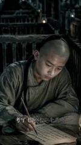 | 0:32.2 | 2.5s | 情報補足：落第続き。机に向かって苦学する画面に「考了七回」を合わせる | 薄暗い試験場で、前頭部を剃った少年が机に伏して筆で字を書く。背後には木格子の号舎が並び油灯がともる。カメラはゆっくりプッシュ… | スムーズなカメラワーク | テキスト | AI 生成動画 88% | AI 生成 | AI 生成 · G6 |
| 41 | 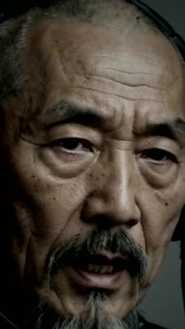 | 0:34.6 | 2.0s | 情報補足：父子で同じ試験を受け、父だけが合格。気まずさを一段重ねる | レコーディングスタジオの超クローズアップ：老人の顔が画面いっぱいに映り、口パクで「同一场我爹上了榜」と歌う。 | スムーズなカメラワーク | 字幕 | デジタルヒューマン（話者） 85% | AI 生成 | TTS + デジタルヒューマン |
| 42 | 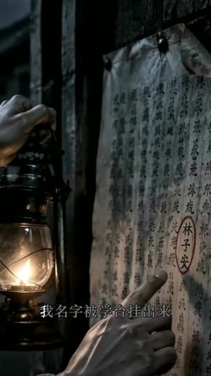 | 0:36.7 | 2.9s | 根拠提示：名前がさらし者として張り出される。赤丸のクローズアップで根拠を示す | 夜、片手で油灯を提げ、もう片方の手の指で壁に貼られた榜文を指す。榜の上の名前が赤丸で囲まれている… | スムーズなカメラワーク | 字幕 | AI 生成動画 81% | AI 生成 | AI 生成 · G7 |
| 43 | 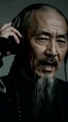 | 0:39.5 | 0.7s | ムード演出：ヘッドホンに手を添えて歌う仕草で、本当に録音しているように見せる | レコーディングスタジオのクローズアップ：老人が片手でヘッドホンを押さえ、聴きながら歌い出す。 | スムーズなカメラワーク | — | AI 生成動画 83% | AI 生成 | AI 生成 · G8 |
| 44 | 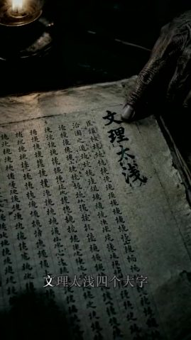 | 0:40.2 | 2.6s | 根拠提示：「文理太浅」の 4 文字をそのまま画面に入れて根拠にする | 薄暗い油灯の下、年老いた指が開かれた古い書物のページを押さえる。ページには大きく「文理太浅」の 4 文字、横に… | スムーズなカメラワーク | 字幕 | AI 生成動画 74% | AI 生成 | AI 生成 · G9 |
| 45 | 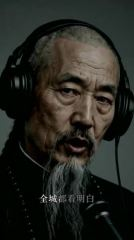 | 0:42.9 | 0.7s | 情報補足：町中に恥をさらしたと歌う | レコーディングスタジオのクローズアップ：老人が「全城都看明白」と歌い、苦い表情。 | スムーズなカメラワーク | テキスト | デジタルヒューマン（話者） 84% | AI 生成 | TTS + デジタルヒューマン |
| 46 | 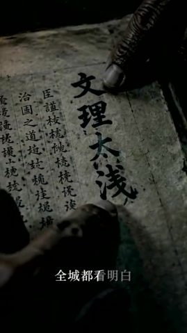 | 0:43.6 | 1.2s | 根拠提示：もう一度プッシュインし、4 文字で画面を埋める | 同じ古書のページのさらに寄ったクローズアップ、「文理太浅」の 4 文字が画面を占め、指が下で動く。 | スムーズなカメラワーク | テキスト | AI 生成動画 76% | AI 生成 | AI 生成 · G10 |
| 47 | 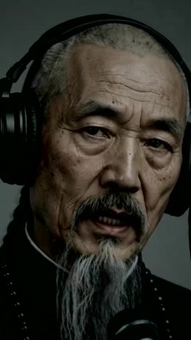 | 0:44.8 | 0.6s | 情報補足：ラップのクローズアップで感情を近づける | レコーディングスタジオの超クローズアップ：老人の顔が画面いっぱいに映り、眉をひそめながら歌う。 | スムーズなカメラワーク | — | デジタルヒューマン（話者） 86% | AI 生成 | TTS + デジタルヒューマン |
| 48 | 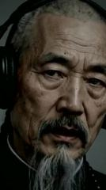 | 0:45.4 | 0.2s | 情報補足：ラップのクローズアップで感情を近づける | レコーディングスタジオの超クローズアップ：老人の顔が画面いっぱいに映り、眉をひそめながら歌う。 | スムーズなカメラワーク | テキスト | デジタルヒューマン（話者） 85% | AI 生成 | TTS + デジタルヒューマン |
| 49 | 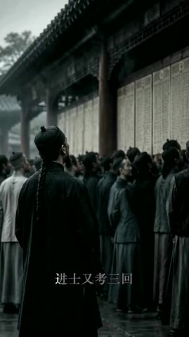 | 0:45.7 | 1.3s | 情報補足：合格発表の人混みで順位を確かめ、さらに 3 回受けたことを示す | 曇天の貢院の壁の下、長袍の読書人たちがひしめいて榜を見上げる。手前に瓜皮帽をかぶり辮髪を垂らした人物がカメラに背を向け… | スムーズなカメラワーク | テキスト | AI 生成動画 78% | AI 生成 | AI 生成 · G11 |
| 50 | 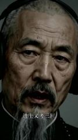 | 0:47.0 | 0.6s | 情報補足：進士の試験もまた 3 回 | レコーディングスタジオの超クローズアップ：老人が「进士又考三回」と歌う。 | スムーズなカメラワーク | テキスト | デジタルヒューマン（話者） 85% | AI 生成 | TTS + デジタルヒューマン |
| 51 | 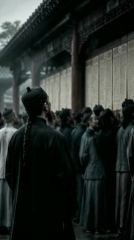 | 0:47.6 | 0.6s | 情報補足：合格発表の人混みで順位を確かめ、さらに 3 回受けたことを示す | 曇天の貢院の壁の下、長袍の読書人たちがひしめいて榜を見上げる。手前に瓜皮帽をかぶり辮髪を垂らした人物がカメラに背を向け… | スムーズなカメラワーク | — | AI 生成動画 77% | AI 生成 | AI 生成 · G12 |
| 52 | 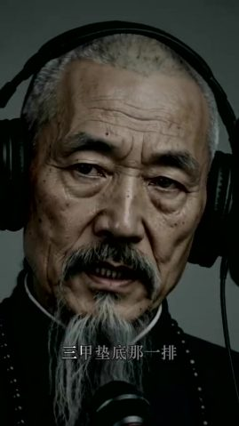 | 0:48.2 | 0.6s | 情報補足：順位は最下位。科挙のくだりを締めくくる | レコーディングスタジオのクローズアップ：老人が手前のマイクに向かって「三甲垫底那一排」と歌う。 | スムーズなカメラワーク | テキスト | デジタルヒューマン（話者） 83% | AI 生成 | TTS + デジタルヒューマン |
| 53 | 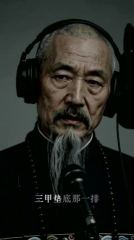 | 0:48.8 | 1.6s | 情報補足：順位は最下位。科挙のくだりを締めくくる | レコーディングスタジオのクローズアップ：老人が手前のマイクに向かって「三甲垫底那一排」と歌う。 | スムーズなカメラワーク | テキスト | デジタルヒューマン（話者） 86% | AI 生成 | TTS + デジタルヒューマン |
| 54 | 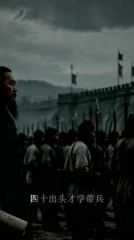 | 0:50.4 | 3.1s | 情報補足：40 歳でようやく兵を率いることを学び、初戦で敗れる | 暗雲の下の城壁の外、左手前にひげを蓄えた武将が巻物を手に横向きで厳かに立ち、背景では長槍を持った大勢の清軍が隊列を組んで行… | スムーズなカメラワーク | 字幕、テキスト | AI 生成動画 78% | AI 生成 | AI 生成 · G13 |
| 55 | 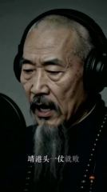 | 0:53.5 | 0.8s | 情報補足：兵を率いた初戦で即敗北 | レコーディングスタジオのクローズアップ：老人が横顔でマイクに向かって「靖港头一仗就败」と歌う。 | スムーズなカメラワーク | テキスト、グラフィック貼り付け | デジタルヒューマン（話者） 84% | AI 生成 | TTS + デジタルヒューマン |
| 56 |  | 0:54.2 | 2.0s | 情報補足：水に落ちて部下に引き上げられる場面に「湘江水冷」を合わせる | 夜の川に浮かぶ木造船、全身ずぶ濡れの白ひげの老人が両手で船板をつき、背後の部下に川から船へ引き上げられる。船首に… | スムーズなカメラワーク | テキスト | AI 生成動画 86% | AI 生成 | AI 生成 · G14 |
| 57 | 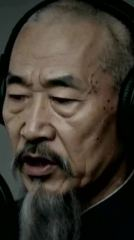 | 0:56.2 | 0.7s | 情報補足：ラップのクローズアップで次の敗戦につなぐ | レコーディングスタジオの超クローズアップ：老人が横顔でうつむいて歌い、重い表情。 | スムーズなカメラワーク | テキスト | デジタルヒューマン（話者） 82% | AI 生成 | TTS + デジタルヒューマン |
| 58 | 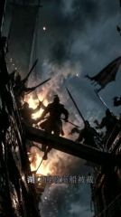 | 0:56.9 | 1.5s | 情報補足：湖口で再び敗れ、座船を奪われる。炎上する軍船で表現 | 夜の水上戦、燃える軍船の上で刀を持った兵士のシルエットが激しく戦う。背景に炎と濃い煙、旗がはためく。 | スムーズなカメラワーク | 字幕 | AI 生成動画 84% | AI 生成 | AI 生成 · G15 |
| 59 | 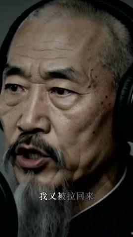 | 0:58.4 | 0.5s | 情報補足：またしても九死に一生を得る | レコーディングスタジオの超クローズアップ：老人が大きく口を開けて「我又被拉回来」と歌い、感情が高ぶる。 | スムーズなカメラワーク | テキスト | デジタルヒューマン（話者） 82% | AI 生成 | TTS + デジタルヒューマン |
| 60 |  | 0:58.9 | 0.6s | 情報補足：またしても九死に一生を得る | レコーディングスタジオの超クローズアップ：老人が大きく口を開けて「我又被拉回来」と歌い、感情が高ぶる。 | スムーズなカメラワーク | テキスト、グラフィック貼り付け | デジタルヒューマン（話者） 83% | AI 生成 | TTS + デジタルヒューマン |
| 61 |  | 0:59.5 | 0.1s | 情報補足：またしても九死に一生を得る | レコーディングスタジオの超クローズアップ：老人が大きく口を開けて「我又被拉回来」と歌い、感情が高ぶる。 | スムーズなカメラワーク | テキスト | デジタルヒューマン（話者） 84% | AI 生成 | TTS + デジタルヒューマン |
| 62 |  | 0:59.6 | 2.9s | 情報補足：祁門で包囲され、先に遺書を書いておく | 薄暗い陣幕の中、白ひげの老人がうつむいて筆を執る。背後の幕の外には夜の篝火、カメラはゆっくりプッシュイン。 | スムーズなカメラワーク | 字幕 | AI 生成動画 89% | AI 生成 | AI 生成 · G16 |
| 63 |  | 1:02.5 | 2.1s | 情報補足：「結硬寨、打呆仗」。塹壕を掘るシルエットで愚直な努力を描く | 黒雲が渦巻く空の下、兵士たちのシルエットがシャベルやハンマーを振るって塹壕を掘り陣を築く。背景に木製の物見櫓、ローアングル。 | スムーズなカメラワーク | 字幕 | AI 生成動画 77% | AI 生成 | AI 生成 · G16 |
| 64 |  | 1:04.7 | 0.7s | ムード演出：歌の合間にうつむいて間を取る | レコーディングスタジオのミディアムショット：老人がマイクの後ろでうつむいて黙って立ち、口を開かない。 | スムーズなカメラワーク | グラフィック貼り付け | AI 生成動画 84% | AI 生成 | AI 生成 · G17 |
| 65 |  | 1:05.4 | 1.8s | 情報補足：「結硬寨、打呆仗」。塹壕を掘るシルエットで愚直な努力を描く | 黒雲が渦巻く空の下、兵士たちのシルエットがシャベルやハンマーを振るって塹壕を掘り陣を築く。背景に木製の物見櫓、ローアングル。 | スムーズなカメラワーク | テキスト | AI 生成動画 77% | AI 生成 | AI 生成 · G18 |
| 66 |  | 1:07.2 | 2.8s | 結論：サビでテーマを打ち出す。罵られ続け負け続け、折れた歯を血ごと飲み込む | レコーディングスタジオのクローズアップ：ヘッドホンをつけた老人がマイクに向かってサビ「打脱牙和血吞」「京城骂完长沙骂」「长沙骂… | スムーズなカメラワーク | 字幕 | デジタルヒューマン（話者） 86% | AI 生成 | TTS + デジタルヒューマン |
| 67 |  | 1:10.0 | 0.5s | 結論：サビでテーマを打ち出す。罵られ続け負け続け、折れた歯を血ごと飲み込む | レコーディングスタジオのクローズアップ：ヘッドホンをつけた老人がマイクに向かってサビ「打脱牙和血吞」「京城骂完长沙骂」「长沙骂… | スムーズなカメラワーク | テキスト、グラフィック貼り付け | デジタルヒューマン（話者） 85% | AI 生成 | TTS + デジタルヒューマン |
| 68 |  | 1:10.5 | 1.2s | 結論：サビでテーマを打ち出す。罵られ続け負け続け、折れた歯を血ごと飲み込む | レコーディングスタジオのクローズアップ：ヘッドホンをつけた老人がマイクに向かってサビ「打脱牙和血吞」「京城骂完长沙骂」「长沙骂… | スムーズなカメラワーク | テキスト、グラフィック貼り付け | デジタルヒューマン（話者） 84% | AI 生成 | TTS + デジタルヒューマン |
| 69 |  | 1:11.8 | 2.8s | 結論：サビでテーマを打ち出す。罵られ続け負け続け、折れた歯を血ごと飲み込む | レコーディングスタジオのクローズアップ：ヘッドホンをつけた老人がマイクに向かってサビ「打脱牙和血吞」「京城骂完长沙骂」「长沙骂… | 固定（被写体が動く） | 字幕、グラフィック貼り付け | デジタルヒューマン（話者） 87% | AI 生成 | TTS + デジタルヒューマン |
| 70 |  | 1:14.6 | 1.4s | 結論：サビでテーマを打ち出す。罵られ続け負け続け、折れた歯を血ごと飲み込む | レコーディングスタジオのクローズアップ：ヘッドホンをつけた老人がマイクに向かってサビ「打脱牙和血吞」「京城骂完长沙骂」「长沙骂… | スムーズなカメラワーク | 字幕、グラフィック貼り付け | デジタルヒューマン（話者） 85% | AI 生成 | TTS + デジタルヒューマン |
| 71 |  | 1:16.0 | 1.3s | 結論：サビでテーマを打ち出す。罵られ続け負け続け、折れた歯を血ごと飲み込む | レコーディングスタジオのクローズアップ：ヘッドホンをつけた老人がマイクに向かってサビ「打脱牙和血吞」「京城骂完长沙骂」「长沙骂… | スムーズなカメラワーク | テキスト | デジタルヒューマン（話者） 84% | AI 生成 | TTS + デジタルヒューマン |
| 72 |  | 1:17.3 | 2.9s | 結論：サビでテーマを打ち出す。罵られ続け負け続け、折れた歯を血ごと飲み込む | レコーディングスタジオのクローズアップ：ヘッドホンをつけた老人がマイクに向かってサビ「打脱牙和血吞」「京城骂完长沙骂」「长沙骂… | スムーズなカメラワーク | 字幕、テキスト、グラフィック貼り付け | デジタルヒューマン（話者） 86% | AI 生成 | TTS + デジタルヒューマン |
| 73 |  | 1:20.2 | 1.0s | 結論：サビでテーマを打ち出す。罵られ続け負け続け、折れた歯を血ごと飲み込む | レコーディングスタジオのクローズアップ：ヘッドホンをつけた老人がマイクに向かってサビ「打脱牙和血吞」「京城骂完长沙骂」「长沙骂… | スムーズなカメラワーク | — | デジタルヒューマン（話者） 84% | AI 生成 | TTS + デジタルヒューマン |
| 74 |  | 1:21.2 | 4.2s | 結論：サビでテーマを打ち出す。罵られ続け負け続け、折れた歯を血ごと飲み込む | レコーディングスタジオのクローズアップ：ヘッドホンをつけた老人がマイクに向かってサビ「打脱牙和血吞」「京城骂完长沙骂」「长沙骂… | スムーズなカメラワーク | 字幕 | デジタルヒューマン（話者） 85% | AI 生成 | TTS + デジタルヒューマン |
| 75 |  | 1:25.5 | 1.7s | ムード演出：サビの後に同じ静物の空ショット群を挟んで一息つく | 黒い古い木造船の舷側の弧が画面を斜めに横切り、船内に櫂 2 本と麻縄の束が横たわる。背景は灰色の霧と斜めの… | スムーズなカメラワーク | — | AI 生成動画 77% | AI 生成 | AI 生成 · G19 |
| 76 |  | 1:27.1 | 1.2s | ムード演出：サビの後に同じ静物の空ショット群を挟んで一息つく | モノクロ調の暗い水面のクローズアップ、細かな波紋が揺れ続け、遠くに弧を描く水平線、上空の曇天から斜めに… | スムーズなカメラワーク | グラフィック貼り付け | AI 生成動画 80% | AI 生成 | AI 生成 · G33（#117 から切り出し） |
| 77 |  | 1:28.3 | 0.2s | ムード演出：一瞬だけの全身の位置確認ショットで、レコーディングスタジオに戻ったことを示す | レコーディングスタジオのミディアムショット：マイクの前に立つ老人、胸に仙鶴の補子、画面に短くとどまる。 | 固定 | — | AI 生成動画 71% | AI 生成 | AI 生成 · G20 |
| 78 |  | 1:28.6 | 2.2s | 情報補足：晩年に右目を失明 | 薄暗い室内、官服を着た白ひげの老人が右手で右目を覆い、疲れ切って老け込んだ表情。カメラはゆっくりプッシュイン。 | スムーズなカメラワーク | テキスト | AI 生成動画 80% | AI 生成 | AI 生成 · G21 |
| 79 |  | 1:30.8 | 0.7s | 情報補足：晩年のくだりへ移る | レコーディングスタジオのクローズアップ：老人が正面からカメラを正視して歌い出し、重い表情。 | スムーズなカメラワーク | — | デジタルヒューマン（話者） 84% | AI 生成 | TTS + デジタルヒューマン |
| 80 |  | 1:31.4 | 1.9s | 情報補足：めまいが止まらず、病に苦しむ | 白ひげの老人が目を閉じてこめかみと目を揉み、めまいに苦しむ表情。カメラはゆっくりプッシュイン。 | スムーズなカメラワーク | テキスト | AI 生成動画 80% | AI 生成 | AI 生成 · G22 |
| 81 |  | 1:33.3 | 0.7s | ムード演出：カメラを正視する間で感情を抑え込む | 老人の顔の超クローズアップ、ヘッドホンなしの写実的な肖像。重い眼差しでカメラを正視し、カメラはゆっくりプッシュイン。 | スムーズなカメラワーク | — | AI 生成動画 84% | AI 生成 | AI 生成 · G23 |
| 82 |  | 1:34.0 | 5.2s | 転換：病を押して天津の事件処理に赴き、売国奴の汚名を着せられる | 清代の交渉用の長机の前、官帽をかぶり一品官服を着た白ひげの官僚が重々しく前を見つめる。手前には数人の西洋人の後ろ姿… | スムーズなカメラワーク | 字幕 | AI 生成動画 88% | AI 生成 | AI 生成 · G24 |
| 83 |  | 1:39.2 | 1.1s | 転換：ラップのクローズアップで汚名のくだりにつなぐ | レコーディングスタジオのクローズアップ：老人が正面で口パクして歌い、眉間にしわを寄せる。 | スムーズなカメラワーク | — | デジタルヒューマン（話者） 86% | AI 生成 | TTS + デジタルヒューマン |
| 84 |  | 1:40.3 | 1.0s | 転換：ヘッドホンを押さえて歌う仕草から、会館の額が叩き壊される場面へ | レコーディングスタジオのミディアムショット：老人が片手でヘッドホンを押さえ首を傾けて聴きながら「湖广会馆挂我的匾」と歌う。 | スムーズなカメラワーク | テキスト、グラフィック貼り付け | AI 生成動画 84% | AI 生成 | AI 生成 · G25 |
| 85 |  | 1:41.3 | 1.8s | 転換：ヘッドホンを押さえて歌う仕草から、会館の額が叩き壊される場面へ | レコーディングスタジオのミディアムショット：老人が片手でヘッドホンを押さえ首を傾けて聴きながら「湖广会馆挂我的匾」と歌う。 | スムーズなカメラワーク | テキスト、グラフィック貼り付け | AI 生成動画 84% | AI 生成 | AI 生成 · G25 |
| 86 |  | 1:43.1 | 3.0s | 転換：故郷の人々に額を壊され、汚名が現実のものになる | 夜の会館の門前、松明を掲げた郷民が金文字の額を地面に叩き落とし、額が激しく燃え上がる。 | スムーズなカメラワーク | 字幕 | AI 生成動画 82% | AI 生成 | AI 生成 · G26 |
| 87 |  | 1:46.1 | 1.3s | ムード演出：汚名のくだりを苦痛の超クローズアップで締める | レコーディングスタジオの超クローズアップ：老人が目を細め眉をひそめた苦しげな表情で、片手をヘッドホンに当てて「外惭清议」と歌う。 | スムーズなカメラワーク | テキスト | AI 生成動画 86% | AI 生成 | AI 生成 · G27 |
| 88 |  | 1:47.4 | 0.5s | ムード演出：汚名のくだりを苦痛の超クローズアップで締める | レコーディングスタジオの超クローズアップ：老人が目を細め眉をひそめた苦しげな表情で、片手をヘッドホンに当てて「外惭清议」と歌う。 | スムーズなカメラワーク | グラフィック貼り付け | AI 生成動画 81% | AI 生成 | AI 生成 · G27 |
| 89 |  | 1:47.9 | 1.1s | ムード演出：サビの前にレコーディングスタジオのミディアムショットへ戻り、一息つく | レコーディングスタジオのミディアムショット：マイクの前に立つ老人、胸に仙鶴の補子、画面に短くとどまる。 | スムーズなカメラワーク | — | AI 生成動画 76% | AI 生成 | AI 生成 · G27 |
| 90 |  | 1:49.0 | 2.6s | 結論：サビをもう一度。汚名も血とともに飲み込む | レコーディングスタジオのミディアムショット：胸に仙鶴の補子をつけた老人がマイクに「内疚神明」「打脱牙和血吞」と歌い、最後にうつむく。 | 固定 | 字幕、グラフィック貼り付け | デジタルヒューマン（話者） 87% | AI 生成 | TTS + デジタルヒューマン |
| 91 |  | 1:51.7 | 1.3s | 結論：サビをもう一度。汚名も血とともに飲み込む | レコーディングスタジオのミディアムショット：胸に仙鶴の補子をつけた老人がマイクに「内疚神明」「打脱牙和血吞」と歌い、最後にうつむく。 | スムーズなカメラワーク | テキスト | デジタルヒューマン（話者） 86% | AI 生成 | TTS + デジタルヒューマン |
| 92 |  | 1:53.0 | 2.8s | 結論：サビをもう一度。汚名も血とともに飲み込む | レコーディングスタジオのミディアムショット：胸に仙鶴の補子をつけた老人がマイクに「内疚神明」「打脱牙和血吞」と歌い、最後にうつむく。 | スムーズなカメラワーク | テキスト | デジタルヒューマン（話者） 87% | AI 生成 | TTS + デジタルヒューマン |
| 93 |  | 1:55.7 | 3.5s | ムード演出：サビの後に同じ静物の空ショット群を挟んで一息つく | 灰色の台の上に焼け焦げて炭化した板の破片がいくつか、上に数筋の白煙が立ち上る。背景は灰色の霧。 | 全体ズーム・パン | — | 静止画 + ズーム・パン効果 85% | AI 生成 | ローカル ffmpeg でズーム・パン |
| 94 |  | 1:59.2 | 2.4s | ムード演出：サビの後に同じ静物の空ショット群を挟んで一息つく | 黒い古い木造船の舷側の弧が画面を斜めに横切り、船内に櫂 2 本と麻縄の束が横たわる。背景は灰色の霧と斜めの… | 全体ズーム・パン | — | 静止画 + ズーム・パン効果 73% | AI 生成 | ローカル ffmpeg でズーム・パン |
| 95 |  | 2:01.6 | 0.7s | ムード演出：空ショットの後にレコーディングスタジオへ戻り、洋務のくだりを導く | レコーディングスタジオの横向きミディアムショット：老人がマイクスタンドの前に立ち、片手でヘッドホンを押さえてうつむいて聴く。 | 全体ズーム・パン | — | 静止画 + ズーム・パン効果 82% | AI 生成 | ローカル ffmpeg でズーム・パン |
| 96 |  | 2:02.3 | 1.9s | 情報補足：洋務の成果。中国が自ら造った蒸気船の進水を見届ける | 霧に煙る川辺、白ひげの老人が左手前の岸に立って遠くを眺める。遠くの川面には黒煙を吐く外輪蒸気船が停泊… | 全体ズーム・パン | テキスト | 静止画 + ズーム・パン効果 75% | AI 生成 | ローカル ffmpeg でズーム・パン |
| 97 |  | 2:04.2 | 0.6s | 情報補足：洋務の実績を歌う | レコーディングスタジオの横顔クローズアップ：老人が画面右側に向かって「黄鹄号下了水」と歌う。 | スムーズなカメラワーク | テキスト | デジタルヒューマン（話者） 83% | AI 生成 | TTS + デジタルヒューマン |
| 98 |  | 2:04.8 | 0.6s | 情報補足：洋務の成果。中国が自ら造った蒸気船の進水を見届ける | 霧に煙る川辺、白ひげの老人が左手前の岸に立って遠くを眺める。遠くの川面には黒煙を吐く外輪蒸気船が停泊… | スムーズなカメラワーク | テキスト | AI 生成動画 76% | AI 生成 | AI 生成 · G28 |
| 99 |  | 2:05.5 | 1.6s | 情報補足：洋務の実績を歌う | レコーディングスタジオの横顔クローズアップ：老人が画面右側に向かって「黄鹄号下了水」と歌う。 | スムーズなカメラワーク | — | デジタルヒューマン（話者） 78% | AI 生成 | TTS + デジタルヒューマン |
| 100 |  | 2:07.1 | 2.1s | 情報補足：幼童の海外留学を奏請する上奏文に署名する | 暗い色の書机に細かな字でびっしり書かれた上奏文が広げられ、年老いた手が紙を押さえる。横に石獅子の印章と朱肉… | スムーズなカメラワーク | テキスト | AI 生成動画 79% | AI 生成 | AI 生成 · G29 |
| 101 |  | 2:09.2 | 0.9s | ムード演出：歌の合間の無言の間 | レコーディングスタジオのミディアムクローズ：老人が 3/4 の斜め向きでポップガードの前に立ち、黙って画面右側を見つめる。 | スムーズなカメラワーク | グラフィック貼り付け | AI 生成動画 71% | AI 生成 | AI 生成 · G30 |
| 102 |  | 2:10.1 | 0.8s | ムード演出：歌の合間の無言の間 | レコーディングスタジオのミディアムクローズ：老人が 3/4 の斜め向きでポップガードの前に立ち、黙って画面右側を見つめる。 | スムーズなカメラワーク | — | AI 生成動画 84% | AI 生成 | AI 生成 · G30 |
| 103 |  | 2:11.0 | 0.7s | 転換：手を広げる仕草で無念を歌い上げる | レコーディングスタジオのミディアムショット：老人がマイクの前で片手を広げ、身振りを交えながら「船开那天我没等到」と歌う。 | スムーズなカメラワーク | グラフィック貼り付け | AI 生成動画 84% | AI 生成 | AI 生成 · G30 |
| 104 |  | 2:11.6 | 1.0s | 転換：手を広げる仕草で無念を歌い上げる | レコーディングスタジオのミディアムショット：老人がマイクの前で片手を広げ、身振りを交えながら「船开那天我没等到」と歌う。 | スムーズなカメラワーク | テキスト、グラフィック貼り付け | AI 生成動画 76% | AI 生成 | AI 生成 · G30 |
| 105 |  | 2:12.6 | 1.4s | 結論：臨終の自己評価。官位は頂点に達したが、学問は何も成さず | レコーディングスタジオのミディアムクローズ：老人が 3/4 の斜め向きでマイクに「通籍三十年官至极品」「学业一无所成」と歌い、… | スムーズなカメラワーク | — | デジタルヒューマン（話者） 86% | AI 生成 | TTS + デジタルヒューマン |
| 106 |  | 2:14.0 | 3.2s | 結論：臨終の自己評価。官位は頂点に達したが、学問は何も成さず | レコーディングスタジオのミディアムクローズ：老人が 3/4 の斜め向きでマイクに「通籍三十年官至极品」「学业一无所成」と歌い、… | スムーズなカメラワーク | テキスト | デジタルヒューマン（話者） 85% | AI 生成 | TTS + デジタルヒューマン |
| 107 |  | 2:17.2 | 1.6s | 結論：臨終の自己評価。官位は頂点に達したが、学問は何も成さず | レコーディングスタジオのミディアムクローズ：老人が 3/4 の斜め向きでマイクに「通籍三十年官至极品」「学业一无所成」と歌い、… | スムーズなカメラワーク | テキスト、グラフィック貼り付け | デジタルヒューマン（話者） 84% | AI 生成 | TTS + デジタルヒューマン |
| 108 |  | 2:18.9 | 3.5s | 結論：臨終の自己評価。官位は頂点に達したが、学問は何も成さず | レコーディングスタジオのミディアムクローズ：老人が 3/4 の斜め向きでマイクに「通籍三十年官至极品」「学业一无所成」と歌い、… | スムーズなカメラワーク | テキスト | デジタルヒューマン（話者） 86% | AI 生成 | TTS + デジタルヒューマン |
| 109 |  | 2:22.3 | 0.7s | 結論：臨終の自己評価。官位は頂点に達したが、学問は何も成さず | レコーディングスタジオのミディアムクローズ：老人が 3/4 の斜め向きでマイクに「通籍三十年官至极品」「学业一无所成」と歌い、… | スムーズなカメラワーク | テキスト、グラフィック貼り付け | デジタルヒューマン（話者） 83% | AI 生成 | TTS + デジタルヒューマン |
| 110 |  | 2:23.0 | 1.0s | ムード演出：締めくくり前の間 | レコーディングスタジオのミディアムクローズ：老人が 3/4 の斜め向きでうつむき、口を開かない。 | 全体ズーム・パン | グラフィック貼り付け | AI 生成動画 70% | AI 生成 | AI 生成 · G31 |
| 111 |  | 2:24.0 | 1.8s | 結論：全身ショットで自己評価を最後の一句まで歌う | レコーディングスタジオの全身ショット：色鮮やかな仙鶴の補服を着た老人がレトロなマイクの前でうつむき、「德行一无可许」と歌う。 | スムーズなカメラワーク | テキスト | AI 生成動画 77% | AI 生成 | AI 生成 · G31 |
| 112 |  | 2:25.8 | 2.2s | 結論：録音エンジニアの OK のように「这条过了」と言い、一生の評語と録音を一緒に締めくくる | レコーディングスタジオのミディアムクローズ：老人がうつむいて「德行一无可许」と言い、続けて小声で「这条，过了。」と言う | スムーズなカメラワーク | 字幕、テキスト | デジタルヒューマン（話者） 86% | AI 生成 | TTS + デジタルヒューマン |
| 113 |  | 2:28.0 | 1.1s | 結論：最後にカメラを正視したまま沈黙し、評価を観客に委ねる | レコーディングスタジオの超クローズアップ：老人がうつむいた後に目を上げてカメラを正視し、もう口を開かない。 | スムーズなカメラワーク | テキスト | AI 生成動画 84% | AI 生成 | AI 生成 · G32 |
| 114 |  | 2:29.2 | 2.8s | 結論：最後にカメラを正視したまま沈黙し、評価を観客に委ねる | レコーディングスタジオの超クローズアップ：老人がうつむいた後に目を上げてカメラを正視し、もう口を開かない。 | スムーズなカメラワーク | — | AI 生成動画 86% | AI 生成 | AI 生成 · G32 |
| 115 |  | 2:32.0 | 3.0s | ムード演出：エンディングで冒頭の静物の空ショット群に戻って締め、冒頭と呼応させる | がらんとした灰色の霧の空間、遠くの地平線上を小さな黒い木の舟（または板）が長い影を引きながらゆっくりと… | — | — | AI 生成動画 76% | AI 生成 | AI 生成 · G33 |
| 116 |  | 2:35.0 | 3.1s | ムード演出：エンディングで冒頭の静物の空ショット群に戻って締め、冒頭と呼応させる | がらんとした灰色の霧の空間、遠くの地平線上を小さな黒い木の舟（または板）が長い影を引きながらゆっくりと… | 全体ズーム・パン | — | 静止画 + ズーム・パン効果 84% | AI 生成 | ローカル ffmpeg でズーム・パン |
| 117 |  | 2:38.1 | 2.2s | ムード演出：エンディングで冒頭の静物の空ショット群に戻って締め、冒頭と呼応させる | モノクロ調の暗い水面のクローズアップ、細かな波紋が揺れ続け、遠くに弧を描く水平線、上空の曇天から斜めに… | スムーズなカメラワーク | グラフィック貼り付け | AI 生成動画 79% | AI 生成 | AI 生成 · G33 |
| 118 |  | 2:40.4 | 4.6s | ムード演出：エンディングを数珠で締め、一生をかけた自省の余韻に落とす | 灰色の台の上に暗い色の数珠が S 字にうねり、カメラが数珠に沿ってゆっくり移動し、金色のひびが入った… | スムーズなカメラワーク | — | AI 生成動画 77% | AI 生成 | AI 生成 · G33 |

## 自分で再現する：この順番で進める

再現するのは作り方とリズムであり、画面をそのまま写すことではない。

1. **内容を決める**：「内容と構成」のストーリーラインに沿って自分の台本を書く
2. **素材を用意する**：下記「用意する素材」を参照
3. **AI 生成**：生成 33 回、下記「AI 生成」を参照
4. **画面収録とモーション**：下記「コード合成」を参照
5. **静止フレーム / ズーム・パン**：下記「ローカル再構築」を参照
6. **編集**：下記「編集」を参照
7. **パッケージング**：字幕ファイル `packaging/subtitles.srt` は編集ソフトにそのまま読み込める。スタイルとタイムラインは「編集パッケージングレイヤー」を参照
8. **サウンド**：「サウンド」を参照。効果音はどれも事前に試聴できる
9. **照合チェック**：完成版と元動画を並べて一通り見る。ショットの長さ、字幕の位置、音楽の入りと抜けが合っているか

### 用意する素材

- `@图片1` 人物参照画像（各キャラクターにつき正面顔 + 上半身を 1 枚）、ショットをまたいで容姿を一致させる：曽国藩（老年、ラッパー）、少年時代の曽国藩、清軍兵士 / 部下、西洋の使節

### AI 生成

**AI 動画 55 ショット → 生成ユニット 33 個、Seedance 2.0（Mini / Fast 含む） 呼び出し 33 回（ほかに 5 ショットは同じ完成クリップの再利用で、そのまま切り出す）**

- グループ分けのルール：同じシーンでハードカットでつながる AI ショットは 1 回の生成にまとめる。1 回 ≤15s。ユニット内の連続ハードカットはなるべく ≤8s、最大 10s。ディゾルブ／フェードイン・アウトとシーン転換で分割する
- サウンド：モデルは動作の効果音と環境音を同時に生成できる。ナレーションは別途 TTS で作ってミックスするのがおすすめ（台本の修正やタイミング合わせがしやすい）
- パッケージングレイヤー：生成ユニットのショット上の字幕はポストのパッケージングなので、プロンプトには書かない。参照フレームに入っているものは先に消し、生成後に「編集パッケージングレイヤー」のタイムラインに沿って重ね直す

AI 動画モデルが受け付ける入力は次のとおり。各生成ユニットの下に、何を入れるか・どこから持ってくるかを書いてある：
- **テキストプロンプト**：必須。画面・動作・カメラワークを記述する
- **先頭フレーム画像**：最初のフレームの構図と被写体を固定する。渡さなければ純粋なテキスト生成になり、構図が毎回変わる
- **末尾フレーム画像**：さらに最後のフレームも固定し、モデルは途中の過程だけを補う。カメラワークや動作のある単一ショットに向く
- **参照画像**：商品や人物の見た目。複数ショットで同じ見た目にする（プロンプトでは `@图片1` で指す）
- **参照動画**：動作・カメラワーク・リズムを手本にし、画面はコピーしない（`@视频1`）。すべてのモデルが対応しているわけではない

ユニットごとに 1 回生成する。表はモデルに入れるもの。ユニットを展開すると出所とプロンプトが見られる。

| ユニット | ショット | 時間 | 尺 | 方式 | 入力 | つなぎ |
|---|---|---|---|---|---|---|
| G1 | #5–#9 | 4.9–7.2s | 2.4s | 1 回で複数ショット | 先頭フレーム画像 + 参照画像 + 参照動画 | — |
| G2 | #11–#16、#18 | 8.6–15.8s、18.1–18.8s | 7.8s | 1 回で複数ショット | 先頭フレーム画像 + 参照画像 + 参照動画 | — |
| G3 | #23、#34 | 21.5–22.2s、28.3–28.6s | 1.0s | 1 回で複数ショット | 先頭フレーム画像 + 参照画像 + 参照動画 | — |
| G4 | #37 | 29.2–31.6s | 2.4s | 単一ショット | 先頭フレーム画像 + 参照画像 + 参照動画 | — |
| G5 | #38 | 31.6–31.8s | 0.1s | 単一ショット | 先頭フレーム画像 + 参照画像 + 参照動画 | — |
| G6 | #40 | 32.2–34.6s | 2.5s | 単一ショット | 先頭フレーム画像 + 参照画像 + 参照動画 | — |
| G7 | #42 | 36.7–39.5s | 2.9s | 単一ショット | 先頭フレーム画像 + 参照画像 + 参照動画 | — |
| G8 | #43 | 39.5–40.2s | 0.7s | 単一ショット | 先頭フレーム画像 + 参照画像 + 参照動画 | — |
| G9 | #44 | 40.2–42.9s | 2.6s | 単一ショット | 先頭フレーム画像 + 参照画像 + 参照動画 | — |
| G10 | #46 | 43.6–44.8s | 1.2s | 単一ショット | 先頭フレーム画像 + 参照画像 + 参照動画 | — |
| G11 | #49 | 45.7–47.0s | 1.3s | 単一ショット | 先頭フレーム画像 + 参照画像 + 参照動画 | — |
| G12 | #51 | 47.6–48.2s | 0.6s | 単一ショット | 先頭フレーム画像 + 参照画像 + 参照動画 | — |
| G13 | #54 | 50.4–53.5s | 3.1s | 単一ショット | 先頭フレーム画像 + 参照画像 + 参照動画 | — |
| G14 | #56 | 54.2–56.2s | 2.0s | 単一ショット | 先頭フレーム画像 + 参照画像 + 参照動画 | — |
| G15 | #58 | 56.9–58.4s | 1.5s | 単一ショット | 先頭フレーム画像 + 参照画像 + 参照動画 | — |
| G16 | #62–#63 | 59.6–64.7s | 5.0s | 1 回で複数ショット | 先頭フレーム画像 + 参照画像 + 参照動画 | — |
| G17 | #64 | 64.7–65.4s | 0.7s | 単一ショット | 先頭フレーム画像 + 参照画像 + 参照動画 | — |
| G18 | #65 | 65.4–67.2s | 1.8s | 単一ショット | 先頭フレーム画像 + 参照画像 + 参照動画 | — |
| G19 | #75 | 85.5–87.1s | 1.7s | 単一ショット | 先頭フレーム画像 + 参照画像 + 参照動画 | — |
| G20 | #77 | 88.3–88.6s | 0.2s | 単一ショット | 先頭フレーム画像 + 参照画像 + 参照動画 | — |
| G21 | #78 | 88.6–90.8s | 2.2s | 単一ショット | 先頭フレーム画像 + 参照画像 + 参照動画 | — |
| G22 | #80 | 91.4–93.3s | 1.9s | 単一ショット | 先頭フレーム画像 + 参照画像 + 参照動画 | — |
| G23 | #81 | 93.3–94.0s | 0.7s | 単一ショット | 先頭フレーム画像 + 参照画像 + 参照動画 | — |
| G24 | #82 | 94.0–99.2s | 5.2s | 単一ショット | 先頭フレーム画像 + 参照画像 + 参照動画 | — |
| G25 | #84–#85 | 100.3–103.1s | 2.8s | 1 回で複数ショット | 先頭フレーム画像 + 参照画像 + 参照動画 | — |
| G26 | #86 | 103.1–106.1s | 3.0s | 単一ショット | 先頭フレーム画像 + 参照画像 + 参照動画 | — |
| G27 | #87–#89 | 106.1–109.0s | 2.9s | 1 回で複数ショット | 先頭フレーム画像 + 参照画像 + 参照動画 | — |
| G28 | #98 | 124.8–125.5s | 0.6s | 単一ショット | 先頭フレーム画像 + 参照画像 + 参照動画 | — |
| G29 | #100 | 127.1–129.2s | 2.1s | 単一ショット | 先頭フレーム画像 + 参照画像 + 参照動画 | — |
| G30 | #101–#104 | 129.2–132.6s | 3.4s | 1 回で複数ショット | 先頭フレーム画像 + 参照画像 + 参照動画 | — |
| G31 | #110–#111 | 143.0–145.8s | 2.8s | 1 回で複数ショット | 先頭フレーム画像 + 参照画像 + 参照動画 | — |
| G32 | #113–#114 | 148.0–152.0s | 4.0s | 1 回で複数ショット | 先頭フレーム画像 + 参照画像 + 参照動画 | — |
| G33 | #115、#117、#118 | 152.0–155.0s、158.1–165.0s | 9.8s | 1 回で複数ショット | 先頭フレーム画像 + 参照画像 + 参照動画 | — |

同じ完成クリップが複数回使われている（画像から判別）：生成は 1 回だけにし、編集時にそれぞれの位置へ配置する。
- #31 と #75 は同じ画面：G19 の完成クリップから切り出す
- #24 と #117 は同じ画面：G33 の完成クリップから切り出す
- #28 と #115 は同じ画面：G33 の完成クリップから切り出す
- #29 と #117 は同じ画面：G33 の完成クリップから切り出す
- #76 と #117 は同じ画面：G33 の完成クリップから切り出す

<details><summary>G1 · ショット #5–#9 · 2.4s · マルチ参照生成</summary>

| 入力 | 要否 | 出所 | 理由 |
|---|---|---|---|
| テキストプロンプト | 必要 | 下記のプロンプトを参照 | 画面・動作・カメラワークを記述する。他の入力はすべてこれを制約するだけ |
| 先頭フレーム画像 | 推奨 | 元動画 `shots/shot_005_first.jpg`（商品・人物・画風を差し替える場合は、画像モデルで下記の先頭フレームプロンプトに沿って描き直す）。このモデルは先頭フレームと参照画像を同時に渡せない：2 枚目の参照画像として渡し、プロンプトに「@图片2 を先頭フレームとする」と書く（即梦の全能参照は対応、API はほぼ非対応） | 構図・ショットサイズ・被写体の位置を一度に固定。テキストだけだと生成のたびに構図が変わる |
| 末尾フレーム画像 | 不要 | — | 1 回で複数ショットを出すため、末尾フレームは最後のショットしか制約できず、使わない |
| 参照画像 | 必要 | `@图片1` 人物参照画像（各キャラクターにつき正面顔 + 上半身を 1 枚）、ショットをまたいで容姿を一致させる | 先頭フレームが効くのは最初のフレームだけ。以降の画面の商品と人物は参照画像で一貫させる |
| 参照動画 | 推奨 | `@视频1` 元動画 4.9–7.2s の区間 | 動作・カメラワーク・編集のリズムを手本にする。参照のみで、画面はコピーされない |

- 先頭フレーム画像プロンプト：クローズアップ、アイレベル、老人の横顔が左向きで画面中央、白髪まじりの長いひげ、黒い長衣、真っ黒な背景、片側からの冷たい白の逆光で輪郭を縁取る、ローキーでハイコントラスト
- 4s で生成して 2.4s にカット（短すぎるショットは単独生成が不安定）

```text
竖屏 9:16；夜景/弱光环境光，没有专门补光，柔光（明暗过渡宽），中性（约 5000K），背景明显虚化（浅景深/人像模式）。人物以 @图片1 为准。参考 @视频1 的动作、运镜和剪辑节奏。镜头之间硬切。
镜头1（0.0–0.7s）：特写，平视，老者侧脸在画面中部；他微张嘴唇、轻轻偏头，镜头固定
镜头2（0.7–1.0s）：特写，平视，老者侧脸在画面中部；他微张嘴唇、轻轻偏头，镜头固定
镜头3（1.0–1.7s）：特写，平视，老者侧脸在画面中部；他微张嘴唇、轻轻偏头，镜头固定
镜头4（1.7–2.0s）：特写，平视，老者侧脸在画面中部；他微张嘴唇、轻轻偏头，镜头固定
镜头5（2.0–2.4s）：特写，平视，老者侧脸在画面中部；他微张嘴唇、轻轻偏头，镜头固定
```

英語プロンプト：

```text
Shot 1 (0.0-0.7s): Close-up, eye level, old man's backlit profile in the middle of frame; he parts his lips and tilts his head slightly, locked-off camera
Shot 2 (0.7-1.0s): Close-up, eye level, old man's backlit profile in the middle of frame; he parts his lips and tilts his head slightly, locked-off camera
Shot 3 (1.0-1.7s): Close-up, eye level, old man's backlit profile in the middle of frame; he parts his lips and tilts his head slightly, locked-off camera
Shot 4 (1.7-2.0s): Close-up, eye level, old man's backlit profile in the middle of frame; he parts his lips and tilts his head slightly, locked-off camera
Shot 5 (2.0-2.4s): Close-up, eye level, old man's backlit profile in the middle of frame; he parts his lips and tilts his head slightly, locked-off camera
```

</details>

<details><summary>G2 · ショット #11–#16、#18 · 7.8s · マルチ参照生成</summary>

| 入力 | 要否 | 出所 | 理由 |
|---|---|---|---|
| テキストプロンプト | 必要 | 下記のプロンプトを参照 | 画面・動作・カメラワークを記述する。他の入力はすべてこれを制約するだけ |
| 先頭フレーム画像 | 推奨 | 元動画 `shots/shot_011_first.jpg`（商品・人物・画風を差し替える場合は、画像モデルで下記の先頭フレームプロンプトに沿って描き直す）。このモデルは先頭フレームと参照画像を同時に渡せない：2 枚目の参照画像として渡し、プロンプトに「@图片2 を先頭フレームとする」と書く（即梦の全能参照は対応、API はほぼ非対応） | 構図・ショットサイズ・被写体の位置を一度に固定。テキストだけだと生成のたびに構図が変わる |
| 末尾フレーム画像 | 不要 | — | 1 回で複数ショットを出すため、末尾フレームは最後のショットしか制約できず、使わない |
| 参照画像 | 必要 | `@图片1` 人物参照画像（各キャラクターにつき正面顔 + 上半身を 1 枚）、ショットをまたいで容姿を一致させる | 先頭フレームが効くのは最初のフレームだけ。以降の画面の商品と人物は参照画像で一貫させる |
| 参照動画 | 推奨 | `@视频1` 元動画 8.6–15.8s、18.1–18.8s の区間（間に挿入された画面を切り取ってから 1 本につなぐ） | 動作・カメラワーク・編集のリズムを手本にする。参照のみで、画面はコピーされない |

- 先頭フレーム画像プロンプト：ミディアムショット、アイレベル、人物が中央、清代の老人（曽国藩）：前額を剃り後頭部に長い辮髪、胸まで垂れる白髪まじりの長いひげ、八の字ひげ、黒い立ち襟の長衣、黒いヘッドホン型モニターヘッドホンを装着、胸に一品の仙鶴の補子、朝珠を掛ける、画面右にポップガードと録音マイク、グレーのシームレス背景、斜め前方からのソフトな光、ローキーでリアル
- この数ショットは完成版では挿入画面で隔てられている：生成時は続けて出し、編集時に挿入画面を戻す

```text
竖屏 9:16；夜景/弱光环境光，没有专门补光，柔光（明暗过渡宽），中性（约 5000K），背景明显虚化（浅景深/人像模式）。人物以 @图片1 为准。参考 @视频1 的动作、运镜和剪辑节奏。镜头之间硬切。
镜头1（0.0–1.3s）：中景，平视，老者居中站在麦克风前；他先低头，再抬眼对着麦克风平静念白，嘴型对上台词，身体基本不动，镜头缓慢推近
镜头2（1.3–3.0s）：中景，平视，老者居中站在麦克风前；他先低头，再抬眼对着麦克风平静念白，嘴型对上台词，身体基本不动，镜头缓慢推近
镜头3（3.0–4.4s）：中景，平视，老者居中站在麦克风前；他先低头，再抬眼对着麦克风平静念白，嘴型对上台词，身体基本不动，镜头缓慢推近
镜头4（4.4–5.4s）：中景，平视，老者居中站在麦克风前；他先低头，再抬眼对着麦克风平静念白，嘴型对上台词，身体基本不动，镜头缓慢推近
镜头5（5.4–6.1s）：中景，平视，老者居中站在麦克风前；他先低头，再抬眼对着麦克风平静念白，嘴型对上台词，身体基本不动，镜头缓慢推近
镜头6（6.1–7.1s）：中景，平视，老者居中站在麦克风前；他先低头，再抬眼对着麦克风平静念白，嘴型对上台词，身体基本不动，镜头缓慢推近
镜头7（7.1–7.8s）：大特写，平视，老者脸部占满画面；他低头垂眼，轻轻吸一口气，镜头固定
```

英語プロンプト：

```text
Shot 1 (0.0-1.3s): Medium shot, eye level, the old man centered at a studio mic; he looks down, then raises his eyes and calmly speaks into the mic with lip sync, body still, slow push-in
Shot 2 (1.3-3.0s): Medium shot, eye level, the old man centered at a studio mic; he looks down, then raises his eyes and calmly speaks into the mic with lip sync, body still, slow push-in
Shot 3 (3.0-4.4s): Medium shot, eye level, the old man centered at a studio mic; he looks down, then raises his eyes and calmly speaks into the mic with lip sync, body still, slow push-in
Shot 4 (4.4-5.4s): Medium shot, eye level, the old man centered at a studio mic; he looks down, then raises his eyes and calmly speaks into the mic with lip sync, body still, slow push-in
Shot 5 (5.4-6.1s): Medium shot, eye level, the old man centered at a studio mic; he looks down, then raises his eyes and calmly speaks into the mic with lip sync, body still, slow push-in
Shot 6 (6.1-7.1s): Medium shot, eye level, the old man centered at a studio mic; he looks down, then raises his eyes and calmly speaks into the mic with lip sync, body still, slow push-in
Shot 7 (7.1-7.8s): Extreme close-up, eye level, the old man's face fills the frame; he looks down and takes a quiet breath, locked-off camera
```

</details>

<details><summary>G3 · ショット #23、#34 · 1.0s · マルチ参照生成</summary>

| 入力 | 要否 | 出所 | 理由 |
|---|---|---|---|
| テキストプロンプト | 必要 | 下記のプロンプトを参照 | 画面・動作・カメラワークを記述する。他の入力はすべてこれを制約するだけ |
| 先頭フレーム画像 | 推奨 | 元動画 `shots/shot_023_first.jpg`（商品・人物・画風を差し替える場合は、画像モデルで下記の先頭フレームプロンプトに沿って描き直す）。このモデルは先頭フレームと参照画像を同時に渡せない：2 枚目の参照画像として渡し、プロンプトに「@图片2 を先頭フレームとする」と書く（即梦の全能参照は対応、API はほぼ非対応） | 構図・ショットサイズ・被写体の位置を一度に固定。テキストだけだと生成のたびに構図が変わる |
| 末尾フレーム画像 | 不要 | — | 1 回で複数ショットを出すため、末尾フレームは最後のショットしか制約できず、使わない |
| 参照画像 | 必要 | `@图片1` 人物参照画像（各キャラクターにつき正面顔 + 上半身を 1 枚）、ショットをまたいで容姿を一致させる | 先頭フレームが効くのは最初のフレームだけ。以降の画面の商品と人物は参照画像で一貫させる |
| 参照動画 | 推奨 | `@视频1` 元動画 21.5–22.2s、28.3–28.6s の区間（間に挿入された画面を切り取ってから 1 本につなぐ） | 動作・カメラワーク・編集のリズムを手本にする。参照のみで、画面はコピーされない |

- 先頭フレーム画像プロンプト：ミディアムクローズ、やや俯瞰、グレーの机上に墨のしみだらけのしわくちゃな宣紙、右上に黒い硯と筆、背景の壁に格子窓の影、低彩度の静物
- 4s で生成して 1.0s にカット（短すぎるショットは単独生成が不安定）。この数ショットは完成版では挿入画面で隔てられている：生成時は続けて出し、編集時に挿入画面を戻す

```text
竖屏 9:16；夜景/弱光环境光，没有专门补光，柔光（明暗过渡宽），中性（约 5000K），背景明显虚化（浅景深/人像模式）。人物以 @图片1 为准。参考 @视频1 的动作、运镜和剪辑节奏。镜头之间硬切。
镜头1（0.0–0.7s）：近景，略俯拍，宣纸占画面下半部；镜头缓慢向右平移
镜头2（0.7–1.0s）：特写，低机位，珠串从前景延伸向远处；镜头贴着珠串缓慢横移，经过带裂纹的珠子
```

英語プロンプト：

```text
Shot 1 (0.0-0.7s): Close shot, slightly high angle, ink-stained crumpled rice paper with an inkstone; slow pan right
Shot 2 (0.7-1.0s): Macro close-up, low angle along a snaking string of dark prayer beads; the camera glides slowly along them past a cracked gold-veined bead
```

</details>

<details><summary>G4 · ショット #37 · 2.4s · マルチ参照生成</summary>

| 入力 | 要否 | 出所 | 理由 |
|---|---|---|---|
| テキストプロンプト | 必要 | 下記のプロンプトを参照 | 画面・動作・カメラワークを記述する。他の入力はすべてこれを制約するだけ |
| 先頭フレーム画像 | 推奨 | 元動画 `shots/shot_037_first.jpg`（商品・人物・画風を差し替える場合は、画像モデルで下記の先頭フレームプロンプトに沿って描き直す）。このモデルは先頭フレームと参照画像を同時に渡せない：2 枚目の参照画像として渡し、プロンプトに「@图片2 を先頭フレームとする」と書く（即梦の全能参照は対応、API はほぼ非対応） | 構図・ショットサイズ・被写体の位置を一度に固定。テキストだけだと生成のたびに構図が変わる |
| 末尾フレーム画像 | 不要 | — | このユニットは参照画像で商品と人物を保つ。このモデルは参照モードでは末尾フレームを受け付けない |
| 参照画像 | 必要 | `@图片1` 人物参照画像（各キャラクターにつき正面顔 + 上半身を 1 枚）、ショットをまたいで容姿を一致させる | 先頭フレームが効くのは最初のフレームだけ。以降の画面の商品と人物は参照画像で一貫させる |
| 参照動画 | 推奨 | `@视频1` 元動画 29.2–31.6s の区間 | 動作・カメラワーク・編集のリズムを手本にする。参照のみで、画面はコピーされない |

- 先頭フレーム画像プロンプト：フルショット、アイレベル、少年の後ろ姿が画面中央下寄り、長い辮髪にグレーの木綿の長衫、木の柵門の前に立つ、前方は両側に提灯が下がる夜の試験場の長い路地、雨上がりの地面が反射、冷たく暗いトーンと暖かい灯りの対比
- 4s で生成して 2.4s にカット（短すぎるショットは単独生成が不安定）

```text
竖屏 9:16；夜景/弱光环境光，没有专门补光，柔光（明暗过渡宽），中性（约 5000K），背景明显虚化（浅景深/人像模式）。人物以 @图片1 为准。参考 @视频1 的动作、运镜和剪辑节奏。
全景，平视，少年背影居中；他缓步穿过木栅门走向灯笼长巷深处，镜头缓慢跟随前推
```

英語プロンプト：

```text
Wide shot, eye level, a boy in a grey robe with a queue seen from behind; he walks through a wooden gate into a lantern-lit exam alley at night, camera slowly follows
```

</details>

<details><summary>G5 · ショット #38 · 0.1s · マルチ参照生成</summary>

| 入力 | 要否 | 出所 | 理由 |
|---|---|---|---|
| テキストプロンプト | 必要 | 下記のプロンプトを参照 | 画面・動作・カメラワークを記述する。他の入力はすべてこれを制約するだけ |
| 先頭フレーム画像 | 推奨 | 元動画 `shots/shot_038_first.jpg`（商品・人物・画風を差し替える場合は、画像モデルで下記の先頭フレームプロンプトに沿って描き直す）。このモデルは先頭フレームと参照画像を同時に渡せない：2 枚目の参照画像として渡し、プロンプトに「@图片2 を先頭フレームとする」と書く（即梦の全能参照は対応、API はほぼ非対応） | 構図・ショットサイズ・被写体の位置を一度に固定。テキストだけだと生成のたびに構図が変わる |
| 末尾フレーム画像 | 不要 | — | このユニットは参照画像で商品と人物を保つ。このモデルは参照モードでは末尾フレームを受け付けない |
| 参照画像 | 必要 | `@图片1` 人物参照画像（各キャラクターにつき正面顔 + 上半身を 1 枚）、ショットをまたいで容姿を一致させる | 先頭フレームが効くのは最初のフレームだけ。以降の画面の商品と人物は参照画像で一貫させる |
| 参照動画 | 推奨 | `@视频1` 元動画 31.6–31.8s の区間 | 動作・カメラワーク・編集のリズムを手本にする。参照のみで、画面はコピーされない |

- 先頭フレーム画像プロンプト：ミディアムショット、アイレベル、清代の老人（曽国藩）：前額を剃り後頭部に長い辮髪、胸まで垂れる白髪まじりの長いひげ、八の字ひげ、黒い立ち襟の長衣、黒いヘッドホン型モニターヘッドホンを装着、グレーのシームレス背景、録音マイク、斜め前方からのソフトな光、ローキーでリアル
- 4s で生成して 0.1s にカット（短すぎるショットは単独生成が不安定）

```text
竖屏 9:16；夜景/弱光环境光，没有专门补光，柔光（明暗过渡宽），中性（约 5000K），背景明显虚化（浅景深/人像模式）。人物以 @图片1 为准。参考 @视频1 的动作、运镜和剪辑节奏。
中景，平视，老者居中站在麦克风前，轻轻抬眼，镜头固定
```

英語プロンプト：

```text
Medium shot, eye level, the old man stands at the mic and lifts his eyes slightly, locked-off camera
```

</details>

<details><summary>G6 · ショット #40 · 2.5s · マルチ参照生成</summary>

| 入力 | 要否 | 出所 | 理由 |
|---|---|---|---|
| テキストプロンプト | 必要 | 下記のプロンプトを参照 | 画面・動作・カメラワークを記述する。他の入力はすべてこれを制約するだけ |
| 先頭フレーム画像 | 推奨 | 元動画 `shots/shot_040_first.jpg`（商品・人物・画風を差し替える場合は、画像モデルで下記の先頭フレームプロンプトに沿って描き直す）。このモデルは先頭フレームと参照画像を同時に渡せない：2 枚目の参照画像として渡し、プロンプトに「@图片2 を先頭フレームとする」と書く（即梦の全能参照は対応、API はほぼ非対応） | 構図・ショットサイズ・被写体の位置を一度に固定。テキストだけだと生成のたびに構図が変わる |
| 末尾フレーム画像 | 不要 | — | このユニットは参照画像で商品と人物を保つ。このモデルは参照モードでは末尾フレームを受け付けない |
| 参照画像 | 必要 | `@图片1` 人物参照画像（各キャラクターにつき正面顔 + 上半身を 1 枚）、ショットをまたいで容姿を一致させる | 先頭フレームが効くのは最初のフレームだけ。以降の画面の商品と人物は参照画像で一貫させる |
| 参照動画 | 推奨 | `@视频1` 元動画 32.2–34.6s の区間 | 動作・カメラワーク・編集のリズムを手本にする。参照のみで、画面はコピーされない |

- 先頭フレーム画像プロンプト：ミディアムショット、やや俯瞰、前額を剃り辮髪を結った少年が画面中央で机に向かい毛筆で字を書く、グレーの木綿の長衫、背景に木の格子の号舎が並び小さな油灯、冷たく暗いトーン
- 4s で生成して 2.5s にカット（短すぎるショットは単独生成が不安定）

```text
竖屏 9:16；夜景/弱光环境光，没有专门补光，柔光（明暗过渡宽），中性（约 5000K），背景明显虚化（浅景深/人像模式）。人物以 @图片1 为准。参考 @视频1 的动作、运镜和剪辑节奏。
中景，略俯拍，少年居中伏案；他低头一笔一笔写字，镜头缓慢推近
```

英語プロンプト：

```text
Medium shot, slightly high angle, a boy with shaved forehead writing with a brush at an exam-cell desk; slow push-in
```

</details>

<details><summary>G7 · ショット #42 · 2.9s · マルチ参照生成</summary>

| 入力 | 要否 | 出所 | 理由 |
|---|---|---|---|
| テキストプロンプト | 必要 | 下記のプロンプトを参照 | 画面・動作・カメラワークを記述する。他の入力はすべてこれを制約するだけ |
| 先頭フレーム画像 | 推奨 | 元動画 `shots/shot_042_first.jpg`（商品・人物・画風を差し替える場合は、画像モデルで下記の先頭フレームプロンプトに沿って描き直す）。このモデルは先頭フレームと参照画像を同時に渡せない：2 枚目の参照画像として渡し、プロンプトに「@图片2 を先頭フレームとする」と書く（即梦の全能参照は対応、API はほぼ非対応） | 構図・ショットサイズ・被写体の位置を一度に固定。テキストだけだと生成のたびに構図が変わる |
| 末尾フレーム画像 | 不要 | — | このユニットは参照画像で商品と人物を保つ。このモデルは参照モードでは末尾フレームを受け付けない |
| 参照画像 | 必要 | `@图片1` 人物参照画像（各キャラクターにつき正面顔 + 上半身を 1 枚）、ショットをまたいで容姿を一致させる | 先頭フレームが効くのは最初のフレームだけ。以降の画面の商品と人物は参照画像で一貫させる |
| 参照動画 | 推奨 | `@视频1` 元動画 36.7–39.5s の区間 | 動作・カメラワーク・編集のリズムを手本にする。参照のみで、画面はコピーされない |

- 先頭フレーム画像プロンプト：ミディアムクローズ、アイレベル、左下の手が古い油灯を提げ、右下の手の人差し指が壁の縦書きの掲示に触れている、掲示のある名前が赤い丸で囲まれている、暖色の灯りが一部を照らし、周囲は薄暗い
- 4s で生成して 2.9s にカット（短すぎるショットは単独生成が不安定）

```text
竖屏 9:16；夜景/弱光环境光，没有专门补光，柔光（明暗过渡宽），中性（约 5000K），背景明显虚化（浅景深/人像模式）。人物以 @图片1 为准。参考 @视频1 的动作、运镜和剪辑节奏。
近景，平视，榜文占画面右半部；手指沿榜文移到红圈处停住，油灯微微晃动，镜头缓慢推近
```

英語プロンプト：

```text
Close shot, eye level, a hand holding an oil lamp and another finger pointing at a posted list with a name circled in red; slow push-in
```

</details>

<details><summary>G8 · ショット #43 · 0.7s · マルチ参照生成</summary>

| 入力 | 要否 | 出所 | 理由 |
|---|---|---|---|
| テキストプロンプト | 必要 | 下記のプロンプトを参照 | 画面・動作・カメラワークを記述する。他の入力はすべてこれを制約するだけ |
| 先頭フレーム画像 | 推奨 | 元動画 `shots/shot_043_first.jpg`（商品・人物・画風を差し替える場合は、画像モデルで下記の先頭フレームプロンプトに沿って描き直す）。このモデルは先頭フレームと参照画像を同時に渡せない：2 枚目の参照画像として渡し、プロンプトに「@图片2 を先頭フレームとする」と書く（即梦の全能参照は対応、API はほぼ非対応） | 構図・ショットサイズ・被写体の位置を一度に固定。テキストだけだと生成のたびに構図が変わる |
| 末尾フレーム画像 | 不要 | — | このユニットは参照画像で商品と人物を保つ。このモデルは参照モードでは末尾フレームを受け付けない |
| 参照画像 | 必要 | `@图片1` 人物参照画像（各キャラクターにつき正面顔 + 上半身を 1 枚）、ショットをまたいで容姿を一致させる | 先頭フレームが効くのは最初のフレームだけ。以降の画面の商品と人物は参照画像で一貫させる |
| 参照動画 | 推奨 | `@视频1` 元動画 39.5–40.2s の区間 | 動作・カメラワーク・編集のリズムを手本にする。参照のみで、画面はコピーされない |

- 先頭フレーム画像プロンプト：クローズアップ、アイレベル、清代の老人（曽国藩）：前額を剃り後頭部に長い辮髪、胸まで垂れる白髪まじりの長いひげ、八の字ひげ、黒い立ち襟の長衣、黒いヘッドホン型モニターヘッドホンを装着、グレーのシームレス背景、録音マイク、斜め前方からのソフトな光、ローキーでリアル
- 4s で生成して 0.7s にカット（短すぎるショットは単独生成が不安定）

```text
竖屏 9:16；夜景/弱光环境光，没有专门补光，柔光（明暗过渡宽），中性（约 5000K），背景明显虚化（浅景深/人像模式）。人物以 @图片1 为准。参考 @视频1 的动作、运镜和剪辑节奏。
特写，平视，老者位于画面中部；他抬手扶住左耳耳机，开口说唱，镜头缓慢推近
```

英語プロンプト：

```text
Close-up, eye level, the old man presses one headphone cup with his hand and starts rapping; slow push-in
```

</details>

<details><summary>G9 · ショット #44 · 2.6s · マルチ参照生成</summary>

| 入力 | 要否 | 出所 | 理由 |
|---|---|---|---|
| テキストプロンプト | 必要 | 下記のプロンプトを参照 | 画面・動作・カメラワークを記述する。他の入力はすべてこれを制約するだけ |
| 先頭フレーム画像 | 推奨 | 元動画 `shots/shot_044_first.jpg`（商品・人物・画風を差し替える場合は、画像モデルで下記の先頭フレームプロンプトに沿って描き直す）。このモデルは先頭フレームと参照画像を同時に渡せない：2 枚目の参照画像として渡し、プロンプトに「@图片2 を先頭フレームとする」と書く（即梦の全能参照は対応、API はほぼ非対応） | 構図・ショットサイズ・被写体の位置を一度に固定。テキストだけだと生成のたびに構図が変わる |
| 末尾フレーム画像 | 不要 | — | このユニットは参照画像で商品と人物を保つ。このモデルは参照モードでは末尾フレームを受け付けない |
| 参照画像 | 必要 | `@图片1` 人物参照画像（各キャラクターにつき正面顔 + 上半身を 1 枚）、ショットをまたいで容姿を一致させる | 先頭フレームが効くのは最初のフレームだけ。以降の画面の商品と人物は参照画像で一貫させる |
| 参照動画 | 推奨 | `@视频1` 元動画 40.2–42.9s の区間 | 動作・カメラワーク・編集のリズムを手本にする。参照のみで、画面はコピーされない |

- 先頭フレーム画像プロンプト：クローズアップ、やや俯瞰、開いた古い本のページが画面いっぱい、大きな毛筆の 4 文字「文理太浅」、周囲に縦書きの小楷、年老いた指がページ下部を押さえる、油灯のサイドライト
- 4s で生成して 2.6s にカット（短すぎるショットは単独生成が不安定）

```text
竖屏 9:16；夜景/弱光环境光，没有专门补光，柔光（明暗过渡宽），中性（约 5000K），背景明显虚化（浅景深/人像模式）。人物以 @图片1 为准。参考 @视频1 的动作、运镜和剪辑节奏。
特写，略俯拍，书页占满画面；苍老的手指沿着字慢慢移动，镜头缓慢推近到「文理太浅」
```

英語プロンプト：

```text
Close-up, slightly high angle, an old book page with four large brush characters; an aged finger slides along the text, slow push-in
```

</details>

<details><summary>G10 · ショット #46 · 1.2s · マルチ参照生成</summary>

| 入力 | 要否 | 出所 | 理由 |
|---|---|---|---|
| テキストプロンプト | 必要 | 下記のプロンプトを参照 | 画面・動作・カメラワークを記述する。他の入力はすべてこれを制約するだけ |
| 先頭フレーム画像 | 推奨 | 元動画 `shots/shot_046_first.jpg`（商品・人物・画風を差し替える場合は、画像モデルで下記の先頭フレームプロンプトに沿って描き直す）。このモデルは先頭フレームと参照画像を同時に渡せない：2 枚目の参照画像として渡し、プロンプトに「@图片2 を先頭フレームとする」と書く（即梦の全能参照は対応、API はほぼ非対応） | 構図・ショットサイズ・被写体の位置を一度に固定。テキストだけだと生成のたびに構図が変わる |
| 末尾フレーム画像 | 不要 | — | このユニットは参照画像で商品と人物を保つ。このモデルは参照モードでは末尾フレームを受け付けない |
| 参照画像 | 必要 | `@图片1` 人物参照画像（各キャラクターにつき正面顔 + 上半身を 1 枚）、ショットをまたいで容姿を一致させる | 先頭フレームが効くのは最初のフレームだけ。以降の画面の商品と人物は参照画像で一貫させる |
| 参照動画 | 推奨 | `@视频1` 元動画 43.6–44.8s の区間 | 動作・カメラワーク・編集のリズムを手本にする。参照のみで、画面はコピーされない |

- 先頭フレーム画像プロンプト：クローズアップ、やや俯瞰、古い本のページの大きな 4 文字「文理太浅」が画面上半分を占める、横に縦書きの小さな字、下に手の影、油灯のサイドライト
- 4s で生成して 1.2s にカット（短すぎるショットは単独生成が不安定）

```text
竖屏 9:16；夜景/弱光环境光，没有专门补光，柔光（明暗过渡宽），中性（约 5000K），背景明显虚化（浅景深/人像模式）。人物以 @图片1 为准。参考 @视频1 的动作、运镜和剪辑节奏。
特写，略俯拍，四个大字占满画面；镜头继续缓慢推近
```

英語プロンプト：

```text
Close-up, slightly high angle, the four large characters fill the frame; continued slow push-in
```

</details>

<details><summary>G11 · ショット #49 · 1.3s · マルチ参照生成</summary>

| 入力 | 要否 | 出所 | 理由 |
|---|---|---|---|
| テキストプロンプト | 必要 | 下記のプロンプトを参照 | 画面・動作・カメラワークを記述する。他の入力はすべてこれを制約するだけ |
| 先頭フレーム画像 | 推奨 | 元動画 `shots/shot_049_first.jpg`（商品・人物・画風を差し替える場合は、画像モデルで下記の先頭フレームプロンプトに沿って描き直す）。このモデルは先頭フレームと参照画像を同時に渡せない：2 枚目の参照画像として渡し、プロンプトに「@图片2 を先頭フレームとする」と書く（即梦の全能参照は対応、API はほぼ非対応） | 構図・ショットサイズ・被写体の位置を一度に固定。テキストだけだと生成のたびに構図が変わる |
| 末尾フレーム画像 | 不要 | — | このユニットは参照画像で商品と人物を保つ。このモデルは参照モードでは末尾フレームを受け付けない |
| 参照画像 | 必要 | `@图片1` 人物参照画像（各キャラクターにつき正面顔 + 上半身を 1 枚）、ショットをまたいで容姿を一致させる | 先頭フレームが効くのは最初のフレームだけ。以降の画面の商品と人物は参照画像で一貫させる |
| 参照動画 | 推奨 | `@视频1` 元動画 45.7–47.0s の区間 | 動作・カメラワーク・編集のリズムを手本にする。参照のみで、画面はコピーされない |

- 先頭フレーム画像プロンプト：フルショット、アイレベル、前景に瓜皮帽をかぶり長い辮髪を結った清代の読書人の後ろ姿が画面左、前方にぎっしりの人だかりが壁の長い掲示を見上げる、曇天、冷たいグレートーン
- 4s で生成して 1.3s にカット（短すぎるショットは単独生成が不安定）

```text
竖屏 9:16；夜景/弱光环境光，没有专门补光，柔光（明暗过渡宽），中性（约 5000K），背景明显虚化（浅景深/人像模式）。人物以 @图片1 为准。参考 @视频1 的动作、运镜和剪辑节奏。
全景，平视，前景背影在左侧；人群轻微晃动仰望榜单，前景人物慢慢转头，镜头缓慢推近
```

英語プロンプト：

```text
Wide shot, eye level, a Qing scholar in a skullcap seen from behind among a crowd reading a long exam list on a palace wall; slow push-in
```

</details>

<details><summary>G12 · ショット #51 · 0.6s · マルチ参照生成</summary>

| 入力 | 要否 | 出所 | 理由 |
|---|---|---|---|
| テキストプロンプト | 必要 | 下記のプロンプトを参照 | 画面・動作・カメラワークを記述する。他の入力はすべてこれを制約するだけ |
| 先頭フレーム画像 | 推奨 | 元動画 `shots/shot_051_first.jpg`（商品・人物・画風を差し替える場合は、画像モデルで下記の先頭フレームプロンプトに沿って描き直す）。このモデルは先頭フレームと参照画像を同時に渡せない：2 枚目の参照画像として渡し、プロンプトに「@图片2 を先頭フレームとする」と書く（即梦の全能参照は対応、API はほぼ非対応） | 構図・ショットサイズ・被写体の位置を一度に固定。テキストだけだと生成のたびに構図が変わる |
| 末尾フレーム画像 | 不要 | — | このユニットは参照画像で商品と人物を保つ。このモデルは参照モードでは末尾フレームを受け付けない |
| 参照画像 | 必要 | `@图片1` 人物参照画像（各キャラクターにつき正面顔 + 上半身を 1 枚）、ショットをまたいで容姿を一致させる | 先頭フレームが効くのは最初のフレームだけ。以降の画面の商品と人物は参照画像で一貫させる |
| 参照動画 | 推奨 | `@视频1` 元動画 47.6–48.2s の区間 | 動作・カメラワーク・編集のリズムを手本にする。参照のみで、画面はコピーされない |

- 先頭フレーム画像プロンプト：フルショット、アイレベル、前景に瓜皮帽をかぶり長い辮髪を結った清代の読書人の後ろ姿が画面左、前方にぎっしりの人だかりが壁の長い掲示を見上げる、曇天、冷たいグレートーン
- 4s で生成して 0.6s にカット（短すぎるショットは単独生成が不安定）

```text
竖屏 9:16；夜景/弱光环境光，没有专门补光，柔光（明暗过渡宽），中性（约 5000K），背景明显虚化（浅景深/人像模式）。人物以 @图片1 为准。参考 @视频1 的动作、运镜和剪辑节奏。
全景，平视，前景背影在左侧；人群轻微晃动仰望榜单，前景人物慢慢转头，镜头缓慢推近
```

英語プロンプト：

```text
Wide shot, eye level, a Qing scholar in a skullcap seen from behind among a crowd reading a long exam list on a palace wall; slow push-in
```

</details>

<details><summary>G13 · ショット #54 · 3.1s · マルチ参照生成</summary>

| 入力 | 要否 | 出所 | 理由 |
|---|---|---|---|
| テキストプロンプト | 必要 | 下記のプロンプトを参照 | 画面・動作・カメラワークを記述する。他の入力はすべてこれを制約するだけ |
| 先頭フレーム画像 | 推奨 | 元動画 `shots/shot_054_first.jpg`（商品・人物・画風を差し替える場合は、画像モデルで下記の先頭フレームプロンプトに沿って描き直す）。このモデルは先頭フレームと参照画像を同時に渡せない：2 枚目の参照画像として渡し、プロンプトに「@图片2 を先頭フレームとする」と書く（即梦の全能参照は対応、API はほぼ非対応） | 構図・ショットサイズ・被写体の位置を一度に固定。テキストだけだと生成のたびに構図が変わる |
| 末尾フレーム画像 | 不要 | — | このユニットは参照画像で商品と人物を保つ。このモデルは参照モードでは末尾フレームを受け付けない |
| 参照画像 | 必要 | `@图片1` 人物参照画像（各キャラクターにつき正面顔 + 上半身を 1 枚）、ショットをまたいで容姿を一致させる | 先頭フレームが効くのは最初のフレームだけ。以降の画面の商品と人物は参照画像で一貫させる |
| 参照動画 | 推奨 | `@视频1` 元動画 50.4–53.5s の区間 | 動作・カメラワーク・編集のリズムを手本にする。参照のみで、画面はコピーされない |

- 先頭フレーム画像プロンプト：フルショット、アイレベル、前景左にひげを蓄えた清代の将領が半身になって巻物を持つ、背景の城壁の下に長槍を持つ清軍の大部隊が整列、暗雲が垂れこめる、低彩度
- 4s で生成して 3.1s にカット（短すぎるショットは単独生成が不安定）

```text
竖屏 9:16；夜景/弱光环境光，没有专门补光，柔光（明暗过渡宽），中性（约 5000K），背景明显虚化（浅景深/人像模式）。人物以 @图片1 为准。参考 @视频1 的动作、运镜和剪辑节奏。
全景，平视，将领位于左侧前景；背景士兵列队行进，旗帜飘动，镜头缓慢推进
```

英語プロンプト：

```text
Wide shot, eye level, a bearded Qing commander holding a scroll in the left foreground, ranks of spear-carrying soldiers marching below a city wall; slow push-in
```

</details>

<details><summary>G14 · ショット #56 · 2.0s · マルチ参照生成</summary>

| 入力 | 要否 | 出所 | 理由 |
|---|---|---|---|
| テキストプロンプト | 必要 | 下記のプロンプトを参照 | 画面・動作・カメラワークを記述する。他の入力はすべてこれを制約するだけ |
| 先頭フレーム画像 | 推奨 | 元動画 `shots/shot_056_first.jpg`（商品・人物・画風を差し替える場合は、画像モデルで下記の先頭フレームプロンプトに沿って描き直す）。このモデルは先頭フレームと参照画像を同時に渡せない：2 枚目の参照画像として渡し、プロンプトに「@图片2 を先頭フレームとする」と書く（即梦の全能参照は対応、API はほぼ非対応） | 構図・ショットサイズ・被写体の位置を一度に固定。テキストだけだと生成のたびに構図が変わる |
| 末尾フレーム画像 | 不要 | — | このユニットは参照画像で商品と人物を保つ。このモデルは参照モードでは末尾フレームを受け付けない |
| 参照画像 | 必要 | `@图片1` 人物参照画像（各キャラクターにつき正面顔 + 上半身を 1 枚）、ショットをまたいで容姿を一致させる | 先頭フレームが効くのは最初のフレームだけ。以降の画面の商品と人物は参照画像で一貫させる |
| 参照動画 | 推奨 | `@视频1` 元動画 54.2–56.2s の区間 | 動作・カメラワーク・編集のリズムを手本にする。参照のみで、画面はコピーされない |

- 先頭フレーム画像プロンプト：ミディアムショット、アイレベル、清代の老人（曽国藩）：前額を剃り後頭部に長い辮髪、胸まで垂れる白髪まじりの長いひげ、八の字ひげ、黒い立ち襟の長衣、全身ずぶ濡れで木造船の船板に両手をつき画面中央、背後で部下が手を伸ばして引き上げようとしている、船首に油灯が一つ、夜の川面に波しぶき、冷たく暗いトーン
- 4s で生成して 2.0s にカット（短すぎるショットは単独生成が不安定）

```text
竖屏 9:16；夜景/弱光环境光，没有专门补光，柔光（明暗过渡宽），中性（约 5000K），背景明显虚化（浅景深/人像模式）。人物以 @图片1 为准。参考 @视频1 的动作、运镜和剪辑节奏。
中景，平视，老者居中撑着船板；他喘着气抬头，身后部下拉住他的胳膊，浪花拍打船舷，镜头缓慢推近
```

英語プロンプト：

```text
Medium shot, eye level, a drenched old Qing man braced on the deck of a wooden boat at night, crew pulling him up behind; slow push-in
```

</details>

<details><summary>G15 · ショット #58 · 1.5s · マルチ参照生成</summary>

| 入力 | 要否 | 出所 | 理由 |
|---|---|---|---|
| テキストプロンプト | 必要 | 下記のプロンプトを参照 | 画面・動作・カメラワークを記述する。他の入力はすべてこれを制約するだけ |
| 先頭フレーム画像 | 推奨 | 元動画 `shots/shot_058_first.jpg`（商品・人物・画風を差し替える場合は、画像モデルで下記の先頭フレームプロンプトに沿って描き直す）。このモデルは先頭フレームと参照画像を同時に渡せない：2 枚目の参照画像として渡し、プロンプトに「@图片2 を先頭フレームとする」と書く（即梦の全能参照は対応、API はほぼ非対応） | 構図・ショットサイズ・被写体の位置を一度に固定。テキストだけだと生成のたびに構図が変わる |
| 末尾フレーム画像 | 不要 | — | このユニットは参照画像で商品と人物を保つ。このモデルは参照モードでは末尾フレームを受け付けない |
| 参照画像 | 必要 | `@图片1` 人物参照画像（各キャラクターにつき正面顔 + 上半身を 1 枚）、ショットをまたいで容姿を一致させる | 先頭フレームが効くのは最初のフレームだけ。以降の画面の商品と人物は参照画像で一貫させる |
| 参照動画 | 推奨 | `@视频1` 元動画 56.9–58.4s の区間 | 動作・カメラワーク・編集のリズムを手本にする。参照のみで、画面はコピーされない |

- 先頭フレーム画像プロンプト：フルショット、ややあおり、夜に燃える木造の軍船の甲板で兵士たちのシルエットが刀を手に交戦、背後に燃え盛る炎と濃い煙、破れた旗がはためく、ハイコントラスト
- 4s で生成して 1.5s にカット（短すぎるショットは単独生成が不安定）

```text
竖屏 9:16；夜景/弱光环境光，没有专门补光，柔光（明暗过渡宽），中性（约 5000K），背景明显虚化（浅景深/人像模式）。人物以 @图片1 为准。参考 @视频1 的动作、运镜和剪辑节奏。
全景，略仰拍，士兵剪影在甲板上交战；火光闪烁，浓烟翻滚，镜头缓慢推进
```

英語プロンプト：

```text
Wide shot, slight low angle, silhouetted soldiers fighting on a burning wooden warship at night; flames flicker, smoke billows, slow push-in
```

</details>

<details><summary>G16 · ショット #62、#63 · 5.0s · マルチ参照生成</summary>

| 入力 | 必要か | 入手元 | 理由 |
|---|---|---|---|
| テキストプロンプト | 必要 | 下記のプロンプトを参照 | 画面・動作・カメラワークを記述する。他の入力はすべてこれを制約するだけ |
| 先頭フレーム画像 | 推奨 | 元動画 `shots/shot_062_first.jpg`（商品・人物・画風を差し替える場合は、下記の先頭フレームプロンプトに従って画像モデルで描き直す）。このモデルは先頭フレームと参照画像を同時に渡せない：2 枚目の参照画像として渡し、プロンプトに「@图片2 作为首帧」と書く（即夢の全能参照は対応、API はおそらく非対応） | 構図・ショットサイズ・被写体の位置を一度で固定できる。テキストだけだと生成のたびに構図が変わる |
| 末尾フレーム画像 | 不要 | — | 複数ショットを一度に生成するため、末尾フレームは最後のショットしか制約できない。使わない |
| 参照画像 | 必要 | `@图片1` 人物参照画像（キャラクターごとに正面顔 1 枚 + 半身 1 枚）で、ショットをまたいで顔立ちを一致させる | 先頭フレームが効くのは最初のフレームだけ。以降の画面の商品と人物は参照画像で一貫性を保つ |
| 参照動画 | 推奨 | `@视频1` 元動画 59.6–64.7s の区間 | 動作・カメラワーク・編集のリズムを手本にする。参照のみで、画面をコピーするわけではない |

- 先頭フレーム画像プロンプト：ミディアムクローズ、アイレベル、清代の老人（曽国藩）：前頭部を剃り上げ、後頭部に長い辮髪、胸元まで垂れる白髪交じりの長いあごひげ、八の字ひげ、黒い立ち襟の長衣、画面中央に座りうつむいて筆で字を書く、背後の陣幕の入口の外に夜の闇に点々と灯るかがり火、冷たく暗いトーン

```text
竖屏 9:16；夜景/弱光环境光，没有专门补光，柔光（明暗过渡宽），中性（约 5000K），背景明显虚化（浅景深/人像模式）。人物以 @图片1 为准。参考 @视频1 的动作、运镜和剪辑节奏。镜头之间硬切。
镜头1（0.0–2.9s）：近景，平视，老者居中；他低头一笔一笔写字，神情凝重，镜头缓慢推近
镜头2（2.9–5.0s）：全景，低机位，士兵剪影在前景挖土打桩；他们反复挥动工具，乌云翻滚，镜头缓慢横移
```

英語プロンプト：

```text
Shot 1 (0.0-2.9s): Close shot, eye level, the white-bearded old man writing with a brush in a dim army tent, campfires outside; slow push-in
Shot 2 (2.9-5.0s): Wide shot, low angle, silhouetted soldiers digging trenches and driving stakes under a stormy sky with watchtowers; slow lateral move
```

</details>

<details><summary>G17 · ショット #64 · 0.7s · マルチ参照生成</summary>

| 入力 | 必要か | 入手元 | 理由 |
|---|---|---|---|
| テキストプロンプト | 必要 | 下記のプロンプトを参照 | 画面・動作・カメラワークを記述する。他の入力はすべてこれを制約するだけ |
| 先頭フレーム画像 | 推奨 | 元動画 `shots/shot_064_first.jpg`（商品・人物・画風を差し替える場合は、下記の先頭フレームプロンプトに従って画像モデルで描き直す）。このモデルは先頭フレームと参照画像を同時に渡せない：2 枚目の参照画像として渡し、プロンプトに「@图片2 作为首帧」と書く（即夢の全能参照は対応、API はおそらく非対応） | 構図・ショットサイズ・被写体の位置を一度で固定できる。テキストだけだと生成のたびに構図が変わる |
| 末尾フレーム画像 | 不要 | — | このユニットは参照画像で商品と人物を保つ。このモデルは参照モードでは末尾フレームを受け付けない |
| 参照画像 | 必要 | `@图片1` 人物参照画像（キャラクターごとに正面顔 1 枚 + 半身 1 枚）で、ショットをまたいで顔立ちを一致させる | 先頭フレームが効くのは最初のフレームだけ。以降の画面の商品と人物は参照画像で一貫性を保つ |
| 参照動画 | 推奨 | `@视频1` 元動画 64.7–65.4s の区間 | 動作・カメラワーク・編集のリズムを手本にする。参照のみで、画面をコピーするわけではない |

- 先頭フレーム画像プロンプト：ミディアムショット、アイレベル、清代の老人（曽国藩）：前頭部を剃り上げ、後頭部に長い辮髪、胸元まで垂れる白髪交じりの長いあごひげ、八の字ひげ、黒い立ち襟の長衣、黒いオーバーヘッド型モニターヘッドホンを装着、グレーのシームレス背景、レコーディング用マイク、斜め前方からのソフトライト、ローキーの写実調
- 4s で生成して 0.7s にカット（短すぎるショットは単独生成が不安定）

```text
竖屏 9:16；夜景/弱光环境光，没有专门补光，柔光（明暗过渡宽），中性（约 5000K），背景明显虚化（浅景深/人像模式）。人物以 @图片1 为准。参考 @视频1 的动作、运镜和剪辑节奏。
中景，平视，老者站在麦克风后；他低头沉默，轻轻叹气，镜头固定
```

英語プロンプト：

```text
Medium shot, eye level, the old man stands behind the mic, head lowered in silence, locked-off camera
```

</details>

<details><summary>G18 · ショット #65 · 1.8s · マルチ参照生成</summary>

| 入力 | 必要か | 入手元 | 理由 |
|---|---|---|---|
| テキストプロンプト | 必要 | 下記のプロンプトを参照 | 画面・動作・カメラワークを記述する。他の入力はすべてこれを制約するだけ |
| 先頭フレーム画像 | 推奨 | 元動画 `shots/shot_065_first.jpg`（商品・人物・画風を差し替える場合は、下記の先頭フレームプロンプトに従って画像モデルで描き直す）。このモデルは先頭フレームと参照画像を同時に渡せない：2 枚目の参照画像として渡し、プロンプトに「@图片2 作为首帧」と書く（即夢の全能参照は対応、API はおそらく非対応） | 構図・ショットサイズ・被写体の位置を一度で固定できる。テキストだけだと生成のたびに構図が変わる |
| 末尾フレーム画像 | 不要 | — | このユニットは参照画像で商品と人物を保つ。このモデルは参照モードでは末尾フレームを受け付けない |
| 参照画像 | 必要 | `@图片1` 人物参照画像（キャラクターごとに正面顔 1 枚 + 半身 1 枚）で、ショットをまたいで顔立ちを一致させる | 先頭フレームが効くのは最初のフレームだけ。以降の画面の商品と人物は参照画像で一貫性を保つ |
| 参照動画 | 推奨 | `@视频1` 元動画 65.4–67.2s の区間 | 動作・カメラワーク・編集のリズムを手本にする。参照のみで、画面をコピーするわけではない |

- 先頭フレーム画像プロンプト：フルショット、ローアングル気味のややあおり、暗い泥地で兵士たちのシルエットが鋤や槌を振るって塹壕を掘り木杭を打ち込む、背景に木造の物見櫓と暗雲が渦巻く空、ハイコントラスト
- 4s で生成して 1.8s にカット（短すぎるショットは単独生成が不安定）

```text
竖屏 9:16；夜景/弱光环境光，没有专门补光，柔光（明暗过渡宽），中性（约 5000K），背景明显虚化（浅景深/人像模式）。人物以 @图片1 为准。参考 @视频1 的动作、运镜和剪辑节奏。
全景，低机位，士兵剪影在前景挖土打桩；他们反复挥动工具，乌云翻滚，镜头缓慢横移
```

英語プロンプト：

```text
Wide shot, low angle, silhouetted soldiers digging trenches and driving stakes under a stormy sky with watchtowers; slow lateral move
```

</details>

<details><summary>G19 · ショット #75 · 1.7s · マルチ参照生成</summary>

| 入力 | 必要か | 入手元 | 理由 |
|---|---|---|---|
| テキストプロンプト | 必要 | 下記のプロンプトを参照 | 画面・動作・カメラワークを記述する。他の入力はすべてこれを制約するだけ |
| 先頭フレーム画像 | 推奨 | 元動画 `shots/shot_075_first.jpg`（商品・人物・画風を差し替える場合は、下記の先頭フレームプロンプトに従って画像モデルで描き直す）。このモデルは先頭フレームと参照画像を同時に渡せない：2 枚目の参照画像として渡し、プロンプトに「@图片2 作为首帧」と書く（即夢の全能参照は対応、API はおそらく非対応） | 構図・ショットサイズ・被写体の位置を一度で固定できる。テキストだけだと生成のたびに構図が変わる |
| 末尾フレーム画像 | 不要 | — | このユニットは参照画像で商品と人物を保つ。このモデルは参照モードでは末尾フレームを受け付けない |
| 参照画像 | 必要 | `@图片1` 人物参照画像（キャラクターごとに正面顔 1 枚 + 半身 1 枚）で、ショットをまたいで顔立ちを一致させる | 先頭フレームが効くのは最初のフレームだけ。以降の画面の商品と人物は参照画像で一貫性を保つ |
| 参照動画 | 推奨 | `@视频1` 元動画 85.5–87.1s の区間 | 動作・カメラワーク・編集のリズムを手本にする。参照のみで、画面をコピーするわけではない |

- 先頭フレーム画像プロンプト：ミディアムクローズ、やや俯瞰、黒く古い木造船の舷側の弧が画面右下から上方へ斜めに切り込む、船内に木の櫂 2 本と麻縄の束、背景に灰色の霧と斜めに差す光の筋、低彩度
- 4s で生成して 1.7s にカット（短すぎるショットは単独生成が不安定）

```text
竖屏 9:16；夜景/弱光环境光，没有专门补光，柔光（明暗过渡宽），中性（约 5000K），背景明显虚化（浅景深/人像模式）。人物以 @图片1 为准。参考 @视频1 的动作、运镜和剪辑节奏。
近景，略俯拍，船舷斜切画面右侧；镜头缓慢推近
```

英語プロンプト：

```text
Close shot, slightly high angle, the curved gunwale of an old black wooden boat with two oars inside; slow push-in
```

</details>

<details><summary>G20 · ショット #77 · 0.2s · マルチ参照生成</summary>

| 入力 | 必要か | 入手元 | 理由 |
|---|---|---|---|
| テキストプロンプト | 必要 | 下記のプロンプトを参照 | 画面・動作・カメラワークを記述する。他の入力はすべてこれを制約するだけ |
| 先頭フレーム画像 | 推奨 | 元動画 `shots/shot_077_first.jpg`（商品・人物・画風を差し替える場合は、下記の先頭フレームプロンプトに従って画像モデルで描き直す）。このモデルは先頭フレームと参照画像を同時に渡せない：2 枚目の参照画像として渡し、プロンプトに「@图片2 作为首帧」と書く（即夢の全能参照は対応、API はおそらく非対応） | 構図・ショットサイズ・被写体の位置を一度で固定できる。テキストだけだと生成のたびに構図が変わる |
| 末尾フレーム画像 | 不要 | — | このユニットは参照画像で商品と人物を保つ。このモデルは参照モードでは末尾フレームを受け付けない |
| 参照画像 | 必要 | `@图片1` 人物参照画像（キャラクターごとに正面顔 1 枚 + 半身 1 枚）で、ショットをまたいで顔立ちを一致させる | 先頭フレームが効くのは最初のフレームだけ。以降の画面の商品と人物は参照画像で一貫性を保つ |
| 参照動画 | 推奨 | `@视频1` 元動画 88.3–88.6s の区間 | 動作・カメラワーク・編集のリズムを手本にする。参照のみで、画面をコピーするわけではない |

- 先頭フレーム画像プロンプト：ミディアムショット、アイレベル、清代の老人（曽国藩）：前頭部を剃り上げ、後頭部に長い辮髪、胸元まで垂れる白髪交じりの長いあごひげ、八の字ひげ、黒い立ち襟の長衣、黒いオーバーヘッド型モニターヘッドホンを装着、グレーのシームレス背景、レコーディング用マイク、斜め前方からのソフトライト、ローキーの写実調
- 4s で生成して 0.2s にカット（短すぎるショットは単独生成が不安定）

```text
竖屏 9:16；夜景/弱光环境光，没有专门补光，柔光（明暗过渡宽），中性（约 5000K），背景明显虚化（浅景深/人像模式）。人物以 @图片1 为准。参考 @视频1 的动作、运镜和剪辑节奏。
中景，平视，老者居中站在麦克风前，轻轻抬眼，镜头固定
```

英語プロンプト：

```text
Medium shot, eye level, the old man stands at the mic and lifts his eyes slightly, locked-off camera
```

</details>

<details><summary>G21 · ショット #78 · 2.2s · マルチ参照生成</summary>

| 入力 | 必要か | 入手元 | 理由 |
|---|---|---|---|
| テキストプロンプト | 必要 | 下記のプロンプトを参照 | 画面・動作・カメラワークを記述する。他の入力はすべてこれを制約するだけ |
| 先頭フレーム画像 | 推奨 | 元動画 `shots/shot_078_first.jpg`（商品・人物・画風を差し替える場合は、下記の先頭フレームプロンプトに従って画像モデルで描き直す）。このモデルは先頭フレームと参照画像を同時に渡せない：2 枚目の参照画像として渡し、プロンプトに「@图片2 作为首帧」と書く（即夢の全能参照は対応、API はおそらく非対応） | 構図・ショットサイズ・被写体の位置を一度で固定できる。テキストだけだと生成のたびに構図が変わる |
| 末尾フレーム画像 | 不要 | — | このユニットは参照画像で商品と人物を保つ。このモデルは参照モードでは末尾フレームを受け付けない |
| 参照画像 | 必要 | `@图片1` 人物参照画像（キャラクターごとに正面顔 1 枚 + 半身 1 枚）で、ショットをまたいで顔立ちを一致させる | 先頭フレームが効くのは最初のフレームだけ。以降の画面の商品と人物は参照画像で一貫性を保つ |
| 参照動画 | 推奨 | `@视频1` 元動画 88.6–90.8s の区間 | 動作・カメラワーク・編集のリズムを手本にする。参照のみで、画面をコピーするわけではない |

- 先頭フレーム画像プロンプト：ミディアムクローズ、アイレベル、清代の老人（曽国藩）：前頭部を剃り上げ、後頭部に長い辮髪、胸元まで垂れる白髪交じりの長いあごひげ、八の字ひげ、黒い立ち襟の長衣、画面中央で右手で右目を覆い、目を閉じて眉をひそめる、薄暗い室内、冷たく暗いトーン
- 4s で生成して 2.2s にカット（短すぎるショットは単独生成が不安定）

```text
竖屏 9:16；夜景/弱光环境光，没有专门补光，柔光（明暗过渡宽），中性（约 5000K），背景明显虚化（浅景深/人像模式）。人物以 @图片1 为准。参考 @视频1 的动作、运镜和剪辑节奏。
近景，平视，老者居中；他缓缓抬手捂住右眼，眉头紧皱，镜头缓慢推近
```

英語プロンプト：

```text
Close shot, eye level, the old man slowly covers his right eye with his hand, brows knitted; slow push-in
```

</details>

<details><summary>G22 · ショット #80 · 1.9s · マルチ参照生成</summary>

| 入力 | 必要か | 入手元 | 理由 |
|---|---|---|---|
| テキストプロンプト | 必要 | 下記のプロンプトを参照 | 画面・動作・カメラワークを記述する。他の入力はすべてこれを制約するだけ |
| 先頭フレーム画像 | 推奨 | 元動画 `shots/shot_080_first.jpg`（商品・人物・画風を差し替える場合は、下記の先頭フレームプロンプトに従って画像モデルで描き直す）。このモデルは先頭フレームと参照画像を同時に渡せない：2 枚目の参照画像として渡し、プロンプトに「@图片2 作为首帧」と書く（即夢の全能参照は対応、API はおそらく非対応） | 構図・ショットサイズ・被写体の位置を一度で固定できる。テキストだけだと生成のたびに構図が変わる |
| 末尾フレーム画像 | 不要 | — | このユニットは参照画像で商品と人物を保つ。このモデルは参照モードでは末尾フレームを受け付けない |
| 参照画像 | 必要 | `@图片1` 人物参照画像（キャラクターごとに正面顔 1 枚 + 半身 1 枚）で、ショットをまたいで顔立ちを一致させる | 先頭フレームが効くのは最初のフレームだけ。以降の画面の商品と人物は参照画像で一貫性を保つ |
| 参照動画 | 推奨 | `@视频1` 元動画 91.4–93.3s の区間 | 動作・カメラワーク・編集のリズムを手本にする。参照のみで、画面をコピーするわけではない |

- 先頭フレーム画像プロンプト：クローズアップ、アイレベル、老人の顔はやや右寄り、片手を額と目に当て、目を閉じて苦悶の表情、灰色の暗い背景、サイドライト
- 4s で生成して 1.9s にカット（短すぎるショットは単独生成が不安定）

```text
竖屏 9:16；夜景/弱光环境光，没有专门补光，柔光（明暗过渡宽），中性（约 5000K），背景明显虚化（浅景深/人像模式）。人物以 @图片1 为准。参考 @视频1 的动作、运镜和剪辑节奏。
特写，平视，老者脸部在画面中部；他闭眼用手揉按太阳穴，身体微晃，镜头缓慢推近
```

英語プロンプト：

```text
Close-up, eye level, the old man presses his hand against his temple and eyes, swaying slightly in pain; slow push-in
```

</details>

<details><summary>G23 · ショット #81 · 0.7s · マルチ参照生成</summary>

| 入力 | 必要か | 入手元 | 理由 |
|---|---|---|---|
| テキストプロンプト | 必要 | 下記のプロンプトを参照 | 画面・動作・カメラワークを記述する。他の入力はすべてこれを制約するだけ |
| 先頭フレーム画像 | 推奨 | 元動画 `shots/shot_081_first.jpg`（商品・人物・画風を差し替える場合は、下記の先頭フレームプロンプトに従って画像モデルで描き直す）。このモデルは先頭フレームと参照画像を同時に渡せない：2 枚目の参照画像として渡し、プロンプトに「@图片2 作为首帧」と書く（即夢の全能参照は対応、API はおそらく非対応） | 構図・ショットサイズ・被写体の位置を一度で固定できる。テキストだけだと生成のたびに構図が変わる |
| 末尾フレーム画像 | 不要 | — | このユニットは参照画像で商品と人物を保つ。このモデルは参照モードでは末尾フレームを受け付けない |
| 参照画像 | 必要 | `@图片1` 人物参照画像（キャラクターごとに正面顔 1 枚 + 半身 1 枚）で、ショットをまたいで顔立ちを一致させる | 先頭フレームが効くのは最初のフレームだけ。以降の画面の商品と人物は参照画像で一貫性を保つ |
| 参照動画 | 推奨 | `@视频1` 元動画 93.3–94.0s の区間 | 動作・カメラワーク・編集のリズムを手本にする。参照のみで、画面をコピーするわけではない |

- 先頭フレーム画像プロンプト：超クローズアップ、アイレベル、老人が正面からカメラを直視、顔が画面いっぱい、白髪交じりのひげ、冷たいグレーの背景、斜め前方からのソフトライト
- 4s で生成して 0.7s にカット（短すぎるショットは単独生成が不安定）

```text
竖屏 9:16；夜景/弱光环境光，没有专门补光，柔光（明暗过渡宽），中性（约 5000K），背景明显虚化（浅景深/人像模式）。人物以 @图片1 为准。参考 @视频1 的动作、运镜和剪辑节奏。
大特写，平视，老者正面居中；他静静直视镜头，眼神沉重，镜头缓慢推近
```

英語プロンプト：

```text
Extreme close-up, eye level, the old man stares straight into the lens; slow push-in
```

</details>

<details><summary>G24 · ショット #82 · 5.2s · マルチ参照生成</summary>

| 入力 | 必要か | 入手元 | 理由 |
|---|---|---|---|
| テキストプロンプト | 必要 | 下記のプロンプトを参照 | 画面・動作・カメラワークを記述する。他の入力はすべてこれを制約するだけ |
| 先頭フレーム画像 | 推奨 | 元動画 `shots/shot_082_first.jpg`（商品・人物・画風を差し替える場合は、下記の先頭フレームプロンプトに従って画像モデルで描き直す）。このモデルは先頭フレームと参照画像を同時に渡せない：2 枚目の参照画像として渡し、プロンプトに「@图片2 作为首帧」と書く（即夢の全能参照は対応、API はおそらく非対応） | 構図・ショットサイズ・被写体の位置を一度で固定できる。テキストだけだと生成のたびに構図が変わる |
| 末尾フレーム画像 | 不要 | — | このユニットは参照画像で商品と人物を保つ。このモデルは参照モードでは末尾フレームを受け付けない |
| 参照画像 | 必要 | `@图片1` 人物参照画像（キャラクターごとに正面顔 1 枚 + 半身 1 枚）で、ショットをまたいで顔立ちを一致させる | 先頭フレームが効くのは最初のフレームだけ。以降の画面の商品と人物は参照画像で一貫性を保つ |
| 参照動画 | 推奨 | `@视频1` 元動画 94.0–99.2s の区間 | 動作・カメラワーク・編集のリズムを手本にする。参照のみで、画面をコピーするわけではない |

- 先頭フレーム画像プロンプト：ミディアムショット、アイレベル、清代の官帽をかぶり一品の補服を着た白ひげの老官僚が長机の奥中央に座る、前景に西洋人 2〜3 人の後ろ姿、机上に文書、背景に彫刻入りの屏風、冷たく暗いトーンのサイドライト

```text
竖屏 9:16；夜景/弱光环境光，没有专门补光，柔光（明暗过渡宽），中性（约 5000K），背景明显虚化（浅景深/人像模式）。人物以 @图片1 为准。参考 @视频1 的动作、运镜和剪辑节奏。
中景，平视，老官员居中；他双手按在桌上沉默凝视，前景洋人轻微侧头，镜头缓慢推近
```

英語プロンプト：

```text
Medium shot, eye level, the old Qing official in court hat at a long table facing Western envoys seen from behind; slow push-in
```

</details>

<details><summary>G25 · ショット #84、#85 · 2.8s · マルチ参照生成</summary>

| 入力 | 必要か | 入手元 | 理由 |
|---|---|---|---|
| テキストプロンプト | 必要 | 下記のプロンプトを参照 | 画面・動作・カメラワークを記述する。他の入力はすべてこれを制約するだけ |
| 先頭フレーム画像 | 推奨 | 元動画 `shots/shot_084_first.jpg`（商品・人物・画風を差し替える場合は、下記の先頭フレームプロンプトに従って画像モデルで描き直す）。このモデルは先頭フレームと参照画像を同時に渡せない：2 枚目の参照画像として渡し、プロンプトに「@图片2 作为首帧」と書く（即夢の全能参照は対応、API はおそらく非対応） | 構図・ショットサイズ・被写体の位置を一度で固定できる。テキストだけだと生成のたびに構図が変わる |
| 末尾フレーム画像 | 不要 | — | 複数ショットを一度に生成するため、末尾フレームは最後のショットしか制約できない。使わない |
| 参照画像 | 必要 | `@图片1` 人物参照画像（キャラクターごとに正面顔 1 枚 + 半身 1 枚）で、ショットをまたいで顔立ちを一致させる | 先頭フレームが効くのは最初のフレームだけ。以降の画面の商品と人物は参照画像で一貫性を保つ |
| 参照動画 | 推奨 | `@视频1` 元動画 100.3–103.1s の区間 | 動作・カメラワーク・編集のリズムを手本にする。参照のみで、画面をコピーするわけではない |

- 先頭フレーム画像プロンプト：ミディアムショット、アイレベル、清代の老人（曽国藩）：前頭部を剃り上げ、後頭部に長い辮髪、胸元まで垂れる白髪交じりの長いあごひげ、八の字ひげ、黒い立ち襟の長衣、黒いオーバーヘッド型モニターヘッドホンを装着、グレーのシームレス背景、レコーディング用マイク、斜め前方からのソフトライト、ローキーの写実調
- 4s で生成して 2.8s にカット（短すぎるショットは単独生成が不安定）

```text
竖屏 9:16；夜景/弱光环境光，没有专门补光，柔光（明暗过渡宽），中性（约 5000K），背景明显虚化（浅景深/人像模式）。人物以 @图片1 为准。参考 @视频1 的动作、运镜和剪辑节奏。镜头之间硬切。
镜头1（0.0–1.0s）：中景，平视，老者居中；他一手按住耳机微微侧头，边听边唱，镜头缓慢推近
镜头2（1.0–2.8s）：中景，平视，老者居中；他一手按住耳机微微侧头，边听边唱，镜头缓慢推近
```

英語プロンプト：

```text
Shot 1 (0.0-1.0s): Medium shot, eye level, the old man holds one headphone cup, head tilted, singing; slow push-in
Shot 2 (1.0-2.8s): Medium shot, eye level, the old man holds one headphone cup, head tilted, singing; slow push-in
```

</details>

<details><summary>G26 · ショット #86 · 3.0s · マルチ参照生成</summary>

| 入力 | 必要か | 入手元 | 理由 |
|---|---|---|---|
| テキストプロンプト | 必要 | 下記のプロンプトを参照 | 画面・動作・カメラワークを記述する。他の入力はすべてこれを制約するだけ |
| 先頭フレーム画像 | 推奨 | 元動画 `shots/shot_086_first.jpg`（商品・人物・画風を差し替える場合は、下記の先頭フレームプロンプトに従って画像モデルで描き直す）。このモデルは先頭フレームと参照画像を同時に渡せない：2 枚目の参照画像として渡し、プロンプトに「@图片2 作为首帧」と書く（即夢の全能参照は対応、API はおそらく非対応） | 構図・ショットサイズ・被写体の位置を一度で固定できる。テキストだけだと生成のたびに構図が変わる |
| 末尾フレーム画像 | 不要 | — | このユニットは参照画像で商品と人物を保つ。このモデルは参照モードでは末尾フレームを受け付けない |
| 参照画像 | 必要 | `@图片1` 人物参照画像（キャラクターごとに正面顔 1 枚 + 半身 1 枚）で、ショットをまたいで顔立ちを一致させる | 先頭フレームが効くのは最初のフレームだけ。以降の画面の商品と人物は参照画像で一貫性を保つ |
| 参照動画 | 推奨 | `@视频1` 元動画 103.1–106.1s の区間 | 動作・カメラワーク・編集のリズムを手本にする。参照のみで、画面をコピーするわけではない |

- 先頭フレーム画像プロンプト：ミディアムクローズ、ややあおり、金文字の入った木の扁額が斜めに地面へ叩きつけられて燃えている、背景に古建築の門楼と松明を掲げる人影、夜、炎の暖色と寒色トーンの対比
- 4s で生成して 3.0s にカット（短すぎるショットは単独生成が不安定）

```text
竖屏 9:16；夜景/弱光环境光，没有专门补光，柔光（明暗过渡宽），中性（约 5000K），背景明显虚化（浅景深/人像模式）。人物以 @图片1 为准。参考 @视频1 的动作、运镜和剪辑节奏。
近景，略仰拍，燃烧的牌匾斜倒在画面中部；火焰窜起，人影举着火把走过，镜头缓慢推近
```

英語プロンプト：

```text
Close shot, slight low angle, a gilded wooden plaque smashed on the ground and burning, torch-bearing villagers behind; slow push-in
```

</details>

<details><summary>G27 · ショット #87–#89 · 2.9s · マルチ参照生成</summary>

| 入力 | 必要か | 入手元 | 理由 |
|---|---|---|---|
| テキストプロンプト | 必要 | 下記のプロンプトを参照 | 画面・動作・カメラワークを記述する。他の入力はすべてこれを制約するだけ |
| 先頭フレーム画像 | 推奨 | 元動画 `shots/shot_087_first.jpg`（商品・人物・画風を差し替える場合は、下記の先頭フレームプロンプトに従って画像モデルで描き直す）。このモデルは先頭フレームと参照画像を同時に渡せない：2 枚目の参照画像として渡し、プロンプトに「@图片2 作为首帧」と書く（即夢の全能参照は対応、API はおそらく非対応） | 構図・ショットサイズ・被写体の位置を一度で固定できる。テキストだけだと生成のたびに構図が変わる |
| 末尾フレーム画像 | 不要 | — | 複数ショットを一度に生成するため、末尾フレームは最後のショットしか制約できない。使わない |
| 参照画像 | 必要 | `@图片1` 人物参照画像（キャラクターごとに正面顔 1 枚 + 半身 1 枚）で、ショットをまたいで顔立ちを一致させる | 先頭フレームが効くのは最初のフレームだけ。以降の画面の商品と人物は参照画像で一貫性を保つ |
| 参照動画 | 推奨 | `@视频1` 元動画 106.1–109.0s の区間 | 動作・カメラワーク・編集のリズムを手本にする。参照のみで、画面をコピーするわけではない |

- 先頭フレーム画像プロンプト：超クローズアップ、アイレベル、清代の老人（曽国藩）：前頭部を剃り上げ、後頭部に長い辮髪、胸元まで垂れる白髪交じりの長いあごひげ、八の字ひげ、黒い立ち襟の長衣、黒いオーバーヘッド型モニターヘッドホンを装着、グレーのシームレス背景、レコーディング用マイク、斜め前方からのソフトライト、ローキーの写実調
- 4s で生成して 2.9s にカット（短すぎるショットは単独生成が不安定）

```text
竖屏 9:16；夜景/弱光环境光，没有专门补光，柔光（明暗过渡宽），中性（约 5000K），背景明显虚化（浅景深/人像模式）。人物以 @图片1 为准。参考 @视频1 的动作、运镜和剪辑节奏。镜头之间硬切。
镜头1（0.0–1.3s）：大特写，平视，老者脸部占满画面；他眯眼皱眉，表情痛苦，手按在耳机上，镜头缓慢推近
镜头2（1.3–1.8s）：大特写，平视，老者脸部占满画面；他眯眼皱眉，表情痛苦，手按在耳机上，镜头缓慢推近
镜头3（1.8–2.9s）：中景，平视，老者居中站在麦克风前，轻轻抬眼，镜头固定
```

英語プロンプト：

```text
Shot 1 (0.0-1.3s): Extreme close-up, the old man squints and frowns in pain, hand pressed on the headphone; slow push-in
Shot 2 (1.3-1.8s): Extreme close-up, the old man squints and frowns in pain, hand pressed on the headphone; slow push-in
Shot 3 (1.8-2.9s): Medium shot, eye level, the old man stands at the mic and lifts his eyes slightly, locked-off camera
```

</details>

<details><summary>G28 · ショット #98 · 0.6s · マルチ参照生成</summary>

| 入力 | 必要か | 入手元 | 理由 |
|---|---|---|---|
| テキストプロンプト | 必要 | 下記のプロンプトを参照 | 画面・動作・カメラワークを記述する。他の入力はすべてこれを制約するだけ |
| 先頭フレーム画像 | 推奨 | 元動画 `shots/shot_098_first.jpg`（商品・人物・画風を差し替える場合は、下記の先頭フレームプロンプトに従って画像モデルで描き直す）。このモデルは先頭フレームと参照画像を同時に渡せない：2 枚目の参照画像として渡し、プロンプトに「@图片2 作为首帧」と書く（即夢の全能参照は対応、API はおそらく非対応） | 構図・ショットサイズ・被写体の位置を一度で固定できる。テキストだけだと生成のたびに構図が変わる |
| 末尾フレーム画像 | 不要 | — | このユニットは参照画像で商品と人物を保つ。このモデルは参照モードでは末尾フレームを受け付けない |
| 参照画像 | 必要 | `@图片1` 人物参照画像（キャラクターごとに正面顔 1 枚 + 半身 1 枚）で、ショットをまたいで顔立ちを一致させる | 先頭フレームが効くのは最初のフレームだけ。以降の画面の商品と人物は参照画像で一貫性を保つ |
| 参照動画 | 推奨 | `@视频1` 元動画 124.8–125.5s の区間 | 動作・カメラワーク・編集のリズムを手本にする。参照のみで、画面をコピーするわけではない |

- 先頭フレーム画像プロンプト：フルショット、アイレベル、清代の老人（曽国藩）：前頭部を剃り上げ、後頭部に長い辮髪、胸元まで垂れる白髪交じりの長いあごひげ、八の字ひげ、黒い立ち襟の長衣、画面左側の岸辺で体を横に向けて遠くを眺める、右側遠くの川面に黒煙を上げる外輪蒸気船、霧、冷たい青灰色のトーン
- 4s で生成して 0.6s にカット（短すぎるショットは単独生成が不安定）

```text
竖屏 9:16；夜景/弱光环境光，没有专门补光，柔光（明暗过渡宽），中性（约 5000K），背景明显虚化（浅景深/人像模式）。人物以 @图片1 为准。参考 @视频1 的动作、运镜和剪辑节奏。
全景，平视，老者在左侧前景；他静静望向江面，远处蒸汽船冒着黑烟缓缓前行，镜头缓慢推近
```

英語プロンプト：

```text
Wide shot, eye level, the old man stands on the riverbank at left gazing at a smoking paddle steamer on a misty river; slow push-in
```

</details>

<details><summary>G29 · ショット #100 · 2.1s · マルチ参照生成</summary>

| 入力 | 必要か | 入手元 | 理由 |
|---|---|---|---|
| テキストプロンプト | 必要 | 下記のプロンプトを参照 | 画面・動作・カメラワークを記述する。他の入力はすべてこれを制約するだけ |
| 先頭フレーム画像 | 推奨 | 元動画 `shots/shot_100_first.jpg`（商品・人物・画風を差し替える場合は、下記の先頭フレームプロンプトに従って画像モデルで描き直す）。このモデルは先頭フレームと参照画像を同時に渡せない：2 枚目の参照画像として渡し、プロンプトに「@图片2 作为首帧」と書く（即夢の全能参照は対応、API はおそらく非対応） | 構図・ショットサイズ・被写体の位置を一度で固定できる。テキストだけだと生成のたびに構図が変わる |
| 末尾フレーム画像 | 不要 | — | このユニットは参照画像で商品と人物を保つ。このモデルは参照モードでは末尾フレームを受け付けない |
| 参照画像 | 必要 | `@图片1` 人物参照画像（キャラクターごとに正面顔 1 枚 + 半身 1 枚）で、ショットをまたいで顔立ちを一致させる | 先頭フレームが効くのは最初のフレームだけ。以降の画面の商品と人物は参照画像で一貫性を保つ |
| 参照動画 | 推奨 | `@视频1` 元動画 127.1–129.2s の区間 | 動作・カメラワーク・編集のリズムを手本にする。参照のみで、画面をコピーするわけではない |

- 先頭フレーム画像プロンプト：ミディアムクローズ、やや俯瞰、暗い色の書案に縦書きの細かな文字がびっしり書かれた折本が開かれ、年老いた手が紙面の右側を押さえる、左上に石獅子のつまみの印章と朱肉、冷たく暗いトーンのサイドライト
- 4s で生成して 2.1s にカット（短すぎるショットは単独生成が不安定）

```text
竖屏 9:16；夜景/弱光环境光，没有专门补光，柔光（明暗过渡宽），中性（约 5000K），背景明显虚化（浅景深/人像模式）。人物以 @图片1 为准。参考 @视频1 的动作、运镜和剪辑节奏。
近景，略俯拍，折子占画面下半部；苍老的手在纸上移动后抬起，镜头缓慢推近
```

英語プロンプト：

```text
Close shot, slightly high angle, an aged hand resting on an open memorial document beside a lion-knob seal and red ink paste; slow push-in
```

</details>

<details><summary>G30 · ショット #101–#104 · 3.4s · マルチ参照生成</summary>

| 入力 | 必要か | 入手元 | 理由 |
|---|---|---|---|
| テキストプロンプト | 必要 | 下記のプロンプトを参照 | 画面・動作・カメラワークを記述する。他の入力はすべてこれを制約するだけ |
| 先頭フレーム画像 | 推奨 | 元動画 `shots/shot_101_first.jpg`（商品・人物・画風を差し替える場合は、下記の先頭フレームプロンプトに従って画像モデルで描き直す）。このモデルは先頭フレームと参照画像を同時に渡せない：2 枚目の参照画像として渡し、プロンプトに「@图片2 作为首帧」と書く（即夢の全能参照は対応、API はおそらく非対応） | 構図・ショットサイズ・被写体の位置を一度で固定できる。テキストだけだと生成のたびに構図が変わる |
| 末尾フレーム画像 | 不要 | — | 複数ショットを一度に生成するため、末尾フレームは最後のショットしか制約できない。使わない |
| 参照画像 | 必要 | `@图片1` 人物参照画像（キャラクターごとに正面顔 1 枚 + 半身 1 枚）で、ショットをまたいで顔立ちを一致させる | 先頭フレームが効くのは最初のフレームだけ。以降の画面の商品と人物は参照画像で一貫性を保つ |
| 参照動画 | 推奨 | `@视频1` 元動画 129.2–132.6s の区間 | 動作・カメラワーク・編集のリズムを手本にする。参照のみで、画面をコピーするわけではない |

- 先頭フレーム画像プロンプト：ミディアムクローズ、アイレベル、清代の老人（曽国藩）：前頭部を剃り上げ、後頭部に長い辮髪、胸元まで垂れる白髪交じりの長いあごひげ、八の字ひげ、黒い立ち襟の長衣、黒いオーバーヘッド型モニターヘッドホンを装着、グレーのシームレス背景、レコーディング用マイク、斜め前方からのソフトライト、ローキーの写実調
- 4s で生成して 3.4s にカット（短すぎるショットは単独生成が不安定）

```text
竖屏 9:16；夜景/弱光环境光，没有专门补光，柔光（明暗过渡宽），中性（约 5000K），背景明显虚化（浅景深/人像模式）。人物以 @图片1 为准。参考 @视频1 的动作、运镜和剪辑节奏。镜头之间硬切。
镜头1（0.0–0.9s）：近景，平视，老者 3/4 侧身位于画面中部；他静静望向画面右侧，眨眼，镜头缓慢推近
镜头2（0.9–1.8s）：近景，平视，老者 3/4 侧身位于画面中部；他静静望向画面右侧，眨眼，镜头缓慢推近
镜头3（1.8–2.4s）：中景，平视，老者居中站在麦克风前；他抬起一只手摊开比划，边唱边看向一侧，镜头缓慢推近
镜头4（2.4–3.4s）：中景，平视，老者居中站在麦克风前；他抬起一只手摊开比划，边唱边看向一侧，镜头缓慢推近
```

英語プロンプト：

```text
Shot 1 (0.0-0.9s): Close shot, three-quarter view, the old man silently looks off to the right and blinks; slow push-in
Shot 2 (0.9-1.8s): Close shot, three-quarter view, the old man silently looks off to the right and blinks; slow push-in
Shot 3 (1.8-2.4s): Medium shot, the old man at the mic opens one hand in a gesture while singing; slow push-in
Shot 4 (2.4-3.4s): Medium shot, the old man at the mic opens one hand in a gesture while singing; slow push-in
```

</details>

<details><summary>G31 · ショット #110、#111 · 2.8s · マルチ参照生成</summary>

| 入力 | 必要か | 入手元 | 理由 |
|---|---|---|---|
| テキストプロンプト | 必要 | 下記のプロンプトを参照 | 画面・動作・カメラワークを記述する。他の入力はすべてこれを制約するだけ |
| 先頭フレーム画像 | 推奨 | 元動画 `shots/shot_110_first.jpg`（商品・人物・画風を差し替える場合は、下記の先頭フレームプロンプトに従って画像モデルで描き直す）。このモデルは先頭フレームと参照画像を同時に渡せない：2 枚目の参照画像として渡し、プロンプトに「@图片2 作为首帧」と書く（即夢の全能参照は対応、API はおそらく非対応） | 構図・ショットサイズ・被写体の位置を一度で固定できる。テキストだけだと生成のたびに構図が変わる |
| 末尾フレーム画像 | 不要 | — | 複数ショットを一度に生成するため、末尾フレームは最後のショットしか制約できない。使わない |
| 参照画像 | 必要 | `@图片1` 人物参照画像（キャラクターごとに正面顔 1 枚 + 半身 1 枚）で、ショットをまたいで顔立ちを一致させる | 先頭フレームが効くのは最初のフレームだけ。以降の画面の商品と人物は参照画像で一貫性を保つ |
| 参照動画 | 推奨 | `@视频1` 元動画 143.0–145.8s の区間 | 動作・カメラワーク・編集のリズムを手本にする。参照のみで、画面をコピーするわけではない |

- 先頭フレーム画像プロンプト：ミディアムクローズ、アイレベル、清代の老人（曽国藩）：前頭部を剃り上げ、後頭部に長い辮髪、胸元まで垂れる白髪交じりの長いあごひげ、八の字ひげ、黒い立ち襟の長衣、黒いオーバーヘッド型モニターヘッドホンを装着、グレーのシームレス背景、レコーディング用マイク、斜め前方からのソフトライト、ローキーの写実調
- 4s で生成して 2.8s にカット（短すぎるショットは単独生成が不安定）

```text
竖屏 9:16；夜景/弱光环境光，没有专门补光，柔光（明暗过渡宽），中性（约 5000K），背景明显虚化（浅景深/人像模式）。人物以 @图片1 为准。参考 @视频1 的动作、运镜和剪辑节奏。镜头之间硬切。
镜头1（0.0–1.0s）：近景，平视，老者 3/4 侧身；他低头沉默，镜头缓慢推近
镜头2（1.0–2.8s）：全景，平视，老者全身站在画面中部，复古麦克风在右侧；他低头静立，镜头缓慢推近
```

英語プロンプト：

```text
Shot 1 (0.0-1.0s): Close shot, three-quarter view, the old man lowers his head in silence; slow push-in
Shot 2 (1.0-2.8s): Full shot, eye level, the old man stands at a vintage mic, head bowed; slow push-in
```

</details>

<details><summary>G32 · ショット #113、#114 · 4.0s · マルチ参照生成</summary>

| 入力 | 必要か | 入手元 | 理由 |
|---|---|---|---|
| テキストプロンプト | 必要 | 下記のプロンプトを参照 | 画面・動作・カメラワークを記述する。他の入力はすべてこれを制約するだけ |
| 先頭フレーム画像 | 推奨 | 元動画 `shots/shot_113_first.jpg`（商品・人物・画風を差し替える場合は、下記の先頭フレームプロンプトに従って画像モデルで描き直す）。このモデルは先頭フレームと参照画像を同時に渡せない：2 枚目の参照画像として渡し、プロンプトに「@图片2 作为首帧」と書く（即夢の全能参照は対応、API はおそらく非対応） | 構図・ショットサイズ・被写体の位置を一度で固定できる。テキストだけだと生成のたびに構図が変わる |
| 末尾フレーム画像 | 不要 | — | 複数ショットを一度に生成するため、末尾フレームは最後のショットしか制約できない。使わない |
| 参照画像 | 必要 | `@图片1` 人物参照画像（キャラクターごとに正面顔 1 枚 + 半身 1 枚）で、ショットをまたいで顔立ちを一致させる | 先頭フレームが効くのは最初のフレームだけ。以降の画面の商品と人物は参照画像で一貫性を保つ |
| 参照動画 | 推奨 | `@视频1` 元動画 148.0–152.0s の区間 | 動作・カメラワーク・編集のリズムを手本にする。参照のみで、画面をコピーするわけではない |

- 先頭フレーム画像プロンプト：超クローズアップ、アイレベル、清代の老人（曽国藩）：前頭部を剃り上げ、後頭部に長い辮髪、胸元まで垂れる白髪交じりの長いあごひげ、八の字ひげ、黒い立ち襟の長衣、黒いオーバーヘッド型モニターヘッドホンを装着、グレーのシームレス背景、レコーディング用マイク、斜め前方からのソフトライト、ローキーの写実調

```text
竖屏 9:16；夜景/弱光环境光，没有专门补光，柔光（明暗过渡宽），中性（约 5000K），背景明显虚化（浅景深/人像模式）。人物以 @图片1 为准。参考 @视频1 的动作、运镜和剪辑节奏。镜头之间硬切。
镜头1（0.0–1.1s）：大特写，平视，老者脸部占满画面；他从低头缓缓抬眼直视镜头，镜头固定
镜头2（1.1–4.0s）：大特写，平视，老者脸部占满画面；他从低头缓缓抬眼直视镜头，镜头固定
```

英語プロンプト：

```text
Shot 1 (0.0-1.1s): Extreme close-up, the old man slowly raises his eyes from looking down to stare into the lens, locked-off camera
Shot 2 (1.1-4.0s): Extreme close-up, the old man slowly raises his eyes from looking down to stare into the lens, locked-off camera
```

</details>

<details><summary>G33 · ショット #115、#117、#118 · 9.8s · マルチ参照生成</summary>

| 入力 | 必要か | 入手元 | 理由 |
|---|---|---|---|
| テキストプロンプト | 必要 | 下記のプロンプトを参照 | 画面・動作・カメラワークを記述する。他の入力はすべてこれを制約するだけ |
| 先頭フレーム画像 | 推奨 | 元動画 `shots/shot_115_first.jpg`（商品・人物・画風を差し替える場合は、下記の先頭フレームプロンプトに従って画像モデルで描き直す）。このモデルは先頭フレームと参照画像を同時に渡せない：2 枚目の参照画像として渡し、プロンプトに「@图片2 作为首帧」と書く（即夢の全能参照は対応、API はおそらく非対応） | 構図・ショットサイズ・被写体の位置を一度で固定できる。テキストだけだと生成のたびに構図が変わる |
| 末尾フレーム画像 | 不要 | — | 複数ショットを一度に生成するため、末尾フレームは最後のショットしか制約できない。使わない |
| 参照画像 | 必要 | `@图片1` 人物参照画像（キャラクターごとに正面顔 1 枚 + 半身 1 枚）で、ショットをまたいで顔立ちを一致させる | 先頭フレームが効くのは最初のフレームだけ。以降の画面の商品と人物は参照画像で一貫性を保つ |
| 参照動画 | 推奨 | `@视频1` 元動画 152.0–155.0s、158.1–165.0s の区間（間に挿入された画面を切り除いて 1 本につなぐ） | 動作・カメラワーク・編集のリズムを手本にする。参照のみで、画面をコピーするわけではない |

- 先頭フレーム画像プロンプト：ロングショット、アイレベル、がらんとした灰色の霧の空間、画面中央の地平線上に小さな黒い木舟が長い影を引く、上方に大きな余白、ミニマルで低彩度
- これらのショットは完成版では挿入画面で隔てられている：生成時は続けて出し、編集時に挿入画面を元の位置に戻す

```text
竖屏 9:16；夜景/弱光环境光，没有专门补光，柔光（明暗过渡宽），中性（约 5000K），背景明显虚化（浅景深/人像模式）。人物以 @图片1 为准。参考 @视频1 的动作、运镜和剪辑节奏。镜头之间硬切。
镜头1（0.0–3.0s）：远景，平视，小船位于画面中部偏左；小船缓慢从左向右漂过，镜头固定
镜头2（3.0–5.2s）：近景，低机位，水面占满下半画面；波纹持续荡漾，镜头缓慢前推
镜头3（5.2–9.8s）：特写，低机位，珠串从前景延伸向远处；镜头贴着珠串缓慢横移，经过带裂纹的珠子
```

英語プロンプト：

```text
Shot 1 (0.0-3.0s): Extreme wide shot, eye level, an empty grey misty void; a tiny dark boat with a long shadow drifts slowly from left to right, locked-off camera
Shot 2 (3.0-5.2s): Close shot, low angle near the water surface; dark ripples keep rolling toward the lens, slow push forward
Shot 3 (5.2-9.8s): Macro close-up, low angle along a snaking string of dark prayer beads; the camera glides slowly along them past a cracked gold-veined bead
```

</details>

### コード合成

Remotion/HTML のプロジェクト 1 つで、テキストトラックとレイアウトに沿って再構築する（文字・UI は 100% 制御可能、文言の変更はデータを変えるだけ）。このプロジェクトは LLM に直接書かせてもよい。

- セグメント1：ショット #1–#4（0.0–4.9s）

再現アセット（すべてレポートディレクトリ内にある。再現時は下記のデータと一緒に、コードを書く人または LLM に渡す）：
- `shots/shot_XXX_first.jpg` / `_last.jpg`：各ショットの先頭・末尾フレームの原寸画像。レイアウト・文字サイズ・余白の照合用
- `shots/shot_XXX_strip.jpg`：約 0.5 秒ごとに 1 枚のキーフレーム帯。アニメーションの過程を確認する用
- `shots/shot_XXX_elements.jpg` と `_el_NN.jpg` / `_st_NN.jpg` / `_ly_NN.jpg`：各要素が静止した後の原寸スクリーンショット。番号はモーションのタイムラインに対応。図形はこれを見て描き直し、アイコン・ロゴ・イラストなど描き起こせないものはそのまま切り抜いて使える
- `packaging/overlays.ass`、`packaging/timeline.json`：テキストの時間・位置・色

画面の作り方（ツールが判定した画面タイプ別）：
- パーティクル／点群：Three.js のパーティクルシステム（目標の形状に沿って点をサンプリングし、形状間を補間して変形、グローのポストエフェクトを加える）、@remotion/three でフレームごとにレンダリング

パーティクル系ショット：各ショットでパーティクルがどんな形を組み、どう動くかが再現の出来を左右する。章タイトル、注記、数字などの HUD テキストは HTML レイヤーで上に重ねる。下表に従ってショットごとに作り、全ショットで同じ背景を使い回さないこと。

| ショット | 時間 | 作り方 | 画面 | カメラワーク | メインカラー | 画面内テキスト |
|---|---|---|---|---|---|---|
| #1 | 0.0–2.1s | パーティクル／点群 | 真っ黒な背景のタイトルカード：上部に小さく「大清有说唱」、中央に大きく「和血吞」、下部に小さくクレジット「作词 Claude 作曲 Suno 演唱 曾国fan」、白文字 3 行がフェードイン。 | 固定 | 背景 #000100 ·  | 大清有说唱 / 和血吞 / 作词Claude作曲Suno演唱曾国fan |
| #2 | 2.1–3.2s | パーティクル／点群 | 黒背景にサイドからの逆光：長いあごひげの老人の横顔シルエットが闇の中からゆっくり浮かび上がり、額・ひげ・肩だけが冷たい白のリムライトで縁取られる。タイトル文字が中央に重なり、その後フェードアウト。 | プッシュイン 1%/s | 背景 #000100 · #030d0b #0f1815 #17201d #303734 | 大清有说唱 / 和血吞 |
| #3 | 3.2–4.2s | パーティクル／点群 | 黒背景にサイドからの逆光：長いあごひげの老人の横顔シルエットが闇の中からゆっくり浮かび上がり、額・ひげ・肩だけが冷たい白のリムライトで縁取られる。タイトル文字が中央に重なり、その後フェードアウト。 | プッシュイン 13%/s、画面が左へ移動 | 背景 #000100 · #111a17 #030d0b #2f3431 #4e5451 | 和血吞 |
| #4 | 4.2–4.9s | パーティクル／点群 | 黒背景にサイドからの逆光：長いあごひげの老人の横顔シルエットが闇の中からゆっくり浮かび上がり、額・ひげ・肩だけが冷たい白のリムライトで縁取られる。タイトル文字が中央に重なり、その後フェードアウト。 | プッシュイン 14%/s、画面が左へ移動 | 背景 #000100 · #030d0b #0d1814 #17201d #525855 | 大清有唱 / 和血吞 |

ショット別モーションタイムライン（ツール計測：位置は画面の幅・高さに対する百分率、色は要素が安定した後の抽出色。キーフレーム帯と合わせて見る）

<details class="ref"><summary>モーション #1 0.0–2.1s · 1 個</summary>


- 背景 #000100；その他の主要色 —
要素キャプチャ（番号は下のモーションに対応；L は常時動くレイヤーのショット中盤と終盤、S はショット全体で動かない要素）、元解像度の単体画像は `shots/` 内：


- 常時動くレイヤー：画面の 3% がショット全体で動いている（x 22%–78%，y 31%–54%）。漂うグラデーション、パーティクルの流れ、グローの明滅など
1. 0.40–0.80s · 中央（x 29%–56%，y 39%–44%） · 出現、イーズイン・イーズアウト · #777b77 · テキスト「和血吞」 · [キャプチャ](shots/shot_001_el_01.jpg)

</details>

<details class="ref"><summary>モーション #2 2.1–3.2s · 0 個</summary>


- 背景 #000100；その他の主要色 #030d0b #0f1815 #17201d #303734
要素キャプチャ（番号は下のモーションに対応；L は常時動くレイヤーのショット中盤と終盤、S はショット全体で動かない要素）、元解像度の単体画像は `shots/` 内：


- S1. ショット全体で静止：図形／テキストブロック · x 0%–51%，y 16%–49% · #18211e · テキスト「大清有说唱 / 和血吞」 · [キャプチャ](shots/shot_002_st_01.jpg)
- S2. ショット全体で静止：図形／テキストブロック · x 60%–63%，y 31%–33% · #565956 · [キャプチャ](shots/shot_002_st_02.jpg)
- S3. ショット全体で静止：図形／テキストブロック · x 57%–70%，y 37%–44% · #e0e3e0 · [キャプチャ](shots/shot_002_st_03.jpg)
- S4. ショット全体で静止：図形／テキストブロック · x 44%–55%，y 38%–43% · #f2f5f2 · テキスト「和血吞」 · [キャプチャ](shots/shot_002_st_04.jpg)
- S5. ショット全体で静止：図形／テキストブロック · x 21%–33%，y 52%–54% · #48504b · [キャプチャ](shots/shot_002_st_05.jpg)
- S6. ショット全体で静止：図形／テキストブロック · x 49%–58%，y 52%–54% · #3f433f · テキスト「作词Claude作曲Suno演唱曾国fan / 作词ClauAe作曲Suno演唱曾国fan」 · [キャプチャ](shots/shot_002_st_06.jpg)
- S7. ショット全体で静止：図形／テキストブロック · x 60%–66%，y 52%–54% · #4c504c · [キャプチャ](shots/shot_002_st_07.jpg)
- S8. ショット全体で静止：図形／テキストブロック · x 67%–79%，y 52%–54% · #4b4f4b · [キャプチャ](shots/shot_002_st_08.jpg)
- 常時動くレイヤー：画面の 2% がショット全体で動いている（x 22%–58%，y 10%–79%）。漂うグラデーション、パーティクルの流れ、グローの明滅など

</details>

<details class="ref"><summary>モーション #3 3.2–4.2s · 2 個</summary>


- 背景 #000100；その他の主要色 #111a17 #030d0b #2f3431 #4e5451
要素キャプチャ（番号は下のモーションに対応；L は常時動くレイヤーのショット中盤と終盤、S はショット全体で動かない要素）、元解像度の単体画像は `shots/` 内：


- S1. ショット全体で静止：図形／テキストブロック · x 0%–29%，y 27%–67% · #111b18 · [キャプチャ](shots/shot_003_st_01.jpg)
- S2. ショット全体で静止：図形／テキストブロック · x 47%–52%，y 30%–33% · #626763 · テキスト「大清有说唱 / 情有说唱」 · [キャプチャ](shots/shot_003_st_02.jpg)
- S3. ショット全体で静止：図形／テキストブロック · x 53%–58%，y 31%–33% · #50534e · テキスト「情有说唱」 · [キャプチャ](shots/shot_003_st_03.jpg)
- S4. ショット全体で静止：図形／テキストブロック · x 58%–63%，y 31%–33% · #505350 · [キャプチャ](shots/shot_003_st_04.jpg)
- S5. ショット全体で静止：図形／テキストブロック · x 33%–38%，y 42%–49% · #131a18 · [キャプチャ](shots/shot_003_st_05.jpg)
- S6. ショット全体で静止：図形／テキストブロック · x 21%–29%，y 50%–55% · #3c4440 · [キャプチャ](shots/shot_003_st_06.jpg)
- S7. ショット全体で静止：図形／テキストブロック · x 60%–66%，y 52%–54% · #464a46 · [キャプチャ](shots/shot_003_st_07.jpg)
- S8. ショット全体で静止：図形／テキストブロック · x 67%–79%，y 52%–54% · #4c504c · [キャプチャ](shots/shot_003_st_08.jpg)
- [キャプチャ L1](shots/shot_003_ly_01.jpg) [キャプチャ L2](shots/shot_003_ly_02.jpg) · 常時動くレイヤー：画面の 7% がショット全体で動いている（x 2%–58%，y 12%–100%）。漂うグラデーション、パーティクルの流れ、グローの明滅など
1. 3.23–4.17s · 中央（x 20%–62%，y 45%–81%） · 出現、右からスライドイン、スローからファスト · #333734 · テキスト「作词Cude作曲Suno演唱曾国fan / 作词Claude由Suno演唱曾国fan」 · [キャプチャ](shots/shot_003_el_01.jpg)
2. 3.83–4.17s · 中央（x 29%–69%，y 36%–44%） · 変化、右へ移動、スローからファスト · #999c97 · テキスト「和血吞」 · [キャプチャ](shots/shot_003_el_02.jpg)

</details>

<details class="ref"><summary>モーション #4 4.2–4.9s · 3 個</summary>


- 背景 #000100；その他の主要色 #030d0b #0d1814 #17201d #525855
要素キャプチャ（番号は下のモーションに対応；L は常時動くレイヤーのショット中盤と終盤、S はショット全体で動かない要素）、元解像度の単体画像は `shots/` 内：


- S1. ショット全体で静止：図形／テキストブロック · x 0%–41%，y 18%–50% · #161f1c · [キャプチャ](shots/shot_004_st_01.jpg)
- S2. ショット全体で静止：図形／テキストブロック · x 38%–42%，y 29%–31% · #0f1916 · [キャプチャ](shots/shot_004_st_02.jpg)
- S3. ショット全体で静止：図形／テキストブロック · x 32%–38%，y 47%–51% · #101a17 · [キャプチャ](shots/shot_004_st_03.jpg)
- [キャプチャ L1](shots/shot_004_ly_01.jpg) [キャプチャ L2](shots/shot_004_ly_02.jpg) · 常時動くレイヤー：画面の 9% がショット全体で動いている（x 11%–71%，y 11%–100%）。漂うグラデーション、パーティクルの流れ、グローの明滅など
1. 4.27–4.81s · 下（x 31%–49%，y 90%–100%） · 出現、左からスライドイン、スローからファスト · #2c3533 · [キャプチャ](shots/shot_004_el_01.jpg)
2. 4.27–4.81s · 下（x 44%–49%，y 94%–100%） · 出現、下からスライドイン、イーズイン・イーズアウト · #0b120e · [キャプチャ](shots/shot_004_el_02.jpg)
3. 4.34–4.54s · 上（x 36%–51%，y 30%–34%） · 消失、イーズイン・イーズアウト · #2e3835 · テキスト「大清有唱」 · [キャプチャ](shots/shot_004_el_03.jpg)

</details>

### ローカルでの再構築

- #10 静止画 + ズーム・パン効果 1.4s；#17 静止画 + ズーム・パン効果 2.3s；#21 静止画 + ズーム・パン効果 0.7s；#22 静止画 + ズーム・パン効果 0.7s；#25 静止画 + ズーム・パン効果 0.7s；#26 静止画 + ズーム・パン効果 0.7s；#27 静止画 + ズーム・パン効果 0.7s；#30 静止画 + ズーム・パン効果 0.7s；#32 静止画 + ズーム・パン効果 0.3s；#33 静止画 + ズーム・パン効果 0.3s；#35 静止画 + ズーム・パン効果 0.4s；#36 静止画 + ズーム・パン効果 0.2s；#93 静止画 + ズーム・パン効果 3.5s；#94 静止画 + ズーム・パン効果 2.4s；#95 静止画 + ズーム・パン効果 0.7s；#96 静止画 + ズーム・パン効果 1.9s；#116 静止画 + ズーム・パン効果 3.1s：画像 1 枚 + 計測したズーム／パンのパラメータで、ffmpeg から直接書き出せる

### 編集

- 「絵コンテ表」の順序と尺どおりに編集する
- 手法：ドラムに合わせてハードカット。Aメロは物語パートの映像とレコーディングスタジオでのラップを交互に見せ、サビはすべてレコーディングスタジオのクローズアップ。静物の実景カットは1拍ごとに切り替え、中盤と終盤で繰り返す
- テンポ：1分あたり 42.6 カット、実写ショットの平均 1.42s；カメラ位置／シーン 2 種；同ポジションのジャンプカット 0 箇所、プッシュインカット 0 箇所；インサート映像（スクリーンショット／画面録画／カード／素材）が 68%；カット点の 95% が発話の間に落ちている（息継ぎで切る）；トランジション ハードカット×88、ジャンプカット×29

## キャラクター・シーン・小道具

| 番号 | 呼び名 | 種類 | 外見 | 役割 | 声 | 登場 |
|---|---|---|---|---|---|---|
| A | 曽国藩（老年、ラッパー） | 人物 | 60歳前後の清代の老人。前頭部を剃り、後頭部に長い弁髪、胸元まで垂れる白髪交じりの長いあごひげ、濃い八の字ひげ、垂れた目袋、顔に老人斑；黒の立ち襟の長袍、胸に一品文官の仙鶴の補子、朝珠を掛ける；レコーディングスタジオでは黒のヘッドホン型モニターヘッドホンを着け、歴史シーンでは着けない。天津の場面では清代の官帽をかぶる | 一人称で自らの一生を語るラッパーであり、歴史シーンの主人公でもある | 低くしゃがれた老年男性の声。語りは淡々とし、ラップでは発音が重い | #2–#20、#38、#39、#41、#43、#45、#47、#48、#50、#52、#53、#55–#57、#59–#62、#64、#66–#74、#77–#85、#87–#92、#95–#99、#101–#114 |
| B | 少年時代の曽国藩 | 人物 | 14歳前後の少年。前頭部を剃り、後頭部に長い弁髪、灰色の布の長衫 | 科挙パートでの少年時代 | — | #37、#40 |
| C | 清軍兵士／部下 | 人物 | 清代の兵勇。短い上着に頭巾、長槍やシャベルを持ち、多くはシルエットで登場 | 兵を率いる・水上戦・塹壕掘りパートの群像 | — | #54、#56、#58、#63、#65 |
| D | 西洋の使節 | 人物 | 金髪でスーツ姿の西洋人。後ろ姿のみ | 天津教案の交渉相手 | — | #82 |

**シーン**

| シーン | 場所 | 時間 | セット／光 | ショット |
|---|---|---|---|---|
| S1 | 真っ黒な空間 | — | 真っ黒な背景、片側からの冷たい白の逆光が人物の輪郭だけを描く | #1–#9 |
| S2 | レコーディングスタジオ | — | グレーの無地背景、ポップガードとコンデンサーマイク、斜め前からのソフトな光、ローキーの冷たいグレー | #10–#16、#18–#20、#38、#39、#41、#43、#45、#47、#48、#50、#52、#53、#55、#57、#59–#61、#64、#66–#74、#77、#79、#81、#83–#85、#87–#92、#95、#97、#99、#101–#114 |
| S3 | グレーの静物台／霧の空間 | — | グレーの台とグレーの霧の背景、斜光、象徴的な物を1つ中央に置く：木の扉、木札、墨の紙、黒い水、空の船、焦げた木、数珠、遠くの小舟 | #17、#21–#36、#75、#76、#93、#94、#115–#118 |
| S4 | 清代の試験場と貢院 | 夜／曇天 | 提灯の並ぶ長い路地、木の格子の号舎、貢院の塀の下で合格発表を見る群衆 | #37、#40、#42、#44、#46、#49、#51 |
| S5 | 戦場と軍営 | 曇天／夜 | 城壁の下に整列する清軍、夜の川の木造船、燃える軍船、陣幕、塹壕掘りの現場 | #54、#56、#58、#62、#63、#65 |
| S6 | 晩年：奥の間、天津の交渉の間、会館の門前、川辺 | 夜／霧 | 薄暗い奥の間、彫刻入りの屏風がある交渉の間、松明と燃える扁額、霧の川面の蒸気船、文机の上の上奏文 | #78、#80、#82、#86、#96、#98、#100 |

**小道具／商品／ロゴ**

- モニターヘッドホンと録音用マイク（ショット #10、#19、#43、#84、#95、#111）：昔の人がレコーディングスタジオに入るという、ギャップの核となる小道具
- 一品の仙鶴の補子付き官服（ショット #10、#89、#90、#111）：胸の補子で位人臣を極めたことを示す
- 宣紙「官至极品 一无所成」（ショット #17）：冒頭で自己評価を文字にして見せる
- 古い書物のページ「文理太浅」（ショット #44、#46）：科挙で講評に辱められた根拠
- 数珠（ショット #27、#34、#118）：静物の実景カットとエンディングの締め
- 黄鵠号蒸気船（ショット #96、#98）：洋務運動の成果

## 撮り方とライティング

- ビジュアルスタイル：低彩度で冷たいグレーのダークトーン、モノクロに近いリアルな映画風；レコーディングスタジオはグレーの無地背景と片側からのソフトな光、歴史シーンは夜景、曇天、火の明かりが中心。
- フレーミング：ショットサイズ 超クローズアップ 68%、クローズアップ 27%、ミディアムクローズ 5%；カメラアングル アイレベル；被写体は人の顔（顔の高さでショットサイズを算出）
- カメラ：移動カメラ（スタビライザー／手持ちでの横移動） 90%、固定カメラ（三脚／スタンド／机置き） 10%；よく使うカメラワーク パン／トラック
- ライティング：レコーディングスタジオ：大型ソフトボックス1灯を斜め前からキーライト + グレー背景 + 弱いリムライト；冒頭は黒背景にサイド逆光；歴史シーンは夜景の暖色の灯り、火の明かり、曇天の冷たい光（画像から判断；ピクセル計測は下の折りたたみを参照）
- カラーグレーディング：ダークトーン低彩度（映画風）；低彩度、コントラスト標準、黒レベル標準、全体に寒色寄り
- 形式：人物が話す（人の顔が被写体 97%、物／手が被写体 3%、手持ち 90%）；画像から判断：縦型 9:16 の AI 歴史ラップ MV、下部に一行ずつ歌詞字幕

<details class="ref"><summary>項目別の計測と画像判断の結果（22 項目）</summary>

| 観点 | 項目 | 結論 | 出所 |
|---|---|---|---|
| フレーミング | ショットサイズ | 超クローズアップ | 計測；画像判断：クローズアップ |
| フレーミング | カメラアングル | アイレベル | 画像判断 |
| フレーミング | 構図 | 縦型、人物は中央かやや左、右側にポップガード／マイクが見える | 画像判断 |
| カメラ | 撮影方法 | 三脚／スタンドで固定 | 計測：移動カメラ（スタビライザー／手持ちでの横移動）；画像判断 |
| カメラ | レンズ | カメラのポートレート／望遠 | 画像判断 |
| カメラ | 速度 | 通常 | 画像判断 |
| カメラ | カメラ位置／シーン | 全編が生成映像：レコーディングスタジオの固定カメラ（ミディアムショット、ミディアムクローズ、クローズアップ、超クローズアップを切り替え）+ 歴史シーン（フルショット、ミディアムクローズが中心）+ 静物の実景カット。ほぼすべてのショットがゆっくりしたプッシュイン | 画像判断 |
| カメラ | 推定機材 | 実写機材なし；人物は AI 画像生成でキャラクターを固め、画像から動画生成／デジタルヒューマンのリップシンクで動かす | 画像判断 |
| ライティング | シーン | 屋内；レコーディングスタジオ；グレーの無地背景 | 画像判断 |
| ライティング | キーライト | 画面左前方約 45°、やや高い位置の大型ソフトボックス | 画像判断 |
| ライティング | 硬さ・柔らかさ | ソフトライト（明暗の移行が広い） | 計測；画像判断：ソフトライト |
| ライティング | フィルライト | フィルライトはごく弱く、暗部は深く沈んでいる | 画像判断 |
| ライティング | リムライト | 頭頂と肩に弱いリムライト | 画像判断 |
| ライティング | キャッチライト | 小さな四角いキャッチライト（ソフトボックス） | 画像判断 |
| ライティング | 見える光源 | なし | 画像判断 |
| ライティング | 色温度 | ニュートラル（約 5000K） | 計測；画像判断：寒色 |
| ライティング | ライティングプラン | 大型ソフトボックス1灯を斜め前からキーライト + グレー背景 + 弱いリムライト、ローキーのポートレート | 画像判断 |
| ライティング | 全体のライティング | レコーディングスタジオ：大型ソフトボックス1灯を斜め前からキーライト + グレー背景 + 弱いリムライト；冒頭は黒背景にサイド逆光；歴史シーンは夜景の暖色の灯り、火の明かり、曇天の冷たい光 | 画像判断 |
| カラーグレーディング | グレーディングスタイル | ダークトーン低彩度（映画風） | 計測；画像判断：ダークトーン低彩度の冷たいグレー、黒レベルを沈め、モノクロに近い |
| カラーグレーディング | 全体のグレーディング | 全編が低彩度で冷たいグレーのダークトーン、モノクロに近く、油灯と火の明かりだけ暖色を残す | 画像判断 |
| 編集 | 編集手法 | ドラムに合わせてハードカット。Aメロは物語パートの映像とレコーディングスタジオでのラップを交互に見せ、サビはすべてレコーディングスタジオのクローズアップ。静物の実景カットは1拍ごとに切り替え、中盤と終盤で繰り返す | 画像判断 |
| 形式 | 動画の形式 | 縦型 9:16 の AI 歴史ラップ MV、下部に一行ずつ歌詞字幕 | 計測：人物が話す；画像判断 |

</details>

- 説明：ライティング比、光の硬さ・柔らかさ、色温度、ショットサイズは被写体のピクセルから計測（顔があれば顔、なければ画面内のピントが合った領域を使い、後者は推定値）；プラットフォームの再エンコードで暗部が沈むため、硬さ・柔らかさとフィルライトは控えめに出る；カメラアングル、光源の種類、キャッチライト、リムライトは画像判断の結果を優先。計測と画像判断が一致しない場合は両方を記載。

## 編集パッケージング層（字幕／装飾テキスト／ステッカー／効果音のタイミング）

- 字幕 43 行（下部、最大 1 行）：黒文字、キーワードを白でハイライト、文字の高さ 3.9%；登場：そのまま表示×25、フェードイン×6、スライドイン×2、ズームでポップアップ×1；キーワードを言うタイミングで色が変わる
- 書き出し：`packaging/subtitles.srt`、`packaging/overlays.ass`、`packaging/timeline.json`（SRT は字幕のタイムライン；ASS は色、縁取り、位置、登場アニメーション付きで、フォントは元動画のフォントに差し替える必要あり；timeline.json は完全なタイムライン）

<details class="ref"><summary>テキストのタイムライン（43 件）</summary>

| 時間 | 種類 | テキスト | スタイル | 登場／退場 | 効果音 |
|---|---|---|---|---|---|
| 7.60–11.30s | 字幕 | 官至极品，一无所成。 | 黒文字、キーワードを白でハイライト、文字の高さ 4.3%（約 37px） | フェードイン／フェードアウト | — |
| 13.10–16.80s | 字幕 | 这话，我自己写的。 | 黒文字、キーワードを白でハイライト、文字の高さ 4.2%（約 36px） | ポップアップ／フェードアウト | — |
| 19.20–19.30s | 字幕 | 上Beat. | 黒文字、文字の高さ 4.0%（約 34px） | そのまま表示／そのまま消える | — |
| 29.30–31.30s | 字幕 | 十四岁进考棚 | 黒文字、キーワードを白でハイライト、文字の高さ 3.8%（約 32px） | そのまま表示／そのまま消える | — |
| 31.60–34.00s | 字幕 | 考了七回才中个秀才 | 黒文字、キーワードを白でハイライト、文字の高さ 4.1%（約 35px） | そのまま表示／フェードアウト | — |
| 35.00–35.80s | 字幕 | 同一场我参上了榜 | 黒文字、キーワードを白でハイライト、文字の高さ 3.8%（約 32px） | そのまま表示／そのまま消える | — |
| 36.40–39.50s | 字幕 | 我名字被学合挂出来 | 黒文字、キーワードを白でハイライト、文字の高さ 3.8%（約 32px） | そのまま消える | — |
| 40.60–41.30s | 字幕 | 文理太浅四个大字 | 黒文字、白の縁取り、文字の高さ 4.0%（約 34px） | そのまま表示／スライドアウト | — |
| 41.90–44.80s | 字幕 | 全城都看明白 | 黒文字、グレーの縁取り、文字の高さ 4.0%（約 34px） | そのまま消える | — |
| 45.70–47.00s | 字幕 | 进士又考三回 | 黒文字、グレーの縁取り、文字の高さ 3.9%（約 34px） | そのまま表示／そのまま消える | — |
| 48.10–49.60s | 字幕 | 三甲垫底那一排 | 黒文字、キーワードを白でハイライト、文字の高さ 4.3%（約 37px） | そのまま表示／そのまま消える | — |
| 50.20–52.30s | 字幕 | 四十出头才学带兵 | 黒文字、文字の高さ 3.6%（約 31px） | そのまま消える | — |
| 52.20–54.20s | 字幕 | 靖港头一仗就败 | 黒文字、文字の高さ 3.8%（約 32px） | そのまま消える | — |
| 54.20–55.70s | 字幕 | 湘江水冷是部下把我捞上来 | 黒文字、キーワードをグレーでハイライト、文字の高さ 3.8%（約 32px） | そのまま表示／フェードアウト | — |
| 57.00–57.40s | 字幕 | 湖口再败座船被截 | 黒文字、キーワードを白でハイライト、文字の高さ 3.5%（約 30px） | そのまま表示／フェードアウト | — |
| 57.70–59.70s | 字幕 | 我又被拉回来 | 黒文字、キーワードを白でハイライト、文字の高さ 3.8%（約 32px） | そのまま消える | — |
| 59.70–60.90s | 字幕 | 祁门被围遗嘱写好 | 黒文字、白の縁取り、文字の高さ 3.6%（約 31px） | そのまま表示／そのまま消える | — |
| 60.90–62.50s | 字幕 | 不肯退营等最坏 | 黒文字、白の縁取り、文字の高さ 3.6%（約 31px） | そのまま表示／そのまま消える | — |
| 62.50–64.70s | 字幕 | 结硬寨打呆仗 | 黒文字、文字の高さ 4.1%（約 35px） | そのまま消える | — |
| 65.70–67.30s | 字幕 | 笨人只会慢慢挨 | 黒文字、グレーの縁取り、文字の高さ 4.2%（約 36px） | そのまま表示 | — |
| 67.30–70.00s | 字幕 | 打脱牙和血吞 | 黒文字、グレーの縁取り、キーワードを白でハイライト、文字の高さ 4.0%（約 35px） | そのまま表示／そのまま消える | — |
| 70.00–72.70s | 字幕 | 京城骂完长沙骂 | 黒文字、グレーの縁取り、文字の高さ 3.9%（約 33px） | そのまま表示／そのまま消える | — |
| 72.70–75.70s | 字幕 | 打脱牙和血吞 | 黒文字、グレーの縁取り、文字の高さ 4.1%（約 35px） | そのまま表示／そのまま消える | — |
| 75.60–77.80s | 字幕 | 长沙骂完江西骂 | 黒文字、グレーの縁取り、キーワードをグレーでハイライト、文字の高さ 3.9%（約 33px） | — | — |
| 78.30–79.80s | 字幕 | 岳州败靖港败湖口败 | 黒文字、グレーの縁取り、太字、文字の高さ 3.8%（約 32px） | そのまま表示／そのまま消える | — |
| 79.60–79.80s | 字幕 | D | 黒文字、グレーの縁取り、太字、文字の高さ 2.9%（約 25px） | スライドイン／そのまま消える | — |
| 82.50–85.00s | 字幕 | 一口一口和血吞 | 黒文字、キーワードを白でハイライト、文字の高さ 3.8%（約 32px） | そのまま表示／フェードアウト | — |
| 88.60–90.70s | 字幕 | 同治九年右眼失明 | 黒文字、キーワードを白でハイライト、文字の高さ 3.9%（約 33px） | そのまま表示／そのまま消える | — |
| 91.70–93.30s | 字幕 | 床在转头晕个不停 | 黒文字、キーワードを白でハイライト、文字の高さ 3.6%（約 31px） | フェードイン | — |
| 94.10–96.10s | 字幕 | 带着病被派去天津 | 黒文字、キーワードを白でハイライト、文字の高さ 3.6%（約 31px） | そのまま表示／縮小して消える | — |
| 96.80–99.30s | 字幕 | 案子一结卖国贼成了我的名 | 黒文字、キーワードをグレーでハイライト、文字の高さ 3.8%（約 32px） | そのまま表示／フェードアウト | — |
| 100.30–103.10s | 字幕 | 湖广会馆挂我的匾 | 黒文字、キーワードを白でハイライト、文字の高さ 4.0%（約 34px） | そのまま表示／そのまま消える | — |
| 103.10–104.60s | 字幕 | 老乡砸了烧成灰烟 | 黒文字、文字の高さ 4.0%（約 34px） | フェードアウト | — |
| 105.10–106.00s | 字幕 | 外惭清议 | 黒文字、グレーの背景ボックス、文字の高さ 4.3%（約 37px） | スライドイン／フェードアウト | — |
| 109.00–110.70s | 字幕 | 内疾神明 | 黒文字、キーワードをグレーでハイライト、文字の高さ 4.3%（約 37px） | そのまま表示／フェードアウト | — |
| 111.30–115.50s | 字幕 | 打脱牙和血吞 | 黒文字、キーワードを白でハイライト、文字の高さ 3.6%（約 31px） | フェードイン／そのまま消える | — |
| 122.30–125.40s | 字幕 | 黄号下了水 | 黒文字、キーワードをグレーでハイライト、文字の高さ 4.1%（約 35px） | そのまま表示／そのまま消える | — |
| 127.20–129.30s | 字幕 | 幼童出洋的折子我签了 | 黒文字、キーワードをグレーでハイライト、文字の高さ 3.8%（約 32px） | フェードイン／スライドアウト | — |
| 131.30–132.30s | 字幕 | 船开那天我没等到 | 黒文字、文字の高さ 3.6%（約 31px） | そのまま表示／そのまま消える | — |
| 135.40–136.80s | 字幕 | 通籍三十年官至极品 | 黒文字、キーワードをグレーでハイライト、文字の高さ 4.1%（約 35px） | フェードイン／そのまま消える | — |
| 140.80–142.70s | 字幕 | 学业一无所成 | 黒文字、キーワードを白でハイライト、文字の高さ 4.2%（約 36px） | そのまま表示／フェードアウト | — |
| 144.30–146.80s | 字幕 | 德行一无可许 | 黒文字、キーワードを白でハイライト、文字の高さ 3.8%（約 33px） | フェードイン（途中でバウンド／色変化あり） | — |
| 146.80–149.00s | 字幕 | 这条，过了。 | 黒文字、キーワードを白でハイライト、文字の高さ 4.3%（約 37px） | スライドアウト | — |

</details>

再現：字幕と装飾テキストは `packaging/overlays.ass` でそのまま焼き込む（ffmpeg -vf ass=overlays.ass）か、timeline.json をもとに CapCut（剪映）／Remotion で再構築する；ステッカーや GIF は同じ素材を探す必要がある（スタンプ素材集／GIF ライブラリ）。キャプチャは packaging/ 内。

## サウンド


- ラウドネス -17.4 dBFS、ピーク -0.1 dBFS；音はカット点をまたいで連続しており、ポストで全体に敷いたもの（カット点での背景音の変化 6.2dB、ショット内 5.7dB）
- 出所の判断：動画タイプ：ナレーション／語り + BGM → ボーカルは TTS 音声；音楽は既製ライブラリの BGM（推定、要確認）

**ボーカル**

- 尺の 22% を占める；基本周波数約 127.5Hz（男性寄り）
- 出所：TTS 音声（TTS 音声 64%、肉声録音 27%、AI 動画ネイティブの台詞（映像と同時生成） 9%）
  - ボーカルと背景音がカット点をまたいで連続：ナレーション全体をポストで別途当てている（TTS または人による吹き替え）
- 再現：TTS 音声：CapCut（剪映）の「文本朗读」などの音声ツールで、近い声質と話速を選ぶ

**BGM**

- テンポ：178.2 BPM（89.1/356.4 の可能性もある）；キー A minor（確信度 0.669）；尺の 100% を占める（0.0–164.5s）；セクション変化点 4.0s, 19.0s, 63.5s, 68.0s, 107.5s, 111.5s, 123.0s, 133.5s；終わり方 ends_with_video
- 編集と拍：カット点の 41% が拍に乗っている（ランダムなら約 42%）
- 出所：要確認（既製ライブラリの BGM 52%、AI 生成音楽 30%、既製の有名曲 17%）
  - 音楽は映像の下支えとなる BGM：一般的な動画の BGM は既製ライブラリ由来の可能性が高い（事前分布）
  - ボーカルは歌ではなく話し声／ナレーション（持続音高の割合 0.29）：「ナレーション + BGM」という一般的な動画形式にあたる
  - 音楽と動画が同時に終わる：尺に合わせて編集したかカスタム制作（どちらの出所もあり得る、弱い根拠）
  - 動画形式の事前分布やエンディングの形といった弱い根拠以外に、この音楽そのものについての根拠はない（出所を聴き取れず、プラットフォームの音楽情報もない）：出所は要確認。ここでは AI 生成の BGM とライブラリの BGM を区別できない
  - 確認方法：抖音（Douyin）／小紅書の元動画ページで音楽タグを見る：曲名が表示される → 既製曲；「@作者创作的原声」と表示される → 作者自身のアップロード（MV 系は多くが AI 楽曲）
  - 確認方法：汽水音楽／QQ 音楽の「听歌识曲」や ACRCloud で識別：識別できれば既製曲
- 再現：原曲は既製ライブラリの BGM と推定：BPM／ムード／キーでライブラリから同系統の曲を探すか、AI で近いスタイルのロイヤリティフリー曲を生成する

**効果音**

- 目立つ効果音は見つからなかった（ボーカルと音楽の下にあるごく小さな効果音は取りこぼしている可能性あり）

- 分離したトラック：`stems/original.wav`（原音）、`stems/vocals.wav`（ボーカルのドライ音）、`stems/music.wav`（BGM + 環境音）、`stems/effects.wav`（効果音トラック）
<!--stems-->

## 不確定な点

- 音声は AI が聴いていない（再チェックは映像のみ）：ボーカルが肉声か TTS かは波形からの推定；効果音は別途分離した効果音トラックから探し、種類は音の特徴から推定。「サウンド」で分離トラックと各効果音を試聴して確認できる
- BGM の出所は要確認：既製ライブラリの BGM の可能性が高い（52%）。確認方法は「サウンド」を参照

## 付録

### ショット別の根拠

各ショットは 2 つに分かれる：画面で見えるものと、ツールが推定した制作方法（判断根拠付き）；最後に再現用プロンプト。デフォルトは折りたたみ、開いて見る。

<details class="ref"><summary>#1 00:00.000–00:02.125 · コード／テンプレートレンダリング</summary>


**画面で見えるもの**（キャプチャと照らし合わせて確認できる）
- 画面：真っ黒な背景のタイトルカード：上に小さな文字「大清有说唱」、中央に大きな文字「和血吞」、下に小さな文字のクレジット「作词 Claude 作曲 Suno 演唱 曾国fan」、白文字3行がフェードイン。
- テキストトラック（画面内テキスト/middle）：大清有说唱
- テキストトラック（画面内テキスト/middle）：和血吞
- テキストトラック（画面内テキスト/middle）：作词Claude作曲Suno演唱曾国fan
- [AI アシスタント 画像判断] 真っ黒な背景に中央揃えのテキスト3行が順にフェードインするだけで、映像の中身はない
- [AI アシスタント 画像判断] 文字はポストで組んだセリフ体で、エッジはきれいで歪みがない

**ツールが推定した制作方法**（推定であり、目で見たものではない）
- 推定：コード／テンプレートレンダリング 89%、2D アニメーション 2%、3D レンダリング 2%（fused_agent）
- 素材の出所：制作側でレンダリング
- 判断根拠（ツールによる計測。目では分からないこともある）：
  - 隣接フレームの 80% が完全に同一で、局所的な要素だけが動いている（典型的なテンプレート／MG アニメーション、または静止後の局所モーション）
  - 暗い背景上の明部はほぼすべて細かな輝点／細線（明部のなめらかな階調は 13% のみ、明るいピクセル 100 個あたり輝度ピーク 24 個）：パーティクル／点群／ワイヤーフレーム系のグラフィックで、明暗の階調がある実写、3D の表面、AI 映像ではない
  - テクスチャはレンダリングの特徴を示す：フラットな色面 96%、95% のピクセルが 1 色のみ、水平・垂直の直線エッジ 40%
  - 背景のピクセルは 100% がフレームごとに完全に不変で、局所的な要素だけが動いている：2D 合成／コードモーションの特徴

- 再現：コードレンダリング：Remotion/HTML でテキストトラックとレイアウトに沿って再構築。100% 制御でき、生成モデルは不要

</details>

<details class="ref"><summary>#2 00:02.125–00:03.167 · コード／テンプレートレンダリング</summary>


**画面で確認できること**（スクリーンショットと照合して確認可能）
- 画面：黒背景にサイド逆光：長いひげの老人の横顔シルエットが暗闇からゆっくり浮かび上がり、額・ひげ・肩だけが冷たい白のリムライトで縁取られる。タイトル文字が中央に重なり、その後フェードアウト。
- テキストトラック（画面内テキスト/middle）：大清有说唱
- テキストトラック（画面内テキスト/middle）：和血吞
- テキストトラック（画面内テキスト/middle）：作词Claude作曲Suno演唱曾国fan / 作词ClauAe作曲Suno演唱曾国fan
- [AI アシスタント 画像確認] 黒背景の中で人物の横顔が徐々にサイド逆光で照らされ、ひげや衣のしわに細かく連続した動きがある
- [AI アシスタント 画像確認] タイトル文字が画面に重なり、第 4 ショットで文字がフェードアウト

**ツールが推定した制作方法**（推定であり、目視ではない）
- 推定：コード／テンプレートレンダリング 88%、3D レンダリング 4%、画面収録／スクリーンショット 4%（fused_agent）
- 素材の出所：制作側でレンダリング
- 判断根拠（ツールによる測定。肉眼では分からない場合がある）：
  - 暗い背景上の明部はほぼすべて細かい輝点／細線（明部の滑らかな階調は 8% のみ、明るい画素百個あたり輝度ピーク 14 個）：パーティクル／点群／ワイヤーフレーム系のグラフィックで、明暗の階調がある実写・3D 表面・AI 画面ではない
  - テクスチャにレンダリングの特徴：平坦な色面 79%、95% の画素がわずか 4 色、水平・垂直の直線エッジ 25%
  - 背景の 96% の画素がフレーム間で完全に不変、局所的な要素だけが動く：2D 合成／コードモーションの特徴

- 再現：コードレンダリング：Remotion/HTML でテキストトラックとレイアウトどおりに再構築、100% 制御可能、生成モデル不要

</details>

<details class="ref"><summary>#3 00:03.167–00:04.208 · コード／テンプレートレンダリング</summary>


**画面で確認できること**（スクリーンショットと照合して確認可能）
- 画面：黒背景にサイド逆光：長いひげの老人の横顔シルエットが暗闇からゆっくり浮かび上がり、額・ひげ・肩だけが冷たい白のリムライトで縁取られる。タイトル文字が中央に重なり、その後フェードアウト。
- テキストトラック（画面内テキスト/middle）：大清有说唱 / 情有说唱
- テキストトラック（画面内テキスト/middle）：和血吞
- テキストトラック（画面内テキスト/middle）：作词Cude作曲Suno演唱曾国fan / 作词Claude由Suno演唱曾国fan
- [AI アシスタント 画像確認] 黒背景の中で人物の横顔が徐々にサイド逆光で照らされ、ひげや衣のしわに細かく連続した動きがある
- [AI アシスタント 画像確認] タイトル文字が画面に重なり、第 4 ショットで文字がフェードアウト

**ツールが推定した制作方法**（推定であり、目視ではない）
- 推定：コード／テンプレートレンダリング 77%、3D レンダリング 11%、画面収録／スクリーンショット 6%（fused_agent）
- 素材の出所：制作側でレンダリング
- 判断根拠（ツールによる測定。肉眼では分からない場合がある）：
  - 暗い背景上の明部はほぼすべて細かい輝点／細線（明部の滑らかな階調は 9% のみ、明るい画素百個あたり輝度ピーク 9 個）：パーティクル／点群／ワイヤーフレーム系のグラフィックで、明暗の階調がある実写・3D 表面・AI 画面ではない
  - テクスチャにレンダリングの特徴：平坦な色面 75%、95% の画素がわずか 5 色、水平・垂直の直線エッジ 20%

- 再現：コードレンダリング：Remotion/HTML でテキストトラックとレイアウトどおりに再構築、100% 制御可能、生成モデル不要

</details>

<details class="ref"><summary>#4 00:04.208–00:04.875 · コード／テンプレートレンダリング</summary>


**画面で確認できること**（スクリーンショットと照合して確認可能）
- 画面：黒背景にサイド逆光：長いひげの老人の横顔シルエットが暗闇からゆっくり浮かび上がり、額・ひげ・肩だけが冷たい白のリムライトで縁取られる。タイトル文字が中央に重なり、その後フェードアウト。
- テキストトラック（画面内テキスト/middle）：大清有唱
- テキストトラック（画面内テキスト/middle）：和血吞
- テキストトラック（画面内テキスト/middle）：作词Clauo / ‘Suno演唱曾国fan
- [AI アシスタント 画像確認] 黒背景の中で人物の横顔が徐々にサイド逆光で照らされ、ひげや衣のしわに細かく連続した動きがある
- [AI アシスタント 画像確認] タイトル文字が画面に重なり、第 4 ショットで文字がフェードアウト

**ツールが推定した制作方法**（推定であり、目視ではない）
- 推定：コード／テンプレートレンダリング 68%、3D レンダリング 15%、AI 生成動画 6%（fused_agent）
- 素材の出所：制作側でレンダリング
- 判断根拠（ツールによる測定。肉眼では分からない場合がある）：
  - 暗い背景上の明部はほぼすべて細かい輝点／細線（明部の滑らかな階調は 8% のみ、明るい画素百個あたり輝度ピーク 6 個）：パーティクル／点群／ワイヤーフレーム系のグラフィックで、明暗の階調がある実写・3D 表面・AI 画面ではない
  - テクスチャにレンダリングの特徴：平坦な色面 73%、95% の画素がわずか 7 色、水平・垂直の直線エッジ 14%

- 再現：コードレンダリング：Remotion/HTML でテキストトラックとレイアウトどおりに再構築、100% 制御可能、生成モデル不要

</details>

<details class="ref"><summary>#5 00:04.875–00:05.542 · AI 生成動画</summary>


**画面で確認できること**（スクリーンショットと照合して確認可能）
- 画面：黒背景・サイド逆光の老人の横顔クローズアップ：白く長いひげと額がリムライトで照らされ、老人はわずかに口を開き、首をかしげる。ショットサイズの異なる短いカットが数本。
- 撮り方／ライティング：クローズアップ；移動カメラ（スタビライザー／手持ちでの移動）；夜景／低照度の環境光、専用のフィルライトなし；キーライトは画面右側（サイド光）；ライティング比 約 3.2:1（1.7 段差）；硬い光（明暗の境界がはっきり）
- [AI アシスタント 画像確認] 同じサイド逆光の人物で、頭部と唇に細かく連続した動きがあり、画像全体のズーム・パンではない
- [AI アシスタント 画像確認] 各カット 1 秒未満、ドラムのビートに合わせてショットサイズを切り替え

**ツールが推定した制作方法**（推定であり、目視ではない）
- 推定：AI 生成動画 67%、デジタルヒューマン（話者） 8%、3D レンダリング 6%（fused_agent）
- 素材の出所：AI 生成
- 判断根拠（ツールによる測定。肉眼では分からない場合がある）：
  - 暗い背景上の明部はほぼすべて細かい輝点／細線（明部の滑らかな階調は 14% のみ、明るい画素百個あたり輝度ピーク 4 個）：パーティクル／点群／ワイヤーフレーム系のグラフィックで、明暗の階調がある実写・3D 表面・AI 画面ではない
  - テクスチャにレンダリングの特徴：平坦な色面 72%、95% の画素がわずか 17 色、水平・垂直の直線エッジ 12%

- 再現：元動画は AI 生成：元ショットの先頭／末尾フレームを取り出して先頭・末尾フレーム生成を行えば、構図と動きを高い精度で再現できる。被写体を差し替える場合は、先に画像モデルで先頭フレームを修正
  - 先頭フレーム画像プロンプト：被写体は画面左側。クローズアップ、アイレベル、左向きの老人の横顔が画面中央、白髪まじりの長いひげ、黒い長衣、真っ黒な背景、片側から冷たい白の逆光で縁取り、ローキー・高コントラスト
  - 動画プロンプト：被写体は画面左側、カメラはプッシュイン。クローズアップ、アイレベル、老人の横顔が画面中央。わずかに唇を開き、軽く首をかしげる、カメラ固定

</details>

<details class="ref"><summary>#6 00:05.542–00:05.875 · AI 生成動画</summary>


**画面で確認できること**（スクリーンショットと照合して確認可能）
- 画面：黒背景・サイド逆光の老人の横顔クローズアップ：白く長いひげと額がリムライトで照らされ、老人はわずかに口を開き、首をかしげる。ショットサイズの異なる短いカットが数本。
- 撮り方／ライティング：クローズアップ；移動カメラ（スタビライザー／手持ちでの移動）；夜景／低照度の環境光、専用のフィルライトなし；キーライトは画面右側やや前方；ライティング比 約 1.7:1（0.8 段差）；柔らかい光（明暗の階調が広い）
- [AI アシスタント 画像確認] 同じサイド逆光の人物で、頭部と唇に細かく連続した動きがあり、画像全体のズーム・パンではない
- [AI アシスタント 画像確認] 各カット 1 秒未満、ドラムのビートに合わせてショットサイズを切り替え

**ツールが推定した制作方法**（推定であり、目視ではない）
- 推定：AI 生成動画 66%、デジタルヒューマン（話者） 8%、コード／テンプレートレンダリング 7%（fused_agent）
- 素材の出所：AI 生成
- 判断根拠（ツールによる測定。肉眼では分からない場合がある）：
  - 暗い背景上の明部はほぼすべて細かい輝点／細線（明部の滑らかな階調は 11% のみ、明るい画素百個あたり輝度ピーク 5 個）：パーティクル／点群／ワイヤーフレーム系のグラフィックで、明暗の階調がある実写・3D 表面・AI 画面ではない
  - テクスチャにレンダリングの特徴：平坦な色面 71%、95% の画素がわずか 14 色、水平・垂直の直線エッジ 12%

- 再現：元動画は AI 生成：元ショットの先頭／末尾フレームを取り出して先頭・末尾フレーム生成を行えば、構図と動きを高い精度で再現できる。被写体を差し替える場合は、先に画像モデルで先頭フレームを修正
  - 先頭フレーム画像プロンプト：被写体は画面左側。クローズアップ、アイレベル、左向きの老人の横顔が画面中央、白髪まじりの長いひげ、黒い長衣、真っ黒な背景、片側から冷たい白の逆光で縁取り、ローキー・高コントラスト
  - 動画プロンプト：被写体は画面左側、カメラはプッシュイン。クローズアップ、アイレベル、老人の横顔が画面中央。わずかに唇を開き、軽く首をかしげる、カメラ固定

</details>

<details class="ref"><summary>#7 00:05.875–00:06.583 · AI 生成動画</summary>


**画面で確認できること**（スクリーンショットと照合して確認可能）
- 画面：黒背景・サイド逆光の老人の横顔クローズアップ：白く長いひげと額がリムライトで照らされ、老人はわずかに口を開き、首をかしげる。ショットサイズの異なる短いカットが数本。
- 撮り方／ライティング：ミディアムクローズ；移動カメラ（スタビライザー／手持ちでの移動）；夜景／低照度の環境光、専用のフィルライトなし；キーライトは画面右側（サイド光）；ライティング比 約 5.5:1（2.5 段差）；硬い光（明暗の境界がはっきり）
- [AI アシスタント 画像確認] 同じサイド逆光の人物で、頭部と唇に細かく連続した動きがあり、画像全体のズーム・パンではない
- [AI アシスタント 画像確認] 各カット 1 秒未満、ドラムのビートに合わせてショットサイズを切り替え

**ツールが推定した制作方法**（推定であり、目視ではない）
- 推定：AI 生成動画 67%、デジタルヒューマン（話者） 8%、3D レンダリング 6%（fused_agent）
- 素材の出所：AI 生成
- 判断根拠（ツールによる測定。肉眼では分からない場合がある）：
  - テクスチャにレンダリングの特徴：平坦な色面 72%、95% の画素がわずか 21 色、水平・垂直の直線エッジ 11%

- 再現：元動画は AI 生成：元ショットの先頭／末尾フレームを取り出して先頭・末尾フレーム生成を行えば、構図と動きを高い精度で再現できる。被写体を差し替える場合は、先に画像モデルで先頭フレームを修正
  - 先頭フレーム画像プロンプト：ミディアムクローズ、被写体は画面左側。クローズアップ、アイレベル、左向きの老人の横顔が画面中央、白髪まじりの長いひげ、黒い長衣、真っ黒な背景、片側から冷たい白の逆光で縁取り、ローキー・高コントラスト
  - 動画プロンプト：ミディアムクローズ、被写体は画面左側、カメラはプッシュイン。クローズアップ、アイレベル、老人の横顔が画面中央。わずかに唇を開き、軽く首をかしげる、カメラ固定

</details>

<details class="ref"><summary>#8 00:06.583–00:06.917 · AI 生成動画 + コード／編集オーバーレイ（グラフィック貼り付け）</summary>


**画面で確認できること**（スクリーンショットと照合して確認可能）
- 画面：黒背景・サイド逆光の老人の横顔クローズアップ：白く長いひげと額がリムライトで照らされ、老人はわずかに口を開き、首をかしげる。ショットサイズの異なる短いカットが数本。
- 撮り方／ライティング：ミディアムクローズ；移動カメラ（スタビライザー／手持ちでの移動）；夜景／低照度の環境光、専用のフィルライトなし；キーライトは画面右側（サイド光）；ライティング比 約 4.6:1（2.2 段差）；硬い光（明暗の境界がはっきり）
- [AI アシスタント 画像確認] 同じサイド逆光の人物で、頭部と唇に細かく連続した動きがあり、画像全体のズーム・パンではない
- [AI アシスタント 画像確認] 各カット 1 秒未満、ドラムのビートに合わせてショットサイズを切り替え

**ツールが推定した制作方法**（推定であり、目視ではない）
- 推定：AI 生成動画 66%、デジタルヒューマン（話者） 8%、コード／テンプレートレンダリング 7%（fused_agent）
- 素材の出所：AI 生成
- 判断根拠（ツールによる測定。肉眼では分からない場合がある）：
  - 暗い背景上の明部はほぼすべて細かい輝点／細線（明部の滑らかな階調は 13% のみ、明るい画素百個あたり輝度ピーク 6 個）：パーティクル／点群／ワイヤーフレーム系のグラフィックで、明暗の階調がある実写・3D 表面・AI 画面ではない
  - テクスチャにレンダリングの特徴：平坦な色面 71%、95% の画素がわずか 15 色、水平・垂直の直線エッジ 11%

- 再現：元動画は AI 生成：元ショットの先頭／末尾フレームを取り出して先頭・末尾フレーム生成を行えば、構図と動きを高い精度で再現できる。被写体を差し替える場合は、先に画像モデルで先頭フレームを修正
  - 先頭フレーム画像プロンプト：ミディアムクローズ、被写体は画面中央。クローズアップ、アイレベル、左向きの老人の横顔が画面中央、白髪まじりの長いひげ、黒い長衣、真っ黒な背景、片側から冷たい白の逆光で縁取り、ローキー・高コントラスト
  - 動画プロンプト：ミディアムクローズ、被写体は画面中央、カメラはプッシュイン。クローズアップ、アイレベル、老人の横顔が画面中央。わずかに唇を開き、軽く首をかしげる、カメラ固定

</details>

<details class="ref"><summary>#9 00:06.917–00:07.250 · AI 生成動画</summary>


**画面で確認できること**（スクリーンショットと照合して確認可能）
- 画面：黒背景・サイド逆光の老人の横顔クローズアップ：白く長いひげと額がリムライトで照らされ、老人はわずかに口を開き、首をかしげる。ショットサイズの異なる短いカットが数本。
- 撮り方／ライティング：ミディアムクローズ；移動カメラ（スタビライザー／手持ちでの移動）；夜景／低照度の環境光、専用のフィルライトなし；キーライトは画面左側（サイド光）；ライティング比 約 2.6:1（1.4 段差）；硬い光（明暗の境界がはっきり）
- [AI アシスタント 画像確認] 同じサイド逆光の人物で、頭部と唇に細かく連続した動きがあり、画像全体のズーム・パンではない
- [AI アシスタント 画像確認] 各カット 1 秒未満、ドラムのビートに合わせてショットサイズを切り替え

**ツールが推定した制作方法**（推定であり、目視ではない）
- 推定：AI 生成動画 67%、3D レンダリング 8%、デジタルヒューマン（話者） 7%（fused_agent）
- 素材の出所：AI 生成
- 判断根拠（ツールによる測定。肉眼では分からない場合がある）：
  - テクスチャにレンダリングの特徴：平坦な色面 75%、95% の画素がわずか 20 色、水平・垂直の直線エッジ 12%

- 再現：元動画は AI 生成：元ショットの先頭／末尾フレームを取り出して先頭・末尾フレーム生成を行えば、構図と動きを高い精度で再現できる。被写体を差し替える場合は、先に画像モデルで先頭フレームを修正
  - 先頭フレーム画像プロンプト：ミディアムクローズ、被写体は画面左側。クローズアップ、アイレベル、左向きの老人の横顔が画面中央、白髪まじりの長いひげ、黒い長衣、真っ黒な背景、片側から冷たい白の逆光で縁取り、ローキー・高コントラスト
  - 動画プロンプト：ミディアムクローズ、被写体は画面左側、カメラはプッシュイン。クローズアップ、アイレベル、老人の横顔が画面中央。わずかに唇を開き、軽く首をかしげる、カメラ固定

</details>

<details class="ref"><summary>#10 00:07.250–00:08.625 · 静止画 + ズーム・パン効果（AI 生成画像） + コード／編集オーバーレイ（テキスト注記、グラフィック貼り付け）</summary>


**画面で確認できること**（スクリーンショットと照合して確認可能）
- 画面：レコーディングスタジオのミディアムショット：清代の老人（曽国藩）：前頭部を剃り上げ、後頭部に長い辮髪、胸元まで垂れる白髪まじりの長いひげ、八の字ひげ、黒い立ち襟の長衣、黒いヘッドホン型モニターを装着、胸に一品の仙鶴の補子、朝珠を掛け、右側にポップガードとマイク。うつむいてから目を上げ、静かに「官至极品，一无所成。这话，我自己写的。」と語る
- テキストトラック（テキスト/bottom）：官至极品，一无所成。
- [AI アシスタント 画像確認] まぶたと唇が台詞に合わせて開閉し、体はほとんど動かない。一枚の人物画像を音声で駆動した効果
- [AI アシスタント 画像確認] ごくゆっくりとしたプッシュインがあり、背景のグレーの布とポップガードは変形しない
- [AI アシスタント 画像確認] 胸の一品文官の仙鶴補子の刺繍ディテールがフレーム間でわずかに揺らぎ、生成画像らしい

**ツールが推定した制作方法**（推定であり、目視ではない）
- 推定：静止画 + ズーム・パン効果 69%、画面収録／スクリーンショット 15%、AI 生成動画 11%（fused_agent）
- 静止フレームの出所：ai_image
- 素材の出所：AI 生成
- 判断根拠（ツールによる測定。肉眼では分からない場合がある）：
  - フレーム全体が単一の剛体変換で動く（フィットのインライア 100%、残差 0.09px、局所的な動きなし）→ 静止画のズーム・パン：ズーム -0.1%/s、パン 5px/s
  - テクスチャにレンダリングの特徴：平坦な色面 52%、95% の画素がわずか 23 色、水平・垂直の直線エッジ 14%

- 再現：静止画のズーム・パン：画像一枚 + 測定したズーム／パンのパラメータでローカルの ffmpeg により正確に再現

</details>

<details class="ref"><summary>#11 00:08.625–00:09.958 · AI 生成動画 + コード／編集オーバーレイ（テキスト注記）</summary>


**画面で確認できること**（スクリーンショットと照合して確認可能）
- 画面：レコーディングスタジオのミディアムショット：清代の老人（曽国藩）：前頭部を剃り上げ、後頭部に長い辮髪、胸元まで垂れる白髪まじりの長いひげ、八の字ひげ、黒い立ち襟の長衣、黒いヘッドホン型モニターを装着、胸に一品の仙鶴の補子、朝珠を掛け、右側にポップガードとマイク。うつむいてから目を上げ、静かに「官至极品，一无所成。这话，我自己写的。」と語る
- 撮り方／ライティング：クローズアップ；アイレベル；三脚／スタンドで固定；夜景／低照度の環境光、専用のフィルライトなし；キーライトは画面右側やや前方；ライティング比 約 1.9:1（1.0 段差）；柔らかい光（明暗の階調が広い）
- テキストトラック（テキスト/bottom）：官至极品，一无所成。
- [AI アシスタント 画像確認] まぶたと唇が台詞に合わせて開閉し、体はほとんど動かない。一枚の人物画像を音声で駆動した効果
- [AI アシスタント 画像確認] ごくゆっくりとしたプッシュインがあり、背景のグレーの布とポップガードは変形しない
- [AI アシスタント 画像確認] 胸の一品文官の仙鶴補子の刺繍ディテールがフレーム間でわずかに揺らぎ、生成画像らしい

**ツールが推定した制作方法**（推定であり、目視ではない）
- 推定：AI 生成動画 77%、静止画 + ズーム・パン効果 7%、画面収録／スクリーンショット 5%（fused_agent）
- 素材の出所：AI 生成
- 判断根拠（ツールによる測定。肉眼では分からない場合がある）：
  - フレーム全体が単一の剛体変換で動く（フィットのインライア 100%、残差 0.13px、局所的な動きなし）→ 静止画のズーム・パン：ズーム -0.1%/s、パン 3px/s
  - テクスチャにレンダリングの特徴：平坦な色面 43%、95% の画素がわずか 32 色、水平・垂直の直線エッジ 14%

- 再現：元動画は AI 生成：元ショットの先頭／末尾フレームを取り出して先頭・末尾フレーム生成を行えば、構図と動きを高い精度で再現できる。被写体を差し替える場合は、先に画像モデルで先頭フレームを修正
  - 先頭フレーム画像プロンプト：クローズアップ、縦画面、人物は中央かやや左寄り、右側にポップガード／マイクが見える。ミディアムショット、アイレベル、人物は中央、清代の老人（曽国藩）：前頭部を剃り上げ、後頭部に長い辮髪、胸元まで垂れる白髪まじりの長いひげ、八の字ひげ、黒い立ち襟の長衣、黒いヘッドホン型モニターを装着、胸に一品の仙鶴の補子、朝珠を掛ける、画面右側にポップガードと録音用マイク、グレーのシームレス背景、斜め前方からの柔らかい光、ローキーのリアル調
  - 動画プロンプト：クローズアップ、縦画面、人物は中央かやや左寄り、右側にポップガード／マイクが見える。ミディアムショット、アイレベル、老人が中央でマイクの前に立つ。まずうつむき、次に目を上げてマイクに向かって静かに台詞を語る、口の動きは台詞に合わせ、体はほぼ動かさず、カメラはゆっくりプッシュイン

</details>

<details class="ref"><summary>#12 00:09.958–00:11.667 · AI 生成動画 + コード／編集オーバーレイ（テキスト注記、グラフィック貼り付け）</summary>


**画面で確認できること**（スクリーンショットと照合して確認可能）
- 画面：レコーディングスタジオのミディアムショット：清代の老人（曽国藩）：前頭部を剃り上げ、後頭部に長い辮髪、胸元まで垂れる白髪まじりの長いひげ、八の字ひげ、黒い立ち襟の長衣、黒いヘッドホン型モニターを装着、胸に一品の仙鶴の補子、朝珠を掛け、右側にポップガードとマイク。うつむいてから目を上げ、静かに「官至极品，一无所成。这话，我自己写的。」と語る
- 撮り方／ライティング：ミディアムクローズ；アイレベル；三脚／スタンドで固定；夜景／低照度の環境光、専用のフィルライトなし；キーライトは画面右側やや前方；ライティング比 約 2.4:1（1.2 段差）；柔らかい光（明暗の階調が広い）
- テキストトラック（テキスト/bottom）：官至极品，一无所成。
- [AI アシスタント 画像確認] まぶたと唇が台詞に合わせて開閉し、体はほとんど動かない。一枚の人物画像を音声で駆動した効果
- [AI アシスタント 画像確認] ごくゆっくりとしたプッシュインがあり、背景のグレーの布とポップガードは変形しない
- [AI アシスタント 画像確認] 胸の一品文官の仙鶴補子の刺繍ディテールがフレーム間でわずかに揺らぎ、生成画像らしい

**ツールが推定した制作方法**（推定であり、目視ではない）
- 推定：AI 生成動画 78%、静止画 + ズーム・パン効果 7%、画面収録／スクリーンショット 5%（fused_agent）
- 素材の出所：AI 生成
- 判断根拠（ツールによる測定。肉眼では分からない場合がある）：
  - フレーム全体が単一の剛体変換で動く（フィットのインライア 100%、残差 0.10px、局所的な動きなし）→ 静止画のズーム・パン：ズーム +0.1%/s、パン 3px/s
  - テクスチャにレンダリングの特徴：平坦な色面 47%、95% の画素がわずか 29 色、水平・垂直の直線エッジ 14%

- 再現：元動画は AI 生成：元ショットの先頭／末尾フレームを取り出して先頭・末尾フレーム生成を行えば、構図と動きを高い精度で再現できる。被写体を差し替える場合は、先に画像モデルで先頭フレームを修正
  - 先頭フレーム画像プロンプト：ミディアムクローズ、縦画面、人物は中央かやや左寄り、右側にポップガード／マイクが見える。ミディアムショット、アイレベル、人物は中央、清代の老人（曽国藩）：前頭部を剃り上げ、後頭部に長い辮髪、胸元まで垂れる白髪まじりの長いひげ、八の字ひげ、黒い立ち襟の長衣、黒いヘッドホン型モニターを装着、胸に一品の仙鶴の補子、朝珠を掛ける、画面右側にポップガードと録音用マイク、グレーのシームレス背景、斜め前方からの柔らかい光、ローキーのリアル調
  - 動画プロンプト：ミディアムクローズ、縦画面、人物は中央かやや左寄り、右側にポップガード／マイクが見える。ミディアムショット、アイレベル、老人が中央でマイクの前に立つ。まずうつむき、次に目を上げてマイクに向かって静かに台詞を語る、口の動きは台詞に合わせ、体はほぼ動かさず、カメラはゆっくりプッシュイン

</details>

<details class="ref"><summary>#13 00:11.667–00:13.042 · AI 生成動画 + コード／編集オーバーレイ（グラフィック貼り付け）</summary>


**画面で確認できること**（スクリーンショットと照合して確認可能）
- 画面：レコーディングスタジオのミディアムショット：清代の老人（曽国藩）：前頭部を剃り上げ、後頭部に長い辮髪、胸元まで垂れる白髪まじりの長いひげ、八の字ひげ、黒い立ち襟の長衣、黒いヘッドホン型モニターを装着、胸に一品の仙鶴の補子、朝珠を掛け、右側にポップガードとマイク。うつむいてから目を上げ、静かに「官至极品，一无所成。这话，我自己写的。」と語る
- 撮り方／ライティング：クローズアップ；アイレベル；三脚／スタンドで固定；夜景／低照度の環境光、専用のフィルライトなし；キーライトは画面右側やや前方；ライティング比 約 2.0:1（1.0 段差）；柔らかい光（明暗の階調が広い）
- [AI アシスタント 画像確認] まぶたと唇が台詞に合わせて開閉し、体はほとんど動かない。一枚の人物画像を音声で駆動した効果
- [AI アシスタント 画像確認] ごくゆっくりとしたプッシュインがあり、背景のグレーの布とポップガードは変形しない
- [AI アシスタント 画像確認] 胸の一品文官の仙鶴補子の刺繍ディテールがフレーム間でわずかに揺らぎ、生成画像らしい

**ツールが推定した制作方法**（推定であり、目視ではない）
- 推定：AI 生成動画 78%、静止画 + ズーム・パン効果 8%、2D アニメーション 4%（fused_agent）
- 素材の出所：AI 生成
- 判断根拠（ツールによる測定。肉眼では分からない場合がある）：
  - フレーム全体が単一の剛体変換で動く（フィットのインライア 100%、残差 0.08px、局所的な動きなし）→ 静止画のズーム・パン：ズーム -0.6%/s、パン 2px/s
  - テクスチャにレンダリングの特徴：平坦な色面 43%、95% の画素がわずか 32 色、水平・垂直の直線エッジ 13%

- 再現：元動画は AI 生成：元ショットの先頭／末尾フレームを取り出して先頭・末尾フレーム生成を行えば、構図と動きを高い精度で再現できる。被写体を差し替える場合は、先に画像モデルで先頭フレームを修正
  - 先頭フレーム画像プロンプト：クローズアップ、縦画面、人物は中央かやや左寄り、右側にポップガード／マイクが見える。ミディアムショット、アイレベル、人物は中央、清代の老人（曽国藩）：前頭部を剃り上げ、後頭部に長い辮髪、胸元まで垂れる白髪まじりの長いひげ、八の字ひげ、黒い立ち襟の長衣、黒いヘッドホン型モニターを装着、胸に一品の仙鶴の補子、朝珠を掛ける、画面右側にポップガードと録音用マイク、グレーのシームレス背景、斜め前方からの柔らかい光、ローキーのリアル調
  - 動画プロンプト：クローズアップ、縦画面、人物は中央かやや左寄り、右側にポップガード／マイクが見える。ミディアムショット、アイレベル、老人が中央でマイクの前に立つ。まずうつむき、次に目を上げてマイクに向かって静かに台詞を語る、口の動きは台詞に合わせ、体はほぼ動かさず、カメラはゆっくりプッシュイン

</details>

<details class="ref"><summary>#14 00:13.042–00:14.042 · AI 生成動画 + コード／編集オーバーレイ（テキスト注記）</summary>


**画面で確認できること**（スクリーンショットと照合して確認可能）
- 画面：レコーディングスタジオのミディアムショット：清代の老人（曽国藩）：前頭部を剃り上げ、後頭部に長い辮髪、胸元まで垂れる白髪まじりの長いひげ、八の字ひげ、黒い立ち襟の長衣、黒いヘッドホン型モニターを装着、胸に一品の仙鶴の補子、朝珠を掛け、右側にポップガードとマイク。うつむいてから目を上げ、静かに「官至极品，一无所成。这话，我自己写的。」と語る
- 撮り方／ライティング：ミディアムクローズ；アイレベル；三脚／スタンドで固定；夜景／低照度の環境光、専用のフィルライトなし；キーライトは画面右側やや前方；ライティング比 約 2.2:1（1.1 段差）；柔らかい光（明暗の階調が広い）
- テキストトラック（テキスト/bottom）：这话，我自己写的。
- [AI アシスタント 画像確認] まぶたと唇が台詞に合わせて開閉し、体はほとんど動かない。一枚の人物画像を音声で駆動した効果
- [AI アシスタント 画像確認] ごくゆっくりとしたプッシュインがあり、背景のグレーの布とポップガードは変形しない
- [AI アシスタント 画像確認] 胸の一品文官の仙鶴補子の刺繍ディテールがフレーム間でわずかに揺らぎ、生成画像らしい

**ツールが推定した制作方法**（推定であり、目視ではない）
- 推定：AI 生成動画 70%、3D レンダリング 8%、デジタルヒューマン（話者） 7%（fused_agent）
- 素材の出所：AI 生成
- 判断根拠（ツールによる測定。肉眼では分からない場合がある）：
  - テクスチャにレンダリングの特徴：平坦な色面 51%、95% の画素がわずか 24 色、水平・垂直の直線エッジ 14%

- 再現：元動画は AI 生成：元ショットの先頭／末尾フレームを取り出して先頭・末尾フレーム生成を行えば、構図と動きを高い精度で再現できる。被写体を差し替える場合は、先に画像モデルで先頭フレームを修正
  - 先頭フレーム画像プロンプト：ミディアムクローズ、縦画面、人物は中央かやや左寄り、右側にポップガード／マイクが見える。ミディアムショット、アイレベル、人物は中央、清代の老人（曽国藩）：前頭部を剃り上げ、後頭部に長い辮髪、胸元まで垂れる白髪まじりの長いひげ、八の字ひげ、黒い立ち襟の長衣、黒いヘッドホン型モニターを装着、胸に一品の仙鶴の補子、朝珠を掛ける、画面右側にポップガードと録音用マイク、グレーのシームレス背景、斜め前方からの柔らかい光、ローキーのリアル調
  - 動画プロンプト：ミディアムクローズ、縦画面、人物は中央かやや左寄り、右側にポップガード／マイクが見える。ミディアムショット、アイレベル、老人が中央でマイクの前に立つ。まずうつむき、次に目を上げてマイクに向かって静かに台詞を語る、口の動きは台詞に合わせ、体はほぼ動かさず、カメラはゆっくりプッシュイン

</details>

<details class="ref"><summary>#15 00:14.042–00:14.708 · AI 生成動画 + コード／編集オーバーレイ（テキスト注記）</summary>


**画面で確認できること**（スクリーンショットと照合して確認可能）
- 画面：レコーディングスタジオのミディアムショット：清代の老人（曽国藩）：前頭部を剃り上げ、後頭部に長い辮髪、胸元まで垂れる白髪まじりの長いひげ、八の字ひげ、黒い立ち襟の長衣、黒いヘッドホン型モニターを装着、胸に一品の仙鶴の補子、朝珠を掛け、右側にポップガードとマイク。うつむいてから目を上げ、静かに「官至极品，一无所成。这话，我自己写的。」と語る
- 撮り方／ライティング：クローズアップ；アイレベル；三脚／スタンドで固定；夜景／低照度の環境光、専用のフィルライトなし；キーライトは画面右側やや前方；ライティング比 約 2.2:1（1.1 段差）；柔らかい光（明暗の階調が広い）
- テキストトラック（テキスト/bottom）：这话，我自己写的。
- [AI アシスタント 画像確認] まぶたと唇が台詞に合わせて開閉し、体はほとんど動かない。一枚の人物画像を音声で駆動した効果
- [AI アシスタント 画像確認] ごくゆっくりとしたプッシュインがあり、背景のグレーの布とポップガードは変形しない
- [AI アシスタント 画像確認] 胸の一品文官の仙鶴補子の刺繍ディテールがフレーム間でわずかに揺らぎ、生成画像らしい

**ツールが推定した制作方法**（推定であり、目視ではない）
- 推定：AI 生成動画 77%、静止画 + ズーム・パン効果 7%、画面収録／スクリーンショット 5%（fused_agent）
- 素材の出所：AI 生成
- 判断根拠（ツールによる測定。肉眼では分からない場合がある）：
  - フレーム全体が単一の剛体変換で動く（フィットのインライア 100%、残差 0.13px、局所的な動きなし）→ 静止画のズーム・パン：ズーム +0.1%/s、パン 3px/s
  - テクスチャにレンダリングの特徴：平坦な色面 42%、95% の画素がわずか 32 色、水平・垂直の直線エッジ 14%

- 再現：元動画は AI 生成：元ショットの先頭／末尾フレームを取り出して先頭・末尾フレーム生成を行えば、構図と動きを高い精度で再現できる。被写体を差し替える場合は、先に画像モデルで先頭フレームを修正
  - 先頭フレーム画像プロンプト：クローズアップ、縦画面、人物は中央かやや左寄り、右側にポップガード／マイクが見える。ミディアムショット、アイレベル、人物は中央、清代の老人（曽国藩）：前頭部を剃り上げ、後頭部に長い辮髪、胸元まで垂れる白髪まじりの長いひげ、八の字ひげ、黒い立ち襟の長衣、黒いヘッドホン型モニターを装着、胸に一品の仙鶴の補子、朝珠を掛ける、画面右側にポップガードと録音用マイク、グレーのシームレス背景、斜め前方からの柔らかい光、ローキーのリアル調
  - 動画プロンプト：クローズアップ、縦画面、人物は中央かやや左寄り、右側にポップガード／マイクが見える。ミディアムショット、アイレベル、老人が中央でマイクの前に立つ。まずうつむき、次に目を上げてマイクに向かって静かに台詞を語る、口の動きは台詞に合わせ、体はほぼ動かさず、カメラはゆっくりプッシュイン

</details>

<details class="ref"><summary>#16 00:14.708–00:15.750 · AI 生成動画 + コード／編集オーバーレイ（テキスト注記、グラフィック貼り付け）</summary>


**画面で確認できること**（スクリーンショットと照合して確認可能）
- 画面：レコーディングスタジオのミディアムショット：清代の老人（曽国藩）：前頭部を剃り上げ、後頭部に長い辮髪、胸元まで垂れる白髪まじりの長いひげ、八の字ひげ、黒い立ち襟の長衣、黒いヘッドホン型モニターを装着、胸に一品の仙鶴の補子、朝珠を掛け、右側にポップガードとマイク。うつむいてから目を上げ、静かに「官至极品，一无所成。这话，我自己写的。」と語る
- 撮り方／ライティング：ミディアムクローズ；アイレベル；三脚／スタンドで固定；夜景／低照度の環境光、専用のフィルライトなし；キーライトは画面右側やや前方；ライティング比 約 2.3:1（1.2 段差）；柔らかい光（明暗の階調が広い）
- テキストトラック（テキスト/bottom）：这话，我自己写的。
- [AI アシスタント 画像確認] まぶたと唇が台詞に合わせて開閉し、体はほとんど動かない。一枚の人物画像を音声で駆動した効果
- [AI アシスタント 画像確認] ごくゆっくりとしたプッシュインがあり、背景のグレーの布とポップガードは変形しない
- [AI アシスタント 画像確認] 胸の一品文官の仙鶴補子の刺繍ディテールがフレーム間でわずかに揺らぎ、生成画像らしい

**ツールが推定した制作方法**（推定であり、目視ではない）
- 推定：AI 生成動画 76%、静止画 + ズーム・パン効果 9%、画面収録／スクリーンショット 5%（fused_agent）
- 素材の出所：AI 生成
- 判断根拠（ツールによる測定。肉眼では分からない場合がある）：
  - フレーム全体が単一の剛体変換で動く（フィットのインライア 100%、残差 0.10px、局所的な動きなし）→ 静止画のズーム・パン：ズーム -0.1%/s、パン 5px/s
  - テクスチャにレンダリングの特徴：平坦な色面 48%、95% の画素がわずか 29 色、水平・垂直の直線エッジ 14%

- 再現：元動画は AI 生成：元ショットの先頭／末尾フレームを取り出して先頭・末尾フレーム生成を行えば、構図と動きを高い精度で再現できる。被写体を差し替える場合は、先に画像モデルで先頭フレームを修正
  - 先頭フレーム画像プロンプト：ミディアムクローズ、縦画面、人物は中央かやや左寄り、右側にポップガード／マイクが見える。ミディアムショット、アイレベル、人物は中央、清代の老人（曽国藩）：前頭部を剃り上げ、後頭部に長い辮髪、胸元まで垂れる白髪まじりの長いひげ、八の字ひげ、黒い立ち襟の長衣、黒いヘッドホン型モニターを装着、胸に一品の仙鶴の補子、朝珠を掛ける、画面右側にポップガードと録音用マイク、グレーのシームレス背景、斜め前方からの柔らかい光、ローキーのリアル調
  - 動画プロンプト：ミディアムクローズ、縦画面、人物は中央かやや左寄り、右側にポップガード／マイクが見える。ミディアムショット、アイレベル、老人が中央でマイクの前に立つ。まずうつむき、次に目を上げてマイクに向かって静かに台詞を語る、口の動きは台詞に合わせ、体はほぼ動かさず、カメラはゆっくりプッシュイン

</details>

<details class="ref"><summary>#17 00:15.750–00:18.083 · 静止画 + ズーム・パン効果（AI 生成画像） + コード／編集オーバーレイ（テキスト注記）</summary>


**画面で確認できること**（スクリーンショットと照合して確認可能）
- 画面：グレーの台の上に耳付きの宣紙が一枚、毛筆の大きな文字で「官至极品 一无所成」、画面はゆっくりプッシュイン。下部に字幕「这话，我自己写的。」
- テキストトラック（テキスト/bottom）：这话，我自己写的。
- [AI アシスタント 画像確認] 紙全体が単一の剛体としてズーム・パンし、紙面と背景の間に相対的な動きはない
- [AI アシスタント 画像確認] 毛筆の文字と耳付き紙の質感が鮮明で字形も正しく、後付けの字幕ではなく生成画像内の文字

**ツールが推定した制作方法**（推定であり、目視ではない）
- 推定：静止画 + ズーム・パン効果 77%、AI 生成動画 16%、2D アニメーション 2%（fused_agent）
- 静止フレームの出所：ai_image
- 素材の出所：AI 生成
- 判断根拠（ツールによる測定。肉眼では分からない場合がある）：
  - フレーム全体が単一の剛体変換で動く（フィットのインライア 98%、残差 0.12px、局所的な動きなし）→ 静止画のズーム・パン：ズーム +10.9%/s、パン 54px/s

- 再現：静止画のズーム・パン：画像一枚 + 測定したズーム／パンのパラメータでローカルの ffmpeg により正確に再現

</details>

<details class="ref"><summary>#18 00:18.083–00:18.792 · AI 生成動画</summary>


**画面で確認できること**（スクリーンショットと照合可能）
- 画面：レコーディングスタジオの超クローズアップ。老人がうつむいて目を伏せ、モニターヘッドホンを着用。顔のしわと老人斑がはっきり見え、背景は冷たいグレー。
- 撮り方／ライティング：超クローズアップ；アイレベル；三脚／スタンド固定；夜景／低照度の環境光、専用のフィルライトなし；キーライトは画面右側やや前方；光比 約 1.7:1（差 0.8 段）；ソフトライト（明暗の移行が広い）
- [AI アシスタント 画像確認] 顔の超クローズアップ。まぶたと頭部に連続した微細な動きがあり、肌の質感と老人斑はフレーム間で安定
- [AI アシスタント 画像確認] 口パクはなく、うつむいて黙っているだけ

**ツールが推定した制作方法**（推定であり、目視ではない）
- 推定：AI 生成動画 78%、デジタルヒューマン（話者） 8%、映画・ドラマ素材 3%（fused_agent）
- 素材の出所：AI 生成
- 判断根拠（ツールによる測定。肉眼では見分けにくい場合あり）：
  - 低照度の画面：38% の領域がほぼ真っ黒だが粒状ノイズあり（単色背景ではない）、明部の平坦ブロックは 4% のみ、かつ人の顔あり：平坦ブロック／少ない色数は暗部の圧縮によるもので、レンダリング的特徴とは見なさない
  - テクスチャは写真／動画的特徴：ノイズ σ=0.36、使用色 40 色、平坦ブロック 21%

- 再現：元動画は AI 生成。元ショットの先頭／末尾フレームを使って先頭・末尾フレーム指定で生成すれば、構図と動きを高い精度で再現できる。被写体を差し替える場合は、先に画像モデルで先頭フレームを修正
  - 先頭フレーム画像プロンプト：縦画面、人物は中央かやや左寄り、右側にポップガード／マイクが見える。超クローズアップ、アイレベルでやや俯瞰、老人の顔が画面いっぱい、うつむいて目を伏せる、清代の老人（曽国藩）：前頭部を剃り上げ後頭部に長い辮髪、胸まで垂れる白髪交じりの長いあごひげ、八の字ひげ、黒いスタンドカラーの長衣、黒いヘッドバンド型モニターヘッドホン、グレーの背景、斜め前方からのソフトライト、写実的な肌の質感
  - 動画プロンプト：縦画面、人物は中央かやや左寄り、右側にポップガード／マイクが見える。超クローズアップ、アイレベル、老人の顔が画面いっぱい；うつむいて目を伏せ、軽く息を吸う、カメラ固定

</details>

<details class="ref"><summary>#19 00:18.792–00:19.458 · デジタルヒューマン（話者）</summary>


**画面で確認できること**（スクリーンショットと照合可能）
- 画面：レコーディングスタジオのクローズアップ。老人がうつむいた状態から顔を上げてカメラを正視し、「上Beat。」と口を開く。
- 撮り方／ライティング：超クローズアップ；アイレベル；三脚／スタンド固定；夜景／低照度の環境光、専用のフィルライトなし；キーライトは画面右側やや前方；光比 約 1.8:1（差 0.9 段）；ソフトライト（明暗の移行が広い）
- [AI アシスタント 画像確認] 老人が顔を上げてカメラを正視し口を開く。口の形が「上 Beat」と合っている
- [AI アシスタント 画像確認] 頭部とひげが連続して動き、背景は変形しない

**ツールが推定した制作方法**（推定であり、目視ではない）
- 推定：デジタルヒューマン（話者） 46%、AI 生成動画 39%、映画・ドラマ素材 3%（fused_agent）
- 素材の出所：AI 生成
- 判断根拠（ツールによる測定。肉眼では見分けにくい場合あり）：
  - 低照度の画面：38% の領域がほぼ真っ黒だが粒状ノイズあり（単色背景ではない）、明部の平坦ブロックは 3% のみ、かつ人の顔あり：平坦ブロック／少ない色数は暗部の圧縮によるもので、レンダリング的特徴とは見なさない
  - テクスチャは写真／動画的特徴：ノイズ σ=0.32、使用色 40 色、平坦ブロック 20%

- 再現：デジタルヒューマン（話者）：先に音声をクローン／合成し、デジタルヒューマンモデルで人物画像 + 音声から駆動
  - 先頭フレーム画像プロンプト：超クローズアップ、縦画面、人物は中央かやや左寄り、右側にポップガード／マイクが見える。クローズアップ、アイレベル、老人が正面からカメラを正視し画面中央に位置、清代の老人（曽国藩）：前頭部を剃り上げ後頭部に長い辮髪、胸まで垂れる白髪交じりの長いあごひげ、八の字ひげ、黒いスタンドカラーの長衣、黒いヘッドバンド型モニターヘッドホン、グレーの背景、斜め前方からのソフトライト、ローキーで写実的
  - 動画プロンプト：超クローズアップ、縦画面、人物は中央かやや左寄り、右側にポップガード／マイクが見える、カメラはプッシュイン。クローズアップ、アイレベル、老人が中央；ゆっくり顔を上げてカメラを正視し、短い一言を口にする、カメラ固定

</details>

<details class="ref"><summary>#20 00:19.458–00:20.125 · デジタルヒューマン（話者） + コード／編集オーバーレイ（テキスト注記、グラフィック貼り付け）</summary>


**画面で確認できること**（スクリーンショットと照合可能）
- 画面：レコーディングスタジオのクローズアップ。老人がうつむいた状態から顔を上げてカメラを正視し、「上Beat。」と口を開く。
- 撮り方／ライティング：超クローズアップ；アイレベル；三脚／スタンド固定；夜景／低照度の環境光、専用のフィルライトなし；キーライトは画面右側やや前方；光比 約 1.9:1（差 0.9 段）；ソフトライト（明暗の移行が広い）
- テキストトラック（テキスト/bottom）：上Beat.
- [AI アシスタント 画像確認] 老人が顔を上げてカメラを正視し口を開く。口の形が「上 Beat」と合っている
- [AI アシスタント 画像確認] 頭部とひげが連続して動き、背景は変形しない

**ツールが推定した制作方法**（推定であり、目視ではない）
- 推定：デジタルヒューマン（話者） 46%、AI 生成動画 39%、3D レンダリング 5%（fused_agent）
- 素材の出所：AI 生成
- 判断根拠（ツールによる測定。肉眼では見分けにくい場合あり）：
  - 顔が画面の 30%、サンプリングフレームの 100% に出現：人物のミディアムクローズの画面で、平坦な色ブロックは主に壁／衣服由来のため、レンダリング的特徴の重みを下げる
  - テクスチャは写真／動画的特徴：ノイズ σ=0.10、使用色 34 色、平坦ブロック 41%

- 再現：デジタルヒューマン（話者）：先に音声をクローン／合成し、デジタルヒューマンモデルで人物画像 + 音声から駆動
  - 先頭フレーム画像プロンプト：超クローズアップ、縦画面、人物は中央かやや左寄り、右側にポップガード／マイクが見える。クローズアップ、アイレベル、老人が正面からカメラを正視し画面中央に位置、清代の老人（曽国藩）：前頭部を剃り上げ後頭部に長い辮髪、胸まで垂れる白髪交じりの長いあごひげ、八の字ひげ、黒いスタンドカラーの長衣、黒いヘッドバンド型モニターヘッドホン、グレーの背景、斜め前方からのソフトライト、ローキーで写実的
  - 動画プロンプト：超クローズアップ、縦画面、人物は中央かやや左寄り、右側にポップガード／マイクが見える、カメラはパン／移動。クローズアップ、アイレベル、老人が中央；ゆっくり顔を上げてカメラを正視し、短い一言を口にする、カメラ固定

</details>

<details class="ref"><summary>#21 00:20.125–00:20.833 · 静止画 + ズーム・パン効果（AI 生成画像）</summary>


**画面で確認できること**（スクリーンショットと照合可能）
- 画面：がらんとしたグレーの空間に半開きの古い木の扉が立ち、左上から冷たい光が一筋斜めに差し込む。画面はゆっくりプッシュイン。
- [AI アシスタント 画像確認] 扉、扉枠、床の影が同じ比率で拡大縮小し、画面内に独立した動きはない

**ツールが推定した制作方法**（推定であり、目視ではない）
- 推定：静止画 + ズーム・パン効果 78%、AI 生成動画 14%、2D アニメーション 2%（fused_agent）
- 静止フレームの出所：ai_image
- 素材の出所：AI 生成
- 判断根拠（ツールによる測定。肉眼では見分けにくい場合あり）：
  - フレーム全体が単一の剛体変換で動く（フィット内点 100%、残差 0.07px、局所的な動きなし）→ 静止画のズーム・パン：ズーム +2.4%/s、パン 11px/s
  - テクスチャはレンダリング的特徴：平坦な色ブロック 30%、95% のピクセルがわずか 26 色、水平・垂直の直線エッジ 28%

- 再現：静止画のズーム・パン：画像 1 枚 + 測定したズーム／パンのパラメータで、ローカルの ffmpeg により正確に再現

</details>

<details class="ref"><summary>#22 00:20.833–00:21.500 · 静止画 + ズーム・パン効果（AI 生成画像）</summary>


**画面で確認できること**（スクリーンショットと照合可能）
- 画面：グレーの壁に麻縄で吊るされた、何も書かれていない古びた木札。左上から斜光。画面はゆっくりプッシュイン。
- [AI アシスタント 画像確認] 木札、麻縄、壁が一体で剛体的に平行移動し、木札自体は揺れていない

**ツールが推定した制作方法**（推定であり、目視ではない）
- 推定：静止画 + ズーム・パン効果 77%、AI 生成動画 15%、2D アニメーション 2%（fused_agent）
- 静止フレームの出所：ai_image
- 素材の出所：AI 生成
- 判断根拠（ツールによる測定。肉眼では見分けにくい場合あり）：
  - フレーム全体が単一の剛体変換で動く（フィット内点 100%、残差 0.06px、局所的な動きなし）→ 静止画のズーム・パン：ズーム +1.2%/s、パン 7px/s
  - テクスチャはレンダリング的特徴：平坦な色ブロック 27%、95% のピクセルがわずか 40 色、水平・垂直の直線エッジ 19%

- 再現：静止画のズーム・パン：画像 1 枚 + 測定したズーム／パンのパラメータで、ローカルの ffmpeg により正確に再現

</details>

<details class="ref"><summary>#23 00:21.500–00:22.167 · AI 生成動画</summary>


**画面で確認できること**（スクリーンショットと照合可能）
- 画面：グレーの卓上に墨跡だらけのしわくちゃな宣紙が広げられ、そばに黒い硯と筆。背景の壁には格子窓の影が落ち、カメラはゆっくり横移動。
- 撮り方／ライティング：ミディアムクローズ；移動カメラ（スタビライザー／手持ちで移動）；正面ソフトライト（フラットライト）；キーライトは正面（カメラ方向からの光で、被写体の左右の明るさがほぼ同じ）；光比 約 1.1:1（差 0.1 段）；ソフトライト（明暗の境界がほぼない）
- [AI アシスタント 画像確認] 紙面、硯、背景の窓影の間にわずかな視差があり、1 枚の画像全体のズーム・パンではない
- [AI アシスタント 画像確認] 墨跡のテクスチャがフレーム間でわずかに揺らいでおり、生成された画面

**ツールが推定した制作方法**（推定であり、目視ではない）
- 推定：AI 生成動画 80%、3D レンダリング 6%、2D アニメーション 4%（fused_agent）
- 素材の出所：AI 生成

- 再現：元動画は AI 生成。元ショットの先頭／末尾フレームを使って先頭・末尾フレーム指定で生成すれば、構図と動きを高い精度で再現できる。被写体を差し替える場合は、先に画像モデルで先頭フレームを修正
  - 先頭フレーム画像プロンプト：被写体は画面中央。ミディアムクローズ、やや俯瞰、グレーの卓上に墨の染みだらけのしわくちゃな宣紙、右上に黒い硯と筆、背景の壁に格子窓の影、低彩度の静物
  - 動画プロンプト：被写体は画面中央、カメラはパン／移動。ミディアムクローズ、やや俯瞰、宣紙が画面下半分を占める；カメラはゆっくり右へ横移動

</details>

<details class="ref"><summary>#24 00:22.167–00:22.875 · AI 生成動画 + コード／編集オーバーレイ（グラフィック貼り付け）</summary>


**画面で確認できること**（スクリーンショットと照合可能）
- 画面：モノクロ調の暗い水面のクローズアップ。細かなさざ波が絶えず揺れ、遠くに弧を描く水平線、上の曇った空から斜光が差す。
- 撮り方／ライティング：ミディアムショット；移動カメラ（スタビライザー／手持ちで移動）；正面ソフトライト（フラットライト）；キーライトは正面（カメラ方向からの光で、被写体の左右の明るさがほぼ同じ）；光比 約 1.2:1（差 0.3 段）；ソフトライト（明暗の境界がほぼない）
- [AI アシスタント 画像確認] 水面のさざ波が自然に流れ続け、ハイライトが波の上できらめく。画像全体のズーム・パンではない
- [AI アシスタント 画像確認] 遠くの弧状の水平線と空の光斑は安定

**ツールが推定した制作方法**（推定であり、目視ではない）
- 推定：AI 生成動画 71%、3D レンダリング 7%、デジタルヒューマン（話者） 7%（fused_agent）
- 素材の出所：AI 生成

- 再現：元動画は AI 生成。元ショットの先頭／末尾フレームを使って先頭・末尾フレーム指定で生成すれば、構図と動きを高い精度で再現できる。被写体を差し替える場合は、先に画像モデルで先頭フレームを修正
  - 先頭フレーム画像プロンプト：ミディアムショット、被写体は画面下部の左側。ミディアムクローズ、水面すれすれのローアングル、暗い水面が画面の下 3 分の 2 を占める、遠くに弧状の水平線、上の暗い灰色の空に斜めの光斑、モノクロ低彩度
  - 動画プロンプト：ミディアムショット、被写体は画面下部の左側、カメラはプルバック。ミディアムクローズ、ローアングル、水面が画面下半分を埋める；さざ波が揺れ続け、カメラはゆっくり前進

</details>

<details class="ref"><summary>#25 00:22.875–00:23.542 · 静止画 + ズーム・パン効果（AI 生成画像）</summary>


**画面で確認できること**（スクリーンショットと照合可能）
- 画面：黒い古い木舟の舷側の弧が画面を斜めに横切り、船内には木の櫂 2 本と麻縄の束が横たわる。背景はグレーの霧と斜光の筋。画面はゆっくりズーム・パン。
- [AI アシスタント 画像確認] 船縁、櫂、背景の光斑が同期して平行移動・拡大縮小し、画面内に独立した動きはない

**ツールが推定した制作方法**（推定であり、目視ではない）
- 推定：静止画 + ズーム・パン効果 76%、AI 生成動画 16%、2D アニメーション 2%（fused_agent）
- 静止フレームの出所：ai_image
- 素材の出所：AI 生成
- 判断根拠（ツールによる測定。肉眼では見分けにくい場合あり）：
  - フレーム全体が単一の剛体変換で動く（フィット内点 99%、残差 0.14px、局所的な動きなし）→ 静止画のズーム・パン：ズーム +5.7%/s、パン 29px/s
  - テクスチャはレンダリング的特徴：平坦な色ブロック 37%、95% のピクセルがわずか 27 色、水平・垂直の直線エッジ 9%

- 再現：静止画のズーム・パン：画像 1 枚 + 測定したズーム／パンのパラメータで、ローカルの ffmpeg により正確に再現

</details>

<details class="ref"><summary>#26 00:23.542–00:24.208 · 静止画 + ズーム・パン効果（AI 生成画像）</summary>


**画面で確認できること**（スクリーンショットと照合可能）
- 画面：グレーの台の上に焼け焦げて炭化した木板の破片がいくつか。上から白い煙が幾筋か立ちのぼり、背景は灰色の霧。
- [AI アシスタント 画像確認] 焦げた木の上の白い煙が絶えず漂い形を変え、煙と木の間に相対的な動きがある。静止画のズーム・パンではない

**ツールが推定した制作方法**（推定であり、目視ではない）
- 推定：静止画 + ズーム・パン効果 83%、AI 生成動画 10%、画面録画／スクリーンショット 2%（fused_agent）
- 静止フレームの出所：ai_image
- 素材の出所：AI 生成
- 判断根拠（ツールによる測定。肉眼では見分けにくい場合あり）：
  - フレーム全体が単一の剛体変換で動く（フィット内点 100%、残差 0.07px、局所的な動きなし）→ 静止画のズーム・パン：ズーム +1.4%/s、パン 7px/s

- 再現：静止画のズーム・パン：画像 1 枚 + 測定したズーム／パンのパラメータで、ローカルの ffmpeg により正確に再現

</details>

<details class="ref"><summary>#27 00:24.208–00:24.917 · 静止画 + ズーム・パン効果（AI 生成画像）</summary>


**画面で確認できること**（スクリーンショットと照合可能）
- 画面：グレーの台の上に黒い数珠が輪になって置かれ、淡い色の親玉 1 つと房が付いている。画面はゆっくりプッシュイン。
- [AI アシスタント 画像確認] 数珠全体と台が一体で剛体的に拡大し、珠そのものは動かない

**ツールが推定した制作方法**（推定であり、目視ではない）
- 推定：静止画 + ズーム・パン効果 76%、AI 生成動画 16%、2D アニメーション 2%（fused_agent）
- 静止フレームの出所：ai_image
- 素材の出所：AI 生成
- 判断根拠（ツールによる測定。肉眼では見分けにくい場合あり）：
  - フレーム全体が単一の剛体変換で動く（フィット内点 99%、残差 0.16px、局所的な動きなし）→ 静止画のズーム・パン：ズーム +14.1%/s、パン 60px/s
  - テクスチャはレンダリング的特徴：平坦な色ブロック 26%、95% のピクセルがわずか 18 色、水平・垂直の直線エッジ 11%

- 再現：静止画のズーム・パン：画像 1 枚 + 測定したズーム／パンのパラメータで、ローカルの ffmpeg により正確に再現

</details>

<details class="ref"><summary>#28 00:24.917–00:25.583 · AI 生成動画</summary>


**画面で確認できること**（スクリーンショットと照合可能）
- 画面：がらんとした灰色の霧の空間。遠くの地平線上を小さな黒い木舟（または木板）が長い影を引きながらゆっくり左から右へ漂う。余白が大きい。
- 撮り方／ライティング：ミディアムクローズ；正面ソフトライト（フラットライト）；キーライトは正面（カメラ方向からの光で、被写体の左右の明るさがほぼ同じ）；光比 約 1.2:1（差 0.2 段）；ソフトライト（明暗の境界がほぼない）
- [AI アシスタント 画像確認] 遠くの小さな物体とその影がフレーム間で左から右へ移動し、背景は動かない。画面内部の動き

**ツールが推定した制作方法**（推定であり、目視ではない）
- 推定：AI 生成動画 61%、3D レンダリング 10%、デジタルヒューマン（話者） 9%（fused_agent）
- 素材の出所：AI 生成
- 判断根拠（ツールによる測定。肉眼では見分けにくい場合あり）：
  - テクスチャはレンダリング的特徴：平坦な色ブロック 28%、95% のピクセルがわずか 21 色、水平・垂直の直線エッジ 56%

- 再現：元動画は AI 生成。元ショットの先頭／末尾フレームを使って先頭・末尾フレーム指定で生成すれば、構図と動きを高い精度で再現できる。被写体を差し替える場合は、先に画像モデルで先頭フレームを修正
  - 先頭フレーム画像プロンプト：ミディアムクローズ、被写体は画面下部の中央。ロングショット、アイレベル、がらんとした灰色の霧の空間、画面中ほどの地平線上に長い影を引く小さな黒い木舟、上部に大きな余白、ミニマルで低彩度
  - 動画プロンプト：ミディアムクローズ、被写体は画面下部の中央。ロングショット、アイレベル、小舟は画面中ほどのやや左；小舟がゆっくり左から右へ漂っていく、カメラ固定

</details>

<details class="ref"><summary>#29 00:25.583–00:26.250 · AI 生成動画 + コード／編集オーバーレイ（グラフィック貼り付け）</summary>


**画面で確認できること**（スクリーンショットと照合可能）
- 画面：モノクロ調の暗い水面のクローズアップ。細かなさざ波が絶えず揺れ、遠くに弧を描く水平線、上の曇った空から斜光が差す。
- 撮り方／ライティング：ミディアムショット；移動カメラ（スタビライザー／手持ちで移動）；斜め前方からのキーライト + フィルライト（標準的なライティング）；キーライトは画面左側やや前方；光比 約 1.5:1（差 0.6 段）；中程度の柔らかさ
- [AI アシスタント 画像確認] 水面のさざ波が自然に流れ続け、ハイライトが波の上できらめく。画像全体のズーム・パンではない
- [AI アシスタント 画像確認] 遠くの弧状の水平線と空の光斑は安定

**ツールが推定した制作方法**（推定であり、目視ではない）
- 推定：AI 生成動画 71%、3D レンダリング 7%、デジタルヒューマン（話者） 7%（fused_agent）
- 素材の出所：AI 生成

- 再現：元動画は AI 生成。元ショットの先頭／末尾フレームを使って先頭・末尾フレーム指定で生成すれば、構図と動きを高い精度で再現できる。被写体を差し替える場合は、先に画像モデルで先頭フレームを修正
  - 先頭フレーム画像プロンプト：ミディアムショット、被写体は画面下部の左側。ミディアムクローズ、水面すれすれのローアングル、暗い水面が画面の下 3 分の 2 を占める、遠くに弧状の水平線、上の暗い灰色の空に斜めの光斑、モノクロ低彩度
  - 動画プロンプト：ミディアムショット、被写体は画面下部の左側、カメラはプルバック。ミディアムクローズ、ローアングル、水面が画面下半分を埋める；さざ波が揺れ続け、カメラはゆっくり前進

</details>

<details class="ref"><summary>#30 00:26.250–00:26.917 · 静止画 + ズーム・パン効果（AI 生成画像）</summary>


**画面で確認できること**（スクリーンショットと照合可能）
- 画面：グレーの台の上に焼け焦げて炭化した木板の破片がいくつか。上から白い煙が幾筋か立ちのぼり、背景は灰色の霧。
- [AI アシスタント 画像確認] 焦げた木の上の白い煙が絶えず漂い形を変え、煙と木の間に相対的な動きがある。静止画のズーム・パンではない

**ツールが推定した制作方法**（推定であり、目視ではない）
- 推定：静止画 + ズーム・パン効果 85%、AI 生成動画 9%、画面録画／スクリーンショット 2%（fused_agent）
- 静止フレームの出所：ai_image
- 素材の出所：AI 生成
- 判断根拠（ツールによる測定。肉眼では見分けにくい場合あり）：
  - フレーム全体が単一の剛体変換で動く（フィット内点 100%、残差 0.07px、局所的な動きなし）→ 静止画のズーム・パン：ズーム +1.9%/s、パン 9px/s

- 再現：静止画のズーム・パン：画像 1 枚 + 測定したズーム／パンのパラメータで、ローカルの ffmpeg により正確に再現

</details>

<details class="ref"><summary>#31 00:26.917–00:27.625 · AI 生成動画 + コード／編集オーバーレイ（グラフィック貼り付け）</summary>


**画面で確認できること**（スクリーンショットと照合可能）
- 画面：黒い古い木舟の舷側の弧が画面を斜めに横切り、船内には木の櫂 2 本と麻縄の束が横たわる。背景はグレーの霧と斜光の筋。画面はゆっくりズーム・パン。
- 撮り方／ライティング：クローズアップ；移動カメラ（スタビライザー／手持ちで移動）；夜景／低照度の環境光、専用のフィルライトなし；キーライトは画面左側（サイドライト）；光比 約 3.6:1（差 1.9 段）；ソフトライト（明暗の移行が広い）
- [AI アシスタント 画像確認] 舷側、櫂、背景の光斑の間に視差があり、カメラに実際の前進感がある。1 枚の画像のズーム・パンではない
- [AI アシスタント 画像確認] 船内の麻縄のテクスチャがフレーム間でわずかに揺らいでおり、生成された画面

**ツールが推定した制作方法**（推定であり、目視ではない）
- 推定：AI 生成動画 73%、3D レンダリング 9%、2D アニメーション 4%（fused_agent）
- 素材の出所：AI 生成
- 判断根拠（ツールによる測定。肉眼では見分けにくい場合あり）：
  - テクスチャはレンダリング的特徴：平坦な色ブロック 42%、95% のピクセルがわずか 28 色、水平・垂直の直線エッジ 6%

- 再現：元動画は AI 生成。元ショットの先頭／末尾フレームを使って先頭・末尾フレーム指定で生成すれば、構図と動きを高い精度で再現できる。被写体を差し替える場合は、先に画像モデルで先頭フレームを修正
  - 先頭フレーム画像プロンプト：クローズアップ、被写体は画面下部の中央。ミディアムクローズ、やや俯瞰、黒い古い木舟の舷側の弧が画面右下から上方へ斜めに横切る、船倉に木の櫂 2 本と麻縄の束、背景はグレーの霧と斜光の筋、低彩度
  - 動画プロンプト：クローズアップ、被写体は画面下部の中央、カメラはプッシュイン。ミディアムクローズ、やや俯瞰、舷側が画面右側を斜めに横切る；カメラはゆっくりプッシュイン

</details>

<details class="ref"><summary>#32 00:27.625–00:27.958 · 静止画 + ズーム・パン効果（AI 生成画像）</summary>


**画面で確認できること**（スクリーンショットと照合可能）
- 画面：グレーの卓上に墨跡だらけのしわくちゃな宣紙が広げられ、そばに黒い硯と筆。背景の壁には格子窓の影が落ち、カメラはゆっくり横移動。
- [AI アシスタント 画像確認] 紙、硯、背景の窓影が一体で平行移動し、墨のにじみなどの局所的な動きはない

**ツールが推定した制作方法**（推定であり、目視ではない）
- 推定：静止画 + ズーム・パン効果 77%、AI 生成動画 15%、画面録画／スクリーンショット 2%（fused_agent）
- 静止フレームの出所：ai_image
- 素材の出所：AI 生成
- 判断根拠（ツールによる測定。肉眼では見分けにくい場合あり）：
  - フレーム全体が単一の剛体変換で動く（フィット内点 100%、残差 0.10px、局所的な動きなし）→ 静止画のズーム・パン：ズーム +0.3%/s、パン 9px/s

- 再現：静止画のズーム・パン：画像 1 枚 + 測定したズーム／パンのパラメータで、ローカルの ffmpeg により正確に再現

</details>

<details class="ref"><summary>#33 00:27.958–00:28.292 · 静止画 + ズーム・パン効果（AI 生成画像）</summary>


**画面で確認できること**（スクリーンショットと照合可能）
- 画面：グレーの壁に麻縄で吊るされた、何も書かれていない古びた木札。左上から斜光。画面はゆっくりプッシュイン。
- [AI アシスタント 画像確認] 木札、麻縄、壁が一体で剛体的に平行移動し、木札自体は揺れていない

**ツールが推定した制作方法**（推定であり、目視ではない）
- 推定：静止画 + ズーム・パン効果 78%、AI 生成動画 15%、2D アニメーション 2%（fused_agent）
- 静止フレームの出所：ai_image
- 素材の出所：AI 生成
- 判断根拠（ツールによる測定。肉眼では見分けにくい場合あり）：
  - フレーム全体が単一の剛体変換で動く（フィット内点 100%、残差 0.11px、局所的な動きなし）→ 静止画のズーム・パン：ズーム +2.9%/s、パン 16px/s

- 再現：静止画のズーム・パン：画像 1 枚 + 測定したズーム／パンのパラメータで、ローカルの ffmpeg により正確に再現

</details>

<details class="ref"><summary>#34 00:28.292–00:28.625 · AI 生成動画</summary>


**画面で確認できること**（スクリーンショットと照合可能）
- 画面：グレーの台の上に濃い色の数珠が S 字にうねって置かれ、カメラが珠すれすれにゆっくり移動し、金色のひび模様の入った珠と淡い青緑色の珠の前を通る。
- 撮り方／ライティング：ミディアムクローズ；移動カメラ（スタビライザー／手持ちで移動）；斜め前方からのキーライト + フィルライト（標準的なライティング）；キーライトは画面右側やや前方；光比 約 1.4:1（差 0.5 段）；ソフトライト（明暗の移行が広い）
- [AI アシスタント 画像確認] カメラが数珠に沿って動く際、手前の珠と奥の珠に視差があり、1 枚の画像のズーム・パンではない
- [AI アシスタント 画像確認] 金色のひび模様の珠と淡い青緑色の珠がアクセントになっている

**ツールが推定した制作方法**（推定であり、目視ではない）
- 推定：AI 生成動画 71%、3D レンダリング 8%、デジタルヒューマン（話者） 7%（fused_agent）
- 素材の出所：AI 生成
- 判断根拠（ツールによる測定。肉眼では見分けにくい場合あり）：
  - テクスチャはレンダリング的特徴：平坦な色ブロック 23%、95% のピクセルがわずか 24 色、水平・垂直の直線エッジ 11%

- 再現：元動画は AI 生成。元ショットの先頭／末尾フレームを使って先頭・末尾フレーム指定で生成すれば、構図と動きを高い精度で再現できる。被写体を差し替える場合は、先に画像モデルで先頭フレームを修正
  - 先頭フレーム画像プロンプト：ミディアムクローズ、被写体は画面下部の中央。クローズアップ、台すれすれのローアングル、濃い色の木の数珠が手前から奥へ S 字に伸びる、手前に金色のひび模様の珠、浅い被写界深度、グレーの背景、低彩度
  - 動画プロンプト：ミディアムクローズ、被写体は画面下部の中央、カメラはプッシュイン。クローズアップ、ローアングル、数珠が手前から奥へ伸びる；カメラが数珠すれすれにゆっくり横移動し、ひび模様の珠の前を通る

</details>

<details class="ref"><summary>#35 00:28.625–00:29.000 · 静止画 + ズーム・パン効果（AI 生成画像）</summary>


**画面で確認できること**（スクリーンショットと照合可能）
- 画面：グレーの台の上に焼け焦げて炭化した木板の破片がいくつか。上から白い煙が幾筋か立ちのぼり、背景は灰色の霧。
- [AI アシスタント 画像確認] 焦げた木の上の白い煙が絶えず漂い形を変え、煙と木の間に相対的な動きがある。静止画のズーム・パンではない

**ツールが推定した制作方法**（推定であり、目視ではない）
- 推定：静止画 + ズーム・パン効果 84%、AI 生成動画 10%、画面録画／スクリーンショット 2%（fused_agent）
- 静止フレームの出所：ai_image
- 素材の出所：AI 生成
- 判断根拠（ツールによる測定。肉眼では見分けにくい場合あり）：
  - フレーム全体が単一の剛体変換で動く（フィット内点 100%、残差 0.08px、局所的な動きなし）→ 静止画のズーム・パン：ズーム +1.7%/s、パン 9px/s

- 再現：静止画のズーム・パン：画像 1 枚 + 測定したズーム／パンのパラメータで、ローカルの ffmpeg により正確に再現

</details>

<details class="ref"><summary>#36 00:29.000–00:29.250 · 静止画 + ズーム・パン効果（AI 生成画像）</summary>


**画面で確認できること**（スクリーンショットと照合可能）
- 画面：がらんとしたグレーの空間に半開きの古い木の扉が立ち、左上から冷たい光が一筋斜めに差し込む。画面はゆっくりプッシュイン。
- [AI アシスタント 画像確認] 扉、扉枠、床の影が同じ比率で拡大縮小し、画面内に独立した動きはない

**ツールが推定した制作方法**（推定であり、目視ではない）
- 推定：静止画 + ズーム・パン効果 78%、AI 生成動画 15%、2D アニメーション 2%（fused_agent）
- 静止フレームの出所：ai_image
- 素材の出所：AI 生成
- 判断根拠（ツールによる測定。肉眼では見分けにくい場合あり）：
  - フレーム全体が単一の剛体変換で動く（フィット内点 100%、残差 0.11px、局所的な動きなし）→ 静止画のズーム・パン：ズーム +3.0%/s、パン 16px/s

- 再現：静止画のズーム・パン：画像 1 枚 + 測定したズーム／パンのパラメータで、ローカルの ffmpeg により正確に再現

</details>

<details class="ref"><summary>#37 00:29.250–00:31.625 · AI 生成動画 + コード／編集オーバーレイ（字幕）</summary>


**画面で確認できること**（スクリーンショットと照合可能）
- 画面：夜、長い辮髪に灰色の長衫を着た少年がカメラに背を向け、木の柵門をくぐって両側に提灯が下がる試験場の長い路地へ入っていく。カメラはゆっくり後を追う。
- 撮り方／ライティング：ミディアムクローズ；移動カメラ（スタビライザー／手持ちで移動）；夜景／低照度の環境光、専用のフィルライトなし；キーライトは正面（カメラ方向からの光で、被写体の左右の明るさがほぼ同じ）；光比 約 1.2:1（差 0.2 段）；ハードライト（明暗の境界がはっきり）
- テキストトラック（字幕/bottom）：十四岁进考棚 / 考了七回才中个秀才
- [AI アシスタント 画像確認] 歩く人物の長衫と辮髪の動きは連続しており、提灯は整然と並ぶが遠くのディテールはぼやけて一塊になっている
- [AI アシスタント 画像確認] 全体に、生成画面によくある冷たく暗いトーンと暖かい灯りの対比

**ツールが推定した制作方法**（推定であり、目視ではない）
- 推定：AI 生成動画 75%、デジタルヒューマン（話者） 6%、3D レンダリング 6%（fused_agent）
- 素材の出所：AI 生成
- 判断根拠（ツールによる測定。肉眼では見分けにくい場合あり）：
  - フレームごとの鮮明度が周期的に上下する（周期 4 フレーム、相関 0.60）が、重複フレームはない：フレーム補間／フレームレート変換の可能性もあれば、再圧縮で残ったリズムにすぎない可能性もある（プラットフォームのロゴを除去したトランスコードファイルも同様になる）。この 1 点だけでは AI と断定できない

- 再現：元動画は AI 生成。元ショットの先頭／末尾フレームを使って先頭・末尾フレーム指定で生成すれば、構図と動きを高い精度で再現できる。被写体を差し替える場合は、先に画像モデルで先頭フレームを修正
  - 先頭フレーム画像プロンプト：ミディアムクローズ、被写体は画面下部の中央。フルショット、アイレベル、少年の後ろ姿が画面中下部、長い辮髪に灰色の木綿の長衫、木の柵門の前に立つ、前方は両側に提灯が下がる夜の試験場の長い路地、雨上がりの地面が反射、冷たく暗いトーンと暖かい灯りの対比
  - 動画プロンプト：ミディアムクローズ、被写体は画面下部の中央、カメラはプッシュイン。フルショット、アイレベル、少年の後ろ姿が中央；ゆっくり木の柵門をくぐり提灯の路地の奥へ歩いていく、カメラはゆっくり追いながら前進

</details>

<details class="ref"><summary>#38 00:31.625–00:31.750 · AI 生成動画 + コード／編集オーバーレイ（テキスト注記）</summary>


**画面で確認できること**（スクリーンショットと照合可能）
- 画面：レコーディングスタジオのミディアムショット。老人がマイクの前に立ち、胸には仙鶴の補子。画面上に一瞬だけ映る。
- 撮り方／ライティング：ミディアムクローズ；アイレベル；三脚／スタンド固定；夜景／低照度の環境光、専用のフィルライトなし；キーライトは画面右側やや前方；光比 約 2.4:1（差 1.2 段）；ソフトライト（明暗の移行が広い）
- テキストトラック（テキスト/bottom）：考了七回才中介秀才
- [AI アシスタント 画像確認] 冒頭のレコーディングスタジオのミディアムショットと同じ人物・同じセットで、人物にわずかな動きがある
- [AI アシスタント 画像確認] ごく短いカットで、ビートに合わせるためのもの

**ツールが推定した制作方法**（推定であり、目視ではない）
- 推定：AI 生成動画 76%、デジタルヒューマン（話者） 8%、3D レンダリング 5%（fused_agent）
- 素材の出所：AI 生成
- 判断根拠（ツールによる測定。肉眼では見分けにくい場合あり）：
  - 顔が画面の 7%、サンプリングフレームの 100% に出現：人物のミディアムクローズの画面で、平坦な色ブロックは主に壁／衣服由来のため、レンダリング的特徴の重みを下げる
  - テクスチャは写真／動画的特徴：ノイズ σ=0.01、使用色 25 色、平坦ブロック 52%

- 再現：元動画は AI 生成。元ショットの先頭／末尾フレームを使って先頭・末尾フレーム指定で生成すれば、構図と動きを高い精度で再現できる。被写体を差し替える場合は、先に画像モデルで先頭フレームを修正
  - 先頭フレーム画像プロンプト：ミディアムクローズ、縦画面、人物は中央かやや左寄り、右側にポップガード／マイクが見える。ミディアムショット、アイレベル、清代の老人（曽国藩）：前頭部を剃り上げ後頭部に長い辮髪、胸まで垂れる白髪交じりの長いあごひげ、八の字ひげ、黒いスタンドカラーの長衣、黒いヘッドバンド型モニターヘッドホン、グレーのシームレス背景、レコーディング用マイク、斜め前方からのソフトライト、ローキーで写実的
  - 動画プロンプト：ミディアムクローズ、縦画面、人物は中央かやや左寄り、右側にポップガード／マイクが見える、カメラはパン／移動。ミディアムショット、アイレベル、老人が中央でマイクの前に立ち、軽く目を上げる、カメラ固定

</details>

<details class="ref"><summary>#39 00:31.750–00:32.167 · デジタルヒューマン（話者） + コード／編集オーバーレイ（テキスト注記）</summary>


**画面で確認できること**（スクリーンショットと照合可能）
- 画面：レコーディングスタジオのクローズアップ。老人がヘッドホンを着けてマイクに向かい「考了七回才中个秀才」とラップする。
- 撮り方／ライティング：超クローズアップ；アイレベル；三脚／スタンド固定；夜景／低照度の環境光、専用のフィルライトなし；キーライトは画面右側やや前方；光比 約 1.8:1（差 0.8 段）；ソフトライト（明暗の移行が広い）
- テキストトラック（テキスト/bottom）：考了七回才中个秀才
- [AI アシスタント 画像確認] 口が歌詞に合わせて開閉し、目線と頭部にわずかな揺れがあるが、体はほとんど動かない：人物画像が歌声で駆動されている
- [AI アシスタント 画像確認] 背景のグレーの布、ヘッドホン、マイクはフレーム間で変形せず、肌の質感とひげのディテールに生成画面特有の均一さがある

**ツールが推定した制作方法**（推定であり、目視ではない）
- 推定：デジタルヒューマン（話者） 46%、AI 生成動画 37%、3D レンダリング 5%（fused_agent）
- 素材の出所：AI 生成
- 判断根拠（ツールによる測定。肉眼では見分けにくい場合あり）：
  - 顔が画面の 34%、サンプリングフレームの 100% に出現：人物のミディアムクローズの画面で、平坦な色ブロックは主に壁／衣服由来のため、レンダリング的特徴の重みを下げる
  - テクスチャは写真／動画的特徴：ノイズ σ=0.15、使用色 37 色、平坦ブロック 36%

- 再現：デジタルヒューマン（話者）：先に音声をクローン／合成し、デジタルヒューマンモデルで人物画像 + 音声から駆動
  - 先頭フレーム画像プロンプト：超クローズアップ、縦画面、人物は中央かやや左寄り、右側にポップガード／マイクが見える。クローズアップ、アイレベル、清代の老人（曽国藩）：前頭部を剃り上げ後頭部に長い辮髪、胸まで垂れる白髪交じりの長いあごひげ、八の字ひげ、黒いスタンドカラーの長衣、黒いヘッドバンド型モニターヘッドホン、人物は画面中央、グレーのシームレス背景、手前または横にレコーディング用マイクが見える、斜め前方からのソフトライト、ローキーで写実的
  - 動画プロンプト：超クローズアップ、縦画面、人物は中央かやや左寄り、右側にポップガード／マイクが見える、カメラはパン／移動。クローズアップ、アイレベル、老人が中央でマイクに向かってラップし、口の形が歌詞と合う、表情は感情に合わせて変化、体はほぼ動かない、カメラはゆっくりプッシュイン

</details>

<details class="ref"><summary>#40 00:32.167–00:34.625 · AI 生成動画 + コード／編集オーバーレイ（テキスト注記）</summary>


**画面で確認できること**（スクリーンショットと照合可能）
- 画面：薄暗い試験場で、前頭部を剃った少年が机に伏して筆で字を書いている。背後には木格子の号舎（受験用の小部屋）と油灯が並び、カメラはゆっくりプッシュイン。
- 撮り方/ライティング：ミディアムクローズ；移動カメラ（スタビライザー/手持ちでの移動）；夜景/低光量の環境光、専用のフィルライトなし；キーライトは正面（カメラ方向からの光で、被写体の左右の明るさがほぼ同じ）；ライティング比 約 1.3:1（差 0.4 段）；ソフトライト（明暗の境界がほぼない）
- テキストトラック（テキスト/bottom）：考了七回才中个秀才
- [AI アシスタント 画像確認] 筆先と紙が接する部分にわずかな変形があり、紙の上の小さな字は意味のない字形
- [AI アシスタント 画像確認] 背景の号舎は規則的に並ぶがディテールはぼやけている

**ツールが推定した制作方法**（推定であり、目視ではない）
- 推定：AI 生成動画 79%、デジタルヒューマン（話者） 8%、映画・ドラマ素材 3%（fused_agent）
- 素材の出所：AI 生成
- 判断根拠（ツールの計測値。肉眼では分からないこともある）：
  - 低照度画面：43% の領域がほぼ真っ黒だが粒状ノイズあり（単色背景ではない）、明部の平坦ブロックは 0% のみ、かつ顔あり：平坦ブロック/少色は暗部の圧縮によるもので、レンダリング特徴とはみなさない
  - テクスチャは写真/動画の特徴：ノイズ σ=0.43、使用色 32 色、平坦ブロック 6%
  - フレームごとの鮮明度が周期的に変動（周期 None フレーム、相関 0.00）するが、重複フレームはない：フレーム補間/フレームレート変換の可能性もあれば、再圧縮で残ったリズムにすぎない可能性もある（プラットフォームのマークを除去したトランスコードファイルでも同様になる）。この一点だけでは AI と断定できない

- 再現：元動画は AI 生成：元ショットの先頭フレーム/末尾フレームを使って先頭・末尾フレーム生成を行えば、構図と動作を高い精度で再現可能。被写体を差し替える場合は、先に画像モデルで先頭フレームを修正
  - 先頭フレーム画像プロンプト：ミディアムクローズ、被写体は画面右側。ミディアムショット、やや俯瞰、前頭部を剃り弁髪を結った少年が画面中央で机に伏して筆で字を書く、灰色の木綿の長衣、背景には木格子の号舎と小さな油灯が並ぶ、冷たく暗いトーン
  - 動画プロンプト：ミディアムクローズ、被写体は画面右側、カメラはプッシュイン。ミディアムショット、やや俯瞰、少年が中央で机に伏す；うつむいて一画ずつ字を書き、カメラはゆっくりプッシュイン

</details>

<details class="ref"><summary>#41 00:34.625–00:36.667 · デジタルヒューマン（話者） + コード／編集オーバーレイ（字幕）</summary>


**画面で確認できること**（スクリーンショットと照合可能）
- 画面：レコーディングスタジオの超クローズアップ：老人の顔が画面いっぱいに映り、「同一场我爹上了榜」と口パクで歌う。
- 撮り方/ライティング：超クローズアップ；アイレベル；三脚/スタンドで固定；夜景/低光量の環境光、専用のフィルライトなし；キーライトは画面右側やや前方；ライティング比 約 1.7:1（差 0.8 段）；ソフトライト（明暗の移行が広い）
- テキストトラック（字幕/bottom）：同一场我参上了榜 / 同一场我爹上了榜
- [AI アシスタント 画像確認] 口の開閉が歌詞に合っており、視線と頭部にわずかな揺れ、体はほとんど動かない：人物画像が歌声で駆動されている
- [AI アシスタント 画像確認] 背景のグレーの布、ヘッドホン、マイクはフレーム間で変形せず、肌のテクスチャとひげのディテールに生成画像特有の均一さがある

**ツールが推定した制作方法**（推定であり、目視ではない）
- 推定：デジタルヒューマン（話者） 46%、AI 生成動画 39%、映画・ドラマ素材 3%（fused_agent）
- 素材の出所：AI 生成
- 判断根拠（ツールの計測値。肉眼では分からないこともある）：
  - 低照度画面：28% の領域がほぼ真っ黒だが粒状ノイズあり（単色背景ではない）、明部の平坦ブロックは 5% のみ、かつ顔あり：平坦ブロック/少色は暗部の圧縮によるもので、レンダリング特徴とはみなさない
  - テクスチャは写真/動画の特徴：ノイズ σ=0.36、使用色 39 色、平坦ブロック 12%

- 再現：デジタルヒューマン（話者）：先に音声をクローン/合成し、デジタルヒューマンモデルで人物画像 + 音声から駆動
  - 先頭フレーム画像プロンプト：縦画面、人物は中央またはやや左寄り、右側にポップガード/マイクが見える。超クローズアップ、アイレベル、清代の老人（曽国藩）：前頭部を剃り上げ後頭部に長い弁髪、胸まで垂れる白髪交じりの長いあごひげ、八の字の口ひげ、黒い立ち襟の長衣、黒いヘッドバンド型モニターヘッドホンを装着、人物は画面中央、グレーの無地背景、前景または側面に録音用マイクが見える、斜め前方からのソフトライト、ローキーでリアル
  - 動画プロンプト：縦画面、人物は中央またはやや左寄り、右側にポップガード/マイクが見える、カメラはパン/移動。超クローズアップ、アイレベル、老人が中央でマイクに向かってラップし、口の動きを歌詞に合わせ、表情は感情に応じて変化、体はほぼ動かず、カメラはゆっくりプッシュイン

</details>

<details class="ref"><summary>#42 00:36.667–00:39.542 · AI 生成動画 + コード／編集オーバーレイ（字幕）</summary>


**画面で確認できること**（スクリーンショットと照合可能）
- 画面：夜、片手で油灯を提げ、もう一方の手の指で壁に貼られた榜文（合格者の掲示）を指している。榜の一つの名前が赤丸で囲まれ、カメラはミディアムクローズでゆっくり移動。
- 撮り方/ライティング：クローズアップ；移動カメラ（スタビライザー/手持ちでの移動）；夜景/低光量の環境光、専用のフィルライトなし；キーライトは正面（カメラ方向からの光で、被写体の左右の明るさがほぼ同じ）；ライティング比 約 1.3:1（差 0.4 段）；ソフトライト（明暗の境界がほぼない）
- 画面内の物体上の文字（後付け字幕ではない）：环来驳范烧林子安、聚流棒烧林子安、汽、汽烧林子安、光港、茶
- テキストトラック（字幕/bottom）：我名字被学合挂出来 / 我名字被学台挂出来
- [AI アシスタント 画像確認] 榜文の縦書きの小さな字はほとんどが字になっていない筆画で、赤丸の中の名前も実在の人名に対応しない。生成画像内の文字
- [AI アシスタント 画像確認] 指の関節がフレーム間でわずかに変形

**ツールが推定した制作方法**（推定であり、目視ではない）
- 推定：AI 生成動画 75%、デジタルヒューマン（話者） 6%、3D レンダリング 5%（fused_agent）
- 素材の出所：AI 生成
- 判断根拠（ツールの計測値。肉眼では分からないこともある）：
  - テクスチャは写真/動画の特徴：ノイズ σ=0.40、使用色 70 色、平坦ブロック 10%

- 再現：元動画は AI 生成：元ショットの先頭フレーム/末尾フレームを使って先頭・末尾フレーム生成を行えば、構図と動作を高い精度で再現可能。被写体を差し替える場合は、先に画像モデルで先頭フレームを修正
  - 先頭フレーム画像プロンプト：クローズアップ、被写体は画面下部の中央。ミディアムクローズ、アイレベル、左下の手が古い油灯を提げ、右下の手の人差し指が壁の縦書きの榜文を指す、榜の一つの名前が赤い丸で囲まれている、暖色の灯りが一部を照らし、周囲は薄暗い
  - 動画プロンプト：クローズアップ、被写体は画面下部の中央、カメラはプッシュイン。ミディアムクローズ、アイレベル、榜文が画面の右半分を占める；指が榜文に沿って赤丸の位置まで移動して止まり、油灯がかすかに揺れ、カメラはゆっくりプッシュイン

</details>

<details class="ref"><summary>#43 00:39.542–00:40.250 · AI 生成動画</summary>


**画面で確認できること**（スクリーンショットと照合可能）
- 画面：レコーディングスタジオのクローズアップ：老人が片手でヘッドホンを押さえ、聴きながら歌い出す。
- 撮り方/ライティング：超クローズアップ；アイレベル；三脚/スタンドで固定；夜景/低光量の環境光、専用のフィルライトなし；キーライトは画面右側やや前方；ライティング比 約 1.9:1（差 0.9 段）；中程度の柔らかさ
- [AI アシスタント 画像確認] 手を上げる、頭を向けるなど体の動きが大きく、口の動きだけを駆動するデジタルヒューマンではない
- [AI アシスタント 画像確認] 背景とヘッドホンのディテールは安定し、肌とひげのテクスチャが均一。生成動画

**ツールが推定した制作方法**（推定であり、目視ではない）
- 推定：AI 生成動画 75%、デジタルヒューマン（話者） 8%、3D レンダリング 5%（fused_agent）
- 素材の出所：AI 生成
- 判断根拠（ツールの計測値。肉眼では分からないこともある）：
  - 顔が画面の 27% を占め、サンプリングしたフレームの 100% に存在：人物のミディアムクローズ画面であり、平坦な色ブロックは主に壁/衣服由来のため、レンダリング特徴の重みを下げる
  - テクスチャは写真/動画の特徴：ノイズ σ=0.07、使用色 35 色、平坦ブロック 43%

- 再現：元動画は AI 生成：元ショットの先頭フレーム/末尾フレームを使って先頭・末尾フレーム生成を行えば、構図と動作を高い精度で再現可能。被写体を差し替える場合は、先に画像モデルで先頭フレームを修正
  - 先頭フレーム画像プロンプト：超クローズアップ、縦画面、人物は中央またはやや左寄り、右側にポップガード/マイクが見える。クローズアップ、アイレベル、清代の老人（曽国藩）：前頭部を剃り上げ後頭部に長い弁髪、胸まで垂れる白髪交じりの長いあごひげ、八の字の口ひげ、黒い立ち襟の長衣、黒いヘッドバンド型モニターヘッドホンを装着、グレーの無地背景、録音用マイク、斜め前方からのソフトライト、ローキーでリアル
  - 動画プロンプト：超クローズアップ、縦画面、人物は中央またはやや左寄り、右側にポップガード/マイクが見える、カメラはパン/移動。クローズアップ、アイレベル、老人は画面中央；手を上げて左耳のヘッドホンを押さえ、ラップを始める、カメラはゆっくりプッシュイン

</details>

<details class="ref"><summary>#44 00:40.250–00:42.875 · AI 生成動画 + コード／編集オーバーレイ（字幕）</summary>


**画面で確認できること**（スクリーンショットと照合可能）
- 画面：薄暗い油灯の下、年老いた指が開かれた古書のページを押さえている。ページには大きな四文字「文理太浅」が書かれ、周りは縦書きの小さな字で埋まっている。カメラはゆっくりプッシュイン。
- 撮り方/ライティング：ミディアムショット；移動カメラ（スタビライザー/手持ちでの移動）；夜景/低光量の環境光、専用のフィルライトなし；キーライトは正面（カメラ方向からの光で、被写体の左右の明るさがほぼ同じ）；ライティング比 約 1.2:1（差 0.2 段）；ソフトライト（明暗の境界がほぼない）
- 画面内の物体上の文字（後付け字幕ではない）：治国之道道捷栏、榄税、梭小、枝协憶虎花杨、植施清地提上文
- テキストトラック（字幕/bottom）：理太浅四个 / 文理太浅四个大字 / 全城都看明白
- テキストトラック（字幕/middle）：文理太浅
- [AI アシスタント 画像確認] 大きな四文字は読めるが、周りの小さな字はほとんどが崩れた筆画で、生成画像の典型的な破綻
- [AI アシスタント 画像確認] 指の輪郭がフレーム間でずれる

**ツールが推定した制作方法**（推定であり、目視ではない）
- 推定：AI 生成動画 67%、3D レンダリング 9%、デジタルヒューマン（話者） 7%（fused_agent）
- 素材の出所：AI 生成
- 判断根拠（ツールの計測値。肉眼では分からないこともある）：
  - テクスチャはレンダリングの特徴：平坦な色ブロック 34%、95% のピクセルがわずか 26 色、水平・垂直の直線エッジ 12%
  - フレームごとの鮮明度が周期的に変動（周期 None フレーム、相関 0.00）するが、重複フレームはない：フレーム補間/フレームレート変換の可能性もあれば、再圧縮で残ったリズムにすぎない可能性もある（プラットフォームのマークを除去したトランスコードファイルでも同様になる）。この一点だけでは AI と断定できない

- 再現：元動画は AI 生成：元ショットの先頭フレーム/末尾フレームを使って先頭・末尾フレーム生成を行えば、構図と動作を高い精度で再現可能。被写体を差し替える場合は、先に画像モデルで先頭フレームを修正
  - 先頭フレーム画像プロンプト：ミディアムショット、被写体は画面左側。クローズアップ、やや俯瞰、開かれた古書のページが画面いっぱい、大きな毛筆の四文字「文理太浅」、周りに縦書きの小楷、年老いた指がページ下部を押さえる、油灯のサイドライト
  - 動画プロンプト：ミディアムショット、被写体は画面左側、カメラはプッシュイン。クローズアップ、やや俯瞰、ページが画面いっぱい；年老いた指が字に沿ってゆっくり動き、カメラは「文理太浅」までゆっくりプッシュイン

</details>

<details class="ref"><summary>#45 00:42.875–00:43.583 · デジタルヒューマン（話者） + コード／編集オーバーレイ（テキスト注記）</summary>


**画面で確認できること**（スクリーンショットと照合可能）
- 画面：レコーディングスタジオのクローズアップ：老人が「全城都看明白」と歌い、苦々しい表情。
- 撮り方/ライティング：超クローズアップ；アイレベル；三脚/スタンドで固定；夜景/低光量の環境光、専用のフィルライトなし；キーライトは画面右側やや前方；ライティング比 約 1.5:1（差 0.6 段）；ソフトライト（明暗の移行が広い）
- テキストトラック（テキスト/bottom）：全城都看明白
- [AI アシスタント 画像確認] 口の開閉が歌詞に合っており、視線と頭部にわずかな揺れ、体はほとんど動かない：人物画像が歌声で駆動されている
- [AI アシスタント 画像確認] 背景のグレーの布、ヘッドホン、マイクはフレーム間で変形せず、肌のテクスチャとひげのディテールに生成画像特有の均一さがある

**ツールが推定した制作方法**（推定であり、目視ではない）
- 推定：デジタルヒューマン（話者） 46%、AI 生成動画 38%、3D レンダリング 5%（fused_agent）
- 素材の出所：AI 生成
- 判断根拠（ツールの計測値。肉眼では分からないこともある）：
  - 顔が画面の 26% を占め、サンプリングしたフレームの 100% に存在：人物のミディアムクローズ画面であり、平坦な色ブロックは主に壁/衣服由来のため、レンダリング特徴の重みを下げる
  - テクスチャは写真/動画の特徴：ノイズ σ=0.09、使用色 31 色、平坦ブロック 40%

- 再現：デジタルヒューマン（話者）：先に音声をクローン/合成し、デジタルヒューマンモデルで人物画像 + 音声から駆動
  - 先頭フレーム画像プロンプト：超クローズアップ、縦画面、人物は中央またはやや左寄り、右側にポップガード/マイクが見える。クローズアップ、アイレベル、清代の老人（曽国藩）：前頭部を剃り上げ後頭部に長い弁髪、胸まで垂れる白髪交じりの長いあごひげ、八の字の口ひげ、黒い立ち襟の長衣、黒いヘッドバンド型モニターヘッドホンを装着、人物は画面中央、グレーの無地背景、前景または側面に録音用マイクが見える、斜め前方からのソフトライト、ローキーでリアル
  - 動画プロンプト：超クローズアップ、縦画面、人物は中央またはやや左寄り、右側にポップガード/マイクが見える、カメラはパン/移動。クローズアップ、アイレベル、老人が中央でマイクに向かってラップし、口の動きを歌詞に合わせ、表情は感情に応じて変化、体はほぼ動かず、カメラはゆっくりプッシュイン

</details>

<details class="ref"><summary>#46 00:43.583–00:44.792 · AI 生成動画 + コード／編集オーバーレイ（テキスト注記）</summary>


**画面で確認できること**（スクリーンショットと照合可能）
- 画面：同じ古書のページをさらに寄ったクローズアップ。「文理太浅」の大きな四文字が画面を占め、指が下方で動く。
- 撮り方/ライティング：ミディアムクローズ；移動カメラ（スタビライザー/手持ちでの移動）；夜景/低光量の環境光、専用のフィルライトなし；キーライトは正面（カメラ方向からの光で、被写体の左右の明るさがほぼ同じ）；ライティング比 約 1.0:1（差 0.0 段）；ソフトライト（明暗の境界がほぼない）
- 画面内の物体上の文字（後付け字幕ではない）：文理太浅、臣枝槎徳协、治国之道趙焚洼播、台国之道随挞洼
- テキストトラック（テキスト/bottom）：全城都看明白
- [AI アシスタント 画像確認] 小さな字は依然として字になっていない筆画
- [AI アシスタント 画像確認] 第 44 ショットと同じシーンで、ショットサイズがより寄り

**ツールが推定した制作方法**（推定であり、目視ではない）
- 推定：AI 生成動画 69%、3D レンダリング 7%、デジタルヒューマン（話者） 7%（fused_agent）
- 素材の出所：AI 生成

- 再現：元動画は AI 生成：元ショットの先頭フレーム/末尾フレームを使って先頭・末尾フレーム生成を行えば、構図と動作を高い精度で再現可能。被写体を差し替える場合は、先に画像モデルで先頭フレームを修正
  - 先頭フレーム画像プロンプト：ミディアムクローズ、被写体は画面左側。クローズアップ、やや俯瞰、古書のページ上の大きな四文字「文理太浅」が画面上半分を占める、横に縦書きの小さな字、下方に手の影、油灯のサイドライト
  - 動画プロンプト：ミディアムクローズ、被写体は画面左側、カメラはプッシュイン。クローズアップ、やや俯瞰、大きな四文字が画面いっぱい；カメラはさらにゆっくりプッシュイン

</details>

<details class="ref"><summary>#47 00:44.792–00:45.417 · デジタルヒューマン（話者）</summary>


**画面で確認できること**（スクリーンショットと照合可能）
- 画面：レコーディングスタジオの超クローズアップ：老人の顔が画面いっぱいに映り、眉をひそめながら歌う。
- 撮り方/ライティング：超クローズアップ；アイレベル；三脚/スタンドで固定；夜景/低光量の環境光、専用のフィルライトなし；キーライトは画面右側やや前方；ライティング比 約 1.6:1（差 0.6 段）；ソフトライト（明暗の移行が広い）
- [AI アシスタント 画像確認] 口の開閉が歌詞に合っており、視線と頭部にわずかな揺れ、体はほとんど動かない：人物画像が歌声で駆動されている
- [AI アシスタント 画像確認] 背景のグレーの布、ヘッドホン、マイクはフレーム間で変形せず、肌のテクスチャとひげのディテールに生成画像特有の均一さがある

**ツールが推定した制作方法**（推定であり、目視ではない）
- 推定：デジタルヒューマン（話者） 46%、AI 生成動画 39%、3D レンダリング 3%（fused_agent）
- 素材の出所：AI 生成
- 判断根拠（ツールの計測値。肉眼では分からないこともある）：
  - 低照度画面：42% の領域がほぼ真っ黒だが粒状ノイズあり（単色背景ではない）、明部の平坦ブロックは 17% のみ、かつ顔あり：平坦ブロック/少色は暗部の圧縮によるもので、レンダリング特徴とはみなさない
  - 顔が画面の 38% を占め、サンプリングしたフレームの 100% に存在：人物のミディアムクローズ画面であり、平坦な色ブロックは主に壁/衣服由来のため、レンダリング特徴の重みを下げる
  - テクスチャは写真/動画の特徴：ノイズ σ=0.21、使用色 33 色、平坦ブロック 30%

- 再現：デジタルヒューマン（話者）：先に音声をクローン/合成し、デジタルヒューマンモデルで人物画像 + 音声から駆動
  - 先頭フレーム画像プロンプト：縦画面、人物は中央またはやや左寄り、右側にポップガード/マイクが見える。超クローズアップ、アイレベル、清代の老人（曽国藩）：前頭部を剃り上げ後頭部に長い弁髪、胸まで垂れる白髪交じりの長いあごひげ、八の字の口ひげ、黒い立ち襟の長衣、黒いヘッドバンド型モニターヘッドホンを装着、人物は画面中央、グレーの無地背景、前景または側面に録音用マイクが見える、斜め前方からのソフトライト、ローキーでリアル
  - 動画プロンプト：縦画面、人物は中央またはやや左寄り、右側にポップガード/マイクが見える、カメラはプルアウト。超クローズアップ、アイレベル、老人が中央でマイクに向かってラップし、口の動きを歌詞に合わせ、表情は感情に応じて変化、体はほぼ動かず、カメラはゆっくりプッシュイン

</details>

<details class="ref"><summary>#48 00:45.417–00:45.667 · デジタルヒューマン（話者） + コード／編集オーバーレイ（テキスト注記）</summary>


**画面で確認できること**（スクリーンショットと照合可能）
- 画面：レコーディングスタジオの超クローズアップ：老人の顔が画面いっぱいに映り、眉をひそめながら歌う。
- 撮り方/ライティング：超クローズアップ；アイレベル；三脚/スタンドで固定；夜景/低光量の環境光、専用のフィルライトなし；キーライトは画面右側やや前方；ライティング比 約 1.5:1（差 0.6 段）；ハードライト（明暗の境界がはっきり）
- テキストトラック（テキスト/middle）：18
- [AI アシスタント 画像確認] 口の開閉が歌詞に合っており、視線と頭部にわずかな揺れ、体はほとんど動かない：人物画像が歌声で駆動されている
- [AI アシスタント 画像確認] 背景のグレーの布、ヘッドホン、マイクはフレーム間で変形せず、肌のテクスチャとひげのディテールに生成画像特有の均一さがある

**ツールが推定した制作方法**（推定であり、目視ではない）
- 推定：デジタルヒューマン（話者） 46%、AI 生成動画 39%、映画・ドラマ素材 3%（fused_agent）
- 素材の出所：AI 生成
- 判断根拠（ツールの計測値。肉眼では分からないこともある）：
  - 低照度画面：37% の領域がほぼ真っ黒だが粒状ノイズあり（単色背景ではない）、明部の平坦ブロックは 5% のみ、かつ顔あり：平坦ブロック/少色は暗部の圧縮によるもので、レンダリング特徴とはみなさない
  - テクスチャは写真/動画の特徴：ノイズ σ=0.32、使用色 34 色、平坦ブロック 18%

- 再現：デジタルヒューマン（話者）：先に音声をクローン/合成し、デジタルヒューマンモデルで人物画像 + 音声から駆動
  - 先頭フレーム画像プロンプト：縦画面、人物は中央またはやや左寄り、右側にポップガード/マイクが見える。超クローズアップ、アイレベル、清代の老人（曽国藩）：前頭部を剃り上げ後頭部に長い弁髪、胸まで垂れる白髪交じりの長いあごひげ、八の字の口ひげ、黒い立ち襟の長衣、黒いヘッドバンド型モニターヘッドホンを装着、人物は画面中央、グレーの無地背景、前景または側面に録音用マイクが見える、斜め前方からのソフトライト、ローキーでリアル
  - 動画プロンプト：縦画面、人物は中央またはやや左寄り、右側にポップガード/マイクが見える、カメラはパン/移動。超クローズアップ、アイレベル、老人が中央でマイクに向かってラップし、口の動きを歌詞に合わせ、表情は感情に応じて変化、体はほぼ動かず、カメラはゆっくりプッシュイン

</details>

<details class="ref"><summary>#49 00:45.667–00:46.958 · AI 生成動画 + コード／編集オーバーレイ（テキスト注記）</summary>


**画面で確認できること**（スクリーンショットと照合可能）
- 画面：曇天の貢院（科挙の試験場）の塀の下に、長衣姿の読書人がひしめき合って榜を見上げている。前景では瓜皮帽をかぶり弁髪を結った人物がカメラに背を向け、カメラはゆっくりプッシュイン。
- 撮り方/ライティング：フルショット；移動カメラ（スタビライザー/手持ちでの移動）；夜景/低光量の環境光、専用のフィルライトなし；キーライトは画面左側やや前方；ライティング比 約 2.4:1（差 1.3 段）；ソフトライト（明暗の移行が広い）
- テキストトラック（テキスト/bottom）：进士又考三回
- [AI アシスタント 画像確認] 遠くの群衆は顔と体がひとかたまりにぼやけ、同じ形の繰り返しがある
- [AI アシスタント 画像確認] 塀の榜文に読める字はない

**ツールが推定した制作方法**（推定であり、目視ではない）
- 推定：AI 生成動画 71%、3D レンダリング 7%、デジタルヒューマン（話者） 7%（fused_agent）
- 素材の出所：AI 生成

- 再現：元動画は AI 生成：元ショットの先頭フレーム/末尾フレームを使って先頭・末尾フレーム生成を行えば、構図と動作を高い精度で再現可能。被写体を差し替える場合は、先に画像モデルで先頭フレームを修正
  - 先頭フレーム画像プロンプト：被写体は画面下部の中央。フルショット、アイレベル、前景に瓜皮帽をかぶり弁髪を結った清代の読書人の後ろ姿が画面左側、その先で黒山の人だかりが塀の長い榜を見上げる、曇天、冷たいグレートーン
  - 動画プロンプト：被写体は画面下部の中央、カメラはプッシュイン。フルショット、アイレベル、前景の後ろ姿は左側；群衆がわずかに揺れながら榜を見上げ、前景の人物がゆっくり振り向く、カメラはゆっくりプッシュイン

</details>

<details class="ref"><summary>#50 00:46.958–00:47.583 · デジタルヒューマン（話者） + コード／編集オーバーレイ（テキスト注記）</summary>


**画面で確認できること**（スクリーンショットと照合可能）
- 画面：レコーディングスタジオの超クローズアップ：老人が「进士又考三回」と歌う。
- 撮り方/ライティング：超クローズアップ；アイレベル；三脚/スタンドで固定；夜景/低光量の環境光、専用のフィルライトなし；キーライトは画面右側やや前方；ライティング比 約 1.4:1（差 0.5 段）；ハードライト（明暗の境界がはっきり）
- テキストトラック（テキスト/bottom）：进士又考三回
- [AI アシスタント 画像確認] 口の開閉が歌詞に合っており、視線と頭部にわずかな揺れ、体はほとんど動かない：人物画像が歌声で駆動されている
- [AI アシスタント 画像確認] 背景のグレーの布、ヘッドホン、マイクはフレーム間で変形せず、肌のテクスチャとひげのディテールに生成画像特有の均一さがある

**ツールが推定した制作方法**（推定であり、目視ではない）
- 推定：デジタルヒューマン（話者） 46%、AI 生成動画 38%、映画・ドラマ素材 3%（fused_agent）
- 素材の出所：AI 生成
- 判断根拠（ツールの計測値。肉眼では分からないこともある）：
  - 低照度画面：33% の領域がほぼ真っ黒だが粒状ノイズあり（単色背景ではない）、明部の平坦ブロックは 7% のみ、かつ顔あり：平坦ブロック/少色は暗部の圧縮によるもので、レンダリング特徴とはみなさない
  - テクスチャは写真/動画の特徴：ノイズ σ=0.34、使用色 35 色、平坦ブロック 17%

- 再現：デジタルヒューマン（話者）：先に音声をクローン/合成し、デジタルヒューマンモデルで人物画像 + 音声から駆動
  - 先頭フレーム画像プロンプト：縦画面、人物は中央またはやや左寄り、右側にポップガード/マイクが見える。超クローズアップ、アイレベル、清代の老人（曽国藩）：前頭部を剃り上げ後頭部に長い弁髪、胸まで垂れる白髪交じりの長いあごひげ、八の字の口ひげ、黒い立ち襟の長衣、黒いヘッドバンド型モニターヘッドホンを装着、人物は画面中央、グレーの無地背景、前景または側面に録音用マイクが見える、斜め前方からのソフトライト、ローキーでリアル
  - 動画プロンプト：縦画面、人物は中央またはやや左寄り、右側にポップガード/マイクが見える、カメラはパン/移動。超クローズアップ、アイレベル、老人が中央でマイクに向かってラップし、口の動きを歌詞に合わせ、表情は感情に応じて変化、体はほぼ動かず、カメラはゆっくりプッシュイン

</details>

<details class="ref"><summary>#51 00:47.583–00:48.208 · AI 生成動画</summary>


**画面で確認できること**（スクリーンショットと照合可能）
- 画面：曇天の貢院の塀の下に、長衣姿の読書人がひしめき合って榜を見上げている。前景では瓜皮帽をかぶり弁髪を結った人物がカメラに背を向け、カメラはゆっくりプッシュイン。
- 撮り方/ライティング：ミディアムショット；移動カメラ（スタビライザー/手持ちでの移動）；夜景/低光量の環境光、専用のフィルライトなし；キーライトは正面（カメラ方向からの光で、被写体の左右の明るさがほぼ同じ）；ライティング比 約 1.0:1（差 0.0 段）；ソフトライト（明暗の境界がほぼない）
- [AI アシスタント 画像確認] 遠くの群衆は顔と体がひとかたまりにぼやけ、同じ形の繰り返しがある
- [AI アシスタント 画像確認] 塀の榜文に読める字はない

**ツールが推定した制作方法**（推定であり、目視ではない）
- 推定：AI 生成動画 70%、3D レンダリング 8%、デジタルヒューマン（話者） 7%（fused_agent）
- 素材の出所：AI 生成
- 判断根拠（ツールの計測値。肉眼では分からないこともある）：
  - テクスチャはレンダリングの特徴：平坦な色ブロック 23%、95% のピクセルがわずか 36 色、水平・垂直の直線エッジ 27%

- 再現：元動画は AI 生成：元ショットの先頭フレーム/末尾フレームを使って先頭・末尾フレーム生成を行えば、構図と動作を高い精度で再現可能。被写体を差し替える場合は、先に画像モデルで先頭フレームを修正
  - 先頭フレーム画像プロンプト：ミディアムショット、被写体は画面左側。フルショット、アイレベル、前景に瓜皮帽をかぶり弁髪を結った清代の読書人の後ろ姿が画面左側、その先で黒山の人だかりが塀の長い榜を見上げる、曇天、冷たいグレートーン
  - 動画プロンプト：ミディアムショット、被写体は画面左側、カメラはプッシュイン。フルショット、アイレベル、前景の後ろ姿は左側；群衆がわずかに揺れながら榜を見上げ、前景の人物がゆっくり振り向く、カメラはゆっくりプッシュイン

</details>

<details class="ref"><summary>#52 00:48.208–00:48.792 · デジタルヒューマン（話者） + コード／編集オーバーレイ（テキスト注記）</summary>


**画面で確認できること**（スクリーンショットと照合可能）
- 画面：レコーディングスタジオのクローズアップ：老人が前景のマイクに向かって「三甲垫底那一排」と歌う。
- 撮り方/ライティング：超クローズアップ；アイレベル；三脚/スタンドで固定；夜景/低光量の環境光、専用のフィルライトなし；キーライトは画面右側やや前方；ライティング比 約 1.5:1（差 0.5 段）；ソフトライト（明暗の移行が広い）
- テキストトラック（テキスト/bottom）：三甲垫底那一排
- [AI アシスタント 画像確認] 口の開閉が歌詞に合っており、視線と頭部にわずかな揺れ、体はほとんど動かない：人物画像が歌声で駆動されている
- [AI アシスタント 画像確認] 背景のグレーの布、ヘッドホン、マイクはフレーム間で変形せず、肌のテクスチャとひげのディテールに生成画像特有の均一さがある

**ツールが推定した制作方法**（推定であり、目視ではない）
- 推定：デジタルヒューマン（話者） 46%、AI 生成動画 37%、3D レンダリング 5%（fused_agent）
- 素材の出所：AI 生成
- 判断根拠（ツールの計測値。肉眼では分からないこともある）：
  - 顔が画面の 39% を占め、サンプリングしたフレームの 100% に存在：人物のミディアムクローズ画面であり、平坦な色ブロックは主に壁/衣服由来のため、レンダリング特徴の重みを下げる
  - テクスチャは写真/動画の特徴：ノイズ σ=0.18、使用色 35 色、平坦ブロック 32%

- 再現：デジタルヒューマン（話者）：先に音声をクローン/合成し、デジタルヒューマンモデルで人物画像 + 音声から駆動
  - 先頭フレーム画像プロンプト：超クローズアップ、縦画面、人物は中央またはやや左寄り、右側にポップガード/マイクが見える。クローズアップ、アイレベル、清代の老人（曽国藩）：前頭部を剃り上げ後頭部に長い弁髪、胸まで垂れる白髪交じりの長いあごひげ、八の字の口ひげ、黒い立ち襟の長衣、黒いヘッドバンド型モニターヘッドホンを装着、人物は画面中央、グレーの無地背景、前景または側面に録音用マイクが見える、斜め前方からのソフトライト、ローキーでリアル
  - 動画プロンプト：超クローズアップ、縦画面、人物は中央またはやや左寄り、右側にポップガード/マイクが見える、カメラはパン/移動。クローズアップ、アイレベル、老人が中央でマイクに向かってラップし、口の動きを歌詞に合わせ、表情は感情に応じて変化、体はほぼ動かず、カメラはゆっくりプッシュイン

</details>

<details class="ref"><summary>#53 00:48.792–00:50.375 · デジタルヒューマン（話者） + コード／編集オーバーレイ（テキスト注記）</summary>


**画面で確認できること**（スクリーンショットと照合可能）
- 画面：レコーディングスタジオのクローズアップ：老人が前景のマイクに向かって「三甲垫底那一排」と歌う。
- 撮り方/ライティング：超クローズアップ；アイレベル；三脚/スタンドで固定；夜景/低光量の環境光、専用のフィルライトなし；キーライトは画面右側やや前方；ライティング比 約 1.5:1（差 0.6 段）；ソフトライト（明暗の移行が広い）
- テキストトラック（テキスト/bottom）：三甲垫底那一排
- [AI アシスタント 画像確認] 口の開閉が歌詞に合っており、視線と頭部にわずかな揺れ、体はほとんど動かない：人物画像が歌声で駆動されている
- [AI アシスタント 画像確認] 背景のグレーの布、ヘッドホン、マイクはフレーム間で変形せず、肌のテクスチャとひげのディテールに生成画像特有の均一さがある

**ツールが推定した制作方法**（推定であり、目視ではない）
- 推定：デジタルヒューマン（話者） 47%、AI 生成動画 39%、3D レンダリング 5%（fused_agent）
- 素材の出所：AI 生成
- 判断根拠（ツールの計測値。肉眼では分からないこともある）：
  - 顔が画面の 21% を占め、サンプリングしたフレームの 100% に存在：人物のミディアムクローズ画面であり、平坦な色ブロックは主に壁/衣服由来のため、レンダリング特徴の重みを下げる
  - テクスチャは写真/動画の特徴：ノイズ σ=0.02、使用色 31 色、平坦ブロック 50%
  - フレームごとの鮮明度が周期的に変動（周期 4 フレーム、相関 0.50）するが、重複フレームはない：フレーム補間/フレームレート変換の可能性もあれば、再圧縮で残ったリズムにすぎない可能性もある（プラットフォームのマークを除去したトランスコードファイルでも同様になる）。この一点だけでは AI と断定できない

- 再現：デジタルヒューマン（話者）：先に音声をクローン/合成し、デジタルヒューマンモデルで人物画像 + 音声から駆動
  - 先頭フレーム画像プロンプト：超クローズアップ、縦画面、人物は中央またはやや左寄り、右側にポップガード/マイクが見える。クローズアップ、アイレベル、清代の老人（曽国藩）：前頭部を剃り上げ後頭部に長い弁髪、胸まで垂れる白髪交じりの長いあごひげ、八の字の口ひげ、黒い立ち襟の長衣、黒いヘッドバンド型モニターヘッドホンを装着、人物は画面中央、グレーの無地背景、前景または側面に録音用マイクが見える、斜め前方からのソフトライト、ローキーでリアル
  - 動画プロンプト：超クローズアップ、縦画面、人物は中央またはやや左寄り、右側にポップガード/マイクが見える。クローズアップ、アイレベル、老人が中央でマイクに向かってラップし、口の動きを歌詞に合わせ、表情は感情に応じて変化、体はほぼ動かず、カメラはゆっくりプッシュイン

</details>

<details class="ref"><summary>#54 00:50.375–00:53.458 · AI 生成動画 + コード／編集オーバーレイ（字幕、テキスト注記）</summary>


**画面で確認できること**（スクリーンショットと照合可能）
- 画面：曇り空の下の城壁の外。左側の前景でひげを蓄えた武将が巻物を手に横向きに厳かに立ち、背景では長槍を持った大勢の清軍が隊列を組んで行進する。カメラはゆっくり前進。
- 撮り方/ライティング：ミディアムショット；移動カメラ（スタビライザー/手持ちでの移動）；夜景/低光量の環境光、専用のフィルライトなし；キーライトは画面左側やや前方；ライティング比 約 1.8:1（差 0.9 段）；ソフトライト（明暗の移行が広い）
- テキストトラック（字幕/bottom）：四十出头才学带兵 / 靖港头一仗就败
- テキストトラック（テキスト/middle）：A
- [AI アシスタント 画像確認] 遠くの兵士は形が繰り返され、動きが同期しており、ディテールがぼやけている
- [AI アシスタント 画像確認] 旗と長槍の輪郭がフレーム間でわずかにちらつく

**ツールが推定した制作方法**（推定であり、目視ではない）
- 推定：AI 生成動画 71%、3D レンダリング 9%、デジタルヒューマン（話者） 7%（fused_agent）
- 素材の出所：AI 生成
- 判断根拠（ツールの計測値。肉眼では分からないこともある）：
  - テクスチャはレンダリングの特徴：平坦な色ブロック 29%、95% のピクセルがわずか 24 色、水平・垂直の直線エッジ 21%
  - フレームごとの鮮明度が周期的に変動（周期 None フレーム、相関 0.00）するが、重複フレームはない：フレーム補間/フレームレート変換の可能性もあれば、再圧縮で残ったリズムにすぎない可能性もある（プラットフォームのマークを除去したトランスコードファイルでも同様になる）。この一点だけでは AI と断定できない

- 再現：元動画は AI 生成：元ショットの先頭フレーム/末尾フレームを使って先頭・末尾フレーム生成を行えば、構図と動作を高い精度で再現可能。被写体を差し替える場合は、先に画像モデルで先頭フレームを修正
  - 先頭フレーム画像プロンプト：ミディアムショット、被写体は画面下部の中央。フルショット、アイレベル、前景左側にひげを蓄えた清代の武将が横向きで巻物を持つ、背景の城壁の下に長槍を持った大勢の清軍が隊列を組む、厚い雲、低彩度
  - 動画プロンプト：ミディアムショット、被写体は画面下部の中央、カメラはプッシュイン。フルショット、アイレベル、武将は左側の前景；背景で兵士が隊列を組んで行進し、旗がはためく、カメラはゆっくり前進

</details>

<details class="ref"><summary>#55 00:53.458–00:54.208 · デジタルヒューマン（話者） + コード／編集オーバーレイ（テキスト注記、グラフィック貼り付け）</summary>


**画面で確認できること**（スクリーンショットと照合可能）
- 画面：レコーディングスタジオのクローズアップ：老人が横顔でマイクに向かって「靖港头一仗就败」と歌う。
- 撮り方/ライティング：超クローズアップ；アイレベル；三脚/スタンドで固定；夜景/低光量の環境光、専用のフィルライトなし；キーライトは正面（カメラ方向からの光で、被写体の左右の明るさがほぼ同じ）；ライティング比 約 1.1:1（差 0.2 段）；ソフトライト（明暗の境界がほぼない）
- テキストトラック（テキスト/bottom）：靖港头一仗就败
- [AI アシスタント 画像確認] 口の開閉が歌詞に合っており、視線と頭部にわずかな揺れ、体はほとんど動かない：人物画像が歌声で駆動されている
- [AI アシスタント 画像確認] 背景のグレーの布、ヘッドホン、マイクはフレーム間で変形せず、肌のテクスチャとひげのディテールに生成画像特有の均一さがある

**ツールが推定した制作方法**（推定であり、目視ではない）
- 推定：デジタルヒューマン（話者） 46%、AI 生成動画 38%、3D レンダリング 5%（fused_agent）
- 素材の出所：AI 生成
- 判断根拠（ツールの計測値。肉眼では分からないこともある）：
  - 顔が画面の 23% を占め、サンプリングしたフレームの 100% に存在：人物のミディアムクローズ画面であり、平坦な色ブロックは主に壁/衣服由来のため、レンダリング特徴の重みを下げる
  - テクスチャは写真/動画の特徴：ノイズ σ=0.06、使用色 36 色、平坦ブロック 45%

- 再現：デジタルヒューマン（話者）：先に音声をクローン/合成し、デジタルヒューマンモデルで人物画像 + 音声から駆動
  - 先頭フレーム画像プロンプト：超クローズアップ、縦画面、人物は中央またはやや左寄り、右側にポップガード/マイクが見える。クローズアップ、アイレベル、清代の老人（曽国藩）：前頭部を剃り上げ後頭部に長い弁髪、胸まで垂れる白髪交じりの長いあごひげ、八の字の口ひげ、黒い立ち襟の長衣、黒いヘッドバンド型モニターヘッドホンを装着、人物は画面中央、グレーの無地背景、前景または側面に録音用マイクが見える、斜め前方からのソフトライト、ローキーでリアル
  - 動画プロンプト：超クローズアップ、縦画面、人物は中央またはやや左寄り、右側にポップガード/マイクが見える、カメラはプッシュイン。クローズアップ、アイレベル、老人が中央でマイクに向かってラップし、口の動きを歌詞に合わせ、表情は感情に応じて変化、体はほぼ動かず、カメラはゆっくりプッシュイン

</details>

<details class="ref"><summary>#56 00:54.208–00:56.208 · AI 生成動画 + コード／編集オーバーレイ（テキスト注記）</summary>


**画面で見えるもの**（スクリーンショットで確認可能）
- 画面：夜の川に浮かぶ木造船。全身ずぶ濡れの白ひげの老人が両手を船板につき、背後の部下に川から船へ引き上げられる。船首には油灯が一つ下がり、背後では波しぶきが逆巻く。
- 撮り方/ライティング：ミディアムクローズ；移動カメラ（スタビライザー/手持ちでの平行移動）；夜景/低照度の環境光、専用のフィルライトなし；キーライトは正面（カメラ方向からの光、被写体の両側の明るさがほぼ同じ）；ライティング比 約 1.3:1（差 0.3 段）；硬い光（明暗の境界がはっきり）
- テキストトラック（テキスト/bottom）：湘江水冷是部下把我捞上来
- [AI アシスタント 画像確認] 濡れた衣服の反射と水滴が均一すぎる
- [AI アシスタント 画像確認] 背後の部下の手と顔が切れており、輪郭が不安定

**ツールが推定した制作方法**（推定であり、目で見たものではない）
- 推定：AI 生成動画 78%、デジタルヒューマン（話者） 8%、映像作品の切り抜き 3%（fused_agent）
- 素材の出所：AI 生成
- 判断根拠（ツールによる計測、肉眼では分からないこともある）：
  - 低照度の画面：50% の領域がほぼ真っ黒だが粒子がある（単色ベタではない）、明部の平坦ブロックは 3% のみ、かつ人の顔あり：平坦ブロック/少色は暗部の圧縮によるもので、レンダリング特徴としては数えない
  - テクスチャは写真/動画の特徴：ノイズ σ=0.41、使用色 39 色、平坦ブロック 8%
  - フレームごとの鮮明度が周期的に上下する（周期 2 フレーム、相関 0.04）が、重複フレームはない：フレーム補間/フレームレート変換の可能性もあれば、再圧縮で残ったリズムにすぎない可能性もある（プラットフォームのマークを除去したトランスコードファイルでも同様になる）、この一点だけでは AI と断定できない

- 再現：原版は AI 生成：元ショットの先頭/末尾フレームを使って先頭・末尾フレーム生成を行えば、構図と動きを高い精度で再現できる；被写体を替える場合は先に画像モデルで先頭フレームを修正
  - 先頭フレーム画像プロンプト：ミディアムクローズ、被写体は画面上部の右側。ミディアムショット、アイレベル、清代の老人（曽国藩）：前頭部を剃り上げ、後頭部に長い辮髪、胸まで垂れる白髪交じりの長いひげ、八の字の口ひげ、黒い立ち襟の長衣、全身ずぶ濡れで両手を木造船の船板について画面中央に位置し、背後で部下が手を伸ばして彼を引き上げる、船首に油灯が一つ、夜の川面の波しぶき、寒色の暗いトーン
  - 動画プロンプト：ミディアムクローズ、被写体は画面上部の右側、カメラはプッシュイン。ミディアムショット、アイレベル、老人が中央で船板に手をつく；彼は息を切らして顔を上げ、背後の部下が彼の腕をつかみ、波しぶきが舷側を打つ、カメラはゆっくりプッシュイン

</details>

<details class="ref"><summary>#57 00:56.208–00:56.917 · デジタルヒューマン（話者） + コード／編集オーバーレイ（テキスト注記）</summary>


**画面で見えるもの**（スクリーンショットで確認可能）
- 画面：レコーディングスタジオの超クローズアップ：老人が横顔でうつむいて歌い、表情は重苦しい。
- 撮り方/ライティング：超クローズアップ；アイレベル；三脚/スタンド固定；夜景/低照度の環境光、専用のフィルライトなし；キーライトは正面（カメラ方向からの光、被写体の両側の明るさがほぼ同じ）；ライティング比 約 1.2:1（差 0.3 段）；柔らかい光（明暗の境界がほとんどない）
- テキストトラック（テキスト/middle）：天
- [AI アシスタント 画像確認] 口の開閉が歌詞に合い、視線と頭がわずかに揺れ、体はほぼ動かない：人物画像が歌声で駆動されている
- [AI アシスタント 画像確認] 背景のグレーの布、ヘッドホン、マイクがフレーム間で変形せず、肌の質感とひげのディテールに生成画像特有の均一さがある

**ツールが推定した制作方法**（推定であり、目で見たものではない）
- 推定：デジタルヒューマン（話者） 45%、AI 生成動画 36%、3D レンダリング 4%（fused_agent）
- 素材の出所：AI 生成
- 判断根拠（ツールによる計測、肉眼では分からないこともある）：
  - 顔が画面の 44% を占め、100% のサンプルフレームに存在：人物の寄りの画面であり、平坦な色ブロックは主に壁/衣服によるもののため、レンダリング特徴の重みを下げる
  - テクスチャは写真/動画の特徴：ノイズ σ=0.21、使用色 42 色、平坦ブロック 22%

- 再現：デジタルヒューマン（話者）：まず音声をクローン/合成し、次にデジタルヒューマンモデルで人物画像 + 音声から駆動
  - 先頭フレーム画像プロンプト：縦画面、人物は中央またはやや左、右側にポップガード/マイクが見える。超クローズアップ、アイレベル、清代の老人（曽国藩）：前頭部を剃り上げ、後頭部に長い辮髪、胸まで垂れる白髪交じりの長いひげ、八の字の口ひげ、黒い立ち襟の長衣、黒いヘッドバンド型モニターヘッドホンを着用、人物は画面中央、グレーのシームレス背景、前景または側面に収録用マイク、斜め前方からの柔らかい光、ローキーでリアル
  - 動画プロンプト：縦画面、人物は中央またはやや左、右側にポップガード/マイクが見える、カメラはプッシュイン。超クローズアップ、アイレベル、老人が中央でマイクに向かってラップし、口の動きが歌詞に合い、表情は感情に合わせて変化、体はほぼ動かない、カメラはゆっくりプッシュイン

</details>

<details class="ref"><summary>#58 00:56.917–00:58.417 · AI 生成動画 + コード／編集オーバーレイ（字幕）</summary>


**画面で見えるもの**（スクリーンショットで確認可能）
- 画面：夜の水上戦。燃える軍船の上で刀を持った兵士のシルエットが激しく交戦し、背景には炎と濃い煙、旗がはためく。
- 撮り方/ライティング：クローズアップ；移動カメラ（スタビライザー/手持ちでの平行移動）；夜景/低照度の環境光、専用のフィルライトなし；キーライトは画面左側やや前方；ライティング比 約 1.8:1（差 0.9 段）；中程度の柔らかさ
- テキストトラック（字幕/bottom）：湖口再败座船被截 / 我又被拉回来
- [AI アシスタント 画像確認] 人物シルエットの手足と武器がフレーム間でくっついて変形する
- [AI アシスタント 画像確認] 炎と煙の動きは生成動画によくある流れるような質感

**ツールが推定した制作方法**（推定であり、目で見たものではない）
- 推定：AI 生成動画 78%、デジタルヒューマン（話者） 6%、3D レンダリング 4%（fused_agent）
- 素材の出所：AI 生成
- 判断根拠（ツールによる計測、肉眼では分からないこともある）：
  - テクスチャは写真/動画の特徴：ノイズ σ=0.35、使用色 82 色、平坦ブロック 8%
  - フレームごとの鮮明度が周期的に上下する（周期 None フレーム、相関 0.00）が、重複フレームはない：フレーム補間/フレームレート変換の可能性もあれば、再圧縮で残ったリズムにすぎない可能性もある（プラットフォームのマークを除去したトランスコードファイルでも同様になる）、この一点だけでは AI と断定できない

- 再現：原版は AI 生成：元ショットの先頭/末尾フレームを使って先頭・末尾フレーム生成を行えば、構図と動きを高い精度で再現できる；被写体を替える場合は先に画像モデルで先頭フレームを修正
  - 先頭フレーム画像プロンプト：クローズアップ、被写体は画面下部の中央。フルショット、ややあおり、夜に燃える木造軍船の甲板で刀を持った兵士たちのシルエットが交戦、背後に燃え盛る炎と濃い煙、破れた旗がはためく、ハイコントラスト
  - 動画プロンプト：クローズアップ、被写体は画面下部の中央、カメラはプッシュイン。フルショット、ややあおり、兵士のシルエットが甲板で交戦；炎が揺らめき、濃い煙が渦巻く、カメラはゆっくり前進

</details>

<details class="ref"><summary>#59 00:58.417–00:58.917 · デジタルヒューマン（話者） + コード／編集オーバーレイ（テキスト注記）</summary>


**画面で見えるもの**（スクリーンショットで確認可能）
- 画面：レコーディングスタジオの超クローズアップ：老人が大きく口を開けて「我又被拉回来」と歌い、感情が高ぶっている。
- 撮り方/ライティング：超クローズアップ；アイレベル；三脚/スタンド固定；夜景/低照度の環境光、専用のフィルライトなし；キーライトは正面（カメラ方向からの光、被写体の両側の明るさがほぼ同じ）；ライティング比 約 1.2:1（差 0.2 段）；柔らかい光（明暗の境界がほとんどない）
- テキストトラック（テキスト/bottom）：我又被拉回来
- [AI アシスタント 画像確認] 口の開閉が歌詞に合い、視線と頭がわずかに揺れ、体はほぼ動かない：人物画像が歌声で駆動されている
- [AI アシスタント 画像確認] 背景のグレーの布、ヘッドホン、マイクがフレーム間で変形せず、肌の質感とひげのディテールに生成画像特有の均一さがある

**ツールが推定した制作方法**（推定であり、目で見たものではない）
- 推定：デジタルヒューマン（話者） 45%、AI 生成動画 37%、3D レンダリング 4%（fused_agent）
- 素材の出所：AI 生成
- 判断根拠（ツールによる計測、肉眼では分からないこともある）：
  - 顔が画面の 47% を占め、100% のサンプルフレームに存在：人物の寄りの画面であり、平坦な色ブロックは主に壁/衣服によるもののため、レンダリング特徴の重みを下げる
  - テクスチャは写真/動画の特徴：ノイズ σ=0.27、使用色 45 色、平坦ブロック 19%

- 再現：デジタルヒューマン（話者）：まず音声をクローン/合成し、次にデジタルヒューマンモデルで人物画像 + 音声から駆動
  - 先頭フレーム画像プロンプト：縦画面、人物は中央またはやや左、右側にポップガード/マイクが見える。超クローズアップ、アイレベル、清代の老人（曽国藩）：前頭部を剃り上げ、後頭部に長い辮髪、胸まで垂れる白髪交じりの長いひげ、八の字の口ひげ、黒い立ち襟の長衣、黒いヘッドバンド型モニターヘッドホンを着用、人物は画面中央、グレーのシームレス背景、前景または側面に収録用マイク、斜め前方からの柔らかい光、ローキーでリアル
  - 動画プロンプト：縦画面、人物は中央またはやや左、右側にポップガード/マイクが見える、カメラはパン/トラック。超クローズアップ、アイレベル、老人が中央でマイクに向かってラップし、口の動きが歌詞に合い、表情は感情に合わせて変化、体はほぼ動かない、カメラはゆっくりプッシュイン

</details>

<details class="ref"><summary>#60 00:58.917–00:59.500 · デジタルヒューマン（話者） + コード／編集オーバーレイ（テキスト注記、グラフィック貼り付け）</summary>


**画面で見えるもの**（スクリーンショットで確認可能）
- 画面：レコーディングスタジオの超クローズアップ：老人が大きく口を開けて「我又被拉回来」と歌い、感情が高ぶっている。
- 撮り方/ライティング：超クローズアップ；アイレベル；三脚/スタンド固定；夜景/低照度の環境光、専用のフィルライトなし；キーライトは正面（カメラ方向からの光、被写体の両側の明るさがほぼ同じ）；ライティング比 約 1.1:1（差 0.1 段）；柔らかい光（明暗の境界がほとんどない）
- テキストトラック（テキスト/bottom）：我又被拉回来
- [AI アシスタント 画像確認] 口の開閉が歌詞に合い、視線と頭がわずかに揺れ、体はほぼ動かない：人物画像が歌声で駆動されている
- [AI アシスタント 画像確認] 背景のグレーの布、ヘッドホン、マイクがフレーム間で変形せず、肌の質感とひげのディテールに生成画像特有の均一さがある

**ツールが推定した制作方法**（推定であり、目で見たものではない）
- 推定：デジタルヒューマン（話者） 46%、AI 生成動画 37%、3D レンダリング 5%（fused_agent）
- 素材の出所：AI 生成
- 判断根拠（ツールによる計測、肉眼では分からないこともある）：
  - 顔が画面の 31% を占め、100% のサンプルフレームに存在：人物の寄りの画面であり、平坦な色ブロックは主に壁/衣服によるもののため、レンダリング特徴の重みを下げる
  - テクスチャは写真/動画の特徴：ノイズ σ=0.17、使用色 42 色、平坦ブロック 31%

- 再現：デジタルヒューマン（話者）：まず音声をクローン/合成し、次にデジタルヒューマンモデルで人物画像 + 音声から駆動
  - 先頭フレーム画像プロンプト：縦画面、人物は中央またはやや左、右側にポップガード/マイクが見える。超クローズアップ、アイレベル、清代の老人（曽国藩）：前頭部を剃り上げ、後頭部に長い辮髪、胸まで垂れる白髪交じりの長いひげ、八の字の口ひげ、黒い立ち襟の長衣、黒いヘッドバンド型モニターヘッドホンを着用、人物は画面中央、グレーのシームレス背景、前景または側面に収録用マイク、斜め前方からの柔らかい光、ローキーでリアル
  - 動画プロンプト：縦画面、人物は中央またはやや左、右側にポップガード/マイクが見える、カメラはプッシュイン。超クローズアップ、アイレベル、老人が中央でマイクに向かってラップし、口の動きが歌詞に合い、表情は感情に合わせて変化、体はほぼ動かない、カメラはゆっくりプッシュイン

</details>

<details class="ref"><summary>#61 00:59.500–00:59.625 · デジタルヒューマン（話者） + コード／編集オーバーレイ（テキスト注記）</summary>


**画面で見えるもの**（スクリーンショットで確認可能）
- 画面：レコーディングスタジオの超クローズアップ：老人が大きく口を開けて「我又被拉回来」と歌い、感情が高ぶっている。
- 撮り方/ライティング：超クローズアップ；アイレベル；三脚/スタンド固定；夜景/低照度の環境光、専用のフィルライトなし；キーライトは正面（カメラ方向からの光、被写体の両側の明るさがほぼ同じ）；ライティング比 約 1.1:1（差 0.1 段）；柔らかい光（明暗の境界がほとんどない）
- テキストトラック（テキスト/bottom）：我又被拉回来
- [AI アシスタント 画像確認] 口の開閉が歌詞に合い、視線と頭がわずかに揺れ、体はほぼ動かない：人物画像が歌声で駆動されている
- [AI アシスタント 画像確認] 背景のグレーの布、ヘッドホン、マイクがフレーム間で変形せず、肌の質感とひげのディテールに生成画像特有の均一さがある

**ツールが推定した制作方法**（推定であり、目で見たものではない）
- 推定：デジタルヒューマン（話者） 46%、AI 生成動画 38%、3D レンダリング 5%（fused_agent）
- 素材の出所：AI 生成
- 判断根拠（ツールによる計測、肉眼では分からないこともある）：
  - 顔が画面の 21% を占め、100% のサンプルフレームに存在：人物の寄りの画面であり、平坦な色ブロックは主に壁/衣服によるもののため、レンダリング特徴の重みを下げる
  - テクスチャは写真/動画の特徴：ノイズ σ=0.03、使用色 33 色、平坦ブロック 47%

- 再現：デジタルヒューマン（話者）：まず音声をクローン/合成し、次にデジタルヒューマンモデルで人物画像 + 音声から駆動
  - 先頭フレーム画像プロンプト：縦画面、人物は中央またはやや左、右側にポップガード/マイクが見える。超クローズアップ、アイレベル、清代の老人（曽国藩）：前頭部を剃り上げ、後頭部に長い辮髪、胸まで垂れる白髪交じりの長いひげ、八の字の口ひげ、黒い立ち襟の長衣、黒いヘッドバンド型モニターヘッドホンを着用、人物は画面中央、グレーのシームレス背景、前景または側面に収録用マイク、斜め前方からの柔らかい光、ローキーでリアル
  - 動画プロンプト：縦画面、人物は中央またはやや左、右側にポップガード/マイクが見える、カメラはプルアウト。超クローズアップ、アイレベル、老人が中央でマイクに向かってラップし、口の動きが歌詞に合い、表情は感情に合わせて変化、体はほぼ動かない、カメラはゆっくりプッシュイン

</details>

<details class="ref"><summary>#62 00:59.625–01:02.542 · AI 生成動画 + コード／編集オーバーレイ（字幕）</summary>


**画面で見えるもの**（スクリーンショットで確認可能）
- 画面：薄暗い陣幕の中、白ひげの老人がうつむいて筆で字を書き、背後の幕の入口の外には夜の闇に浮かぶ篝火。カメラはゆっくりプッシュイン。
- 撮り方/ライティング：クローズアップ；移動カメラ（スタビライザー/手持ちでの平行移動）；夜景/低照度の環境光、専用のフィルライトなし；キーライトは画面右側やや前方；ライティング比 約 1.8:1（差 0.9 段）；柔らかい光（明暗の移行が広い）
- テキストトラック（字幕/bottom）：祁门被围遗瞩写好 / 祁门被围遗嘱写好 / 不肯退营等最坏
- [AI アシスタント 画像確認] 筆の軸と指が接する部分にわずかな変形
- [AI アシスタント 画像確認] 背景の篝火はぼやけた光の点

**ツールが推定した制作方法**（推定であり、目で見たものではない）
- 推定：AI 生成動画 81%、デジタルヒューマン（話者） 8%、2D アニメーション 2%（fused_agent）
- 素材の出所：AI 生成
- 判断根拠（ツールによる計測、肉眼では分からないこともある）：
  - 低照度の画面：45% の領域がほぼ真っ黒だが粒子がある（単色ベタではない）、明部の平坦ブロックは 0% のみ、かつ人の顔あり：平坦ブロック/少色は暗部の圧縮によるもので、レンダリング特徴としては数えない
  - テクスチャは写真/動画の特徴：ノイズ σ=0.39、使用色 38 色、平坦ブロック 8%
  - フレームごとの鮮明度が周期的に上下する（周期 None フレーム、相関 0.00）が、重複フレームはない：フレーム補間/フレームレート変換の可能性もあれば、再圧縮で残ったリズムにすぎない可能性もある（プラットフォームのマークを除去したトランスコードファイルでも同様になる）、この一点だけでは AI と断定できない

- 再現：原版は AI 生成：元ショットの先頭/末尾フレームを使って先頭・末尾フレーム生成を行えば、構図と動きを高い精度で再現できる；被写体を替える場合は先に画像モデルで先頭フレームを修正
  - 先頭フレーム画像プロンプト：クローズアップ、被写体は画面上部の中央。ミディアムクローズ、アイレベル、清代の老人（曽国藩）：前頭部を剃り上げ、後頭部に長い辮髪、胸まで垂れる白髪交じりの長いひげ、八の字の口ひげ、黒い立ち襟の長衣、画面中央に座りうつむいて毛筆で字を書く、背後の陣幕の入口の外に夜の闇に点々と篝火、寒色の暗いトーン
  - 動画プロンプト：クローズアップ、被写体は画面上部の中央。ミディアムクローズ、アイレベル、老人が中央；彼はうつむいて一筆一筆字を書き、表情は深刻、カメラはゆっくりプッシュイン

</details>

<details class="ref"><summary>#63 01:02.542–01:04.667 · AI 生成動画 + コード／編集オーバーレイ（字幕）</summary>


**画面で見えるもの**（スクリーンショットで確認可能）
- 画面：黒雲が渦巻く空の下、兵士たちのシルエットが鋤を振り槌を打ち下ろして塹壕を掘り陣を築く。背景には木造の物見櫓、ローアングル。
- 撮り方/ライティング：ミディアムショット；移動カメラ（スタビライザー/手持ちでの平行移動）；夜景/低照度の環境光、専用のフィルライトなし；キーライトは正面（カメラ方向からの光、被写体の両側の明るさがほぼ同じ）；ライティング比 約 1.3:1（差 0.4 段）；柔らかい光（明暗の移行が広い）
- テキストトラック（字幕/bottom）：结硬寨打呆仗 / 结硬寨打果仗
- [AI アシスタント 画像確認] シルエットの人物の道具と腕がフレーム間でくっつく
- [AI アシスタント 画像確認] 動きのリズムが一定で、生成されたループ動作のよう

**ツールが推定した制作方法**（推定であり、目で見たものではない）
- 推定：AI 生成動画 70%、3D レンダリング 9%、デジタルヒューマン（話者） 7%（fused_agent）
- 素材の出所：AI 生成
- 判断根拠（ツールによる計測、肉眼では分からないこともある）：
  - テクスチャはレンダリングの特徴：平坦な色ブロック 37%、95% のピクセルがわずか 26 色、水平・垂直の直線エッジ 13%
  - フレームごとの鮮明度が周期的に上下する（周期 4 フレーム、相関 0.68）が、重複フレームはない：フレーム補間/フレームレート変換の可能性もあれば、再圧縮で残ったリズムにすぎない可能性もある（プラットフォームのマークを除去したトランスコードファイルでも同様になる）、この一点だけでは AI と断定できない

- 再現：原版は AI 生成：元ショットの先頭/末尾フレームを使って先頭・末尾フレーム生成を行えば、構図と動きを高い精度で再現できる；被写体を替える場合は先に画像モデルで先頭フレームを修正
  - 先頭フレーム画像プロンプト：ミディアムショット、被写体は画面下部の中央。フルショット、ローアングルでややあおり、暗い泥地で兵士たちのシルエットが鋤を振り槌を打ち下ろして塹壕を掘り木杭を打つ、背景に木造の物見櫓と黒雲が渦巻く空、ハイコントラスト
  - 動画プロンプト：ミディアムショット、被写体は画面下部の中央、カメラはパン/トラック。フルショット、ローアングル、兵士のシルエットが前景で土を掘り杭を打つ；彼らは繰り返し道具を振るい、黒雲が渦巻く、カメラはゆっくり横移動

</details>

<details class="ref"><summary>#64 01:04.667–01:05.375 · AI 生成動画 + コード／編集オーバーレイ（グラフィック貼り付け）</summary>


**画面で見えるもの**（スクリーンショットで確認可能）
- 画面：レコーディングスタジオのミディアムショット：老人がマイクの後ろでうつむいて黙り込み、口を開かない。
- 撮り方/ライティング：クローズアップ；アイレベル；三脚/スタンド固定；夜景/低照度の環境光、専用のフィルライトなし；キーライトは画面右側やや前方；ライティング比 約 1.5:1（差 0.6 段）；柔らかい光（明暗の移行が広い）
- [AI アシスタント 画像確認] 体に手を上げる、振り向くなどの大きな動きがあり、口の動きだけを駆動するデジタルヒューマンではない
- [AI アシスタント 画像確認] 背景とヘッドホンのディテールが安定し、肌とひげの質感が均一で、生成動画である

**ツールが推定した制作方法**（推定であり、目で見たものではない）
- 推定：AI 生成動画 76%、デジタルヒューマン（話者） 8%、3D レンダリング 5%（fused_agent）
- 素材の出所：AI 生成
- 判断根拠（ツールによる計測、肉眼では分からないこともある）：
  - 顔が画面の 12% を占め、100% のサンプルフレームに存在：人物の寄りの画面であり、平坦な色ブロックは主に壁/衣服によるもののため、レンダリング特徴の重みを下げる
  - テクスチャは写真/動画の特徴：ノイズ σ=0.01、使用色 26 色、平坦ブロック 52%

- 再現：原版は AI 生成：元ショットの先頭/末尾フレームを使って先頭・末尾フレーム生成を行えば、構図と動きを高い精度で再現できる；被写体を替える場合は先に画像モデルで先頭フレームを修正
  - 先頭フレーム画像プロンプト：クローズアップ、縦画面、人物は中央またはやや左、右側にポップガード/マイクが見える。ミディアムショット、アイレベル、清代の老人（曽国藩）：前頭部を剃り上げ、後頭部に長い辮髪、胸まで垂れる白髪交じりの長いひげ、八の字の口ひげ、黒い立ち襟の長衣、黒いヘッドバンド型モニターヘッドホンを着用、グレーのシームレス背景、収録用マイク、斜め前方からの柔らかい光、ローキーでリアル
  - 動画プロンプト：クローズアップ、縦画面、人物は中央またはやや左、右側にポップガード/マイクが見える、カメラはプッシュイン。ミディアムショット、アイレベル、老人がマイクの後ろに立つ；彼はうつむいて黙り、そっとため息をつく、カメラは固定

</details>

<details class="ref"><summary>#65 01:05.375–01:07.167 · AI 生成動画 + コード／編集オーバーレイ（テキスト注記）</summary>


**画面で見えるもの**（スクリーンショットで確認可能）
- 画面：黒雲が渦巻く空の下、兵士たちのシルエットが鋤を振り槌を打ち下ろして塹壕を掘り陣を築く。背景には木造の物見櫓、ローアングル。
- 撮り方/ライティング：ミディアムショット；移動カメラ（スタビライザー/手持ちでの平行移動）；夜景/低照度の環境光、専用のフィルライトなし；キーライトは画面左側やや前方；ライティング比 約 2.3:1（差 1.2 段）；柔らかい光（明暗の移行が広い）
- テキストトラック（テキスト/bottom）：笨人只会慢慢挨
- [AI アシスタント 画像確認] シルエットの人物の道具と腕がフレーム間でくっつく
- [AI アシスタント 画像確認] 動きのリズムが一定で、生成されたループ動作のよう

**ツールが推定した制作方法**（推定であり、目で見たものではない）
- 推定：AI 生成動画 69%、3D レンダリング 9%、デジタルヒューマン（話者） 7%（fused_agent）
- 素材の出所：AI 生成
- 判断根拠（ツールによる計測、肉眼では分からないこともある）：
  - テクスチャはレンダリングの特徴：平坦な色ブロック 37%、95% のピクセルがわずか 25 色、水平・垂直の直線エッジ 13%
  - フレームごとの鮮明度が周期的に上下する（周期 6 フレーム、相関 0.18）が、重複フレームはない：フレーム補間/フレームレート変換の可能性もあれば、再圧縮で残ったリズムにすぎない可能性もある（プラットフォームのマークを除去したトランスコードファイルでも同様になる）、この一点だけでは AI と断定できない

- 再現：原版は AI 生成：元ショットの先頭/末尾フレームを使って先頭・末尾フレーム生成を行えば、構図と動きを高い精度で再現できる；被写体を替える場合は先に画像モデルで先頭フレームを修正
  - 先頭フレーム画像プロンプト：ミディアムショット、被写体は画面下部の中央。フルショット、ローアングルでややあおり、暗い泥地で兵士たちのシルエットが鋤を振り槌を打ち下ろして塹壕を掘り木杭を打つ、背景に木造の物見櫓と黒雲が渦巻く空、ハイコントラスト
  - 動画プロンプト：ミディアムショット、被写体は画面下部の中央、カメラはパン/トラック。フルショット、ローアングル、兵士のシルエットが前景で土を掘り杭を打つ；彼らは繰り返し道具を振るい、黒雲が渦巻く、カメラはゆっくり横移動

</details>

<details class="ref"><summary>#66 01:07.167–01:10.000 · デジタルヒューマン（話者） + コード／編集オーバーレイ（字幕）</summary>


**画面で見えるもの**（スクリーンショットで確認可能）
- 画面：レコーディングスタジオのクローズアップ：老人がヘッドホンをつけてマイクに向かいサビ「打脱牙和血吞」「京城骂完长沙骂」「长沙骂完江西骂」「岳州败靖港败湖口败」「一口一口和血吞」を歌い、数カットでショットサイズとアングルを切り替える。
- 撮り方/ライティング：超クローズアップ；アイレベル；三脚/スタンド固定；夜景/低照度の環境光、専用のフィルライトなし；キーライトは画面右側やや前方；ライティング比 約 2.3:1（差 1.2 段）；柔らかい光（明暗の移行が広い）
- テキストトラック（字幕/bottom）：笨人只会慢慢挨 / 打脱牙和血吞
- [AI アシスタント 画像確認] 口の開閉が歌詞に合い、視線と頭がわずかに揺れ、体はほぼ動かない：人物画像が歌声で駆動されている
- [AI アシスタント 画像確認] 背景のグレーの布、ヘッドホン、マイクがフレーム間で変形せず、肌の質感とひげのディテールに生成画像特有の均一さがある

**ツールが推定した制作方法**（推定であり、目で見たものではない）
- 推定：デジタルヒューマン（話者） 47%、AI 生成動画 39%、3D レンダリング 5%（fused_agent）
- 素材の出所：AI 生成
- 判断根拠（ツールによる計測、肉眼では分からないこともある）：
  - 顔が画面の 23% を占め、100% のサンプルフレームに存在：人物の寄りの画面であり、平坦な色ブロックは主に壁/衣服によるもののため、レンダリング特徴の重みを下げる
  - テクスチャは写真/動画の特徴：ノイズ σ=0.03、使用色 33 色、平坦ブロック 48%
  - フレームごとの鮮明度が周期的に上下する（周期 4 フレーム、相関 0.30）が、重複フレームはない：フレーム補間/フレームレート変換の可能性もあれば、再圧縮で残ったリズムにすぎない可能性もある（プラットフォームのマークを除去したトランスコードファイルでも同様になる）、この一点だけでは AI と断定できない

- 再現：デジタルヒューマン（話者）：まず音声をクローン/合成し、次にデジタルヒューマンモデルで人物画像 + 音声から駆動
  - 先頭フレーム画像プロンプト：超クローズアップ、縦画面、人物は中央またはやや左、右側にポップガード/マイクが見える。クローズアップ、アイレベル、清代の老人（曽国藩）：前頭部を剃り上げ、後頭部に長い辮髪、胸まで垂れる白髪交じりの長いひげ、八の字の口ひげ、黒い立ち襟の長衣、黒いヘッドバンド型モニターヘッドホンを着用、人物は画面中央、グレーのシームレス背景、前景または側面に収録用マイク、斜め前方からの柔らかい光、ローキーでリアル
  - 動画プロンプト：超クローズアップ、縦画面、人物は中央またはやや左、右側にポップガード/マイクが見える、カメラはプッシュイン。クローズアップ、アイレベル、老人が中央でマイクに向かってラップし、口の動きが歌詞に合い、表情は感情に合わせて変化、体はほぼ動かない、カメラはゆっくりプッシュイン

</details>

<details class="ref"><summary>#67 01:10.000–01:10.542 · デジタルヒューマン（話者） + コード／編集オーバーレイ（テキスト注記、グラフィック貼り付け）</summary>


**画面で見えるもの**（スクリーンショットで確認可能）
- 画面：レコーディングスタジオのクローズアップ：老人がヘッドホンをつけてマイクに向かいサビ「打脱牙和血吞」「京城骂完长沙骂」「长沙骂完江西骂」「岳州败靖港败湖口败」「一口一口和血吞」を歌い、数カットでショットサイズとアングルを切り替える。
- 撮り方/ライティング：クローズアップ；アイレベル；三脚/スタンド固定；夜景/低照度の環境光、専用のフィルライトなし；キーライトは画面右側やや前方；ライティング比 約 1.8:1（差 0.8 段）；硬い光（明暗の境界がはっきり）
- テキストトラック（テキスト/bottom）：京城骂完长沙骂
- [AI アシスタント 画像確認] 口の開閉が歌詞に合い、視線と頭がわずかに揺れ、体はほぼ動かない：人物画像が歌声で駆動されている
- [AI アシスタント 画像確認] 背景のグレーの布、ヘッドホン、マイクがフレーム間で変形せず、肌の質感とひげのディテールに生成画像特有の均一さがある

**ツールが推定した制作方法**（推定であり、目で見たものではない）
- 推定：デジタルヒューマン（話者） 46%、AI 生成動画 38%、3D レンダリング 5%（fused_agent）
- 素材の出所：AI 生成
- 判断根拠（ツールによる計測、肉眼では分からないこともある）：
  - 顔が画面の 16% を占め、100% のサンプルフレームに存在：人物の寄りの画面であり、平坦な色ブロックは主に壁/衣服によるもののため、レンダリング特徴の重みを下げる
  - テクスチャは写真/動画の特徴：ノイズ σ=0.03、使用色 28 色、平坦ブロック 50%

- 再現：デジタルヒューマン（話者）：まず音声をクローン/合成し、次にデジタルヒューマンモデルで人物画像 + 音声から駆動
  - 先頭フレーム画像プロンプト：縦画面、人物は中央またはやや左、右側にポップガード/マイクが見える。クローズアップ、アイレベル、清代の老人（曽国藩）：前頭部を剃り上げ、後頭部に長い辮髪、胸まで垂れる白髪交じりの長いひげ、八の字の口ひげ、黒い立ち襟の長衣、黒いヘッドバンド型モニターヘッドホンを着用、人物は画面中央、グレーのシームレス背景、前景または側面に収録用マイク、斜め前方からの柔らかい光、ローキーでリアル
  - 動画プロンプト：縦画面、人物は中央またはやや左、右側にポップガード/マイクが見える、カメラはプルアウト。クローズアップ、アイレベル、老人が中央でマイクに向かってラップし、口の動きが歌詞に合い、表情は感情に合わせて変化、体はほぼ動かない、カメラはゆっくりプッシュイン

</details>

<details class="ref"><summary>#68 01:10.542–01:11.792 · デジタルヒューマン（話者） + コード／編集オーバーレイ（テキスト注記、グラフィック貼り付け）</summary>


**画面で見えるもの**（スクリーンショットで確認可能）
- 画面：レコーディングスタジオのクローズアップ：老人がヘッドホンをつけてマイクに向かいサビ「打脱牙和血吞」「京城骂完长沙骂」「长沙骂完江西骂」「岳州败靖港败湖口败」「一口一口和血吞」を歌い、数カットでショットサイズとアングルを切り替える。
- 撮り方/ライティング：超クローズアップ；アイレベル；三脚/スタンド固定；夜景/低照度の環境光、専用のフィルライトなし；キーライトは正面（カメラ方向からの光、被写体の両側の明るさがほぼ同じ）；ライティング比 約 1.1:1（差 0.2 段）；柔らかい光（明暗の境界がほとんどない）
- テキストトラック（テキスト/bottom）：京城骂完长沙骂
- [AI アシスタント 画像確認] 口の開閉が歌詞に合い、視線と頭がわずかに揺れ、体はほぼ動かない：人物画像が歌声で駆動されている
- [AI アシスタント 画像確認] 背景のグレーの布、ヘッドホン、マイクがフレーム間で変形せず、肌の質感とひげのディテールに生成画像特有の均一さがある

**ツールが推定した制作方法**（推定であり、目で見たものではない）
- 推定：デジタルヒューマン（話者） 46%、AI 生成動画 38%、3D レンダリング 5%（fused_agent）
- 素材の出所：AI 生成
- 判断根拠（ツールによる計測、肉眼では分からないこともある）：
  - 顔が画面の 24% を占め、100% のサンプルフレームに存在：人物の寄りの画面であり、平坦な色ブロックは主に壁/衣服によるもののため、レンダリング特徴の重みを下げる
  - テクスチャは写真/動画の特徴：ノイズ σ=0.10、使用色 34 色、平坦ブロック 40%

- 再現：デジタルヒューマン（話者）：まず音声をクローン/合成し、次にデジタルヒューマンモデルで人物画像 + 音声から駆動
  - 先頭フレーム画像プロンプト：超クローズアップ、縦画面、人物は中央またはやや左、右側にポップガード/マイクが見える。クローズアップ、アイレベル、清代の老人（曽国藩）：前頭部を剃り上げ、後頭部に長い辮髪、胸まで垂れる白髪交じりの長いひげ、八の字の口ひげ、黒い立ち襟の長衣、黒いヘッドバンド型モニターヘッドホンを着用、人物は画面中央、グレーのシームレス背景、前景または側面に収録用マイク、斜め前方からの柔らかい光、ローキーでリアル
  - 動画プロンプト：超クローズアップ、縦画面、人物は中央またはやや左、右側にポップガード/マイクが見える、カメラはパン/トラック。クローズアップ、アイレベル、老人が中央でマイクに向かってラップし、口の動きが歌詞に合い、表情は感情に合わせて変化、体はほぼ動かない、カメラはゆっくりプッシュイン

</details>

<details class="ref"><summary>#69 01:11.792–01:14.583 · デジタルヒューマン（話者） + コード／編集オーバーレイ（字幕、グラフィック貼り付け）</summary>


**画面で見えるもの**（スクリーンショットで確認可能）
- 画面：レコーディングスタジオのクローズアップ：老人がヘッドホンをつけてマイクに向かいサビ「打脱牙和血吞」「京城骂完长沙骂」「长沙骂完江西骂」「岳州败靖港败湖口败」「一口一口和血吞」を歌い、数カットでショットサイズとアングルを切り替える。
- 撮り方/ライティング：クローズアップ；アイレベル；三脚/スタンド固定；夜景/低照度の環境光、専用のフィルライトなし；キーライトは正面（カメラ方向からの光、被写体の両側の明るさがほぼ同じ）；ライティング比 約 1.1:1（差 0.2 段）；柔らかい光（明暗の境界がほとんどない）
- テキストトラック（字幕/bottom）：京城骂完长沙骂 / 打脱牙和血吞
- テキストトラック（字幕/bottom）：2 / COD
- [AI アシスタント 画像確認] 口の開閉が歌詞に合い、視線と頭がわずかに揺れ、体はほぼ動かない：人物画像が歌声で駆動されている
- [AI アシスタント 画像確認] 背景のグレーの布、ヘッドホン、マイクがフレーム間で変形せず、肌の質感とひげのディテールに生成画像特有の均一さがある

**ツールが推定した制作方法**（推定であり、目で見たものではない）
- 推定：デジタルヒューマン（話者） 53%、AI 生成動画 34%、3D レンダリング 5%（fused_agent）
- 素材の出所：AI 生成
- 判断根拠（ツールによる計測、肉眼では分からないこともある）：
  - 顔が画面の 15% を占め、100% のサンプルフレームに存在：人物の寄りの画面であり、平坦な色ブロックは主に壁/衣服によるもののため、レンダリング特徴の重みを下げる
  - テクスチャは写真/動画の特徴：ノイズ σ=0.03、使用色 34 色、平坦ブロック 46%
  - フレームごとの鮮明度が周期的に上下する（周期 None フレーム、相関 0.00）が、重複フレームはない：フレーム補間/フレームレート変換の可能性もあれば、再圧縮で残ったリズムにすぎない可能性もある（プラットフォームのマークを除去したトランスコードファイルでも同様になる）、この一点だけでは AI と断定できない
  - 100% のサンプルフレームに正面の顔があり、カメラ位置は固定、音声トラックにボーカルあり

- 再現：デジタルヒューマン（話者）：まず音声をクローン/合成し、次にデジタルヒューマンモデルで人物画像 + 音声から駆動
  - 先頭フレーム画像プロンプト：縦画面、人物は中央またはやや左、右側にポップガード/マイクが見える。クローズアップ、アイレベル、清代の老人（曽国藩）：前頭部を剃り上げ、後頭部に長い辮髪、胸まで垂れる白髪交じりの長いひげ、八の字の口ひげ、黒い立ち襟の長衣、黒いヘッドバンド型モニターヘッドホンを着用、人物は画面中央、グレーのシームレス背景、前景または側面に収録用マイク、斜め前方からの柔らかい光、ローキーでリアル
  - 動画プロンプト：縦画面、人物は中央またはやや左、右側にポップガード/マイクが見える。クローズアップ、アイレベル、老人が中央でマイクに向かってラップし、口の動きが歌詞に合い、表情は感情に合わせて変化、体はほぼ動かない、カメラはゆっくりプッシュイン

</details>

<details class="ref"><summary>#70 01:14.583–01:16.000 · デジタルヒューマン（話者） + コード／編集オーバーレイ（字幕、グラフィック貼り付け）</summary>


**画面で見えるもの**（スクリーンショットで確認可能）
- 画面：レコーディングスタジオのクローズアップ：老人がヘッドホンをつけてマイクに向かいサビ「打脱牙和血吞」「京城骂完长沙骂」「长沙骂完江西骂」「岳州败靖港败湖口败」「一口一口和血吞」を歌い、数カットでショットサイズとアングルを切り替える。
- 撮り方/ライティング：超クローズアップ；アイレベル；三脚/スタンド固定；夜景/低照度の環境光、専用のフィルライトなし；キーライトは正面（カメラ方向からの光、被写体の両側の明るさがほぼ同じ）；ライティング比 約 1.3:1（差 0.4 段）；柔らかい光（明暗の移行が広い）
- テキストトラック（字幕/bottom）：打脱牙和血吞 / 长沙骂完江西骂
- [AI アシスタント 画像確認] 口の開閉が歌詞に合い、視線と頭がわずかに揺れ、体はほぼ動かない：人物画像が歌声で駆動されている
- [AI アシスタント 画像確認] 背景のグレーの布、ヘッドホン、マイクがフレーム間で変形せず、肌の質感とひげのディテールに生成画像特有の均一さがある

**ツールが推定した制作方法**（推定であり、目で見たものではない）
- 推定：デジタルヒューマン（話者） 46%、AI 生成動画 39%、3D レンダリング 5%（fused_agent）
- 素材の出所：AI 生成
- 判断根拠（ツールによる計測、肉眼では分からないこともある）：
  - 顔が画面の 23% を占め、100% のサンプルフレームに存在：人物の寄りの画面であり、平坦な色ブロックは主に壁/衣服によるもののため、レンダリング特徴の重みを下げる
  - テクスチャは写真/動画の特徴：ノイズ σ=0.10、使用色 35 色、平坦ブロック 40%
  - フレームごとの鮮明度が周期的に上下する（周期 2 フレーム、相関 0.51）が、重複フレームはない：フレーム補間/フレームレート変換の可能性もあれば、再圧縮で残ったリズムにすぎない可能性もある（プラットフォームのマークを除去したトランスコードファイルでも同様になる）、この一点だけでは AI と断定できない

- 再現：デジタルヒューマン（話者）：まず音声をクローン/合成し、次にデジタルヒューマンモデルで人物画像 + 音声から駆動
  - 先頭フレーム画像プロンプト：超クローズアップ、縦画面、人物は中央またはやや左、右側にポップガード/マイクが見える。クローズアップ、アイレベル、清代の老人（曽国藩）：前頭部を剃り上げ、後頭部に長い辮髪、胸まで垂れる白髪交じりの長いひげ、八の字の口ひげ、黒い立ち襟の長衣、黒いヘッドバンド型モニターヘッドホンを着用、人物は画面中央、グレーのシームレス背景、前景または側面に収録用マイク、斜め前方からの柔らかい光、ローキーでリアル
  - 動画プロンプト：超クローズアップ、縦画面、人物は中央またはやや左、右側にポップガード/マイクが見える。クローズアップ、アイレベル、老人が中央でマイクに向かってラップし、口の動きが歌詞に合い、表情は感情に合わせて変化、体はほぼ動かない、カメラはゆっくりプッシュイン

</details>

<details class="ref"><summary>#71 01:16.000–01:17.292 · デジタルヒューマン（話者） + コード／編集オーバーレイ（テキスト注記）</summary>


**画面で確認できること**（スクリーンショットと照合して確認可能）
- 画面：レコーディングスタジオのクローズアップ：老人がヘッドホンを着けマイクに向かってサビ「打脱牙和血吞」「京城骂完长沙骂」「长沙骂完江西骂」「岳州败靖港败湖口败」「一口一口和血吞」を歌い、数カットでショットサイズとアングルを切り替える。
- 撮影/ライティング：超クローズアップ；アイレベル；三脚/スタンドで固定；夜景/低照度の環境光、専用のフィルライトなし；キーライトは正面（カメラ方向からの光で、被写体の左右の明るさがほぼ同じ）；ライティング比 約 1.3:1（差 0.4 段）；ソフトライト（明暗の境目がほとんどない）
- テキストトラック（テキスト/bottom）：长沙骂完江西骂
- [AI アシスタント 画像確認] 口の形が歌詞に合わせて開閉し、視線と頭にわずかな揺れがあり、体はほぼ動かない：人物画像が歌声で駆動されている
- [AI アシスタント 画像確認] 背景のグレーの布、ヘッドホン、マイクがフレーム間で変形せず、肌の質感やひげのディテールに生成画像特有の均一さがある

**ツールが推定した制作方法**（推定であり、目視ではない）
- 推定：デジタルヒューマン（話者） 46%、AI 生成動画 38%、3D レンダリング 5%（fused_agent）
- 素材の出所：AI 生成
- 判断根拠（ツールによる計測。肉眼では分からないこともある）：
  - 顔が画面の 27% を占め、サンプリングフレームの 100% に映っている：人物の寄りの画面で、平坦な色ブロックは主に壁/衣服由来のため、レンダリング特徴の重みを下げる
  - テクスチャは写真/動画の特徴：ノイズ σ=0.08、使用色 35 色、平坦ブロック 41%

- 再現：デジタルヒューマン（話者）：まず音声をクローン/合成し、デジタルヒューマンモデルで人物画像 + 音声から駆動する
  - 先頭フレーム画像プロンプト：超クローズアップ、縦画面、人物は中央かやや左寄り、右側にポップガード/マイクが見える。クローズアップ、アイレベル、清代の老人（曽国藩）：前頭部を剃り上げ、後頭部に長い辮髪、胸まで垂れる白髪交じりの長いひげ、八の字ひげ、黒い立ち襟の長袍、黒いヘッドバンド型モニターヘッドホンを装着、人物は画面中央、グレーのシームレス背景、前景または側面に録音用マイクが見える、斜め前からのソフトライト、ローキーでリアル
  - 動画プロンプト：超クローズアップ、縦画面、人物は中央かやや左寄り、右側にポップガード/マイクが見える。クローズアップ、アイレベル、老人が中央でマイクに向かってラップし、口の形を歌詞に合わせ、表情は感情に合わせて変化、体はほぼ動かさず、カメラはゆっくりプッシュイン

</details>

<details class="ref"><summary>#72 01:17.292–01:20.208 · デジタルヒューマン（話者） + コード／編集オーバーレイ（字幕、テキスト注記、グラフィック貼り付け）</summary>


**画面で確認できること**（スクリーンショットと照合して確認可能）
- 画面：レコーディングスタジオのクローズアップ：老人がヘッドホンを着けマイクに向かってサビ「打脱牙和血吞」「京城骂完长沙骂」「长沙骂完江西骂」「岳州败靖港败湖口败」「一口一口和血吞」を歌い、数カットでショットサイズとアングルを切り替える。
- 撮影/ライティング：クローズアップ；アイレベル；三脚/スタンドで固定；夜景/低照度の環境光、専用のフィルライトなし；キーライトは画面左側のやや前方；ライティング比 約 1.5:1（差 0.6 段）；ハードライト（明暗の境目がはっきり）
- テキストトラック（字幕/bottom）：长沙骂完江西骂 / 岳州败靖港败湖口败 / D
- テキストトラック（テキスト/bottom）：C
- [AI アシスタント 画像確認] 口の形が歌詞に合わせて開閉し、視線と頭にわずかな揺れがあり、体はほぼ動かない：人物画像が歌声で駆動されている
- [AI アシスタント 画像確認] 背景のグレーの布、ヘッドホン、マイクがフレーム間で変形せず、肌の質感やひげのディテールに生成画像特有の均一さがある

**ツールが推定した制作方法**（推定であり、目視ではない）
- 推定：デジタルヒューマン（話者） 47%、AI 生成動画 39%、3D レンダリング 5%（fused_agent）
- 素材の出所：AI 生成
- 判断根拠（ツールによる計測。肉眼では分からないこともある）：
  - 顔が画面の 16% を占め、サンプリングフレームの 100% に映っている：人物の寄りの画面で、平坦な色ブロックは主に壁/衣服由来のため、レンダリング特徴の重みを下げる
  - テクスチャは写真/動画の特徴：ノイズ σ=0.04、使用色 35 色、平坦ブロック 44%
  - フレームごとの鮮明度が周期的に変動する（周期 None フレーム、相関 0.00）が、重複フレームはない：フレーム補間/フレームレート変換の可能性もあれば、再圧縮で残ったリズムにすぎない可能性もある（プラットフォームのマークを除去したトランスコードファイルでも同様になる）。これだけでは AI と断定できない

- 再現：デジタルヒューマン（話者）：まず音声をクローン/合成し、デジタルヒューマンモデルで人物画像 + 音声から駆動する
  - 先頭フレーム画像プロンプト：縦画面、人物は中央かやや左寄り、右側にポップガード/マイクが見える。クローズアップ、アイレベル、清代の老人（曽国藩）：前頭部を剃り上げ、後頭部に長い辮髪、胸まで垂れる白髪交じりの長いひげ、八の字ひげ、黒い立ち襟の長袍、黒いヘッドバンド型モニターヘッドホンを装着、人物は画面中央、グレーのシームレス背景、前景または側面に録音用マイクが見える、斜め前からのソフトライト、ローキーでリアル
  - 動画プロンプト：縦画面、人物は中央かやや左寄り、右側にポップガード/マイクが見える。クローズアップ、アイレベル、老人が中央でマイクに向かってラップし、口の形を歌詞に合わせ、表情は感情に合わせて変化、体はほぼ動かさず、カメラはゆっくりプッシュイン

</details>

<details class="ref"><summary>#73 01:20.208–01:21.208 · デジタルヒューマン（話者）</summary>


**画面で確認できること**（スクリーンショットと照合して確認可能）
- 画面：レコーディングスタジオのクローズアップ：老人がヘッドホンを着けマイクに向かってサビ「打脱牙和血吞」「京城骂完长沙骂」「长沙骂完江西骂」「岳州败靖港败湖口败」「一口一口和血吞」を歌い、数カットでショットサイズとアングルを切り替える。
- 撮影/ライティング：超クローズアップ；アイレベル；三脚/スタンドで固定；夜景/低照度の環境光、専用のフィルライトなし；キーライトは正面（カメラ方向からの光で、被写体の左右の明るさがほぼ同じ）；ライティング比 約 1.3:1（差 0.4 段）；ソフトライト（明暗の境目がほとんどない）
- [AI アシスタント 画像確認] 口の形が歌詞に合わせて開閉し、視線と頭にわずかな揺れがあり、体はほぼ動かない：人物画像が歌声で駆動されている
- [AI アシスタント 画像確認] 背景のグレーの布、ヘッドホン、マイクがフレーム間で変形せず、肌の質感やひげのディテールに生成画像特有の均一さがある

**ツールが推定した制作方法**（推定であり、目視ではない）
- 推定：デジタルヒューマン（話者） 46%、AI 生成動画 38%、3D レンダリング 3%（fused_agent）
- 素材の出所：AI 生成
- 判断根拠（ツールによる計測。肉眼では分からないこともある）：
  - 低照度の画面：37% の領域がほぼ真っ黒だが粒状感がある（単色の地ではない）。明部の平坦ブロックは 19% のみで、顔もある：平坦ブロック/少ない色数は暗部の圧縮によるもので、レンダリング特徴としては数えない
  - 顔が画面の 36% を占め、サンプリングフレームの 100% に映っている：人物の寄りの画面で、平坦な色ブロックは主に壁/衣服由来のため、レンダリング特徴の重みを下げる
  - テクスチャは写真/動画の特徴：ノイズ σ=0.19、使用色 36 色、平坦ブロック 29%

- 再現：デジタルヒューマン（話者）：まず音声をクローン/合成し、デジタルヒューマンモデルで人物画像 + 音声から駆動する
  - 先頭フレーム画像プロンプト：超クローズアップ、縦画面、人物は中央かやや左寄り、右側にポップガード/マイクが見える。クローズアップ、アイレベル、清代の老人（曽国藩）：前頭部を剃り上げ、後頭部に長い辮髪、胸まで垂れる白髪交じりの長いひげ、八の字ひげ、黒い立ち襟の長袍、黒いヘッドバンド型モニターヘッドホンを装着、人物は画面中央、グレーのシームレス背景、前景または側面に録音用マイクが見える、斜め前からのソフトライト、ローキーでリアル
  - 動画プロンプト：超クローズアップ、縦画面、人物は中央かやや左寄り、右側にポップガード/マイクが見える、カメラはパン/移動。クローズアップ、アイレベル、老人が中央でマイクに向かってラップし、口の形を歌詞に合わせ、表情は感情に合わせて変化、体はほぼ動かさず、カメラはゆっくりプッシュイン

</details>

<details class="ref"><summary>#74 01:21.208–01:25.458 · デジタルヒューマン（話者） + コード／編集オーバーレイ（字幕）</summary>


**画面で確認できること**（スクリーンショットと照合して確認可能）
- 画面：レコーディングスタジオのクローズアップ：老人がヘッドホンを着けマイクに向かってサビ「打脱牙和血吞」「京城骂完长沙骂」「长沙骂完江西骂」「岳州败靖港败湖口败」「一口一口和血吞」を歌い、数カットでショットサイズとアングルを切り替える。
- 撮影/ライティング：超クローズアップ；アイレベル；三脚/スタンドで固定；夜景/低照度の環境光、専用のフィルライトなし；キーライトは正面（カメラ方向からの光で、被写体の左右の明るさがほぼ同じ）；ライティング比 約 1.1:1（差 0.1 段）；ハードライト（明暗の境目がはっきり）
- テキストトラック（字幕/bottom）：口一口和血吞 / 一口一口和血吞
- [AI アシスタント 画像確認] 口の形が歌詞に合わせて開閉し、視線と頭にわずかな揺れがあり、体はほぼ動かない：人物画像が歌声で駆動されている
- [AI アシスタント 画像確認] 背景のグレーの布、ヘッドホン、マイクがフレーム間で変形せず、肌の質感やひげのディテールに生成画像特有の均一さがある

**ツールが推定した制作方法**（推定であり、目視ではない）
- 推定：デジタルヒューマン（話者） 47%、AI 生成動画 39%、3D レンダリング 5%（fused_agent）
- 素材の出所：AI 生成
- 判断根拠（ツールによる計測。肉眼では分からないこともある）：
  - 顔が画面の 25% を占め、サンプリングフレームの 100% に映っている：人物の寄りの画面で、平坦な色ブロックは主に壁/衣服由来のため、レンダリング特徴の重みを下げる
  - テクスチャは写真/動画の特徴：ノイズ σ=0.08、使用色 34 色、平坦ブロック 41%
  - フレームごとの鮮明度が周期的に変動する（周期 None フレーム、相関 0.00）が、重複フレームはない：フレーム補間/フレームレート変換の可能性もあれば、再圧縮で残ったリズムにすぎない可能性もある（プラットフォームのマークを除去したトランスコードファイルでも同様になる）。これだけでは AI と断定できない

- 再現：デジタルヒューマン（話者）：まず音声をクローン/合成し、デジタルヒューマンモデルで人物画像 + 音声から駆動する
  - 先頭フレーム画像プロンプト：超クローズアップ、縦画面、人物は中央かやや左寄り、右側にポップガード/マイクが見える。クローズアップ、アイレベル、清代の老人（曽国藩）：前頭部を剃り上げ、後頭部に長い辮髪、胸まで垂れる白髪交じりの長いひげ、八の字ひげ、黒い立ち襟の長袍、黒いヘッドバンド型モニターヘッドホンを装着、人物は画面中央、グレーのシームレス背景、前景または側面に録音用マイクが見える、斜め前からのソフトライト、ローキーでリアル
  - 動画プロンプト：超クローズアップ、縦画面、人物は中央かやや左寄り、右側にポップガード/マイクが見える、カメラはプルバック。クローズアップ、アイレベル、老人が中央でマイクに向かってラップし、口の形を歌詞に合わせ、表情は感情に合わせて変化、体はほぼ動かさず、カメラはゆっくりプッシュイン

</details>

<details class="ref"><summary>#75 01:25.458–01:27.125 · AI 生成動画</summary>


**画面で確認できること**（スクリーンショットと照合して確認可能）
- 画面：黒い古い木造船の舷側の弧が画面を斜めに横切り、船内には木の櫂 2 本と麻縄の束が横たえてあり、背景は灰色の霧と斜めの光の筋、画面はゆっくり移動する。
- 撮影/ライティング：ミディアムクローズ；移動カメラ（スタビライザー/手持ちで平行移動）；夜景/低照度の環境光、専用のフィルライトなし；キーライトは画面左側（サイドライト）；ライティング比 約 5.1:1（差 2.4 段）；ソフトライト（明暗の移行が広い）
- [AI アシスタント 画像確認] 舷側、櫂、背景の光の斑点の間に視差があり、カメラが実際に前進している感覚がある。1 枚の画像のズーム・パンではない
- [AI アシスタント 画像確認] 船内の麻縄の質感がフレーム間でわずかに揺らいでおり、生成画像である

**ツールが推定した制作方法**（推定であり、目視ではない）
- 推定：AI 生成動画 74%、3D レンダリング 9%、2D アニメーション 4%（fused_agent）
- 素材の出所：AI 生成
- 判断根拠（ツールによる計測。肉眼では分からないこともある）：
  - テクスチャはレンダリングの特徴：平坦な色ブロック 41%、95% のピクセルが 26 色のみ、水平・垂直の直線エッジ 8%
  - フレームごとの鮮明度が周期的に変動する（周期 4 フレーム、相関 0.95）が、重複フレームはない：フレーム補間/フレームレート変換の可能性もあれば、再圧縮で残ったリズムにすぎない可能性もある（プラットフォームのマークを除去したトランスコードファイルでも同様になる）。これだけでは AI と断定できない

- 再現：元動画は AI 生成：元ショットの先頭フレーム/末尾フレームを取り出して先頭・末尾フレーム指定で生成すれば、構図と動きを高い精度で再現できる。被写体を差し替える場合は、先に画像モデルで先頭フレームを修正する
  - 先頭フレーム画像プロンプト：被写体は画面下部の中央。ミディアムクローズ、やや俯瞰、黒い古い木造船の舷側の弧が画面右下から上方へ斜めに横切り、船室には木の櫂 2 本と麻縄の束、背景は灰色の霧と斜めの光の筋、低彩度
  - 動画プロンプト：被写体は画面下部の中央、カメラはプッシュイン。ミディアムクローズ、やや俯瞰、舷側が画面右側を斜めに横切る；カメラはゆっくりプッシュイン

</details>

<details class="ref"><summary>#76 01:27.125–01:28.333 · AI 生成動画 + コード／編集オーバーレイ（グラフィック貼り付け）</summary>


**画面で確認できること**（スクリーンショットと照合して確認可能）
- 画面：モノクロ調の暗い水面のクローズアップ。細かな波紋が絶えず揺れ、遠くに弧を描く水平線、上方の曇った空から斜めの光が差す。
- 撮影/ライティング：ミディアムクローズ；移動カメラ（スタビライザー/手持ちで平行移動）；斜め前からのキーライト + フィルライト（標準的なライティング）；キーライトは画面左側のやや前方；ライティング比 約 1.6:1（差 0.7 段）；ソフトライト（明暗の移行が広い）
- [AI アシスタント 画像確認] 水面の波紋が絶えず自然に流れ、ハイライトが波紋の上で揺らめく。画像全体のズーム・パンではない
- [AI アシスタント 画像確認] 遠くの弧を描く水平線と空の光の斑点は安定している

**ツールが推定した制作方法**（推定であり、目視ではない）
- 推定：AI 生成動画 74%、3D レンダリング 7%、デジタルヒューマン（話者） 6%（fused_agent）
- 素材の出所：AI 生成
- 判断根拠（ツールによる計測。肉眼では分からないこともある）：
  - フレームごとの鮮明度が周期的に変動する（周期 4 フレーム、相関 0.53）が、重複フレームはない：フレーム補間/フレームレート変換の可能性もあれば、再圧縮で残ったリズムにすぎない可能性もある（プラットフォームのマークを除去したトランスコードファイルでも同様になる）。これだけでは AI と断定できない

- 再現：元動画は AI 生成：元ショットの先頭フレーム/末尾フレームを取り出して先頭・末尾フレーム指定で生成すれば、構図と動きを高い精度で再現できる。被写体を差し替える場合は、先に画像モデルで先頭フレームを修正する
  - 先頭フレーム画像プロンプト：被写体は画面下部の中央。ミディアムクローズ、水面すれすれのローアングル、暗い水面が画面下 3 分の 2 を占め、遠くに弧を描く水平線、上方の灰色の暗い空に斜めの光の斑点、モノクロ低彩度
  - 動画プロンプト：被写体は画面下部の中央、カメラはプルバック。ミディアムクローズ、ローアングル、水面が画面下半分を埋める；波紋が絶えず揺れ、カメラはゆっくり前進

</details>

<details class="ref"><summary>#77 01:28.333–01:28.583 · AI 生成動画</summary>


**画面で確認できること**（スクリーンショットと照合して確認可能）
- 画面：レコーディングスタジオのミディアムショット：老人がマイクの前に立ち、胸には仙鶴の補子、画面上に一瞬とどまる。
- 撮影/ライティング：ミディアムクローズ；アイレベル；三脚/スタンドで固定；夜景/低照度の環境光、専用のフィルライトなし；キーライトは画面右側のやや前方；ライティング比 約 2.5:1（差 1.3 段）；ソフトライト（明暗の移行が広い）
- [AI アシスタント 画像確認] 冒頭のレコーディングスタジオのミディアムショットと同じ人物・同じセットで、人物にわずかな動きがある
- [AI アシスタント 画像確認] ごく短い 1 カットで、ビートに合わせるためのもの

**ツールが推定した制作方法**（推定であり、目視ではない）
- 推定：AI 生成動画 63%、デジタルヒューマン（話者） 8%、コード／テンプレートレンダリング 7%（fused_agent）
- 素材の出所：AI 生成
- 判断根拠（ツールによる計測。肉眼では分からないこともある）：
  - 隣接フレームの 75% が完全に重複し、局所的な要素だけが動いている（典型的なテンプレート/MG アニメーション、または静止後の局所的なモーション）
  - テクスチャはレンダリングの特徴：平坦な色ブロック 59%、95% のピクセルが 21 色のみ、水平・垂直の直線エッジ 13%
  - 背景の 97% のピクセルがフレーム間で完全に不変で、局所的な要素だけが動いている：2D 合成/コードによるモーションの特徴
  - サンプリングフレームの 100% に正面の顔があり、カメラは固定、音声トラックにボーカルあり

- 再現：元動画は AI 生成：元ショットの先頭フレーム/末尾フレームを取り出して先頭・末尾フレーム指定で生成すれば、構図と動きを高い精度で再現できる。被写体を差し替える場合は、先に画像モデルで先頭フレームを修正する
  - 先頭フレーム画像プロンプト：ミディアムクローズ、縦画面、人物は中央かやや左寄り、右側にポップガード/マイクが見える。ミディアムショット、アイレベル、清代の老人（曽国藩）：前頭部を剃り上げ、後頭部に長い辮髪、胸まで垂れる白髪交じりの長いひげ、八の字ひげ、黒い立ち襟の長袍、黒いヘッドバンド型モニターヘッドホンを装着、グレーのシームレス背景、録音用マイク、斜め前からのソフトライト、ローキーでリアル
  - 動画プロンプト：ミディアムクローズ、縦画面、人物は中央かやや左寄り、右側にポップガード/マイクが見える。ミディアムショット、アイレベル、老人が中央でマイクの前に立ち、軽く目を上げる、カメラ固定

</details>

<details class="ref"><summary>#78 01:28.583–01:30.750 · AI 生成動画 + コード／編集オーバーレイ（テキスト注記）</summary>


**画面で確認できること**（スクリーンショットと照合して確認可能）
- 画面：薄暗い室内で、官服を着た白ひげの老人が右手で右目を覆い、疲れ切って老け込んだ表情、カメラはゆっくりプッシュイン。
- 撮影/ライティング：ミディアムクローズ；移動カメラ（スタビライザー/手持ちで平行移動）；夜景/低照度の環境光、専用のフィルライトなし；キーライトは正面（カメラ方向からの光で、被写体の左右の明るさがほぼ同じ）；ライティング比 約 1.3:1（差 0.4 段）；中程度の柔らかさ
- テキストトラック（テキスト/bottom）：同治九年右眼失明
- [AI アシスタント 画像確認] 指と眼窩の境目がわずかに溶け合っている
- [AI アシスタント 画像確認] 肌の質感が均一すぎる

**ツールが推定した制作方法**（推定であり、目視ではない）
- 推定：AI 生成動画 73%、デジタルヒューマン（話者） 6%、3D レンダリング 6%（fused_agent）
- 素材の出所：AI 生成
- 判断根拠（ツールによる計測。肉眼では分からないこともある）：
  - フレームごとの鮮明度が周期的に変動する（周期 4 フレーム、相関 0.73）が、重複フレームはない：フレーム補間/フレームレート変換の可能性もあれば、再圧縮で残ったリズムにすぎない可能性もある（プラットフォームのマークを除去したトランスコードファイルでも同様になる）。これだけでは AI と断定できない

- 再現：元動画は AI 生成：元ショットの先頭フレーム/末尾フレームを取り出して先頭・末尾フレーム指定で生成すれば、構図と動きを高い精度で再現できる。被写体を差し替える場合は、先に画像モデルで先頭フレームを修正する
  - 先頭フレーム画像プロンプト：被写体は画面の中央。ミディアムクローズ、アイレベル、清代の老人（曽国藩）：前頭部を剃り上げ、後頭部に長い辮髪、胸まで垂れる白髪交じりの長いひげ、八の字ひげ、黒い立ち襟の長袍、画面中央で右手で右目を覆い、目を閉じて眉をひそめる、薄暗い室内、冷たく暗いトーン
  - 動画プロンプト：被写体は画面の中央、カメラはプッシュイン。ミディアムクローズ、アイレベル、老人が中央；ゆっくり手を上げて右目を覆い、眉を強くひそめる、カメラはゆっくりプッシュイン

</details>

<details class="ref"><summary>#79 01:30.750–01:31.417 · デジタルヒューマン（話者）</summary>


**画面で確認できること**（スクリーンショットと照合して確認可能）
- 画面：レコーディングスタジオのクローズアップ：老人が正面からカメラを見据えて歌い出し、表情は重い。
- 撮影/ライティング：超クローズアップ；アイレベル；三脚/スタンドで固定；夜景/低照度の環境光、専用のフィルライトなし；キーライトは画面右側のやや前方；ライティング比 約 2.1:1（差 1.1 段）；ソフトライト（明暗の移行が広い）
- [AI アシスタント 画像確認] 口の形が歌詞に合わせて開閉し、視線と頭にわずかな揺れがあり、体はほぼ動かない：人物画像が歌声で駆動されている
- [AI アシスタント 画像確認] 背景のグレーの布、ヘッドホン、マイクがフレーム間で変形せず、肌の質感やひげのディテールに生成画像特有の均一さがある

**ツールが推定した制作方法**（推定であり、目視ではない）
- 推定：デジタルヒューマン（話者） 46%、AI 生成動画 38%、3D レンダリング 4%（fused_agent）
- 素材の出所：AI 生成
- 判断根拠（ツールによる計測。肉眼では分からないこともある）：
  - 低照度の画面：43% の領域がほぼ真っ黒だが粒状感がある（単色の地ではない）。明部の平坦ブロックは 14% のみで、顔もある：平坦ブロック/少ない色数は暗部の圧縮によるもので、レンダリング特徴としては数えない
  - テクスチャは写真/動画の特徴：ノイズ σ=0.18、使用色 35 色、平坦ブロック 30%

- 再現：デジタルヒューマン（話者）：まず音声をクローン/合成し、デジタルヒューマンモデルで人物画像 + 音声から駆動する
  - 先頭フレーム画像プロンプト：超クローズアップ、縦画面、人物は中央かやや左寄り、右側にポップガード/マイクが見える。クローズアップ、アイレベル、清代の老人（曽国藩）：前頭部を剃り上げ、後頭部に長い辮髪、胸まで垂れる白髪交じりの長いひげ、八の字ひげ、黒い立ち襟の長袍、黒いヘッドバンド型モニターヘッドホンを装着、人物は画面中央、グレーのシームレス背景、前景または側面に録音用マイクが見える、斜め前からのソフトライト、ローキーでリアル
  - 動画プロンプト：超クローズアップ、縦画面、人物は中央かやや左寄り、右側にポップガード/マイクが見える、カメラはパン/移動。クローズアップ、アイレベル、老人が中央でマイクに向かってラップし、口の形を歌詞に合わせ、表情は感情に合わせて変化、体はほぼ動かさず、カメラはゆっくりプッシュイン

</details>

<details class="ref"><summary>#80 01:31.417–01:33.333 · AI 生成動画 + コード／編集オーバーレイ（テキスト注記）</summary>


**画面で確認できること**（スクリーンショットと照合して確認可能）
- 画面：白ひげの老人が目を閉じてこめかみと目を揉み、めまいに苦しむ表情、カメラはゆっくりプッシュイン。
- 撮影/ライティング：ミディアムクローズ；移動カメラ（スタビライザー/手持ちで平行移動）；夜景/低照度の環境光、専用のフィルライトなし；キーライトは画面左側のやや前方；ライティング比 約 1.7:1（差 0.8 段）；中程度の柔らかさ
- テキストトラック（テキスト/bottom）：床在转头晕个不停
- [AI アシスタント 画像確認] 指が顔の上を滑るとき、肌にわずかに貼り付いている
- [AI アシスタント 画像確認] ひげの質感がフレーム間で揺らいでいる

**ツールが推定した制作方法**（推定であり、目視ではない）
- 推定：AI 生成動画 73%、デジタルヒューマン（話者） 6%、3D レンダリング 6%（fused_agent）
- 素材の出所：AI 生成
- 判断根拠（ツールによる計測。肉眼では分からないこともある）：
  - フレームごとの鮮明度が周期的に変動する（周期 4 フレーム、相関 0.34）が、重複フレームはない：フレーム補間/フレームレート変換の可能性もあれば、再圧縮で残ったリズムにすぎない可能性もある（プラットフォームのマークを除去したトランスコードファイルでも同様になる）。これだけでは AI と断定できない

- 再現：元動画は AI 生成：元ショットの先頭フレーム/末尾フレームを取り出して先頭・末尾フレーム指定で生成すれば、構図と動きを高い精度で再現できる。被写体を差し替える場合は、先に画像モデルで先頭フレームを修正する
  - 先頭フレーム画像プロンプト：ミディアムクローズ、被写体は画面下部の中央。クローズアップ、アイレベル、老人の顔はやや右寄り、片手を額と目に当て、目を閉じて苦しむ、灰色の暗い背景、サイドライト
  - 動画プロンプト：ミディアムクローズ、被写体は画面下部の中央、カメラはプッシュイン。クローズアップ、アイレベル、老人の顔は画面中央；目を閉じて手でこめかみを揉み、体がわずかに揺れる、カメラはゆっくりプッシュイン

</details>

<details class="ref"><summary>#81 01:33.333–01:34.000 · AI 生成動画</summary>


**画面で確認できること**（スクリーンショットと照合して確認可能）
- 画面：老人の顔の超クローズアップ。ヘッドホンを着けていないリアルな肖像で、重い眼差しでカメラを正面から見据え、カメラはゆっくりプッシュイン。
- 撮影/ライティング：超クローズアップ；移動カメラ（スタビライザー/手持ちで平行移動）；斜め前からのキーライト + フィルライト（標準的なライティング）；キーライトは画面右側のやや前方；ライティング比 約 1.7:1（差 0.7 段）；ソフトライト（明暗の移行が広い）
- [AI アシスタント 画像確認] 肌の毛穴やしわが整いすぎている
- [AI アシスタント 画像確認] 口の動きはなく、まばたきとかすかな呼吸だけ

**ツールが推定した制作方法**（推定であり、目視ではない）
- 推定：AI 生成動画 76%、デジタルヒューマン（話者） 8%、映画・ドラマの切り抜き 4%（fused_agent）
- 素材の出所：AI 生成
- 判断根拠（ツールによる計測。肉眼では分からないこともある）：
  - 低照度の画面：21% の領域がほぼ真っ黒だが粒状感がある（単色の地ではない）。明部の平坦ブロックは 4% のみで、顔もある：平坦ブロック/少ない色数は暗部の圧縮によるもので、レンダリング特徴としては数えない
  - テクスチャは写真/動画の特徴：ノイズ σ=0.38、使用色 41 色、平坦ブロック 8%

- 再現：元動画は AI 生成：元ショットの先頭フレーム/末尾フレームを取り出して先頭・末尾フレーム指定で生成すれば、構図と動きを高い精度で再現できる。被写体を差し替える場合は、先に画像モデルで先頭フレームを修正する
  - 先頭フレーム画像プロンプト：被写体は画面の中央。超クローズアップ、アイレベル、老人が正面からカメラを見据え、顔が画面いっぱい、白髪交じりのひげ、冷たいグレーの背景、斜め前からのソフトライト
  - 動画プロンプト：被写体は画面の中央、カメラはプルバック。超クローズアップ、アイレベル、老人が正面中央；静かにカメラを見据え、眼差しは重い、カメラはゆっくりプッシュイン

</details>

<details class="ref"><summary>#82 01:34.000–01:39.208 · AI 生成動画 + コード／編集オーバーレイ（字幕）</summary>


**画面で確認できること**（スクリーンショットと照合して確認可能）
- 画面：清代の交渉の長テーブルの前で、官帽をかぶり一品官服を着た白ひげの官僚が重々しく前方を見つめ、前景には数人の西洋人の後ろ姿、テーブルには文書、冷たいトーンのサイドライト、カメラはゆっくりプッシュイン。
- 撮影/ライティング：ミディアムクローズ；移動カメラ（スタビライザー/手持ちで平行移動）；斜め前からのキーライト + フィルライト（標準的なライティング）；キーライトは画面右側のやや前方；ライティング比 約 1.7:1（差 0.8 段）；ソフトライト（明暗の移行が広い）
- テキストトラック（字幕/bottom）：带着病被派去天津 / 案子一结卖国贼成了我的名
- [AI アシスタント 画像確認] 前景の西洋人の後頭部と肩の輪郭がぼやけて変形している
- [AI アシスタント 画像確認] テーブルの反射と文書の文字が判読できない

**ツールが推定した制作方法**（推定であり、目視ではない）
- 推定：AI 生成動画 79%、デジタルヒューマン（話者） 8%、映画・ドラマの切り抜き 3%（fused_agent）
- 素材の出所：AI 生成
- 判断根拠（ツールによる計測。肉眼では分からないこともある）：
  - 低照度の画面：33% の領域がほぼ真っ黒だが粒状感がある（単色の地ではない）。明部の平坦ブロックは 1% のみで、顔もある：平坦ブロック/少ない色数は暗部の圧縮によるもので、レンダリング特徴としては数えない
  - テクスチャは写真/動画の特徴：ノイズ σ=0.44、使用色 55 色、平坦ブロック 3%
  - フレームごとの鮮明度が周期的に変動する（周期 None フレーム、相関 0.00）が、重複フレームはない：フレーム補間/フレームレート変換の可能性もあれば、再圧縮で残ったリズムにすぎない可能性もある（プラットフォームのマークを除去したトランスコードファイルでも同様になる）。これだけでは AI と断定できない

- 再現：元動画は AI 生成：元ショットの先頭フレーム/末尾フレームを取り出して先頭・末尾フレーム指定で生成すれば、構図と動きを高い精度で再現できる。被写体を差し替える場合は、先に画像モデルで先頭フレームを修正する
  - 先頭フレーム画像プロンプト：ミディアムクローズ、被写体は画面上部の中央。ミディアムショット、アイレベル、清代の官帽をかぶり一品の補服を着た白ひげの老官僚が長テーブルの奥中央に座り、前景に西洋人 2〜3 人の後ろ姿、テーブルに文書、背景は彫刻入りの屏風、冷たく暗いトーンのサイドライト
  - 動画プロンプト：ミディアムクローズ、被写体は画面上部の中央、カメラはプッシュイン。ミディアムショット、アイレベル、老官僚が中央；両手をテーブルについて黙って見つめ、前景の西洋人がわずかに首を傾ける、カメラはゆっくりプッシュイン

</details>

<details class="ref"><summary>#83 01:39.208–01:40.333 · デジタルヒューマン（話者）</summary>


**画面で確認できること**（スクリーンショットと照合して確認可能）
- 画面：レコーディングスタジオのクローズアップ：老人が正面で口を合わせて歌い、眉をきつく寄せる。
- 撮影/ライティング：超クローズアップ；アイレベル；三脚/スタンドで固定；夜景/低照度の環境光、専用のフィルライトなし；キーライトは画面右側のやや前方；ライティング比 約 1.6:1（差 0.7 段）；ソフトライト（明暗の移行が広い）
- [AI アシスタント 画像確認] 口の形が歌詞に合わせて開閉し、視線と頭にわずかな揺れがあり、体はほぼ動かない：人物画像が歌声で駆動されている
- [AI アシスタント 画像確認] 背景のグレーの布、ヘッドホン、マイクがフレーム間で変形せず、肌の質感やひげのディテールに生成画像特有の均一さがある

**ツールが推定した制作方法**（推定であり、目視ではない）
- 推定：デジタルヒューマン（話者） 46%、AI 生成動画 39%、3D レンダリング 3%（fused_agent）
- 素材の出所：AI 生成
- 判断根拠（ツールによる計測。肉眼では分からないこともある）：
  - 低照度の画面：53% の領域がほぼ真っ黒だが粒状感がある（単色の地ではない）。明部の平坦ブロックは 10% のみで、顔もある：平坦ブロック/少ない色数は暗部の圧縮によるもので、レンダリング特徴としては数えない
  - テクスチャは写真/動画の特徴：ノイズ σ=0.16、使用色 35 色、平坦ブロック 34%

- 再現：デジタルヒューマン（話者）：まず音声をクローン/合成し、デジタルヒューマンモデルで人物画像 + 音声から駆動する
  - 先頭フレーム画像プロンプト：超クローズアップ、縦画面、人物は中央かやや左寄り、右側にポップガード/マイクが見える。クローズアップ、アイレベル、清代の老人（曽国藩）：前頭部を剃り上げ、後頭部に長い辮髪、胸まで垂れる白髪交じりの長いひげ、八の字ひげ、黒い立ち襟の長袍、黒いヘッドバンド型モニターヘッドホンを装着、人物は画面中央、グレーのシームレス背景、前景または側面に録音用マイクが見える、斜め前からのソフトライト、ローキーでリアル
  - 動画プロンプト：超クローズアップ、縦画面、人物は中央かやや左寄り、右側にポップガード/マイクが見える、カメラはプッシュイン。クローズアップ、アイレベル、老人が中央でマイクに向かってラップし、口の形を歌詞に合わせ、表情は感情に合わせて変化、体はほぼ動かさず、カメラはゆっくりプッシュイン

</details>

<details class="ref"><summary>#84 01:40.333–01:41.333 · AI 生成動画 + コード／編集オーバーレイ（テキスト注記、グラフィック貼り付け）</summary>


**画面で確認できること**（スクリーンショットと照合して確認可能）
- 画面：レコーディングスタジオのミディアムショット：老人が片手でヘッドホンを押さえ首を傾けて聴きながら、「湖广会馆挂我的匾」と歌う。
- 撮影/ライティング：クローズアップ；アイレベル；三脚/スタンドで固定；夜景/低照度の環境光、専用のフィルライトなし；キーライトは正面（カメラ方向からの光で、被写体の左右の明るさがほぼ同じ）；ライティング比 約 1.3:1（差 0.4 段）；ソフトライト（明暗の移行が広い）
- テキストトラック（テキスト/bottom）：湖广会馆挂我的匾
- [AI アシスタント 画像確認] 手を上げる、首を回すなど体の動きが大きく、口だけを駆動するデジタルヒューマンではない
- [AI アシスタント 画像確認] 背景とヘッドホンのディテールは安定し、肌とひげの質感が均一で、生成動画である

**ツールが推定した制作方法**（推定であり、目視ではない）
- 推定：AI 生成動画 76%、デジタルヒューマン（話者） 8%、3D レンダリング 5%（fused_agent）
- 素材の出所：AI 生成
- 判断根拠（ツールによる計測。肉眼では分からないこともある）：
  - 顔が画面の 9% を占め、サンプリングフレームの 100% に映っている：人物の寄りの画面で、平坦な色ブロックは主に壁/衣服由来のため、レンダリング特徴の重みを下げる
  - テクスチャは写真/動画の特徴：ノイズ σ=0.02、使用色 28 色、平坦ブロック 49%

- 再現：元動画は AI 生成：元ショットの先頭フレーム/末尾フレームを取り出して先頭・末尾フレーム指定で生成すれば、構図と動きを高い精度で再現できる。被写体を差し替える場合は、先に画像モデルで先頭フレームを修正する
  - 先頭フレーム画像プロンプト：クローズアップ、縦画面、人物は中央かやや左寄り、右側にポップガード/マイクが見える。ミディアムショット、アイレベル、清代の老人（曽国藩）：前頭部を剃り上げ、後頭部に長い辮髪、胸まで垂れる白髪交じりの長いひげ、八の字ひげ、黒い立ち襟の長袍、黒いヘッドバンド型モニターヘッドホンを装着、グレーのシームレス背景、録音用マイク、斜め前からのソフトライト、ローキーでリアル
  - 動画プロンプト：クローズアップ、縦画面、人物は中央かやや左寄り、右側にポップガード/マイクが見える。ミディアムショット、アイレベル、老人が中央；片手でヘッドホンを押さえて少し首を傾け、聴きながら歌う、カメラはゆっくりプッシュイン

</details>

<details class="ref"><summary>#85 01:41.333–01:43.125 · AI 生成動画 + コード／編集オーバーレイ（テキスト注記、グラフィック貼り付け）</summary>


**画面で確認できること**（スクリーンショットと照合して確認可能）
- 画面：レコーディングスタジオのミディアムショット：老人が片手でヘッドホンを押さえ首を傾けて聴きながら、「湖广会馆挂我的匾」と歌う。
- 撮影/ライティング：クローズアップ；アイレベル；三脚/スタンドで固定；夜景/低照度の環境光、専用のフィルライトなし；キーライトは正面（カメラ方向からの光で、被写体の左右の明るさがほぼ同じ）；ライティング比 約 1.3:1（差 0.4 段）；ソフトライト（明暗の移行が広い）
- テキストトラック（テキスト/bottom）：湖广会馆挂我的匾
- [AI アシスタント 画像確認] 手を上げる、首を回すなど体の動きが大きく、口だけを駆動するデジタルヒューマンではない
- [AI アシスタント 画像確認] 背景とヘッドホンのディテールは安定し、肌とひげの質感が均一で、生成動画である

**ツールが推定した制作方法**（推定であり、目視ではない）
- 推定：AI 生成動画 76%、デジタルヒューマン（話者） 8%、3D レンダリング 5%（fused_agent）
- 素材の出所：AI 生成
- 判断根拠（ツールによる計測。肉眼では分からないこともある）：
  - 顔が画面の 12% を占め、サンプリングフレームの 100% に映っている：人物の寄りの画面で、平坦な色ブロックは主に壁/衣服由来のため、レンダリング特徴の重みを下げる
  - テクスチャは写真/動画の特徴：ノイズ σ=0.04、使用色 30 色、平坦ブロック 47%

- 再現：元動画は AI 生成：元ショットの先頭フレーム/末尾フレームを取り出して先頭・末尾フレーム指定で生成すれば、構図と動きを高い精度で再現できる。被写体を差し替える場合は、先に画像モデルで先頭フレームを修正する
  - 先頭フレーム画像プロンプト：クローズアップ、縦画面、人物は中央かやや左寄り、右側にポップガード/マイクが見える。ミディアムショット、アイレベル、清代の老人（曽国藩）：前頭部を剃り上げ、後頭部に長い辮髪、胸まで垂れる白髪交じりの長いひげ、八の字ひげ、黒い立ち襟の長袍、黒いヘッドバンド型モニターヘッドホンを装着、グレーのシームレス背景、録音用マイク、斜め前からのソフトライト、ローキーでリアル
  - 動画プロンプト：クローズアップ、縦画面、人物は中央かやや左寄り、右側にポップガード/マイクが見える。ミディアムショット、アイレベル、老人が中央；片手でヘッドホンを押さえて少し首を傾け、聴きながら歌う、カメラはゆっくりプッシュイン

</details>

<details class="ref"><summary>#86 01:43.125–01:46.125 · AI 生成動画 + コード／編集オーバーレイ（字幕）</summary>


**画面で確認できること**（スクリーンショットと照合して確認可能）
- 画面：夜の会館の門前で、松明を掲げた郷民たちが金文字の扁額を地面に叩き落とし、扁額が激しく燃え上がる。
- 撮影/ライティング：ミディアムクローズ；移動カメラ（スタビライザー/手持ちで平行移動）；夜景/低照度の環境光、専用のフィルライトなし；キーライトは画面右側のやや前方；ライティング比 約 1.6:1（差 0.7 段）；中程度の柔らかさ
- テキストトラック（字幕/bottom）：老乡砸了烧成灰烟 / 外惭清议
- [AI アシスタント 画像確認] 扁額の金文字は字になっていない筆画
- [AI アシスタント 画像確認] 人影の手と松明がフレーム間で溶け合っている

**ツールが推定した制作方法**（推定であり、目視ではない）
- 推定：AI 生成動画 76%、デジタルヒューマン（話者） 6%、3D レンダリング 5%（fused_agent）
- 素材の出所：AI 生成
- 判断根拠（ツールによる計測。肉眼では分からないこともある）：
  - テクスチャは写真/動画の特徴：ノイズ σ=0.46、使用色 70 色、平坦ブロック 8%
  - フレームごとの鮮明度が周期的に変動する（周期 None フレーム、相関 0.00）が、重複フレームはない：フレーム補間/フレームレート変換の可能性もあれば、再圧縮で残ったリズムにすぎない可能性もある（プラットフォームのマークを除去したトランスコードファイルでも同様になる）。これだけでは AI と断定できない

- 再現：元動画は AI 生成：元ショットの先頭フレーム/末尾フレームを取り出して先頭・末尾フレーム指定で生成すれば、構図と動きを高い精度で再現できる。被写体を差し替える場合は、先に画像モデルで先頭フレームを修正する
  - 先頭フレーム画像プロンプト：被写体は画面の中央。ミディアムクローズ、ややあおり、金文字の木の扁額が地面に斜めに叩きつけられて燃えている、背景は古建築の門楼と松明を掲げた人影、夜、炎の暖色と冷たいトーンの対比
  - 動画プロンプト：被写体は画面の中央、カメラはパン/移動。ミディアムクローズ、ややあおり、燃える扁額が画面中央に斜めに倒れている；炎が燃え上がり、松明を掲げた人影が通り過ぎる、カメラはゆっくりプッシュイン

</details>

<details class="ref"><summary>#87 01:46.125–01:47.417 · AI 生成動画 + コード／編集オーバーレイ（テキスト注記）</summary>


**画面で確認できること**（スクリーンショットと照合可能）
- 画面：レコーディングスタジオの超クローズアップ：老人が目を細めて眉をしかめ、苦しげな表情で片手をヘッドホンに当て、「外惭清议」と歌う。
- 撮影/ライティング：超クローズアップ；アイレベル；三脚/スタンドで固定；夜景/弱い環境光、専用のフィルライトなし；キーライトは画面右側やや前方；光比 約 2.1:1（差 1.1 段）；ソフトライト（明暗の移行が広い）
- テキストトラック（テキスト/bottom）：外惭清议
- [AI アシスタント 画像確認] 手を上げる、振り向くなど体の大きな動きがあり、口の形だけを駆動するデジタルヒューマンではない
- [AI アシスタント 画像確認] 背景とヘッドホンのディテールが安定し、肌とひげの質感が均一で、生成動画である

**ツールが推定した制作方法**（推定であり、目視ではない）
- 推定：AI 生成動画 78%、デジタルヒューマン（話者） 8%、映画・ドラマの切り抜き 3%（fused_agent）
- 素材の出所：AI 生成
- 判断根拠（ツール計測、肉眼では見えないこともある）：
  - 低照度の画面：29% の領域がほぼ真っ黒だが粒子あり（単色の背景ではない）、明部の平坦ブロックは 0% のみ、かつ人の顔あり：平坦ブロック/色数の少なさは暗部の圧縮によるもので、レンダリング特徴とはみなさない
  - テクスチャは写真/動画の特徴：ノイズ σ=0.34、使用色 41 種、平坦ブロック 12%
  - フレームごとの鮮明度が周期的に変動（周期 2 フレーム、相関 0.04）するが、重複フレームはない：フレーム補間/フレームレート変換の可能性も、再圧縮で残ったリズムにすぎない可能性もある（プラットフォームのマークを除去したトランスコードファイルでも同様になる）。この一点だけでは AI と断定できない

- 再現：原作は AI 生成：元ショットの先頭/末尾フレームを使って先頭・末尾フレーム生成を行えば、構図と動作を高い精度で再現できる。被写体を差し替える場合は先に画像モデルで先頭フレームを修正
  - 先頭フレーム画像プロンプト：縦画面、人物は中央またはやや左、右側にポップガード/マイクが見える。超クローズアップ、アイレベル、清代の老人（曽国藩）：前頭部を剃り上げ、後頭部に長い辮髪、胸まで垂れる白髪交じりの長いあごひげ、八の字の口ひげ、黒い立襟の長衣、黒いヘッドバンド型モニターヘッドホンを着用、グレーのシームレス背景、レコーディング用マイク、斜め前方からのソフトライト、ローキーでリアル
  - 動画プロンプト：縦画面、人物は中央またはやや左、右側にポップガード/マイクが見える、カメラはプッシュイン。超クローズアップ、アイレベル、老人の顔が画面いっぱい；目を細めて眉をしかめ、苦しげな表情で手をヘッドホンに当てる、カメラはゆっくりプッシュイン

</details>

<details class="ref"><summary>#88 01:47.417–01:47.917 · AI 生成動画 + コード／編集オーバーレイ（グラフィック貼り付け）</summary>


**画面で確認できること**（スクリーンショットと照合可能）
- 画面：レコーディングスタジオの超クローズアップ：老人が目を細めて眉をしかめ、苦しげな表情で片手をヘッドホンに当て、「外惭清议」と歌う。
- 撮影/ライティング：超クローズアップ；アイレベル；三脚/スタンドで固定；夜景/弱い環境光、専用のフィルライトなし；キーライトは画面右側やや前方；光比 約 1.5:1（差 0.6 段）；ソフトライト（明暗の移行が広い）
- [AI アシスタント 画像確認] 手を上げる、振り向くなど体の大きな動きがあり、口の形だけを駆動するデジタルヒューマンではない
- [AI アシスタント 画像確認] 背景とヘッドホンのディテールが安定し、肌とひげの質感が均一で、生成動画である

**ツールが推定した制作方法**（推定であり、目視ではない）
- 推定：AI 生成動画 73%、デジタルヒューマン（話者） 8%、3D レンダリング 5%（fused_agent）
- 素材の出所：AI 生成
- 判断根拠（ツール計測、肉眼では見えないこともある）：
  - 人の顔が画面の 47% を占め、サンプリングフレームの 100% に存在：人物の寄りの画面であり、平坦な色ブロックの多くは壁/衣服由来のため、レンダリング特徴の重みを下げる
  - テクスチャは写真/動画の特徴：ノイズ σ=0.26、使用色 39 種、平坦ブロック 25%

- 再現：原作は AI 生成：元ショットの先頭/末尾フレームを使って先頭・末尾フレーム生成を行えば、構図と動作を高い精度で再現できる。被写体を差し替える場合は先に画像モデルで先頭フレームを修正
  - 先頭フレーム画像プロンプト：縦画面、人物は中央またはやや左、右側にポップガード/マイクが見える。超クローズアップ、アイレベル、清代の老人（曽国藩）：前頭部を剃り上げ、後頭部に長い辮髪、胸まで垂れる白髪交じりの長いあごひげ、八の字の口ひげ、黒い立襟の長衣、黒いヘッドバンド型モニターヘッドホンを着用、グレーのシームレス背景、レコーディング用マイク、斜め前方からのソフトライト、ローキーでリアル
  - 動画プロンプト：縦画面、人物は中央またはやや左、右側にポップガード/マイクが見える、カメラはプルアウト。超クローズアップ、アイレベル、老人の顔が画面いっぱい；目を細めて眉をしかめ、苦しげな表情で手をヘッドホンに当てる、カメラはゆっくりプッシュイン

</details>

<details class="ref"><summary>#89 01:47.917–01:49.042 · AI 生成動画</summary>


**画面で確認できること**（スクリーンショットと照合可能）
- 画面：レコーディングスタジオのミディアムショット：老人がマイクの前に立ち、胸に仙鶴の補子、画面上で一瞬止まる。
- 撮影/ライティング：ミディアムクローズ；アイレベル；三脚/スタンドで固定；夜景/弱い環境光、専用のフィルライトなし；キーライトは画面右側やや前方；光比 約 2.4:1（差 1.3 段）；ソフトライト（明暗の移行が広い）
- [AI アシスタント 画像確認] 冒頭のレコーディングスタジオのミディアムショットと同じ人物・同じセットで、人物にわずかな動きがある
- [AI アシスタント 画像確認] ビートに合わせるための極めて短いカット

**ツールが推定した制作方法**（推定であり、目視ではない）
- 推定：AI 生成動画 67%、デジタルヒューマン（話者） 9%、3D レンダリング 9%（fused_agent）
- 素材の出所：AI 生成
- 判断根拠（ツール計測、肉眼では見えないこともある）：
  - テクスチャはレンダリングの特徴：平坦な色ブロック 55%、95% のピクセルが 22 色のみ、水平・垂直の直線エッジ 12%

- 再現：原作は AI 生成：元ショットの先頭/末尾フレームを使って先頭・末尾フレーム生成を行えば、構図と動作を高い精度で再現できる。被写体を差し替える場合は先に画像モデルで先頭フレームを修正
  - 先頭フレーム画像プロンプト：ミディアムクローズ、縦画面、人物は中央またはやや左、右側にポップガード/マイクが見える。ミディアムショット、アイレベル、清代の老人（曽国藩）：前頭部を剃り上げ、後頭部に長い辮髪、胸まで垂れる白髪交じりの長いあごひげ、八の字の口ひげ、黒い立襟の長衣、黒いヘッドバンド型モニターヘッドホンを着用、グレーのシームレス背景、レコーディング用マイク、斜め前方からのソフトライト、ローキーでリアル
  - 動画プロンプト：ミディアムクローズ、縦画面、人物は中央またはやや左、右側にポップガード/マイクが見える。ミディアムショット、アイレベル、老人が中央でマイクの前に立ち、軽く目を上げる、カメラ固定

</details>

<details class="ref"><summary>#90 01:49.042–01:51.667 · デジタルヒューマン（話者） + コード／編集オーバーレイ（字幕、グラフィック貼り付け）</summary>


**画面で確認できること**（スクリーンショットと照合可能）
- 画面：レコーディングスタジオのミディアムショット：胸に仙鶴の補子をつけた老人がマイクに向かって「内疚神明」「打脱牙和血吞」と歌い、最後にうつむく。
- 撮影/ライティング：ミディアムクローズ；アイレベル；三脚/スタンドで固定；夜景/弱い環境光、専用のフィルライトなし；キーライトは画面右側やや前方；光比 約 2.4:1（差 1.3 段）；ソフトライト（明暗の移行が広い）
- テキストトラック（字幕/bottom）：内疚神明 / 打脱牙和血吞
- [AI アシスタント 画像確認] 口の形が歌詞に合わせて開閉し、視線と頭にわずかな揺れがあり、体はほとんど動かない：人物像が歌声で駆動されている
- [AI アシスタント 画像確認] 背景のグレーの布、ヘッドホン、マイクがフレーム間で変形せず、肌の質感とひげのディテールに生成画像特有の均一さがある

**ツールが推定した制作方法**（推定であり、目視ではない）
- 推定：デジタルヒューマン（話者） 53%、AI 生成動画 34%、3D レンダリング 5%（fused_agent）
- 素材の出所：AI 生成
- 判断根拠（ツール計測、肉眼では見えないこともある）：
  - 人の顔が画面の 7% を占め、サンプリングフレームの 100% に存在：人物の寄りの画面であり、平坦な色ブロックの多くは壁/衣服由来のため、レンダリング特徴の重みを下げる
  - テクスチャは写真/動画の特徴：ノイズ σ=0.04、使用色 27 種、平坦ブロック 46%
  - フレームごとの鮮明度が周期的に変動（周期 2 フレーム、相関 0.03）するが、重複フレームはない：フレーム補間/フレームレート変換の可能性も、再圧縮で残ったリズムにすぎない可能性もある（プラットフォームのマークを除去したトランスコードファイルでも同様になる）。この一点だけでは AI と断定できない
  - サンプリングフレームの 100% に正面顔があり、カメラ位置は固定、音声トラックにボーカルあり

- 再現：デジタルヒューマン（話者）：まず音声をクローン/合成し、次にデジタルヒューマンモデルで人物画像 + 音声から駆動
  - 先頭フレーム画像プロンプト：ミディアムクローズ、縦画面、人物は中央またはやや左、右側にポップガード/マイクが見える。ミディアムショット、アイレベル、清代の老人（曽国藩）：前頭部を剃り上げ、後頭部に長い辮髪、胸まで垂れる白髪交じりの長いあごひげ、八の字の口ひげ、黒い立襟の長衣、黒いヘッドバンド型モニターヘッドホンを着用、人物は画面中央、グレーのシームレス背景、前景または横にレコーディング用マイクが見える、斜め前方からのソフトライト、ローキーでリアル
  - 動画プロンプト：ミディアムクローズ、縦画面、人物は中央またはやや左、右側にポップガード/マイクが見える。ミディアムショット、アイレベル、老人が中央でマイクに向かってラップし、口の形を歌詞に合わせる、表情は感情に応じて変化、体はほぼ動かない、カメラはゆっくりプッシュイン

</details>

<details class="ref"><summary>#91 01:51.667–01:52.958 · デジタルヒューマン（話者） + コード／編集オーバーレイ（テキスト注記）</summary>


**画面で確認できること**（スクリーンショットと照合可能）
- 画面：レコーディングスタジオのミディアムショット：胸に仙鶴の補子をつけた老人がマイクに向かって「内疚神明」「打脱牙和血吞」と歌い、最後にうつむく。
- 撮影/ライティング：クローズアップ；アイレベル；三脚/スタンドで固定；夜景/弱い環境光、専用のフィルライトなし；キーライトは画面右側やや前方；光比 約 2.2:1（差 1.1 段）；ソフトライト（明暗の移行が広い）
- テキストトラック（テキスト/bottom）：打脱牙和血吞
- [AI アシスタント 画像確認] 口の形が歌詞に合わせて開閉し、視線と頭にわずかな揺れがあり、体はほとんど動かない：人物像が歌声で駆動されている
- [AI アシスタント 画像確認] 背景のグレーの布、ヘッドホン、マイクがフレーム間で変形せず、肌の質感とひげのディテールに生成画像特有の均一さがある

**ツールが推定した制作方法**（推定であり、目視ではない）
- 推定：デジタルヒューマン（話者） 47%、AI 生成動画 39%、3D レンダリング 5%（fused_agent）
- 素材の出所：AI 生成
- 判断根拠（ツール計測、肉眼では見えないこともある）：
  - 人の顔が画面の 11% を占め、サンプリングフレームの 100% に存在：人物の寄りの画面であり、平坦な色ブロックの多くは壁/衣服由来のため、レンダリング特徴の重みを下げる
  - テクスチャは写真/動画の特徴：ノイズ σ=0.09、使用色 32 種、平坦ブロック 41%
  - フレームごとの鮮明度が周期的に変動（周期 4 フレーム、相関 0.72）するが、重複フレームはない：フレーム補間/フレームレート変換の可能性も、再圧縮で残ったリズムにすぎない可能性もある（プラットフォームのマークを除去したトランスコードファイルでも同様になる）。この一点だけでは AI と断定できない

- 再現：デジタルヒューマン（話者）：まず音声をクローン/合成し、次にデジタルヒューマンモデルで人物画像 + 音声から駆動
  - 先頭フレーム画像プロンプト：クローズアップ、縦画面、人物は中央またはやや左、右側にポップガード/マイクが見える。ミディアムショット、アイレベル、清代の老人（曽国藩）：前頭部を剃り上げ、後頭部に長い辮髪、胸まで垂れる白髪交じりの長いあごひげ、八の字の口ひげ、黒い立襟の長衣、黒いヘッドバンド型モニターヘッドホンを着用、人物は画面中央、グレーのシームレス背景、前景または横にレコーディング用マイクが見える、斜め前方からのソフトライト、ローキーでリアル
  - 動画プロンプト：クローズアップ、縦画面、人物は中央またはやや左、右側にポップガード/マイクが見える。ミディアムショット、アイレベル、老人が中央でマイクに向かってラップし、口の形を歌詞に合わせる、表情は感情に応じて変化、体はほぼ動かない、カメラはゆっくりプッシュイン

</details>

<details class="ref"><summary>#92 01:52.958–01:55.708 · デジタルヒューマン（話者） + コード／編集オーバーレイ（テキスト注記）</summary>


**画面で確認できること**（スクリーンショットと照合可能）
- 画面：レコーディングスタジオのミディアムショット：胸に仙鶴の補子をつけた老人がマイクに向かって「内疚神明」「打脱牙和血吞」と歌い、最後にうつむく。
- 撮影/ライティング：クローズアップ；アイレベル；三脚/スタンドで固定；夜景/弱い環境光、専用のフィルライトなし；キーライトは画面右側やや前方；光比 約 2.2:1（差 1.2 段）；ソフトライト（明暗の移行が広い）
- テキストトラック（テキスト/bottom）：打脱牙和血吞
- [AI アシスタント 画像確認] 口の形が歌詞に合わせて開閉し、視線と頭にわずかな揺れがあり、体はほとんど動かない：人物像が歌声で駆動されている
- [AI アシスタント 画像確認] 背景のグレーの布、ヘッドホン、マイクがフレーム間で変形せず、肌の質感とひげのディテールに生成画像特有の均一さがある

**ツールが推定した制作方法**（推定であり、目視ではない）
- 推定：デジタルヒューマン（話者） 47%、AI 生成動画 40%、3D レンダリング 4%（fused_agent）
- 素材の出所：AI 生成
- 判断根拠（ツール計測、肉眼では見えないこともある）：
  - 低照度の画面：42% の領域がほぼ真っ黒だが粒子あり（単色の背景ではない）、明部の平坦ブロックは 27% のみ、かつ人の顔あり：平坦ブロック/色数の少なさは暗部の圧縮によるもので、レンダリング特徴とはみなさない
  - 人の顔が画面の 17% を占め、サンプリングフレームの 100% に存在：人物の寄りの画面であり、平坦な色ブロックの多くは壁/衣服由来のため、レンダリング特徴の重みを下げる
  - テクスチャは写真/動画の特徴：ノイズ σ=0.12、使用色 36 種、平坦ブロック 36%
  - フレームごとの鮮明度が周期的に変動（周期 4 フレーム、相関 0.48）するが、重複フレームはない：フレーム補間/フレームレート変換の可能性も、再圧縮で残ったリズムにすぎない可能性もある（プラットフォームのマークを除去したトランスコードファイルでも同様になる）。この一点だけでは AI と断定できない

- 再現：デジタルヒューマン（話者）：まず音声をクローン/合成し、次にデジタルヒューマンモデルで人物画像 + 音声から駆動
  - 先頭フレーム画像プロンプト：クローズアップ、縦画面、人物は中央またはやや左、右側にポップガード/マイクが見える。ミディアムショット、アイレベル、清代の老人（曽国藩）：前頭部を剃り上げ、後頭部に長い辮髪、胸まで垂れる白髪交じりの長いあごひげ、八の字の口ひげ、黒い立襟の長衣、黒いヘッドバンド型モニターヘッドホンを着用、人物は画面中央、グレーのシームレス背景、前景または横にレコーディング用マイクが見える、斜め前方からのソフトライト、ローキーでリアル
  - 動画プロンプト：クローズアップ、縦画面、人物は中央またはやや左、右側にポップガード/マイクが見える、カメラはパン/トラック。ミディアムショット、アイレベル、老人が中央でマイクに向かってラップし、口の形を歌詞に合わせる、表情は感情に応じて変化、体はほぼ動かない、カメラはゆっくりプッシュイン

</details>

<details class="ref"><summary>#93 01:55.708–01:59.208 · 静止画 + ズーム・パン効果（AI 生成画像）</summary>


**画面で確認できること**（スクリーンショットと照合可能）
- 画面：グレーの台の上に焼け焦げて炭化した板の破片がいくつかあり、上に白い煙が数筋立ちのぼる、背景は灰色の霧。
- [AI アシスタント 画像確認] 焦げた木の上の白い煙が絶えず漂って形を変え、煙と木の間に相対的な動きがあるため、静止画のズーム・パンではない

**ツールが推定した制作方法**（推定であり、目視ではない）
- 推定：静止画 + ズーム・パン効果 85%、AI 生成動画 9%、画面録画/スクリーンショット 2%（fused_agent）
- 静止フレームの出所：ai_image
- 素材の出所：AI 生成
- 判断根拠（ツール計測、肉眼では見えないこともある）：
  - フレーム全体が単一の剛体変換で動く（フィットのインライア 100%、残差 0.06px、局所的な動きなし）→ 静止画のズーム・パン：ズーム +1.9%/s、平行移動 9px/s

- 再現：静止画のズーム・パン：画像 1 枚 + 計測したズーム/平行移動パラメータで、ローカルの ffmpeg により正確に再現

</details>

<details class="ref"><summary>#94 01:59.208–02:01.583 · 静止画 + ズーム・パン効果（AI 生成画像）</summary>


**画面で確認できること**（スクリーンショットと照合可能）
- 画面：黒い古い木造船の舷側の弧が画面を斜めに横切り、船内に木のオール 2 本と麻縄の束が横たわる、背景は灰色の霧と斜めの光の筋、画面がゆっくり移動する。
- [AI アシスタント 画像確認] 船べり、オール、背景の光の斑点が同期して平行移動・ズームし、画面内部に独立した動きはない

**ツールが推定した制作方法**（推定であり、目視ではない）
- 推定：静止画 + ズーム・パン効果 73%、AI 生成動画 18%、2D アニメーション 3%（fused_agent）
- 静止フレームの出所：ai_image
- 素材の出所：AI 生成
- 判断根拠（ツール計測、肉眼では見えないこともある）：
  - フレーム全体が単一の剛体変換で動く（フィットのインライア 97%、残差 0.17px、局所的な動きなし）→ 静止画のズーム・パン：ズーム +6.6%/s、平行移動 38px/s
  - テクスチャはレンダリングの特徴：平坦な色ブロック 40%、95% のピクセルが 28 色のみ、水平・垂直の直線エッジ 7%

- 再現：静止画のズーム・パン：画像 1 枚 + 計測したズーム/平行移動パラメータで、ローカルの ffmpeg により正確に再現

</details>

<details class="ref"><summary>#95 02:01.583–02:02.292 · 静止画 + ズーム・パン効果（AI 生成画像）</summary>


**画面で確認できること**（スクリーンショットと照合可能）
- 画面：レコーディングスタジオの横向きのミディアムショット：老人がマイクスタンドの前に立ち、片手でヘッドホンを押さえてうつむいて聴いている。
- [AI アシスタント 画像確認] 手を上げる、振り向くなど体の大きな動きがあり、口の形だけを駆動するデジタルヒューマンではない
- [AI アシスタント 画像確認] 背景とヘッドホンのディテールが安定し、肌とひげの質感が均一で、生成動画である

**ツールが推定した制作方法**（推定であり、目視ではない）
- 推定：静止画 + ズーム・パン効果 82%、AI 生成動画 10%、画面録画/スクリーンショット 3%（fused_agent）
- 静止フレームの出所：ai_image
- 素材の出所：AI 生成
- 判断根拠（ツール計測、肉眼では見えないこともある）：
  - フレーム全体が単一の剛体変換で動く（フィットのインライア 100%、残差 0.09px、局所的な動きなし）→ 静止画のズーム・パン：ズーム -0.3%/s、平行移動 3px/s
  - テクスチャはレンダリングの特徴：平坦な色ブロック 57%、95% のピクセルが 15 色のみ、水平・垂直の直線エッジ 23%

- 再現：静止画のズーム・パン：画像 1 枚 + 計測したズーム/平行移動パラメータで、ローカルの ffmpeg により正確に再現

</details>

<details class="ref"><summary>#96 02:02.292–02:04.208 · 静止画 + ズーム・パン効果（AI 生成画像） + コード／編集オーバーレイ（テキスト注記）</summary>


**画面で確認できること**（スクリーンショットと照合可能）
- 画面：霧に煙る川辺、白いひげの老人が左側前景の岸辺に立って遠くを眺め、遠くの川面には黒煙を上げる外輪蒸気船が停まっている、冷たい青灰色のトーン。
- テキストトラック（テキスト/bottom）：黄号下了水
- [AI アシスタント 画像確認] 蒸気船の構造のディテールが溶け合ってぼやけている
- [AI アシスタント 画像確認] 川面の映り込みと霧が均一すぎる

**ツールが推定した制作方法**（推定であり、目視ではない）
- 推定：静止画 + ズーム・パン効果 75%、AI 生成動画 14%、画面録画/スクリーンショット 4%（fused_agent）
- 静止フレームの出所：ai_image
- 素材の出所：AI 生成
- 判断根拠（ツール計測、肉眼では見えないこともある）：
  - フレーム全体が単一の剛体変換で動く（フィットのインライア 97%、残差 0.21px、局所的な動きなし）→ 静止画のズーム・パン：ズーム +2.8%/s、平行移動 14px/s
  - テクスチャはレンダリングの特徴：平坦な色ブロック 28%、95% のピクセルが 19 色のみ、水平・垂直の直線エッジ 24%

- 再現：静止画のズーム・パン：画像 1 枚 + 計測したズーム/平行移動パラメータで、ローカルの ffmpeg により正確に再現

</details>

<details class="ref"><summary>#97 02:04.208–02:04.833 · デジタルヒューマン（話者） + コード／編集オーバーレイ（テキスト注記）</summary>


**画面で確認できること**（スクリーンショットと照合可能）
- 画面：レコーディングスタジオの横顔のクローズアップ：老人が画面右に向かって「黄鹄号下了水」と歌う。
- 撮影/ライティング：超クローズアップ；アイレベル；三脚/スタンドで固定
- テキストトラック（テキスト/bottom）：黄号下了水
- [AI アシスタント 画像確認] 口の形が歌詞に合わせて開閉し、視線と頭にわずかな揺れがあり、体はほとんど動かない：人物像が歌声で駆動されている
- [AI アシスタント 画像確認] 背景のグレーの布、ヘッドホン、マイクがフレーム間で変形せず、肌の質感とひげのディテールに生成画像特有の均一さがある

**ツールが推定した制作方法**（推定であり、目視ではない）
- 推定：デジタルヒューマン（話者） 46%、AI 生成動画 37%、3D レンダリング 5%（fused_agent）
- 素材の出所：AI 生成
- 判断根拠（ツール計測、肉眼では見えないこともある）：
  - 人の顔が画面の 19% を占め、サンプリングフレームの 100% に存在：人物の寄りの画面であり、平坦な色ブロックの多くは壁/衣服由来のため、レンダリング特徴の重みを下げる
  - テクスチャは写真/動画の特徴：ノイズ σ=0.14、使用色 39 種、平坦ブロック 37%

- 再現：デジタルヒューマン（話者）：まず音声をクローン/合成し、次にデジタルヒューマンモデルで人物画像 + 音声から駆動
  - 先頭フレーム画像プロンプト：超クローズアップ、縦画面、人物は中央またはやや左、右側にポップガード/マイクが見える。クローズアップ、アイレベル、清代の老人（曽国藩）：前頭部を剃り上げ、後頭部に長い辮髪、胸まで垂れる白髪交じりの長いあごひげ、八の字の口ひげ、黒い立襟の長衣、黒いヘッドバンド型モニターヘッドホンを着用、人物は画面中央、グレーのシームレス背景、前景または横にレコーディング用マイクが見える、斜め前方からのソフトライト、ローキーでリアル
  - 動画プロンプト：超クローズアップ、縦画面、人物は中央またはやや左、右側にポップガード/マイクが見える、カメラはプッシュイン。クローズアップ、アイレベル、老人が中央でマイクに向かってラップし、口の形を歌詞に合わせる、表情は感情に応じて変化、体はほぼ動かない、カメラはゆっくりプッシュイン

</details>

<details class="ref"><summary>#98 02:04.833–02:05.458 · AI 生成動画 + コード／編集オーバーレイ（テキスト注記）</summary>


**画面で確認できること**（スクリーンショットと照合可能）
- 画面：霧に煙る川辺、白いひげの老人が左側前景の岸辺に立って遠くを眺め、遠くの川面には黒煙を上げる外輪蒸気船が停まっている、冷たい青灰色のトーン。
- 撮影/ライティング：ミディアムショット；移動カメラ（スタビライザー/手持ちで平行移動）
- テキストトラック（テキスト/bottom）：黄号下了水
- [AI アシスタント 画像確認] 蒸気船の構造のディテールが溶け合ってぼやけている
- [AI アシスタント 画像確認] 川面の映り込みと霧が均一すぎる

**ツールが推定した制作方法**（推定であり、目視ではない）
- 推定：AI 生成動画 67%、デジタルヒューマン（話者） 9%、3D レンダリング 9%（fused_agent）
- 素材の出所：AI 生成
- 判断根拠（ツール計測、肉眼では見えないこともある）：
  - テクスチャはレンダリングの特徴：平坦な色ブロック 34%、95% のピクセルが 17 色のみ、水平・垂直の直線エッジ 25%

- 再現：原作は AI 生成：元ショットの先頭/末尾フレームを使って先頭・末尾フレーム生成を行えば、構図と動作を高い精度で再現できる。被写体を差し替える場合は先に画像モデルで先頭フレームを修正
  - 先頭フレーム画像プロンプト：ミディアムショット、被写体は画面上部の左側。フルショット、アイレベル、清代の老人（曽国藩）：前頭部を剃り上げ、後頭部に長い辮髪、胸まで垂れる白髪交じりの長いあごひげ、八の字の口ひげ、黒い立襟の長衣、画面左側の岸辺に横向きに立って遠くを眺める、右奥の川面に黒煙を上げる外輪蒸気船、霧、冷たい青灰色のトーン
  - 動画プロンプト：ミディアムショット、被写体は画面上部の左側、カメラはプッシュイン。フルショット、アイレベル、老人は左側前景；静かに川面を見つめ、遠くの蒸気船が黒煙を上げながらゆっくり進む、カメラはゆっくりプッシュイン

</details>

<details class="ref"><summary>#99 02:05.458–02:07.083 · デジタルヒューマン（話者）</summary>


**画面で確認できること**（スクリーンショットと照合可能）
- 画面：レコーディングスタジオの横顔のクローズアップ：老人が画面右に向かって「黄鹄号下了水」と歌う。
- 撮影/ライティング：クローズアップ；アイレベル；三脚/スタンドで固定；夜景/弱い環境光、専用のフィルライトなし；キーライトは正面（カメラ方向から当たり、被写体の左右の明るさが近い）；光比 約 1.3:1（差 0.4 段）；ハードライト（明暗の境界がはっきり）
- [AI アシスタント 画像確認] 口の形が歌詞に合わせて開閉し、視線と頭にわずかな揺れがあり、体はほとんど動かない：人物像が歌声で駆動されている
- [AI アシスタント 画像確認] 背景のグレーの布、ヘッドホン、マイクがフレーム間で変形せず、肌の質感とひげのディテールに生成画像特有の均一さがある

**ツールが推定した制作方法**（推定であり、目視ではない）
- 推定：デジタルヒューマン（話者） 40%、AI 生成動画 37%、3D レンダリング 8%（fused_agent）
- 素材の出所：AI 生成
- 判断根拠（ツール計測、肉眼では見えないこともある）：
  - テクスチャはレンダリングの特徴：平坦な色ブロック 25%、95% のピクセルが 38 色のみ、水平・垂直の直線エッジ 12%
  - フレームごとの鮮明度が周期的に変動（周期 4 フレーム、相関 0.60）するが、重複フレームはない：フレーム補間/フレームレート変換の可能性も、再圧縮で残ったリズムにすぎない可能性もある（プラットフォームのマークを除去したトランスコードファイルでも同様になる）。この一点だけでは AI と断定できない

- 再現：デジタルヒューマン（話者）：まず音声をクローン/合成し、次にデジタルヒューマンモデルで人物画像 + 音声から駆動
  - 先頭フレーム画像プロンプト：縦画面、人物は中央またはやや左、右側にポップガード/マイクが見える。クローズアップ、アイレベル、清代の老人（曽国藩）：前頭部を剃り上げ、後頭部に長い辮髪、胸まで垂れる白髪交じりの長いあごひげ、八の字の口ひげ、黒い立襟の長衣、黒いヘッドバンド型モニターヘッドホンを着用、人物は画面中央、グレーのシームレス背景、前景または横にレコーディング用マイクが見える、斜め前方からのソフトライト、ローキーでリアル
  - 動画プロンプト：縦画面、人物は中央またはやや左、右側にポップガード/マイクが見える、カメラはパン/トラック。クローズアップ、アイレベル、老人が中央でマイクに向かってラップし、口の形を歌詞に合わせる、表情は感情に応じて変化、体はほぼ動かない、カメラはゆっくりプッシュイン

</details>

<details class="ref"><summary>#100 02:07.083–02:09.208 · AI 生成動画 + コード／編集オーバーレイ（テキスト注記）</summary>


**画面で確認できること**（スクリーンショットと照合可能）
- 画面：暗い色の書き物机に小さな字がびっしり書かれた上奏文が広げられ、年老いた手が紙を押さえている、そばに石獅子の印章と朱肉、カメラがゆっくりプッシュイン。
- 撮影/ライティング：ミディアムショット；移動カメラ（スタビライザー/手持ちで平行移動）；夜景/弱い環境光、専用のフィルライトなし；キーライトは画面左側（サイドライト）；光比 約 4.0:1（差 2.0 段）；ソフトライト（明暗の移行が広い）
- テキストトラック（テキスト/bottom）：幼童出洋的折子我签了
- [AI アシスタント 画像確認] 紙の上の小さな字が文字になっていない
- [AI アシスタント 画像確認] 手の甲の血管と指がフレーム間でわずかに変形する

**ツールが推定した制作方法**（推定であり、目視ではない）
- 推定：AI 生成動画 73%、3D レンダリング 7%、デジタルヒューマン（話者） 6%（fused_agent）
- 素材の出所：AI 生成
- 判断根拠（ツール計測、肉眼では見えないこともある）：
  - フレームごとの鮮明度が周期的に変動（周期 4 フレーム、相関 0.75）するが、重複フレームはない：フレーム補間/フレームレート変換の可能性も、再圧縮で残ったリズムにすぎない可能性もある（プラットフォームのマークを除去したトランスコードファイルでも同様になる）。この一点だけでは AI と断定できない

- 再現：原作は AI 生成：元ショットの先頭/末尾フレームを使って先頭・末尾フレーム生成を行えば、構図と動作を高い精度で再現できる。被写体を差し替える場合は先に画像モデルで先頭フレームを修正
  - 先頭フレーム画像プロンプト：ミディアムショット、被写体は画面下部の中央。ミディアムクローズ、やや俯瞰、暗い色の書き物机に縦書きの小さな字がびっしり書かれた上奏文が広げられ、年老いた手が紙面の右側を押さえる、左上に石獅子のつまみの印章と赤い朱肉、冷たく暗いトーンのサイドライト
  - 動画プロンプト：ミディアムショット、被写体は画面下部の中央、カメラはプッシュイン。ミディアムクローズ、やや俯瞰、上奏文が画面の下半分を占める；年老いた手が紙の上を動いてから持ち上がる、カメラはゆっくりプッシュイン

</details>

<details class="ref"><summary>#101 02:09.208–02:10.125 · AI 生成動画 + コード／編集オーバーレイ（グラフィック貼り付け）</summary>


**画面で確認できること**（スクリーンショットと照合可能）
- 画面：レコーディングスタジオのミディアムクローズ：老人が 3/4 の斜め向きでポップガードの前に立ち、黙って画面右を見つめる。
- 撮影/ライティング：クローズアップ；アイレベル；三脚/スタンドで固定；夜景/弱い環境光、専用のフィルライトなし；キーライトは正面（カメラ方向から当たり、被写体の左右の明るさが近い）；光比 約 1.1:1（差 0.1 段）；ソフトライト（明暗の境界がほぼない）
- [AI アシスタント 画像確認] 手を上げる、振り向くなど体の大きな動きがあり、口の形だけを駆動するデジタルヒューマンではない
- [AI アシスタント 画像確認] 背景とヘッドホンのディテールが安定し、肌とひげの質感が均一で、生成動画である

**ツールが推定した制作方法**（推定であり、目視ではない）
- 推定：AI 生成動画 70%、静止画 + ズーム・パン効果 17%、2D アニメーション 4%（fused_agent）
- 素材の出所：AI 生成
- 判断根拠（ツール計測、肉眼では見えないこともある）：
  - フレーム全体が単一の剛体変換で動く（フィットのインライア 94%、残差 0.21px、局所的な動きなし）→ 静止画のズーム・パン：ズーム -3.6%/s、平行移動 37px/s
  - テクスチャはレンダリングの特徴：平坦な色ブロック 55%、95% のピクセルが 24 色のみ、水平・垂直の直線エッジ 14%

- 再現：原作は AI 生成：元ショットの先頭/末尾フレームを使って先頭・末尾フレーム生成を行えば、構図と動作を高い精度で再現できる。被写体を差し替える場合は先に画像モデルで先頭フレームを修正
  - 先頭フレーム画像プロンプト：クローズアップ、縦画面、人物は中央またはやや左、右側にポップガード/マイクが見える。ミディアムクローズ、アイレベル、清代の老人（曽国藩）：前頭部を剃り上げ、後頭部に長い辮髪、胸まで垂れる白髪交じりの長いあごひげ、八の字の口ひげ、黒い立襟の長衣、黒いヘッドバンド型モニターヘッドホンを着用、グレーのシームレス背景、レコーディング用マイク、斜め前方からのソフトライト、ローキーでリアル
  - 動画プロンプト：クローズアップ、縦画面、人物は中央またはやや左、右側にポップガード/マイクが見える、カメラはプルアウト。ミディアムクローズ、アイレベル、老人が 3/4 の斜め向きで画面中ほどに立つ；静かに画面右を見つめ、まばたきする、カメラはゆっくりプッシュイン

</details>

<details class="ref"><summary>#102 02:10.125–02:10.958 · AI 生成動画</summary>


**画面で確認できること**（スクリーンショットと照合可能）
- 画面：レコーディングスタジオのミディアムクローズ：老人が 3/4 の斜め向きでポップガードの前に立ち、黙って画面右を見つめる。
- 撮影/ライティング：クローズアップ；アイレベル；三脚/スタンドで固定；夜景/弱い環境光、専用のフィルライトなし；キーライトは正面（カメラ方向から当たり、被写体の左右の明るさが近い）；光比 約 1.1:1（差 0.1 段）；ソフトライト（明暗の境界がほぼない）
- [AI アシスタント 画像確認] 手を上げる、振り向くなど体の大きな動きがあり、口の形だけを駆動するデジタルヒューマンではない
- [AI アシスタント 画像確認] 背景とヘッドホンのディテールが安定し、肌とひげの質感が均一で、生成動画である

**ツールが推定した制作方法**（推定であり、目視ではない）
- 推定：AI 生成動画 76%、デジタルヒューマン（話者） 8%、3D レンダリング 5%（fused_agent）
- 素材の出所：AI 生成
- 判断根拠（ツール計測、肉眼では見えないこともある）：
  - 人の顔が画面の 14% を占め、サンプリングフレームの 100% に存在：人物の寄りの画面であり、平坦な色ブロックの多くは壁/衣服由来のため、レンダリング特徴の重みを下げる
  - テクスチャは写真/動画の特徴：ノイズ σ=0.01、使用色 27 種、平坦ブロック 55%

- 再現：原作は AI 生成：元ショットの先頭/末尾フレームを使って先頭・末尾フレーム生成を行えば、構図と動作を高い精度で再現できる。被写体を差し替える場合は先に画像モデルで先頭フレームを修正
  - 先頭フレーム画像プロンプト：クローズアップ、縦画面、人物は中央またはやや左、右側にポップガード/マイクが見える。ミディアムクローズ、アイレベル、清代の老人（曽国藩）：前頭部を剃り上げ、後頭部に長い辮髪、胸まで垂れる白髪交じりの長いあごひげ、八の字の口ひげ、黒い立襟の長衣、黒いヘッドバンド型モニターヘッドホンを着用、グレーのシームレス背景、レコーディング用マイク、斜め前方からのソフトライト、ローキーでリアル
  - 動画プロンプト：クローズアップ、縦画面、人物は中央またはやや左、右側にポップガード/マイクが見える、カメラはプルアウト。ミディアムクローズ、アイレベル、老人が 3/4 の斜め向きで画面中ほどに立つ；静かに画面右を見つめ、まばたきする、カメラはゆっくりプッシュイン

</details>

<details class="ref"><summary>#103 02:10.958–02:11.625 · AI 生成動画 + コード／編集オーバーレイ（グラフィック貼り付け）</summary>


**画面で確認できること**（スクリーンショットと照合可能）
- 画面：レコーディングスタジオのミディアムショット：老人がマイクの前に立って片手を広げ、身振りを交えながら「船开那天我没等到」と歌う。
- 撮影/ライティング：クローズアップ；アイレベル；三脚/スタンドで固定；夜景/弱い環境光、専用のフィルライトなし；キーライトは正面（カメラ方向から当たり、被写体の左右の明るさが近い）；光比 約 1.1:1（差 0.2 段）；ソフトライト（明暗の境界がほぼない）
- [AI アシスタント 画像確認] 手を上げる、振り向くなど体の大きな動きがあり、口の形だけを駆動するデジタルヒューマンではない
- [AI アシスタント 画像確認] 背景とヘッドホンのディテールが安定し、肌とひげの質感が均一で、生成動画である

**ツールが推定した制作方法**（推定であり、目視ではない）
- 推定：AI 生成動画 76%、デジタルヒューマン（話者） 8%、3D レンダリング 5%（fused_agent）
- 素材の出所：AI 生成
- 判断根拠（ツール計測、肉眼では見えないこともある）：
  - 人の顔が画面の 9% を占め、サンプリングフレームの 100% に存在：人物の寄りの画面であり、平坦な色ブロックの多くは壁/衣服由来のため、レンダリング特徴の重みを下げる
  - テクスチャは写真/動画の特徴：ノイズ σ=0.02、使用色 26 種、平坦ブロック 51%

- 再現：原作は AI 生成：元ショットの先頭/末尾フレームを使って先頭・末尾フレーム生成を行えば、構図と動作を高い精度で再現できる。被写体を差し替える場合は先に画像モデルで先頭フレームを修正
  - 先頭フレーム画像プロンプト：クローズアップ、縦画面、人物は中央またはやや左、右側にポップガード/マイクが見える。ミディアムショット、アイレベル、清代の老人（曽国藩）：前頭部を剃り上げ、後頭部に長い辮髪、胸まで垂れる白髪交じりの長いあごひげ、八の字の口ひげ、黒い立襟の長衣、黒いヘッドバンド型モニターヘッドホンを着用、グレーのシームレス背景、レコーディング用マイク、斜め前方からのソフトライト、ローキーでリアル
  - 動画プロンプト：クローズアップ、縦画面、人物は中央またはやや左、右側にポップガード/マイクが見える、カメラはパン/トラック。ミディアムショット、アイレベル、老人が中央でマイクの前に立つ；片手を上げて広げ身振りをし、歌いながら横を見る、カメラはゆっくりプッシュイン

</details>

<details class="ref"><summary>#104 02:11.625–02:12.583 · AI 生成動画 + コード／編集オーバーレイ（テキスト注記、グラフィック貼り付け）</summary>


**画面で確認できること**（スクリーンショットと照合可能）
- 画面：レコーディングスタジオのミディアムショット：老人がマイクの前に立って片手を広げ、身振りをしながら「船开那天我没等到」と歌う。
- 撮り方／ライティング：ミディアムクローズ；アイレベル；三脚／スタンド固定；夜景／低照度の環境光、専用のフィルライトなし；キーライトは正面（カメラ方向からの光、被写体の左右の明るさがほぼ同じ）；ライティング比 約 1.1:1（差 0.1 段）；ソフトライト（明暗の境界がほとんどない）
- テキストトラック（テキスト/bottom）：船开那天我没等到
- テキストトラック（テキスト/bottom）：C
- [AI アシスタント 画像確認] 手を上げる・頭を向けるなど体の大きな動きがあり、口の形だけを駆動するデジタルヒューマンではない
- [AI アシスタント 画像確認] 背景とヘッドホンのディテールが安定し、肌とひげの質感が均一で、生成動画である

**ツールが推定した制作方式**（推定であり、目視ではない）
- 推定：AI 生成動画 67%、デジタルヒューマン（話者） 9%、3D レンダリング 9%（fused_agent）
- 素材の出所：AI 生成
- 判断根拠（ツールによる測定、肉眼では分からない場合もある）：
  - テクスチャはレンダリングの特徴：平坦な色ブロック 53%、95% のピクセルがわずか 22 色、水平・垂直の直線エッジ 18%

- 再現：元動画は AI 生成：元ショットの先頭／末尾フレームを取り出して先頭・末尾フレーム生成を行えば、構図と動きを高い精度で再現できる。被写体を差し替える場合は、先に画像モデルで先頭フレームを修正する
  - 先頭フレーム画像プロンプト：ミディアムクローズ、縦画面、人物は中央かやや左寄り、右側にポップガード／マイクが見える。ミディアムショット、アイレベル、清代の老人（曽国藩）：前頭部を剃り上げ後頭部に長い辮髪、胸まで垂れる白髪交じりの長いあごひげ、八の字の口ひげ、黒の立ち襟の長衣、黒のヘッドバンド型モニターヘッドホン、グレーの無地背景、録音用マイク、斜め前方からのソフトライト、ローキーの写実調
  - 動画プロンプト：ミディアムクローズ、縦画面、人物は中央かやや左寄り、右側にポップガード／マイクが見える、カメラはパン／トラック。ミディアムショット、アイレベル、老人は中央でマイクの前に立つ。片手を上げて開き身振りをしながら、歌いつつ横を見る、カメラはゆっくりプッシュイン

</details>

<details class="ref"><summary>#105 02:12.583–02:14.000 · デジタルヒューマン（話者）</summary>


**画面で確認できること**（スクリーンショットと照合可能）
- 画面：レコーディングスタジオのミディアムクローズ：老人が 3/4 の斜め向きでマイクに向かい「通籍三十年官至极品」「学业一无所成」と歌う、落ち着いた口調。
- 撮り方／ライティング：超クローズアップ；アイレベル；三脚／スタンド固定；夜景／低照度の環境光、専用のフィルライトなし；キーライトは画面右側やや前方；ライティング比 約 1.4:1（差 0.4 段）；ハードライト（明暗の境界がはっきり）
- [AI アシスタント 画像確認] 口の形が歌詞に合わせて開閉し、視線と頭部にわずかな揺れがあり、体はほぼ動かない：人物像が歌声で駆動されている
- [AI アシスタント 画像確認] 背景のグレーの布、ヘッドホン、マイクがフレーム間で変形せず、肌の質感とひげのディテールに生成画像特有の均一さがある

**ツールが推定した制作方式**（推定であり、目視ではない）
- 推定：デジタルヒューマン（話者） 47%、AI 生成動画 39%、3D レンダリング 5%（fused_agent）
- 素材の出所：AI 生成
- 判断根拠（ツールによる測定、肉眼では分からない場合もある）：
  - 顔が画面の 21% を占め、サンプリングフレームの 100% に出現：人物の寄りの画面で、平坦な色ブロックは主に壁面／衣服由来のため、レンダリング特徴の重みを下げた
  - テクスチャは写真／動画の特徴：ノイズ σ=0.04、使用色 30 色、平坦ブロック 47%
  - フレームごとの鮮明度に周期的な起伏がある（周期 4 フレーム、相関 0.66）が、重複フレームはない：フレーム補間／フレームレート変換の可能性もあれば、再圧縮で残ったリズムにすぎない可能性もある（プラットフォームの透かしを除去したトランスコードファイルでも同様になる）。これだけでは AI と断定できない

- 再現：デジタルヒューマン（話者）：まず音声をクローン／合成し、次にデジタルヒューマンモデルで人物像 + 音声から駆動する
  - 先頭フレーム画像プロンプト：超クローズアップ、縦画面、人物は中央かやや左寄り、右側にポップガード／マイクが見える。ミディアムクローズ、アイレベル、清代の老人（曽国藩）：前頭部を剃り上げ後頭部に長い辮髪、胸まで垂れる白髪交じりの長いあごひげ、八の字の口ひげ、黒の立ち襟の長衣、黒のヘッドバンド型モニターヘッドホン、人物は画面中央、グレーの無地背景、前景または側面に録音用マイクが見える、斜め前方からのソフトライト、ローキーの写実調
  - 動画プロンプト：超クローズアップ、縦画面、人物は中央かやや左寄り、右側にポップガード／マイクが見える。ミディアムクローズ、アイレベル、老人は中央でマイクに向かってラップし、口の形は歌詞に合い、表情は感情に合わせて変化、体はほぼ動かない、カメラはゆっくりプッシュイン

</details>

<details class="ref"><summary>#106 02:14.000–02:17.250 · デジタルヒューマン（話者） + コード／編集オーバーレイ（テキスト注記）</summary>


**画面で確認できること**（スクリーンショットと照合可能）
- 画面：レコーディングスタジオのミディアムクローズ：老人が 3/4 の斜め向きでマイクに向かい「通籍三十年官至极品」「学业一无所成」と歌う、落ち着いた口調。
- 撮り方／ライティング：超クローズアップ；アイレベル；三脚／スタンド固定；夜景／低照度の環境光、専用のフィルライトなし；キーライトは正面（カメラ方向からの光、被写体の左右の明るさがほぼ同じ）；ライティング比 約 1.1:1（差 0.1 段）；ソフトライト（明暗の境界がほとんどない）
- テキストトラック（テキスト/bottom）：通籍三十年官至极品
- テキストトラック（テキスト/middle）：大
- [AI アシスタント 画像確認] 口の形が歌詞に合わせて開閉し、視線と頭部にわずかな揺れがあり、体はほぼ動かない：人物像が歌声で駆動されている
- [AI アシスタント 画像確認] 背景のグレーの布、ヘッドホン、マイクがフレーム間で変形せず、肌の質感とひげのディテールに生成画像特有の均一さがある

**ツールが推定した制作方式**（推定であり、目視ではない）
- 推定：デジタルヒューマン（話者） 46%、AI 生成動画 39%、3D レンダリング 5%（fused_agent）
- 素材の出所：AI 生成
- 判断根拠（ツールによる測定、肉眼では分からない場合もある）：
  - 顔が画面の 24% を占め、サンプリングフレームの 100% に出現：人物の寄りの画面で、平坦な色ブロックは主に壁面／衣服由来のため、レンダリング特徴の重みを下げた
  - テクスチャは写真／動画の特徴：ノイズ σ=0.11、使用色 32 色、平坦ブロック 39%
  - フレームごとの鮮明度に周期的な起伏がある（周期 None フレーム、相関 0.00）が、重複フレームはない：フレーム補間／フレームレート変換の可能性もあれば、再圧縮で残ったリズムにすぎない可能性もある（プラットフォームの透かしを除去したトランスコードファイルでも同様になる）。これだけでは AI と断定できない

- 再現：デジタルヒューマン（話者）：まず音声をクローン／合成し、次にデジタルヒューマンモデルで人物像 + 音声から駆動する
  - 先頭フレーム画像プロンプト：超クローズアップ、縦画面、人物は中央かやや左寄り、右側にポップガード／マイクが見える。ミディアムクローズ、アイレベル、清代の老人（曽国藩）：前頭部を剃り上げ後頭部に長い辮髪、胸まで垂れる白髪交じりの長いあごひげ、八の字の口ひげ、黒の立ち襟の長衣、黒のヘッドバンド型モニターヘッドホン、人物は画面中央、グレーの無地背景、前景または側面に録音用マイクが見える、斜め前方からのソフトライト、ローキーの写実調
  - 動画プロンプト：超クローズアップ、縦画面、人物は中央かやや左寄り、右側にポップガード／マイクが見える、カメラはプルバック。ミディアムクローズ、アイレベル、老人は中央でマイクに向かってラップし、口の形は歌詞に合い、表情は感情に合わせて変化、体はほぼ動かない、カメラはゆっくりプッシュイン

</details>

<details class="ref"><summary>#107 02:17.250–02:18.875 · デジタルヒューマン（話者） + コード／編集オーバーレイ（テキスト注記、グラフィック貼り付け）</summary>


**画面で確認できること**（スクリーンショットと照合可能）
- 画面：レコーディングスタジオのミディアムクローズ：老人が 3/4 の斜め向きでマイクに向かい「通籍三十年官至极品」「学业一无所成」と歌う、落ち着いた口調。
- 撮り方／ライティング：超クローズアップ；アイレベル；三脚／スタンド固定；夜景／低照度の環境光、専用のフィルライトなし；キーライトは画面右側やや前方；ライティング比 約 1.5:1（差 0.6 段）；中程度の柔らかさ
- テキストトラック（テキスト/middle）：大
- [AI アシスタント 画像確認] 口の形が歌詞に合わせて開閉し、視線と頭部にわずかな揺れがあり、体はほぼ動かない：人物像が歌声で駆動されている
- [AI アシスタント 画像確認] 背景のグレーの布、ヘッドホン、マイクがフレーム間で変形せず、肌の質感とひげのディテールに生成画像特有の均一さがある

**ツールが推定した制作方式**（推定であり、目視ではない）
- 推定：デジタルヒューマン（話者） 46%、AI 生成動画 38%、3D レンダリング 5%（fused_agent）
- 素材の出所：AI 生成
- 判断根拠（ツールによる測定、肉眼では分からない場合もある）：
  - 顔が画面の 27% を占め、サンプリングフレームの 100% に出現：人物の寄りの画面で、平坦な色ブロックは主に壁面／衣服由来のため、レンダリング特徴の重みを下げた
  - テクスチャは写真／動画の特徴：ノイズ σ=0.19、使用色 34 色、平坦ブロック 32%
  - フレームごとの鮮明度に周期的な起伏がある（周期 4 フレーム、相関 0.47）が、重複フレームはない：フレーム補間／フレームレート変換の可能性もあれば、再圧縮で残ったリズムにすぎない可能性もある（プラットフォームの透かしを除去したトランスコードファイルでも同様になる）。これだけでは AI と断定できない

- 再現：デジタルヒューマン（話者）：まず音声をクローン／合成し、次にデジタルヒューマンモデルで人物像 + 音声から駆動する
  - 先頭フレーム画像プロンプト：超クローズアップ、縦画面、人物は中央かやや左寄り、右側にポップガード／マイクが見える。ミディアムクローズ、アイレベル、清代の老人（曽国藩）：前頭部を剃り上げ後頭部に長い辮髪、胸まで垂れる白髪交じりの長いあごひげ、八の字の口ひげ、黒の立ち襟の長衣、黒のヘッドバンド型モニターヘッドホン、人物は画面中央、グレーの無地背景、前景または側面に録音用マイクが見える、斜め前方からのソフトライト、ローキーの写実調
  - 動画プロンプト：超クローズアップ、縦画面、人物は中央かやや左寄り、右側にポップガード／マイクが見える、カメラはパン／トラック。ミディアムクローズ、アイレベル、老人は中央でマイクに向かってラップし、口の形は歌詞に合い、表情は感情に合わせて変化、体はほぼ動かない、カメラはゆっくりプッシュイン

</details>

<details class="ref"><summary>#108 02:18.875–02:22.333 · デジタルヒューマン（話者） + コード／編集オーバーレイ（テキスト注記）</summary>


**画面で確認できること**（スクリーンショットと照合可能）
- 画面：レコーディングスタジオのミディアムクローズ：老人が 3/4 の斜め向きでマイクに向かい「通籍三十年官至极品」「学业一无所成」と歌う、落ち着いた口調。
- 撮り方／ライティング：超クローズアップ；アイレベル；三脚／スタンド固定；夜景／低照度の環境光、専用のフィルライトなし；キーライトは画面右側やや前方；ライティング比 約 1.4:1（差 0.5 段）；中程度の柔らかさ
- テキストトラック（テキスト/bottom）：学业一无所成
- [AI アシスタント 画像確認] 口の形が歌詞に合わせて開閉し、視線と頭部にわずかな揺れがあり、体はほぼ動かない：人物像が歌声で駆動されている
- [AI アシスタント 画像確認] 背景のグレーの布、ヘッドホン、マイクがフレーム間で変形せず、肌の質感とひげのディテールに生成画像特有の均一さがある

**ツールが推定した制作方式**（推定であり、目視ではない）
- 推定：デジタルヒューマン（話者） 46%、AI 生成動画 40%、映画・ドラマのクリップ 3%（fused_agent）
- 素材の出所：AI 生成
- 判断根拠（ツールによる測定、肉眼では分からない場合もある）：
  - 低照度の画面：38% の領域がほぼ真っ黒だが粒子がある（単色の地ではない）、明部の平坦ブロックはわずか 7%、かつ顔がある：平坦ブロック／少ない色数は暗部の圧縮によるもので、レンダリング特徴としては数えない
  - テクスチャは写真／動画の特徴：ノイズ σ=0.30、使用色 33 色、平坦ブロック 20%
  - フレームごとの鮮明度に周期的な起伏がある（周期 2 フレーム、相関 0.14）が、重複フレームはない：フレーム補間／フレームレート変換の可能性もあれば、再圧縮で残ったリズムにすぎない可能性もある（プラットフォームの透かしを除去したトランスコードファイルでも同様になる）。これだけでは AI と断定できない

- 再現：デジタルヒューマン（話者）：まず音声をクローン／合成し、次にデジタルヒューマンモデルで人物像 + 音声から駆動する
  - 先頭フレーム画像プロンプト：超クローズアップ、縦画面、人物は中央かやや左寄り、右側にポップガード／マイクが見える。ミディアムクローズ、アイレベル、清代の老人（曽国藩）：前頭部を剃り上げ後頭部に長い辮髪、胸まで垂れる白髪交じりの長いあごひげ、八の字の口ひげ、黒の立ち襟の長衣、黒のヘッドバンド型モニターヘッドホン、人物は画面中央、グレーの無地背景、前景または側面に録音用マイクが見える、斜め前方からのソフトライト、ローキーの写実調
  - 動画プロンプト：超クローズアップ、縦画面、人物は中央かやや左寄り、右側にポップガード／マイクが見える、カメラはパン／トラック。ミディアムクローズ、アイレベル、老人は中央でマイクに向かってラップし、口の形は歌詞に合い、表情は感情に合わせて変化、体はほぼ動かない、カメラはゆっくりプッシュイン

</details>

<details class="ref"><summary>#109 02:22.333–02:23.042 · デジタルヒューマン（話者） + コード／編集オーバーレイ（テキスト注記、グラフィック貼り付け）</summary>


**画面で確認できること**（スクリーンショットと照合可能）
- 画面：レコーディングスタジオのミディアムクローズ：老人が 3/4 の斜め向きでマイクに向かい「通籍三十年官至极品」「学业一无所成」と歌う、落ち着いた口調。
- 撮り方／ライティング：超クローズアップ；アイレベル；三脚／スタンド固定；夜景／低照度の環境光、専用のフィルライトなし；キーライトは正面（カメラ方向からの光、被写体の左右の明るさがほぼ同じ）；ライティング比 約 1.3:1（差 0.3 段）；ソフトライト（明暗の境界がほとんどない）
- テキストトラック（テキスト/bottom）：学业一无所成
- [AI アシスタント 画像確認] 口の形が歌詞に合わせて開閉し、視線と頭部にわずかな揺れがあり、体はほぼ動かない：人物像が歌声で駆動されている
- [AI アシスタント 画像確認] 背景のグレーの布、ヘッドホン、マイクがフレーム間で変形せず、肌の質感とひげのディテールに生成画像特有の均一さがある

**ツールが推定した制作方式**（推定であり、目視ではない）
- 推定：デジタルヒューマン（話者） 46%、AI 生成動画 37%、3D レンダリング 5%（fused_agent）
- 素材の出所：AI 生成
- 判断根拠（ツールによる測定、肉眼では分からない場合もある）：
  - 顔が画面の 26% を占め、サンプリングフレームの 100% に出現：人物の寄りの画面で、平坦な色ブロックは主に壁面／衣服由来のため、レンダリング特徴の重みを下げた
  - テクスチャは写真／動画の特徴：ノイズ σ=0.16、使用色 33 色、平坦ブロック 34%

- 再現：デジタルヒューマン（話者）：まず音声をクローン／合成し、次にデジタルヒューマンモデルで人物像 + 音声から駆動する
  - 先頭フレーム画像プロンプト：超クローズアップ、縦画面、人物は中央かやや左寄り、右側にポップガード／マイクが見える。ミディアムクローズ、アイレベル、清代の老人（曽国藩）：前頭部を剃り上げ後頭部に長い辮髪、胸まで垂れる白髪交じりの長いあごひげ、八の字の口ひげ、黒の立ち襟の長衣、黒のヘッドバンド型モニターヘッドホン、人物は画面中央、グレーの無地背景、前景または側面に録音用マイクが見える、斜め前方からのソフトライト、ローキーの写実調
  - 動画プロンプト：超クローズアップ、縦画面、人物は中央かやや左寄り、右側にポップガード／マイクが見える、カメラはプッシュイン。ミディアムクローズ、アイレベル、老人は中央でマイクに向かってラップし、口の形は歌詞に合い、表情は感情に合わせて変化、体はほぼ動かない、カメラはゆっくりプッシュイン

</details>

<details class="ref"><summary>#110 02:23.042–02:24.000 · AI 生成動画 + コード／編集オーバーレイ（グラフィック貼り付け）</summary>


**画面で確認できること**（スクリーンショットと照合可能）
- 画面：レコーディングスタジオのミディアムクローズ：老人が 3/4 の斜め向きでうつむき、口を開かない。
- 撮り方／ライティング：クローズアップ；アイレベル；三脚／スタンド固定；夜景／低照度の環境光、専用のフィルライトなし；キーライトは画面右側やや前方；ライティング比 約 1.5:1（差 0.5 段）；中程度の柔らかさ
- [AI アシスタント 画像確認] 手を上げる・頭を向けるなど体の大きな動きがあり、口の形だけを駆動するデジタルヒューマンではない
- [AI アシスタント 画像確認] 背景とヘッドホンのディテールが安定し、肌とひげの質感が均一で、生成動画である

**ツールが推定した制作方式**（推定であり、目視ではない）
- 推定：AI 生成動画 68%、静止画 + ズーム・パン効果 17%、画面録画／スクリーンショット 5%（fused_agent）
- 素材の出所：AI 生成
- 判断根拠（ツールによる測定、肉眼では分からない場合もある）：
  - フレーム全体が単一の剛体変換で動く（フィットのインライア 96%、残差 0.19px、局所的な動きなし）→ 静止画 + ズーム・パン効果：ズーム +0.1%/s、パン 15px/s
  - テクスチャはレンダリングの特徴：平坦な色ブロック 52%、95% のピクセルがわずか 30 色、水平・垂直の直線エッジ 16%

- 再現：元動画は AI 生成：元ショットの先頭／末尾フレームを取り出して先頭・末尾フレーム生成を行えば、構図と動きを高い精度で再現できる。被写体を差し替える場合は、先に画像モデルで先頭フレームを修正する
  - 先頭フレーム画像プロンプト：クローズアップ、縦画面、人物は中央かやや左寄り、右側にポップガード／マイクが見える。ミディアムクローズ、アイレベル、清代の老人（曽国藩）：前頭部を剃り上げ後頭部に長い辮髪、胸まで垂れる白髪交じりの長いあごひげ、八の字の口ひげ、黒の立ち襟の長衣、黒のヘッドバンド型モニターヘッドホン、グレーの無地背景、録音用マイク、斜め前方からのソフトライト、ローキーの写実調
  - 動画プロンプト：クローズアップ、縦画面、人物は中央かやや左寄り、右側にポップガード／マイクが見える、カメラはパン／トラック。ミディアムクローズ、アイレベル、老人は 3/4 の斜め向き。うつむいて黙り、カメラはゆっくりプッシュイン

</details>

<details class="ref"><summary>#111 02:24.000–02:25.833 · AI 生成動画 + コード／編集オーバーレイ（テキスト注記）</summary>


**画面で確認できること**（スクリーンショットと照合可能）
- 画面：レコーディングスタジオの全身ショット：色鮮やかな仙鶴の補服を着た老人がレトロなマイクの前でうつむき、「德行一无可许」と歌う。
- 撮り方／ライティング：ミディアムショット；アイレベル；三脚／スタンド固定；夜景／低照度の環境光、専用のフィルライトなし；キーライトは正面（カメラ方向からの光、被写体の左右の明るさがほぼ同じ）；ライティング比 約 1.1:1（差 0.1 段）；ソフトライト（明暗の境界がほとんどない）
- テキストトラック（テキスト/bottom）：德行一无可许
- [AI アシスタント 画像確認] 手を上げる・頭を向けるなど体の大きな動きがあり、口の形だけを駆動するデジタルヒューマンではない
- [AI アシスタント 画像確認] 背景とヘッドホンのディテールが安定し、肌とひげの質感が均一で、生成動画である

**ツールが推定した制作方式**（推定であり、目視ではない）
- 推定：AI 生成動画 68%、3D レンダリング 9%、デジタルヒューマン（話者） 9%（fused_agent）
- 素材の出所：AI 生成
- 判断根拠（ツールによる測定、肉眼では分からない場合もある）：
  - テクスチャはレンダリングの特徴：平坦な色ブロック 49%、95% のピクセルがわずか 26 色、水平・垂直の直線エッジ 17%
  - フレームごとの鮮明度に周期的な起伏がある（周期 4 フレーム、相関 0.91）が、重複フレームはない：フレーム補間／フレームレート変換の可能性もあれば、再圧縮で残ったリズムにすぎない可能性もある（プラットフォームの透かしを除去したトランスコードファイルでも同様になる）。これだけでは AI と断定できない

- 再現：元動画は AI 生成：元ショットの先頭／末尾フレームを取り出して先頭・末尾フレーム生成を行えば、構図と動きを高い精度で再現できる。被写体を差し替える場合は、先に画像モデルで先頭フレームを修正する
  - 先頭フレーム画像プロンプト：ミディアムショット、縦画面、人物は中央かやや左寄り、右側にポップガード／マイクが見える。フルショット、アイレベル、清代の老人（曽国藩）：前頭部を剃り上げ後頭部に長い辮髪、胸まで垂れる白髪交じりの長いあごひげ、八の字の口ひげ、黒の立ち襟の長衣、黒のヘッドバンド型モニターヘッドホン、グレーの無地背景、録音用マイク、斜め前方からのソフトライト、ローキーの写実調
  - 動画プロンプト：ミディアムショット、縦画面、人物は中央かやや左寄り、右側にポップガード／マイクが見える、カメラはプッシュイン。フルショット、アイレベル、老人が全身で画面中央に立ち、レトロなマイクは右側。うつむいて静かに立ち、カメラはゆっくりプッシュイン

</details>

<details class="ref"><summary>#112 02:25.833–02:28.042 · デジタルヒューマン（話者） + コード／編集オーバーレイ（字幕、テキスト注記）</summary>


**画面で確認できること**（スクリーンショットと照合可能）
- 画面：レコーディングスタジオのミディアムクローズ：老人がうつむいて「德行一无可许」と言い、続けて小声で「这条，过了。」と言う。
- 撮り方／ライティング：クローズアップ；アイレベル；三脚／スタンド固定；夜景／低照度の環境光、専用のフィルライトなし；キーライトは正面（カメラ方向からの光、被写体の左右の明るさがほぼ同じ）；ライティング比 約 1.3:1（差 0.3 段）；ハードライト（明暗の境界がはっきり）
- テキストトラック（字幕/bottom）：德行一无可许 / 这条，过了。 / 这条，过了
- テキストトラック（テキスト/bottom）：福
- [AI アシスタント 画像確認] 口の形が歌詞に合わせて開閉し、視線と頭部にわずかな揺れがあり、体はほぼ動かない：人物像が歌声で駆動されている
- [AI アシスタント 画像確認] 背景のグレーの布、ヘッドホン、マイクがフレーム間で変形せず、肌の質感とひげのディテールに生成画像特有の均一さがある

**ツールが推定した制作方式**（推定であり、目視ではない）
- 推定：デジタルヒューマン（話者） 47%、AI 生成動画 39%、3D レンダリング 5%（fused_agent）
- 素材の出所：AI 生成
- 判断根拠（ツールによる測定、肉眼では分からない場合もある）：
  - 顔が画面の 11% を占め、サンプリングフレームの 100% に出現：人物の寄りの画面で、平坦な色ブロックは主に壁面／衣服由来のため、レンダリング特徴の重みを下げた
  - テクスチャは写真／動画の特徴：ノイズ σ=0.02、使用色 29 色、平坦ブロック 54%
  - フレームごとの鮮明度に周期的な起伏がある（周期 2 フレーム、相関 0.03）が、重複フレームはない：フレーム補間／フレームレート変換の可能性もあれば、再圧縮で残ったリズムにすぎない可能性もある（プラットフォームの透かしを除去したトランスコードファイルでも同様になる）。これだけでは AI と断定できない

- 再現：デジタルヒューマン（話者）：まず音声をクローン／合成し、次にデジタルヒューマンモデルで人物像 + 音声から駆動する
  - 先頭フレーム画像プロンプト：クローズアップ、縦画面、人物は中央かやや左寄り、右側にポップガード／マイクが見える。ミディアムクローズ、アイレベル、清代の老人（曽国藩）：前頭部を剃り上げ後頭部に長い辮髪、胸まで垂れる白髪交じりの長いあごひげ、八の字の口ひげ、黒の立ち襟の長衣、黒のヘッドバンド型モニターヘッドホン、人物は画面中央、グレーの無地背景、前景または側面に録音用マイクが見える、斜め前方からのソフトライト、ローキーの写実調
  - 動画プロンプト：クローズアップ、縦画面、人物は中央かやや左寄り、右側にポップガード／マイクが見える、カメラはプッシュイン。ミディアムクローズ、アイレベル、老人は中央でマイクに向かってラップし、口の形は歌詞に合い、表情は感情に合わせて変化、体はほぼ動かない、カメラはゆっくりプッシュイン

</details>

<details class="ref"><summary>#113 02:28.042–02:29.167 · AI 生成動画 + コード／編集オーバーレイ（テキスト注記）</summary>


**画面で確認できること**（スクリーンショットと照合可能）
- 画面：レコーディングスタジオの超クローズアップ：老人がうつむいた後に目を上げてカメラを直視し、もう口を開かない。
- 撮り方／ライティング：超クローズアップ；アイレベル；三脚／スタンド固定；夜景／低照度の環境光、専用のフィルライトなし；キーライトは正面（カメラ方向からの光、被写体の左右の明るさがほぼ同じ）；ライティング比 約 1.0:1（差 0.1 段）；ソフトライト（明暗の境界がほとんどない）
- テキストトラック（テキスト/bottom）：这条，过了。
- [AI アシスタント 画像確認] 手を上げる・頭を向けるなど体の大きな動きがあり、口の形だけを駆動するデジタルヒューマンではない
- [AI アシスタント 画像確認] 背景とヘッドホンのディテールが安定し、肌とひげの質感が均一で、生成動画である

**ツールが推定した制作方式**（推定であり、目視ではない）
- 推定：AI 生成動画 76%、デジタルヒューマン（話者） 8%、3D レンダリング 4%（fused_agent）
- 素材の出所：AI 生成
- 判断根拠（ツールによる測定、肉眼では分からない場合もある）：
  - 低照度の画面：27% の領域がほぼ真っ黒だが粒子がある（単色の地ではない）、明部の平坦ブロックはわずか 20%、かつ顔がある：平坦ブロック／少ない色数は暗部の圧縮によるもので、レンダリング特徴としては数えない
  - 顔が画面の 43% を占め、サンプリングフレームの 100% に出現：人物の寄りの画面で、平坦な色ブロックは主に壁面／衣服由来のため、レンダリング特徴の重みを下げた
  - テクスチャは写真／動画の特徴：ノイズ σ=0.28、使用色 32 色、平坦ブロック 23%

- 再現：元動画は AI 生成：元ショットの先頭／末尾フレームを取り出して先頭・末尾フレーム生成を行えば、構図と動きを高い精度で再現できる。被写体を差し替える場合は、先に画像モデルで先頭フレームを修正する
  - 先頭フレーム画像プロンプト：縦画面、人物は中央かやや左寄り、右側にポップガード／マイクが見える。超クローズアップ、アイレベル、清代の老人（曽国藩）：前頭部を剃り上げ後頭部に長い辮髪、胸まで垂れる白髪交じりの長いあごひげ、八の字の口ひげ、黒の立ち襟の長衣、黒のヘッドバンド型モニターヘッドホン、グレーの無地背景、録音用マイク、斜め前方からのソフトライト、ローキーの写実調
  - 動画プロンプト：縦画面、人物は中央かやや左寄り、右側にポップガード／マイクが見える、カメラはパン／トラック。超クローズアップ、アイレベル、老人の顔が画面いっぱい。うつむいた状態からゆっくり目を上げてカメラを直視、カメラは固定

</details>

<details class="ref"><summary>#114 02:29.167–02:32.000 · AI 生成動画</summary>


**画面で確認できること**（スクリーンショットと照合可能）
- 画面：レコーディングスタジオの超クローズアップ：老人がうつむいた後に目を上げてカメラを直視し、もう口を開かない。
- 撮り方／ライティング：超クローズアップ；アイレベル；三脚／スタンド固定；夜景／低照度の環境光、専用のフィルライトなし；キーライトは正面（カメラ方向からの光、被写体の左右の明るさがほぼ同じ）；ライティング比 約 1.3:1（差 0.4 段）；ハードライト（明暗の境界がはっきり）
- [AI アシスタント 画像確認] 手を上げる・頭を向けるなど体の大きな動きがあり、口の形だけを駆動するデジタルヒューマンではない
- [AI アシスタント 画像確認] 背景とヘッドホンのディテールが安定し、肌とひげの質感が均一で、生成動画である

**ツールが推定した制作方式**（推定であり、目視ではない）
- 推定：AI 生成動画 78%、デジタルヒューマン（話者） 8%、3D レンダリング 4%（fused_agent）
- 素材の出所：AI 生成
- 判断根拠（ツールによる測定、肉眼では分からない場合もある）：
  - 低照度の画面：34% の領域がほぼ真っ黒だが粒子がある（単色の地ではない）、明部の平坦ブロックはわずか 23%、かつ顔がある：平坦ブロック／少ない色数は暗部の圧縮によるもので、レンダリング特徴としては数えない
  - 顔が画面の 29% を占め、サンプリングフレームの 100% に出現：人物の寄りの画面で、平坦な色ブロックは主に壁面／衣服由来のため、レンダリング特徴の重みを下げた
  - テクスチャは写真／動画の特徴：ノイズ σ=0.26、使用色 34 色、平坦ブロック 30%
  - フレームごとの鮮明度に周期的な起伏がある（周期 4 フレーム、相関 0.07）が、重複フレームはない：フレーム補間／フレームレート変換の可能性もあれば、再圧縮で残ったリズムにすぎない可能性もある（プラットフォームの透かしを除去したトランスコードファイルでも同様になる）。これだけでは AI と断定できない

- 再現：元動画は AI 生成：元ショットの先頭／末尾フレームを取り出して先頭・末尾フレーム生成を行えば、構図と動きを高い精度で再現できる。被写体を差し替える場合は、先に画像モデルで先頭フレームを修正する
  - 先頭フレーム画像プロンプト：縦画面、人物は中央かやや左寄り、右側にポップガード／マイクが見える。超クローズアップ、アイレベル、清代の老人（曽国藩）：前頭部を剃り上げ後頭部に長い辮髪、胸まで垂れる白髪交じりの長いあごひげ、八の字の口ひげ、黒の立ち襟の長衣、黒のヘッドバンド型モニターヘッドホン、グレーの無地背景、録音用マイク、斜め前方からのソフトライト、ローキーの写実調
  - 動画プロンプト：縦画面、人物は中央かやや左寄り、右側にポップガード／マイクが見える。超クローズアップ、アイレベル、老人の顔が画面いっぱい。うつむいた状態からゆっくり目を上げてカメラを直視、カメラは固定

</details>

<details class="ref"><summary>#115 02:32.000–02:35.000 · AI 生成動画</summary>


**画面で確認できること**（スクリーンショットと照合可能）
- 画面：がらんとした灰色の霧の空間。遠くの地平線上で小さな黒い木の小舟（または板）が長い影を引きながらゆっくり左から右へ漂う。余白が大きい。
- 撮り方／ライティング：ミディアムクローズ；正面からのソフトライト（フラットライト）；キーライトは正面（カメラ方向からの光、被写体の左右の明るさがほぼ同じ）；ライティング比 約 1.1:1（差 0.2 段）；中程度の柔らかさ
- [AI アシスタント 画像確認] 遠くの小さな物体とその影がフレーム間で左から右へ平行移動し、背景は動かない：画面内部の動きである

**ツールが推定した制作方式**（推定であり、目視ではない）
- 推定：AI 生成動画 68%、3D レンダリング 9%、デジタルヒューマン（話者） 8%（fused_agent）
- 素材の出所：AI 生成
- 判断根拠（ツールによる測定、肉眼では分からない場合もある）：
  - テクスチャはレンダリングの特徴：平坦な色ブロック 21%、95% のピクセルがわずか 21 色、水平・垂直の直線エッジ 46%
  - フレームごとの鮮明度に周期的な起伏がある（周期 4 フレーム、相関 0.63）が、重複フレームはない：フレーム補間／フレームレート変換の可能性もあれば、再圧縮で残ったリズムにすぎない可能性もある（プラットフォームの透かしを除去したトランスコードファイルでも同様になる）。これだけでは AI と断定できない

- 再現：元動画は AI 生成：元ショットの先頭／末尾フレームを取り出して先頭・末尾フレーム生成を行えば、構図と動きを高い精度で再現できる。被写体を差し替える場合は、先に画像モデルで先頭フレームを修正する
  - 先頭フレーム画像プロンプト：ミディアムクローズ、被写体は画面下部の中央。ロングショット、アイレベル、がらんとした灰色の霧の空間、画面中央の地平線上に長い影を引く小さな黒い木の小舟、上方に大きな余白、ミニマルで低彩度
  - 動画プロンプト：ミディアムクローズ、被写体は画面下部の中央。ロングショット、アイレベル、小舟は画面中央やや左。小舟がゆっくり左から右へ漂っていく、カメラは固定

</details>

<details class="ref"><summary>#116 02:35.000–02:38.125 · 静止画 + ズーム・パン効果（AI 生成画像）</summary>


**画面で確認できること**（スクリーンショットと照合可能）
- 画面：がらんとした灰色の霧の空間。遠くの地平線上で小さな黒い木の小舟（または板）が長い影を引きながらゆっくり左から右へ漂う。余白が大きい。
- [AI アシスタント 画像確認] 遠くの小さな物体とその影がフレーム間で左から右へ平行移動し、背景は動かない：画面内部の動きである

**ツールが推定した制作方式**（推定であり、目視ではない）
- 推定：静止画 + ズーム・パン効果 84%、AI 生成動画 9%、画面録画／スクリーンショット 3%（fused_agent）
- 静止画の出所：ai_image
- 素材の出所：AI 生成
- 判断根拠（ツールによる測定、肉眼では分からない場合もある）：
  - フレーム全体が単一の剛体変換で動く（フィットのインライア 100%、残差 0.10px、局所的な動きなし）→ 静止画 + ズーム・パン効果：ズーム -8.8%/s、パン 72px/s
  - テクスチャはレンダリングの特徴：平坦な色ブロック 31%、95% のピクセルがわずか 18 色、水平・垂直の直線エッジ 49%

- 再現：静止画のズーム・パン：画像 1 枚 + 測定したズーム／パンのパラメータで、ローカルの ffmpeg により正確に再現

</details>

<details class="ref"><summary>#117 02:38.125–02:40.375 · AI 生成動画 + コード／編集オーバーレイ（グラフィック貼り付け）</summary>


**画面で確認できること**（スクリーンショットと照合可能）
- 画面：モノクロ調の暗い水面のクローズアップ。細かな波紋が絶えず揺れ、遠くに弧を描く水平線、上方の曇った空から斜めの光が差す。
- 撮り方／ライティング：ミディアムクローズ；移動カメラ（スタビライザー／手持ちでの平行移動）；夜景／低照度の環境光、専用のフィルライトなし；キーライトは画面左側やや前方；ライティング比 約 1.6:1（差 0.7 段）；ソフトライト（明暗の移行が広い）
- [AI アシスタント 画像確認] 水面の波紋が自然に流れ続け、ハイライトが波紋の上できらめく：画像全体のズーム・パンではない
- [AI アシスタント 画像確認] 遠くの弧状の水平線と空の光斑は安定

**ツールが推定した制作方式**（推定であり、目視ではない）
- 推定：AI 生成動画 72%、3D レンダリング 8%、デジタルヒューマン（話者） 7%（fused_agent）
- 素材の出所：AI 生成
- 判断根拠（ツールによる測定、肉眼では分からない場合もある）：
  - テクスチャはレンダリングの特徴：平坦な色ブロック 20%、95% のピクセルがわずか 21 色、水平・垂直の直線エッジ 32%
  - フレームごとの鮮明度に周期的な起伏がある（周期 4 フレーム、相関 0.47）が、重複フレームはない：フレーム補間／フレームレート変換の可能性もあれば、再圧縮で残ったリズムにすぎない可能性もある（プラットフォームの透かしを除去したトランスコードファイルでも同様になる）。これだけでは AI と断定できない

- 再現：元動画は AI 生成：元ショットの先頭／末尾フレームを取り出して先頭・末尾フレーム生成を行えば、構図と動きを高い精度で再現できる。被写体を差し替える場合は、先に画像モデルで先頭フレームを修正する
  - 先頭フレーム画像プロンプト：被写体は画面の真ん中。ミディアムクローズ、水面すれすれのローアングル、暗い水面が画面の下 3 分の 2 を占め、遠くに弧状の水平線、上方の灰色の暗い空に斜めの光斑、モノクロで低彩度
  - 動画プロンプト：被写体は画面の真ん中、カメラはプルバック。ミディアムクローズ、ローアングル、水面が画面の下半分を埋める。波紋が揺れ続け、カメラはゆっくり前進

</details>

<details class="ref"><summary>#118 02:40.375–02:44.958 · AI 生成動画</summary>


**画面で確認できること**（スクリーンショットと照合可能）
- 画面：グレーの台の上で濃い色の数珠が S 字にうねる。カメラが数珠に沿ってゆっくり移動し、金色のひびが入った珠と淡い青緑の珠の横を通る。
- 撮り方／ライティング：ミディアムクローズ；移動カメラ（スタビライザー／手持ちでの平行移動）；斜め前方のキーライト + フィルライト（標準的なライティング）；キーライトは画面右側やや前方；ライティング比 約 1.6:1（差 0.7 段）；中程度の柔らかさ
- [AI アシスタント 画像確認] カメラが数珠に沿って動く際、手前と奥の珠に視差があり、1 枚画像のズーム・パンではない
- [AI アシスタント 画像確認] 金色のひびが入った珠 1 つと淡い青緑の珠 1 つがアクセント

**ツールが推定した制作方式**（推定であり、目視ではない）
- 推定：AI 生成動画 70%、3D レンダリング 9%、デジタルヒューマン（話者） 7%（fused_agent）
- 素材の出所：AI 生成
- 判断根拠（ツールによる測定、肉眼では分からない場合もある）：
  - テクスチャはレンダリングの特徴：平坦な色ブロック 28%、95% のピクセルがわずか 15 色、水平・垂直の直線エッジ 12%
  - フレームごとの鮮明度に周期的な起伏がある（周期 4 フレーム、相関 0.83）が、重複フレームはない：フレーム補間／フレームレート変換の可能性もあれば、再圧縮で残ったリズムにすぎない可能性もある（プラットフォームの透かしを除去したトランスコードファイルでも同様になる）。これだけでは AI と断定できない

- 再現：元動画は AI 生成：元ショットの先頭／末尾フレームを取り出して先頭・末尾フレーム生成を行えば、構図と動きを高い精度で再現できる。被写体を差し替える場合は、先に画像モデルで先頭フレームを修正する
  - 先頭フレーム画像プロンプト：ミディアムクローズ、被写体は画面下部の中央。クローズアップ、台面すれすれのローアングル、濃い色の木製数珠が S 字を描いて前景から奥へ伸び、前景に金色のひびが入った珠、浅い被写界深度、グレーの背景、低彩度
  - 動画プロンプト：ミディアムクローズ、被写体は画面下部の中央、カメラはプッシュイン。クローズアップ、ローアングル、数珠が前景から奥へ伸びる。カメラは数珠に沿ってゆっくり横移動し、ひびの入った珠の横を通る

</details>

### メタデータの手がかり

- エンコーダ：`Lavf61.7.100`

### 注記

- 決定論的な検証は「動いているか、画像全体のズーム・パンか、レンダリングの質感か、24→30 フレームレート変換か」の判定には信頼性が高い。実写 / AI / 3D の区別は画像確認（画像認識モデルまたは AI アシスタントによる再確認）に頼る必要があり、できれば自分でもスクリーンショットと照合して確認するとよい。
- メタデータはプラットフォームのトランスコードで消去されることが多く、欠落していても存在しなかったとは限らない。
- 完全なデータは `breakdown.json` にある。モデルに読ませる分解パッケージは `VIDEO.md` から始まる。
