# 这条视频是怎么做的：salted_egg.mp4

**一句话**：用毛绒 3D 小猴和一颗剖开的鸭蛋模型，分 4 步讲清咸鸭蛋为什么会流油：可爱角色负责留人，每个看不见的过程都做成一个看得见的比喻动画。
**怎么做的**：混合制作：3D 渲染 100%

- 1:06 · 竖屏 9:16 · 29 个镜头，平均 2.3 秒一个
- 判断可靠度 87%，依据：工具测量 + AI 助手看图复核 29 镜
- ⚠️ 有 2 处拿不准，见「不确定点」

<!--mix-->

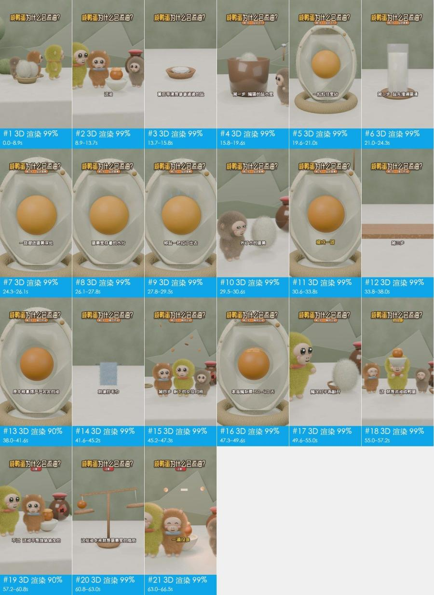

## 核心看点

- **开头怎么抓人**：0 秒起顶部大标题常驻抛出问题「咸鸭蛋为什么会流油？」；1.5–7 秒鸭宝敲开毛球鸭蛋，蛋黄自己冒出油层和粉色油烟，字幕「明明没往里加一滴油」点出矛盾；7–8.9 秒切花猫瞪大眼的反应，把好奇放大。
- 13.7–15.8 秒把盐做成带眼睛的小白球从碗里冒出来，配一声「叮」：主角一登场就是个角色，后面每一步都由它来演，观众更容易跟住。
- 15.8–54.6 秒标题下方的步骤牌依次换成「第1步·盐钻气孔」到「第4步·静待出油」：一分钟的原理讲解被切成 4 段，观众随时知道还剩几步。
- 41.6–45.3 秒用拧毛巾滴水类比蛋白质收紧挤出油：把分子层面的变化换成人人做过的动作，一看就懂。
- 60.8–63.0 秒天平上落下小球、横梁摆平再闪星（叮）：把「一滴没多、一滴也没少」做成画面，结论有了可视的证据。

## 一眼看懂：画面、包装、声音三层

短视频都可以拆成三层：底下是画面本身，上面叠字幕、花字、贴纸，再配上声音。复刻时一层一层做。

| 层 | 这条视频里是什么 | 怎么做 | 细节 |
|---|---|---|---|
| **画面**（底层） | 3D 渲染 29 镜 | AI 分 14 次生成 | 「自己复刻」 |
| **包装**（叠在画面上） | 文字、标题、字幕、花字 | 剪辑软件里加：字幕、花字、贴纸照时间轴摆 | 「剪辑包装层」 |
| **声音** | 人声（TTS 配音）、背景音乐（110 BPM、待确认）、音效 6 处 | 人声：TTS 配音；配乐：按节奏和情绪找同类曲；音效：按时间点从音效库加 | 「声音」 |

## 内容与结构

- 下面的叙事线来自逐镜看图；台词没有单独整理，字幕原文见「剪辑包装层」

**叙事线**

复刻时保留这条线：每一步的顺序和作用照搬，讲的那一点换成自己的案例、数据和素材，就不只是换个主角。

| 时间 | 镜头 | 作用 | 在讲什么 |
|---|---|---|---|
| 0.0–11.5s | #1–#6 | 抓注意 | 用萌系角色和日常场景开场，先交代谁在哪里 → 主角动手敲开鸭蛋，把问题落到一个具体动作上 → 直接给出反常识的结果画面：蛋黄自己冒油 → 强调没加油却出油的矛盾，抛出悬念 → 用角色瞪大眼的反应把观众的好奇放大 →（共 6 点，逐镜见「分镜表」） |
| 11.5–13.7s | #7 | 转折 | 话锋一转，准备揭晓幕后原因 |
| 13.7–41.6s | #8–#20 | 补信息 | 点出真正的主角，并把它拟人化 → 第 1 步：交代腌制的环境 → 用剖面模型把盐进入蛋壳的路径画出来 → 第 2 步前半：盐先灌满蛋清 → 第 2 步后半：盐穿过蛋黄膜进入蛋黄 →（共 13 点，逐镜见「分镜表」） |
| 41.6–45.2s | #21 | 给证据 | 用拧毛巾的日常经验类比蛋白质挤出油 |
| 45.2–49.6s | #22、#23 | 补信息 | 第 4 步：把等待的时间交给画面 → 用具体天数说明腌制要多久 |
| 49.6–57.2s | #24–#26 | 给结论 | 腌够日子再打开，结果揭晓 → 把开头的流油画面再放一次，这次已经知道原因 → 用角色庆祝的动作给出「成了」的结论 |
| 57.2–60.8s | #27 | 转折 | 用「不过」排除误解：不是加了什么东西 |
| 60.8–66.5s | #28、#29 | 给结论 | 用天平说明油本来就在蛋黄里，总量没变 → 用一句对仗的话收尾，把结论说死 |

## 分镜表

「画面」「运镜」「叠加层」是画面里看得到的；「制作方式」「素材来源」是工具推断的，依据见附录逐镜取证。

| # | 截图 | 时间 | 时长 | 在讲什么 | 画面 | 运镜 | 叠加层 | 制作方式（推断） | 素材来源（推断） | 复刻 |
|---|---|---|---|---|---|---|---|---|---|---|
| 1 | 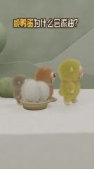 | 0:00.0 | 1.5s | 抓注意：用萌系角色和日常场景开场，先交代谁在哪里 | 中景平视，白色台面、鼠尾草绿墙面和低多边形山形背景；黄绿毛绒猴（鸭宝）、橙棕毛绒… | 固定（主体在动） | 文字、标题 | 3D 渲染 89% | 制作方渲染 | AI 生成 / 3D 渲染 · G1 |
| 2 | 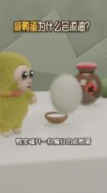 | 0:01.5 | 2.2s | 抓注意：主角动手敲开鸭蛋，把问题落到一个具体动作上 | 近景平视；黄绿毛绒猴鸭宝站在左侧，面前一个白色长毛毛球（鸭蛋）从小木碗上方浮起转… | 固定 | 字幕、标题 | 3D 渲染 85% | 制作方渲染 | AI 生成 / 3D 渲染 · G1 |
| 3 | 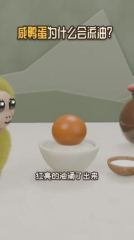 | 0:03.7 | 1.5s | 抓注意：直接给出反常识的结果画面：蛋黄自己冒油 | 中景平视；白瓷碗里一颗橙色蛋黄，顶部冒出浅色油层，上方升起粉白色 S 形油烟曲线… | 平滑运镜 | 文字、标题 | 3D 渲染 86% | 制作方渲染 | AI 生成 / 3D 渲染 · G1 |
| 4 | 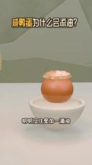 | 0:05.2 | 1.8s | 抓注意：强调没加油却出油的矛盾，抛出悬念 | 中景平视，白瓷碗里冒着油层的蛋黄居中，背景鼠尾草绿墙面，镜头缓慢推近。 | 固定 | 文字、标题 | 3D 渲染 89% | 制作方渲染 | AI 生成 / 3D 渲染 · G1 |
| 5 | 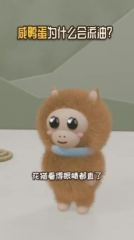 | 0:07.0 | 1.9s | 抓注意：用角色瞪大眼的反应把观众的好奇放大 | 近景平视；橙棕长毛毛绒猴花猫居中正对镜头，蓝色项圈，大眼睛眨动、身体轻微晃动，头… | 平滑运镜 | 文字、标题 | 3D 渲染 79% | 制作方渲染 | AI 生成 / 3D 渲染 · G2 |
| 6 | 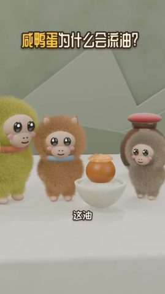 | 0:08.9 | 2.6s | 抓注意：把问题再问一遍：油到底从哪来 | 中景平视；鸭宝、花猫、灰棕毛绒猴和冒油的蛋黄碗排成一排，右侧陶罐，画面右上方飘起… | 固定 | 字幕、标题 | 3D 渲染 84% | 制作方渲染 | AI 生成 / 3D 渲染 · G2 |
| 7 | 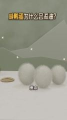 | 0:11.5 | 2.2s | 转折：话锋一转，准备揭晓幕后原因 | 中景平视；三个白色长毛毛球（鸭蛋）在台面上排成一排，左边一个麻绳圈，背景闪着白色… | 平滑运镜 | 字幕、标题 | 3D 渲染 90% | 制作方渲染 | AI 生成 / 3D 渲染 · G2 |
| 8 | 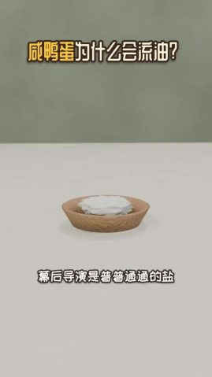 | 0:13.7 | 2.2s | 补信息：点出真正的主角，并把它拟人化 | 中景略俯拍；白台面上一只浅木碗盛着白色盐堆，几颗带黑眼睛的小白球（拟人化盐粒）依… | 固定 | 文字、标题 | 3D 渲染 91% | 制作方渲染 | AI 生成 / 3D 渲染 · G3 |
| 9 | 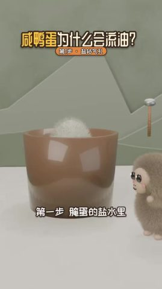 | 0:15.8 | 3.8s | 补信息：第 1 步：交代腌制的环境 | 中景平视；一只棕色半透明大杯（代表腌蛋的盐水缸），杯口露出白色毛球蛋，右侧灰棕毛… | 固定 | 字幕、标题 | 3D 渲染 90% | 制作方渲染 | AI 生成 / 3D 渲染 · G4 |
| 10 | 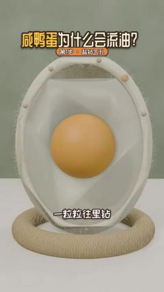 | 0:19.6 | 1.5s | 补信息：用剖面模型把盐进入蛋壳的路径画出来 | 近景平视；竖立的鸭蛋剖面模型放在麻绳圈底座上，米白色蛋壳带细绒毛，内部半透明蛋清… | 平滑运镜 | 字幕、标题 | 3D 渲染 86% | 制作方渲染 | AI 生成 / 3D 渲染 · G5 |
| 11 | 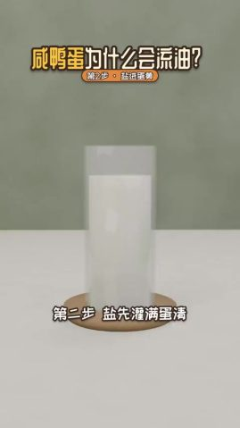 | 0:21.0 | 2.0s | 补信息：第 2 步前半：盐先灌满蛋清 | 中景平视；白台面上一只装白色液体的玻璃圆柱杯（代表蛋清），放在木托盘上，几颗小白… | 固定 | 字幕、标题 | 3D 渲染 91% | 制作方渲染 | AI 生成 / 3D 渲染 · G5 |
| 12 | 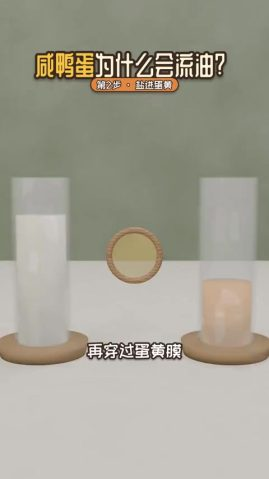 | 0:23.0 | 1.3s | 补信息：第 2 步后半：盐穿过蛋黄膜进入蛋黄 | 中景平视；左边装白色液体的玻璃杯（蛋清），右边装橙黄液体的玻璃杯（蛋黄），中间立… | 固定 | 文字、标题 | 3D 渲染 91% | 制作方渲染 | AI 生成 / 3D 渲染 · G5 |
| 13 | 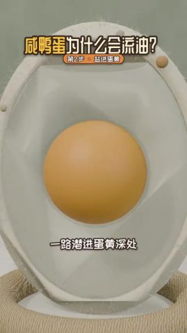 | 0:24.3 | 1.8s | 补信息：镜头推进蛋黄，告诉观众盐已到达核心 | 特写平视；鸭蛋剖面模型的蛋黄居中，镜头缓慢推近，蛋黄上方闪出白色四角星和「蛋黄」… | 平滑运镜 | 字幕、文字、标题 | 3D 渲染 85% | 制作方渲染 | AI 生成 / 3D 渲染 · G5 |
| 14 | 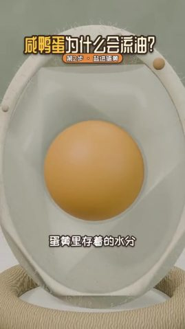 | 0:26.1 | 1.7s | 补信息：点出蛋黄里本来存着水 | 特写平视；鸭蛋剖面模型的蛋黄居中，画面基本静止，镜头极缓慢推近。 | 平滑运镜 | 文字、标题 | 3D 渲染 84% | 制作方渲染 | AI 生成 / 3D 渲染 · G5 |
| 15 | 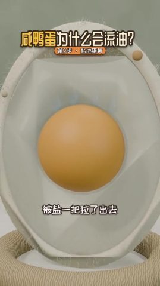 | 0:27.8 | 1.7s | 补信息：演示水分被盐从蛋黄里拉出去 | 特写平视；鸭蛋剖面模型，蛋黄居中，右侧壳边出现浅蓝色水滴向外移动，镜头固定。 | 平滑运镜 | 文字、标题 | 3D 渲染 84% | 制作方渲染 | AI 生成 / 3D 渲染 · G5 |
| 16 | 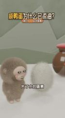 | 0:29.5 | 1.2s | 补信息：用角色反应过渡到蛋黄缩小这件事 | 近景平视；灰棕毛绒猴在左侧抬头看，旁边白色毛球（蛋黄的拟人化）浮起变大，背后陶罐… | 平滑运镜 | 字幕、标题 | 3D 渲染 89% | 制作方渲染 | AI 生成 / 3D 渲染 · G6 |
| 17 | 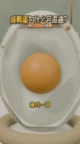 | 0:30.6 | 3.1s | 补信息：给出脱水的结果：蛋黄缩小变硬 | 特写平视；鸭蛋剖面模型，中央蛋黄逐渐均匀缩小，周围出现一圈空隙，镜头固定。 | 平滑运镜 | 字幕、标题 | 3D 渲染 84% | 制作方渲染 | AI 生成 / 3D 渲染 · G7 |
| 18 | 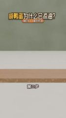 | 0:33.8 | 4.3s | 补信息：第 3 步：把蛋白质收紧抱团做成角色动作 | 中景平视；一块木板横在白台面上，几个带黑眼睛的白色毛团（代表蛋白质）先后弹落到木… | 固定（主体在动） | 字幕、标题 | 3D 渲染 91% | 制作方渲染 | AI 生成 / 3D 渲染 · G7 |
| 19 | 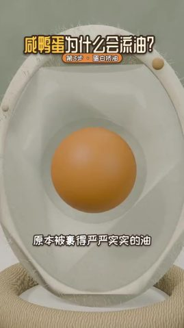 | 0:38.0 | 2.0s | 补信息：演示被包住的油开始被挤出来 | 特写平视；鸭蛋剖面模型，蛋黄顶部冒出几颗橙色半透明油珠，镜头固定。 | 平滑运镜 | 文字、标题 | 3D 渲染 84% | 制作方渲染 | AI 生成 / 3D 渲染 · G8 |
| 20 | 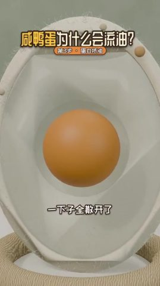 | 0:40.0 | 1.6s | 补信息：油散开后聚到蛋黄表面 | 特写平视；鸭蛋剖面模型，蛋黄上方的油珠散开后落回顶部铺成一层油，镜头固定。 | 平滑运镜 | 字幕、标题 | 3D 渲染 85% | 制作方渲染 | AI 生成 / 3D 渲染 · G8 |
| 21 | 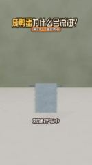 | 0:41.6 | 3.7s | 给证据：用拧毛巾的日常经验类比蛋白质挤出油 | 中景平视；一块浅蓝色绒毛方巾挂在金属横杆上，横杆向两侧拉伸把毛巾拧成 T 字形，… | 固定 | 字幕、标题 | 3D 渲染 92% | 制作方渲染 | AI 生成 / 3D 渲染 · G8 |
| 22 | 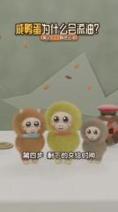 | 0:45.2 | 2.1s | 补信息：第 4 步：把等待的时间交给画面 | 中景平视；花猫、鸭宝、灰棕毛绒猴并排站立轻晃，右后方陶罐，上方不断落下棕色小片（… | 固定 | 文字、标题 | 3D 渲染 85% | 制作方渲染 | AI 生成 / 3D 渲染 · G9 |
| 23 | 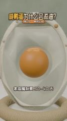 | 0:47.3 | 2.2s | 补信息：用具体天数说明腌制要多久 | 特写平视；鸭蛋剖面模型，蛋黄顶部的油层逐渐变厚，周围闪出白色四角星，镜头缓慢推近… | 平滑运镜 | 字幕、标题 | 3D 渲染 82% | 制作方渲染 | AI 生成 / 3D 渲染 · G10 |
| 24 | 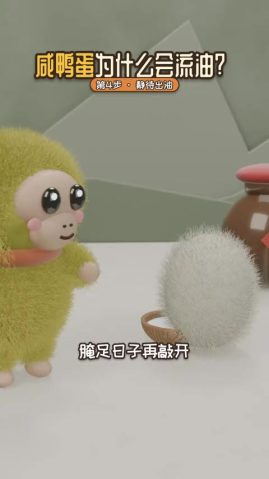 | 0:49.6 | 1.7s | 给结论：腌够日子再打开，结果揭晓 | 近景平视；鸭宝站在左侧，面前的白色毛球（鸭蛋）变成白瓷碗里冒油的蛋黄，右后方陶罐… | 固定 | 文字、标题 | 3D 渲染 86% | 制作方渲染 | AI 生成 / 3D 渲染 · G11 |
| 25 | 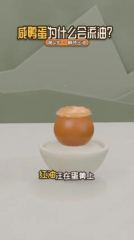 | 0:51.3 | 3.7s | 给结论：把开头的流油画面再放一次，这次已经知道原因 | 中景平视；白瓷碗里冒油的蛋黄居中，上方升起粉白色 S 形油烟，出现「红油」小标签… | 固定（主体在动） | 字幕、文字、标题 | 3D 渲染 89% | 制作方渲染 | AI 生成 / 3D 渲染 · G11 |
| 26 | 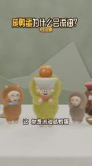 | 0:55.0 | 2.2s | 给结论：用角色庆祝的动作给出「成了」的结论 | 近景平视；鸭宝居中双手把盛着冒油蛋黄的白碗举过头顶，笑眯眼，两侧花猫和灰棕毛绒猴… | 固定 | 字幕、标题、花字 | 3D 渲染 84% | 制作方渲染 | AI 生成 / 3D 渲染 · G12 |
| 27 | 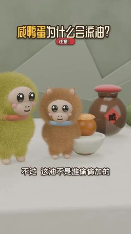 | 0:57.2 | 3.5s | 转折：用「不过」排除误解：不是加了什么东西 | 近景平视；鸭宝和花猫站在冒油的蛋黄碗旁，背后贴「咸」字标签的陶罐，右边还有一个紫… | 固定 | 字幕、标题 | 3D 渲染 82% | 制作方渲染 | AI 生成 / 3D 渲染 · G12 |
| 28 | 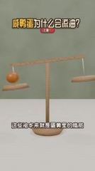 | 1:00.8 | 2.2s | 给结论：用天平说明油本来就在蛋黄里，总量没变 | 中景平视；木质天平左盘放一颗橙色蛋黄球，横梁左低右高，一颗小橙球从上方落下，横梁… | 固定 | 文字、标题 | 3D 渲染 91% | 制作方渲染 | AI 生成 / 3D 渲染 · G13 |
| 29 | 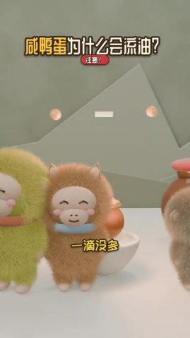 | 1:03.0 | 3.5s | 给结论：用一句对仗的话收尾，把结论说死 | 近景到中景；鸭宝、花猫、灰棕毛绒猴并排笑眯眼站立轻晃，背景浮着粉色圆球和白色短条… | 固定（主体在动） | 字幕、标题 | 3D 渲染 85% | 制作方渲染 | AI 生成 / 3D 渲染 · G14 |

## 自己复刻：按这个顺序做

复刻的是做法和节奏，不是照抄画面。

1. **定内容**：照「内容与结构」的叙事线写自己的脚本
2. **备素材**：见下方「要准备的素材」
3. **AI 生成**：14 次生成，见下方「AI 生成」
4. **剪辑**：见下方「剪辑」
5. **包装**：字幕文件 `packaging/subtitles.srt` 可以直接导入剪辑软件；样式和时间轴见「剪辑包装层」
6. **声音**：见「声音」，每处音效都能先试听
7. **对照检查**：成片和原片并排看一遍：镜头长短、字幕位置、音乐起落对不对得上

### 要准备的素材

- `@图片1` 人物参考图（每个角色一张正脸 + 半身），保证跨镜头长相一致：鸭宝、花猫、灰棕小猴（未点名）、盐粒小球、蛋白质毛团

### AI 生成

**3D 渲染 29 镜 → 14 个生成单元、14 次 Seedance 2.0（含 Mini / Fast） 调用**

- 分组规则：同场景、硬切相连的 AI 镜头合并为一次生成；单次 ≤15s；单元内连续硬切尽量 ≤8s、最多 10s；在叠化/淡入淡出和换场景处切开
- 声音：模型可以同时生成动作音效和环境声；口播建议单独 TTS 再混进去，方便改文案和卡时间
- 包装层：生成单元镜头上的标题、字幕、文字标注、花字属于后期包装，不写进提示词；参考帧上带着的先擦掉，生成后按「剪辑包装层」的时间轴叠回

AI 视频模型能吃这几种输入，每个生成单元下面写了要喂哪些、从哪来：
- **文字提示词**：必需，描述画面、动作、运镜
- **首帧图**：锁住第一帧的构图和主体。不给就是纯文生，构图每次都不一样
- **尾帧图**：再锁住最后一帧，模型只补中间过程。适合单个有运镜或动作的镜头
- **参考图**：商品、人物的样子，让多个镜头里长得一样（提示词里用 `@图片1` 指代）
- **参考视频**：照着学动作、运镜和节奏，不复制画面（`@视频1`）；不是每个模型都支持

每个单元一次生成。表里是要喂给模型的东西，展开单元看来源和提示词。

| 单元 | 镜头 | 时间 | 时长 | 方式 | 要喂的 | 衔接 |
|---|---|---|---|---|---|---|
| G1 | #1–#4 | 0.0–7.0s | 7.0s | 一次多镜头 | 首帧图 + 参考图 + 参考视频 | — |
| G2 | #5–#7 | 7.0–13.7s | 6.7s | 一次多镜头 | 首帧图 + 参考图 + 参考视频 | 首帧用 G1 的尾帧，接上动作 |
| G3 | #8 | 13.7–15.8s | 2.2s | 单镜 | 首帧图 + 参考图 + 参考视频 | — |
| G4 | #9 | 15.8–19.6s | 3.8s | 单镜 | 首帧图 + 参考图 + 参考视频 | — |
| G5 | #10–#15 | 19.6–29.5s | 9.9s | 一次多镜头 | 首帧图 + 参考图 + 参考视频 | — |
| G6 | #16 | 29.5–30.6s | 1.2s | 单镜 | 首帧图 + 参考图 + 参考视频 | — |
| G7 | #17–#18 | 30.6–38.0s | 7.4s | 一次多镜头 | 首帧图 + 参考图 + 参考视频 | — |
| G8 | #19–#21 | 38.0–45.2s | 7.2s | 一次多镜头 | 首帧图 + 参考图 + 参考视频 | 首帧用 G7 的尾帧，接上动作 |
| G9 | #22 | 45.2–47.3s | 2.1s | 单镜 | 首帧图 + 参考图 + 参考视频 | — |
| G10 | #23 | 47.3–49.6s | 2.2s | 单镜 | 首帧图 + 参考图 + 参考视频 | — |
| G11 | #24–#25 | 49.6–55.0s | 5.4s | 一次多镜头 | 首帧图 + 参考图 + 参考视频 | — |
| G12 | #26–#27 | 55.0–60.8s | 5.8s | 一次多镜头 | 首帧图 + 参考图 + 参考视频 | 首帧用 G11 的尾帧，接上动作 |
| G13 | #28 | 60.8–63.0s | 2.2s | 单镜 | 首帧图 + 参考图 + 参考视频 | — |
| G14 | #29 | 63.0–66.5s | 3.5s | 单镜 | 首帧图 + 参考图 + 参考视频 | — |

<details><summary>G1 · 镜头 #1–#4 · 7.0s · 多参考生成</summary>

| 输入 | 要不要 | 从哪来 | 为什么 |
|---|---|---|---|
| 文字提示词 | 要 | 见下面的提示词 | 描述画面、动作和运镜；其他输入都只是约束它 |
| 首帧图 | 建议 | 原片 `shots/shot_001_first.jpg`（换产品、人物或画风时，用图像模型照下面的首帧提示词重画）。这个模型首帧和参考图不能同时传：作为第 2 张参考图传入，提示词写「@图片2 作为首帧」（即梦全能参考支持，API 多半不支持） | 构图、景别、主体位置一次锁定；只给文字，每次生成的构图都不一样 |
| 尾帧图 | 不用 | — | 一次出多个镜头，尾帧只能约束最后一镜，不用 |
| 参考图 | 要 | `@图片1` 人物参考图（每个角色一张正脸 + 半身），保证跨镜头长相一致 | 首帧只管第一帧，后面画面里的商品和人靠参考图保持一致 |
| 参考视频 | 建议 | `@视频1` 原片 0.0–7.0s 片段 | 照着学动作、运镜和剪辑节奏；只作参考，不会复制画面 |

- 首帧图像提示词：中景平视，竖屏 9:16；白色台面，后方鼠尾草绿墙面上有浅色低多边形山形；左侧竹编浅篮里放两个白色长毛毛球，三只毛绒小猴（灰棕、橙棕、黄绿）从左到右排成一列侧身朝右；柔和漫射光，Blender 毛发渲染，低饱和清新色调。
- 另一条路：3D 工程。让 LLM 写 Blender 脚本或 Three.js 场景，角色/道具建模一次、按镜头设机位渲染，多角度和角色一致性最好，改文案和镜头也只是改代码

```text
竖屏 9:16；正面柔光（平光），柔光（几乎没有明暗分界），中性（约 5000K），背景明显虚化（浅景深/人像模式）。人物以 @图片1 为准。参考 @视频1 的动作、运镜和剪辑节奏。镜头之间硬切。
镜头1（0.0–1.5s）：中景平视，三只毛绒小猴排成一列从画面左侧向右缓慢走动，身体轻微左右摇摆，竹篮里的两个白毛球留在左下方不动；镜头固定。
镜头2（1.5–3.7s）：近景平视，黄绿毛绒小猴站在左侧看着面前的白毛球，白毛球从小碗上方缓慢浮起并轻轻转动，小猴抬手；镜头固定。
镜头3（3.7–5.2s）：中景平视，蛋黄顶部慢慢鼓起一层浅黄油脂，几粒小油点弹起，随后上方升起三道粉白色 S 形油烟曲线；镜头固定。
镜头4（5.2–7.0s）：中景平视，镜头向碗中冒油的蛋黄缓慢匀速推近，蛋黄和油层保持不动。
```

英文提示词：

```text
Shot 1 (0.0-1.5s): Medium eye-level shot. Three plush monkeys walk in a line from left to right, bodies swaying gently, while two white fluffy balls stay in a woven basket at lower left. Static camera.
Shot 2 (1.5-3.7s): Close shot, eye level. A yellow-green plush monkey on the left watches a white fluffy ball float up from a small bowl and slowly turn; the monkey lifts a hand. Static camera.
Shot 3 (3.7-5.2s): Medium eye-level shot. A layer of pale oil swells on top of an orange yolk in a white bowl, a few droplets pop up, then three pinkish-white S-shaped wisps rise above it. Static camera.
Shot 4 (5.2-7.0s): Medium eye-level shot. The camera slowly pushes in toward the oily yolk in the white bowl; the yolk and oil stay still.
```

</details>

<details><summary>G2 · 镜头 #5–#7 · 6.7s · 多参考生成</summary>

| 输入 | 要不要 | 从哪来 | 为什么 |
|---|---|---|---|
| 文字提示词 | 要 | 见下面的提示词 | 描述画面、动作和运镜；其他输入都只是约束它 |
| 首帧图 | 建议 | G1 生成结果的最后一帧。这个模型首帧和参考图不能同时传：作为第 2 张参考图传入，提示词写「@图片2 作为首帧」（即梦全能参考支持，API 多半不支持） | 和上一段硬切相连，同一场景，首帧接上才不会跳 |
| 尾帧图 | 不用 | — | 一次出多个镜头，尾帧只能约束最后一镜，不用 |
| 参考图 | 要 | `@图片1` 人物参考图（每个角色一张正脸 + 半身），保证跨镜头长相一致 | 首帧只管第一帧，后面画面里的商品和人靠参考图保持一致 |
| 参考视频 | 建议 | `@视频1` 原片 7.0–13.7s 片段 | 照着学动作、运镜和剪辑节奏；只作参考，不会复制画面 |

- 首帧图像提示词：近景平视，竖屏；橙棕色长毛毛绒小猴居中正对镜头，头顶两只小尖耳，米色脸、黑亮大眼、粉腮、浅蓝色圈状项圈；鼠尾草绿墙、白台面；柔光，Blender 毛发渲染。
- 另一条路：3D 工程。让 LLM 写 Blender 脚本或 Three.js 场景，角色/道具建模一次、按镜头设机位渲染，多角度和角色一致性最好，改文案和镜头也只是改代码

```text
竖屏 9:16；正面柔光（平光），柔光（几乎没有明暗分界），中性（约 5000K），背景明显虚化（浅景深/人像模式）。人物以 @图片1 为准。参考 @视频1 的动作、运镜和剪辑节奏。镜头之间硬切。
镜头1（0.0–1.9s）：近景平视，橙棕毛绒小猴正对镜头，眼睛慢慢睁大并眨一下，身体左右轻晃，头顶依次闪出几颗白色四角星；镜头固定。
镜头2（1.9–4.5s）：中景平视，三只毛绒小猴围着冒油的蛋黄轻轻晃动、歪头，画面右上方依次飘出两个橙色问号；镜头固定。
镜头3（4.5–6.7s）：中景平视，镜头向右缓慢横移经过三个白色毛球，背景的白色四角星一闪一闪。
```

英文提示词：

```text
Shot 1 (0.0-1.9s): Close eye-level shot. A brown plush monkey faces the camera, its eyes widen and blink, its body sways slightly, and white four-point sparkles pop above its head. Static camera.
Shot 2 (1.9-4.5s): Medium eye-level shot. Three plush monkeys stand around the oily yolk, swaying and tilting their heads, while two orange question marks float up at upper right. Static camera.
Shot 3 (4.5-6.7s): Medium eye-level shot. The camera slowly trucks right past three white fluffy balls on the table while white sparkles twinkle in the background.
```

</details>

<details><summary>G3 · 镜头 #8 · 2.2s · 多参考生成</summary>

| 输入 | 要不要 | 从哪来 | 为什么 |
|---|---|---|---|
| 文字提示词 | 要 | 见下面的提示词 | 描述画面、动作和运镜；其他输入都只是约束它 |
| 首帧图 | 建议 | 原片 `shots/shot_008_first.jpg`（换产品、人物或画风时，用图像模型照下面的首帧提示词重画）。这个模型首帧和参考图不能同时传：作为第 2 张参考图传入，提示词写「@图片2 作为首帧」（即梦全能参考支持，API 多半不支持） | 构图、景别、主体位置一次锁定；只给文字，每次生成的构图都不一样 |
| 尾帧图 | 不用 | — | 这一单元用参考图保住商品和人物，这个模型在参考模式下不收尾帧 |
| 参考图 | 要 | `@图片1` 人物参考图（每个角色一张正脸 + 半身），保证跨镜头长相一致 | 首帧只管第一帧，后面画面里的商品和人靠参考图保持一致 |
| 参考视频 | 建议 | `@视频1` 原片 13.7–15.8s 片段 | 照着学动作、运镜和剪辑节奏；只作参考，不会复制画面 |

- 首帧图像提示词：中景略俯拍，竖屏；画面中下部白台面上一只浅色木纹圆碗，碗里堆满白色盐粉；背景虚化的鼠尾草绿墙面；柔和漫射光，极简 3D 卡通渲染。
- 生成 4s 后剪到 2.2s（太短的镜头单独生成不稳定）
- 另一条路：3D 工程。让 LLM 写 Blender 脚本或 Three.js 场景，角色/道具建模一次、按镜头设机位渲染，多角度和角色一致性最好，改文案和镜头也只是改代码

```text
竖屏 9:16；正面柔光（平光），柔光（几乎没有明暗分界），中性（约 5000K），背景明显虚化（浅景深/人像模式）。人物以 @图片1 为准。参考 @视频1 的动作、运镜和剪辑节奏。
中景略俯拍，五六颗带黑色小眼睛的白色小圆球从碗里的盐堆中依次弹出，停在盐面上轻轻晃动；镜头固定。
```

英文提示词：

```text
Medium slightly high-angle shot. Five or six small white balls with tiny black eyes pop out of the salt pile in a wooden bowl one by one and wobble on the surface. Static camera.
```

</details>

<details><summary>G4 · 镜头 #9 · 3.8s · 多参考生成</summary>

| 输入 | 要不要 | 从哪来 | 为什么 |
|---|---|---|---|
| 文字提示词 | 要 | 见下面的提示词 | 描述画面、动作和运镜；其他输入都只是约束它 |
| 首帧图 | 建议 | 原片 `shots/shot_009_first.jpg`（换产品、人物或画风时，用图像模型照下面的首帧提示词重画）。这个模型首帧和参考图不能同时传：作为第 2 张参考图传入，提示词写「@图片2 作为首帧」（即梦全能参考支持，API 多半不支持） | 构图、景别、主体位置一次锁定；只给文字，每次生成的构图都不一样 |
| 尾帧图 | 不用 | — | 这一单元用参考图保住商品和人物，这个模型在参考模式下不收尾帧 |
| 参考图 | 要 | `@图片1` 人物参考图（每个角色一张正脸 + 半身），保证跨镜头长相一致 | 首帧只管第一帧，后面画面里的商品和人靠参考图保持一致 |
| 参考视频 | 建议 | `@视频1` 原片 15.8–19.6s 片段 | 照着学动作、运镜和剪辑节奏；只作参考，不会复制画面 |

- 首帧图像提示词：中景平视，竖屏；画面中央一只棕色半透明圆柱大杯，杯口露出白色长毛毛球的顶部；右下方灰棕毛绒小猴探出半个身子朝左看；背景鼠尾草绿墙、低多边形山形和一根木柄小锤；柔光，3D 卡通渲染。
- 另一条路：3D 工程。让 LLM 写 Blender 脚本或 Three.js 场景，角色/道具建模一次、按镜头设机位渲染，多角度和角色一致性最好，改文案和镜头也只是改代码

```text
竖屏 9:16；正面柔光（平光），柔光（几乎没有明暗分界），中性（约 5000K），背景明显虚化（浅景深/人像模式）。人物以 @图片1 为准。参考 @视频1 的动作、运镜和剪辑节奏。
中景平视，白毛球在棕色杯里轻轻下沉，右侧灰棕毛绒小猴眨眼看着；镜头固定。
```

英文提示词：

```text
Medium eye-level shot. The white fluffy ball sinks slightly into the brown cup while a grey-brown plush monkey on the right blinks and watches. Static camera.
```

</details>

<details><summary>G5 · 镜头 #10–#15 · 9.9s · 多参考生成</summary>

| 输入 | 要不要 | 从哪来 | 为什么 |
|---|---|---|---|
| 文字提示词 | 要 | 见下面的提示词 | 描述画面、动作和运镜；其他输入都只是约束它 |
| 首帧图 | 建议 | 原片 `shots/shot_010_first.jpg`（换产品、人物或画风时，用图像模型照下面的首帧提示词重画）。这个模型首帧和参考图不能同时传：作为第 2 张参考图传入，提示词写「@图片2 作为首帧」（即梦全能参考支持，API 多半不支持） | 构图、景别、主体位置一次锁定；只给文字，每次生成的构图都不一样 |
| 尾帧图 | 不用 | — | 一次出多个镜头，尾帧只能约束最后一镜，不用 |
| 参考图 | 要 | `@图片1` 人物参考图（每个角色一张正脸 + 半身），保证跨镜头长相一致 | 首帧只管第一帧，后面画面里的商品和人靠参考图保持一致 |
| 参考视频 | 建议 | `@视频1` 原片 19.6–29.5s 片段 | 照着学动作、运镜和剪辑节奏；只作参考，不会复制画面 |

- 首帧图像提示词：近景平视，竖屏；画面中央竖立一个椭圆鸭蛋剖面模型，米白色蛋壳外沿有细绒毛，内部半透明蛋清，正中一颗橙色球形蛋黄，底部放在麻绳编织圆环上；鼠尾草绿背景；柔光，3D 科普渲染。
- 另一条路：3D 工程。让 LLM 写 Blender 脚本或 Three.js 场景，角色/道具建模一次、按镜头设机位渲染，多角度和角色一致性最好，改文案和镜头也只是改代码

```text
竖屏 9:16；正面柔光（平光），柔光（几乎没有明暗分界），中性（约 5000K），背景明显虚化（浅景深/人像模式）。人物以 @图片1 为准。参考 @视频1 的动作、运镜和剪辑节奏。镜头之间硬切。
镜头1（0.0–1.5s）：近景平视，几粒小白色盐球从右上方落到蛋壳顶部，依次钻进壳上的小孔进入蛋清；蛋黄不动；镜头固定。
镜头2（1.5–3.5s）：中景平视，几颗小白色盐粒从杯口上方依次落入乳白色液体中；镜头固定。
镜头3（3.5–4.8s）：中景平视，几颗白色小盐粒从左杯上方飞出，穿过中间的木框圆膜，落进右侧橙黄液体里；镜头固定。
镜头4（4.8–6.5s）：特写平视，镜头向中央的橙色蛋黄缓慢推近，蛋黄上方闪出两颗白色四角星；结束时蛋黄占画面一半。
镜头5（6.5–8.2s）：特写平视，蛋黄表面泛起微弱的湿润高光，镜头极缓慢推近。
镜头6（8.2–9.9s）：特写平视，几颗浅蓝色小水滴从蛋黄表面渗出，穿过蛋清向右侧壳边移动并消失；镜头固定。
```

英文提示词：

```text
Shot 1 (0.0-1.5s): Close eye-level shot. A few small white salt balls drop onto the top of the egg cross-section model from the upper right and slip one by one through tiny pores into the egg white. Static camera.
Shot 2 (1.5-3.5s): Medium eye-level shot. A few small white salt grains fall one by one into a glass cylinder of milky liquid. Static camera.
Shot 3 (3.5-4.8s): Medium eye-level shot. Small white salt grains fly out above the left glass, pass through the wooden-framed round membrane in the middle and drop into the orange liquid in the right glass. Static camera.
Shot 4 (4.8-6.5s): Close-up, eye level. The camera slowly pushes in on the orange yolk at the center of the egg model; two white sparkles flash above it. Ends with the yolk filling half the frame.
Shot 5 (6.5-8.2s): Close-up, eye level. A faint wet highlight shimmers on the yolk surface while the camera creeps in very slowly.
Shot 6 (8.2-9.9s): Close-up, eye level. A few pale blue droplets seep out of the yolk, drift through the egg white to the right edge of the shell and vanish. Static camera.
```

</details>

<details><summary>G6 · 镜头 #16 · 1.2s · 多参考生成</summary>

| 输入 | 要不要 | 从哪来 | 为什么 |
|---|---|---|---|
| 文字提示词 | 要 | 见下面的提示词 | 描述画面、动作和运镜；其他输入都只是约束它 |
| 首帧图 | 建议 | 原片 `shots/shot_016_first.jpg`（换产品、人物或画风时，用图像模型照下面的首帧提示词重画）。这个模型首帧和参考图不能同时传：作为第 2 张参考图传入，提示词写「@图片2 作为首帧」（即梦全能参考支持，API 多半不支持） | 构图、景别、主体位置一次锁定；只给文字，每次生成的构图都不一样 |
| 尾帧图 | 不用 | — | 这一单元用参考图保住商品和人物，这个模型在参考模式下不收尾帧 |
| 参考图 | 要 | `@图片1` 人物参考图（每个角色一张正脸 + 半身），保证跨镜头长相一致 | 首帧只管第一帧，后面画面里的商品和人靠参考图保持一致 |
| 参考视频 | 建议 | `@视频1` 原片 29.5–30.6s 片段 | 照着学动作、运镜和剪辑节奏；只作参考，不会复制画面 |

- 首帧图像提示词：近景平视，竖屏；左侧灰棕色毛绒小猴，米色脸、黑大眼、粉腮，侧身朝右；右侧一个白色长毛椭圆毛球悬在台面上方；右后方棕色红盖陶罐；鼠尾草绿墙、低多边形山形；柔光，Blender 毛发渲染。
- 生成 4s 后剪到 1.2s（太短的镜头单独生成不稳定）
- 另一条路：3D 工程。让 LLM 写 Blender 脚本或 Three.js 场景，角色/道具建模一次、按镜头设机位渲染，多角度和角色一致性最好，改文案和镜头也只是改代码

```text
竖屏 9:16；正面柔光（平光），柔光（几乎没有明暗分界），中性（约 5000K），背景明显虚化（浅景深/人像模式）。人物以 @图片1 为准。参考 @视频1 的动作、运镜和剪辑节奏。
近景平视，白色毛球从台面浮起并慢慢转动，左侧灰棕小猴抬头眨眼看着它；镜头缓慢推近。
```

英文提示词：

```text
Close eye-level shot. A white fluffy ball rises from the table and slowly turns while the grey-brown plush monkey on the left looks up and blinks. The camera slowly pushes in.
```

</details>

<details><summary>G7 · 镜头 #17、#18 · 7.4s · 多参考生成</summary>

| 输入 | 要不要 | 从哪来 | 为什么 |
|---|---|---|---|
| 文字提示词 | 要 | 见下面的提示词 | 描述画面、动作和运镜；其他输入都只是约束它 |
| 首帧图 | 建议 | 原片 `shots/shot_017_first.jpg`（换产品、人物或画风时，用图像模型照下面的首帧提示词重画）。这个模型首帧和参考图不能同时传：作为第 2 张参考图传入，提示词写「@图片2 作为首帧」（即梦全能参考支持，API 多半不支持） | 构图、景别、主体位置一次锁定；只给文字，每次生成的构图都不一样 |
| 尾帧图 | 不用 | — | 一次出多个镜头，尾帧只能约束最后一镜，不用 |
| 参考图 | 要 | `@图片1` 人物参考图（每个角色一张正脸 + 半身），保证跨镜头长相一致 | 首帧只管第一帧，后面画面里的商品和人靠参考图保持一致 |
| 参考视频 | 建议 | `@视频1` 原片 30.6–38.0s 片段 | 照着学动作、运镜和剪辑节奏；只作参考，不会复制画面 |

- 首帧图像提示词：特写平视，竖屏；鸭蛋剖面模型，正中橙色球形蛋黄，四周半透明蛋清和米白壳；柔光，3D 科普渲染。
- 另一条路：3D 工程。让 LLM 写 Blender 脚本或 Three.js 场景，角色/道具建模一次、按镜头设机位渲染，多角度和角色一致性最好，改文案和镜头也只是改代码

```text
竖屏 9:16；正面柔光（平光），柔光（几乎没有明暗分界），中性（约 5000K），背景明显虚化（浅景深/人像模式）。人物以 @图片1 为准。参考 @视频1 的动作、运镜和剪辑节奏。镜头之间硬切。
镜头1（0.0–3.1s）：特写平视，中央的橙色蛋黄均匀地缩小约一成，蛋黄和蛋清之间露出一圈浅色空隙，结束时蛋黄静止；镜头固定。
镜头2（3.1–7.4s）：中景平视，几个带黑亮眼睛的白色长毛毛团从上方依次弹落到木板上，互相挤紧排成一排，接着几颗橙色小圆球从它们中间向上弹出；镜头固定。
```

英文提示词：

```text
Shot 1 (0.0-3.1s): Close-up, eye level. The orange yolk shrinks evenly by about ten percent, leaving a pale ring of space around it, and comes to rest. Static camera.
Shot 2 (3.1-7.4s): Medium eye-level shot. Several white furry blobs with shiny black eyes bounce down onto a wooden plank one after another and squeeze together in a row, then a few small orange balls pop up from between them. Static camera.
```

</details>

<details><summary>G8 · 镜头 #19–#21 · 7.2s · 多参考生成</summary>

| 输入 | 要不要 | 从哪来 | 为什么 |
|---|---|---|---|
| 文字提示词 | 要 | 见下面的提示词 | 描述画面、动作和运镜；其他输入都只是约束它 |
| 首帧图 | 建议 | G7 生成结果的最后一帧。这个模型首帧和参考图不能同时传：作为第 2 张参考图传入，提示词写「@图片2 作为首帧」（即梦全能参考支持，API 多半不支持） | 和上一段硬切相连，同一场景，首帧接上才不会跳 |
| 尾帧图 | 不用 | — | 一次出多个镜头，尾帧只能约束最后一镜，不用 |
| 参考图 | 要 | `@图片1` 人物参考图（每个角色一张正脸 + 半身），保证跨镜头长相一致 | 首帧只管第一帧，后面画面里的商品和人靠参考图保持一致 |
| 参考视频 | 建议 | `@视频1` 原片 38.0–45.2s 片段 | 照着学动作、运镜和剪辑节奏；只作参考，不会复制画面 |

- 首帧图像提示词：特写平视，竖屏；鸭蛋剖面模型，正中橙色球形蛋黄，四周半透明蛋清；柔光，3D 科普渲染。
- 另一条路：3D 工程。让 LLM 写 Blender 脚本或 Three.js 场景，角色/道具建模一次、按镜头设机位渲染，多角度和角色一致性最好，改文案和镜头也只是改代码

```text
竖屏 9:16；正面柔光（平光），柔光（几乎没有明暗分界），中性（约 5000K），背景明显虚化（浅景深/人像模式）。人物以 @图片1 为准。参考 @视频1 的动作、运镜和剪辑节奏。镜头之间硬切。
镜头1（0.0–2.0s）：特写平视，蛋黄顶部依次冒出四五颗橙色半透明小油珠，停在蛋黄上方；镜头固定。
镜头2（2.0–3.5s）：特写平视，蛋黄上方的几颗油珠散开又落回蛋黄顶部，铺成一层起皱的浅黄油层；镜头固定。
镜头3（3.5–7.2s）：中景平视，毛巾被横杆向上提起并从中间拧紧，变成细长的 T 字形，两侧不断滴下透明水滴；镜头固定。
```

英文提示词：

```text
Shot 1 (0.0-2.0s): Close-up, eye level. Four or five translucent orange oil beads rise one by one from the top of the yolk and hover above it. Static camera.
Shot 2 (2.0-3.5s): Close-up, eye level. The oil beads above the yolk spread out and fall back onto its top, forming a wrinkled pale oil layer. Static camera.
Shot 3 (3.5-7.2s): Medium eye-level shot. The towel is lifted by the metal rod and wrung tight in the middle into a narrow T shape while clear water drops fall on both sides. Static camera.
```

</details>

<details><summary>G9 · 镜头 #22 · 2.1s · 多参考生成</summary>

| 输入 | 要不要 | 从哪来 | 为什么 |
|---|---|---|---|
| 文字提示词 | 要 | 见下面的提示词 | 描述画面、动作和运镜；其他输入都只是约束它 |
| 首帧图 | 建议 | 原片 `shots/shot_022_first.jpg`（换产品、人物或画风时，用图像模型照下面的首帧提示词重画）。这个模型首帧和参考图不能同时传：作为第 2 张参考图传入，提示词写「@图片2 作为首帧」（即梦全能参考支持，API 多半不支持） | 构图、景别、主体位置一次锁定；只给文字，每次生成的构图都不一样 |
| 尾帧图 | 不用 | — | 这一单元用参考图保住商品和人物，这个模型在参考模式下不收尾帧 |
| 参考图 | 要 | `@图片1` 人物参考图（每个角色一张正脸 + 半身），保证跨镜头长相一致 | 首帧只管第一帧，后面画面里的商品和人靠参考图保持一致 |
| 参考视频 | 建议 | `@视频1` 原片 45.2–47.3s 片段 | 照着学动作、运镜和剪辑节奏；只作参考，不会复制画面 |

- 首帧图像提示词：中景平视，竖屏；三只毛绒小猴并排正对镜头，左橙棕、中黄绿、右灰棕，右后方棕色红盖陶罐贴红色「咸」字菱形标签，左侧一个麻绳圈；鼠尾草绿墙和低多边形山形；柔光，Blender 毛发渲染。
- 生成 4s 后剪到 2.1s（太短的镜头单独生成不稳定）
- 另一条路：3D 工程。让 LLM 写 Blender 脚本或 Three.js 场景，角色/道具建模一次、按镜头设机位渲染，多角度和角色一致性最好，改文案和镜头也只是改代码

```text
竖屏 9:16；正面柔光（平光），柔光（几乎没有明暗分界），中性（约 5000K），背景明显虚化（浅景深/人像模式）。人物以 @图片1 为准。参考 @视频1 的动作、运镜和剪辑节奏。
中景平视，三只毛绒小猴并排轻轻左右摇晃，上方不断飘落棕色小叶片；镜头固定。
```

英文提示词：

```text
Medium eye-level shot. Three plush monkeys stand side by side swaying gently while small brown flakes keep drifting down from above. Static camera.
```

</details>

<details><summary>G10 · 镜头 #23 · 2.2s · 多参考生成</summary>

| 输入 | 要不要 | 从哪来 | 为什么 |
|---|---|---|---|
| 文字提示词 | 要 | 见下面的提示词 | 描述画面、动作和运镜；其他输入都只是约束它 |
| 首帧图 | 建议 | 原片 `shots/shot_023_first.jpg`（换产品、人物或画风时，用图像模型照下面的首帧提示词重画）。这个模型首帧和参考图不能同时传：作为第 2 张参考图传入，提示词写「@图片2 作为首帧」（即梦全能参考支持，API 多半不支持） | 构图、景别、主体位置一次锁定；只给文字，每次生成的构图都不一样 |
| 尾帧图 | 不用 | — | 这一单元用参考图保住商品和人物，这个模型在参考模式下不收尾帧 |
| 参考图 | 要 | `@图片1` 人物参考图（每个角色一张正脸 + 半身），保证跨镜头长相一致 | 首帧只管第一帧，后面画面里的商品和人靠参考图保持一致 |
| 参考视频 | 建议 | `@视频1` 原片 47.3–49.6s 片段 | 照着学动作、运镜和剪辑节奏；只作参考，不会复制画面 |

- 首帧图像提示词：特写平视，竖屏；鸭蛋剖面模型，正中橙色球形蛋黄，顶部一层浅黄油脂；柔光，3D 科普渲染。
- 生成 4s 后剪到 2.2s（太短的镜头单独生成不稳定）
- 另一条路：3D 工程。让 LLM 写 Blender 脚本或 Three.js 场景，角色/道具建模一次、按镜头设机位渲染，多角度和角色一致性最好，改文案和镜头也只是改代码

```text
竖屏 9:16；正面柔光（平光），柔光（几乎没有明暗分界），中性（约 5000K），背景明显虚化（浅景深/人像模式）。人物以 @图片1 为准。参考 @视频1 的动作、运镜和剪辑节奏。
特写平视，蛋黄顶部的浅黄油层慢慢变厚溢开，四周依次闪出白色四角星；镜头缓慢推近。
```

英文提示词：

```text
Close-up, eye level. The pale oil layer on top of the yolk slowly thickens and spreads while white sparkles flash around it. The camera slowly pushes in.
```

</details>

<details><summary>G11 · 镜头 #24、#25 · 5.4s · 多参考生成</summary>

| 输入 | 要不要 | 从哪来 | 为什么 |
|---|---|---|---|
| 文字提示词 | 要 | 见下面的提示词 | 描述画面、动作和运镜；其他输入都只是约束它 |
| 首帧图 | 建议 | 原片 `shots/shot_024_first.jpg`（换产品、人物或画风时，用图像模型照下面的首帧提示词重画）。这个模型首帧和参考图不能同时传：作为第 2 张参考图传入，提示词写「@图片2 作为首帧」（即梦全能参考支持，API 多半不支持） | 构图、景别、主体位置一次锁定；只给文字，每次生成的构图都不一样 |
| 尾帧图 | 不用 | — | 一次出多个镜头，尾帧只能约束最后一镜，不用 |
| 参考图 | 要 | `@图片1` 人物参考图（每个角色一张正脸 + 半身），保证跨镜头长相一致 | 首帧只管第一帧，后面画面里的商品和人靠参考图保持一致 |
| 参考视频 | 建议 | `@视频1` 原片 49.6–55.0s 片段 | 照着学动作、运镜和剪辑节奏；只作参考，不会复制画面 |

- 首帧图像提示词：近景平视，竖屏；左侧黄绿长毛毛绒小猴朝右站，面前一个白色长毛毛球悬在小椰壳碗上方，右后方棕色红盖陶罐；鼠尾草绿墙、白台面；柔光，Blender 毛发渲染。
- 另一条路：3D 工程。让 LLM 写 Blender 脚本或 Three.js 场景，角色/道具建模一次、按镜头设机位渲染，多角度和角色一致性最好，改文案和镜头也只是改代码

```text
竖屏 9:16；正面柔光（平光），柔光（几乎没有明暗分界），中性（约 5000K），背景明显虚化（浅景深/人像模式）。人物以 @图片1 为准。参考 @视频1 的动作、运镜和剪辑节奏。镜头之间硬切。
镜头1（0.0–1.7s）：近景平视，白毛球轻轻一颤后变成白瓷碗里一颗顶着浅黄油层的橙色蛋黄，左侧小猴抬手看着；镜头固定。
镜头2（1.7–5.4s）：中景平视，蛋黄上方升起三道粉白色 S 形油烟曲线并缓慢飘动，油层轻轻颤动；镜头固定。
```

英文提示词：

```text
Shot 1 (0.0-1.7s): Close eye-level shot. The white fluffy ball quivers and turns into an orange yolk topped with pale oil in a white bowl, while the monkey on the left raises a hand and watches. Static camera.
Shot 2 (1.7-5.4s): Medium eye-level shot. Three pinkish-white S-shaped wisps rise above the oily yolk and drift slowly while the oil layer quivers. Static camera.
```

</details>

<details><summary>G12 · 镜头 #26、#27 · 5.8s · 多参考生成</summary>

| 输入 | 要不要 | 从哪来 | 为什么 |
|---|---|---|---|
| 文字提示词 | 要 | 见下面的提示词 | 描述画面、动作和运镜；其他输入都只是约束它 |
| 首帧图 | 建议 | G11 生成结果的最后一帧。这个模型首帧和参考图不能同时传：作为第 2 张参考图传入，提示词写「@图片2 作为首帧」（即梦全能参考支持，API 多半不支持） | 和上一段硬切相连，同一场景，首帧接上才不会跳 |
| 尾帧图 | 不用 | — | 一次出多个镜头，尾帧只能约束最后一镜，不用 |
| 参考图 | 要 | `@图片1` 人物参考图（每个角色一张正脸 + 半身），保证跨镜头长相一致 | 首帧只管第一帧，后面画面里的商品和人靠参考图保持一致 |
| 参考视频 | 建议 | `@视频1` 原片 55.0–60.8s 片段 | 照着学动作、运镜和剪辑节奏；只作参考，不会复制画面 |

- 首帧图像提示词：近景平视，竖屏；画面中央黄绿毛绒小猴双手举着一只白碗，碗里一颗顶着油层的橙色蛋黄；左侧橙棕毛绒猴、右侧灰棕毛绒猴半身入画；鼠尾草绿墙；柔光，Blender 毛发渲染。
- 另一条路：3D 工程。让 LLM 写 Blender 脚本或 Three.js 场景，角色/道具建模一次、按镜头设机位渲染，多角度和角色一致性最好，改文案和镜头也只是改代码

```text
竖屏 9:16；正面柔光（平光），柔光（几乎没有明暗分界），中性（约 5000K），背景明显虚化（浅景深/人像模式）。人物以 @图片1 为准。参考 @视频1 的动作、运镜和剪辑节奏。镜头之间硬切。
镜头1（0.0–2.2s）：近景平视，中间的小猴把白碗举过头顶、笑眯起眼睛，两侧小猴跟着笑，周围闪出几颗白色四角星；镜头轻微推近。
镜头2（2.2–5.8s）：近景平视，两只毛绒小猴站着眨眼轻晃，橙棕小猴抬手，随后一个红色圆形禁止标志从画面右侧滑入挡住紫色小瓶；镜头固定。
```

英文提示词：

```text
Shot 1 (0.0-2.2s): Close eye-level shot. The monkey in the middle lifts the white bowl over its head and smiles with closed eyes, the two monkeys beside it smile too, and white sparkles flash around. The camera pushes in slightly.
Shot 2 (2.2-5.8s): Close eye-level shot. Two plush monkeys stand blinking and swaying, the brown one raises a hand, then a red circular no-sign slides in from the right and covers the purple bottle. Static camera.
```

</details>

<details><summary>G13 · 镜头 #28 · 2.2s · 多参考生成</summary>

| 输入 | 要不要 | 从哪来 | 为什么 |
|---|---|---|---|
| 文字提示词 | 要 | 见下面的提示词 | 描述画面、动作和运镜；其他输入都只是约束它 |
| 首帧图 | 建议 | 原片 `shots/shot_028_first.jpg`（换产品、人物或画风时，用图像模型照下面的首帧提示词重画）。这个模型首帧和参考图不能同时传：作为第 2 张参考图传入，提示词写「@图片2 作为首帧」（即梦全能参考支持，API 多半不支持） | 构图、景别、主体位置一次锁定；只给文字，每次生成的构图都不一样 |
| 尾帧图 | 不用 | — | 这一单元用参考图保住商品和人物，这个模型在参考模式下不收尾帧 |
| 参考图 | 要 | `@图片1` 人物参考图（每个角色一张正脸 + 半身），保证跨镜头长相一致 | 首帧只管第一帧，后面画面里的商品和人靠参考图保持一致 |
| 参考视频 | 建议 | `@视频1` 原片 60.8–63.0s 片段 | 照着学动作、运镜和剪辑节奏；只作参考，不会复制画面 |

- 首帧图像提示词：中景平视，竖屏；画面中央一架浅木纹双盘天平，立柱缠麻绳，左盘放一颗橙色球，横梁左低右高；白台面、鼠尾草绿墙；柔光，极简 3D 科普渲染。
- 生成 4s 后剪到 2.2s（太短的镜头单独生成不稳定）
- 另一条路：3D 工程。让 LLM 写 Blender 脚本或 Three.js 场景，角色/道具建模一次、按镜头设机位渲染，多角度和角色一致性最好，改文案和镜头也只是改代码

```text
竖屏 9:16；正面柔光（平光），柔光（几乎没有明暗分界），中性（约 5000K），背景明显虚化（浅景深/人像模式）。人物以 @图片1 为准。参考 @视频1 的动作、运镜和剪辑节奏。
中景平视，一颗小橙球从上方落下，天平横梁慢慢摆平，随后上方闪出三颗白色四角星，天平静止；镜头固定。
```

英文提示词：

```text
Medium eye-level shot. A small orange ball drops from above, the balance beam slowly levels out, then three white sparkles flash above it and the balance comes to rest. Static camera.
```

</details>

<details><summary>G14 · 镜头 #29 · 3.5s · 多参考生成</summary>

| 输入 | 要不要 | 从哪来 | 为什么 |
|---|---|---|---|
| 文字提示词 | 要 | 见下面的提示词 | 描述画面、动作和运镜；其他输入都只是约束它 |
| 首帧图 | 建议 | 原片 `shots/shot_029_first.jpg`（换产品、人物或画风时，用图像模型照下面的首帧提示词重画）。这个模型首帧和参考图不能同时传：作为第 2 张参考图传入，提示词写「@图片2 作为首帧」（即梦全能参考支持，API 多半不支持） | 构图、景别、主体位置一次锁定；只给文字，每次生成的构图都不一样 |
| 尾帧图 | 不用 | — | 这一单元用参考图保住商品和人物，这个模型在参考模式下不收尾帧 |
| 参考图 | 要 | `@图片1` 人物参考图（每个角色一张正脸 + 半身），保证跨镜头长相一致 | 首帧只管第一帧，后面画面里的商品和人靠参考图保持一致 |
| 参考视频 | 建议 | `@视频1` 原片 63.0–66.5s 片段 | 照着学动作、运镜和剪辑节奏；只作参考，不会复制画面 |

- 首帧图像提示词：近景平视，竖屏；左黄绿、中橙棕、右灰棕三只毛绒小猴并排，笑眯眼；后方棕色红盖陶罐和白碗；背景鼠尾草绿墙、低多边形山形，空中浮着两颗粉色小圆球和一根白色短条；柔光，Blender 毛发渲染。
- 另一条路：3D 工程。让 LLM 写 Blender 脚本或 Three.js 场景，角色/道具建模一次、按镜头设机位渲染，多角度和角色一致性最好，改文案和镜头也只是改代码

```text
竖屏 9:16；正面柔光（平光），柔光（几乎没有明暗分界），中性（约 5000K），背景明显虚化（浅景深/人像模式）。人物以 @图片1 为准。参考 @视频1 的动作、运镜和剪辑节奏。
近景平视，三只毛绒小猴笑着左右轻晃，镜头缓慢向后拉成中景，背景的粉色小圆球轻轻浮动。
```

英文提示词：

```text
Close eye-level shot. Three plush monkeys smile and sway side to side as the camera slowly pulls back to a medium shot; the pink balls in the background float gently.
```

</details>

### 剪辑

- 按「分镜表」的顺序和时长剪
- 手法：按旁白一句一切，平均约 2.3 秒一刀；角色镜头和剖面讲解镜头交替，同一个鸭蛋剖面模型反复回到画面里推进讲解
- 节奏：每分钟 25.2 刀，平均镜头 2.29s；没有实拍镜头；转场 硬切×15、跳剪×13

## 角色、场景与道具

| 编号 | 称呼 | 类型 | 外观 | 作用 | 声音 | 出场 |
|---|---|---|---|---|---|---|
| A | 鸭宝 | 卡通形象 | 黄绿色长毛毛绒小猴，米色圆脸、黑亮大眼、粉色腮红、小嘴，脖子上一圈橙红色围脖，身体圆胖、短腿 | 主角，敲开咸鸭蛋、最后举碗庆祝 | 无台词，只有旁白 | #1–#3、#6、#22、#24、#26、#27、#29 |
| B | 花猫 | 卡通形象 | 橙棕色长毛毛绒小猴，头顶两只小尖耳，米色脸、黑亮大眼、粉腮，脖子上一圈浅蓝色圈状项圈 | 旁观者，负责瞪眼、好奇的反应 | 无台词，只有旁白 | #1、#5、#6、#22、#26、#27、#29 |
| C | 灰棕小猴（未点名） | 卡通形象 | 灰棕色短一些的毛绒小猴，米色脸、黑大眼、粉腮，没有项圈，个子略小 | 配角，在讲解镜头旁探头观看 | 无台词 | #1、#6、#9、#16、#22、#26、#29 |
| D | 盐粒小球 | 卡通形象 | 豆粒大小的白色光滑小圆球，带两颗黑色小眼睛 | 拟人化的盐，演示盐钻进蛋里 | 无 | #8 |
| E | 蛋白质毛团 | 卡通形象 | 白色长毛半圆毛团，带一对黑亮大眼，会弹跳挤在一起 | 拟人化的蛋白质，演示收紧抱团挤出油 | 无 | #18 |

**场景**

| 场景 | 地点 | 时间 | 布景 / 光线 | 镜头 |
|---|---|---|---|---|
| S1 | 角色台面：米白台面前是鼠尾草绿墙面，墙上叠着浅色低多边形山形 | 白天，室内感柔光 | 柔和漫射光，低饱和绿 + 米白，常有陶罐、小碗、麻绳圈做陈设 | #1–#7、#9、#16、#22、#24–#27、#29 |
| S2 | 讲解台面：同样的米白台面和纯鼠尾草绿墙，只放一件讲解道具或鸭蛋剖面模型 | 白天 | 极简，背景虚化，道具居中 | #8、#10–#15、#17–#21、#23、#28 |

**道具 / 商品 / Logo**

- 白色毛球鸭蛋（镜头 #1、#2、#7、#16、#24）：白色长毛椭圆毛球，代表鸭蛋
- 冒油的蛋黄碗（镜头 #3、#4、#6、#24–#27）：白瓷碗里一颗橙色蛋黄，顶部一层起皱的浅黄油，有时冒出粉白色 S 形油烟
- 「咸」字陶罐（镜头 #2、#6、#16、#22、#24、#27、#29）：棕色陶罐、红色圆盖、罐身红色菱形「咸」字标签
- 鸭蛋剖面模型（镜头 #10、#13–#15、#17、#19、#20、#23）：竖立的椭圆剖面：米白带绒毛的壳、半透明蛋清、正中橙色球形蛋黄，放在麻绳编织圆环底座上
- 比喻道具（镜头 #8、#9、#11、#12、#21、#28）：盛盐的木碗、棕色盐水杯、两只玻璃杯 + 木框圆膜、挂在金属杆上的绒毛毛巾、木质双盘天平

## 拍法与打光

- 视觉风格：毛绒质感 3D 卡通（Blender 毛发渲染），鼠尾草绿墙面 + 浅色低多边形山形 + 米白台面，柔和漫射光，低饱和清新调色，橙色蛋黄做视觉焦点
- 取景：景别 中景 81%、近景 19%；主体是画面清晰区域（没有人脸，景别为估算）
- 机位：固定机位（三脚架/支架/放在桌上） 66%、移动机位（稳定器/手持平移） 34%；常见运镜 推
- 打光：大面积柔和漫射光，正面略偏上，阴影很淡，毛发边缘有轻微亮边；中性偏暖，整体明亮低对比（看图判断；像素测量见下方折叠）
- 调色：日系清新（明亮、低饱和、黑位抬高）；低饱和、低对比、黑位抬高（发灰的暗部）、整体中性

<details class="ref"><summary>逐项测量与看图结果（9 项）</summary>

| 维度 | 项目 | 结论 | 来源 |
|---|---|---|---|
| 取景 | 景别 | 中景 | 测量 |
| 机位 | 拍摄方式 | 混合：固定机位（三脚架/支架/放在桌上） 66%、移动机位（稳定器/手持平移） 34% | 测量 |
| 机位 | 机位/场景 | 纯 3D 虚拟摄像机：角色台面的中景 / 近景，加上鸭蛋剖面模型特写和玻璃杯、毛巾、天平等比喻道具的中景；几乎都是固定机位，少量缓慢推近、横移、拉远 | 看图 |
| 机位 | 推测设备 | 无实拍设备；Blender 一类 3D 软件建模渲染（毛发粒子 + 柔和全局光照），字幕和标签在剪辑软件里加 | 看图 |
| 打光 | 软硬 | 硬光（明暗分界清楚） | 测量 |
| 打光 | 色温 | 中性（约 5000K） | 测量 |
| 打光 | 整体布光 | 大面积柔和漫射光，正面略偏上，阴影很淡，毛发边缘有轻微亮边；中性偏暖，整体明亮低对比 | 看图 |
| 调色 | 调色风格 | 日系清新（明亮、低饱和、黑位抬高） | 测量 |
| 调色 | 整体调色 | 低饱和清新：鼠尾草绿墙、米白台面、橙色蛋黄做唯一的高饱和点，黑位抬高 | 看图 |

</details>

- 说明：光比、软硬、色温、景别由主体像素测得（有人脸用人脸，没有用画面清晰区域，后者是估算）；平台转码会压暗部，软硬和补光偏保守；机位角度、光源种类、眼神光、轮廓光以看图结果为准。测量和看图不一致时两者都列出。

## 剪辑包装层（字幕 / 花字 / 贴纸 / 音效卡点）

- 字幕 39 句（底部，最多 1 行）：白字、黑描边、关键词黄色高亮、字高 3.6%；入场：直接出现×20、缩放弹出×1；说到关键词时变色
- 花字 1 处（字号大、黄色字）：「流油咸鸭蛋！」
- 标题 7 处：「咸鸭蛋为什么会流油？」、「第1步·盐钻气孔」、「第2步·盐进蛋黄 蛋黄膜」、「第3步·蛋白挤油」、「第4步·静待出油」、「成了！」等
- 文字标注 3 处（其中 1 个跟着物体移动）：「气孔」、「蛋黄」、「红油」
- 音效卡点：标题出现 1 处、字幕出现 1 处
- 按台词定位 6 处（换文案时跟着这句话走，不按原秒数放）：文字标注「气孔」 → 「盐顺着蛋壳的气孔」说完后 0.4s，对上「气孔」、文字标注「蛋黄」 → 「蛋黄里存着的水分」开始前 0.5s，对上「蛋黄」、文字标注「红油」 → 「红油汪在蛋黄上」开始后 0.2s，对上「红油」等
- 常驻图层 6 个（跨切镜不变，复刻时整段叠一次，不进逐镜生成）：标题「咸鸭蛋为什么会流油？」 0.0–66.1s、标题「第1步·盐钻气孔」 15.9–21.0s、标题「第2步·盐进蛋黄 蛋黄膜」 21.0–33.6s、标题「第3步·蛋白挤油」 34.0–45.1s等
- 导出：`packaging/subtitles.srt`、`packaging/overlays.ass`、`packaging/timeline.json`（SRT 是字幕时间轴；ASS 带颜色、描边、位置和入场动画，字体需要换成原片字体；timeline.json 是完整时间轴）

<details class="ref"><summary>文字时间轴（50 条）</summary>

| 时间 | 类型 | 文字 | 样式 | 入场 / 出场 | 音效 |
|---|---|---|---|---|---|
| 0.00–66.10s | 标题 | 咸鸭蛋为什么会流油？ | 白字、棕描边、关键词黄色高亮、字高 5.6%（约 48px） | 直接消失 | — |
| 0.00–1.50s | 字幕 | 清晨的小院里 | 白字、黑描边、字高 3.9%（约 33px） | 直接消失 | — |
| 1.50–3.10s | 字幕 | 鸭宝磕开一枚腌好的咸鸭蛋 | 白字、黑描边、关键词黄色高亮、字高 3.3%（约 28px） | 直接出现 / 直接消失 | — |
| 3.50–5.30s | 字幕 | 红亮的油涌了出来 | 白字、黑描边、关键词黄色高亮、字高 3.5%（约 30px） | 直接消失 | — |
| 5.30–7.00s | 字幕 | 明明没往里加一滴油 | 白字、黑描边、关键词黄色高亮、字高 3.4%（约 29px） | 直接出现 / 直接消失 | — |
| 7.00–8.90s | 字幕 | 花猫看得眼睛都直了 | 白字、黑描边、字高 3.6%（约 31px） | 直接出现 / 直接消失 | — |
| 8.90–9.50s | 字幕 | 这油 | 白字、黑描边、字高 4.7%（约 40px） | 直接出现 / 滑出 | — |
| 9.50–11.50s | 字幕 | 到底是打哪儿冒出来的？ | 白字、黑描边、关键词黄色高亮、字高 3.3%（约 28px） | 直接消失 | — |
| 11.50–11.60s | 字幕 | 原来 | 白字、黑描边、字高 4.7%（约 40px） | 直接出现 | — |
| 12.00–13.10s | 字幕 | 这场流油的大戏 | 白字、黑描边、关键词白色高亮、字高 3.9%（约 33px） | 缩小消失 | — |
| 13.50–15.80s | 字幕 | 幕后导演是普普通通的盐 | 白字、黑描边、字高 3.4%（约 29px） | 直接消失 | — |
| 15.80–18.00s | 字幕 | 第一步腌蛋的盐水里 | 白字、黑描边、关键词黄色高亮、字高 3.5%（约 30px） | 直接出现 / 直接消失 | — |
| 15.90–21.00s | 标题 | 第1步·盐钻气孔 | 棕字、橙底框、关键词白色高亮、字高 2.7%（约 23px） | 直接出现 / 直接消失 | — |
| 18.00–19.50s | 字幕 | 盐顺着蛋壳的气孔 | 白字、黑描边、关键词黄色高亮、字高 3.5%（约 30px） | 直接出现 / 缩小消失 | — |
| 19.50–21.00s | 字幕 | 一粒粒往里钻 | 白字、黑描边、关键词黄色高亮、字高 3.5%（约 30px） | 直接消失 | — |
| 19.90–20.60s | 文字标注 | 气孔 | 黑字、白底框、字高 2.8%（约 24px） | 直接出现 / 淡出 | — |
| 21.00–33.60s | 标题 | 第2步·盐进蛋黄 ⏎ 蛋黄膜 | 棕字、橙底框、关键词白色高亮、字高 2.5%（约 21px） | 逐字 / 缩小消失 | — |
| 21.00–23.00s | 字幕 | 第二步盐先灌满蛋清 | 白字、黑描边、关键词黄色高亮、字高 3.9%（约 33px） | 直接出现 / 直接消失 | — |
| 23.00–24.30s | 字幕 | 再穿过蛋黄膜 | 白字、黑描边、字高 4.1%（约 35px） | 直接出现 / 直接消失 | — |
| 24.50–25.60s | 字幕 | 一路潜进蛋黄深处 | 白字、黑描边、关键词黄色高亮、字高 3.5%（约 30px） | 缩小消失 | — |
| 25.50–25.60s | 文字标注 | 蛋黄 | 黑字、白底框、字高 2.8%（约 24px） | 直接出现 / 直接消失 | — |
| 26.00–27.80s | 字幕 | 蛋黄里存着的水分 | 白字、黑描边、关键词黄色高亮、字高 3.4%（约 29px） | 直接出现 / 直接消失 | — |
| 27.80–29.50s | 字幕 | 被盐一把拉了出去 | 白字、黑描边、关键词黄色高亮、字高 3.5%（约 30px） | 直接出现 / 直接消失 | — |
| 29.50–30.50s | 字幕 | 失了水的蛋黄 | 白字、黑描边、字高 3.9%（约 33px） | 直接出现 / 淡出 | — |
| 30.50–31.50s | 字幕 | 缩成一团 | 白字、黑描边、关键词灰色高亮、字高 4.3%（约 37px） | 缩小消失 | — |
| 31.50–33.80s | 字幕 | 越缩越小越缩越硬 | 白字、黑描边、关键词黄色高亮、字高 3.5%（约 30px） | 直接消失 | — |
| 33.80–34.50s | 字幕 | 第三步 | 白字、黑描边、字高 4.6%（约 39px） | 直接出现 / 淡出 | — |
| 34.00–45.10s | 标题 | 第3步·蛋白挤油 | 棕字、橙底框、关键词白色高亮、字高 2.5%（约 21px） | 直接出现 / 缩小消失 | ding |
| 34.50–36.50s | 字幕 | 高盐让蛋黄里的蛋白质 | 白字、黑描边、关键词黄色高亮、字高 4.2%（约 36px） | 直接消失 | — |
| 36.50–38.00s | 字幕 | 纷纷收紧抱团 | 白字、黑描边、字高 3.8%（约 32px） | 直接出现 / 直接消失 | — |
| 38.00–40.00s | 字幕 | 原本被裹得严严实实的油 | 白字、黑描边、字高 3.3%（约 28px） | 直接消失 | — |
| 40.00–41.10s | 字幕 | 一下子全散开了 | 白字、黑描边、字高 3.5%（约 30px） | 直接出现 / 缩小消失 | — |
| 41.50–42.80s | 字幕 | 就像拧毛巾 | 白字、黑描边、字高 3.9%（约 33px） | 直接消失 | — |
| 43.00–43.10s | 字幕 | 手一收紧 | 白字、黑描边、字高 4.5%（约 38px） | — | — |
| 43.50–45.30s | 字幕 | 水就被挤了出来 | 白字、黑描边、关键词黄色高亮、字高 3.9%（约 33px） | 直接消失 | — |
| 45.30–47.30s | 字幕 | 第四步剩下的交给时间 | 白字、黑描边、关键词黄色高亮、字高 3.8%（约 32px） | 直接出现 / 直接消失 | — |
| 45.50–54.60s | 标题 | 第4步·静待出油 | 白字、橙底框、关键词白色高亮、字高 2.8%（约 24px） | 直接出现 / 缩小消失 | — |
| 47.50–49.10s | 字幕 | 家庭腌制要30~40天 | 白字、黑描边、关键词黄色高亮、字高 3.3%（约 28px） | 弹出 / 缩小消失 | — |
| 49.50–51.30s | 字幕 | 腌足日子再敲开 | 白字、黑描边、关键词黄色高亮、字高 3.5%（约 30px） | 直接消失 | — |
| 51.30–52.80s | 字幕 | 红油汪在蛋黄上 | 白字、黑描边、关键词黄色高亮、字高 3.4%（约 29px） | 直接出现 / 直接消失 | — |
| 51.50–55.00s | 文字标注·跟随物体 | 红油 | 橙字、白描边、关键词黑色高亮、字高 2.8%（约 24px） | 淡入 / 直接消失 | — |
| 52.80–55.00s | 字幕 | 颤颤的亮亮的 | 白字、黑描边、字高 4.0%（约 34px） | 直接出现 / 直接消失 | — |
| 55.00–56.60s | 字幕 | 这就是流油咸鸭蛋 | 白字、黑描边、字高 3.5%（约 30px） | 直接出现 / 直接消失 | — |
| 55.50–56.60s | 花字 | 流油咸鸭蛋！ | 黄字、棕描边、字高 8.7%（约 74px） | 直接出现 / 滑出 | — |
| 56.00–56.60s | 标题 | 成了！ | 白字、黄底框、字高 2.7%（约 23px） | 直接出现 / 直接消失 | — |
| 57.00–59.40s | 字幕 | 不过这油不是谁偷偷加的 | 白字、黑描边、关键词黄色高亮、字高 4.0%（约 34px） | 淡出 | — |
| 57.00–66.50s | 标题 | 注意！ | 白字、红底框、字高 2.9%（约 25px） | — | — |
| 59.50–60.80s | 字幕 | 神秘物质 | 白字、黑描边、字高 4.1%（约 35px） | 直接消失 | — |
| 60.80–63.00s | 字幕 | 这些油本来就是蛋黄里的脂肪 | 白字、黑描边、关键词黄色高亮、字高 3.4%（约 29px） | 直接出现 / 直接消失 | — |
| 63.00–66.50s | 字幕 | 一滴也没少 | 白字、黑描边、字高 4.3%（约 37px） | — | ding |

</details>

| 时间 | 元素 | 跟哪句台词 |
|---|---|---|
| 15.90s | 标题「第1步·盐钻气孔」 | 「第一步腌蛋的盐水里」开始后 0.1s |
| 19.90s | 文字标注「气孔」 | 「盐顺着蛋壳的气孔」说完后 0.4s，对上「气孔」 |
| 25.50s | 文字标注「蛋黄」 | 「蛋黄里存着的水分」开始前 0.5s，对上「蛋黄」 |
| 51.50s | 文字标注「红油」 | 「红油汪在蛋黄上」开始后 0.2s，对上「红油」 |
| 55.50s | 花字「流油咸鸭蛋！」 | 「这就是流油咸鸭蛋」开始后 0.5s，对上「流油咸鸭蛋」 |
| 56.00s | 标题「成了！」 | 「这就是流油咸鸭蛋」开始后 1.0s |

复刻：字幕和花字用 `packaging/overlays.ass` 直接压制（ffmpeg -vf ass=overlays.ass），或按 timeline.json 在剪映 / Remotion 里重建；贴纸和动图要找同款素材（表情包库 / GIF 库），截图在 packaging/ 下。

## 声音

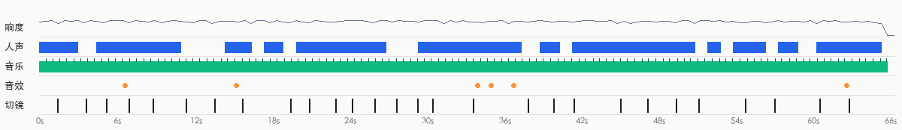

- 响度 -17.3 dBFS，峰值 -0.5 dBFS；声音跨切点连续，是后期整体铺的（切点处背景声变化 10.2dB，镜头内 9.6dB）
- 来源判断：视频类型：旁白/口播 + 配乐 → 人声TTS 配音；音乐现成曲库配乐（倾向，待确认）；音效音效库/剪辑软件后期添加（倾向，待确认）

**人声**

- 占 74% 时长；基频约 324.3Hz（偏女声）
- 来源：TTS 配音（TTS 配音 64%，真人录音 27%，AI 视频原生对白（随画面生成） 9%）
  - 人声和背景声跨切点连续：整条旁白是后期单独配上去的（TTS 或真人配音）
- 复刻：TTS 配音：剪映「文本朗读」或其他配音工具，选相近的音色和语速

**背景音乐**

- 节奏：110.0 BPM（也可能是 55.0/219.9）；调性 D major（置信 0.865）；占 99% 时长（0.0–66.0s）；段落变化点 4.0s, 8.5s, 13.0s, 17.0s, 26.5s, 42.5s, 46.5s, 51.0s；片尾ends_with_video
- 剪辑与节拍：36% 的切点落在节拍上（随机约 26%）
- 来源：待确认（现成曲库配乐 52%，AI 生成音乐 30%，现成知名歌曲 17%）
  - 音乐是给画面垫底的配乐：普通视频的配乐大概率来自现成曲库（先验）
  - 人声是说话/旁白而不是唱歌（持续音高占比 0.16）：属于「旁白 + BGM」的普通视频形式
  - 音乐与视频同时收尾：按片长剪辑或定制过（两种来源都可能，弱证据）
  - 除了视频形式的先验和片尾形状这类弱证据，没有关于这段音乐本身的证据（没听出来源、没有平台音乐信息）：来源待确认，AI 生成的配乐在这里和曲库配乐分不开
  - 确认方法：在抖音/小红书原视频页面看音乐标签：显示歌名 → 现成曲目；显示「@作者创作的原声」→ 作者自己上传（MV 类多为 AI 歌）
  - 确认方法：用汽水音乐/QQ 音乐「听歌识曲」或 ACRCloud 识别：识别得到就是现成歌曲
- 复刻：原曲倾向现成曲库配乐：按 BPM/情绪/调性在曲库检索同类曲，或用 AI 生成相近风格的免版权曲

**音效**（6）

| 声音 | 试听 | 类型 | 次数 | 出现在 | 对应画面 |
|---|---|---|---|---|---|
| F1 | [试听](sfx/sfx_01.wav) | other | 1 | 6.7s | — |
| F2 | [试听](sfx/sfx_02.wav) | ding | 1 | 15.3s | — |
| F3 | [试听](sfx/sfx_03.wav) | ding | 1 | 34.1s | 标题「第3步·蛋白挤油」出现 |
| F4 | [试听](sfx/sfx_04.wav) | click | 1 | 35.1s | — |
| F5 | [试听](sfx/sfx_05.wav) | ding | 1 | 36.9s | — |
| F6 | [试听](sfx/sfx_06.wav) | ding | 1 | 62.9s | 字幕「一滴也没少」出现 |

- 复刻：每种声音先点「试听」听一下（已单独分离出来，听不到人声和配乐），到剪辑软件的音效库里找一个同类的，按「出现在」的时间点放到每一处

- 分离出的音轨：`stems/original.wav`（原声）、`stems/vocals.wav`（人声干声）、`stems/music.wav`（配乐 + 环境声）、`stems/effects.wav`（音效轨）
<!--stems-->

## 不确定点

- 声音没有 AI 听过（复核只看了画面）：人声是真人还是 TTS 是按波形推断的；音效是从单独分离出的音效轨里找的，类型是按声音特征估的。可以在「声音」里试听分轨和每处音效核对
- 背景音乐来源待确认：更像现成曲库配乐（52%），确认方法见「声音」

## 附录

### 逐镜取证

每个镜头分两块：画面里看得到的，和工具推断的制作方式（附判断依据）；最后是复刻提示词。默认折叠，点开看。

<details class="ref"><summary>#1 00:00.000–00:01.458 · 3D 渲染 + 代码/剪辑叠加（文字标注、标题）</summary>

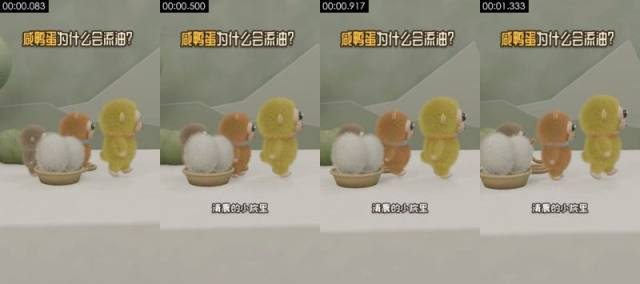

**画面里看得到的**（可以对照截图核实）
- 画面：中景平视，白色台面、鼠尾草绿墙面和低多边形山形背景；黄绿毛绒猴（鸭宝）、橙棕毛绒猴（花猫）、灰棕毛绒猴依次向右走，左侧竹篮里放着两个白色毛球（代表鸭蛋），镜头固定。
- 拍法/打光：中景；固定机位（三脚架/支架/放在桌上）；正面柔光（平光）；主光正面（光从镜头方向来，主体两侧亮度接近）；光比约 1.0:1（相差 0.0 档）；柔光（几乎没有明暗分界）
- 文字轨（文字/bottom）：清晨的小院里
- 文字轨（标题/top）：咸鸭蛋为什么会流油？
- [AI 助手 看图] 三个毛绒角色和篮里两个白毛球的轮廓、位置跨帧稳定
- [AI 助手 看图] 毛发逐帧稳定、没有闪烁或糊成一团
- [AI 助手 看图] 鼠尾巴、项圈等细节帧间不变，只有角色整体平移和轻微摆动

**工具推断的制作方式**（是推断，不是看到的）
- 推断：3D 渲染 83%，AI 生成视频 6%，代码/模板渲染 4%（fused_agent）
- 素材来源：制作方渲染
- 判断依据（工具测量，肉眼不一定看得出）：
  - 纹理呈渲染特征：平坦色块 54%、95% 像素仅用 56 种颜色、横竖直边 37%
  - 逐帧清晰度呈周期性起伏（周期 2 帧，相关 0.68），但没有重复帧：可能是插帧/帧率转换，也可能只是重新压缩留下的节奏（去掉了平台标记的转码文件也会这样），单凭这一条不能定 AI

- 复刻：3D 渲染：可用首尾帧 AI 生成近似；需要精确多角度时走 3D 建模 + Blender 渲染
  - 首帧图像提示词：主体在画面上部正中。中景平视，竖屏 9:16；白色台面，后方鼠尾草绿墙面上有浅色低多边形山形；左侧竹编浅篮里放两个白色长毛毛球，三只毛绒小猴（灰棕、橙棕、黄绿）从左到右排成一列侧身朝右；柔和漫射光，Blender 毛发渲染，低饱和清新色调。
  - 视频提示词：主体在画面上部正中。中景平视，三只毛绒小猴排成一列从画面左侧向右缓慢走动，身体轻微左右摇摆，竹篮里的两个白毛球留在左下方不动；镜头固定。

</details>

<details class="ref"><summary>#2 00:01.458–00:03.667 · 3D 渲染 + 代码/剪辑叠加（字幕、标题）</summary>

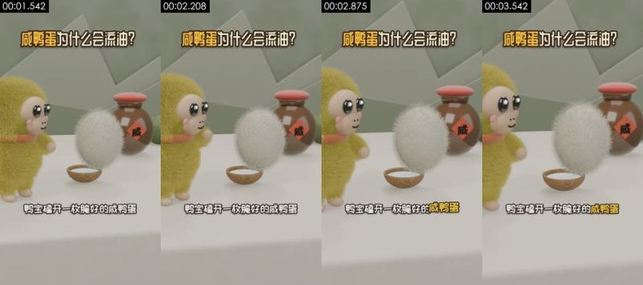

**画面里看得到的**（可以对照截图核实）
- 画面：近景平视；黄绿毛绒猴鸭宝站在左侧，面前一个白色长毛毛球（鸭蛋）从小木碗上方浮起转动，右后方是带红盖和「咸」字标签的棕色陶罐，镜头固定。
- 拍法/打光：近景；固定机位（三脚架/支架/放在桌上）；正面柔光（平光）；主光正面（光从镜头方向来，主体两侧亮度接近）；光比约 1.2:1（相差 0.3 档）；柔光（几乎没有明暗分界）
- 画面里物体上的字（不是后期字幕）：咸
- 文字轨（字幕/bottom）：鸭宝磕开一枚腌好的咸鸭蛋 / 红亮的油涌了出来
- 文字轨（标题/top）：咸鸭蛋为什么会流油？
- 镜头内动效节拍：2.33s
- [AI 助手 看图] 白毛球（鸭蛋）浮起时毛发形状稳定
- [AI 助手 看图] 陶罐上的「咸」字红菱形标签清晰不变形，是贴图不是 AI 乱码
- [AI 助手 看图] 几何轮廓和材质跨帧一致，没有 AI 视频常见的形变

**工具推断的制作方式**（是推断，不是看到的）
- 推断：3D 渲染 79%，AI 生成视频 7%，代码/模板渲染 4%（fused_agent）
- 素材来源：制作方渲染
- 判断依据（工具测量，肉眼不一定看得出）：
  - 纹理呈渲染特征：平坦色块 49%、95% 像素仅用 70 种颜色、横竖直边 33%
  - 100% 的采样帧有正脸且机位固定，音轨有人声

- 复刻：3D 渲染：可用首尾帧 AI 生成近似；需要精确多角度时走 3D 建模 + Blender 渲染
  - 首帧图像提示词：主体在画面左侧。近景平视，竖屏；左侧黄绿长毛毛绒小猴，米色脸、黑亮大眼、粉腮、橙红围脖，朝右；画面中间一个白色长毛毛球悬在小椰壳碗上方；右后方棕色陶罐，红色圆盖，罐身贴红色菱形「咸」字标签；白台面、鼠尾草绿墙；柔光，Blender 毛发渲染。
  - 视频提示词：主体在画面左侧。近景平视，黄绿毛绒小猴站在左侧看着面前的白毛球，白毛球从小碗上方缓慢浮起并轻轻转动，小猴抬手；镜头固定。

</details>

<details class="ref"><summary>#3 00:03.667–00:05.208 · 3D 渲染 + 代码/剪辑叠加（文字标注、标题）</summary>

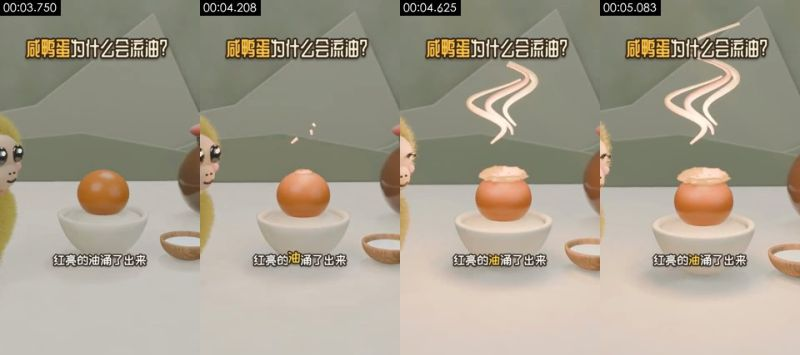

**画面里看得到的**（可以对照截图核实）
- 画面：中景平视；白瓷碗里一颗橙色蛋黄，顶部冒出浅色油层，上方升起粉白色 S 形油烟曲线，左右两侧露出毛绒角色的一部分，右下有一小碗白盐，镜头固定。
- 拍法/打光：中景；移动机位（稳定器/手持平移）；逆光/背景比主体亮；主光正面（光从镜头方向来，主体两侧亮度接近）；光比约 1.1:1（相差 0.2 档）；柔光（几乎没有明暗分界）
- 文字轨（文字/bottom）：红亮的油涌了出来
- 文字轨（标题/top）：咸鸭蛋为什么会流油？
- [AI 助手 看图] 蛋黄球体和白瓷碗边缘干净规则
- [AI 助手 看图] 粉色油烟是规则的 S 形曲线，粗细均匀
- [AI 助手 看图] 几何轮廓和材质跨帧一致，没有 AI 视频常见的形变

**工具推断的制作方式**（是推断，不是看到的）
- 推断：3D 渲染 80%，AI 生成视频 8%，代码/模板渲染 4%（fused_agent）
- 素材来源：制作方渲染
- 判断依据（工具测量，肉眼不一定看得出）：
  - 纹理呈渲染特征：平坦色块 60%、95% 像素仅用 79 种颜色、横竖直边 36%

- 复刻：3D 渲染：可用首尾帧 AI 生成近似；需要精确多角度时走 3D 建模 + Blender 渲染
  - 首帧图像提示词：主体在画面上部正中。中景平视，竖屏；画面中央白瓷碗里放一颗光滑橙色蛋黄，右下角一个木碗装白盐，左右边缘各露出半个毛绒小猴；鼠尾草绿墙面、白台面；柔光，3D 卡通渲染。
  - 视频提示词：主体在画面上部正中。中景平视，蛋黄顶部慢慢鼓起一层浅黄油脂，几粒小油点弹起，随后上方升起三道粉白色 S 形油烟曲线；镜头固定。

</details>

<details class="ref"><summary>#4 00:05.208–00:07.000 · 3D 渲染 + 代码/剪辑叠加（文字标注、标题）</summary>

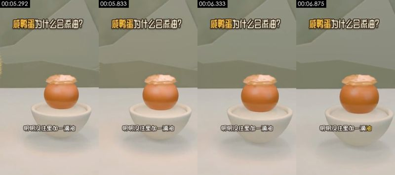

**画面里看得到的**（可以对照截图核实）
- 画面：中景平视，白瓷碗里冒着油层的蛋黄居中，背景鼠尾草绿墙面，镜头缓慢推近。
- 拍法/打光：中景；固定机位（三脚架/支架/放在桌上）；正面柔光（平光）；主光正面（光从镜头方向来，主体两侧亮度接近）；光比约 1.2:1（相差 0.2 档）；柔光（几乎没有明暗分界）
- 文字轨（文字/bottom）：明明没往里加一滴油
- 文字轨（标题/top）：咸鸭蛋为什么会流油？
- [AI 助手 看图] 蛋黄、油层、瓷碗形状逐帧一致
- [AI 助手 看图] 镜头只有缓慢平稳的推近，没有物体漂移
- [AI 助手 看图] 几何轮廓和材质跨帧一致，没有 AI 视频常见的形变

**工具推断的制作方式**（是推断，不是看到的）
- 推断：3D 渲染 82%，代码/模板渲染 5%，AI 生成视频 5%（fused_agent）
- 素材来源：制作方渲染
- 判断依据（工具测量，肉眼不一定看得出）：
  - 纹理呈渲染特征：平坦色块 59%、95% 像素仅用 55 种颜色、横竖直边 42%

- 复刻：3D 渲染：可用首尾帧 AI 生成近似；需要精确多角度时走 3D 建模 + Blender 渲染
  - 首帧图像提示词：主体在画面上部正中。中景平视，竖屏；画面中央白瓷碗里一颗橙色蛋黄，顶部盖着一层起皱的浅黄油脂；纯净白台面和鼠尾草绿墙面；柔光，3D 卡通渲染。
  - 视频提示词：主体在画面上部正中。中景平视，镜头向碗中冒油的蛋黄缓慢匀速推近，蛋黄和油层保持不动。

</details>

<details class="ref"><summary>#5 00:07.000–00:08.875 · 3D 渲染 + 代码/剪辑叠加（文字标注、标题）</summary>

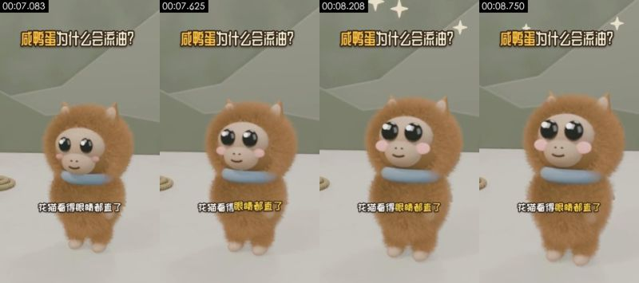

**画面里看得到的**（可以对照截图核实）
- 画面：近景平视；橙棕长毛毛绒猴花猫居中正对镜头，蓝色项圈，大眼睛眨动、身体轻微晃动，头顶闪出白色四角星，镜头固定。
- 拍法/打光：近景；移动机位（稳定器/手持平移）；正面柔光（平光）；主光正面（光从镜头方向来，主体两侧亮度接近）；光比约 1.1:1（相差 0.1 档）；柔光（几乎没有明暗分界）
- 文字轨（文字/bottom）：花猫看得眼睛都直了
- 文字轨（标题/top）：咸鸭蛋为什么会流油？
- [AI 助手 看图] 长毛跟随身体整体摆动，没有闪烁
- [AI 助手 看图] 眼睛和腮红在脸上的位置稳定
- [AI 助手 看图] 上方白色四角星闪光是规则图形

**工具推断的制作方式**（是推断，不是看到的）
- 推断：3D 渲染 74%，AI 生成视频 12%，数字人口播 3%（fused_agent）
- 素材来源：制作方渲染
- 判断依据（工具测量，肉眼不一定看得出）：
  - 人脸占画面 7%、100% 的采样帧都有：是人物近景画面，平坦色块多来自墙面/衣服，渲染特征降权
  - 纹理呈照片/视频特征：噪声 σ=0.04、用色 61 种、平坦块 54%

- 复刻：3D 渲染：可用首尾帧 AI 生成近似；需要精确多角度时走 3D 建模 + Blender 渲染
  - 首帧图像提示词：主体在画面正中。近景平视，竖屏；橙棕色长毛毛绒小猴居中正对镜头，头顶两只小尖耳，米色脸、黑亮大眼、粉腮、浅蓝色圈状项圈；鼠尾草绿墙、白台面；柔光，Blender 毛发渲染。
  - 视频提示词：主体在画面正中。近景平视，橙棕毛绒小猴正对镜头，眼睛慢慢睁大并眨一下，身体左右轻晃，头顶依次闪出几颗白色四角星；镜头固定。

</details>

<details class="ref"><summary>#6 00:08.875–00:11.458 · 3D 渲染 + 代码/剪辑叠加（字幕、标题）</summary>

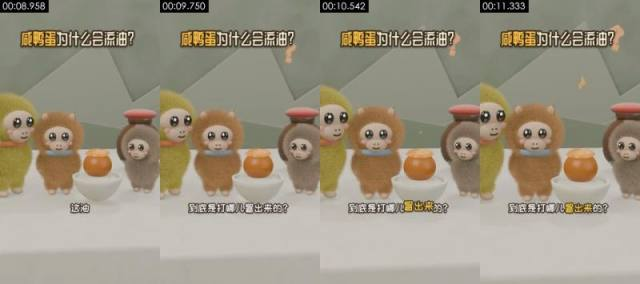

**画面里看得到的**（可以对照截图核实）
- 画面：中景平视；鸭宝、花猫、灰棕毛绒猴和冒油的蛋黄碗排成一排，右侧陶罐，画面右上方飘起橙色问号，角色轻微晃动，镜头固定。
- 拍法/打光：中景；固定机位（三脚架/支架/放在桌上）；正面柔光（平光）；主光正面（光从镜头方向来，主体两侧亮度接近）；光比约 1.2:1（相差 0.3 档）；柔光（几乎没有明暗分界）
- 文字轨（字幕/bottom）：这油 / 到底是打哪儿冒出来的？
- 文字轨（标题/top）：咸鸭蛋为什么会流油？
- 镜头内动效节拍：9.62s
- [AI 助手 看图] 三个角色和陶罐跨帧位置稳定
- [AI 助手 看图] 橙色问号有明暗，是场景里的 3D 物体
- [AI 助手 看图] 毛发逐帧稳定、没有闪烁或糊成一团

**工具推断的制作方式**（是推断，不是看到的）
- 推断：3D 渲染 78%，AI 生成视频 8%，代码/模板渲染 3%（fused_agent）
- 素材来源：制作方渲染
- 判断依据（工具测量，肉眼不一定看得出）：
  - 纹理呈渲染特征：平坦色块 47%、95% 像素仅用 82 种颜色、横竖直边 33%
  - 83% 的采样帧有正脸且机位固定，音轨有人声

- 复刻：3D 渲染：可用首尾帧 AI 生成近似；需要精确多角度时走 3D 建模 + Blender 渲染
  - 首帧图像提示词：主体在画面左侧。中景平视，竖屏；从左到右：黄绿毛绒猴、橙棕毛绒猴、白瓷碗里冒油的蛋黄、灰棕毛绒猴，背后棕色红盖陶罐；鼠尾草绿墙和低多边形山形；柔光，3D 卡通渲染。
  - 视频提示词：主体在画面左侧。中景平视，三只毛绒小猴围着冒油的蛋黄轻轻晃动、歪头，画面右上方依次飘出两个橙色问号；镜头固定。

</details>

<details class="ref"><summary>#7 00:11.458–00:13.667 · 3D 渲染 + 代码/剪辑叠加（字幕、标题）</summary>

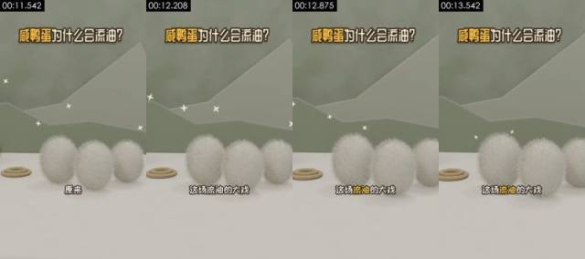

**画面里看得到的**（可以对照截图核实）
- 画面：中景平视；三个白色长毛毛球（鸭蛋）在台面上排成一排，左边一个麻绳圈，背景闪着白色四角星，镜头缓慢横移。
- 拍法/打光：中景；移动机位（稳定器/手持平移）；正面柔光（平光）；主光正面（光从镜头方向来，主体两侧亮度接近）；光比约 1.0:1（相差 0.0 档）；柔光（几乎没有明暗分界）
- 文字轨（字幕/bottom）：原来 / 这场流油的大戏 / 万后导演是普普通通的盐
- 文字轨（标题/top）：咸鸭蛋为什么会流油？
- [AI 助手 看图] 三个白毛球边缘毛发稳定，只有整体平移
- [AI 助手 看图] 左侧麻绳圈和背景山形不变
- [AI 助手 看图] 几何轮廓和材质跨帧一致，没有 AI 视频常见的形变

**工具推断的制作方式**（是推断，不是看到的）
- 推断：3D 渲染 83%，AI 生成视频 5%，代码/模板渲染 4%（fused_agent）
- 素材来源：制作方渲染
- 判断依据（工具测量，肉眼不一定看得出）：
  - 纹理呈渲染特征：平坦色块 62%、95% 像素仅用 21 种颜色、横竖直边 36%

- 复刻：3D 渲染：可用首尾帧 AI 生成近似；需要精确多角度时走 3D 建模 + Blender 渲染
  - 首帧图像提示词：主体在画面上部正中。中景平视，竖屏；白台面上三个白色长毛椭圆毛球排成一排，左侧一个麻绳卷成的圆圈，背后鼠尾草绿墙和低多边形山形，空中几颗白色四角星；柔光，Blender 毛发渲染。
  - 视频提示词：主体在画面上部正中。中景平视，镜头向右缓慢横移经过三个白色毛球，背景的白色四角星一闪一闪。

</details>

<details class="ref"><summary>#8 00:13.667–00:15.833 · 3D 渲染 + 代码/剪辑叠加（文字标注、标题）</summary>

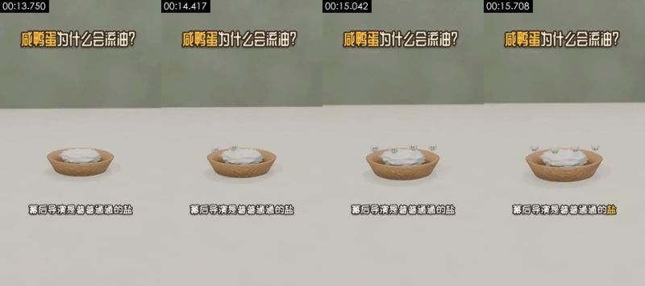

**画面里看得到的**（可以对照截图核实）
- 画面：中景略俯拍；白台面上一只浅木碗盛着白色盐堆，几颗带黑眼睛的小白球（拟人化盐粒）依次从盐堆里冒出来，镜头固定。
- 拍法/打光：中景；固定机位（三脚架/支架/放在桌上）；逆光/背景比主体亮；主光正面（光从镜头方向来，主体两侧亮度接近）；光比约 1.0:1（相差 0.0 档）；柔光（几乎没有明暗分界）
- 文字轨（文字/bottom）：幕后导演是普普通通的盐
- 文字轨（标题/top）：咸鸭蛋为什么会流油？
- [AI 助手 看图] 木碗有木纹和投影，白色盐堆有体积和明暗，不是平面代码图形
- [AI 助手 看图] 带眼睛的小白球依次弹出，轨迹规则
- [AI 助手 看图] 背景是虚化的绿墙和台面，不是逐像素冻结的纯色

**工具推断的制作方式**（是推断，不是看到的）
- 推断：3D 渲染 78%，代码/模板渲染 10%，2D 动画 3%（fused_agent）
- 素材来源：制作方渲染
- 判断依据（工具测量，肉眼不一定看得出）：
  - 纹理呈渲染特征：平坦色块 76%、95% 像素仅用 25 种颜色、横竖直边 40%

- 复刻：3D 渲染：可用首尾帧 AI 生成近似；需要精确多角度时走 3D 建模 + Blender 渲染
  - 首帧图像提示词：主体在画面上部正中。中景略俯拍，竖屏；画面中下部白台面上一只浅色木纹圆碗，碗里堆满白色盐粉；背景虚化的鼠尾草绿墙面；柔和漫射光，极简 3D 卡通渲染。
  - 视频提示词：主体在画面上部正中。中景略俯拍，五六颗带黑色小眼睛的白色小圆球从碗里的盐堆中依次弹出，停在盐面上轻轻晃动；镜头固定。

</details>

<details class="ref"><summary>#9 00:15.833–00:19.583 · 3D 渲染 + 代码/剪辑叠加（字幕、标题）</summary>

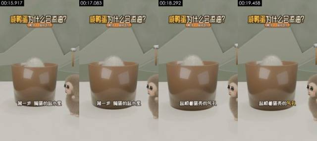

**画面里看得到的**（可以对照截图核实）
- 画面：中景平视；一只棕色半透明大杯（代表腌蛋的盐水缸），杯口露出白色毛球蛋，右侧灰棕毛绒猴探头看，背景挂着一根木柄小锤，镜头固定。
- 拍法/打光：中景；固定机位（三脚架/支架/放在桌上）；正面柔光（平光）；主光正面（光从镜头方向来，主体两侧亮度接近）；光比约 1.0:1（相差 0.1 档）；柔光（几乎没有明暗分界）
- 文字轨（字幕/bottom）：第一步腌蛋的盐水里 / 盐顺着蛋壳的气孔 / 一粒粒往里钻
- 文字轨（标题/top）：咸鸭蛋为什么会流油？ / 第1步·盐钻气孔
- [AI 助手 看图] 棕色杯壁有高光反射，几何规整
- [AI 助手 看图] 右侧灰棕毛绒猴毛发稳定
- [AI 助手 看图] 几何轮廓和材质跨帧一致，没有 AI 视频常见的形变

**工具推断的制作方式**（是推断，不是看到的）
- 推断：3D 渲染 82%，代码/模板渲染 6%，AI 生成视频 4%（fused_agent）
- 素材来源：制作方渲染
- 判断依据（工具测量，肉眼不一定看得出）：
  - 纹理呈渲染特征：平坦色块 53%、95% 像素仅用 41 种颜色、横竖直边 38%

- 复刻：3D 渲染：可用首尾帧 AI 生成近似；需要精确多角度时走 3D 建模 + Blender 渲染
  - 首帧图像提示词：主体在画面上部正中。中景平视，竖屏；画面中央一只棕色半透明圆柱大杯，杯口露出白色长毛毛球的顶部；右下方灰棕毛绒小猴探出半个身子朝左看；背景鼠尾草绿墙、低多边形山形和一根木柄小锤；柔光，3D 卡通渲染。
  - 视频提示词：主体在画面上部正中。中景平视，白毛球在棕色杯里轻轻下沉，右侧灰棕毛绒小猴眨眼看着；镜头固定。

</details>

<details class="ref"><summary>#10 00:19.583–00:21.042 · 3D 渲染 + 代码/剪辑叠加（字幕、标题）</summary>

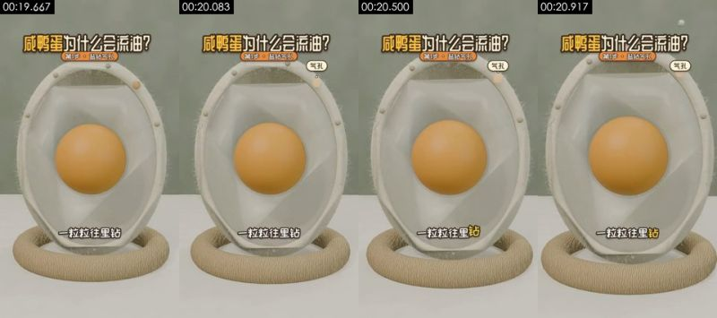

**画面里看得到的**（可以对照截图核实）
- 画面：近景平视；竖立的鸭蛋剖面模型放在麻绳圈底座上，米白色蛋壳带细绒毛，内部半透明蛋清包着橙色蛋黄，几粒小盐球从壳顶的气孔钻进来，镜头固定。
- 拍法/打光：中景；移动机位（稳定器/手持平移）；正面柔光（平光）；主光正面（光从镜头方向来，主体两侧亮度接近）；光比约 1.1:1（相差 0.1 档）；柔光（几乎没有明暗分界）
- 文字轨（字幕/bottom）：一粒粒往里钻 / 第二步盐先灌满蛋清
- 文字轨（标题/top）：咸鸭蛋为什么会流油？ / 第1步·盐钻气孔 / 第2步·盐进蛋黄
- 文字轨（标题/top）：气孔
- [AI 助手 看图] 鸭蛋剖面模型：米白壳、半透明蛋清、正球形蛋黄，跨帧不变
- [AI 助手 看图] 壳边绒毛和麻绳底座有材质纹理
- [AI 助手 看图] 小盐粒沿规则轨迹从壳顶钻入

**工具推断的制作方式**（是推断，不是看到的）
- 推断：3D 渲染 80%，AI 生成视频 7%，代码/模板渲染 4%（fused_agent）
- 素材来源：制作方渲染
- 判断依据（工具测量，肉眼不一定看得出）：
  - 纹理呈渲染特征：平坦色块 35%、95% 像素仅用 57 种颜色、横竖直边 31%

- 复刻：3D 渲染：可用首尾帧 AI 生成近似；需要精确多角度时走 3D 建模 + Blender 渲染
  - 首帧图像提示词：中景，主体在画面上部正中。近景平视，竖屏；画面中央竖立一个椭圆鸭蛋剖面模型，米白色蛋壳外沿有细绒毛，内部半透明蛋清，正中一颗橙色球形蛋黄，底部放在麻绳编织圆环上；鼠尾草绿背景；柔光，3D 科普渲染。
  - 视频提示词：中景，主体在画面上部正中，镜头推。近景平视，几粒小白色盐球从右上方落到蛋壳顶部，依次钻进壳上的小孔进入蛋清；蛋黄不动；镜头固定。

</details>

<details class="ref"><summary>#11 00:21.042–00:23.042 · 3D 渲染 + 代码/剪辑叠加（字幕、标题）</summary>

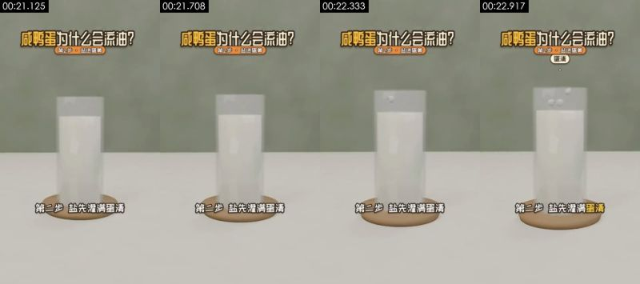

**画面里看得到的**（可以对照截图核实）
- 画面：中景平视；白台面上一只装白色液体的玻璃圆柱杯（代表蛋清），放在木托盘上，几颗小白盐粒从上方落进杯里，镜头固定。
- 拍法/打光：中景；固定机位（三脚架/支架/放在桌上）；逆光/背景比主体亮；主光正面（光从镜头方向来，主体两侧亮度接近）；光比约 1.0:1（相差 0.0 档）；柔光（几乎没有明暗分界）
- 文字轨（字幕/bottom）：第二步盐先灌满蛋清 / 再穿过蛋黄膜
- 文字轨（标题/top）：咸鸭蛋为什么会流油？ / 第2步·盐进蛋黄
- [AI 助手 看图] 玻璃杯有折射、厚度和投影，木托盘有木纹
- [AI 助手 看图] 白色液体有体积，不是平面色块
- [AI 助手 看图] 小盐粒落入液面的轨迹规则

**工具推断的制作方式**（是推断，不是看到的）
- 推断：3D 渲染 78%，代码/模板渲染 10%，2D 动画 3%（fused_agent）
- 素材来源：制作方渲染
- 判断依据（工具测量，肉眼不一定看得出）：
  - 纹理呈渲染特征：平坦色块 70%、95% 像素仅用 27 种颜色、横竖直边 41%
  - 逐帧清晰度呈周期性起伏（周期 2 帧，相关 0.47），但没有重复帧：可能是插帧/帧率转换，也可能只是重新压缩留下的节奏（去掉了平台标记的转码文件也会这样），单凭这一条不能定 AI

- 复刻：3D 渲染：可用首尾帧 AI 生成近似；需要精确多角度时走 3D 建模 + Blender 渲染
  - 首帧图像提示词：主体在画面上部正中。中景平视，竖屏；画面中央白台面上一只透明玻璃圆柱杯，盛满乳白色液体，杯底垫一个浅木圆托盘；背景鼠尾草绿墙；柔和漫射光，极简 3D 科普渲染。
  - 视频提示词：主体在画面上部正中。中景平视，几颗小白色盐粒从杯口上方依次落入乳白色液体中；镜头固定。

</details>

<details class="ref"><summary>#12 00:23.042–00:24.333 · 3D 渲染 + 代码/剪辑叠加（文字标注、标题）</summary>

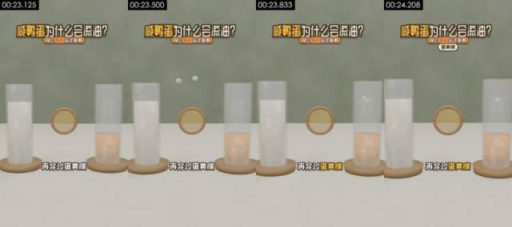

**画面里看得到的**（可以对照截图核实）
- 画面：中景平视；左边装白色液体的玻璃杯（蛋清），右边装橙黄液体的玻璃杯（蛋黄），中间立着一个木框圆形薄膜（蛋黄膜），白色盐粒从左向右穿过薄膜，镜头固定。
- 拍法/打光：中景；固定机位（三脚架/支架/放在桌上）；逆光/背景比主体亮；主光正面（光从镜头方向来，主体两侧亮度接近）；光比约 1.0:1（相差 0.0 档）；柔光（几乎没有明暗分界）
- 文字轨（文字/bottom）：再穿过蛋黄膜
- 文字轨（标题/top）：咸鸭蛋为什么会流油？ / 第2步·盐进蛋黄
- 文字轨（标题/top）：蛋黄膜
- [AI 助手 看图] 两只玻璃杯和中间的木框圆膜有材质、透明度和投影
- [AI 助手 看图] 白色小球穿过圆膜飞向右杯，轨迹规则
- [AI 助手 看图] 几何轮廓和材质跨帧一致，没有 AI 视频常见的形变

**工具推断的制作方式**（是推断，不是看到的）
- 推断：3D 渲染 82%，代码/模板渲染 7%，AI 生成视频 3%（fused_agent）
- 素材来源：制作方渲染
- 判断依据（工具测量，肉眼不一定看得出）：
  - 纹理呈渲染特征：平坦色块 63%、95% 像素仅用 41 种颜色、横竖直边 41%

- 复刻：3D 渲染：可用首尾帧 AI 生成近似；需要精确多角度时走 3D 建模 + Blender 渲染
  - 首帧图像提示词：主体在画面上部正中。中景平视，竖屏；白台面上左侧一只玻璃杯装乳白液体，右侧一只玻璃杯装半杯橙黄液体，两杯都垫浅木托盘，中间悬着一个木框圆形半透明薄膜；鼠尾草绿背景；柔光，极简 3D 科普渲染。
  - 视频提示词：主体在画面上部正中。中景平视，几颗白色小盐粒从左杯上方飞出，穿过中间的木框圆膜，落进右侧橙黄液体里；镜头固定。

</details>

<details class="ref"><summary>#13 00:24.333–00:26.125 · 3D 渲染 + 代码/剪辑叠加（字幕、文字标注、标题）</summary>

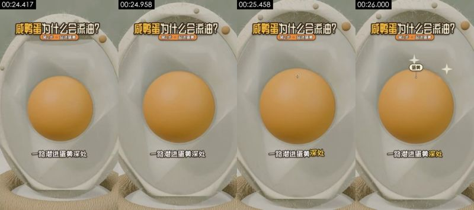

**画面里看得到的**（可以对照截图核实）
- 画面：特写平视；鸭蛋剖面模型的蛋黄居中，镜头缓慢推近，蛋黄上方闪出白色四角星和「蛋黄」小标签。
- 拍法/打光：中景；移动机位（稳定器/手持平移）；正面柔光（平光）；主光正面（光从镜头方向来，主体两侧亮度接近）；光比约 1.0:1（相差 0.0 档）；柔光（几乎没有明暗分界）
- 文字轨（字幕/bottom）：一路潜进蛋黄深处 / 蛋黄里存着的水分
- 文字轨（文字/middle）：蛋黄
- 文字轨（标题/top）：咸鸭蛋为什么会流油？ / 第2步·盐进蛋黄
- [AI 助手 看图] 和第 10 镜是同一个鸭蛋剖面模型，结构完全一致
- [AI 助手 看图] 推近过程平稳，蛋黄是正球体
- [AI 助手 看图] 几何轮廓和材质跨帧一致，没有 AI 视频常见的形变

**工具推断的制作方式**（是推断，不是看到的）
- 推断：3D 渲染 79%，AI 生成视频 8%，代码/模板渲染 3%（fused_agent）
- 素材来源：制作方渲染
- 判断依据（工具测量，肉眼不一定看得出）：
  - 纹理呈渲染特征：平坦色块 28%、95% 像素仅用 62 种颜色、横竖直边 31%

- 复刻：3D 渲染：可用首尾帧 AI 生成近似；需要精确多角度时走 3D 建模 + Blender 渲染
  - 首帧图像提示词：中景，主体在画面上部正中。特写平视，竖屏；鸭蛋剖面模型填满画面，米白壳、半透明蛋清，正中橙色球形蛋黄；柔光，3D 科普渲染。
  - 视频提示词：中景，主体在画面上部正中。特写平视，镜头向中央的橙色蛋黄缓慢推近，蛋黄上方闪出两颗白色四角星；结束时蛋黄占画面一半。

</details>

<details class="ref"><summary>#14 00:26.125–00:27.792 · 3D 渲染 + 代码/剪辑叠加（文字标注、标题）</summary>

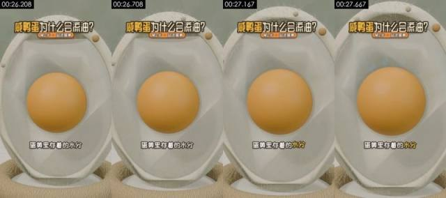

**画面里看得到的**（可以对照截图核实）
- 画面：特写平视；鸭蛋剖面模型的蛋黄居中，画面基本静止，镜头极缓慢推近。
- 拍法/打光：中景；移动机位（稳定器/手持平移）；正面柔光（平光）；主光正面（光从镜头方向来，主体两侧亮度接近）；光比约 1.0:1（相差 0.1 档）；柔光（几乎没有明暗分界）
- 文字轨（文字/bottom）：蛋黄里存着的水分
- 文字轨（标题/top）：咸鸭蛋为什么会流油？ / 第2步·盐进蛋黄
- [AI 助手 看图] 蛋黄和壳体形状跨帧一致
- [AI 助手 看图] 壳边小圆粒位置固定
- [AI 助手 看图] 几何轮廓和材质跨帧一致，没有 AI 视频常见的形变

**工具推断的制作方式**（是推断，不是看到的）
- 推断：3D 渲染 79%，AI 生成视频 8%，代码/模板渲染 3%（fused_agent）
- 素材来源：制作方渲染
- 判断依据（工具测量，肉眼不一定看得出）：
  - 纹理呈渲染特征：平坦色块 27%、95% 像素仅用 61 种颜色、横竖直边 31%

- 复刻：3D 渲染：可用首尾帧 AI 生成近似；需要精确多角度时走 3D 建模 + Blender 渲染
  - 首帧图像提示词：中景，主体在画面上部正中。特写平视，竖屏；鸭蛋剖面模型，正中橙色球形蛋黄，四周半透明蛋清和米白壳；柔光，3D 科普渲染。
  - 视频提示词：中景，主体在画面上部正中，镜头推。特写平视，蛋黄表面泛起微弱的湿润高光，镜头极缓慢推近。

</details>

<details class="ref"><summary>#15 00:27.792–00:29.458 · 3D 渲染 + 代码/剪辑叠加（文字标注、标题）</summary>

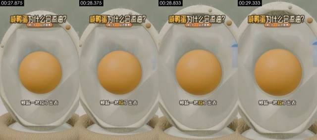

**画面里看得到的**（可以对照截图核实）
- 画面：特写平视；鸭蛋剖面模型，蛋黄居中，右侧壳边出现浅蓝色水滴向外移动，镜头固定。
- 拍法/打光：中景；移动机位（稳定器/手持平移）；正面柔光（平光）；主光正面（光从镜头方向来，主体两侧亮度接近）；光比约 1.0:1（相差 0.0 档）；柔光（几乎没有明暗分界）
- 文字轨（文字/bottom）：被盐一把拉了出去
- 文字轨（标题/top）：咸鸭蛋为什么会流油？ / 第2步·盐进蛋黄
- [AI 助手 看图] 同一剖面模型，蛋黄形状稳定
- [AI 助手 看图] 右侧壳边出现浅蓝色水滴形状，边缘规则
- [AI 助手 看图] 几何轮廓和材质跨帧一致，没有 AI 视频常见的形变

**工具推断的制作方式**（是推断，不是看到的）
- 推断：3D 渲染 78%，AI 生成视频 9%，代码/模板渲染 3%（fused_agent）
- 素材来源：制作方渲染
- 判断依据（工具测量，肉眼不一定看得出）：
  - 纹理呈渲染特征：平坦色块 26%、95% 像素仅用 63 种颜色、横竖直边 31%

- 复刻：3D 渲染：可用首尾帧 AI 生成近似；需要精确多角度时走 3D 建模 + Blender 渲染
  - 首帧图像提示词：中景，主体在画面上部正中。特写平视，竖屏；鸭蛋剖面模型，正中橙色球形蛋黄，四周半透明蛋清；柔光，3D 科普渲染。
  - 视频提示词：中景，主体在画面上部正中，镜头推。特写平视，几颗浅蓝色小水滴从蛋黄表面渗出，穿过蛋清向右侧壳边移动并消失；镜头固定。

</details>

<details class="ref"><summary>#16 00:29.458–00:30.625 · 3D 渲染 + 代码/剪辑叠加（字幕、标题）</summary>

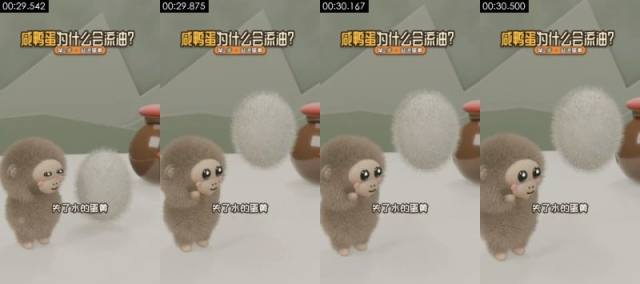

**画面里看得到的**（可以对照截图核实）
- 画面：近景平视；灰棕毛绒猴在左侧抬头看，旁边白色毛球（蛋黄的拟人化）浮起变大，背后陶罐，镜头缓慢推近。
- 拍法/打光：近景；移动机位（稳定器/手持平移）；正面柔光（平光）；主光正面（光从镜头方向来，主体两侧亮度接近）；光比约 1.2:1（相差 0.3 档）；硬光（明暗分界清楚）
- 文字轨（字幕/bottom）：失了水的蛋黄 / 缩成一团
- 文字轨（标题/top）：咸鸭蛋为什么会流油？ / 第2步·盐进蛋黄
- [AI 助手 看图] 灰棕毛绒猴和白毛球毛发稳定
- [AI 助手 看图] 陶罐的红盖和反光一致
- [AI 助手 看图] 几何轮廓和材质跨帧一致，没有 AI 视频常见的形变

**工具推断的制作方式**（是推断，不是看到的）
- 推断：3D 渲染 83%，AI 生成视频 5%，代码/模板渲染 4%（fused_agent）
- 素材来源：制作方渲染
- 判断依据（工具测量，肉眼不一定看得出）：
  - 纹理呈渲染特征：平坦色块 50%、95% 像素仅用 43 种颜色、横竖直边 36%
  - 逐帧清晰度呈周期性起伏（周期 4 帧，相关 0.85），但没有重复帧：可能是插帧/帧率转换，也可能只是重新压缩留下的节奏（去掉了平台标记的转码文件也会这样），单凭这一条不能定 AI

- 复刻：3D 渲染：可用首尾帧 AI 生成近似；需要精确多角度时走 3D 建模 + Blender 渲染
  - 首帧图像提示词：主体在画面下部左侧。近景平视，竖屏；左侧灰棕色毛绒小猴，米色脸、黑大眼、粉腮，侧身朝右；右侧一个白色长毛椭圆毛球悬在台面上方；右后方棕色红盖陶罐；鼠尾草绿墙、低多边形山形；柔光，Blender 毛发渲染。
  - 视频提示词：主体在画面下部左侧。近景平视，白色毛球从台面浮起并慢慢转动，左侧灰棕小猴抬头眨眼看着它；镜头缓慢推近。

</details>

<details class="ref"><summary>#17 00:30.625–00:33.750 · 3D 渲染 + 代码/剪辑叠加（字幕、标题）</summary>

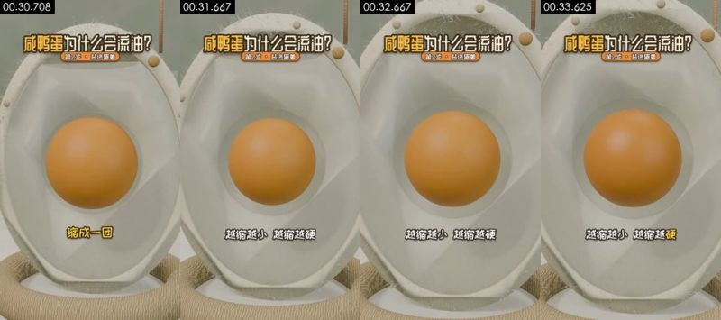

**画面里看得到的**（可以对照截图核实）
- 画面：特写平视；鸭蛋剖面模型，中央蛋黄逐渐均匀缩小，周围出现一圈空隙，镜头固定。
- 拍法/打光：中景；移动机位（稳定器/手持平移）；正面柔光（平光）；主光正面（光从镜头方向来，主体两侧亮度接近）；光比约 1.0:1（相差 0.0 档）；柔光（几乎没有明暗分界）
- 文字轨（字幕/bottom）：缩成一团 / 越缩越小越缩越硬
- 文字轨（标题/top）：咸鸭蛋为什么会流油？ / 第2步·盐进蛋黄
- [AI 助手 看图] 同一剖面模型，蛋黄缩小是均匀的比例缩放
- [AI 助手 看图] 壳体和背景完全不变
- [AI 助手 看图] 几何轮廓和材质跨帧一致，没有 AI 视频常见的形变

**工具推断的制作方式**（是推断，不是看到的）
- 推断：3D 渲染 78%，AI 生成视频 9%，代码/模板渲染 3%（fused_agent）
- 素材来源：制作方渲染
- 判断依据（工具测量，肉眼不一定看得出）：
  - 纹理呈渲染特征：平坦色块 25%、95% 像素仅用 59 种颜色、横竖直边 28%

- 复刻：3D 渲染：可用首尾帧 AI 生成近似；需要精确多角度时走 3D 建模 + Blender 渲染
  - 首帧图像提示词：中景，主体在画面上部正中。特写平视，竖屏；鸭蛋剖面模型，正中橙色球形蛋黄，四周半透明蛋清和米白壳；柔光，3D 科普渲染。
  - 视频提示词：中景，主体在画面上部正中，镜头推。特写平视，中央的橙色蛋黄均匀地缩小约一成，蛋黄和蛋清之间露出一圈浅色空隙，结束时蛋黄静止；镜头固定。

</details>

<details class="ref"><summary>#18 00:33.750–00:38.042 · 3D 渲染 + 代码/剪辑叠加（字幕、标题）</summary>

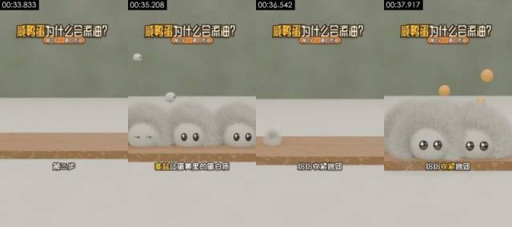

**画面里看得到的**（可以对照截图核实）
- 画面：中景平视；一块木板横在白台面上，几个带黑眼睛的白色毛团（代表蛋白质）先后弹落到木板上挤在一起，随后几颗橙色小球（油滴）从它们中间弹出，镜头固定。
- 拍法/打光：中景；固定机位（三脚架/支架/放在桌上）；正面柔光（平光）；主光正面（光从镜头方向来，主体两侧亮度接近）；光比约 1.0:1（相差 0.0 档）；柔光（几乎没有明暗分界）
- 文字轨（字幕/bottom）：第三步 / 高盐让蛋黄里的蛋白质 / 纷纷收紧抱团 / 原本被裹得严严实实的油
- 文字轨（标题/top）：咸鸭蛋为什么会流油？ / 第3步·蛋白挤油
- [AI 助手 看图] 白色毛团角色有细长毛发和体积阴影，木板有木纹
- [AI 助手 看图] 36.5s 左右毛团整体消失后重新弹入，像两段渲染拼接，不是形变
- [AI 助手 看图] 橙色小球弹出的轨迹规则

**工具推断的制作方式**（是推断，不是看到的）
- 推断：3D 渲染 83%，代码/模板渲染 5%，AI 生成视频 4%（fused_agent）
- 素材来源：制作方渲染
- 判断依据（工具测量，肉眼不一定看得出）：
  - 纹理呈渲染特征：平坦色块 56%、95% 像素仅用 36 种颜色、横竖直边 42%

- 复刻：3D 渲染：可用首尾帧 AI 生成近似；需要精确多角度时走 3D 建模 + Blender 渲染
  - 首帧图像提示词：主体在画面上部正中。中景平视，竖屏；画面下半部一块浅木纹长木板横放在白台面上，背景纯鼠尾草绿墙面；柔光，3D 卡通渲染。
  - 视频提示词：主体在画面上部正中。中景平视，几个带黑亮眼睛的白色长毛毛团从上方依次弹落到木板上，互相挤紧排成一排，接着几颗橙色小圆球从它们中间向上弹出；镜头固定。

</details>

<details class="ref"><summary>#19 00:38.042–00:40.000 · 3D 渲染 + 代码/剪辑叠加（文字标注、标题）</summary>

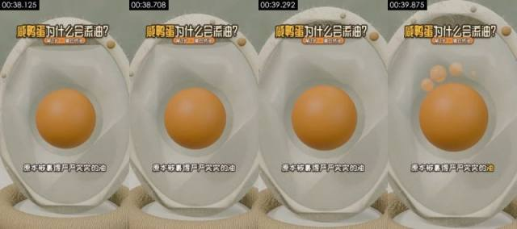

**画面里看得到的**（可以对照截图核实）
- 画面：特写平视；鸭蛋剖面模型，蛋黄顶部冒出几颗橙色半透明油珠，镜头固定。
- 拍法/打光：中景；移动机位（稳定器/手持平移）；正面柔光（平光）；主光正面（光从镜头方向来，主体两侧亮度接近）；光比约 1.0:1（相差 0.0 档）；柔光（几乎没有明暗分界）
- 文字轨（文字/bottom）：原本被裹得严严实实的油
- 文字轨（标题/top）：咸鸭蛋为什么会流油？ / 第3步·蛋白挤油
- [AI 助手 看图] 同一剖面模型
- [AI 助手 看图] 蛋黄上方冒出的橙色油珠是规则球体，逐个出现
- [AI 助手 看图] 几何轮廓和材质跨帧一致，没有 AI 视频常见的形变

**工具推断的制作方式**（是推断，不是看到的）
- 推断：3D 渲染 78%，AI 生成视频 9%，代码/模板渲染 3%（fused_agent）
- 素材来源：制作方渲染
- 判断依据（工具测量，肉眼不一定看得出）：
  - 纹理呈渲染特征：平坦色块 26%、95% 像素仅用 63 种颜色、横竖直边 30%

- 复刻：3D 渲染：可用首尾帧 AI 生成近似；需要精确多角度时走 3D 建模 + Blender 渲染
  - 首帧图像提示词：中景，主体在画面上部正中。特写平视，竖屏；鸭蛋剖面模型，正中橙色球形蛋黄，四周半透明蛋清；柔光，3D 科普渲染。
  - 视频提示词：中景，主体在画面上部正中，镜头推。特写平视，蛋黄顶部依次冒出四五颗橙色半透明小油珠，停在蛋黄上方；镜头固定。

</details>

<details class="ref"><summary>#20 00:40.000–00:41.583 · 3D 渲染 + 代码/剪辑叠加（字幕、标题）</summary>


**画面里看得到的**（可以对照截图核实）
- 画面：特写平视；鸭蛋剖面模型，蛋黄上方的油珠散开后落回顶部铺成一层油，镜头固定。
- 拍法/打光：中景；移动机位（稳定器/手持平移）；正面柔光（平光）；主光正面（光从镜头方向来，主体两侧亮度接近）；光比约 1.0:1（相差 0.0 档）；柔光（几乎没有明暗分界）
- 文字轨（字幕/bottom）：一下子全散开了 / 就像拧毛巾
- 文字轨（标题/top）：咸鸭蛋为什么会流油？ / 第3步·蛋白挤油
- [AI 助手 看图] 同一剖面模型
- [AI 助手 看图] 油珠落回蛋黄顶部变成一层油，过渡平滑
- [AI 助手 看图] 几何轮廓和材质跨帧一致，没有 AI 视频常见的形变

**工具推断的制作方式**（是推断，不是看到的）
- 推断：3D 渲染 79%，AI 生成视频 8%，代码/模板渲染 3%（fused_agent）
- 素材来源：制作方渲染
- 判断依据（工具测量，肉眼不一定看得出）：
  - 纹理呈渲染特征：平坦色块 26%、95% 像素仅用 60 种颜色、横竖直边 32%

- 复刻：3D 渲染：可用首尾帧 AI 生成近似；需要精确多角度时走 3D 建模 + Blender 渲染
  - 首帧图像提示词：中景，主体在画面上部正中。特写平视，竖屏；鸭蛋剖面模型，正中橙色球形蛋黄，上方飘着几颗橙色油珠；柔光，3D 科普渲染。
  - 视频提示词：中景，主体在画面上部正中，镜头推。特写平视，蛋黄上方的几颗油珠散开又落回蛋黄顶部，铺成一层起皱的浅黄油层；镜头固定。

</details>

<details class="ref"><summary>#21 00:41.583–00:45.250 · 3D 渲染 + 代码/剪辑叠加（字幕、标题）</summary>


**画面里看得到的**（可以对照截图核实）
- 画面：中景平视；一块浅蓝色绒毛方巾挂在金属横杆上，横杆向两侧拉伸把毛巾拧成 T 字形，两侧滴下透明水滴，镜头固定。
- 拍法/打光：中景；固定机位（三脚架/支架/放在桌上）；逆光/背景比主体亮；主光正面（光从镜头方向来，主体两侧亮度接近）；光比约 1.0:1（相差 0.0 档）；柔光（几乎没有明暗分界）
- 文字轨（字幕/bottom）：就像拧毛巾 / 手一收紧 / 水就被挤了出来
- 文字轨（标题/top）：咸鸭蛋为什么会流油？ / 第3步·蛋白挤油
- [AI 助手 看图] 毛巾有绒毛材质，金属杆有高光，水滴有折射
- [AI 助手 看图] 毛巾被挤成 T 字形，变形规则
- [AI 助手 看图] 背景是有空间感的台面和墙，不是平面色块

**工具推断的制作方式**（是推断，不是看到的）
- 推断：3D 渲染 81%，代码/模板渲染 8%，2D 动画 2%（fused_agent）
- 素材来源：制作方渲染
- 判断依据（工具测量，肉眼不一定看得出）：
  - 纹理呈渲染特征：平坦色块 68%、95% 像素仅用 24 种颜色、横竖直边 45%

- 复刻：3D 渲染：可用首尾帧 AI 生成近似；需要精确多角度时走 3D 建模 + Blender 渲染
  - 首帧图像提示词：主体在画面上部正中。中景平视，竖屏；画面中央白台面上方一根金属细横杆，挂着一块浅灰蓝色绒毛方巾；背景鼠尾草绿墙；柔和漫射光，极简 3D 科普渲染。
  - 视频提示词：主体在画面上部正中。中景平视，毛巾被横杆向上提起并从中间拧紧，变成细长的 T 字形，两侧不断滴下透明水滴；镜头固定。

</details>

<details class="ref"><summary>#22 00:45.250–00:47.333 · 3D 渲染 + 代码/剪辑叠加（文字标注、标题）</summary>


**画面里看得到的**（可以对照截图核实）
- 画面：中景平视；花猫、鸭宝、灰棕毛绒猴并排站立轻晃，右后方陶罐，上方不断落下棕色小片（代表时间流逝），镜头固定。
- 拍法/打光：中景；固定机位（三脚架/支架/放在桌上）；正面柔光（平光）；主光正面（光从镜头方向来，主体两侧亮度接近）；光比约 1.0:1（相差 0.0 档）；柔光（几乎没有明暗分界）
- 画面里物体上的字（不是后期字幕）：盛
- 文字轨（文字/bottom）：第四步剩下的交给时间
- 文字轨（标题/top）：咸鸭蛋为什么会流油？ / 第4步·静待出油
- [AI 助手 看图] 三个角色和陶罐形状稳定
- [AI 助手 看图] 陶罐「咸」字标签是贴图
- [AI 助手 看图] 落下的棕色小片沿规则轨迹下落

**工具推断的制作方式**（是推断，不是看到的）
- 推断：3D 渲染 79%，AI 生成视频 8%，代码/模板渲染 4%（fused_agent）
- 素材来源：制作方渲染
- 判断依据（工具测量，肉眼不一定看得出）：
  - 纹理呈渲染特征：平坦色块 47%、95% 像素仅用 76 种颜色、横竖直边 33%

- 复刻：3D 渲染：可用首尾帧 AI 生成近似；需要精确多角度时走 3D 建模 + Blender 渲染
  - 首帧图像提示词：主体在画面上部正中。中景平视，竖屏；三只毛绒小猴并排正对镜头，左橙棕、中黄绿、右灰棕，右后方棕色红盖陶罐贴红色「咸」字菱形标签，左侧一个麻绳圈；鼠尾草绿墙和低多边形山形；柔光，Blender 毛发渲染。
  - 视频提示词：主体在画面上部正中。中景平视，三只毛绒小猴并排轻轻左右摇晃，上方不断飘落棕色小叶片；镜头固定。

</details>

<details class="ref"><summary>#23 00:47.333–00:49.583 · 3D 渲染 + 代码/剪辑叠加（字幕、标题）</summary>


**画面里看得到的**（可以对照截图核实）
- 画面：特写平视；鸭蛋剖面模型，蛋黄顶部的油层逐渐变厚，周围闪出白色四角星，镜头缓慢推近。
- 拍法/打光：中景；移动机位（稳定器/手持平移）；正面柔光（平光）；主光正面（光从镜头方向来，主体两侧亮度接近）；光比约 1.0:1（相差 0.0 档）；柔光（几乎没有明暗分界）
- 文字轨（字幕/bottom）：家庭腌制要30~40天 / 腌足日子再敲开
- 文字轨（标题/top）：咸鸭蛋为什么会流油？ / 第4步·静待出油
- [AI 助手 看图] 同一剖面模型
- [AI 助手 看图] 蛋黄顶部油层逐渐变厚，白色四角星闪光
- [AI 助手 看图] 几何轮廓和材质跨帧一致，没有 AI 视频常见的形变

**工具推断的制作方式**（是推断，不是看到的）
- 推断：3D 渲染 77%，AI 生成视频 9%，代码/模板渲染 3%（fused_agent）
- 素材来源：制作方渲染

- 复刻：3D 渲染：可用首尾帧 AI 生成近似；需要精确多角度时走 3D 建模 + Blender 渲染
  - 首帧图像提示词：中景，主体在画面上部正中。特写平视，竖屏；鸭蛋剖面模型，正中橙色球形蛋黄，顶部一层浅黄油脂；柔光，3D 科普渲染。
  - 视频提示词：中景，主体在画面上部正中，镜头推。特写平视，蛋黄顶部的浅黄油层慢慢变厚溢开，四周依次闪出白色四角星；镜头缓慢推近。

</details>

<details class="ref"><summary>#24 00:49.583–00:51.292 · 3D 渲染 + 代码/剪辑叠加（文字标注、标题）</summary>


**画面里看得到的**（可以对照截图核实）
- 画面：近景平视；鸭宝站在左侧，面前的白色毛球（鸭蛋）变成白瓷碗里冒油的蛋黄，右后方陶罐，镜头固定。
- 拍法/打光：近景；固定机位（三脚架/支架/放在桌上）；正面柔光（平光）；主光正面（光从镜头方向来，主体两侧亮度接近）；光比约 1.2:1（相差 0.3 档）；柔光（几乎没有明暗分界）
- 文字轨（文字/bottom）：腌足日子再敲开
- 文字轨（标题/top）：咸鸭蛋为什么会流油？ / 第4步·静待出油
- 镜头内动效节拍：50.38s
- [AI 助手 看图] 和第 2 镜同一套场景和角色，构图更近
- [AI 助手 看图] 白毛球切换成碗里的蛋黄，过渡干净
- [AI 助手 看图] 毛发逐帧稳定、没有闪烁或糊成一团

**工具推断的制作方式**（是推断，不是看到的）
- 推断：3D 渲染 80%，AI 生成视频 7%，代码/模板渲染 4%（fused_agent）
- 素材来源：制作方渲染
- 判断依据（工具测量，肉眼不一定看得出）：
  - 纹理呈渲染特征：平坦色块 51%、95% 像素仅用 69 种颜色、横竖直边 36%
  - 100% 的采样帧有正脸且机位固定，音轨有人声

- 复刻：3D 渲染：可用首尾帧 AI 生成近似；需要精确多角度时走 3D 建模 + Blender 渲染
  - 首帧图像提示词：主体在画面左侧。近景平视，竖屏；左侧黄绿长毛毛绒小猴朝右站，面前一个白色长毛毛球悬在小椰壳碗上方，右后方棕色红盖陶罐；鼠尾草绿墙、白台面；柔光，Blender 毛发渲染。
  - 视频提示词：主体在画面左侧。近景平视，白毛球轻轻一颤后变成白瓷碗里一颗顶着浅黄油层的橙色蛋黄，左侧小猴抬手看着；镜头固定。

</details>

<details class="ref"><summary>#25 00:51.292–00:54.958 · 3D 渲染 + 代码/剪辑叠加（字幕、文字标注、标题）</summary>


**画面里看得到的**（可以对照截图核实）
- 画面：中景平视；白瓷碗里冒油的蛋黄居中，上方升起粉白色 S 形油烟，出现「红油」小标签，镜头固定。
- 拍法/打光：近景；固定机位（三脚架/支架/放在桌上）；逆光/背景比主体亮；主光正面（光从镜头方向来，主体两侧亮度接近）；光比约 1.2:1（相差 0.3 档）；柔光（几乎没有明暗分界）
- 文字轨（字幕/bottom）：红油汪在蛋黄上 / 颤颤的亮亮的
- 文字轨（文字/middle）：红油
- 文字轨（标题/top）：咸鸭蛋为什么会流油？ / 第4步·静待出油
- [AI 助手 看图] 蛋黄、油层和瓷碗形状稳定
- [AI 助手 看图] 粉白色 S 形油烟和「红油」标签规则出现
- [AI 助手 看图] 几何轮廓和材质跨帧一致，没有 AI 视频常见的形变

**工具推断的制作方式**（是推断，不是看到的）
- 推断：3D 渲染 81%，AI 生成视频 5%，代码/模板渲染 5%（fused_agent）
- 素材来源：制作方渲染
- 判断依据（工具测量，肉眼不一定看得出）：
  - 纹理呈渲染特征：平坦色块 56%、95% 像素仅用 56 种颜色、横竖直边 38%

- 复刻：3D 渲染：可用首尾帧 AI 生成近似；需要精确多角度时走 3D 建模 + Blender 渲染
  - 首帧图像提示词：近景，主体在画面上部正中。中景平视，竖屏；画面中央白瓷碗里一颗橙色蛋黄，顶部盖着起皱的浅黄油层；鼠尾草绿墙和低多边形山形；柔光，3D 卡通渲染。
  - 视频提示词：近景，主体在画面上部正中。中景平视，蛋黄上方升起三道粉白色 S 形油烟曲线并缓慢飘动，油层轻轻颤动；镜头固定。

</details>

<details class="ref"><summary>#26 00:54.958–00:57.208 · 3D 渲染 + 代码/剪辑叠加（字幕、标题、花字）</summary>


**画面里看得到的**（可以对照截图核实）
- 画面：近景平视；鸭宝居中双手把盛着冒油蛋黄的白碗举过头顶，笑眯眼，两侧花猫和灰棕毛绒猴也在笑，周围闪白色四角星，镜头固定。
- 拍法/打光：近景；固定机位（三脚架/支架/放在桌上）；正面柔光（平光）；主光正面（光从镜头方向来，主体两侧亮度接近）；光比约 1.1:1（相差 0.1 档）；柔光（几乎没有明暗分界）
- 画面里物体上的字（不是后期字幕）：咸
- 文字轨（字幕/bottom）：这就是流油咸鸭蛋 / 不过这油不是谁偷偷加的
- 文字轨（字幕/middle）：流油咸鸭蛋！ / 流油咸鸭蛋！+
- 文字轨（标题/top）：咸鸭蛋为什么会流油？ / 成了！ / 注营！
- [AI 助手 看图] 三个角色毛发稳定
- [AI 助手 看图] 鸭宝头顶的碗和蛋黄跟着手臂一起抬起，没有穿插形变
- [AI 助手 看图] 四角星闪光为规则图形

**工具推断的制作方式**（是推断，不是看到的）
- 推断：3D 渲染 77%，AI 生成视频 8%，代码/模板渲染 4%（fused_agent）
- 素材来源：制作方渲染
- 判断依据（工具测量，肉眼不一定看得出）：
  - 纹理呈渲染特征：平坦色块 41%、95% 像素仅用 113 种颜色、横竖直边 38%
  - 100% 的采样帧有正脸且机位固定，音轨有人声

- 复刻：3D 渲染：可用首尾帧 AI 生成近似；需要精确多角度时走 3D 建模 + Blender 渲染
  - 首帧图像提示词：主体在画面正中。近景平视，竖屏；画面中央黄绿毛绒小猴双手举着一只白碗，碗里一颗顶着油层的橙色蛋黄；左侧橙棕毛绒猴、右侧灰棕毛绒猴半身入画；鼠尾草绿墙；柔光，Blender 毛发渲染。
  - 视频提示词：主体在画面正中。近景平视，中间的小猴把白碗举过头顶、笑眯起眼睛，两侧小猴跟着笑，周围闪出几颗白色四角星；镜头轻微推近。

</details>

<details class="ref"><summary>#27 00:57.208–01:00.750 · 3D 渲染 + 代码/剪辑叠加（字幕、标题）</summary>


**画面里看得到的**（可以对照截图核实）
- 画面：近景平视；鸭宝和花猫站在冒油的蛋黄碗旁，背后贴「咸」字标签的陶罐，右边还有一个紫色小瓶，最后右侧滑入一个红色禁止标志，镜头固定。
- 拍法/打光：中景；固定机位（三脚架/支架/放在桌上）；正面柔光（平光）；主光正面（光从镜头方向来，主体两侧亮度接近）；光比约 1.2:1（相差 0.3 档）；柔光（几乎没有明暗分界）
- 画面里物体上的字（不是后期字幕）：咸、威
- 文字轨（字幕/bottom）：不过这油不是谁偷偷加的 / 神秘物质
- 文字轨（标题/top）：咸鸭蛋为什么会流油？ / 注意！
- 镜头内动效节拍：58.33s、59.54s
- [AI 助手 看图] 角色、陶罐、油碗跨帧稳定
- [AI 助手 看图] 「咸」字标签是罐身贴图
- [AI 助手 看图] 右侧红色禁止标志是有厚度的 3D 牌子，从右侧滑入

**工具推断的制作方式**（是推断，不是看到的）
- 推断：3D 渲染 77%，AI 生成视频 10%，数字人口播 3%（fused_agent）
- 素材来源：制作方渲染
- 判断依据（工具测量，肉眼不一定看得出）：
  - 100% 的采样帧有正脸且机位固定，音轨有人声

- 复刻：3D 渲染：可用首尾帧 AI 生成近似；需要精确多角度时走 3D 建模 + Blender 渲染
  - 首帧图像提示词：中景，主体在画面左侧。近景平视，竖屏；左侧黄绿毛绒小猴、中间橙棕毛绒小猴，身旁白碗里一颗冒油的橙色蛋黄，后方棕色红盖陶罐贴红色「咸」字菱形标签，右侧一个紫色小瓶；鼠尾草绿墙；柔光，Blender 毛发渲染。
  - 视频提示词：中景，主体在画面左侧。近景平视，两只毛绒小猴站着眨眼轻晃，橙棕小猴抬手，随后一个红色圆形禁止标志从画面右侧滑入挡住紫色小瓶；镜头固定。

</details>

<details class="ref"><summary>#28 01:00.750–01:03.000 · 3D 渲染 + 代码/剪辑叠加（文字标注、标题）</summary>


**画面里看得到的**（可以对照截图核实）
- 画面：中景平视；木质天平左盘放一颗橙色蛋黄球，横梁左低右高，一颗小橙球从上方落下，横梁摆平，上方闪出白色四角星，镜头固定。
- 拍法/打光：中景；固定机位（三脚架/支架/放在桌上）；正面柔光（平光）；主光正面（光从镜头方向来，主体两侧亮度接近）；光比约 1.0:1（相差 0.0 档）；柔光（几乎没有明暗分界）
- 文字轨（文字/bottom）：这些油本来就是蛋黄里的脂肪
- 文字轨（标题/top）：咸鸭蛋为什么会流油？ / 注意！
- [AI 助手 看图] 木质天平有木纹、立柱有麻绳纹理，托盘有投影
- [AI 助手 看图] 小橙球下落、横梁摆平，运动精确
- [AI 助手 看图] 背景是有空间感的台面和墙

**工具推断的制作方式**（是推断，不是看到的）
- 推断：3D 渲染 82%，代码/模板渲染 7%，AI 生成视频 3%（fused_agent）
- 素材来源：制作方渲染
- 判断依据（工具测量，肉眼不一定看得出）：
  - 纹理呈渲染特征：平坦色块 64%、95% 像素仅用 43 种颜色、横竖直边 41%

- 复刻：3D 渲染：可用首尾帧 AI 生成近似；需要精确多角度时走 3D 建模 + Blender 渲染
  - 首帧图像提示词：主体在画面下部正中。中景平视，竖屏；画面中央一架浅木纹双盘天平，立柱缠麻绳，左盘放一颗橙色球，横梁左低右高；白台面、鼠尾草绿墙；柔光，极简 3D 科普渲染。
  - 视频提示词：主体在画面下部正中。中景平视，一颗小橙球从上方落下，天平横梁慢慢摆平，随后上方闪出三颗白色四角星，天平静止；镜头固定。

</details>

<details class="ref"><summary>#29 01:03.000–01:06.542 · 3D 渲染 + 代码/剪辑叠加（字幕、标题）</summary>


**画面里看得到的**（可以对照截图核实）
- 画面：近景到中景；鸭宝、花猫、灰棕毛绒猴并排笑眯眼站立轻晃，背景浮着粉色圆球和白色短条，镜头缓慢拉远。
- 拍法/打光：中景；固定机位（三脚架/支架/放在桌上）；正面柔光（平光）；主光正面（光从镜头方向来，主体两侧亮度接近）；光比约 1.0:1（相差 0.0 档）；柔光（几乎没有明暗分界）
- 文字轨（字幕/bottom）：一滴没多 / 一滴也没少
- 文字轨（标题/top）：咸鸭蛋为什么会流油？ / 注意！
- [AI 助手 看图] 三个角色和陶罐跨帧稳定
- [AI 助手 看图] 背景浮着的粉色圆球和白色短条是规则几何体
- [AI 助手 看图] 毛发逐帧稳定、没有闪烁或糊成一团

**工具推断的制作方式**（是推断，不是看到的）
- 推断：3D 渲染 79%，AI 生成视频 8%，代码/模板渲染 4%（fused_agent）
- 素材来源：制作方渲染
- 判断依据（工具测量，肉眼不一定看得出）：
  - 纹理呈渲染特征：平坦色块 49%、95% 像素仅用 84 种颜色、横竖直边 35%

- 复刻：3D 渲染：可用首尾帧 AI 生成近似；需要精确多角度时走 3D 建模 + Blender 渲染
  - 首帧图像提示词：中景，主体在画面上部正中。近景平视，竖屏；左黄绿、中橙棕、右灰棕三只毛绒小猴并排，笑眯眼；后方棕色红盖陶罐和白碗；背景鼠尾草绿墙、低多边形山形，空中浮着两颗粉色小圆球和一根白色短条；柔光，Blender 毛发渲染。
  - 视频提示词：主体在画面上部正中。近景平视，三只毛绒小猴笑着左右轻晃，镜头缓慢向后拉成中景，背景的粉色小圆球轻轻浮动。

</details>

### 元数据线索

- 编码器：`Lavf61.7.100`

### 说明

- 确定性取证对「是否在动、是否整图推拉、是否渲染纹理、是否 24→30 帧率转换」很可靠；对实拍 / AI / 3D 的区分要靠看图（看图模型或 AI 助手复核），最好再自己对照截图看一眼。
- 元数据经平台转码常被清除，缺失不代表没有。
- 完整数据在 `breakdown.json`；给模型读的拆片包从 `VIDEO.md` 开始。
