# How this video was made: salted_egg.mp4

**In one line**: Plush 3D monkeys and a cut-open egg model explain in 4 steps why salted duck eggs ooze oil: the cute characters keep people watching, and every invisible process becomes a visible metaphor animation.
**How it was made**: Mixed production: 3D render 100%

- 1:06 · vertical 9:16 · 29 shots, 2.3s each on average
- Confidence 87%, based on: tool measurements + AI assistant reviewed 29 shots
- ⚠️ 2 points are uncertain, see “Open questions”

<!--mix-->

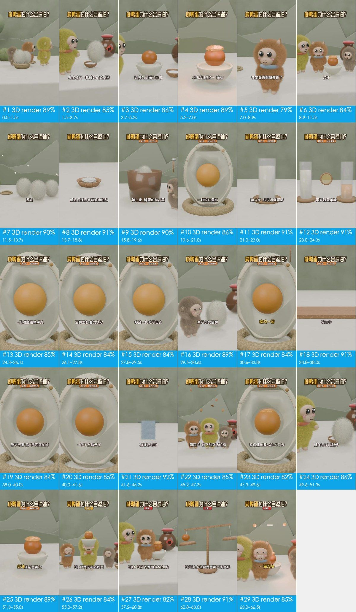

## What makes it work

- **The hook**: From 0 s a large title fixed at the top asks the question 咸鸭蛋为什么会流油？ (why do salted eggs ooze oil?); at 1.5–7 s Yabao cracks the fluffy egg and the yolk oozes oil and pink wisps on its own, while the 
- 13.7–15.8 s: salt becomes little white balls with eyes popping out of a bowl, with a ding. The protagonist enters as a character and acts out every later step, so viewers can follow it.
- 15.8–54.6 s: the step tag under the title changes from 第1步·盐钻气孔 (step 1: salt enters the pores) to 第4步·静待出油 (step 4: wait for the oil). A minute of explanation is cut into 4 parts and viewers always k
- 41.6–45.3 s: wringing a dripping towel stands in for proteins tightening and squeezing out oil, turning a molecular change into a motion everyone has made.
- 60.8–63.0 s: a small ball drops onto a balance, the beam levels out and sparkles flash (ding). "Not a drop more, not a drop less" becomes a picture, so the conclusion has visible proof.

## At a glance: picture, packaging, sound

Any short video splits into three layers: the picture, what is laid on top of it (subtitles, styled text, stickers), and the sound. Remake it one layer at a time.

| Layer | In this video | How to make it | Detail |
|---|---|---|---|
| **Picture** (base) | 3D render 29 shots | AI in 14 generations | “Remake it yourself” |
| **Packaging** (on top) | text, title, subtitle, styled text | add in the editor: subtitles, styled text and stickers by the timeline | “Packaging layer” |
| **Sound** | voice（TTS voice-over）, music (110 BPM, to confirm), 6 sound effects | voice: TTS voice-over; music: find a track with the same tempo and mood; effects: add from a library at the listed times | “Sound” |

## Content and structure

- The narrative line below comes from reading each shot; the lines were not transcribed separately, subtitle text is under “Packaging layer”

**Narrative line**

Keep this line in a remake: same order, same job at each step, with the point refilled from your own cases, numbers and material, so it is more than a change of subject.

| Time | Shots | Job | What it says |
|---|---|---|---|
| 0.0–11.5s | #1–#6 | grab attention | Opens with cute characters in an everyday setting: who, and where → The hero cracks the egg, tying the question to a concrete action → Shows the counterintuitive result straight away: the yolk makes its own oil → Stresses the contradiction (oil appears though none was added) and sets up the mystery → A wide-eyed character reaction amplifies the viewer's curiosity → (… 6 points, each shot in the shot list) |
| 11.5–13.7s | #7 | turn | Turns the story toward revealing the real cause |
| 13.7–41.6s | #8–#20 | add information | Names the real protagonist and turns it into a character → Step 1: sets up the curing environment → Uses a cross-section model to draw the path salt takes into the shell → Step 2, first half: salt fills the egg white → Step 2, second half: salt crosses the yolk membrane into the yolk → (… 13 points, each shot in the shot list) |
| 41.6–45.2s | #21 | show evidence | Compares proteins squeezing out oil to wringing a towel, an everyday experience |
| 45.2–49.6s | #22, #23 | add information | Step 4: lets the picture carry the waiting time → Gives a concrete number of days for how long curing takes |
| 49.6–57.2s | #24–#26 | deliver the conclusion | After enough curing time the egg is opened: the result → Replays the opening oil shot, now that the viewer knows why → A celebratory character move delivers the conclusion: it worked |
| 57.2–60.8s | #27 | turn | A "however" clears up a misconception: nothing was added |
| 60.8–66.5s | #28, #29 | deliver the conclusion | A balance shows the oil was in the yolk all along: the total is unchanged → Ends on a balanced line that nails the conclusion |

## Shot list

Picture, Camera and Overlays are what is visible on screen; Made with and Material are the tools' inference, with the basis in the shot-by-shot appendix.

| # | Frames | Time | Length | What it says | Picture | Camera | Overlays | Made with (inferred) | Material (inferred) | Remake |
|---|---|---|---|---|---|---|---|---|---|---|
| 1 | 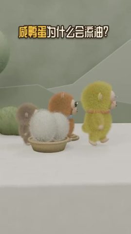 | 0:00.0 | 1.5s | grab attention: Opens with cute characters in an… | Medium eye-level shot. White tabletop, s… | static (subject moves) | text, title | 3D render 89% | rendered by the creator | AI generation / 3D render · G1 |
| 2 | 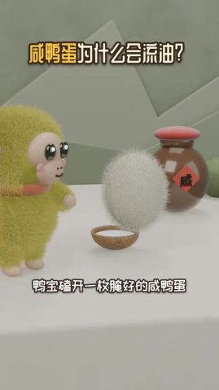 | 0:01.5 | 2.2s | grab attention: The hero cracks the egg, tying t… | Close eye-level shot. The yellow-green p… | static | subtitle, title | 3D render 85% | rendered by the creator | AI generation / 3D render · G1 |
| 3 | 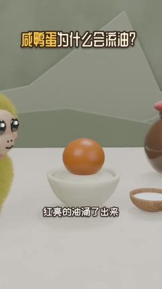 | 0:03.7 | 1.5s | grab attention: Shows the counterintuitive resul… | Medium eye-level shot. An orange yolk in… | smooth move | text, title | 3D render 86% | rendered by the creator | AI generation / 3D render · G1 |
| 4 | 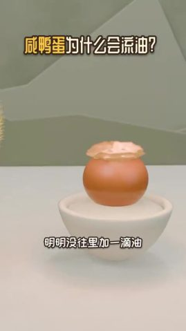 | 0:05.2 | 1.8s | grab attention: Stresses the contradiction (oil … | Medium eye-level shot. The oily yolk in … | static | text, title | 3D render 89% | rendered by the creator | AI generation / 3D render · G1 |
| 5 | 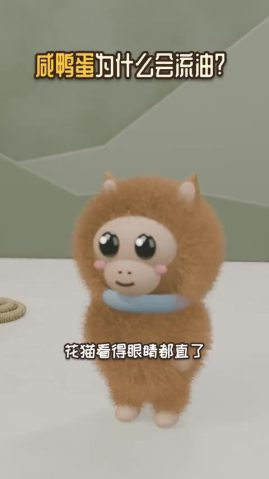 | 0:07.0 | 1.9s | grab attention: A wide-eyed character reaction a… | Close eye-level shot. The long-haired or… | smooth move | text, title | 3D render 79% | rendered by the creator | AI generation / 3D render · G2 |
| 6 | 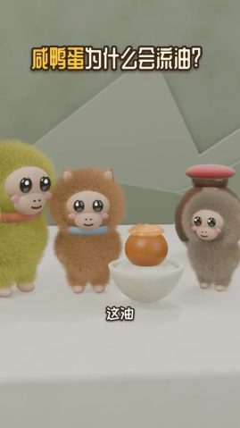 | 0:08.9 | 2.6s | grab attention: Asks the question again: where d… | Medium eye-level shot. Yabao, Huamao, th… | static | subtitle, title | 3D render 84% | rendered by the creator | AI generation / 3D render · G2 |
| 7 | 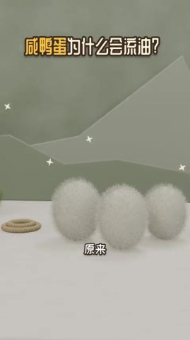 | 0:11.5 | 2.2s | turn: Turns the story toward revealing the real … | Medium eye-level shot. Three long-haired… | smooth move | subtitle, title | 3D render 90% | rendered by the creator | AI generation / 3D render · G2 |
| 8 | 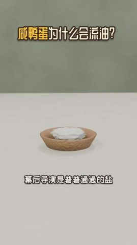 | 0:13.7 | 2.2s | add information: Names the real protagonist and … | Medium, slightly high-angle shot. A shal… | static | text, title | 3D render 91% | rendered by the creator | AI generation / 3D render · G3 |
| 9 | 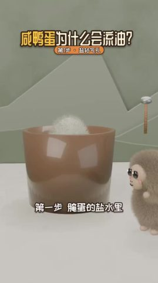 | 0:15.8 | 3.8s | add information: Step 1: sets up the curing envi… | Medium eye-level shot. A large brown tra… | static | subtitle, title | 3D render 90% | rendered by the creator | AI generation / 3D render · G4 |
| 10 | 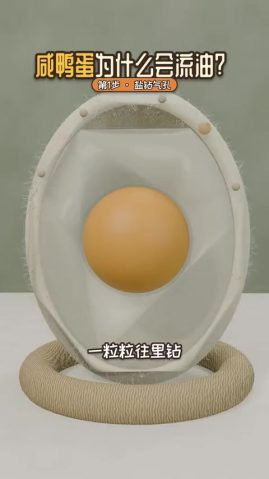 | 0:19.6 | 1.5s | add information: Uses a cross-section model to d… | Close eye-level shot. An upright egg cro… | smooth move | subtitle, title | 3D render 86% | rendered by the creator | AI generation / 3D render · G5 |
| 11 | 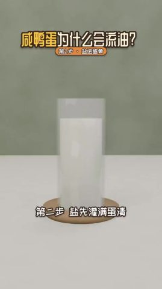 | 0:21.0 | 2.0s | add information: Step 2, first half: salt fills … | Medium eye-level shot. A glass cylinder … | static | subtitle, title | 3D render 91% | rendered by the creator | AI generation / 3D render · G5 |
| 12 | 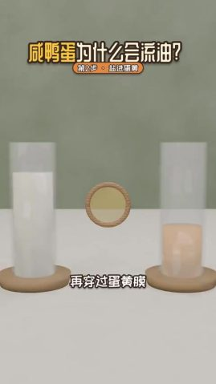 | 0:23.0 | 1.3s | add information: Step 2, second half: salt cross… | Medium eye-level shot. A glass of white … | static | text, title | 3D render 91% | rendered by the creator | AI generation / 3D render · G5 |
| 13 | 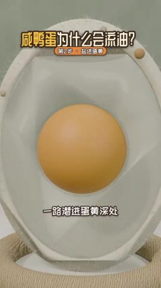 | 0:24.3 | 1.8s | add information: The camera moves into the yolk:… | Close-up, eye level. The yolk of the cro… | smooth move | subtitle, text, title | 3D render 85% | rendered by the creator | AI generation / 3D render · G5 |
| 14 | 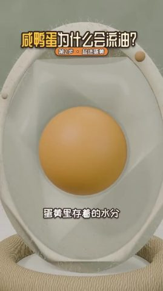 | 0:26.1 | 1.7s | add information: Points out that the yolk holds … | Close-up, eye level. The cross-section y… | smooth move | text, title | 3D render 84% | rendered by the creator | AI generation / 3D render · G5 |
| 15 | 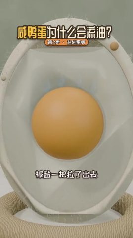 | 0:27.8 | 1.7s | add information: Shows salt pulling water out of… | Close-up, eye level. The cross-section m… | smooth move | text, title | 3D render 84% | rendered by the creator | AI generation / 3D render · G5 |
| 16 | 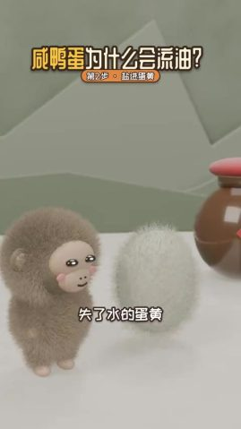 | 0:29.5 | 1.2s | add information: A character reaction bridges to… | Close eye-level shot. The grey-brown plu… | smooth move | subtitle, title | 3D render 89% | rendered by the creator | AI generation / 3D render · G6 |
| 17 | 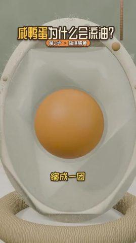 | 0:30.6 | 3.1s | add information: Gives the result of dehydration… | Close-up, eye level. In the cross-sectio… | smooth move | subtitle, title | 3D render 84% | rendered by the creator | AI generation / 3D render · G7 |
| 18 | 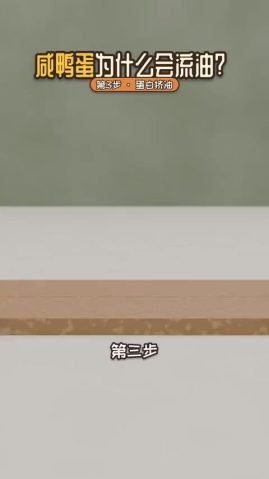 | 0:33.8 | 4.3s | add information: Step 3: turns proteins clumping… | Medium eye-level shot. A wooden plank ac… | static (subject moves) | subtitle, title | 3D render 91% | rendered by the creator | AI generation / 3D render · G7 |
| 19 | 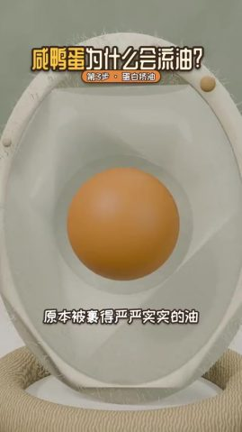 | 0:38.0 | 2.0s | add information: Shows the trapped oil starting … | Close-up, eye level. In the cross-sectio… | smooth move | text, title | 3D render 84% | rendered by the creator | AI generation / 3D render · G8 |
| 20 | 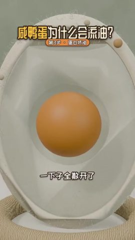 | 0:40.0 | 1.6s | add information: The released oil gathers on the… | Close-up, eye level. In the cross-sectio… | smooth move | subtitle, title | 3D render 85% | rendered by the creator | AI generation / 3D render · G8 |
| 21 | 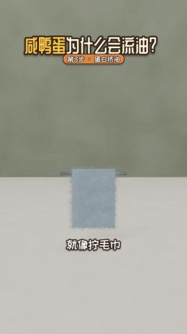 | 0:41.6 | 3.7s | show evidence: Compares proteins squeezing out o… | Medium eye-level shot. A pale blue fuzzy… | static | subtitle, title | 3D render 92% | rendered by the creator | AI generation / 3D render · G8 |
| 22 | 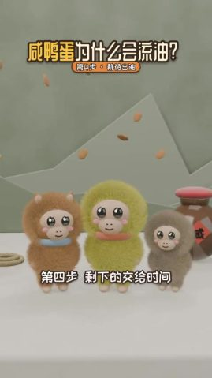 | 0:45.2 | 2.1s | add information: Step 4: lets the picture carry … | Medium eye-level shot. Huamao, Yabao and… | static | text, title | 3D render 85% | rendered by the creator | AI generation / 3D render · G9 |
| 23 | 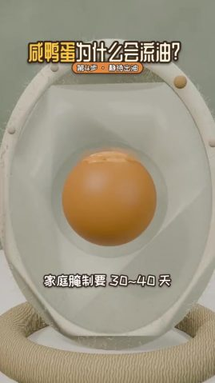 | 0:47.3 | 2.2s | add information: Gives a concrete number of days… | Close-up, eye level. In the cross-sectio… | smooth move | subtitle, title | 3D render 82% | rendered by the creator | AI generation / 3D render · G10 |
| 24 | 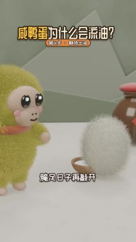 | 0:49.6 | 1.7s | deliver the conclusion: After enough curing time… | Close eye-level shot. Yabao stands at le… | static | text, title | 3D render 86% | rendered by the creator | AI generation / 3D render · G11 |
| 25 | 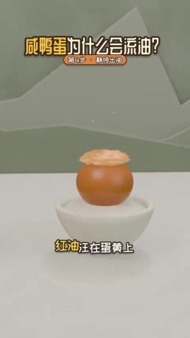 | 0:51.3 | 3.7s | deliver the conclusion: Replays the opening oil … | Medium eye-level shot. The oily yolk in … | static (subject moves) | subtitle, text, title | 3D render 89% | rendered by the creator | AI generation / 3D render · G11 |
| 26 | 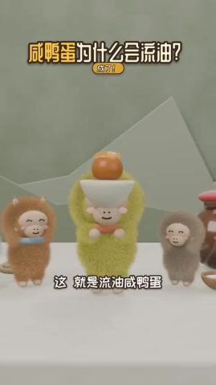 | 0:55.0 | 2.2s | deliver the conclusion: A celebratory character … | Close eye-level shot. Yabao, in the cent… | static | subtitle, title, styled text | 3D render 84% | rendered by the creator | AI generation / 3D render · G12 |
| 27 | 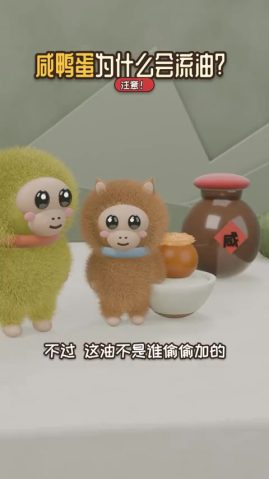 | 0:57.2 | 3.5s | turn: A "however" clears up a misconception: not… | Close eye-level shot. Yabao and Huamao s… | static | subtitle, title | 3D render 82% | rendered by the creator | AI generation / 3D render · G12 |
| 28 | 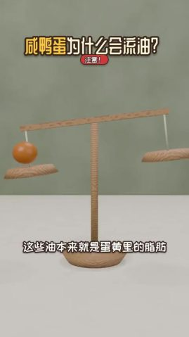 | 1:00.8 | 2.2s | deliver the conclusion: A balance shows the oil … | Medium eye-level shot. A wooden balance … | static | text, title | 3D render 91% | rendered by the creator | AI generation / 3D render · G13 |
| 29 | 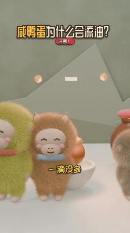 | 1:03.0 | 3.5s | deliver the conclusion: Ends on a balanced line … | Close to medium shot. Yabao, Huamao and … | static (subject moves) | subtitle, title | 3D render 85% | rendered by the creator | AI generation / 3D render · G14 |

## Remake it yourself: do it in this order

Copy the method and the rhythm, not the pictures.

1. **Plan the content**: write your script on the narrative line under “Content and structure”
2. **Collect material**: see “What to prepare” below
3. **Generate**: 14 generations, see “AI generation” below
4. **Edit**: see “Edit” below
5. **Packaging**: the subtitle file `packaging/subtitles.srt` imports straight into an editor; styles and timeline under “Packaging layer”
6. **Sound**: see “Sound”; every effect can be played first
7. **Compare**: watch yours next to the original: shot lengths, subtitle positions, where the music comes in and drops

### What to prepare

- `@图片1` character reference images (one frontal face + one half-body per character) so the look stays consistent across shots: Yabao, Huamao, Grey-brown monkey (unnamed), Salt balls, Protein blobs

### AI generation

**29 3D render shots → 14 generation units, 14 Seedance 2.0 calls**

- Grouping: AI shots in the same scene joined by hard cuts are generated in one call; ≤15s per call; consecutive hard cuts inside a unit preferably ≤8s, at most 10s; split at dissolves / fades and scene changes
- Audio: the model can generate action sound effects and ambience along with the picture; voice-over is better done as separate TTS and mixed in, so copy and timing stay editable
- Packaging: the title, subtitle, text label, styled text on the generated shots is post-production packaging: keep it out of the prompts, erase it from reference frames, and lay it back on from the packaging timeline after generation

A video model can take these inputs; each generation unit below lists which ones to feed and where they come from:
- **Text prompt**: always; describes the picture, action and camera
- **First frame**: locks the composition and subject of frame one. Without it this is plain text-to-video and framing changes every time
- **Last frame**: also locks the final frame so the model only fills in between. Suits a single shot with a camera move or action
- **Reference images**: how the product and people look, so they stay the same across shots (`@图片1` in the prompt)
- **Reference video**: copy the action, camera move and rhythm, not the picture (`@视频1`); not every model takes one

One generation per unit. The table lists what to feed the model; open a unit for where each input comes from and the prompt.

| Unit | Shots | Time | Duration | Mode | Feed | Continuity |
|---|---|---|---|---|---|---|
| G1 | #1–#4 | 0.0–7.0s | 7.0s | multi-shot | first frame + reference image + reference video | — |
| G2 | #5–#7 | 7.0–13.7s | 6.7s | multi-shot | first frame + reference image + reference video | first frame = last frame of G1, continue the action |
| G3 | #8 | 13.7–15.8s | 2.2s | single shot | first frame + reference image + reference video | — |
| G4 | #9 | 15.8–19.6s | 3.8s | single shot | first frame + reference image + reference video | — |
| G5 | #10–#15 | 19.6–29.5s | 9.9s | multi-shot | first frame + reference image + reference video | — |
| G6 | #16 | 29.5–30.6s | 1.2s | single shot | first frame + reference image + reference video | — |
| G7 | #17–#18 | 30.6–38.0s | 7.4s | multi-shot | first frame + reference image + reference video | — |
| G8 | #19–#21 | 38.0–45.2s | 7.2s | multi-shot | first frame + reference image + reference video | first frame = last frame of G7, continue the action |
| G9 | #22 | 45.2–47.3s | 2.1s | single shot | first frame + reference image + reference video | — |
| G10 | #23 | 47.3–49.6s | 2.2s | single shot | first frame + reference image + reference video | — |
| G11 | #24–#25 | 49.6–55.0s | 5.4s | multi-shot | first frame + reference image + reference video | — |
| G12 | #26–#27 | 55.0–60.8s | 5.8s | multi-shot | first frame + reference image + reference video | first frame = last frame of G11, continue the action |
| G13 | #28 | 60.8–63.0s | 2.2s | single shot | first frame + reference image + reference video | — |
| G14 | #29 | 63.0–66.5s | 3.5s | single shot | first frame + reference image + reference video | — |

<details><summary>G1 · shots #1–#4 · 7.0s · multi-reference generation</summary>

| Input | Needed | From | Why |
|---|---|---|---|
| text prompt | yes | see the prompt below | describes picture, action and camera; every other input only constrains it |
| first frame | worth it | source frame `shots/shot_001_first.jpg` (to change product, person or style, redraw it with an image model from the first-frame prompt below); this model takes frame inputs or references, not both: pass it as one more reference image and write “@图片2 as the first frame” in the prompt (Jimeng's omni-reference accepts this; most APIs do not, drop it if refused) | locks composition, shot size and subject position; with text alone every generation frames it differently |
| last frame | no | — | several shots in one call; a last frame would only constrain the final shot |
| reference image | yes | `@图片1` character reference images (one frontal face + one half-body per character) so the look stays consistent across shots | the first frame only fixes frame one; reference images keep the product and people consistent after it |
| reference video | worth it | `@视频1` source clip 0.0–7.0s | follow the action, camera move and cutting rhythm; reference only, the picture is not copied |

- First-frame image prompt: Medium eye-level shot, vertical 9:16. White tabletop with a sage-green wall and pale low-poly mountain shapes behind. At left, a shallow woven basket holding two long-haired white fluffy balls; three plush monkeys (grey-brown, orange-brown, yellow-green) stand in a line from left to right, side-on, facing right. Soft diffuse light, Blender fur render, low-saturation fresh palette.
- Alternative: a 3D project. Have an LLM write a Blender script or a Three.js scene; model the characters / props once and render each shot from its own camera. Best for multiple angles and character consistency, and changing copy or shots is just a code change

```text
Vertical 9:16; soft frontal light (flat light), soft light (almost no lit / shadow edge), neutral (about 5000K), background clearly blurred (shallow depth of field / portrait mode). Characters follow @图片1. Follow the action, camera movement and cutting rhythm of @视频1. Hard cuts between shots.
Shot 1 (0.0–1.5s): Medium eye-level shot. Three plush monkeys walk in a line from left to right, bodies swaying gently, while two white fluffy balls stay in a woven basket at lower left. Static camera.
Shot 2 (1.5–3.7s): Close eye-level shot. A yellow-green plush monkey on the left watches a white fluffy ball float up from a small bowl and slowly turn; the monkey lifts a hand. Static camera.
Shot 3 (3.7–5.2s): Medium eye-level shot. A layer of pale oil swells on top of an orange yolk in a white bowl, a few droplets pop up, then three pinkish-white S-shaped wisps rise above it. Static camera.
Shot 4 (5.2–7.0s): Medium eye-level shot. The camera slowly pushes in toward the oily yolk in the white bowl; the yolk and oil stay still.
```

English prompt:

```text
Shot 1 (0.0-1.5s): Medium eye-level shot. Three plush monkeys walk in a line from left to right, bodies swaying gently, while two white fluffy balls stay in a woven basket at lower left. Static camera.
Shot 2 (1.5-3.7s): Close eye-level shot. A yellow-green plush monkey on the left watches a white fluffy ball float up from a small bowl and slowly turn; the monkey lifts a hand. Static camera.
Shot 3 (3.7-5.2s): Medium eye-level shot. A layer of pale oil swells on top of an orange yolk in a white bowl, a few droplets pop up, then three pinkish-white S-shaped wisps rise above it. Static camera.
Shot 4 (5.2-7.0s): Medium eye-level shot. The camera slowly pushes in toward the oily yolk in the white bowl; the yolk and oil stay still.
```

</details>

<details><summary>G2 · shots #5–#7 · 6.7s · multi-reference generation</summary>

| Input | Needed | From | Why |
|---|---|---|---|
| text prompt | yes | see the prompt below | describes picture, action and camera; every other input only constrains it |
| first frame | worth it | the last frame of G1's result; this model takes frame inputs or references, not both: pass it as one more reference image and write “@图片2 as the first frame” in the prompt (Jimeng's omni-reference accepts this; most APIs do not, drop it if refused) | hard cut from the previous unit in the same scene; matching the first frame keeps it from jumping |
| last frame | no | — | several shots in one call; a last frame would only constrain the final shot |
| reference image | yes | `@图片1` character reference images (one frontal face + one half-body per character) so the look stays consistent across shots | the first frame only fixes frame one; reference images keep the product and people consistent after it |
| reference video | worth it | `@视频1` source clip 7.0–13.7s | follow the action, camera move and cutting rhythm; reference only, the picture is not copied |

- First-frame image prompt: Close eye-level shot, vertical. An orange-brown long-haired plush monkey faces the camera in the center, two small pointed ears on top, beige face, big glossy black eyes, pink cheeks and a pale blue ring collar. Sage-green wall, white tabletop. Soft light, Blender fur render.
- Alternative: a 3D project. Have an LLM write a Blender script or a Three.js scene; model the characters / props once and render each shot from its own camera. Best for multiple angles and character consistency, and changing copy or shots is just a code change

```text
Vertical 9:16; soft frontal light (flat light), soft light (almost no lit / shadow edge), neutral (about 5000K), background clearly blurred (shallow depth of field / portrait mode). Characters follow @图片1. Follow the action, camera movement and cutting rhythm of @视频1. Hard cuts between shots.
Shot 1 (0.0–1.9s): Close eye-level shot. A brown plush monkey faces the camera, its eyes widen and blink, its body sways slightly, and white four-point sparkles pop above its head. Static camera.
Shot 2 (1.9–4.5s): Medium eye-level shot. Three plush monkeys stand around the oily yolk, swaying and tilting their heads, while two orange question marks float up at upper right. Static camera.
Shot 3 (4.5–6.7s): Medium eye-level shot. The camera slowly trucks right past three white fluffy balls on the table while white sparkles twinkle in the background.
```

English prompt:

```text
Shot 1 (0.0-1.9s): Close eye-level shot. A brown plush monkey faces the camera, its eyes widen and blink, its body sways slightly, and white four-point sparkles pop above its head. Static camera.
Shot 2 (1.9-4.5s): Medium eye-level shot. Three plush monkeys stand around the oily yolk, swaying and tilting their heads, while two orange question marks float up at upper right. Static camera.
Shot 3 (4.5-6.7s): Medium eye-level shot. The camera slowly trucks right past three white fluffy balls on the table while white sparkles twinkle in the background.
```

</details>

<details><summary>G3 · shots #8 · 2.2s · multi-reference generation</summary>

| Input | Needed | From | Why |
|---|---|---|---|
| text prompt | yes | see the prompt below | describes picture, action and camera; every other input only constrains it |
| first frame | worth it | source frame `shots/shot_008_first.jpg` (to change product, person or style, redraw it with an image model from the first-frame prompt below); this model takes frame inputs or references, not both: pass it as one more reference image and write “@图片2 as the first frame” in the prompt (Jimeng's omni-reference accepts this; most APIs do not, drop it if refused) | locks composition, shot size and subject position; with text alone every generation frames it differently |
| last frame | no | — | this unit uses references to keep the product and people; the model takes no last frame alongside them |
| reference image | yes | `@图片1` character reference images (one frontal face + one half-body per character) so the look stays consistent across shots | the first frame only fixes frame one; reference images keep the product and people consistent after it |
| reference video | worth it | `@视频1` source clip 13.7–15.8s | follow the action, camera move and cutting rhythm; reference only, the picture is not copied |

- First-frame image prompt: Medium slightly high-angle shot, vertical. In the lower middle, a pale wood-grain round bowl heaped with white salt on a white tabletop; blurred sage-green wall behind. Soft diffuse light, minimal 3D cartoon render.
- Generate 4s and trim to 2.2s (very short shots are unstable when generated on their own)
- Alternative: a 3D project. Have an LLM write a Blender script or a Three.js scene; model the characters / props once and render each shot from its own camera. Best for multiple angles and character consistency, and changing copy or shots is just a code change

```text
Vertical 9:16; soft frontal light (flat light), soft light (almost no lit / shadow edge), neutral (about 5000K), background clearly blurred (shallow depth of field / portrait mode). Characters follow @图片1. Follow the action, camera movement and cutting rhythm of @视频1.
Medium slightly high-angle shot. Five or six small white balls with tiny black eyes pop out of the salt pile in a wooden bowl one by one and wobble on the surface. Static camera.
```

English prompt:

```text
Medium slightly high-angle shot. Five or six small white balls with tiny black eyes pop out of the salt pile in a wooden bowl one by one and wobble on the surface. Static camera.
```

</details>

<details><summary>G4 · shots #9 · 3.8s · multi-reference generation</summary>

| Input | Needed | From | Why |
|---|---|---|---|
| text prompt | yes | see the prompt below | describes picture, action and camera; every other input only constrains it |
| first frame | worth it | source frame `shots/shot_009_first.jpg` (to change product, person or style, redraw it with an image model from the first-frame prompt below); this model takes frame inputs or references, not both: pass it as one more reference image and write “@图片2 as the first frame” in the prompt (Jimeng's omni-reference accepts this; most APIs do not, drop it if refused) | locks composition, shot size and subject position; with text alone every generation frames it differently |
| last frame | no | — | this unit uses references to keep the product and people; the model takes no last frame alongside them |
| reference image | yes | `@图片1` character reference images (one frontal face + one half-body per character) so the look stays consistent across shots | the first frame only fixes frame one; reference images keep the product and people consistent after it |
| reference video | worth it | `@视频1` source clip 15.8–19.6s | follow the action, camera move and cutting rhythm; reference only, the picture is not copied |

- First-frame image prompt: Medium eye-level shot, vertical. In the center, a large brown translucent cylindrical cup with the top of a long-haired white fluffy ball showing at the rim; at lower right a grey-brown plush monkey leans in, looking left. Sage-green wall, low-poly mountain shapes and a small wooden-handled hammer behind. Soft light, 3D cartoon render.
- Alternative: a 3D project. Have an LLM write a Blender script or a Three.js scene; model the characters / props once and render each shot from its own camera. Best for multiple angles and character consistency, and changing copy or shots is just a code change

```text
Vertical 9:16; soft frontal light (flat light), soft light (almost no lit / shadow edge), neutral (about 5000K), background clearly blurred (shallow depth of field / portrait mode). Characters follow @图片1. Follow the action, camera movement and cutting rhythm of @视频1.
Medium eye-level shot. The white fluffy ball sinks slightly into the brown cup while a grey-brown plush monkey on the right blinks and watches. Static camera.
```

English prompt:

```text
Medium eye-level shot. The white fluffy ball sinks slightly into the brown cup while a grey-brown plush monkey on the right blinks and watches. Static camera.
```

</details>

<details><summary>G5 · shots #10–#15 · 9.9s · multi-reference generation</summary>

| Input | Needed | From | Why |
|---|---|---|---|
| text prompt | yes | see the prompt below | describes picture, action and camera; every other input only constrains it |
| first frame | worth it | source frame `shots/shot_010_first.jpg` (to change product, person or style, redraw it with an image model from the first-frame prompt below); this model takes frame inputs or references, not both: pass it as one more reference image and write “@图片2 as the first frame” in the prompt (Jimeng's omni-reference accepts this; most APIs do not, drop it if refused) | locks composition, shot size and subject position; with text alone every generation frames it differently |
| last frame | no | — | several shots in one call; a last frame would only constrain the final shot |
| reference image | yes | `@图片1` character reference images (one frontal face + one half-body per character) so the look stays consistent across shots | the first frame only fixes frame one; reference images keep the product and people consistent after it |
| reference video | worth it | `@视频1` source clip 19.6–29.5s | follow the action, camera move and cutting rhythm; reference only, the picture is not copied |

- First-frame image prompt: Close eye-level shot, vertical. In the center, an upright oval egg cross-section model: off-white shell with fine fuzz along the rim, translucent egg white inside and an orange spherical yolk in the middle, resting on a woven rope ring. Sage-green background. Soft light, 3D science-explainer render.
- Alternative: a 3D project. Have an LLM write a Blender script or a Three.js scene; model the characters / props once and render each shot from its own camera. Best for multiple angles and character consistency, and changing copy or shots is just a code change

```text
Vertical 9:16; soft frontal light (flat light), soft light (almost no lit / shadow edge), neutral (about 5000K), background clearly blurred (shallow depth of field / portrait mode). Characters follow @图片1. Follow the action, camera movement and cutting rhythm of @视频1. Hard cuts between shots.
Shot 1 (0.0–1.5s): Close eye-level shot. A few small white salt balls drop onto the top of the egg cross-section model from the upper right and slip one by one through tiny pores into the egg white. Static camera.
Shot 2 (1.5–3.5s): Medium eye-level shot. A few small white salt grains fall one by one into a glass cylinder of milky liquid. Static camera.
Shot 3 (3.5–4.8s): Medium eye-level shot. Small white salt grains fly out above the left glass, pass through the wooden-framed round membrane in the middle and drop into the orange liquid in the right glass. Static camera.
Shot 4 (4.8–6.5s): Close-up, eye level. The camera slowly pushes in on the orange yolk at the center of the egg model; two white sparkles flash above it. Ends with the yolk filling half the frame.
Shot 5 (6.5–8.2s): Close-up, eye level. A faint wet highlight shimmers on the yolk surface while the camera creeps in very slowly.
Shot 6 (8.2–9.9s): Close-up, eye level. A few pale blue droplets seep out of the yolk, drift through the egg white to the right edge of the shell and vanish. Static camera.
```

English prompt:

```text
Shot 1 (0.0-1.5s): Close eye-level shot. A few small white salt balls drop onto the top of the egg cross-section model from the upper right and slip one by one through tiny pores into the egg white. Static camera.
Shot 2 (1.5-3.5s): Medium eye-level shot. A few small white salt grains fall one by one into a glass cylinder of milky liquid. Static camera.
Shot 3 (3.5-4.8s): Medium eye-level shot. Small white salt grains fly out above the left glass, pass through the wooden-framed round membrane in the middle and drop into the orange liquid in the right glass. Static camera.
Shot 4 (4.8-6.5s): Close-up, eye level. The camera slowly pushes in on the orange yolk at the center of the egg model; two white sparkles flash above it. Ends with the yolk filling half the frame.
Shot 5 (6.5-8.2s): Close-up, eye level. A faint wet highlight shimmers on the yolk surface while the camera creeps in very slowly.
Shot 6 (8.2-9.9s): Close-up, eye level. A few pale blue droplets seep out of the yolk, drift through the egg white to the right edge of the shell and vanish. Static camera.
```

</details>

<details><summary>G6 · shots #16 · 1.2s · multi-reference generation</summary>

| Input | Needed | From | Why |
|---|---|---|---|
| text prompt | yes | see the prompt below | describes picture, action and camera; every other input only constrains it |
| first frame | worth it | source frame `shots/shot_016_first.jpg` (to change product, person or style, redraw it with an image model from the first-frame prompt below); this model takes frame inputs or references, not both: pass it as one more reference image and write “@图片2 as the first frame” in the prompt (Jimeng's omni-reference accepts this; most APIs do not, drop it if refused) | locks composition, shot size and subject position; with text alone every generation frames it differently |
| last frame | no | — | this unit uses references to keep the product and people; the model takes no last frame alongside them |
| reference image | yes | `@图片1` character reference images (one frontal face + one half-body per character) so the look stays consistent across shots | the first frame only fixes frame one; reference images keep the product and people consistent after it |
| reference video | worth it | `@视频1` source clip 29.5–30.6s | follow the action, camera move and cutting rhythm; reference only, the picture is not copied |

- First-frame image prompt: Close eye-level shot, vertical. At left, a grey-brown plush monkey with a beige face, big black eyes and pink cheeks, side-on facing right; at right, a long-haired white oval fluffy ball hovering above the table; behind on the right, a brown red-lidded clay jar. Sage-green wall, low-poly mountain shapes. Soft light, Blender fur render.
- Generate 4s and trim to 1.2s (very short shots are unstable when generated on their own)
- Alternative: a 3D project. Have an LLM write a Blender script or a Three.js scene; model the characters / props once and render each shot from its own camera. Best for multiple angles and character consistency, and changing copy or shots is just a code change

```text
Vertical 9:16; soft frontal light (flat light), soft light (almost no lit / shadow edge), neutral (about 5000K), background clearly blurred (shallow depth of field / portrait mode). Characters follow @图片1. Follow the action, camera movement and cutting rhythm of @视频1.
Close eye-level shot. A white fluffy ball rises from the table and slowly turns while the grey-brown plush monkey on the left looks up and blinks. The camera slowly pushes in.
```

English prompt:

```text
Close eye-level shot. A white fluffy ball rises from the table and slowly turns while the grey-brown plush monkey on the left looks up and blinks. The camera slowly pushes in.
```

</details>

<details><summary>G7 · shots #17, #18 · 7.4s · multi-reference generation</summary>

| Input | Needed | From | Why |
|---|---|---|---|
| text prompt | yes | see the prompt below | describes picture, action and camera; every other input only constrains it |
| first frame | worth it | source frame `shots/shot_017_first.jpg` (to change product, person or style, redraw it with an image model from the first-frame prompt below); this model takes frame inputs or references, not both: pass it as one more reference image and write “@图片2 as the first frame” in the prompt (Jimeng's omni-reference accepts this; most APIs do not, drop it if refused) | locks composition, shot size and subject position; with text alone every generation frames it differently |
| last frame | no | — | several shots in one call; a last frame would only constrain the final shot |
| reference image | yes | `@图片1` character reference images (one frontal face + one half-body per character) so the look stays consistent across shots | the first frame only fixes frame one; reference images keep the product and people consistent after it |
| reference video | worth it | `@视频1` source clip 30.6–38.0s | follow the action, camera move and cutting rhythm; reference only, the picture is not copied |

- First-frame image prompt: Close-up, eye level, vertical. The egg cross-section model with an orange spherical yolk in the center, surrounded by translucent white and an off-white shell. Soft light, 3D science-explainer render.
- Alternative: a 3D project. Have an LLM write a Blender script or a Three.js scene; model the characters / props once and render each shot from its own camera. Best for multiple angles and character consistency, and changing copy or shots is just a code change

```text
Vertical 9:16; soft frontal light (flat light), soft light (almost no lit / shadow edge), neutral (about 5000K), background clearly blurred (shallow depth of field / portrait mode). Characters follow @图片1. Follow the action, camera movement and cutting rhythm of @视频1. Hard cuts between shots.
Shot 1 (0.0–3.1s): Close-up, eye level. The orange yolk shrinks evenly by about ten percent, leaving a pale ring of space around it, and comes to rest. Static camera.
Shot 2 (3.1–7.4s): Medium eye-level shot. Several white furry blobs with shiny black eyes bounce down onto a wooden plank one after another and squeeze together in a row, then a few small orange balls pop up from between them. Static camera.
```

English prompt:

```text
Shot 1 (0.0-3.1s): Close-up, eye level. The orange yolk shrinks evenly by about ten percent, leaving a pale ring of space around it, and comes to rest. Static camera.
Shot 2 (3.1-7.4s): Medium eye-level shot. Several white furry blobs with shiny black eyes bounce down onto a wooden plank one after another and squeeze together in a row, then a few small orange balls pop up from between them. Static camera.
```

</details>

<details><summary>G8 · shots #19–#21 · 7.2s · multi-reference generation</summary>

| Input | Needed | From | Why |
|---|---|---|---|
| text prompt | yes | see the prompt below | describes picture, action and camera; every other input only constrains it |
| first frame | worth it | the last frame of G7's result; this model takes frame inputs or references, not both: pass it as one more reference image and write “@图片2 as the first frame” in the prompt (Jimeng's omni-reference accepts this; most APIs do not, drop it if refused) | hard cut from the previous unit in the same scene; matching the first frame keeps it from jumping |
| last frame | no | — | several shots in one call; a last frame would only constrain the final shot |
| reference image | yes | `@图片1` character reference images (one frontal face + one half-body per character) so the look stays consistent across shots | the first frame only fixes frame one; reference images keep the product and people consistent after it |
| reference video | worth it | `@视频1` source clip 38.0–45.2s | follow the action, camera move and cutting rhythm; reference only, the picture is not copied |

- First-frame image prompt: Close-up, eye level, vertical. The egg cross-section model with an orange spherical yolk in the center, surrounded by translucent egg white. Soft light, 3D science-explainer render.
- Alternative: a 3D project. Have an LLM write a Blender script or a Three.js scene; model the characters / props once and render each shot from its own camera. Best for multiple angles and character consistency, and changing copy or shots is just a code change

```text
Vertical 9:16; soft frontal light (flat light), soft light (almost no lit / shadow edge), neutral (about 5000K), background clearly blurred (shallow depth of field / portrait mode). Characters follow @图片1. Follow the action, camera movement and cutting rhythm of @视频1. Hard cuts between shots.
Shot 1 (0.0–2.0s): Close-up, eye level. Four or five translucent orange oil beads rise one by one from the top of the yolk and hover above it. Static camera.
Shot 2 (2.0–3.5s): Close-up, eye level. The oil beads above the yolk spread out and fall back onto its top, forming a wrinkled pale oil layer. Static camera.
Shot 3 (3.5–7.2s): Medium eye-level shot. The towel is lifted by the metal rod and wrung tight in the middle into a narrow T shape while clear water drops fall on both sides. Static camera.
```

English prompt:

```text
Shot 1 (0.0-2.0s): Close-up, eye level. Four or five translucent orange oil beads rise one by one from the top of the yolk and hover above it. Static camera.
Shot 2 (2.0-3.5s): Close-up, eye level. The oil beads above the yolk spread out and fall back onto its top, forming a wrinkled pale oil layer. Static camera.
Shot 3 (3.5-7.2s): Medium eye-level shot. The towel is lifted by the metal rod and wrung tight in the middle into a narrow T shape while clear water drops fall on both sides. Static camera.
```

</details>

<details><summary>G9 · shots #22 · 2.1s · multi-reference generation</summary>

| Input | Needed | From | Why |
|---|---|---|---|
| text prompt | yes | see the prompt below | describes picture, action and camera; every other input only constrains it |
| first frame | worth it | source frame `shots/shot_022_first.jpg` (to change product, person or style, redraw it with an image model from the first-frame prompt below); this model takes frame inputs or references, not both: pass it as one more reference image and write “@图片2 as the first frame” in the prompt (Jimeng's omni-reference accepts this; most APIs do not, drop it if refused) | locks composition, shot size and subject position; with text alone every generation frames it differently |
| last frame | no | — | this unit uses references to keep the product and people; the model takes no last frame alongside them |
| reference image | yes | `@图片1` character reference images (one frontal face + one half-body per character) so the look stays consistent across shots | the first frame only fixes frame one; reference images keep the product and people consistent after it |
| reference video | worth it | `@视频1` source clip 45.2–47.3s | follow the action, camera move and cutting rhythm; reference only, the picture is not copied |

- First-frame image prompt: Medium eye-level shot, vertical. Three plush monkeys side by side facing the camera: orange-brown at left, yellow-green in the middle, grey-brown at right; behind on the right a brown red-lidded jar with a red diamond 咸 label; a rope ring at left. Sage-green wall and low-poly mountain shapes. Soft light, Blender fur render.
- Generate 4s and trim to 2.1s (very short shots are unstable when generated on their own)
- Alternative: a 3D project. Have an LLM write a Blender script or a Three.js scene; model the characters / props once and render each shot from its own camera. Best for multiple angles and character consistency, and changing copy or shots is just a code change

```text
Vertical 9:16; soft frontal light (flat light), soft light (almost no lit / shadow edge), neutral (about 5000K), background clearly blurred (shallow depth of field / portrait mode). Characters follow @图片1. Follow the action, camera movement and cutting rhythm of @视频1.
Medium eye-level shot. Three plush monkeys stand side by side swaying gently while small brown flakes keep drifting down from above. Static camera.
```

English prompt:

```text
Medium eye-level shot. Three plush monkeys stand side by side swaying gently while small brown flakes keep drifting down from above. Static camera.
```

</details>

<details><summary>G10 · shots #23 · 2.2s · multi-reference generation</summary>

| Input | Needed | From | Why |
|---|---|---|---|
| text prompt | yes | see the prompt below | describes picture, action and camera; every other input only constrains it |
| first frame | worth it | source frame `shots/shot_023_first.jpg` (to change product, person or style, redraw it with an image model from the first-frame prompt below); this model takes frame inputs or references, not both: pass it as one more reference image and write “@图片2 as the first frame” in the prompt (Jimeng's omni-reference accepts this; most APIs do not, drop it if refused) | locks composition, shot size and subject position; with text alone every generation frames it differently |
| last frame | no | — | this unit uses references to keep the product and people; the model takes no last frame alongside them |
| reference image | yes | `@图片1` character reference images (one frontal face + one half-body per character) so the look stays consistent across shots | the first frame only fixes frame one; reference images keep the product and people consistent after it |
| reference video | worth it | `@视频1` source clip 47.3–49.6s | follow the action, camera move and cutting rhythm; reference only, the picture is not copied |

- First-frame image prompt: Close-up, eye level, vertical. The egg cross-section model with an orange spherical yolk in the center, topped with a layer of pale yellow oil. Soft light, 3D science-explainer render.
- Generate 4s and trim to 2.2s (very short shots are unstable when generated on their own)
- Alternative: a 3D project. Have an LLM write a Blender script or a Three.js scene; model the characters / props once and render each shot from its own camera. Best for multiple angles and character consistency, and changing copy or shots is just a code change

```text
Vertical 9:16; soft frontal light (flat light), soft light (almost no lit / shadow edge), neutral (about 5000K), background clearly blurred (shallow depth of field / portrait mode). Characters follow @图片1. Follow the action, camera movement and cutting rhythm of @视频1.
Close-up, eye level. The pale oil layer on top of the yolk slowly thickens and spreads while white sparkles flash around it. The camera slowly pushes in.
```

English prompt:

```text
Close-up, eye level. The pale oil layer on top of the yolk slowly thickens and spreads while white sparkles flash around it. The camera slowly pushes in.
```

</details>

<details><summary>G11 · shots #24, #25 · 5.4s · multi-reference generation</summary>

| Input | Needed | From | Why |
|---|---|---|---|
| text prompt | yes | see the prompt below | describes picture, action and camera; every other input only constrains it |
| first frame | worth it | source frame `shots/shot_024_first.jpg` (to change product, person or style, redraw it with an image model from the first-frame prompt below); this model takes frame inputs or references, not both: pass it as one more reference image and write “@图片2 as the first frame” in the prompt (Jimeng's omni-reference accepts this; most APIs do not, drop it if refused) | locks composition, shot size and subject position; with text alone every generation frames it differently |
| last frame | no | — | several shots in one call; a last frame would only constrain the final shot |
| reference image | yes | `@图片1` character reference images (one frontal face + one half-body per character) so the look stays consistent across shots | the first frame only fixes frame one; reference images keep the product and people consistent after it |
| reference video | worth it | `@视频1` source clip 49.6–55.0s | follow the action, camera move and cutting rhythm; reference only, the picture is not copied |

- First-frame image prompt: Close eye-level shot, vertical. At left, a yellow-green long-haired plush monkey facing right; in front of it a long-haired white fluffy ball hovering above a small coconut-shell bowl; behind on the right, a brown red-lidded clay jar. Sage-green wall, white tabletop. Soft light, Blender fur render.
- Alternative: a 3D project. Have an LLM write a Blender script or a Three.js scene; model the characters / props once and render each shot from its own camera. Best for multiple angles and character consistency, and changing copy or shots is just a code change

```text
Vertical 9:16; soft frontal light (flat light), soft light (almost no lit / shadow edge), neutral (about 5000K), background clearly blurred (shallow depth of field / portrait mode). Characters follow @图片1. Follow the action, camera movement and cutting rhythm of @视频1. Hard cuts between shots.
Shot 1 (0.0–1.7s): Close eye-level shot. The white fluffy ball quivers and turns into an orange yolk topped with pale oil in a white bowl, while the monkey on the left raises a hand and watches. Static camera.
Shot 2 (1.7–5.4s): Medium eye-level shot. Three pinkish-white S-shaped wisps rise above the oily yolk and drift slowly while the oil layer quivers. Static camera.
```

English prompt:

```text
Shot 1 (0.0-1.7s): Close eye-level shot. The white fluffy ball quivers and turns into an orange yolk topped with pale oil in a white bowl, while the monkey on the left raises a hand and watches. Static camera.
Shot 2 (1.7-5.4s): Medium eye-level shot. Three pinkish-white S-shaped wisps rise above the oily yolk and drift slowly while the oil layer quivers. Static camera.
```

</details>

<details><summary>G12 · shots #26, #27 · 5.8s · multi-reference generation</summary>

| Input | Needed | From | Why |
|---|---|---|---|
| text prompt | yes | see the prompt below | describes picture, action and camera; every other input only constrains it |
| first frame | worth it | the last frame of G11's result; this model takes frame inputs or references, not both: pass it as one more reference image and write “@图片2 as the first frame” in the prompt (Jimeng's omni-reference accepts this; most APIs do not, drop it if refused) | hard cut from the previous unit in the same scene; matching the first frame keeps it from jumping |
| last frame | no | — | several shots in one call; a last frame would only constrain the final shot |
| reference image | yes | `@图片1` character reference images (one frontal face + one half-body per character) so the look stays consistent across shots | the first frame only fixes frame one; reference images keep the product and people consistent after it |
| reference video | worth it | `@视频1` source clip 55.0–60.8s | follow the action, camera move and cutting rhythm; reference only, the picture is not copied |

- First-frame image prompt: Close eye-level shot, vertical. In the center, a yellow-green plush monkey holding up a white bowl with both hands, an orange yolk topped with oil in the bowl; an orange-brown plush monkey at left and a grey-brown one at right, half in frame. Sage-green wall. Soft light, Blender fur render.
- Alternative: a 3D project. Have an LLM write a Blender script or a Three.js scene; model the characters / props once and render each shot from its own camera. Best for multiple angles and character consistency, and changing copy or shots is just a code change

```text
Vertical 9:16; soft frontal light (flat light), soft light (almost no lit / shadow edge), neutral (about 5000K), background clearly blurred (shallow depth of field / portrait mode). Characters follow @图片1. Follow the action, camera movement and cutting rhythm of @视频1. Hard cuts between shots.
Shot 1 (0.0–2.2s): Close eye-level shot. The monkey in the middle lifts the white bowl over its head and smiles with closed eyes, the two monkeys beside it smile too, and white sparkles flash around. The camera pushes in slightly.
Shot 2 (2.2–5.8s): Close eye-level shot. Two plush monkeys stand blinking and swaying, the brown one raises a hand, then a red circular no-sign slides in from the right and covers the purple bottle. Static camera.
```

English prompt:

```text
Shot 1 (0.0-2.2s): Close eye-level shot. The monkey in the middle lifts the white bowl over its head and smiles with closed eyes, the two monkeys beside it smile too, and white sparkles flash around. The camera pushes in slightly.
Shot 2 (2.2-5.8s): Close eye-level shot. Two plush monkeys stand blinking and swaying, the brown one raises a hand, then a red circular no-sign slides in from the right and covers the purple bottle. Static camera.
```

</details>

<details><summary>G13 · shots #28 · 2.2s · multi-reference generation</summary>

| Input | Needed | From | Why |
|---|---|---|---|
| text prompt | yes | see the prompt below | describes picture, action and camera; every other input only constrains it |
| first frame | worth it | source frame `shots/shot_028_first.jpg` (to change product, person or style, redraw it with an image model from the first-frame prompt below); this model takes frame inputs or references, not both: pass it as one more reference image and write “@图片2 as the first frame” in the prompt (Jimeng's omni-reference accepts this; most APIs do not, drop it if refused) | locks composition, shot size and subject position; with text alone every generation frames it differently |
| last frame | no | — | this unit uses references to keep the product and people; the model takes no last frame alongside them |
| reference image | yes | `@图片1` character reference images (one frontal face + one half-body per character) so the look stays consistent across shots | the first frame only fixes frame one; reference images keep the product and people consistent after it |
| reference video | worth it | `@视频1` source clip 60.8–63.0s | follow the action, camera move and cutting rhythm; reference only, the picture is not copied |

- First-frame image prompt: Medium eye-level shot, vertical. In the center, a pale wood-grain two-pan balance with a rope-wrapped post, an orange ball in the left pan, beam low on the left and high on the right. White tabletop, sage-green wall. Soft light, minimal 3D science-explainer render.
- Generate 4s and trim to 2.2s (very short shots are unstable when generated on their own)
- Alternative: a 3D project. Have an LLM write a Blender script or a Three.js scene; model the characters / props once and render each shot from its own camera. Best for multiple angles and character consistency, and changing copy or shots is just a code change

```text
Vertical 9:16; soft frontal light (flat light), soft light (almost no lit / shadow edge), neutral (about 5000K), background clearly blurred (shallow depth of field / portrait mode). Characters follow @图片1. Follow the action, camera movement and cutting rhythm of @视频1.
Medium eye-level shot. A small orange ball drops from above, the balance beam slowly levels out, then three white sparkles flash above it and the balance comes to rest. Static camera.
```

English prompt:

```text
Medium eye-level shot. A small orange ball drops from above, the balance beam slowly levels out, then three white sparkles flash above it and the balance comes to rest. Static camera.
```

</details>

<details><summary>G14 · shots #29 · 3.5s · multi-reference generation</summary>

| Input | Needed | From | Why |
|---|---|---|---|
| text prompt | yes | see the prompt below | describes picture, action and camera; every other input only constrains it |
| first frame | worth it | source frame `shots/shot_029_first.jpg` (to change product, person or style, redraw it with an image model from the first-frame prompt below); this model takes frame inputs or references, not both: pass it as one more reference image and write “@图片2 as the first frame” in the prompt (Jimeng's omni-reference accepts this; most APIs do not, drop it if refused) | locks composition, shot size and subject position; with text alone every generation frames it differently |
| last frame | no | — | this unit uses references to keep the product and people; the model takes no last frame alongside them |
| reference image | yes | `@图片1` character reference images (one frontal face + one half-body per character) so the look stays consistent across shots | the first frame only fixes frame one; reference images keep the product and people consistent after it |
| reference video | worth it | `@视频1` source clip 63.0–66.5s | follow the action, camera move and cutting rhythm; reference only, the picture is not copied |

- First-frame image prompt: Close eye-level shot, vertical. Three plush monkeys side by side, yellow-green at left, orange-brown in the middle, grey-brown at right, smiling with closed eyes; behind them a brown red-lidded jar and a white bowl; sage-green wall, low-poly mountain shapes, two small pink balls and a short white bar floating in the air. Soft light, Blender fur render.
- Alternative: a 3D project. Have an LLM write a Blender script or a Three.js scene; model the characters / props once and render each shot from its own camera. Best for multiple angles and character consistency, and changing copy or shots is just a code change

```text
Vertical 9:16; soft frontal light (flat light), soft light (almost no lit / shadow edge), neutral (about 5000K), background clearly blurred (shallow depth of field / portrait mode). Characters follow @图片1. Follow the action, camera movement and cutting rhythm of @视频1.
Close eye-level shot. Three plush monkeys smile and sway side to side as the camera slowly pulls back to a medium shot; the pink balls in the background float gently.
```

English prompt:

```text
Close eye-level shot. Three plush monkeys smile and sway side to side as the camera slowly pulls back to a medium shot; the pink balls in the background float gently.
```

</details>

### Edit

- Cut in the order and lengths of the shot list
- Approach: One cut per narration line, about one cut every 2.3 s; character shots alternate with cross-section explainer shots, and the same egg cross-section model keeps returning to carry the explanation forward
- Rhythm: 25.2 cuts per minute, 2.29s average shot; no live-action shots; transitions cut×15, jump cut×13

## Cast, scenes and props

| Id | Name | Kind | Look | Role | Voice | Shots |
|---|---|---|---|---|---|---|
| A | Yabao | cartoon character | Yellow-green long-haired plush monkey with a round beige face, big glossy black eyes, pink cheeks, a small mouth and an orange-red scarf; chubby body, short legs | Hero: cracks the salted egg and lifts the bowl in celebration at the end | No lines; narration only | #1–#3, #6, #22, #24, #26, #27, #29 |
| B | Huamao | cartoon character | Orange-brown long-haired plush monkey with two small pointed ears on top, beige face, big glossy black eyes, pink cheeks and a pale blue ring collar | Onlooker: supplies the wide-eyed, curious reactions | No lines; narration only | #1, #5, #6, #22, #26, #27, #29 |
| C | Grey-brown monkey (unnamed) | cartoon character | Grey-brown plush monkey with slightly shorter fur, beige face, big black eyes, pink cheeks, no collar, a little smaller | Supporting: peeks in beside the explainer props | No lines | #1, #6, #9, #16, #22, #26, #29 |
| D | Salt balls | cartoon character | Pea-sized smooth white balls with two tiny black eyes | Personified salt that acts out salt entering the egg | None | #8 |
| E | Protein blobs | cartoon character | White long-haired dome-shaped blobs with a pair of glossy black eyes that bounce and squeeze together | Personified proteins that act out clumping and squeezing out oil | None | #18 |

**Scenes**

| Scene | Where | When | Set / light | Shots |
|---|---|---|---|---|
| S1 | Character tabletop: off-white table in front of a sage-green wall layered with p | Daytime, soft indoor-style light | Soft diffuse light, low-saturation green and off-white, dressed with a clay jar, small bowls and a rope ring | #1–#7, #9, #16, #22, #24–#27, #29 |
| S2 | Explainer tabletop: the same off-white table and plain sage-green wall with a si | Daytime | Minimal, blurred background, prop centered | #8, #10–#15, #17–#21, #23, #28 |

**Props / products / logos**

- White fluffy egg (shots #1, #2, #7, #16, #24): Long-haired white oval fluffy ball standing in for the duck egg
- Oily yolk bowl (shots #3, #4, #6, #24–#27): Orange yolk in a white porcelain bowl topped with a wrinkled pale oil layer, sometimes with pinkish-white S-shaped wisps
- Jar labelled 咸 (shots #2, #6, #16, #22, #24, #27, #29): Brown clay jar with a round red lid and a red diamond label reading 咸 (salted)
- Egg cross-section model (shots #10, #13–#15, #17, #19, #20, #23): Upright oval cross-section: fuzzy off-white shell, translucent white, orange spherical yolk in the center, on a woven rope-ring base
- Metaphor props (shots #8, #9, #11, #12, #21, #28): Wooden bowl of salt, brown brine cup, two glasses with a wooden-framed round membrane, a fuzzy towel on a metal rod, a wooden two-pan balance

## Camera and lighting

- Visual style: Plush-textured 3D cartoon (Blender fur render); sage-green wall with pale low-poly mountain shapes and an off-white tabletop; soft diffuse light, low-saturation fresh grade, the orange yolk as the vis
- Framing: shot size medium shot 81%, medium close-up 19%; subject is the in-focus region (no face; shot size is an estimate)
- Camera: fixed camera (tripod / mount / on the desk) 66%, moving camera (gimbal / handheld pan) 34%; typical move push-in
- Lighting: Broad soft diffuse light from the front and slightly above, very faint shadows, a slight bright edge on the fur; neutral to warm, bright and low contrast overall (image reading; pixel measurements in the fold below)
- Grade: airy Japanese-style (bright, low saturation, lifted blacks); low saturation, low contrast, lifted blacks (greyish shadows), overall neutral

<details class="ref"><summary>Per-item measurements and image readings (9)</summary>

| Aspect | Item | Verdict | Sources |
|---|---|---|---|
| Framing | shot size | medium shot | measured |
| Camera | camera support | mixed: fixed camera (tripod / mount / on the desk) 66%, moving camera (gimbal / handheld pan) 34% | measured |
| Camera | set-ups / locations | Pure 3D virtual camera: medium and close shots of the characters on the tabletop, plus close-ups of the egg cross-section model and medium shots of metaphor props (glasses, towel, balance); almost all static, with a few slow push-ins, trucks and pull-backs | agent review |
| Camera | likely gear | No camera; modelled and rendered in Blender or similar 3D software (fur particles + soft global illumination); subtitles and labels added in the editor | agent review |
| Lighting | soft / hard | hard light (sharp shadow edge) | measured |
| Lighting | colour temperature | neutral (about 5000K) | measured |
| Lighting | overall lighting | Broad soft diffuse light from the front and slightly above, very faint shadows, a slight bright edge on the fur; neutral to warm, bright and low contrast overall | agent review |
| Grade | colour grade | airy Japanese-style (bright, low saturation, lifted blacks) | measured |
| Grade | overall grade | Low-saturation fresh look: sage-green wall, off-white table, the orange yolk as the only saturated accent; lifted blacks | agent review |

</details>

- Note: lighting ratio, soft / hard, colour temperature and shot size are measured on the subject's pixels (the face when there is one, otherwise the in-focus region, which is an estimate); platform transcodes crush the shadows, so hardness and fill read conservative; camera angle, light source, catchlight and rim light follow the image readers. Where measurement and readers disagree, both are listed.

## Packaging layer (subtitles / styled text / stickers / sound-effect hits)

- 39 subtitle lines (bottom, up to 1 rows): white text, black outline, keywords highlighted in yellow, line height 3.6%; entrance: hard in×20, scale pop×1; keywords change colour as they are spoken
- styled text ×1 (字号大, 黄色字): "流油咸鸭蛋！"
- title ×7: "咸鸭蛋为什么会流油？", "第1步·盐钻气孔", "第2步·盐进蛋黄 蛋黄膜", "第3步·蛋白挤油", "第4步·静待出油", "成了！" …
- text label ×3 (1 of them follow an object): "气孔", "蛋黄", "红油"
- SFX hits on: title in ×1, subtitle in ×1
- Placed by spoken line ×6 (with new wording they follow the line, not the old second): text label "气孔" → 0.4s after "盐顺着蛋壳的气孔", on "气孔", text label "蛋黄" → 0.5s before "蛋黄里存着的水分", on "蛋黄", text label "红油" → 0.2s into "红油汪在蛋黄上", on "红油" …
- 6 persistent layers (unchanged across cuts: lay each on once for its span, not per shot): title "咸鸭蛋为什么会流油？" 0.0–66.1s, title "第1步·盐钻气孔" 15.9–21.0s, title "第2步·盐进蛋黄 蛋黄膜" 21.0–33.6s, title "第3步·蛋白挤油" 34.0–45.1s …
- Exports: `packaging/subtitles.srt`, `packaging/overlays.ass`, `packaging/timeline.json` (SRT is the subtitle timeline; ASS carries colour, outline, position and entrance animation, swap in the original font; timeline.json is the full timeline)

<details class="ref"><summary>text timeline (50 rows)</summary>

| Time | Kind | Text | Style | In / out | SFX |
|---|---|---|---|---|---|
| 0.00–66.10s | title | 咸鸭蛋为什么会流油？ | white text, brown outline, keywords highlighted in yellow, line height 5.6% (about 48px) | hard out | — |
| 0.00–1.50s | subtitle | 清晨的小院里 | white text, black outline, line height 3.9% (about 33px) | hard out | — |
| 1.50–3.10s | subtitle | 鸭宝磕开一枚腌好的咸鸭蛋 | white text, black outline, keywords highlighted in yellow, line height 3.3% (about 28px) | hard in / hard out | — |
| 3.50–5.30s | subtitle | 红亮的油涌了出来 | white text, black outline, keywords highlighted in yellow, line height 3.5% (about 30px) | hard out | — |
| 5.30–7.00s | subtitle | 明明没往里加一滴油 | white text, black outline, keywords highlighted in yellow, line height 3.4% (about 29px) | hard in / hard out | — |
| 7.00–8.90s | subtitle | 花猫看得眼睛都直了 | white text, black outline, line height 3.6% (about 31px) | hard in / hard out | — |
| 8.90–9.50s | subtitle | 这油 | white text, black outline, line height 4.7% (about 40px) | hard in / slide out | — |
| 9.50–11.50s | subtitle | 到底是打哪儿冒出来的？ | white text, black outline, keywords highlighted in yellow, line height 3.3% (about 28px) | hard out | — |
| 11.50–11.60s | subtitle | 原来 | white text, black outline, line height 4.7% (about 40px) | hard in | — |
| 12.00–13.10s | subtitle | 这场流油的大戏 | white text, black outline, keywords highlighted in white, line height 3.9% (about 33px) | shrink out | — |
| 13.50–15.80s | subtitle | 幕后导演是普普通通的盐 | white text, black outline, line height 3.4% (about 29px) | hard out | — |
| 15.80–18.00s | subtitle | 第一步腌蛋的盐水里 | white text, black outline, keywords highlighted in yellow, line height 3.5% (about 30px) | hard in / hard out | — |
| 15.90–21.00s | title | 第1步·盐钻气孔 | brown text, orange box, keywords highlighted in white, line height 2.7% (about 23px) | hard in / hard out | — |
| 18.00–19.50s | subtitle | 盐顺着蛋壳的气孔 | white text, black outline, keywords highlighted in yellow, line height 3.5% (about 30px) | hard in / shrink out | — |
| 19.50–21.00s | subtitle | 一粒粒往里钻 | white text, black outline, keywords highlighted in yellow, line height 3.5% (about 30px) | hard out | — |
| 19.90–20.60s | text label | 气孔 | black text, white box, line height 2.8% (about 24px) | hard in / fade out | — |
| 21.00–33.60s | title | 第2步·盐进蛋黄 ⏎ 蛋黄膜 | brown text, orange box, keywords highlighted in white, line height 2.5% (about 21px) | type-on / shrink out | — |
| 21.00–23.00s | subtitle | 第二步盐先灌满蛋清 | white text, black outline, keywords highlighted in yellow, line height 3.9% (about 33px) | hard in / hard out | — |
| 23.00–24.30s | subtitle | 再穿过蛋黄膜 | white text, black outline, line height 4.1% (about 35px) | hard in / hard out | — |
| 24.50–25.60s | subtitle | 一路潜进蛋黄深处 | white text, black outline, keywords highlighted in yellow, line height 3.5% (about 30px) | shrink out | — |
| 25.50–25.60s | text label | 蛋黄 | black text, white box, line height 2.8% (about 24px) | hard in / hard out | — |
| 26.00–27.80s | subtitle | 蛋黄里存着的水分 | white text, black outline, keywords highlighted in yellow, line height 3.4% (about 29px) | hard in / hard out | — |
| 27.80–29.50s | subtitle | 被盐一把拉了出去 | white text, black outline, keywords highlighted in yellow, line height 3.5% (about 30px) | hard in / hard out | — |
| 29.50–30.50s | subtitle | 失了水的蛋黄 | white text, black outline, line height 3.9% (about 33px) | hard in / fade out | — |
| 30.50–31.50s | subtitle | 缩成一团 | white text, black outline, keywords highlighted in grey, line height 4.3% (about 37px) | shrink out | — |
| 31.50–33.80s | subtitle | 越缩越小越缩越硬 | white text, black outline, keywords highlighted in yellow, line height 3.5% (about 30px) | hard out | — |
| 33.80–34.50s | subtitle | 第三步 | white text, black outline, line height 4.6% (about 39px) | hard in / fade out | — |
| 34.00–45.10s | title | 第3步·蛋白挤油 | brown text, orange box, keywords highlighted in white, line height 2.5% (about 21px) | hard in / shrink out | ding |
| 34.50–36.50s | subtitle | 高盐让蛋黄里的蛋白质 | white text, black outline, keywords highlighted in yellow, line height 4.2% (about 36px) | hard out | — |
| 36.50–38.00s | subtitle | 纷纷收紧抱团 | white text, black outline, line height 3.8% (about 32px) | hard in / hard out | — |
| 38.00–40.00s | subtitle | 原本被裹得严严实实的油 | white text, black outline, line height 3.3% (about 28px) | hard out | — |
| 40.00–41.10s | subtitle | 一下子全散开了 | white text, black outline, line height 3.5% (about 30px) | hard in / shrink out | — |
| 41.50–42.80s | subtitle | 就像拧毛巾 | white text, black outline, line height 3.9% (about 33px) | hard out | — |
| 43.00–43.10s | subtitle | 手一收紧 | white text, black outline, line height 4.5% (about 38px) | — | — |
| 43.50–45.30s | subtitle | 水就被挤了出来 | white text, black outline, keywords highlighted in yellow, line height 3.9% (about 33px) | hard out | — |
| 45.30–47.30s | subtitle | 第四步剩下的交给时间 | white text, black outline, keywords highlighted in yellow, line height 3.8% (about 32px) | hard in / hard out | — |
| 45.50–54.60s | title | 第4步·静待出油 | white text, orange box, keywords highlighted in white, line height 2.8% (about 24px) | hard in / shrink out | — |
| 47.50–49.10s | subtitle | 家庭腌制要30~40天 | white text, black outline, keywords highlighted in yellow, line height 3.3% (about 28px) | pop / shrink out | — |
| 49.50–51.30s | subtitle | 腌足日子再敲开 | white text, black outline, keywords highlighted in yellow, line height 3.5% (about 30px) | hard out | — |
| 51.30–52.80s | subtitle | 红油汪在蛋黄上 | white text, black outline, keywords highlighted in yellow, line height 3.4% (about 29px) | hard in / hard out | — |
| 51.50–55.00s | text label · follows an object | 红油 | orange text, white outline, keywords highlighted in black, line height 2.8% (about 24px) | fade in / hard out | — |
| 52.80–55.00s | subtitle | 颤颤的亮亮的 | white text, black outline, line height 4.0% (about 34px) | hard in / hard out | — |
| 55.00–56.60s | subtitle | 这就是流油咸鸭蛋 | white text, black outline, line height 3.5% (about 30px) | hard in / hard out | — |
| 55.50–56.60s | styled text | 流油咸鸭蛋！ | yellow text, brown outline, line height 8.7% (about 74px) | hard in / slide out | — |
| 56.00–56.60s | title | 成了！ | white text, yellow box, line height 2.7% (about 23px) | hard in / hard out | — |
| 57.00–59.40s | subtitle | 不过这油不是谁偷偷加的 | white text, black outline, keywords highlighted in yellow, line height 4.0% (about 34px) | fade out | — |
| 57.00–66.50s | title | 注意！ | white text, red box, line height 2.9% (about 25px) | — | — |
| 59.50–60.80s | subtitle | 神秘物质 | white text, black outline, line height 4.1% (about 35px) | hard out | — |
| 60.80–63.00s | subtitle | 这些油本来就是蛋黄里的脂肪 | white text, black outline, keywords highlighted in yellow, line height 3.4% (about 29px) | hard in / hard out | — |
| 63.00–66.50s | subtitle | 一滴也没少 | white text, black outline, line height 4.3% (about 37px) | — | ding |

</details>

| Time | Layer | Spoken line |
|---|---|---|
| 15.90s | title "第1步·盐钻气孔" | 0.1s into "第一步腌蛋的盐水里" |
| 19.90s | text label "气孔" | 0.4s after "盐顺着蛋壳的气孔", on "气孔" |
| 25.50s | text label "蛋黄" | 0.5s before "蛋黄里存着的水分", on "蛋黄" |
| 51.50s | text label "红油" | 0.2s into "红油汪在蛋黄上", on "红油" |
| 55.50s | styled text "流油咸鸭蛋！" | 0.5s into "这就是流油咸鸭蛋", on "流油咸鸭蛋" |
| 56.00s | title "成了！" | 1.0s into "这就是流油咸鸭蛋" |

Remake: burn subtitles and styled text in with `packaging/overlays.ass` (ffmpeg -vf ass=overlays.ass), or rebuild them from timeline.json in CapCut / Remotion; stickers and GIFs need matching assets (meme / GIF libraries), crops are under packaging/.

## Sound

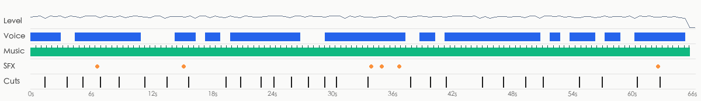

- loudness -17.3 dBFS, peak -0.5 dBFS; sound runs across cuts, laid in post as one bed (background changes 10.2dB at cuts vs 9.6dB within shots)
- Sources: Video type: voice-over / talking head + music → voice: TTS voice-over; music: stock library music (leaning, to confirm); SFX: added in post from an SFX library / editor (leaning, to confirm)

**Voice**

- 74% of the duration; pitch about 324.3Hz (female-leaning)
- Source: TTS voice-over (TTS voice-over 64%, human recording 27%, native dialogue from the AI video model 9%)
  - Voice and background sound run across cuts: the voice-over was laid on separately in post (TTS or a human voice-over)
- Remake: TTS voice-over: CapCut text-to-speech or another TTS tool, with a similar voice and pace

**Music**

- Tempo: 110.0 BPM (or 55.0/219.9); key D major (confidence 0.865); 99% of the duration (0.0–66.0s); section changes at 4.0s, 8.5s, 13.0s, 17.0s, 26.5s, 42.5s, 46.5s, 51.0s; ending: ends_with_video
- Cuts vs beat: 36% of cuts land on a beat (chance: about 26%)
- Source: to confirm (stock library music 52%, AI-generated music 30%, well-known song 17%)
  - The music is a bed under the picture: in a regular video the bed usually comes from a stock library (prior)
  - The voice is speech / narration, not singing (sustained-pitch ratio 0.16): a regular "voice-over + music bed" video
  - Music and video end together: edited to length or custom-made (either source possible, weak evidence)
  - Nothing about this track beyond the format prior and weak cues like the ending (no source heard, no platform music tag): source to confirm; an AI-generated bed cannot be told from a library bed here
  - How to confirm: Check the music tag on the original Douyin / Xiaohongshu / TikTok post: a song title → existing track; "original sound - @creator" → uploaded by the creator (for music videos, usually an AI song)
  - How to confirm: Run it through Shazam / ACRCloud or another song-ID service: a hit means an existing song
- Remake: The original track leans stock library music: search a library by BPM / mood / key for a similar track, or generate a royalty-free track in a similar style with AI

**Sound effects** (6)

| Sound | Listen | Type | Times used | At | On screen |
|---|---|---|---|---|---|
| F1 | [listen](sfx/sfx_01.wav) | other | 1 | 6.7s | — |
| F2 | [listen](sfx/sfx_02.wav) | ding | 1 | 15.3s | — |
| F3 | [listen](sfx/sfx_03.wav) | ding | 1 | 34.1s | title "第3步·蛋白挤油" appears |
| F4 | [listen](sfx/sfx_04.wav) | click | 1 | 35.1s | — |
| F5 | [listen](sfx/sfx_05.wav) | ding | 1 | 36.9s | — |
| F6 | [listen](sfx/sfx_06.wav) | ding | 1 | 62.9s | subtitle "一滴也没少" appears |

- Remake: play each sound first (separated out, without voice or music), find one similar effect in the editor's library, and place it at every time listed under “At”

- Separated stems: `stems/original.wav` (original), `stems/vocals.wav` (dry voice), `stems/music.wav` (music + ambience), `stems/effects.wav` (effects track)
<!--stems-->

## Open questions

- No AI listened to the soundtrack (the review covered the picture only): real voice versus TTS is inferred from the waveform; the effects were found on the separated effects track and their types are estimated from the sound. Play the stems and each effect under “Sound” to check
- music source to confirm: most likely stock library music (52%); how to check is under “Sound”

## Appendix

### Shot by shot

Each shot has two parts: what is visible on screen, and how the tools infer it was made (with the basis); remake prompts last. Folded by default.

<details class="ref"><summary>#1 00:00.000–00:01.458 · 3D render + code / editor overlays (text labels, title)</summary>

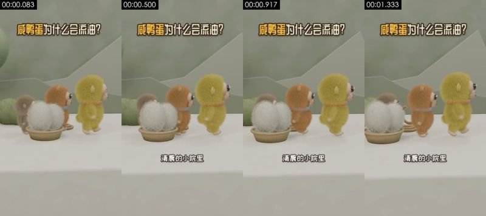

**Visible on screen** (check against the frames)
- Picture: Medium eye-level shot. White tabletop, sage-green wall and low-poly mountain shapes behind. A yellow-green plush monkey (Yabao), an orange-brown one (Huamao) and a grey-brown one walk to the right; a woven basket at left holds two white fluffy balls (the duck eggs). Static camera.
- Camera / lighting: medium shot; fixed camera (tripod / mount / on the desk); soft frontal light (flat light); key light frontal (from the camera side; both sides of the subject about equally bright); lighting ratio about 1.0:1 (0.0 stops); soft light (almost no lit / shadow edge)
- Text track (text/bottom): 清晨的小院里
- Text track (title/top): 咸鸭蛋为什么会流油？
- [AI assistant review] The outlines and positions of the three plush characters and the two white fluffy balls in the basket stay stable
- [AI assistant review] Fur stays stable frame to frame, with no flicker or smearing
- [AI assistant review] Tails, collars and other details never change; only the characters move as a whole and sway slightly

**How it was made, as inferred by the tools** (inferred, not seen)
- Inference: 3D render 83%, AI-generated video 6%, code / template render 4% (fused_agent)
- Material: rendered by the creator
- Basis (tool measurements, not necessarily visible to the eye):
  - Rendered texture: 54% flat colour blocks, 95% of pixels use only 56 colours, 37% axis-aligned edges
  - Per-frame sharpness oscillates periodically (period 2 frames, correlation 0.68) with no duplicate frames: frame interpolation / rate conversion, or just the rhythm of a re-encode (transcodes whose platform tags were stripped show it too); not enough on its own to call AI

- Remake: 3D render: AI first/last-frame generation gives an approximation; for precise multiple angles, model in 3D and render in Blender
  - First-frame image prompt: medium shot, subject in the upper middle of the frame. Medium eye-level shot, vertical 9:16. White tabletop with a sage-green wall and pale low-poly mountain shapes behind. At left, a shallow woven basket holding two long-haired white fluffy balls; three plush monkeys (grey-brown, orange-brown, yellow-green) stand in a line from left to right, side-on, facing right. Soft diffuse light, Blender fur render, low-saturation fresh palette.
  - Video prompt: medium shot, subject in the upper middle of the frame. Medium eye-level shot. Three plush monkeys walk in a line from left to right, bodies swaying gently, while two white fluffy balls stay in a woven basket at lower left. Static camera.

</details>

<details class="ref"><summary>#2 00:01.458–00:03.667 · 3D render + code / editor overlays (subtitles, title)</summary>

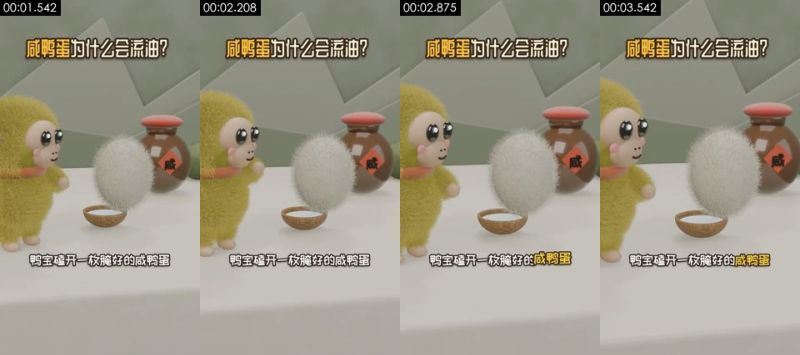

**Visible on screen** (check against the frames)
- Picture: Close eye-level shot. The yellow-green plush monkey Yabao stands at left; in front of it a long-haired white fluffy ball (the egg) floats up and turns above a small wooden bowl. Behind on the right, a brown jar with a red lid and a 咸 label. Static camera.
- Camera / lighting: medium close-up; fixed camera (tripod / mount / on the desk); soft frontal light (flat light); key light frontal (from the camera side; both sides of the subject about equally bright); lighting ratio about 1.2:1 (0.3 stops); soft light (almost no lit / shadow edge)
- Text on objects in the scene (not subtitles): 咸
- Text track (subtitle/bottom): 鸭宝磕开一枚腌好的咸鸭蛋 / 红亮的油涌了出来
- Text track (title/top): 咸鸭蛋为什么会流油？
- Motion beats within the shot: 2.33s
- [AI assistant review] The white fluffy ball (the egg) keeps its fur shape as it floats up
- [AI assistant review] The red diamond label with the character 咸 on the jar stays sharp and undistorted: a texture, not AI gibberish
- [AI assistant review] Outlines and materials stay consistent across frames, without the warping typical of AI video

**How it was made, as inferred by the tools** (inferred, not seen)
- Inference: 3D render 79%, AI-generated video 7%, code / template render 4% (fused_agent)
- Material: rendered by the creator
- Basis (tool measurements, not necessarily visible to the eye):
  - Rendered texture: 49% flat colour blocks, 95% of pixels use only 70 colours, 33% axis-aligned edges
  - 100% of sampled frames show a frontal face on a fixed camera, voice on the audio track

- Remake: 3D render: AI first/last-frame generation gives an approximation; for precise multiple angles, model in 3D and render in Blender
  - First-frame image prompt: medium close-up, subject in the left of the frame. Close eye-level shot, vertical. At left, a yellow-green long-haired plush monkey with a beige face, big glossy black eyes, pink cheeks and an orange-red scarf, facing right. In the middle, a long-haired white fluffy ball hovering above a small coconut-shell bowl. Behind on the right, a brown clay jar with a round red lid and a red diamond label reading 咸. White tabletop, sage-green wall. Soft light, Blender fur render.
  - Video prompt: medium close-up, subject in the left of the frame. Close eye-level shot. A yellow-green plush monkey on the left watches a white fluffy ball float up from a small bowl and slowly turn; the monkey lifts a hand. Static camera.

</details>

<details class="ref"><summary>#3 00:03.667–00:05.208 · 3D render + code / editor overlays (text labels, title)</summary>

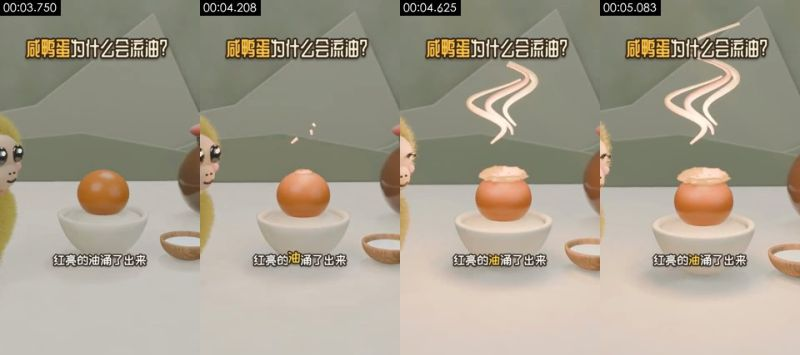

**Visible on screen** (check against the frames)
- Picture: Medium eye-level shot. An orange yolk in a white porcelain bowl; a pale oil layer bubbles up on top and pinkish-white S-shaped wisps rise above it. Parts of the plush characters show at the left and right edges; a small bowl of white salt sits at lower right. Static camera.
- Camera / lighting: medium shot; moving camera (gimbal / handheld pan); backlit / background brighter than subject; key light frontal (from the camera side; both sides of the subject about equally bright); lighting ratio about 1.1:1 (0.2 stops); soft light (almost no lit / shadow edge)
- Text track (text/bottom): 红亮的油涌了出来
- Text track (title/top): 咸鸭蛋为什么会流油？
- [AI assistant review] The yolk sphere and the rim of the white bowl are clean and regular
- [AI assistant review] The pink oil wisps are regular S-curves of even thickness
- [AI assistant review] Outlines and materials stay consistent across frames, without the warping typical of AI video

**How it was made, as inferred by the tools** (inferred, not seen)
- Inference: 3D render 80%, AI-generated video 8%, code / template render 4% (fused_agent)
- Material: rendered by the creator
- Basis (tool measurements, not necessarily visible to the eye):
  - Rendered texture: 60% flat colour blocks, 95% of pixels use only 79 colours, 36% axis-aligned edges

- Remake: 3D render: AI first/last-frame generation gives an approximation; for precise multiple angles, model in 3D and render in Blender
  - First-frame image prompt: medium shot, subject in the upper middle of the frame. Medium eye-level shot, vertical. In the center, a smooth orange yolk in a white porcelain bowl; a wooden bowl of white salt at lower right; half of a plush monkey visible at each edge. Sage-green wall, white tabletop. Soft light, 3D cartoon render.
  - Video prompt: medium shot, subject in the upper middle of the frame. Medium eye-level shot. A layer of pale oil swells on top of an orange yolk in a white bowl, a few droplets pop up, then three pinkish-white S-shaped wisps rise above it. Static camera.

</details>

<details class="ref"><summary>#4 00:05.208–00:07.000 · 3D render + code / editor overlays (text labels, title)</summary>

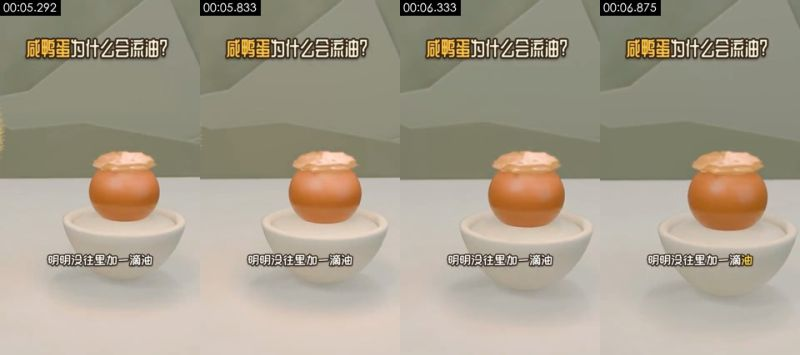

**Visible on screen** (check against the frames)
- Picture: Medium eye-level shot. The oily yolk in its white bowl sits in the center against the sage-green wall; the camera slowly pushes in.
- Camera / lighting: medium shot; fixed camera (tripod / mount / on the desk); soft frontal light (flat light); key light frontal (from the camera side; both sides of the subject about equally bright); lighting ratio about 1.2:1 (0.2 stops); soft light (almost no lit / shadow edge)
- Text track (text/bottom): 明明没往里加一滴油
- Text track (title/top): 咸鸭蛋为什么会流油？
- [AI assistant review] The yolk, oil layer and bowl keep the same shape every frame
- [AI assistant review] The only motion is a slow, steady push-in; nothing drifts
- [AI assistant review] Outlines and materials stay consistent across frames, without the warping typical of AI video

**How it was made, as inferred by the tools** (inferred, not seen)
- Inference: 3D render 82%, code / template render 5%, AI-generated video 5% (fused_agent)
- Material: rendered by the creator
- Basis (tool measurements, not necessarily visible to the eye):
  - Rendered texture: 59% flat colour blocks, 95% of pixels use only 55 colours, 42% axis-aligned edges

- Remake: 3D render: AI first/last-frame generation gives an approximation; for precise multiple angles, model in 3D and render in Blender
  - First-frame image prompt: medium shot, subject in the upper middle of the frame. Medium eye-level shot, vertical. In the center, an orange yolk in a white porcelain bowl, topped with a wrinkled layer of pale yellow oil. Clean white tabletop and sage-green wall. Soft light, 3D cartoon render.
  - Video prompt: medium shot, subject in the upper middle of the frame. Medium eye-level shot. The camera slowly pushes in toward the oily yolk in the white bowl; the yolk and oil stay still.

</details>

<details class="ref"><summary>#5 00:07.000–00:08.875 · 3D render + code / editor overlays (text labels, title)</summary>

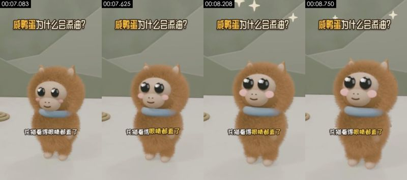

**Visible on screen** (check against the frames)
- Picture: Close eye-level shot. The long-haired orange-brown plush monkey Huamao faces the camera in the center, wearing a blue collar; its big eyes blink, its body sways slightly and white four-point sparkles flash above its head. Static camera.
- Camera / lighting: medium close-up; moving camera (gimbal / handheld pan); soft frontal light (flat light); key light frontal (from the camera side; both sides of the subject about equally bright); lighting ratio about 1.1:1 (0.1 stops); soft light (almost no lit / shadow edge)
- Text track (text/bottom): 花猫看得眼睛都直了
- Text track (title/top): 咸鸭蛋为什么会流油？
- [AI assistant review] The long fur moves with the body as a whole, with no flicker
- [AI assistant review] Eyes and cheek blush stay fixed on the face
- [AI assistant review] The white four-point sparkles above are regular shapes

**How it was made, as inferred by the tools** (inferred, not seen)
- Inference: 3D render 74%, AI-generated video 12%, AI avatar (talking head) 3% (fused_agent)
- Material: rendered by the creator
- Basis (tool measurements, not necessarily visible to the eye):
  - A face covers 7% of the frame and appears in 100% of sampled frames: a close-up of a person, flat colour blocks mostly come from walls / clothing, rendered-texture cues down-weighted
  - Photographic texture: noise σ=0.04, 61 colours, 54% flat blocks

- Remake: 3D render: AI first/last-frame generation gives an approximation; for precise multiple angles, model in 3D and render in Blender
  - First-frame image prompt: medium close-up, subject centred in frame. Close eye-level shot, vertical. An orange-brown long-haired plush monkey faces the camera in the center, two small pointed ears on top, beige face, big glossy black eyes, pink cheeks and a pale blue ring collar. Sage-green wall, white tabletop. Soft light, Blender fur render.
  - Video prompt: medium close-up, subject centred in frame. Close eye-level shot. A brown plush monkey faces the camera, its eyes widen and blink, its body sways slightly, and white four-point sparkles pop above its head. Static camera.

</details>

<details class="ref"><summary>#6 00:08.875–00:11.458 · 3D render + code / editor overlays (subtitles, title)</summary>

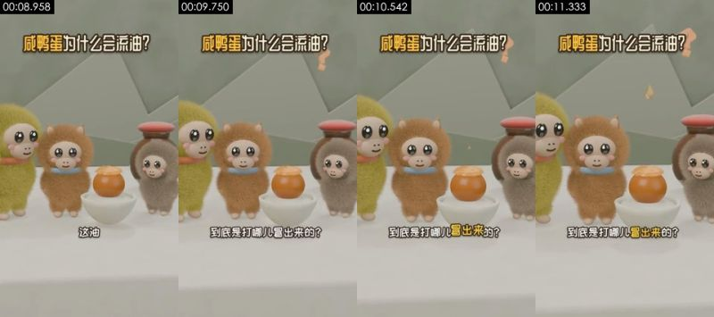

**Visible on screen** (check against the frames)
- Picture: Medium eye-level shot. Yabao, Huamao, the grey-brown monkey and the bowl with the oily yolk stand in a row with the jar on the right; orange question marks float up at upper right while the characters sway. Static camera.
- Camera / lighting: medium shot; fixed camera (tripod / mount / on the desk); soft frontal light (flat light); key light frontal (from the camera side; both sides of the subject about equally bright); lighting ratio about 1.2:1 (0.3 stops); soft light (almost no lit / shadow edge)
- Text track (subtitle/bottom): 这油 / 到底是打哪儿冒出来的？
- Text track (title/top): 咸鸭蛋为什么会流油？
- Motion beats within the shot: 9.62s
- [AI assistant review] The three characters and the jar hold their positions across frames
- [AI assistant review] The orange question marks are shaded: 3D objects in the scene
- [AI assistant review] Fur stays stable frame to frame, with no flicker or smearing

**How it was made, as inferred by the tools** (inferred, not seen)
- Inference: 3D render 78%, AI-generated video 8%, code / template render 3% (fused_agent)
- Material: rendered by the creator
- Basis (tool measurements, not necessarily visible to the eye):
  - Rendered texture: 47% flat colour blocks, 95% of pixels use only 82 colours, 33% axis-aligned edges
  - 83% of sampled frames show a frontal face on a fixed camera, voice on the audio track

- Remake: 3D render: AI first/last-frame generation gives an approximation; for precise multiple angles, model in 3D and render in Blender
  - First-frame image prompt: medium shot, subject in the left of the frame. Medium eye-level shot, vertical. From left to right: yellow-green plush monkey, orange-brown plush monkey, the oily yolk in a white bowl, grey-brown plush monkey, with a brown red-lidded jar behind. Sage-green wall and low-poly mountain shapes. Soft light, 3D cartoon render.
  - Video prompt: medium shot, subject in the left of the frame. Medium eye-level shot. Three plush monkeys stand around the oily yolk, swaying and tilting their heads, while two orange question marks float up at upper right. Static camera.

</details>

<details class="ref"><summary>#7 00:11.458–00:13.667 · 3D render + code / editor overlays (subtitles, title)</summary>

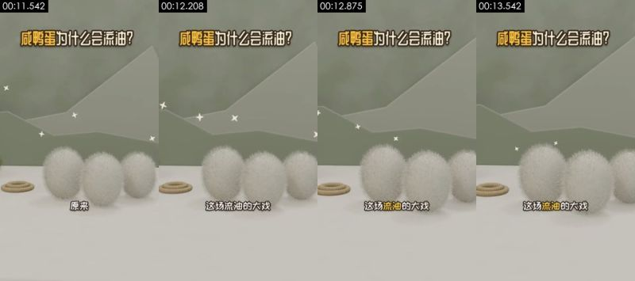

**Visible on screen** (check against the frames)
- Picture: Medium eye-level shot. Three long-haired white fluffy balls (the eggs) sit in a row on the table, a rope ring at left, white four-point sparkles in the background. The camera trucks slowly.
- Camera / lighting: medium shot; moving camera (gimbal / handheld pan); soft frontal light (flat light); key light frontal (from the camera side; both sides of the subject about equally bright); lighting ratio about 1.0:1 (0.0 stops); soft light (almost no lit / shadow edge)
- Text track (subtitle/bottom): 原来 / 这场流油的大戏 / 万后导演是普普通通的盐
- Text track (title/top): 咸鸭蛋为什么会流油？
- [AI assistant review] The fur edges of the three white balls stay stable; only the whole frame pans
- [AI assistant review] The rope ring at left and the background mountains do not change
- [AI assistant review] Outlines and materials stay consistent across frames, without the warping typical of AI video

**How it was made, as inferred by the tools** (inferred, not seen)
- Inference: 3D render 83%, AI-generated video 5%, code / template render 4% (fused_agent)
- Material: rendered by the creator
- Basis (tool measurements, not necessarily visible to the eye):
  - Rendered texture: 62% flat colour blocks, 95% of pixels use only 21 colours, 36% axis-aligned edges

- Remake: 3D render: AI first/last-frame generation gives an approximation; for precise multiple angles, model in 3D and render in Blender
  - First-frame image prompt: medium shot, subject in the upper middle of the frame. Medium eye-level shot, vertical. Three long-haired white oval fluffy balls in a row on a white tabletop, a coiled rope ring at left, sage-green wall and low-poly mountain shapes behind, a few white four-point sparkles in the air. Soft light, Blender fur render.
  - Video prompt: medium shot, subject in the upper middle of the frame. Medium eye-level shot. The camera slowly trucks right past three white fluffy balls on the table while white sparkles twinkle in the background.

</details>

<details class="ref"><summary>#8 00:13.667–00:15.833 · 3D render + code / editor overlays (text labels, title)</summary>

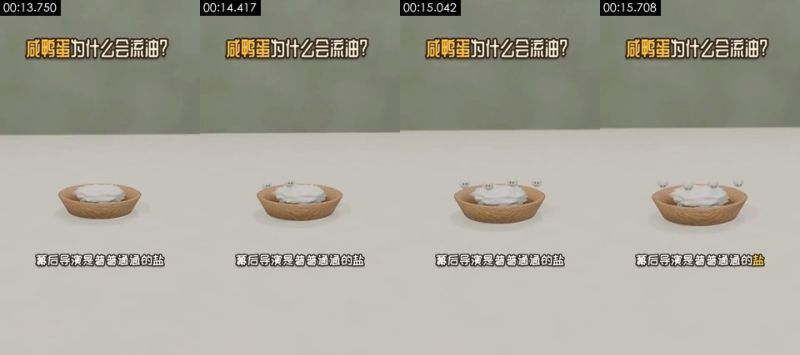

**Visible on screen** (check against the frames)
- Picture: Medium, slightly high-angle shot. A shallow wooden bowl of white salt on a white table; small white balls with black eyes (personified salt grains) pop out of the pile one by one. Static camera.
- Camera / lighting: medium shot; fixed camera (tripod / mount / on the desk); backlit / background brighter than subject; key light frontal (from the camera side; both sides of the subject about equally bright); lighting ratio about 1.0:1 (0.0 stops); soft light (almost no lit / shadow edge)
- Text track (text/bottom): 幕后导演是普普通通的盐
- Text track (title/top): 咸鸭蛋为什么会流油？
- [AI assistant review] The wooden bowl has wood grain and a shadow, the salt pile has volume and shading: not flat code graphics
- [AI assistant review] The small white balls with eyes pop up one by one on regular paths
- [AI assistant review] The background is a blurred green wall and tabletop, not a pixel-frozen flat color

**How it was made, as inferred by the tools** (inferred, not seen)
- Inference: 3D render 78%, code / template render 10%, 2D animation 3% (fused_agent)
- Material: rendered by the creator
- Basis (tool measurements, not necessarily visible to the eye):
  - Rendered texture: 76% flat colour blocks, 95% of pixels use only 25 colours, 40% axis-aligned edges

- Remake: 3D render: AI first/last-frame generation gives an approximation; for precise multiple angles, model in 3D and render in Blender
  - First-frame image prompt: medium shot, subject in the upper middle of the frame. Medium slightly high-angle shot, vertical. In the lower middle, a pale wood-grain round bowl heaped with white salt on a white tabletop; blurred sage-green wall behind. Soft diffuse light, minimal 3D cartoon render.
  - Video prompt: medium shot, subject in the upper middle of the frame. Medium slightly high-angle shot. Five or six small white balls with tiny black eyes pop out of the salt pile in a wooden bowl one by one and wobble on the surface. Static camera.

</details>

<details class="ref"><summary>#9 00:15.833–00:19.583 · 3D render + code / editor overlays (subtitles, title)</summary>

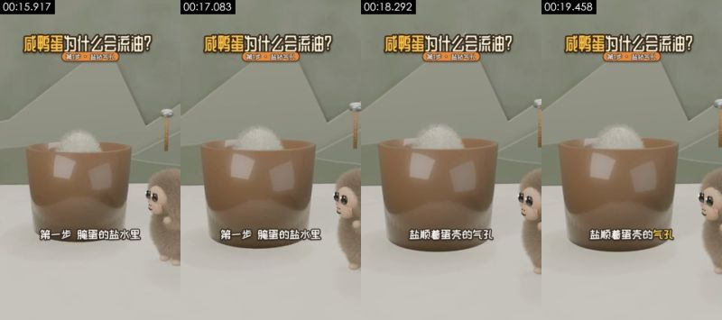

**Visible on screen** (check against the frames)
- Picture: Medium eye-level shot. A large brown translucent cup (the brine crock) with a white fluffy egg showing at its rim; the grey-brown plush monkey peeks in from the right; a small wooden-handled hammer hangs in the background. Static camera.
- Camera / lighting: medium shot; fixed camera (tripod / mount / on the desk); soft frontal light (flat light); key light frontal (from the camera side; both sides of the subject about equally bright); lighting ratio about 1.0:1 (0.1 stops); soft light (almost no lit / shadow edge)
- Text track (subtitle/bottom): 第一步腌蛋的盐水里 / 盐顺着蛋壳的气孔 / 一粒粒往里钻
- Text track (title/top): 咸鸭蛋为什么会流油？ / 第1步·盐钻气孔
- [AI assistant review] The brown cup wall has specular reflections and clean geometry
- [AI assistant review] The grey-brown plush monkey at right keeps stable fur
- [AI assistant review] Outlines and materials stay consistent across frames, without the warping typical of AI video

**How it was made, as inferred by the tools** (inferred, not seen)
- Inference: 3D render 82%, code / template render 6%, AI-generated video 4% (fused_agent)
- Material: rendered by the creator
- Basis (tool measurements, not necessarily visible to the eye):
  - Rendered texture: 53% flat colour blocks, 95% of pixels use only 41 colours, 38% axis-aligned edges

- Remake: 3D render: AI first/last-frame generation gives an approximation; for precise multiple angles, model in 3D and render in Blender
  - First-frame image prompt: medium shot, subject in the upper middle of the frame. Medium eye-level shot, vertical. In the center, a large brown translucent cylindrical cup with the top of a long-haired white fluffy ball showing at the rim; at lower right a grey-brown plush monkey leans in, looking left. Sage-green wall, low-poly mountain shapes and a small wooden-handled hammer behind. Soft light, 3D cartoon render.
  - Video prompt: medium shot, subject in the upper middle of the frame. Medium eye-level shot. The white fluffy ball sinks slightly into the brown cup while a grey-brown plush monkey on the right blinks and watches. Static camera.

</details>

<details class="ref"><summary>#10 00:19.583–00:21.042 · 3D render + code / editor overlays (subtitles, title)</summary>

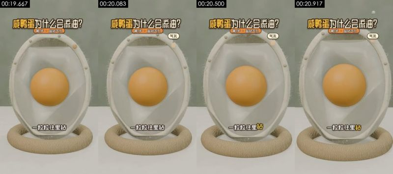

**Visible on screen** (check against the frames)
- Picture: Close eye-level shot. An upright egg cross-section model on a rope-ring base: an off-white shell with fine fuzz, translucent egg white and an orange yolk inside. A few small salt balls slip in through pores at the top of the shell. Static camera.
- Camera / lighting: medium shot; moving camera (gimbal / handheld pan); soft frontal light (flat light); key light frontal (from the camera side; both sides of the subject about equally bright); lighting ratio about 1.1:1 (0.1 stops); soft light (almost no lit / shadow edge)
- Text track (subtitle/bottom): 一粒粒往里钻 / 第二步盐先灌满蛋清
- Text track (title/top): 咸鸭蛋为什么会流油？ / 第1步·盐钻气孔 / 第2步·盐进蛋黄
- Text track (title/top): 气孔
- [AI assistant review] Egg cross-section model: off-white shell, translucent white, perfectly spherical yolk, unchanged across frames
- [AI assistant review] The fuzz on the shell edge and the rope base have material texture
- [AI assistant review] Tiny salt balls enter through the top of the shell on regular paths

**How it was made, as inferred by the tools** (inferred, not seen)
- Inference: 3D render 80%, AI-generated video 7%, code / template render 4% (fused_agent)
- Material: rendered by the creator
- Basis (tool measurements, not necessarily visible to the eye):
  - Rendered texture: 35% flat colour blocks, 95% of pixels use only 57 colours, 31% axis-aligned edges

- Remake: 3D render: AI first/last-frame generation gives an approximation; for precise multiple angles, model in 3D and render in Blender
  - First-frame image prompt: medium shot, subject in the upper middle of the frame. Close eye-level shot, vertical. In the center, an upright oval egg cross-section model: off-white shell with fine fuzz along the rim, translucent egg white inside and an orange spherical yolk in the middle, resting on a woven rope ring. Sage-green background. Soft light, 3D science-explainer render.
  - Video prompt: medium shot, subject in the upper middle of the frame, camera push-in. Close eye-level shot. A few small white salt balls drop onto the top of the egg cross-section model from the upper right and slip one by one through tiny pores into the egg white. Static camera.

</details>

<details class="ref"><summary>#11 00:21.042–00:23.042 · 3D render + code / editor overlays (subtitles, title)</summary>

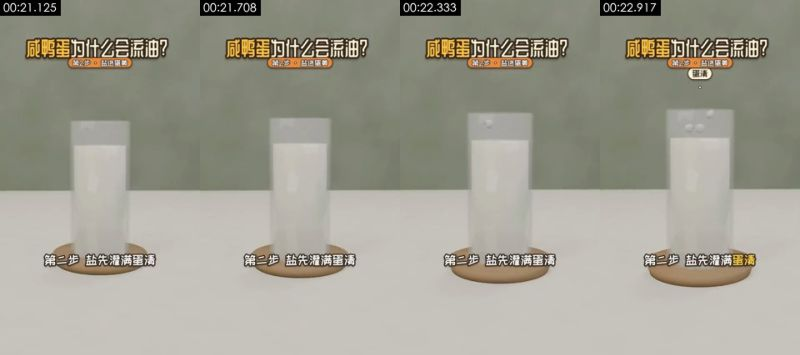

**Visible on screen** (check against the frames)
- Picture: Medium eye-level shot. A glass cylinder of white liquid (the egg white) on a wooden coaster on a white table; a few small salt grains fall into it from above. Static camera.
- Camera / lighting: medium shot; fixed camera (tripod / mount / on the desk); backlit / background brighter than subject; key light frontal (from the camera side; both sides of the subject about equally bright); lighting ratio about 1.0:1 (0.0 stops); soft light (almost no lit / shadow edge)
- Text track (subtitle/bottom): 第二步盐先灌满蛋清 / 再穿过蛋黄膜
- Text track (title/top): 咸鸭蛋为什么会流油？ / 第2步·盐进蛋黄
- [AI assistant review] The glass has refraction, thickness and a shadow; the wooden coaster has grain
- [AI assistant review] The white liquid has volume, not a flat color block
- [AI assistant review] The salt grains fall into the liquid on regular paths

**How it was made, as inferred by the tools** (inferred, not seen)
- Inference: 3D render 78%, code / template render 10%, 2D animation 3% (fused_agent)
- Material: rendered by the creator
- Basis (tool measurements, not necessarily visible to the eye):
  - Rendered texture: 70% flat colour blocks, 95% of pixels use only 27 colours, 41% axis-aligned edges
  - Per-frame sharpness oscillates periodically (period 2 frames, correlation 0.47) with no duplicate frames: frame interpolation / rate conversion, or just the rhythm of a re-encode (transcodes whose platform tags were stripped show it too); not enough on its own to call AI

- Remake: 3D render: AI first/last-frame generation gives an approximation; for precise multiple angles, model in 3D and render in Blender
  - First-frame image prompt: medium shot, subject in the upper middle of the frame. Medium eye-level shot, vertical. In the center, a clear glass cylinder full of milky white liquid on a pale round wooden coaster on a white tabletop; sage-green wall behind. Soft diffuse light, minimal 3D science-explainer render.
  - Video prompt: medium shot, subject in the upper middle of the frame. Medium eye-level shot. A few small white salt grains fall one by one into a glass cylinder of milky liquid. Static camera.

</details>

<details class="ref"><summary>#12 00:23.042–00:24.333 · 3D render + code / editor overlays (text labels, title)</summary>

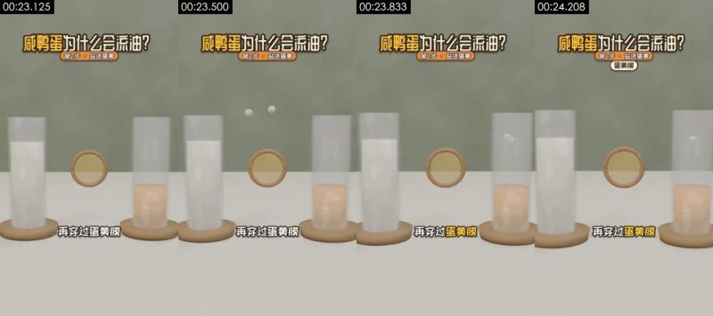

**Visible on screen** (check against the frames)
- Picture: Medium eye-level shot. A glass of white liquid at left (egg white), a glass of orange-yellow liquid at right (yolk), and a wooden-framed round membrane between them (yolk membrane). White salt grains pass from left to right through the membrane. Static camera.
- Camera / lighting: medium shot; fixed camera (tripod / mount / on the desk); backlit / background brighter than subject; key light frontal (from the camera side; both sides of the subject about equally bright); lighting ratio about 1.0:1 (0.0 stops); soft light (almost no lit / shadow edge)
- Text track (text/bottom): 再穿过蛋黄膜
- Text track (title/top): 咸鸭蛋为什么会流油？ / 第2步·盐进蛋黄
- Text track (title/top): 蛋黄膜
- [AI assistant review] Both glasses and the wooden-framed round membrane have materials, transparency and shadows
- [AI assistant review] The white balls pass through the membrane toward the right glass on regular paths
- [AI assistant review] Outlines and materials stay consistent across frames, without the warping typical of AI video

**How it was made, as inferred by the tools** (inferred, not seen)
- Inference: 3D render 82%, code / template render 7%, AI-generated video 3% (fused_agent)
- Material: rendered by the creator
- Basis (tool measurements, not necessarily visible to the eye):
  - Rendered texture: 63% flat colour blocks, 95% of pixels use only 41 colours, 41% axis-aligned edges

- Remake: 3D render: AI first/last-frame generation gives an approximation; for precise multiple angles, model in 3D and render in Blender
  - First-frame image prompt: medium shot, subject in the upper middle of the frame. Medium eye-level shot, vertical. On a white tabletop, a glass of milky liquid at left and a glass half full of orange-yellow liquid at right, both on pale wooden coasters, with a wooden-framed round translucent membrane floating between them. Sage-green background. Soft light, minimal 3D science-explainer render.
  - Video prompt: medium shot, subject in the upper middle of the frame. Medium eye-level shot. Small white salt grains fly out above the left glass, pass through the wooden-framed round membrane in the middle and drop into the orange liquid in the right glass. Static camera.

</details>

<details class="ref"><summary>#13 00:24.333–00:26.125 · 3D render + code / editor overlays (subtitles, text labels, title)</summary>

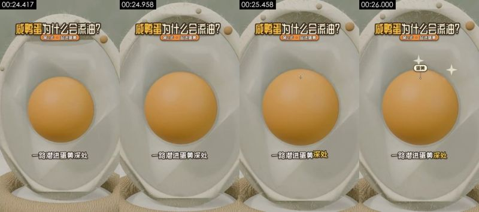

**Visible on screen** (check against the frames)
- Picture: Close-up, eye level. The yolk of the cross-section model sits in the center; the camera slowly pushes in, and white four-point sparkles and a small 蛋黄 (yolk) label appear above it.
- Camera / lighting: medium shot; moving camera (gimbal / handheld pan); soft frontal light (flat light); key light frontal (from the camera side; both sides of the subject about equally bright); lighting ratio about 1.0:1 (0.0 stops); soft light (almost no lit / shadow edge)
- Text track (subtitle/bottom): 一路潜进蛋黄深处 / 蛋黄里存着的水分
- Text track (text/middle): 蛋黄
- Text track (title/top): 咸鸭蛋为什么会流油？ / 第2步·盐进蛋黄
- [AI assistant review] The same egg cross-section model as shot 10, identical structure
- [AI assistant review] The push-in is smooth and the yolk is a perfect sphere
- [AI assistant review] Outlines and materials stay consistent across frames, without the warping typical of AI video

**How it was made, as inferred by the tools** (inferred, not seen)
- Inference: 3D render 79%, AI-generated video 8%, code / template render 3% (fused_agent)
- Material: rendered by the creator
- Basis (tool measurements, not necessarily visible to the eye):
  - Rendered texture: 28% flat colour blocks, 95% of pixels use only 62 colours, 31% axis-aligned edges

- Remake: 3D render: AI first/last-frame generation gives an approximation; for precise multiple angles, model in 3D and render in Blender
  - First-frame image prompt: medium shot, subject in the upper middle of the frame. Close-up, eye level, vertical. The egg cross-section model fills the frame: off-white shell, translucent white, orange spherical yolk in the center. Soft light, 3D science-explainer render.
  - Video prompt: medium shot, subject in the upper middle of the frame. Close-up, eye level. The camera slowly pushes in on the orange yolk at the center of the egg model; two white sparkles flash above it. Ends with the yolk filling half the frame.

</details>

<details class="ref"><summary>#14 00:26.125–00:27.792 · 3D render + code / editor overlays (text labels, title)</summary>

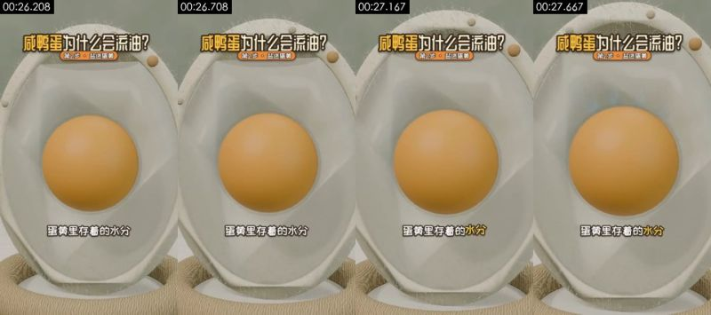

**Visible on screen** (check against the frames)
- Picture: Close-up, eye level. The cross-section yolk in the center; the picture is almost still while the camera creeps in.
- Camera / lighting: medium shot; moving camera (gimbal / handheld pan); soft frontal light (flat light); key light frontal (from the camera side; both sides of the subject about equally bright); lighting ratio about 1.0:1 (0.1 stops); soft light (almost no lit / shadow edge)
- Text track (text/bottom): 蛋黄里存着的水分
- Text track (title/top): 咸鸭蛋为什么会流油？ / 第2步·盐进蛋黄
- [AI assistant review] The yolk and shell keep the same shape across frames
- [AI assistant review] The small round beads on the shell edge stay put
- [AI assistant review] Outlines and materials stay consistent across frames, without the warping typical of AI video

**How it was made, as inferred by the tools** (inferred, not seen)
- Inference: 3D render 79%, AI-generated video 8%, code / template render 3% (fused_agent)
- Material: rendered by the creator
- Basis (tool measurements, not necessarily visible to the eye):
  - Rendered texture: 27% flat colour blocks, 95% of pixels use only 61 colours, 31% axis-aligned edges

- Remake: 3D render: AI first/last-frame generation gives an approximation; for precise multiple angles, model in 3D and render in Blender
  - First-frame image prompt: medium shot, subject in the upper middle of the frame. Close-up, eye level, vertical. The egg cross-section model with an orange spherical yolk in the center, surrounded by translucent white and an off-white shell. Soft light, 3D science-explainer render.
  - Video prompt: medium shot, subject in the upper middle of the frame, camera push-in. Close-up, eye level. A faint wet highlight shimmers on the yolk surface while the camera creeps in very slowly.

</details>

<details class="ref"><summary>#15 00:27.792–00:29.458 · 3D render + code / editor overlays (text labels, title)</summary>

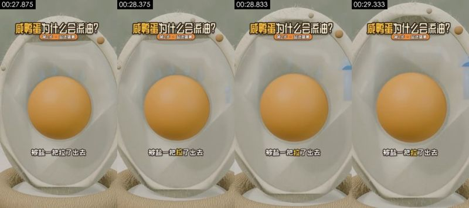

**Visible on screen** (check against the frames)
- Picture: Close-up, eye level. The cross-section model with the yolk in the center; pale blue droplets appear at the right edge of the shell and move outward. Static camera.
- Camera / lighting: medium shot; moving camera (gimbal / handheld pan); soft frontal light (flat light); key light frontal (from the camera side; both sides of the subject about equally bright); lighting ratio about 1.0:1 (0.0 stops); soft light (almost no lit / shadow edge)
- Text track (text/bottom): 被盐一把拉了出去
- Text track (title/top): 咸鸭蛋为什么会流油？ / 第2步·盐进蛋黄
- [AI assistant review] Same cross-section model, stable yolk shape
- [AI assistant review] Pale blue droplet shapes with regular edges appear at the right edge of the shell
- [AI assistant review] Outlines and materials stay consistent across frames, without the warping typical of AI video

**How it was made, as inferred by the tools** (inferred, not seen)
- Inference: 3D render 78%, AI-generated video 9%, code / template render 3% (fused_agent)
- Material: rendered by the creator
- Basis (tool measurements, not necessarily visible to the eye):
  - Rendered texture: 26% flat colour blocks, 95% of pixels use only 63 colours, 31% axis-aligned edges

- Remake: 3D render: AI first/last-frame generation gives an approximation; for precise multiple angles, model in 3D and render in Blender
  - First-frame image prompt: medium shot, subject in the upper middle of the frame. Close-up, eye level, vertical. The egg cross-section model with an orange spherical yolk in the center, surrounded by translucent egg white. Soft light, 3D science-explainer render.
  - Video prompt: medium shot, subject in the upper middle of the frame, camera push-in. Close-up, eye level. A few pale blue droplets seep out of the yolk, drift through the egg white to the right edge of the shell and vanish. Static camera.

</details>

<details class="ref"><summary>#16 00:29.458–00:30.625 · 3D render + code / editor overlays (subtitles, title)</summary>

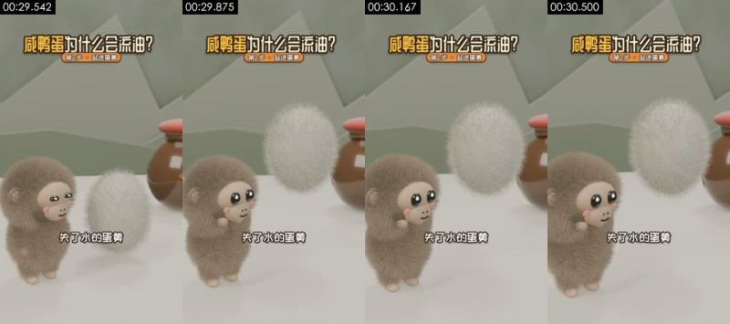

**Visible on screen** (check against the frames)
- Picture: Close eye-level shot. The grey-brown plush monkey looks up at left while a white fluffy ball (the yolk, personified) rises and grows beside it, the jar behind. The camera slowly pushes in.
- Camera / lighting: medium close-up; moving camera (gimbal / handheld pan); soft frontal light (flat light); key light frontal (from the camera side; both sides of the subject about equally bright); lighting ratio about 1.2:1 (0.3 stops); hard light (sharp shadow edge)
- Text track (subtitle/bottom): 失了水的蛋黄 / 缩成一团
- Text track (title/top): 咸鸭蛋为什么会流油？ / 第2步·盐进蛋黄
- [AI assistant review] The grey-brown monkey and the white fluffy ball keep stable fur
- [AI assistant review] The jar's red lid and reflections stay consistent
- [AI assistant review] Outlines and materials stay consistent across frames, without the warping typical of AI video

**How it was made, as inferred by the tools** (inferred, not seen)
- Inference: 3D render 83%, AI-generated video 5%, code / template render 4% (fused_agent)
- Material: rendered by the creator
- Basis (tool measurements, not necessarily visible to the eye):
  - Rendered texture: 50% flat colour blocks, 95% of pixels use only 43 colours, 36% axis-aligned edges
  - Per-frame sharpness oscillates periodically (period 4 frames, correlation 0.85) with no duplicate frames: frame interpolation / rate conversion, or just the rhythm of a re-encode (transcodes whose platform tags were stripped show it too); not enough on its own to call AI

- Remake: 3D render: AI first/last-frame generation gives an approximation; for precise multiple angles, model in 3D and render in Blender
  - First-frame image prompt: medium close-up, subject in the lower left of the frame. Close eye-level shot, vertical. At left, a grey-brown plush monkey with a beige face, big black eyes and pink cheeks, side-on facing right; at right, a long-haired white oval fluffy ball hovering above the table; behind on the right, a brown red-lidded clay jar. Sage-green wall, low-poly mountain shapes. Soft light, Blender fur render.
  - Video prompt: medium close-up, subject in the lower left of the frame. Close eye-level shot. A white fluffy ball rises from the table and slowly turns while the grey-brown plush monkey on the left looks up and blinks. The camera slowly pushes in.

</details>

<details class="ref"><summary>#17 00:30.625–00:33.750 · 3D render + code / editor overlays (subtitles, title)</summary>

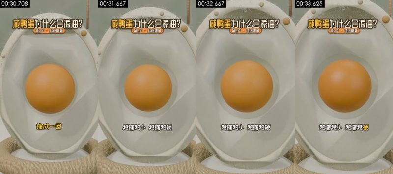

**Visible on screen** (check against the frames)
- Picture: Close-up, eye level. In the cross-section model the yolk shrinks evenly and a ring of empty space opens around it. Static camera.
- Camera / lighting: medium shot; moving camera (gimbal / handheld pan); soft frontal light (flat light); key light frontal (from the camera side; both sides of the subject about equally bright); lighting ratio about 1.0:1 (0.0 stops); soft light (almost no lit / shadow edge)
- Text track (subtitle/bottom): 缩成一团 / 越缩越小越缩越硬
- Text track (title/top): 咸鸭蛋为什么会流油？ / 第2步·盐进蛋黄
- [AI assistant review] Same cross-section model; the yolk shrinks by a uniform scale
- [AI assistant review] The shell and background do not change at all
- [AI assistant review] Outlines and materials stay consistent across frames, without the warping typical of AI video

**How it was made, as inferred by the tools** (inferred, not seen)
- Inference: 3D render 78%, AI-generated video 9%, code / template render 3% (fused_agent)
- Material: rendered by the creator
- Basis (tool measurements, not necessarily visible to the eye):
  - Rendered texture: 25% flat colour blocks, 95% of pixels use only 59 colours, 28% axis-aligned edges

- Remake: 3D render: AI first/last-frame generation gives an approximation; for precise multiple angles, model in 3D and render in Blender
  - First-frame image prompt: medium shot, subject in the upper middle of the frame. Close-up, eye level, vertical. The egg cross-section model with an orange spherical yolk in the center, surrounded by translucent white and an off-white shell. Soft light, 3D science-explainer render.
  - Video prompt: medium shot, subject in the upper middle of the frame, camera push-in. Close-up, eye level. The orange yolk shrinks evenly by about ten percent, leaving a pale ring of space around it, and comes to rest. Static camera.

</details>

<details class="ref"><summary>#18 00:33.750–00:38.042 · 3D render + code / editor overlays (subtitles, title)</summary>

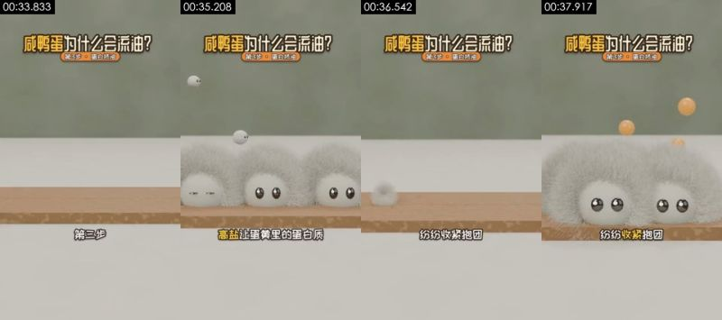

**Visible on screen** (check against the frames)
- Picture: Medium eye-level shot. A wooden plank across the white table; several white furry blobs with black eyes (the proteins) bounce down onto it and squeeze together, then a few small orange balls (oil droplets) pop out from between them. Static camera.
- Camera / lighting: medium shot; fixed camera (tripod / mount / on the desk); soft frontal light (flat light); key light frontal (from the camera side; both sides of the subject about equally bright); lighting ratio about 1.0:1 (0.0 stops); soft light (almost no lit / shadow edge)
- Text track (subtitle/bottom): 第三步 / 高盐让蛋黄里的蛋白质 / 纷纷收紧抱团 / 原本被裹得严严实实的油
- Text track (title/top): 咸鸭蛋为什么会流油？ / 第3步·蛋白挤油
- [AI assistant review] The white blob characters have long fur and volumetric shadows; the plank has wood grain
- [AI assistant review] Around 36.5s all blobs vanish and bounce in again, like two renders joined end to end, not a deformation
- [AI assistant review] The orange balls pop out on regular paths

**How it was made, as inferred by the tools** (inferred, not seen)
- Inference: 3D render 83%, code / template render 5%, AI-generated video 4% (fused_agent)
- Material: rendered by the creator
- Basis (tool measurements, not necessarily visible to the eye):
  - Rendered texture: 56% flat colour blocks, 95% of pixels use only 36 colours, 42% axis-aligned edges

- Remake: 3D render: AI first/last-frame generation gives an approximation; for precise multiple angles, model in 3D and render in Blender
  - First-frame image prompt: medium shot, subject in the upper middle of the frame. Medium eye-level shot, vertical. A long pale wood-grain plank lying across the lower half of the frame on a white tabletop, plain sage-green wall behind. Soft light, 3D cartoon render.
  - Video prompt: medium shot, subject in the upper middle of the frame. Medium eye-level shot. Several white furry blobs with shiny black eyes bounce down onto a wooden plank one after another and squeeze together in a row, then a few small orange balls pop up from between them. Static camera.

</details>

<details class="ref"><summary>#19 00:38.042–00:40.000 · 3D render + code / editor overlays (text labels, title)</summary>

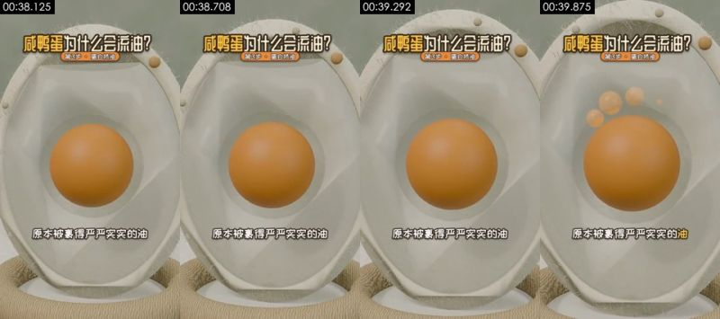

**Visible on screen** (check against the frames)
- Picture: Close-up, eye level. In the cross-section model, a few translucent orange oil beads rise from the top of the yolk. Static camera.
- Camera / lighting: medium shot; moving camera (gimbal / handheld pan); soft frontal light (flat light); key light frontal (from the camera side; both sides of the subject about equally bright); lighting ratio about 1.0:1 (0.0 stops); soft light (almost no lit / shadow edge)
- Text track (text/bottom): 原本被裹得严严实实的油
- Text track (title/top): 咸鸭蛋为什么会流油？ / 第3步·蛋白挤油
- [AI assistant review] Same cross-section model
- [AI assistant review] The orange oil beads rising above the yolk are regular spheres that appear one at a time
- [AI assistant review] Outlines and materials stay consistent across frames, without the warping typical of AI video

**How it was made, as inferred by the tools** (inferred, not seen)
- Inference: 3D render 78%, AI-generated video 9%, code / template render 3% (fused_agent)
- Material: rendered by the creator
- Basis (tool measurements, not necessarily visible to the eye):
  - Rendered texture: 26% flat colour blocks, 95% of pixels use only 63 colours, 30% axis-aligned edges

- Remake: 3D render: AI first/last-frame generation gives an approximation; for precise multiple angles, model in 3D and render in Blender
  - First-frame image prompt: medium shot, subject in the upper middle of the frame. Close-up, eye level, vertical. The egg cross-section model with an orange spherical yolk in the center, surrounded by translucent egg white. Soft light, 3D science-explainer render.
  - Video prompt: medium shot, subject in the upper middle of the frame, camera push-in. Close-up, eye level. Four or five translucent orange oil beads rise one by one from the top of the yolk and hover above it. Static camera.

</details>

<details class="ref"><summary>#20 00:40.000–00:41.583 · 3D render + code / editor overlays (subtitles, title)</summary>


**Visible on screen** (check against the frames)
- Picture: Close-up, eye level. In the cross-section model, the oil beads above the yolk spread out and settle back on top as a layer of oil. Static camera.
- Camera / lighting: medium shot; moving camera (gimbal / handheld pan); soft frontal light (flat light); key light frontal (from the camera side; both sides of the subject about equally bright); lighting ratio about 1.0:1 (0.0 stops); soft light (almost no lit / shadow edge)
- Text track (subtitle/bottom): 一下子全散开了 / 就像拧毛巾
- Text track (title/top): 咸鸭蛋为什么会流油？ / 第3步·蛋白挤油
- [AI assistant review] Same cross-section model
- [AI assistant review] The oil beads fall back onto the yolk and become a layer with a smooth transition
- [AI assistant review] Outlines and materials stay consistent across frames, without the warping typical of AI video

**How it was made, as inferred by the tools** (inferred, not seen)
- Inference: 3D render 79%, AI-generated video 8%, code / template render 3% (fused_agent)
- Material: rendered by the creator
- Basis (tool measurements, not necessarily visible to the eye):
  - Rendered texture: 26% flat colour blocks, 95% of pixels use only 60 colours, 32% axis-aligned edges

- Remake: 3D render: AI first/last-frame generation gives an approximation; for precise multiple angles, model in 3D and render in Blender
  - First-frame image prompt: medium shot, subject in the upper middle of the frame. Close-up, eye level, vertical. The egg cross-section model with an orange spherical yolk in the center and a few orange oil beads floating above it. Soft light, 3D science-explainer render.
  - Video prompt: medium shot, subject in the upper middle of the frame, camera push-in. Close-up, eye level. The oil beads above the yolk spread out and fall back onto its top, forming a wrinkled pale oil layer. Static camera.

</details>

<details class="ref"><summary>#21 00:41.583–00:45.250 · 3D render + code / editor overlays (subtitles, title)</summary>


**Visible on screen** (check against the frames)
- Picture: Medium eye-level shot. A pale blue fuzzy square towel hangs on a metal rod; the rod pulls outward and wrings the towel into a T shape while clear drops fall on both sides. Static camera.
- Camera / lighting: medium shot; fixed camera (tripod / mount / on the desk); backlit / background brighter than subject; key light frontal (from the camera side; both sides of the subject about equally bright); lighting ratio about 1.0:1 (0.0 stops); soft light (almost no lit / shadow edge)
- Text track (subtitle/bottom): 就像拧毛巾 / 手一收紧 / 水就被挤了出来
- Text track (title/top): 咸鸭蛋为什么会流油？ / 第3步·蛋白挤油
- [AI assistant review] The towel has a fuzzy material, the metal rod has highlights, the drops refract
- [AI assistant review] The towel is squeezed into a T shape with a regular deformation
- [AI assistant review] The background is a table and wall with depth, not a flat color block

**How it was made, as inferred by the tools** (inferred, not seen)
- Inference: 3D render 81%, code / template render 8%, 2D animation 2% (fused_agent)
- Material: rendered by the creator
- Basis (tool measurements, not necessarily visible to the eye):
  - Rendered texture: 68% flat colour blocks, 95% of pixels use only 24 colours, 45% axis-aligned edges

- Remake: 3D render: AI first/last-frame generation gives an approximation; for precise multiple angles, model in 3D and render in Blender
  - First-frame image prompt: medium shot, subject in the upper middle of the frame. Medium eye-level shot, vertical. In the center, above a white tabletop, a thin horizontal metal rod with a pale grey-blue fuzzy square towel hanging from it; sage-green wall behind. Soft diffuse light, minimal 3D science-explainer render.
  - Video prompt: medium shot, subject in the upper middle of the frame. Medium eye-level shot. The towel is lifted by the metal rod and wrung tight in the middle into a narrow T shape while clear water drops fall on both sides. Static camera.

</details>

<details class="ref"><summary>#22 00:45.250–00:47.333 · 3D render + code / editor overlays (text labels, title)</summary>


**Visible on screen** (check against the frames)
- Picture: Medium eye-level shot. Huamao, Yabao and the grey-brown monkey stand side by side swaying, the jar behind on the right, while small brown flakes keep falling from above (time passing). Static camera.
- Camera / lighting: medium shot; fixed camera (tripod / mount / on the desk); soft frontal light (flat light); key light frontal (from the camera side; both sides of the subject about equally bright); lighting ratio about 1.0:1 (0.0 stops); soft light (almost no lit / shadow edge)
- Text on objects in the scene (not subtitles): 盛
- Text track (text/bottom): 第四步剩下的交给时间
- Text track (title/top): 咸鸭蛋为什么会流油？ / 第4步·静待出油
- [AI assistant review] The three characters and the jar keep stable shapes
- [AI assistant review] The 咸 label on the jar is a texture
- [AI assistant review] The small brown flakes fall on regular paths

**How it was made, as inferred by the tools** (inferred, not seen)
- Inference: 3D render 79%, AI-generated video 8%, code / template render 4% (fused_agent)
- Material: rendered by the creator
- Basis (tool measurements, not necessarily visible to the eye):
  - Rendered texture: 47% flat colour blocks, 95% of pixels use only 76 colours, 33% axis-aligned edges

- Remake: 3D render: AI first/last-frame generation gives an approximation; for precise multiple angles, model in 3D and render in Blender
  - First-frame image prompt: medium shot, subject in the upper middle of the frame. Medium eye-level shot, vertical. Three plush monkeys side by side facing the camera: orange-brown at left, yellow-green in the middle, grey-brown at right; behind on the right a brown red-lidded jar with a red diamond 咸 label; a rope ring at left. Sage-green wall and low-poly mountain shapes. Soft light, Blender fur render.
  - Video prompt: medium shot, subject in the upper middle of the frame. Medium eye-level shot. Three plush monkeys stand side by side swaying gently while small brown flakes keep drifting down from above. Static camera.

</details>

<details class="ref"><summary>#23 00:47.333–00:49.583 · 3D render + code / editor overlays (subtitles, title)</summary>


**Visible on screen** (check against the frames)
- Picture: Close-up, eye level. In the cross-section model the oil layer on the yolk gradually thickens and white four-point sparkles flash around it. The camera slowly pushes in.
- Camera / lighting: medium shot; moving camera (gimbal / handheld pan); soft frontal light (flat light); key light frontal (from the camera side; both sides of the subject about equally bright); lighting ratio about 1.0:1 (0.0 stops); soft light (almost no lit / shadow edge)
- Text track (subtitle/bottom): 家庭腌制要30~40天 / 腌足日子再敲开
- Text track (title/top): 咸鸭蛋为什么会流油？ / 第4步·静待出油
- [AI assistant review] Same cross-section model
- [AI assistant review] The oil layer on top of the yolk thickens gradually and white four-point sparkles flash
- [AI assistant review] Outlines and materials stay consistent across frames, without the warping typical of AI video

**How it was made, as inferred by the tools** (inferred, not seen)
- Inference: 3D render 77%, AI-generated video 9%, code / template render 3% (fused_agent)
- Material: rendered by the creator

- Remake: 3D render: AI first/last-frame generation gives an approximation; for precise multiple angles, model in 3D and render in Blender
  - First-frame image prompt: medium shot, subject in the upper middle of the frame. Close-up, eye level, vertical. The egg cross-section model with an orange spherical yolk in the center, topped with a layer of pale yellow oil. Soft light, 3D science-explainer render.
  - Video prompt: medium shot, subject in the upper middle of the frame, camera push-in. Close-up, eye level. The pale oil layer on top of the yolk slowly thickens and spreads while white sparkles flash around it. The camera slowly pushes in.

</details>

<details class="ref"><summary>#24 00:49.583–00:51.292 · 3D render + code / editor overlays (text labels, title)</summary>


**Visible on screen** (check against the frames)
- Picture: Close eye-level shot. Yabao stands at left; the white fluffy ball (the egg) in front of it turns into an oily yolk in a white bowl, the jar behind on the right. Static camera.
- Camera / lighting: medium close-up; fixed camera (tripod / mount / on the desk); soft frontal light (flat light); key light frontal (from the camera side; both sides of the subject about equally bright); lighting ratio about 1.2:1 (0.3 stops); soft light (almost no lit / shadow edge)
- Text track (text/bottom): 腌足日子再敲开
- Text track (title/top): 咸鸭蛋为什么会流油？ / 第4步·静待出油
- Motion beats within the shot: 50.38s
- [AI assistant review] Same set and characters as shot 2, framed tighter
- [AI assistant review] The white fluffy ball switches cleanly to the yolk in the bowl
- [AI assistant review] Fur stays stable frame to frame, with no flicker or smearing

**How it was made, as inferred by the tools** (inferred, not seen)
- Inference: 3D render 80%, AI-generated video 7%, code / template render 4% (fused_agent)
- Material: rendered by the creator
- Basis (tool measurements, not necessarily visible to the eye):
  - Rendered texture: 51% flat colour blocks, 95% of pixels use only 69 colours, 36% axis-aligned edges
  - 100% of sampled frames show a frontal face on a fixed camera, voice on the audio track

- Remake: 3D render: AI first/last-frame generation gives an approximation; for precise multiple angles, model in 3D and render in Blender
  - First-frame image prompt: medium close-up, subject in the left of the frame. Close eye-level shot, vertical. At left, a yellow-green long-haired plush monkey facing right; in front of it a long-haired white fluffy ball hovering above a small coconut-shell bowl; behind on the right, a brown red-lidded clay jar. Sage-green wall, white tabletop. Soft light, Blender fur render.
  - Video prompt: medium close-up, subject in the left of the frame. Close eye-level shot. The white fluffy ball quivers and turns into an orange yolk topped with pale oil in a white bowl, while the monkey on the left raises a hand and watches. Static camera.

</details>

<details class="ref"><summary>#25 00:51.292–00:54.958 · 3D render + code / editor overlays (subtitles, text labels, title)</summary>


**Visible on screen** (check against the frames)
- Picture: Medium eye-level shot. The oily yolk in its white bowl in the center; pinkish-white S-shaped wisps rise above it and a small 红油 (red oil) label appears. Static camera.
- Camera / lighting: medium close-up; fixed camera (tripod / mount / on the desk); backlit / background brighter than subject; key light frontal (from the camera side; both sides of the subject about equally bright); lighting ratio about 1.2:1 (0.3 stops); soft light (almost no lit / shadow edge)
- Text track (subtitle/bottom): 红油汪在蛋黄上 / 颤颤的亮亮的
- Text track (text/middle): 红油
- Text track (title/top): 咸鸭蛋为什么会流油？ / 第4步·静待出油
- [AI assistant review] The yolk, oil layer and bowl keep stable shapes
- [AI assistant review] The pinkish-white S-shaped wisps and the 红油 (red oil) label appear in a regular way
- [AI assistant review] Outlines and materials stay consistent across frames, without the warping typical of AI video

**How it was made, as inferred by the tools** (inferred, not seen)
- Inference: 3D render 81%, AI-generated video 5%, code / template render 5% (fused_agent)
- Material: rendered by the creator
- Basis (tool measurements, not necessarily visible to the eye):
  - Rendered texture: 56% flat colour blocks, 95% of pixels use only 56 colours, 38% axis-aligned edges

- Remake: 3D render: AI first/last-frame generation gives an approximation; for precise multiple angles, model in 3D and render in Blender
  - First-frame image prompt: medium close-up, subject in the upper middle of the frame. Medium eye-level shot, vertical. In the center, an orange yolk in a white porcelain bowl topped with a wrinkled pale yellow oil layer. Sage-green wall and low-poly mountain shapes. Soft light, 3D cartoon render.
  - Video prompt: medium close-up, subject in the upper middle of the frame. Medium eye-level shot. Three pinkish-white S-shaped wisps rise above the oily yolk and drift slowly while the oil layer quivers. Static camera.

</details>

<details class="ref"><summary>#26 00:54.958–00:57.208 · 3D render + code / editor overlays (subtitles, title, styled text)</summary>


**Visible on screen** (check against the frames)
- Picture: Close eye-level shot. Yabao, in the center, lifts the white bowl with the oily yolk over its head with both hands, eyes closed in a smile; Huamao and the grey-brown monkey smile on either side; white four-point sparkles flash around. Static camera.
- Camera / lighting: medium close-up; fixed camera (tripod / mount / on the desk); soft frontal light (flat light); key light frontal (from the camera side; both sides of the subject about equally bright); lighting ratio about 1.1:1 (0.1 stops); soft light (almost no lit / shadow edge)
- Text on objects in the scene (not subtitles): 咸
- Text track (subtitle/bottom): 这就是流油咸鸭蛋 / 不过这油不是谁偷偷加的
- Text track (subtitle/middle): 流油咸鸭蛋！ / 流油咸鸭蛋！+
- Text track (title/top): 咸鸭蛋为什么会流油？ / 成了！ / 注营！
- [AI assistant review] The three characters keep stable fur
- [AI assistant review] The bowl and yolk on Yabao's head rise with its arms, with no clipping or warping
- [AI assistant review] The four-point sparkles are regular shapes

**How it was made, as inferred by the tools** (inferred, not seen)
- Inference: 3D render 77%, AI-generated video 8%, code / template render 4% (fused_agent)
- Material: rendered by the creator
- Basis (tool measurements, not necessarily visible to the eye):
  - Rendered texture: 41% flat colour blocks, 95% of pixels use only 113 colours, 38% axis-aligned edges
  - 100% of sampled frames show a frontal face on a fixed camera, voice on the audio track

- Remake: 3D render: AI first/last-frame generation gives an approximation; for precise multiple angles, model in 3D and render in Blender
  - First-frame image prompt: medium close-up, subject centred in frame. Close eye-level shot, vertical. In the center, a yellow-green plush monkey holding up a white bowl with both hands, an orange yolk topped with oil in the bowl; an orange-brown plush monkey at left and a grey-brown one at right, half in frame. Sage-green wall. Soft light, Blender fur render.
  - Video prompt: medium close-up, subject centred in frame. Close eye-level shot. The monkey in the middle lifts the white bowl over its head and smiles with closed eyes, the two monkeys beside it smile too, and white sparkles flash around. The camera pushes in slightly.

</details>

<details class="ref"><summary>#27 00:57.208–01:00.750 · 3D render + code / editor overlays (subtitles, title)</summary>


**Visible on screen** (check against the frames)
- Picture: Close eye-level shot. Yabao and Huamao stand beside the bowl with the oily yolk, the jar with the 咸 label behind them and a small purple bottle at right; finally a red no-sign slides in from the right. Static camera.
- Camera / lighting: medium shot; fixed camera (tripod / mount / on the desk); soft frontal light (flat light); key light frontal (from the camera side; both sides of the subject about equally bright); lighting ratio about 1.2:1 (0.3 stops); soft light (almost no lit / shadow edge)
- Text on objects in the scene (not subtitles): 咸, 威
- Text track (subtitle/bottom): 不过这油不是谁偷偷加的 / 神秘物质
- Text track (title/top): 咸鸭蛋为什么会流油？ / 注意！
- Motion beats within the shot: 58.33s, 59.54s
- [AI assistant review] Characters, jar and oil bowl stay stable across frames
- [AI assistant review] The 咸 label is a texture on the jar
- [AI assistant review] The red no-sign on the right is a 3D sign with thickness that slides in from the right

**How it was made, as inferred by the tools** (inferred, not seen)
- Inference: 3D render 77%, AI-generated video 10%, AI avatar (talking head) 3% (fused_agent)
- Material: rendered by the creator
- Basis (tool measurements, not necessarily visible to the eye):
  - 100% of sampled frames show a frontal face on a fixed camera, voice on the audio track

- Remake: 3D render: AI first/last-frame generation gives an approximation; for precise multiple angles, model in 3D and render in Blender
  - First-frame image prompt: medium shot, subject in the left of the frame. Close eye-level shot, vertical. A yellow-green plush monkey at left and an orange-brown plush monkey in the middle, beside a white bowl with an oily orange yolk; behind them a brown red-lidded jar with a red diamond 咸 label; a small purple bottle at right. Sage-green wall. Soft light, Blender fur render.
  - Video prompt: medium shot, subject in the left of the frame. Close eye-level shot. Two plush monkeys stand blinking and swaying, the brown one raises a hand, then a red circular no-sign slides in from the right and covers the purple bottle. Static camera.

</details>

<details class="ref"><summary>#28 01:00.750–01:03.000 · 3D render + code / editor overlays (text labels, title)</summary>


**Visible on screen** (check against the frames)
- Picture: Medium eye-level shot. A wooden balance with an orange yolk ball in the left pan, beam low on the left; a small orange ball drops from above, the beam levels out and white four-point sparkles flash above. Static camera.
- Camera / lighting: medium shot; fixed camera (tripod / mount / on the desk); soft frontal light (flat light); key light frontal (from the camera side; both sides of the subject about equally bright); lighting ratio about 1.0:1 (0.0 stops); soft light (almost no lit / shadow edge)
- Text track (text/bottom): 这些油本来就是蛋黄里的脂肪
- Text track (title/top): 咸鸭蛋为什么会流油？ / 注意！
- [AI assistant review] The wooden balance has wood grain, the post has rope texture, the pans cast shadows
- [AI assistant review] The small orange ball falls and the beam levels out with precise motion
- [AI assistant review] The background is a table and wall with depth

**How it was made, as inferred by the tools** (inferred, not seen)
- Inference: 3D render 82%, code / template render 7%, AI-generated video 3% (fused_agent)
- Material: rendered by the creator
- Basis (tool measurements, not necessarily visible to the eye):
  - Rendered texture: 64% flat colour blocks, 95% of pixels use only 43 colours, 41% axis-aligned edges

- Remake: 3D render: AI first/last-frame generation gives an approximation; for precise multiple angles, model in 3D and render in Blender
  - First-frame image prompt: medium shot, subject in the lower middle of the frame. Medium eye-level shot, vertical. In the center, a pale wood-grain two-pan balance with a rope-wrapped post, an orange ball in the left pan, beam low on the left and high on the right. White tabletop, sage-green wall. Soft light, minimal 3D science-explainer render.
  - Video prompt: medium shot, subject in the lower middle of the frame. Medium eye-level shot. A small orange ball drops from above, the balance beam slowly levels out, then three white sparkles flash above it and the balance comes to rest. Static camera.

</details>

<details class="ref"><summary>#29 01:03.000–01:06.542 · 3D render + code / editor overlays (subtitles, title)</summary>


**Visible on screen** (check against the frames)
- Picture: Close to medium shot. Yabao, Huamao and the grey-brown monkey stand side by side smiling with closed eyes and swaying; pink balls and a short white bar float in the background. The camera slowly pulls back.
- Camera / lighting: medium shot; fixed camera (tripod / mount / on the desk); soft frontal light (flat light); key light frontal (from the camera side; both sides of the subject about equally bright); lighting ratio about 1.0:1 (0.0 stops); soft light (almost no lit / shadow edge)
- Text track (subtitle/bottom): 一滴没多 / 一滴也没少
- Text track (title/top): 咸鸭蛋为什么会流油？ / 注意！
- [AI assistant review] The three characters and the jar stay stable across frames
- [AI assistant review] The pink balls and the white bar floating in the background are regular geometry
- [AI assistant review] Fur stays stable frame to frame, with no flicker or smearing

**How it was made, as inferred by the tools** (inferred, not seen)
- Inference: 3D render 79%, AI-generated video 8%, code / template render 4% (fused_agent)
- Material: rendered by the creator
- Basis (tool measurements, not necessarily visible to the eye):
  - Rendered texture: 49% flat colour blocks, 95% of pixels use only 84 colours, 35% axis-aligned edges

- Remake: 3D render: AI first/last-frame generation gives an approximation; for precise multiple angles, model in 3D and render in Blender
  - First-frame image prompt: medium shot, subject in the upper middle of the frame. Close eye-level shot, vertical. Three plush monkeys side by side, yellow-green at left, orange-brown in the middle, grey-brown at right, smiling with closed eyes; behind them a brown red-lidded jar and a white bowl; sage-green wall, low-poly mountain shapes, two small pink balls and a short white bar floating in the air. Soft light, Blender fur render.
  - Video prompt: subject in the upper middle of the frame. Close eye-level shot. Three plush monkeys smile and sway side to side as the camera slowly pulls back to a medium shot; the pink balls in the background float gently.

</details>

### Metadata clues

- Encoder: `Lavf61.7.100`

### Notes

- Deterministic forensics is reliable on motion, whole-frame pan/zoom, rendered texture and 24→30 fps conversion; telling live action from AI from 3D needs image reading (a VLM or an AI assistant's review), and a look at the frames yourself.
- Platform transcoding usually strips metadata; missing metadata proves nothing.
- The full data is in `breakdown.json`; the package for models starts at `REEL.md`.
