# この動画はどう作られたか：salted_egg.mp4

> [report.md](report.md)（rea-video がこの動画について生成した中国語の Markdown レポート）の日本語訳です。セクションの順序と内容はツールの出力に従い、画面上の文字（字幕・タイトル・ラベル、テキストトラックの行）とコードブロック内のプロンプトは原文のまま残しています。

**ひとことで**：ぬいぐるみ風の 3D の小猿と、断面を見せたアヒルの卵の模型を使い、塩漬けアヒル卵がなぜ油を出すのかを 4 ステップで説明する。かわいいキャラクターで視聴者を引き留め、目に見えない過程はそれぞれ目に見える比喩アニメーションにしている。
**どう作られたか**：混合制作：3D レンダリング 100%

- 1:06 · 縦型 9:16 · 29 ショット、平均 1 ショット 2.3 秒
- 判定の信頼度 87%、根拠：ツールによる計測 + AI アシスタントによる画像を見てのレビュー 29 ショット
- ⚠️ 判断に迷う箇所が 2 つある。「不確定な点」を参照

<!--mix-->

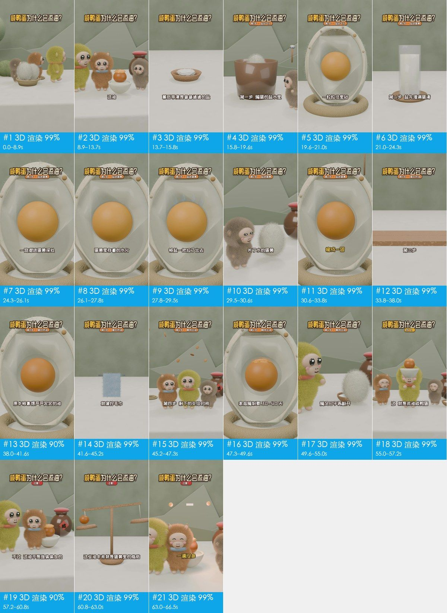

## 見どころ

- **冒頭でどう注意を引くか**：0 秒から上部に大きなタイトルを常時表示して「咸鸭蛋为什么会流油？」と問いを投げる。1.5–7 秒で鸭宝が毛玉のアヒル卵を割ると、卵黄から勝手に油の層とピンクの油煙が立ちのぼり、字幕「明明没往里加一滴油」で矛盾を示す。7–8.9 秒で目を見開く花猫のリアクションに切り替え、好奇心を増幅させる。
- 13.7–15.8 秒、塩を目のついた小さな白い玉にしてお椀から飛び出させ、「叮」という音を添える。主役が登場した瞬間からキャラクターになっていて、以降の各ステップもこれが演じるので、視聴者がついていきやすい。
- 15.8–54.6 秒、タイトル下のステップ札が「第1步·盐钻气孔」から「第4步·静待出油」へ順に切り替わる。1 分間の原理解説を 4 つに区切り、残りが何ステップかが常にわかる。
- 41.6–45.3 秒、タオルを絞って水が滴る様子で、タンパク質が縮んで油を押し出すことを例える。分子レベルの変化を誰もがやったことのある動作に置き換えていて、一目でわかる。
- 60.8–63.0 秒、天秤に小さな玉が落ち、梁が水平になってから星がきらめく（叮）。「一滴没多、一滴也没少」を映像にし、結論に目に見える根拠を与えている。

## ひと目でわかる：映像・パッケージ・音声の 3 層

ショート動画は 3 層に分解できる。土台が映像そのもので、その上に字幕・装飾テキスト・ステッカーを重ね、さらに音声をつける。再現するときは 1 層ずつ作る。

| 層 | この動画では何か | 作り方 | 詳細 |
|---|---|---|---|
| **映像**（土台） | 3D レンダリング 29 ショット | AI で 14 回に分けて生成 | 「自分で再現する」 |
| **パッケージ**（映像の上に重ねる） | テキスト、タイトル、字幕、装飾テキスト | 編集ソフトで追加：字幕・装飾テキスト・ステッカーをタイムラインどおりに配置 | 「編集パッケージ層」 |
| **音声** | ナレーション（人の声）（TTS 音声）、BGM（110 BPM、要確認）、効果音 6 箇所 | ナレーション：TTS 音声；BGM：テンポと雰囲気で同系統の曲を探す；効果音：タイミングに合わせて効果音ライブラリから追加 | 「音声」 |

## 内容と構成

- 以下のナラティブラインはショットごとに画像を見て整理したもの。セリフは別途まとめておらず、字幕の原文は「編集パッケージ層」を参照

**ナラティブライン**

再現するときはこの流れを残す。各ステップの順序と役割はそのまま使い、語る中身を自分の事例・データ・素材に置き換えれば、主役を差し替えただけのものにはならない。

| 時間 | ショット | 役割 | 何を語っているか |
|---|---|---|---|
| 0.0–11.5s | #1–#6 | 注意を引く | かわいいキャラクターと日常の場面で始め、まず誰がどこにいるかを示す → 主役が手を動かしてアヒル卵を割り、問いを具体的な動作に落とし込む → 常識に反する結果の画面をいきなり見せる：卵黄から勝手に油が出る → 油を足していないのに油が出る矛盾を強調し、謎を投げかける → 目を見開くキャラクターのリアクションで視聴者の好奇心を増幅する →（全 6 点、ショットごとの内容は「ショット一覧」を参照） |
| 11.5–13.7s | #7 | 転換 | 話題を切り替え、裏にある理由の種明かしに入る |
| 13.7–41.6s | #8–#20 | 情報を補う | 本当の主役を示し、それを擬人化する → ステップ 1：塩漬けの環境を示す → 断面模型で塩が殻に入っていく経路を描く → ステップ 2 前半：塩がまず卵白を満たす → ステップ 2 後半：塩が卵黄膜を通って卵黄に入る →（全 13 点、ショットごとの内容は「ショット一覧」を参照） |
| 41.6–45.2s | #21 | 根拠を示す | タオルを絞る日常の経験で、タンパク質が油を押し出すことを例える |
| 45.2–49.6s | #22、#23 | 情報を補う | ステップ 4：待つ時間を映像に任せる → 具体的な日数で塩漬けにかかる期間を示す |
| 49.6–57.2s | #24–#26 | 結論を示す | 十分な日数漬けてから開け、結果を明かす → 冒頭の油が出る映像をもう一度見せる。今度は理由がわかっている → キャラクターが喜ぶ動作で「成了」という結論を示す |
| 57.2–60.8s | #27 | 転換 | 「不过」（でも）で誤解を打ち消す：何かを加えたわけではない |
| 60.8–66.5s | #28、#29 | 結論を示す | 天秤で油はもともと卵黄の中にあり、総量は変わっていないことを示す → 対句のひとことで締め、結論を言い切る |

## ショット一覧

「映像」「カメラワーク」「オーバーレイ」は画面で確認できるもの。「制作方法」「素材の出所」はツールによる推定で、根拠は付録のショットごとの根拠を参照。

| # | スクリーンショット | 時間 | 長さ | 何を語っているか | 映像 | カメラワーク | オーバーレイ | 制作方法（推定） | 素材の出所（推定） | 再現 |
|---|---|---|---|---|---|---|---|---|---|---|
| 1 | 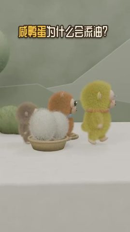 | 0:00.0 | 1.5s | 注意を引く：かわいいキャラクターと日常の場面で始め、まず誰がどこにいるかを示す | ミディアムショット・アイレベル。白い台、セージグリーンの壁とローポリの山の形の背景。黄緑のぬいぐるみ風の小猿（鸭宝）、オレンジブラウンのぬいぐるみ… | 固定（被写体が動く） | テキスト、タイトル | 3D レンダリング 89% | 制作者側のレンダリング | AI 生成 / 3D レンダリング · G1 |
| 2 | 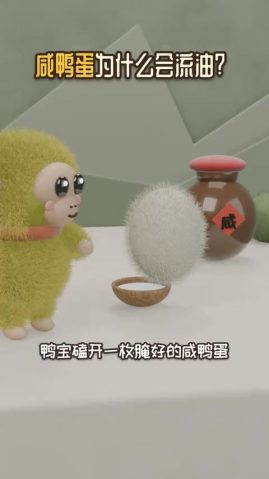 | 0:01.5 | 2.2s | 注意を引く：主役が手を動かしてアヒル卵を割り、問いを具体的な動作に落とし込む | クローズショット・アイレベル。黄緑のぬいぐるみ風の小猿・鸭宝が左側に立ち、目の前で白い長毛の毛玉（アヒル卵）が小さな木の椀の上に浮かび上がって回… | 固定 | 字幕、タイトル | 3D レンダリング 85% | 制作者側のレンダリング | AI 生成 / 3D レンダリング · G1 |
| 3 | 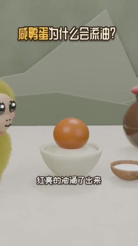 | 0:03.7 | 1.5s | 注意を引く：常識に反する結果の画面をいきなり見せる：卵黄から勝手に油が出る | ミディアムショット・アイレベル。白磁の椀にオレンジの卵黄がひとつ、上部から淡い色の油の層が湧き、上方にピンクがかった白の S 字の油煙の曲線が立ちのぼる… | スムーズなカメラ移動 | テキスト、タイトル | 3D レンダリング 86% | 制作者側のレンダリング | AI 生成 / 3D レンダリング · G1 |
| 4 | 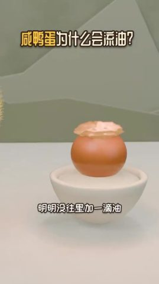 | 0:05.2 | 1.8s | 注意を引く：油を足していないのに油が出る矛盾を強調し、謎を投げかける | ミディアムショット・アイレベル。白磁の椀の中で油の層を出している卵黄が中央、背景はセージグリーンの壁、カメラがゆっくり寄る。 | 固定 | テキスト、タイトル | 3D レンダリング 89% | 制作者側のレンダリング | AI 生成 / 3D レンダリング · G1 |
| 5 | 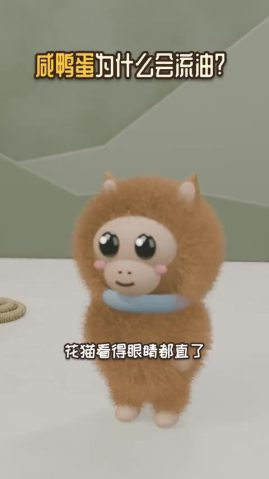 | 0:07.0 | 1.9s | 注意を引く：目を見開くキャラクターのリアクションで視聴者の好奇心を増幅する | クローズショット・アイレベル。オレンジブラウンの長毛のぬいぐるみ風の小猿・花猫が中央で正面を向き、青い首輪、大きな目をまばたきし、体を軽く揺らし、頭… | スムーズなカメラ移動 | テキスト、タイトル | 3D レンダリング 79% | 制作者側のレンダリング | AI 生成 / 3D レンダリング · G2 |
| 6 | 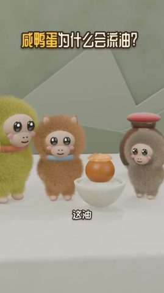 | 0:08.9 | 2.6s | 注意を引く：問いをもう一度投げる：油はいったいどこから来るのか | ミディアムショット・アイレベル。鸭宝、花猫、グレーブラウンのぬいぐるみ風の小猿と油の出る卵黄の椀が一列に並び、右側に陶器の壺、画面右上に漂う… | 固定 | 字幕、タイトル | 3D レンダリング 84% | 制作者側のレンダリング | AI 生成 / 3D レンダリング · G2 |
| 7 | 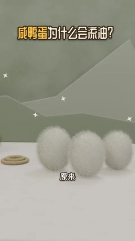 | 0:11.5 | 2.2s | 転換：話題を切り替え、裏にある理由の種明かしに入る | ミディアムショット・アイレベル。白い長毛の毛玉（アヒル卵）3 つが台の上に一列に並び、左に麻縄の輪、背景に白い… がきらめく | スムーズなカメラ移動 | 字幕、タイトル | 3D レンダリング 90% | 制作者側のレンダリング | AI 生成 / 3D レンダリング · G2 |
| 8 | 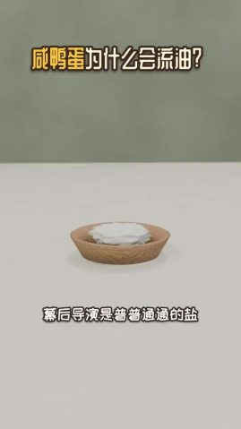 | 0:13.7 | 2.2s | 情報を補う：本当の主役を示し、それを擬人化する | ミディアムショット・やや俯瞰。白い台の上の明るい木の椀に白い塩の山、黒い目のついた小さな白い玉（擬人化した塩の粒）がいくつか順に… | 固定 | テキスト、タイトル | 3D レンダリング 91% | 制作者側のレンダリング | AI 生成 / 3D レンダリング · G3 |
| 9 | 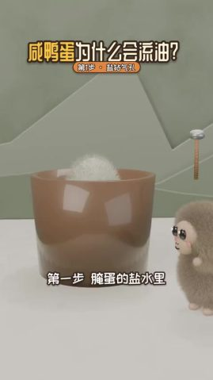 | 0:15.8 | 3.8s | 情報を補う：ステップ 1：塩漬けの環境を示す | ミディアムショット・アイレベル。茶色の半透明の大きなカップ（卵を漬ける塩水の甕を表す）、口から白い毛玉の卵がのぞき、右側にグレーブラウンのぬいぐるみ… | 固定 | 字幕、タイトル | 3D レンダリング 90% | 制作者側のレンダリング | AI 生成 / 3D レンダリング · G4 |
| 10 | 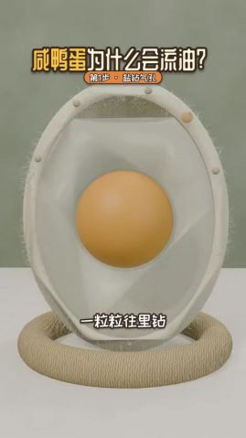 | 0:19.6 | 1.5s | 情報を補う：断面模型で塩が殻に入っていく経路を描く | クローズショット・アイレベル。縦置きの卵の断面模型が麻縄の輪の台座に載り、オフホワイトの殻に細かな産毛、内部に半透明の卵白… | スムーズなカメラ移動 | 字幕、タイトル | 3D レンダリング 86% | 制作者側のレンダリング | AI 生成 / 3D レンダリング · G5 |
| 11 | 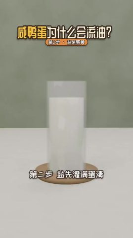 | 0:21.0 | 2.0s | 情報を補う：ステップ 2 前半：塩がまず卵白を満たす | ミディアムショット・アイレベル。白い台の上に白い液体の入ったガラスの円柱カップ（卵白を表す）が木のトレーに置かれ、小さな白い… がいくつか | 固定 | 字幕、タイトル | 3D レンダリング 91% | 制作者側のレンダリング | AI 生成 / 3D レンダリング · G5 |
| 12 | 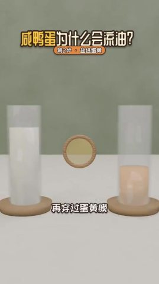 | 0:23.0 | 1.3s | 情報を補う：ステップ 2 後半：塩が卵黄膜を通って卵黄に入る | ミディアムショット・アイレベル。左に白い液体のガラスカップ（卵白）、右にオレンジイエローの液体のガラスカップ（卵黄）、中央に立つ… | 固定 | テキスト、タイトル | 3D レンダリング 91% | 制作者側のレンダリング | AI 生成 / 3D レンダリング · G5 |
| 13 | 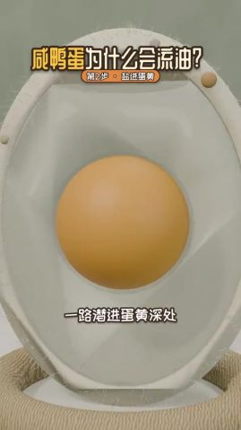 | 0:24.3 | 1.8s | 情報を補う：カメラが卵黄に寄り、塩が中心まで届いたことを伝える | クローズアップ・アイレベル。卵の断面模型の卵黄が中央、カメラがゆっくり寄り、卵黄の上に白い四芒星のきらめきと「蛋黄」… が現れる | スムーズなカメラ移動 | 字幕、テキスト、タイトル | 3D レンダリング 85% | 制作者側のレンダリング | AI 生成 / 3D レンダリング · G5 |
| 14 | 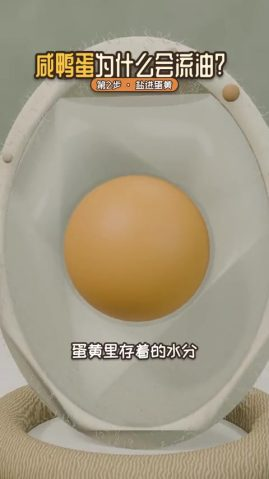 | 0:26.1 | 1.7s | 情報を補う：卵黄にはもともと水が含まれていることを示す | クローズアップ・アイレベル。卵の断面模型の卵黄が中央、画面はほぼ静止し、カメラがごくゆっくり寄る。 | スムーズなカメラ移動 | テキスト、タイトル | 3D レンダリング 84% | 制作者側のレンダリング | AI 生成 / 3D レンダリング · G5 |
| 15 | 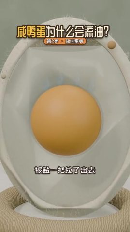 | 0:27.8 | 1.7s | 情報を補う：水分が塩によって卵黄から引き出される様子を見せる | クローズアップ・アイレベル。卵の断面模型、卵黄が中央、右側の殻の縁に水色の水滴が現れて外へ移動、カメラは固定。 | スムーズなカメラ移動 | テキスト、タイトル | 3D レンダリング 84% | 制作者側のレンダリング | AI 生成 / 3D レンダリング · G5 |
| 16 | 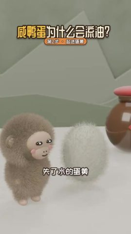 | 0:29.5 | 1.2s | 情報を補う：キャラクターのリアクションで卵黄が縮む話へつなぐ | クローズショット・アイレベル。グレーブラウンのぬいぐるみ風の小猿が左側で見上げ、横で白い毛玉（擬人化した卵黄）が浮かんで大きくなり、背後に陶器の壺… | スムーズなカメラ移動 | 字幕、タイトル | 3D レンダリング 89% | 制作者側のレンダリング | AI 生成 / 3D レンダリング · G6 |
| 17 | 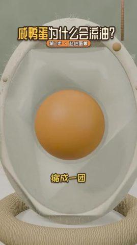 | 0:30.6 | 3.1s | 情報を補う：脱水の結果を示す：卵黄が縮んで硬くなる | クローズアップ・アイレベル。卵の断面模型、中央の卵黄が均一に少しずつ縮み、周りに隙間ができる、カメラは固定。 | スムーズなカメラ移動 | 字幕、タイトル | 3D レンダリング 84% | 制作者側のレンダリング | AI 生成 / 3D レンダリング · G7 |
| 18 | 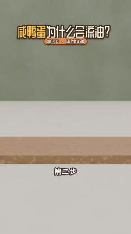 | 0:33.8 | 4.3s | 情報を補う：ステップ 3：タンパク質が縮んで固まる様子をキャラクターの動作にする | ミディアムショット・アイレベル。白い台の上に木の板が横たわり、黒い目のついた白い毛の塊（タンパク質を表す）がいくつか次々と木の… に弾んで落ちる | 固定（被写体が動く） | 字幕、タイトル | 3D レンダリング 91% | 制作者側のレンダリング | AI 生成 / 3D レンダリング · G7 |
| 19 | 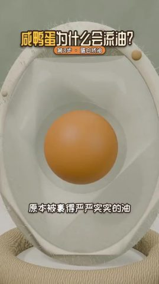 | 0:38.0 | 2.0s | 情報を補う：閉じ込められていた油が押し出され始める様子を見せる | クローズアップ・アイレベル。卵の断面模型、卵黄の上部からオレンジの半透明の油の粒がいくつか湧き出る、カメラは固定。 | スムーズなカメラ移動 | テキスト、タイトル | 3D レンダリング 84% | 制作者側のレンダリング | AI 生成 / 3D レンダリング · G8 |
| 20 | 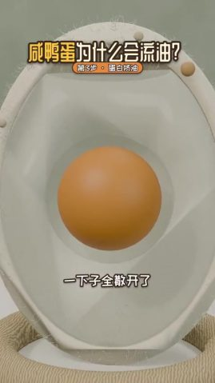 | 0:40.0 | 1.6s | 情報を補う：油が散ったあと卵黄の表面に集まる | クローズアップ・アイレベル。卵の断面模型、卵黄の上の油の粒が散ってから上部に戻り、一層の油になる、カメラは固定。 | スムーズなカメラ移動 | 字幕、タイトル | 3D レンダリング 85% | 制作者側のレンダリング | AI 生成 / 3D レンダリング · G8 |
| 21 | 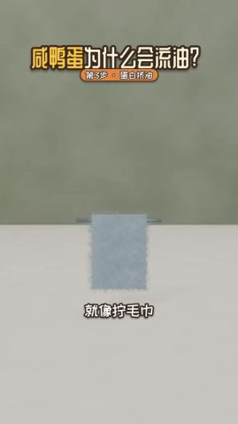 | 0:41.6 | 3.7s | 根拠を示す：タオルを絞る日常の経験で、タンパク質が油を押し出すことを例える | ミディアムショット・アイレベル。水色の起毛の四角いタオルが金属の横棒に掛かり、横棒が左右に伸びてタオルを T 字形に絞る… | 固定 | 字幕、タイトル | 3D レンダリング 92% | 制作者側のレンダリング | AI 生成 / 3D レンダリング · G8 |
| 22 | 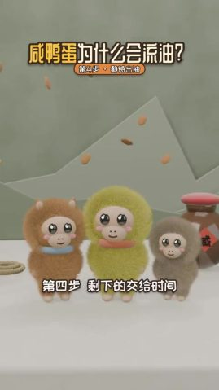 | 0:45.2 | 2.1s | 情報を補う：ステップ 4：待つ時間を映像に任せる | ミディアムショット・アイレベル。花猫、鸭宝、グレーブラウンのぬいぐるみ風の小猿が並んで立って軽く揺れ、右奥に陶器の壺、上から茶色の小片が次々と落ちる（… | 固定 | テキスト、タイトル | 3D レンダリング 85% | 制作者側のレンダリング | AI 生成 / 3D レンダリング · G9 |
| 23 | 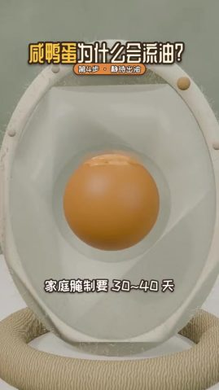 | 0:47.3 | 2.2s | 情報を補う：具体的な日数で塩漬けにかかる期間を示す | クローズアップ・アイレベル。卵の断面模型、卵黄上部の油の層が少しずつ厚くなり、周りに白い四芒星のきらめき、カメラがゆっくり寄る… | スムーズなカメラ移動 | 字幕、タイトル | 3D レンダリング 82% | 制作者側のレンダリング | AI 生成 / 3D レンダリング · G10 |
| 24 | 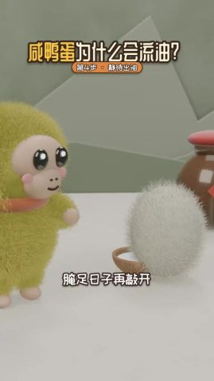 | 0:49.6 | 1.7s | 結論を示す：十分な日数漬けてから開け、結果を明かす | クローズショット・アイレベル。鸭宝が左側に立ち、目の前の白い毛玉（アヒル卵）が白磁の椀の中で油の出る卵黄に変わる、右奥に陶器の壺… | 固定 | テキスト、タイトル | 3D レンダリング 86% | 制作者側のレンダリング | AI 生成 / 3D レンダリング · G11 |
| 25 | 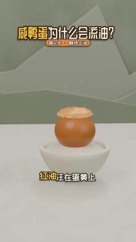 | 0:51.3 | 3.7s | 結論を示す：冒頭の油が出る映像をもう一度見せる。今度は理由がわかっている | ミディアムショット・アイレベル。白磁の椀の中で油の出る卵黄が中央、上方にピンクがかった白の S 字の油煙が立ちのぼり、「红油」の小さなラベルが現れる… | 固定（被写体が動く） | 字幕、テキスト、タイトル | 3D レンダリング 89% | 制作者側のレンダリング | AI 生成 / 3D レンダリング · G11 |
| 26 | 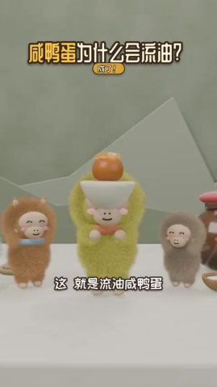 | 0:55.0 | 2.2s | 結論を示す：キャラクターが喜ぶ動作で「成了」という結論を示す | クローズショット・アイレベル。鸭宝が中央で、油の出る卵黄を盛った白い椀を両手で頭上に掲げ、目を細めて笑う、両側に花猫とグレーブラウンのぬいぐるみ風の小猿… | 固定 | 字幕、タイトル、装飾テキスト | 3D レンダリング 84% | 制作者側のレンダリング | AI 生成 / 3D レンダリング · G12 |
| 27 | 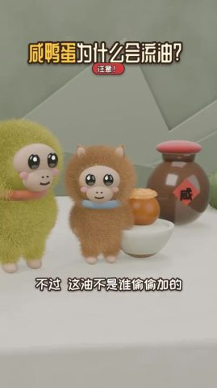 | 0:57.2 | 3.5s | 転換：「不过」（でも）で誤解を打ち消す：何かを加えたわけではない | クローズショット・アイレベル。鸭宝と花猫が油の出る卵黄の椀のそばに立ち、背後に「咸」の字のラベルを貼った陶器の壺、右側にさらに紫の… | 固定 | 字幕、タイトル | 3D レンダリング 82% | 制作者側のレンダリング | AI 生成 / 3D レンダリング · G12 |
| 28 | 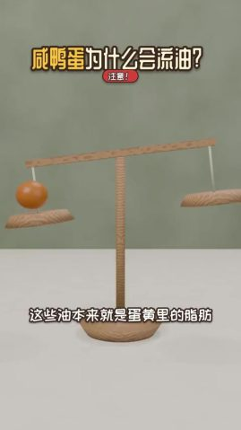 | 1:00.8 | 2.2s | 結論を示す：天秤で油はもともと卵黄の中にあり、総量は変わっていないことを示す | ミディアムショット・アイレベル。木製の天秤の左皿にオレンジの卵黄の玉、梁は左が低く右が高い、上から小さなオレンジの玉が落ちてきて、梁が… | 固定 | テキスト、タイトル | 3D レンダリング 91% | 制作者側のレンダリング | AI 生成 / 3D レンダリング · G13 |
| 29 | 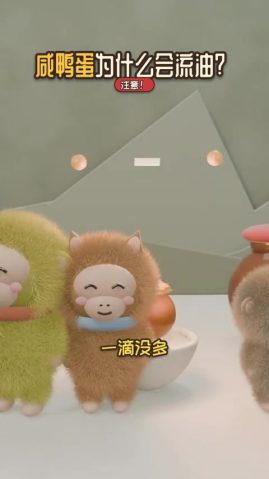 | 1:03.0 | 3.5s | 結論を示す：対句のひとことで締め、結論を言い切る | クローズショットからミディアムショット。鸭宝、花猫、グレーブラウンのぬいぐるみ風の小猿が並んで目を細めて笑い、軽く揺れる、背景にピンクの丸い玉と白い短い棒が浮かぶ… | 固定（被写体が動く） | 字幕、タイトル | 3D レンダリング 85% | 制作者側のレンダリング | AI 生成 / 3D レンダリング · G14 |

## 自分で再現する：この順番で作る

再現するのは作り方とリズムであって、映像をそのまま写すことではない。

1. **内容を決める**：「内容と構成」のナラティブラインに沿って自分の台本を書く
2. **素材を用意する**：下の「用意する素材」を参照
3. **AI 生成**：14 回の生成。下の「AI 生成」を参照
4. **編集**：下の「編集」を参照
5. **パッケージ**：字幕ファイル `packaging/subtitles.srt` はそのまま編集ソフトに読み込める。スタイルとタイムラインは「編集パッケージ層」を参照
6. **音声**：「音声」を参照。効果音はどれも先に試聴できる
7. **見比べてチェック**：完成版と元動画を並べて一度見る。ショットの長さ、字幕の位置、音楽の入りと抜けが合っているか

### 用意する素材

- `@图片1` キャラクター参照画像（各キャラクターごとに正面 + 半身を 1 枚）、ショットをまたいで見た目を揃える：鸭宝、花猫、灰褐色の小猿（名前なし）、塩粒の小球、タンパク質の毛玉

### AI 生成

**3D レンダリング 29 ショット → 14 生成ユニット、Seedance 2.0（Mini / Fast を含む）を 14 回呼び出し**

- グループ化ルール：同じシーンでハードカットでつながる AI ショットは 1 回の生成にまとめる。1 回 ≤15s。ユニット内の連続ハードカットはなるべく ≤8s、最大 10s。ディゾルブ／フェードイン・アウトやシーン切り替えの箇所で分割する
- 音声：モデルは動作の効果音と環境音を同時に生成できる。ナレーションは別途 TTS で作ってからミックスするのがおすすめ（原稿の修正やタイミング合わせがしやすい）
- パッケージ層：生成ユニットのショット上のタイトル、字幕、テキストラベル、装飾テキストはポストプロダクションのパッケージなのでプロンプトには書かない。参照フレームに写っているものは先に消し、生成後に「編集パッケージ層」のタイムラインに沿って重ね直す

AI 動画モデルが受け付ける入力は次のとおり。各生成ユニットの下に、何を渡すか・どこから用意するかを書いてある：
- **テキストプロンプト**：必須。画面、動作、カメラワークを記述する
- **先頭フレーム画像**：最初のフレームの構図と被写体を固定する。渡さなければ純粋なテキストからの生成になり、構図が毎回変わる
- **末尾フレーム画像**：さらに最後のフレームも固定し、モデルは中間の過程だけを補う。カメラワークや動作のある単一ショットに向く
- **参照画像**：商品や人物の見た目。複数のショットで同じ見た目にする（プロンプトでは `@图片1` で指す）
- **参照動画**：動作、カメラワーク、リズムを真似るためのもので、画面はコピーしない（`@视频1`）。すべてのモデルが対応しているわけではない

各ユニットは 1 回で生成する。表はモデルに渡すもの。ユニットを展開すると出所とプロンプトが見られる。

| ユニット | ショット | 時間 | 長さ | 方式 | 渡すもの | つなぎ |
|---|---|---|---|---|---|---|
| G1 | #1–#4 | 0.0–7.0s | 7.0s | 1 回でマルチショット | 先頭フレーム画像 + 参照画像 + 参照動画 | — |
| G2 | #5–#7 | 7.0–13.7s | 6.7s | 1 回でマルチショット | 先頭フレーム画像 + 参照画像 + 参照動画 | 先頭フレームに G1 の末尾フレームを使い、動作をつなぐ |
| G3 | #8 | 13.7–15.8s | 2.2s | 単一ショット | 先頭フレーム画像 + 参照画像 + 参照動画 | — |
| G4 | #9 | 15.8–19.6s | 3.8s | 単一ショット | 先頭フレーム画像 + 参照画像 + 参照動画 | — |
| G5 | #10–#15 | 19.6–29.5s | 9.9s | 1 回でマルチショット | 先頭フレーム画像 + 参照画像 + 参照動画 | — |
| G6 | #16 | 29.5–30.6s | 1.2s | 単一ショット | 先頭フレーム画像 + 参照画像 + 参照動画 | — |
| G7 | #17–#18 | 30.6–38.0s | 7.4s | 1 回でマルチショット | 先頭フレーム画像 + 参照画像 + 参照動画 | — |
| G8 | #19–#21 | 38.0–45.2s | 7.2s | 1 回でマルチショット | 先頭フレーム画像 + 参照画像 + 参照動画 | 先頭フレームに G7 の末尾フレームを使い、動作をつなぐ |
| G9 | #22 | 45.2–47.3s | 2.1s | 単一ショット | 先頭フレーム画像 + 参照画像 + 参照動画 | — |
| G10 | #23 | 47.3–49.6s | 2.2s | 単一ショット | 先頭フレーム画像 + 参照画像 + 参照動画 | — |
| G11 | #24–#25 | 49.6–55.0s | 5.4s | 1 回でマルチショット | 先頭フレーム画像 + 参照画像 + 参照動画 | — |
| G12 | #26–#27 | 55.0–60.8s | 5.8s | 1 回でマルチショット | 先頭フレーム画像 + 参照画像 + 参照動画 | 先頭フレームに G11 の末尾フレームを使い、動作をつなぐ |
| G13 | #28 | 60.8–63.0s | 2.2s | 単一ショット | 先頭フレーム画像 + 参照画像 + 参照動画 | — |
| G14 | #29 | 63.0–66.5s | 3.5s | 単一ショット | 先頭フレーム画像 + 参照画像 + 参照動画 | — |

<details><summary>G1 · ショット #1–#4 · 7.0s · マルチ参照生成</summary>

| 入力 | 必要か | 出所 | 理由 |
|---|---|---|---|
| テキストプロンプト | 必要 | 下のプロンプトを参照 | 画面、動作、カメラワークを記述する。ほかの入力はすべてこれを制約するだけ |
| 先頭フレーム画像 | 推奨 | 元動画 `shots/shot_001_first.jpg`（商品・人物・画風を変える場合は、下の先頭フレーム画像プロンプトに従って画像モデルで描き直す）。このモデルは先頭フレームと参照画像を同時に渡せない：2 枚目の参照画像として渡し、プロンプトに「@图片2 作为首帧」と書く（即梦の全能参照は対応、API はたいてい非対応） | 構図、ショットサイズ、被写体の位置を一度に固定する。テキストだけだと生成のたびに構図が変わる |
| 末尾フレーム画像 | 不要 | — | 1 回で複数ショットを出すので、末尾フレームは最後のショットしか制約できず、使わない |
| 参照画像 | 必要 | `@图片1` キャラクター参照画像（各キャラクターごとに正面 + 半身を 1 枚）、ショットをまたいで見た目を揃える | 先頭フレームが効くのは最初のフレームだけ。その後の画面の商品と人物は参照画像で一貫させる |
| 参照動画 | 推奨 | `@视频1` 元動画 0.0–7.0s のクリップ | 動作、カメラワーク、編集のリズムを真似る。参照のみで、画面はコピーしない |

- 先頭フレーム画像プロンプト：ミディアムショット、アイレベル、縦画面 9:16。白い台、奥のセージグリーンの壁に淡い色のローポリの山の形。左側の浅い竹編みかごに白い長毛の毛玉が 2 つ、ぬいぐるみ風の小猿 3 匹（灰褐色、橙褐色、黄緑）が左から右へ一列に並び、体を右に向けている。柔らかい拡散光、Blender の毛レンダリング、低彩度の爽やかなトーン。
- 別の方法：3D プロジェクト。LLM に Blender スクリプトや Three.js シーンを書かせ、キャラクター／小道具を一度モデリングしてショットごとにカメラ位置を設定してレンダリングする。多アングルとキャラクターの一貫性が最も高く、原稿やショットの変更もコードを直すだけで済む

```text
竖屏 9:16；正面柔光（平光），柔光（几乎没有明暗分界），中性（约 5000K），背景明显虚化（浅景深/人像模式）。人物以 @图片1 为准。参考 @视频1 的动作、运镜和剪辑节奏。镜头之间硬切。
镜头1（0.0–1.5s）：中景平视，三只毛绒小猴排成一列从画面左侧向右缓慢走动，身体轻微左右摇摆，竹篮里的两个白毛球留在左下方不动；镜头固定。
镜头2（1.5–3.7s）：近景平视，黄绿毛绒小猴站在左侧看着面前的白毛球，白毛球从小碗上方缓慢浮起并轻轻转动，小猴抬手；镜头固定。
镜头3（3.7–5.2s）：中景平视，蛋黄顶部慢慢鼓起一层浅黄油脂，几粒小油点弹起，随后上方升起三道粉白色 S 形油烟曲线；镜头固定。
镜头4（5.2–7.0s）：中景平视，镜头向碗中冒油的蛋黄缓慢匀速推近，蛋黄和油层保持不动。
```

英語プロンプト：

```text
Shot 1 (0.0-1.5s): Medium eye-level shot. Three plush monkeys walk in a line from left to right, bodies swaying gently, while two white fluffy balls stay in a woven basket at lower left. Static camera.
Shot 2 (1.5-3.7s): Close shot, eye level. A yellow-green plush monkey on the left watches a white fluffy ball float up from a small bowl and slowly turn; the monkey lifts a hand. Static camera.
Shot 3 (3.7-5.2s): Medium eye-level shot. A layer of pale oil swells on top of an orange yolk in a white bowl, a few droplets pop up, then three pinkish-white S-shaped wisps rise above it. Static camera.
Shot 4 (5.2-7.0s): Medium eye-level shot. The camera slowly pushes in toward the oily yolk in the white bowl; the yolk and oil stay still.
```

</details>

<details><summary>G2 · ショット #5–#7 · 6.7s · マルチ参照生成</summary>

| 入力 | 必要か | 出所 | 理由 |
|---|---|---|---|
| テキストプロンプト | 必要 | 下のプロンプトを参照 | 画面、動作、カメラワークを記述する。ほかの入力はすべてこれを制約するだけ |
| 先頭フレーム画像 | 推奨 | G1 の生成結果の最後のフレーム。このモデルは先頭フレームと参照画像を同時に渡せない：2 枚目の参照画像として渡し、プロンプトに「@图片2 作为首帧」と書く（即梦の全能参照は対応、API はたいてい非対応） | 前のパートとハードカットでつながる同一シーンなので、先頭フレームをつながないと飛んで見える |
| 末尾フレーム画像 | 不要 | — | 1 回で複数ショットを出すので、末尾フレームは最後のショットしか制約できず、使わない |
| 参照画像 | 必要 | `@图片1` キャラクター参照画像（各キャラクターごとに正面 + 半身を 1 枚）、ショットをまたいで見た目を揃える | 先頭フレームが効くのは最初のフレームだけ。その後の画面の商品と人物は参照画像で一貫させる |
| 参照動画 | 推奨 | `@视频1` 元動画 7.0–13.7s のクリップ | 動作、カメラワーク、編集のリズムを真似る。参照のみで、画面はコピーしない |

- 先頭フレーム画像プロンプト：クローズショット、アイレベル、縦画面。橙褐色の長毛のぬいぐるみ風の小猿が中央でカメラに正対、頭頂に小さな尖った耳が 2 つ、ベージュの顔、つやのある黒い大きな目、ピンクの頬、淡いブルーのリング状の首輪。セージグリーンの壁、白い台。ソフトライト、Blender の毛レンダリング。
- 別の方法：3D プロジェクト。LLM に Blender スクリプトや Three.js シーンを書かせ、キャラクター／小道具を一度モデリングしてショットごとにカメラ位置を設定してレンダリングする。多アングルとキャラクターの一貫性が最も高く、原稿やショットの変更もコードを直すだけで済む

```text
竖屏 9:16；正面柔光（平光），柔光（几乎没有明暗分界），中性（约 5000K），背景明显虚化（浅景深/人像模式）。人物以 @图片1 为准。参考 @视频1 的动作、运镜和剪辑节奏。镜头之间硬切。
镜头1（0.0–1.9s）：近景平视，橙棕毛绒小猴正对镜头，眼睛慢慢睁大并眨一下，身体左右轻晃，头顶依次闪出几颗白色四角星；镜头固定。
镜头2（1.9–4.5s）：中景平视，三只毛绒小猴围着冒油的蛋黄轻轻晃动、歪头，画面右上方依次飘出两个橙色问号；镜头固定。
镜头3（4.5–6.7s）：中景平视，镜头向右缓慢横移经过三个白色毛球，背景的白色四角星一闪一闪。
```

英語プロンプト：

```text
Shot 1 (0.0-1.9s): Close eye-level shot. A brown plush monkey faces the camera, its eyes widen and blink, its body sways slightly, and white four-point sparkles pop above its head. Static camera.
Shot 2 (1.9-4.5s): Medium eye-level shot. Three plush monkeys stand around the oily yolk, swaying and tilting their heads, while two orange question marks float up at upper right. Static camera.
Shot 3 (4.5-6.7s): Medium eye-level shot. The camera slowly trucks right past three white fluffy balls on the table while white sparkles twinkle in the background.
```

</details>

<details><summary>G3 · ショット #8 · 2.2s · マルチ参照生成</summary>

| 入力 | 必要か | 出所 | 理由 |
|---|---|---|---|
| テキストプロンプト | 必要 | 下のプロンプトを参照 | 画面、動作、カメラワークを記述する。ほかの入力はすべてこれを制約するだけ |
| 先頭フレーム画像 | 推奨 | 元動画 `shots/shot_008_first.jpg`（商品・人物・画風を変える場合は、下の先頭フレーム画像プロンプトに従って画像モデルで描き直す）。このモデルは先頭フレームと参照画像を同時に渡せない：2 枚目の参照画像として渡し、プロンプトに「@图片2 作为首帧」と書く（即梦の全能参照は対応、API はたいてい非対応） | 構図、ショットサイズ、被写体の位置を一度に固定する。テキストだけだと生成のたびに構図が変わる |
| 末尾フレーム画像 | 不要 | — | このユニットは参照画像で商品と人物を保つ。このモデルは参照モードでは末尾フレームを受け付けない |
| 参照画像 | 必要 | `@图片1` キャラクター参照画像（各キャラクターごとに正面 + 半身を 1 枚）、ショットをまたいで見た目を揃える | 先頭フレームが効くのは最初のフレームだけ。その後の画面の商品と人物は参照画像で一貫させる |
| 参照動画 | 推奨 | `@视频1` 元動画 13.7–15.8s のクリップ | 動作、カメラワーク、編集のリズムを真似る。参照のみで、画面はコピーしない |

- 先頭フレーム画像プロンプト：ミディアムショット、やや俯瞰、縦画面。画面中央下の白い台に淡い木目の丸い器があり、中には白い塩の粉が山盛り。背景はぼけたセージグリーンの壁。柔らかい拡散光、ミニマルな 3D カートゥーンレンダリング。
- 4s で生成して 2.2s に切り詰める（短すぎるショットを単独で生成すると不安定）
- 別の方法：3D プロジェクト。LLM に Blender スクリプトや Three.js シーンを書かせ、キャラクター／小道具を一度モデリングしてショットごとにカメラ位置を設定してレンダリングする。多アングルとキャラクターの一貫性が最も高く、原稿やショットの変更もコードを直すだけで済む

```text
竖屏 9:16；正面柔光（平光），柔光（几乎没有明暗分界），中性（约 5000K），背景明显虚化（浅景深/人像模式）。人物以 @图片1 为准。参考 @视频1 的动作、运镜和剪辑节奏。
中景略俯拍，五六颗带黑色小眼睛的白色小圆球从碗里的盐堆中依次弹出，停在盐面上轻轻晃动；镜头固定。
```

英語プロンプト：

```text
Medium slightly high-angle shot. Five or six small white balls with tiny black eyes pop out of the salt pile in a wooden bowl one by one and wobble on the surface. Static camera.
```

</details>

<details><summary>G4 · ショット #9 · 3.8s · マルチ参照生成</summary>

| 入力 | 必要か | 出所 | 理由 |
|---|---|---|---|
| テキストプロンプト | 必要 | 下のプロンプトを参照 | 画面、動作、カメラワークを記述する。ほかの入力はすべてこれを制約するだけ |
| 先頭フレーム画像 | 推奨 | 元動画 `shots/shot_009_first.jpg`（商品・人物・画風を変える場合は、下の先頭フレーム画像プロンプトに従って画像モデルで描き直す）。このモデルは先頭フレームと参照画像を同時に渡せない：2 枚目の参照画像として渡し、プロンプトに「@图片2 作为首帧」と書く（即梦の全能参照は対応、API はたいてい非対応） | 構図、ショットサイズ、被写体の位置を一度に固定する。テキストだけだと生成のたびに構図が変わる |
| 末尾フレーム画像 | 不要 | — | このユニットは参照画像で商品と人物を保つ。このモデルは参照モードでは末尾フレームを受け付けない |
| 参照画像 | 必要 | `@图片1` キャラクター参照画像（各キャラクターごとに正面 + 半身を 1 枚）、ショットをまたいで見た目を揃える | 先頭フレームが効くのは最初のフレームだけ。その後の画面の商品と人物は参照画像で一貫させる |
| 参照動画 | 推奨 | `@视频1` 元動画 15.8–19.6s のクリップ | 動作、カメラワーク、編集のリズムを真似る。参照のみで、画面はコピーしない |

- 先頭フレーム画像プロンプト：ミディアムショット、アイレベル、縦画面。画面中央に茶色の半透明な円筒形の大きなカップ、口から白い長毛の毛玉の頭がのぞく。右下から灰褐色のぬいぐるみ風の小猿が半身を乗り出して左を見ている。背景はセージグリーンの壁、ローポリの山の形と木の柄の小さなハンマー。ソフトライト、3D カートゥーンレンダリング。
- 別の方法：3D プロジェクト。LLM に Blender スクリプトや Three.js シーンを書かせ、キャラクター／小道具を一度モデリングしてショットごとにカメラ位置を設定してレンダリングする。多アングルとキャラクターの一貫性が最も高く、原稿やショットの変更もコードを直すだけで済む

```text
竖屏 9:16；正面柔光（平光），柔光（几乎没有明暗分界），中性（约 5000K），背景明显虚化（浅景深/人像模式）。人物以 @图片1 为准。参考 @视频1 的动作、运镜和剪辑节奏。
中景平视，白毛球在棕色杯里轻轻下沉，右侧灰棕毛绒小猴眨眼看着；镜头固定。
```

英語プロンプト：

```text
Medium eye-level shot. The white fluffy ball sinks slightly into the brown cup while a grey-brown plush monkey on the right blinks and watches. Static camera.
```

</details>

<details><summary>G5 · ショット #10–#15 · 9.9s · マルチ参照生成</summary>

| 入力 | 必要か | 出所 | 理由 |
|---|---|---|---|
| テキストプロンプト | 必要 | 下のプロンプトを参照 | 画面、動作、カメラワークを記述する。ほかの入力はすべてこれを制約するだけ |
| 先頭フレーム画像 | 推奨 | 元動画 `shots/shot_010_first.jpg`（商品・人物・画風を変える場合は、下の先頭フレーム画像プロンプトに従って画像モデルで描き直す）。このモデルは先頭フレームと参照画像を同時に渡せない：2 枚目の参照画像として渡し、プロンプトに「@图片2 作为首帧」と書く（即梦の全能参照は対応、API はたいてい非対応） | 構図、ショットサイズ、被写体の位置を一度に固定する。テキストだけだと生成のたびに構図が変わる |
| 末尾フレーム画像 | 不要 | — | 1 回で複数ショットを出すので、末尾フレームは最後のショットしか制約できず、使わない |
| 参照画像 | 必要 | `@图片1` キャラクター参照画像（各キャラクターごとに正面 + 半身を 1 枚）、ショットをまたいで見た目を揃える | 先頭フレームが効くのは最初のフレームだけ。その後の画面の商品と人物は参照画像で一貫させる |
| 参照動画 | 推奨 | `@视频1` 元動画 19.6–29.5s のクリップ | 動作、カメラワーク、編集のリズムを真似る。参照のみで、画面はコピーしない |

- 先頭フレーム画像プロンプト：クローズショット、アイレベル、縦画面。画面中央に楕円形の卵の断面模型が立っている。オフホワイトの殻の外縁に細かい産毛、内部は半透明の卵白、真ん中にオレンジ色の球形の卵黄、底は麻縄編みのリングに載っている。セージグリーンの背景。ソフトライト、3D 科学解説レンダリング。
- 別の方法：3D プロジェクト。LLM に Blender スクリプトや Three.js シーンを書かせ、キャラクター／小道具を一度モデリングしてショットごとにカメラ位置を設定してレンダリングする。多アングルとキャラクターの一貫性が最も高く、原稿やショットの変更もコードを直すだけで済む

```text
竖屏 9:16；正面柔光（平光），柔光（几乎没有明暗分界），中性（约 5000K），背景明显虚化（浅景深/人像模式）。人物以 @图片1 为准。参考 @视频1 的动作、运镜和剪辑节奏。镜头之间硬切。
镜头1（0.0–1.5s）：近景平视，几粒小白色盐球从右上方落到蛋壳顶部，依次钻进壳上的小孔进入蛋清；蛋黄不动；镜头固定。
镜头2（1.5–3.5s）：中景平视，几颗小白色盐粒从杯口上方依次落入乳白色液体中；镜头固定。
镜头3（3.5–4.8s）：中景平视，几颗白色小盐粒从左杯上方飞出，穿过中间的木框圆膜，落进右侧橙黄液体里；镜头固定。
镜头4（4.8–6.5s）：特写平视，镜头向中央的橙色蛋黄缓慢推近，蛋黄上方闪出两颗白色四角星；结束时蛋黄占画面一半。
镜头5（6.5–8.2s）：特写平视，蛋黄表面泛起微弱的湿润高光，镜头极缓慢推近。
镜头6（8.2–9.9s）：特写平视，几颗浅蓝色小水滴从蛋黄表面渗出，穿过蛋清向右侧壳边移动并消失；镜头固定。
```

英語プロンプト：

```text
Shot 1 (0.0-1.5s): Close eye-level shot. A few small white salt balls drop onto the top of the egg cross-section model from the upper right and slip one by one through tiny pores into the egg white. Static camera.
Shot 2 (1.5-3.5s): Medium eye-level shot. A few small white salt grains fall one by one into a glass cylinder of milky liquid. Static camera.
Shot 3 (3.5-4.8s): Medium eye-level shot. Small white salt grains fly out above the left glass, pass through the wooden-framed round membrane in the middle and drop into the orange liquid in the right glass. Static camera.
Shot 4 (4.8-6.5s): Close-up, eye level. The camera slowly pushes in on the orange yolk at the center of the egg model; two white sparkles flash above it. Ends with the yolk filling half the frame.
Shot 5 (6.5-8.2s): Close-up, eye level. A faint wet highlight shimmers on the yolk surface while the camera creeps in very slowly.
Shot 6 (8.2-9.9s): Close-up, eye level. A few pale blue droplets seep out of the yolk, drift through the egg white to the right edge of the shell and vanish. Static camera.
```

</details>

<details><summary>G6 · ショット #16 · 1.2s · マルチ参照生成</summary>

| 入力 | 必要か | 出所 | 理由 |
|---|---|---|---|
| テキストプロンプト | 必要 | 下のプロンプトを参照 | 画面、動作、カメラワークを記述する。ほかの入力はすべてこれを制約するだけ |
| 先頭フレーム画像 | 推奨 | 元動画 `shots/shot_016_first.jpg`（商品・人物・画風を変える場合は、下の先頭フレーム画像プロンプトに従って画像モデルで描き直す）。このモデルは先頭フレームと参照画像を同時に渡せない：2 枚目の参照画像として渡し、プロンプトに「@图片2 作为首帧」と書く（即梦の全能参照は対応、API はたいてい非対応） | 構図、ショットサイズ、被写体の位置を一度に固定する。テキストだけだと生成のたびに構図が変わる |
| 末尾フレーム画像 | 不要 | — | このユニットは参照画像で商品と人物を保つ。このモデルは参照モードでは末尾フレームを受け付けない |
| 参照画像 | 必要 | `@图片1` キャラクター参照画像（各キャラクターごとに正面 + 半身を 1 枚）、ショットをまたいで見た目を揃える | 先頭フレームが効くのは最初のフレームだけ。その後の画面の商品と人物は参照画像で一貫させる |
| 参照動画 | 推奨 | `@视频1` 元動画 29.5–30.6s のクリップ | 動作、カメラワーク、編集のリズムを真似る。参照のみで、画面はコピーしない |

- 先頭フレーム画像プロンプト：クローズショット、アイレベル、縦画面。左に灰褐色のぬいぐるみ風の小猿、ベージュの顔、黒い大きな目、ピンクの頬、体を右に向けている。右に白い長毛の楕円形の毛玉が台の上に浮かぶ。右奥に茶色で赤い蓋の陶器の壺。セージグリーンの壁、ローポリの山の形。ソフトライト、Blender の毛レンダリング。
- 4s で生成して 1.2s に切り詰める（短すぎるショットを単独で生成すると不安定）
- 別の方法：3D プロジェクト。LLM に Blender スクリプトや Three.js シーンを書かせ、キャラクター／小道具を一度モデリングしてショットごとにカメラ位置を設定してレンダリングする。多アングルとキャラクターの一貫性が最も高く、原稿やショットの変更もコードを直すだけで済む

```text
竖屏 9:16；正面柔光（平光），柔光（几乎没有明暗分界），中性（约 5000K），背景明显虚化（浅景深/人像模式）。人物以 @图片1 为准。参考 @视频1 的动作、运镜和剪辑节奏。
近景平视，白色毛球从台面浮起并慢慢转动，左侧灰棕小猴抬头眨眼看着它；镜头缓慢推近。
```

英語プロンプト：

```text
Close eye-level shot. A white fluffy ball rises from the table and slowly turns while the grey-brown plush monkey on the left looks up and blinks. The camera slowly pushes in.
```

</details>

<details><summary>G7 · ショット #17、#18 · 7.4s · マルチ参照生成</summary>

| 入力 | 必要か | 出所 | 理由 |
|---|---|---|---|
| テキストプロンプト | 必要 | 下のプロンプトを参照 | 画面、動作、カメラワークを記述する。ほかの入力はすべてこれを制約するだけ |
| 先頭フレーム画像 | 推奨 | 元動画 `shots/shot_017_first.jpg`（商品・人物・画風を変える場合は、下の先頭フレーム画像プロンプトに従って画像モデルで描き直す）。このモデルは先頭フレームと参照画像を同時に渡せない：2 枚目の参照画像として渡し、プロンプトに「@图片2 作为首帧」と書く（即梦の全能参照は対応、API はたいてい非対応） | 構図、ショットサイズ、被写体の位置を一度に固定する。テキストだけだと生成のたびに構図が変わる |
| 末尾フレーム画像 | 不要 | — | 1 回で複数ショットを出すので、末尾フレームは最後のショットしか制約できず、使わない |
| 参照画像 | 必要 | `@图片1` キャラクター参照画像（各キャラクターごとに正面 + 半身を 1 枚）、ショットをまたいで見た目を揃える | 先頭フレームが効くのは最初のフレームだけ。その後の画面の商品と人物は参照画像で一貫させる |
| 参照動画 | 推奨 | `@视频1` 元動画 30.6–38.0s のクリップ | 動作、カメラワーク、編集のリズムを真似る。参照のみで、画面はコピーしない |

- 先頭フレーム画像プロンプト：クローズアップ、アイレベル、縦画面。卵の断面模型、真ん中にオレンジ色の球形の卵黄、周囲に半透明の卵白とオフホワイトの殻。ソフトライト、3D 科学解説レンダリング。
- 別の方法：3D プロジェクト。LLM に Blender スクリプトや Three.js シーンを書かせ、キャラクター／小道具を一度モデリングしてショットごとにカメラ位置を設定してレンダリングする。多アングルとキャラクターの一貫性が最も高く、原稿やショットの変更もコードを直すだけで済む

```text
竖屏 9:16；正面柔光（平光），柔光（几乎没有明暗分界），中性（约 5000K），背景明显虚化（浅景深/人像模式）。人物以 @图片1 为准。参考 @视频1 的动作、运镜和剪辑节奏。镜头之间硬切。
镜头1（0.0–3.1s）：特写平视，中央的橙色蛋黄均匀地缩小约一成，蛋黄和蛋清之间露出一圈浅色空隙，结束时蛋黄静止；镜头固定。
镜头2（3.1–7.4s）：中景平视，几个带黑亮眼睛的白色长毛毛团从上方依次弹落到木板上，互相挤紧排成一排，接着几颗橙色小圆球从它们中间向上弹出；镜头固定。
```

英語プロンプト：

```text
Shot 1 (0.0-3.1s): Close-up, eye level. The orange yolk shrinks evenly by about ten percent, leaving a pale ring of space around it, and comes to rest. Static camera.
Shot 2 (3.1-7.4s): Medium eye-level shot. Several white furry blobs with shiny black eyes bounce down onto a wooden plank one after another and squeeze together in a row, then a few small orange balls pop up from between them. Static camera.
```

</details>

<details><summary>G8 · ショット #19–#21 · 7.2s · マルチ参照生成</summary>

| 入力 | 必要か | 出所 | 理由 |
|---|---|---|---|
| テキストプロンプト | 必要 | 下のプロンプトを参照 | 画面、動作、カメラワークを記述する。ほかの入力はすべてこれを制約するだけ |
| 先頭フレーム画像 | 推奨 | G7 の生成結果の最後のフレーム。このモデルは先頭フレームと参照画像を同時に渡せない：2 枚目の参照画像として渡し、プロンプトに「@图片2 作为首帧」と書く（即梦の全能参照は対応、API はたいてい非対応） | 前のパートとハードカットでつながる同一シーンなので、先頭フレームをつながないと飛んで見える |
| 末尾フレーム画像 | 不要 | — | 1 回で複数ショットを出すので、末尾フレームは最後のショットしか制約できず、使わない |
| 参照画像 | 必要 | `@图片1` キャラクター参照画像（各キャラクターごとに正面 + 半身を 1 枚）、ショットをまたいで見た目を揃える | 先頭フレームが効くのは最初のフレームだけ。その後の画面の商品と人物は参照画像で一貫させる |
| 参照動画 | 推奨 | `@视频1` 元動画 38.0–45.2s のクリップ | 動作、カメラワーク、編集のリズムを真似る。参照のみで、画面はコピーしない |

- 先頭フレーム画像プロンプト：クローズアップ、アイレベル、縦画面。卵の断面模型、真ん中にオレンジ色の球形の卵黄、周囲に半透明の卵白。ソフトライト、3D 科学解説レンダリング。
- 別の方法：3D プロジェクト。LLM に Blender スクリプトや Three.js シーンを書かせ、キャラクター／小道具を一度モデリングしてショットごとにカメラ位置を設定してレンダリングする。多アングルとキャラクターの一貫性が最も高く、原稿やショットの変更もコードを直すだけで済む

```text
竖屏 9:16；正面柔光（平光），柔光（几乎没有明暗分界），中性（约 5000K），背景明显虚化（浅景深/人像模式）。人物以 @图片1 为准。参考 @视频1 的动作、运镜和剪辑节奏。镜头之间硬切。
镜头1（0.0–2.0s）：特写平视，蛋黄顶部依次冒出四五颗橙色半透明小油珠，停在蛋黄上方；镜头固定。
镜头2（2.0–3.5s）：特写平视，蛋黄上方的几颗油珠散开又落回蛋黄顶部，铺成一层起皱的浅黄油层；镜头固定。
镜头3（3.5–7.2s）：中景平视，毛巾被横杆向上提起并从中间拧紧，变成细长的 T 字形，两侧不断滴下透明水滴；镜头固定。
```

英語プロンプト：

```text
Shot 1 (0.0-2.0s): Close-up, eye level. Four or five translucent orange oil beads rise one by one from the top of the yolk and hover above it. Static camera.
Shot 2 (2.0-3.5s): Close-up, eye level. The oil beads above the yolk spread out and fall back onto its top, forming a wrinkled pale oil layer. Static camera.
Shot 3 (3.5-7.2s): Medium eye-level shot. The towel is lifted by the metal rod and wrung tight in the middle into a narrow T shape while clear water drops fall on both sides. Static camera.
```

</details>

<details><summary>G9 · ショット #22 · 2.1s · マルチ参照生成</summary>

| 入力 | 必要か | 出所 | 理由 |
|---|---|---|---|
| テキストプロンプト | 必要 | 下のプロンプトを参照 | 画面、動作、カメラワークを記述する。ほかの入力はすべてこれを制約するだけ |
| 先頭フレーム画像 | 推奨 | 元動画 `shots/shot_022_first.jpg`（商品・人物・画風を変える場合は、下の先頭フレーム画像プロンプトに従って画像モデルで描き直す）。このモデルは先頭フレームと参照画像を同時に渡せない：2 枚目の参照画像として渡し、プロンプトに「@图片2 作为首帧」と書く（即梦の全能参照は対応、API はたいてい非対応） | 構図、ショットサイズ、被写体の位置を一度に固定する。テキストだけだと生成のたびに構図が変わる |
| 末尾フレーム画像 | 不要 | — | このユニットは参照画像で商品と人物を保つ。このモデルは参照モードでは末尾フレームを受け付けない |
| 参照画像 | 必要 | `@图片1` キャラクター参照画像（各キャラクターごとに正面 + 半身を 1 枚）、ショットをまたいで見た目を揃える | 先頭フレームが効くのは最初のフレームだけ。その後の画面の商品と人物は参照画像で一貫させる |
| 参照動画 | 推奨 | `@视频1` 元動画 45.2–47.3s のクリップ | 動作、カメラワーク、編集のリズムを真似る。参照のみで、画面はコピーしない |

- 先頭フレーム画像プロンプト：ミディアムショット、アイレベル、縦画面。ぬいぐるみ風の小猿 3 匹が並んでカメラに正対（左が橙褐色、中央が黄緑、右が灰褐色）。右奥に茶色で赤い蓋の陶器の壺、赤い「咸」の字のひし形ラベル付き。左側に麻縄の輪。セージグリーンの壁とローポリの山の形。ソフトライト、Blender の毛レンダリング。
- 4s で生成して 2.1s に切り詰める（短すぎるショットを単独で生成すると不安定）
- 別の方法：3D プロジェクト。LLM に Blender スクリプトや Three.js シーンを書かせ、キャラクター／小道具を一度モデリングしてショットごとにカメラ位置を設定してレンダリングする。多アングルとキャラクターの一貫性が最も高く、原稿やショットの変更もコードを直すだけで済む

```text
竖屏 9:16；正面柔光（平光），柔光（几乎没有明暗分界），中性（约 5000K），背景明显虚化（浅景深/人像模式）。人物以 @图片1 为准。参考 @视频1 的动作、运镜和剪辑节奏。
中景平视，三只毛绒小猴并排轻轻左右摇晃，上方不断飘落棕色小叶片；镜头固定。
```

英語プロンプト：

```text
Medium eye-level shot. Three plush monkeys stand side by side swaying gently while small brown flakes keep drifting down from above. Static camera.
```

</details>

<details><summary>G10 · ショット #23 · 2.2s · マルチ参照生成</summary>

| 入力 | 必要か | 出所 | 理由 |
|---|---|---|---|
| テキストプロンプト | 必要 | 下のプロンプトを参照 | 画面、動作、カメラワークを記述する。ほかの入力はすべてこれを制約するだけ |
| 先頭フレーム画像 | 推奨 | 元動画 `shots/shot_023_first.jpg`（商品・人物・画風を変える場合は、下の先頭フレーム画像プロンプトに従って画像モデルで描き直す）。このモデルは先頭フレームと参照画像を同時に渡せない：2 枚目の参照画像として渡し、プロンプトに「@图片2 作为首帧」と書く（即梦の全能参照は対応、API はたいてい非対応） | 構図、ショットサイズ、被写体の位置を一度に固定する。テキストだけだと生成のたびに構図が変わる |
| 末尾フレーム画像 | 不要 | — | このユニットは参照画像で商品と人物を保つ。このモデルは参照モードでは末尾フレームを受け付けない |
| 参照画像 | 必要 | `@图片1` キャラクター参照画像（各キャラクターごとに正面 + 半身を 1 枚）、ショットをまたいで見た目を揃える | 先頭フレームが効くのは最初のフレームだけ。その後の画面の商品と人物は参照画像で一貫させる |
| 参照動画 | 推奨 | `@视频1` 元動画 47.3–49.6s のクリップ | 動作、カメラワーク、編集のリズムを真似る。参照のみで、画面はコピーしない |

- 先頭フレーム画像プロンプト：クローズアップ、アイレベル、縦画面。卵の断面模型、真ん中にオレンジ色の球形の卵黄、その上に淡い黄色の油脂の層。ソフトライト、3D 科学解説レンダリング。
- 4s で生成して 2.2s に切り詰める（短すぎるショットを単独で生成すると不安定）
- 別の方法：3D プロジェクト。LLM に Blender スクリプトや Three.js シーンを書かせ、キャラクター／小道具を一度モデリングしてショットごとにカメラ位置を設定してレンダリングする。多アングルとキャラクターの一貫性が最も高く、原稿やショットの変更もコードを直すだけで済む

```text
竖屏 9:16；正面柔光（平光），柔光（几乎没有明暗分界），中性（约 5000K），背景明显虚化（浅景深/人像模式）。人物以 @图片1 为准。参考 @视频1 的动作、运镜和剪辑节奏。
特写平视，蛋黄顶部的浅黄油层慢慢变厚溢开，四周依次闪出白色四角星；镜头缓慢推近。
```

英語プロンプト：

```text
Close-up, eye level. The pale oil layer on top of the yolk slowly thickens and spreads while white sparkles flash around it. The camera slowly pushes in.
```

</details>

<details><summary>G11 · ショット #24、#25 · 5.4s · マルチ参照生成</summary>

| 入力 | 必要か | 出所 | 理由 |
|---|---|---|---|
| テキストプロンプト | 必要 | 下のプロンプトを参照 | 画面、動作、カメラワークを記述する。ほかの入力はすべてこれを制約するだけ |
| 先頭フレーム画像 | 推奨 | 元動画 `shots/shot_024_first.jpg`（商品・人物・画風を変える場合は、下の先頭フレーム画像プロンプトに従って画像モデルで描き直す）。このモデルは先頭フレームと参照画像を同時に渡せない：2 枚目の参照画像として渡し、プロンプトに「@图片2 作为首帧」と書く（即梦の全能参照は対応、API はたいてい非対応） | 構図、ショットサイズ、被写体の位置を一度に固定する。テキストだけだと生成のたびに構図が変わる |
| 末尾フレーム画像 | 不要 | — | 1 回で複数ショットを出すので、末尾フレームは最後のショットしか制約できず、使わない |
| 参照画像 | 必要 | `@图片1` キャラクター参照画像（各キャラクターごとに正面 + 半身を 1 枚）、ショットをまたいで見た目を揃える | 先頭フレームが効くのは最初のフレームだけ。その後の画面の商品と人物は参照画像で一貫させる |
| 参照動画 | 推奨 | `@视频1` 元動画 49.6–55.0s のクリップ | 動作、カメラワーク、編集のリズムを真似る。参照のみで、画面はコピーしない |

- 先頭フレーム画像プロンプト：クローズショット、アイレベル、縦画面。左に黄緑の長毛のぬいぐるみ風の小猿が右向きに立ち、目の前で白い長毛の毛玉が小さなココナッツ殻の器の上に浮かぶ。右奥に茶色で赤い蓋の陶器の壺。セージグリーンの壁、白い台。ソフトライト、Blender の毛レンダリング。
- 別の方法：3D プロジェクト。LLM に Blender スクリプトや Three.js シーンを書かせ、キャラクター／小道具を一度モデリングしてショットごとにカメラ位置を設定してレンダリングする。多アングルとキャラクターの一貫性が最も高く、原稿やショットの変更もコードを直すだけで済む

```text
竖屏 9:16；正面柔光（平光），柔光（几乎没有明暗分界），中性（约 5000K），背景明显虚化（浅景深/人像模式）。人物以 @图片1 为准。参考 @视频1 的动作、运镜和剪辑节奏。镜头之间硬切。
镜头1（0.0–1.7s）：近景平视，白毛球轻轻一颤后变成白瓷碗里一颗顶着浅黄油层的橙色蛋黄，左侧小猴抬手看着；镜头固定。
镜头2（1.7–5.4s）：中景平视，蛋黄上方升起三道粉白色 S 形油烟曲线并缓慢飘动，油层轻轻颤动；镜头固定。
```

英語プロンプト：

```text
Shot 1 (0.0-1.7s): Close eye-level shot. The white fluffy ball quivers and turns into an orange yolk topped with pale oil in a white bowl, while the monkey on the left raises a hand and watches. Static camera.
Shot 2 (1.7-5.4s): Medium eye-level shot. Three pinkish-white S-shaped wisps rise above the oily yolk and drift slowly while the oil layer quivers. Static camera.
```

</details>

<details><summary>G12 · ショット #26、#27 · 5.8s · マルチ参照生成</summary>

| 入力 | 必要か | 出所 | 理由 |
|---|---|---|---|
| テキストプロンプト | 必要 | 下のプロンプトを参照 | 画面、動作、カメラワークを記述する。ほかの入力はすべてこれを制約するだけ |
| 先頭フレーム画像 | 推奨 | G11 の生成結果の最後のフレーム。このモデルは先頭フレームと参照画像を同時に渡せない：2 枚目の参照画像として渡し、プロンプトに「@图片2 作为首帧」と書く（即梦の全能参照は対応、API はたいてい非対応） | 前のパートとハードカットでつながる同一シーンなので、先頭フレームをつながないと飛んで見える |
| 末尾フレーム画像 | 不要 | — | 1 回で複数ショットを出すので、末尾フレームは最後のショットしか制約できず、使わない |
| 参照画像 | 必要 | `@图片1` キャラクター参照画像（各キャラクターごとに正面 + 半身を 1 枚）、ショットをまたいで見た目を揃える | 先頭フレームが効くのは最初のフレームだけ。その後の画面の商品と人物は参照画像で一貫させる |
| 参照動画 | 推奨 | `@视频1` 元動画 55.0–60.8s のクリップ | 動作、カメラワーク、編集のリズムを真似る。参照のみで、画面はコピーしない |

- 先頭フレーム画像プロンプト：クローズショット、アイレベル、縦画面。画面中央で黄緑のぬいぐるみ風の小猿が両手で白い器を掲げ、器には油の層をのせたオレンジ色の卵黄。左に橙褐色、右に灰褐色のぬいぐるみ風の小猿が半身でフレームイン。セージグリーンの壁。ソフトライト、Blender の毛レンダリング。
- 別の方法：3D プロジェクト。LLM に Blender スクリプトや Three.js シーンを書かせ、キャラクター／小道具を一度モデリングしてショットごとにカメラ位置を設定してレンダリングする。多アングルとキャラクターの一貫性が最も高く、原稿やショットの変更もコードを直すだけで済む

```text
竖屏 9:16；正面柔光（平光），柔光（几乎没有明暗分界），中性（约 5000K），背景明显虚化（浅景深/人像模式）。人物以 @图片1 为准。参考 @视频1 的动作、运镜和剪辑节奏。镜头之间硬切。
镜头1（0.0–2.2s）：近景平视，中间的小猴把白碗举过头顶、笑眯起眼睛，两侧小猴跟着笑，周围闪出几颗白色四角星；镜头轻微推近。
镜头2（2.2–5.8s）：近景平视，两只毛绒小猴站着眨眼轻晃，橙棕小猴抬手，随后一个红色圆形禁止标志从画面右侧滑入挡住紫色小瓶；镜头固定。
```

英語プロンプト：

```text
Shot 1 (0.0-2.2s): Close eye-level shot. The monkey in the middle lifts the white bowl over its head and smiles with closed eyes, the two monkeys beside it smile too, and white sparkles flash around. The camera pushes in slightly.
Shot 2 (2.2-5.8s): Close eye-level shot. Two plush monkeys stand blinking and swaying, the brown one raises a hand, then a red circular no-sign slides in from the right and covers the purple bottle. Static camera.
```

</details>

<details><summary>G13 · ショット #28 · 2.2s · マルチ参照生成</summary>

| 入力 | 必要か | 出所 | 理由 |
|---|---|---|---|
| テキストプロンプト | 必要 | 下のプロンプトを参照 | 画面、動作、カメラワークを記述する。ほかの入力はすべてこれを制約するだけ |
| 先頭フレーム画像 | 推奨 | 元動画 `shots/shot_028_first.jpg`（商品・人物・画風を変える場合は、下の先頭フレーム画像プロンプトに従って画像モデルで描き直す）。このモデルは先頭フレームと参照画像を同時に渡せない：2 枚目の参照画像として渡し、プロンプトに「@图片2 作为首帧」と書く（即梦の全能参照は対応、API はたいてい非対応） | 構図、ショットサイズ、被写体の位置を一度に固定する。テキストだけだと生成のたびに構図が変わる |
| 末尾フレーム画像 | 不要 | — | このユニットは参照画像で商品と人物を保つ。このモデルは参照モードでは末尾フレームを受け付けない |
| 参照画像 | 必要 | `@图片1` キャラクター参照画像（各キャラクターごとに正面 + 半身を 1 枚）、ショットをまたいで見た目を揃える | 先頭フレームが効くのは最初のフレームだけ。その後の画面の商品と人物は参照画像で一貫させる |
| 参照動画 | 推奨 | `@视频1` 元動画 60.8–63.0s のクリップ | 動作、カメラワーク、編集のリズムを真似る。参照のみで、画面はコピーしない |

- 先頭フレーム画像プロンプト：ミディアムショット、アイレベル、縦画面。画面中央に淡い木目の上皿天秤、支柱に麻縄が巻かれ、左の皿にオレンジ色の球、梁は左が低く右が高い。白い台、セージグリーンの壁。ソフトライト、ミニマルな 3D 科学解説レンダリング。
- 4s で生成して 2.2s に切り詰める（短すぎるショットを単独で生成すると不安定）
- 別の方法：3D プロジェクト。LLM に Blender スクリプトや Three.js シーンを書かせ、キャラクター／小道具を一度モデリングしてショットごとにカメラ位置を設定してレンダリングする。多アングルとキャラクターの一貫性が最も高く、原稿やショットの変更もコードを直すだけで済む

```text
竖屏 9:16；正面柔光（平光），柔光（几乎没有明暗分界），中性（约 5000K），背景明显虚化（浅景深/人像模式）。人物以 @图片1 为准。参考 @视频1 的动作、运镜和剪辑节奏。
中景平视，一颗小橙球从上方落下，天平横梁慢慢摆平，随后上方闪出三颗白色四角星，天平静止；镜头固定。
```

英語プロンプト：

```text
Medium eye-level shot. A small orange ball drops from above, the balance beam slowly levels out, then three white sparkles flash above it and the balance comes to rest. Static camera.
```

</details>

<details><summary>G14 · ショット #29 · 3.5s · マルチ参照生成</summary>

| 入力 | 必要か | 出所 | 理由 |
|---|---|---|---|
| テキストプロンプト | 必要 | 下のプロンプトを参照 | 画面、動作、カメラワークを記述する。ほかの入力はすべてこれを制約するだけ |
| 先頭フレーム画像 | 推奨 | 元動画 `shots/shot_029_first.jpg`（商品・人物・画風を変える場合は、下の先頭フレーム画像プロンプトに従って画像モデルで描き直す）。このモデルは先頭フレームと参照画像を同時に渡せない：2 枚目の参照画像として渡し、プロンプトに「@图片2 作为首帧」と書く（即梦の全能参照は対応、API はたいてい非対応） | 構図、ショットサイズ、被写体の位置を一度に固定する。テキストだけだと生成のたびに構図が変わる |
| 末尾フレーム画像 | 不要 | — | このユニットは参照画像で商品と人物を保つ。このモデルは参照モードでは末尾フレームを受け付けない |
| 参照画像 | 必要 | `@图片1` キャラクター参照画像（各キャラクターごとに正面 + 半身を 1 枚）、ショットをまたいで見た目を揃える | 先頭フレームが効くのは最初のフレームだけ。その後の画面の商品と人物は参照画像で一貫させる |
| 参照動画 | 推奨 | `@视频1` 元動画 63.0–66.5s のクリップ | 動作、カメラワーク、編集のリズムを真似る。参照のみで、画面はコピーしない |

- 先頭フレーム画像プロンプト：クローズショット、アイレベル、縦画面。左から黄緑、橙褐色、灰褐色のぬいぐるみ風の小猿 3 匹が並び、目を細めて笑っている。奥に茶色で赤い蓋の陶器の壺と白い器。背景はセージグリーンの壁、ローポリの山の形、宙に浮かぶピンクの小さな球 2 つと白い短い棒 1 本。ソフトライト、Blender の毛レンダリング。
- 別の方法：3D プロジェクト。LLM に Blender スクリプトや Three.js シーンを書かせ、キャラクター／小道具を一度モデリングしてショットごとにカメラ位置を設定してレンダリングする。多アングルとキャラクターの一貫性が最も高く、原稿やショットの変更もコードを直すだけで済む

```text
竖屏 9:16；正面柔光（平光），柔光（几乎没有明暗分界），中性（约 5000K），背景明显虚化（浅景深/人像模式）。人物以 @图片1 为准。参考 @视频1 的动作、运镜和剪辑节奏。
近景平视，三只毛绒小猴笑着左右轻晃，镜头缓慢向后拉成中景，背景的粉色小圆球轻轻浮动。
```

英語プロンプト：

```text
Close eye-level shot. Three plush monkeys smile and sway side to side as the camera slowly pulls back to a medium shot; the pink balls in the background float gently.
```

</details>

### 編集

- 「ショット一覧」の順序と尺どおりに編集する
- 手法：ナレーション 1 文ごとにカット、平均約 2.3 秒で 1 カット。キャラクターのショットと断面解説のショットを交互に置き、同じ卵の断面模型が何度も画面に戻ってきて解説を進める
- テンポ：毎分 25.2 カット、平均ショット長 2.29s。実写ショットなし。トランジションはハードカット×15、ジャンプカット×13

## キャラクター・シーン・小道具

| 番号 | 呼び名 | 種類 | 外見 | 役割 | 音声 | 登場 |
|---|---|---|---|---|---|---|
| A | 鸭宝 | キャラクター | 黄緑色の長毛のぬいぐるみ風の小猿。ベージュの丸顔、つやのある大きな黒目、ピンクの頬紅、小さな口、首にオレンジレッドのマフラー、丸々とした体に短い脚 | 主役。塩漬け卵を割り、最後に碗を掲げて喜ぶ | セリフなし、ナレーションのみ | #1–#3、#6、#22、#24、#26、#27、#29 |
| B | 花猫 | キャラクター | オレンジブラウンの長毛のぬいぐるみ風の小猿。頭に小さな尖った耳が 2 つ、ベージュの顔、つやのある大きな黒目、ピンクの頬、首に水色のリング状の首輪 | 傍観者。目を見開く・興味津々のリアクション担当 | セリフなし、ナレーションのみ | #1、#5、#6、#22、#26、#27、#29 |
| C | 灰褐色の小猿（名前なし） | キャラクター | 灰褐色でやや毛の短いぬいぐるみ風の小猿。ベージュの顔、大きな黒目、ピンクの頬、首輪なし、体はやや小さめ | 脇役。解説ショットの横から顔を出して見ている | セリフなし | #1、#6、#9、#16、#22、#26、#29 |
| D | 塩粒ボール | キャラクター | 豆粒ほどの白くなめらかな小さな球、黒い小さな目が 2 つ | 擬人化した塩。塩が卵に入り込む様子を演示 | なし | #8 |
| E | タンパク質の毛玉 | キャラクター | 白い長毛の半球状の毛玉、つやのある大きな黒目が一対。弾みながら寄り集まる | 擬人化したタンパク質。縮んで固まり油を押し出す様子を演示 | なし | #18 |

**シーン**

| シーン | 場所 | 時間 | セット / 光 | ショット |
|---|---|---|---|---|
| S1 | キャラクター台：オフホワイトの台の奥にセージグリーンの壁、壁には淡色のローポリの山の形が重なる | 昼、室内風の柔らかい光 | 柔らかな拡散光、低彩度のグリーン + オフホワイト。陶器の壺・小碗・麻縄の輪がよく置かれている | #1–#7、#9、#16、#22、#24–#27、#29 |
| S2 | 解説台：同じオフホワイトの台と無地のセージグリーンの壁、解説用の小道具か卵の断面模型を 1 点だけ置く | 昼 | ミニマル、背景ボケ、小道具は中央 | #8、#10–#15、#17–#21、#23、#28 |

**小道具 / 商品 / ロゴ**

- 白い毛玉の卵（ショット #1、#2、#7、#16、#24）：白い長毛の楕円形の毛玉。アヒルの卵を表す
- 油がにじむ卵黄の碗（ショット #3、#4、#6、#24–#27）：白磁の碗にオレンジ色の卵黄が 1 つ、上面にしわの寄った淡黄色の油の層。ときどきピンクがかった白の S 字状の湯気が立つ
- 「咸」の字の陶器の壺（ショット #2、#6、#16、#22、#24、#27、#29）：茶色の陶器の壺、赤い丸蓋、胴に赤いひし形の「咸」字ラベル
- 卵の断面模型（ショット #10、#13–#15、#17、#19、#20、#23）：縦に立てた楕円の断面。オフホワイトで起毛した殻、半透明の卵白、中央にオレンジ色の球状の卵黄。麻縄を編んだ円環の台座に載る
- 比喩用の小道具（ショット #8、#9、#11、#12、#21、#28）：塩を盛った木の碗、茶色の塩水のコップ、ガラスコップ 2 つ + 木枠の円形膜、金属バーに掛けた起毛タオル、木製の両皿天秤

## 撮り方とライティング

- ビジュアルスタイル：ぬいぐるみ質感の 3D カートゥーン（Blender のヘアレンダリング）。セージグリーンの壁 + 淡色のローポリの山の形 + オフホワイトの台、柔らかな拡散光、低彩度の爽やかなカラーグレーディング、オレンジ色の卵黄が視覚的な焦点
- フレーミング：ショットサイズはミディアムショット 81%、クローズショット 19%。被写体は画面内のピントの合った領域（顔がないため、ショットサイズは推定値）
- カメラ位置：固定カメラ（三脚／スタンド／卓上置き） 66%、移動カメラ（スタビライザー／手持ちパン） 34%。よく使われるカメラワークはドリーイン
- ライティング：広い面の柔らかな拡散光、正面やや上から。影はごく薄く、毛の縁にわずかなエッジライト。ニュートラル寄りの暖色、全体に明るく低コントラスト（画像を見ての判断。ピクセル測定は下の折りたたみ参照）
- カラーグレーディング：和風の爽やかなトーン（明るい・低彩度・黒浮き）。低彩度、低コントラスト、黒浮き（グレーがかった暗部）、全体にニュートラル

<details class="ref"><summary>項目ごとの測定と目視結果（9 項目）</summary>

| 次元 | 項目 | 結論 | 出所 |
|---|---|---|---|
| フレーミング | ショットサイズ | ミディアムショット | 測定 |
| カメラ位置 | 撮影方式 | 混在：固定カメラ（三脚／スタンド／卓上置き） 66%、移動カメラ（スタビライザー／手持ちパン） 34% | 測定 |
| カメラ位置 | カメラ位置／シーン | 純粋な 3D 仮想カメラ：キャラクター台のミディアムショット／クローズショットに、卵の断面模型のクローズアップと、ガラスコップ・タオル・天秤などの比喩用小道具のミディアムショットを加えたもの。ほぼ固定カメラで、ゆっくりしたドリーイン・横移動・ドリーアウトが少しある | 目視 |
| カメラ位置 | 推定機材 | 実写機材なし。Blender 系の 3D ソフトでモデリング・レンダリング（ヘアパーティクル + 柔らかなグローバルイルミネーション）、字幕とラベルは編集ソフトで追加 | 目視 |
| ライティング | 硬さ | 硬い光（明暗の境界がはっきり） | 測定 |
| ライティング | 色温度 | ニュートラル（約 5000K） | 測定 |
| ライティング | 全体のライティング | 広い面の柔らかな拡散光、正面やや上から。影はごく薄く、毛の縁にわずかなエッジライト。ニュートラル寄りの暖色、全体に明るく低コントラスト | 目視 |
| カラーグレーディング | グレーディングのスタイル | 和風の爽やかなトーン（明るい・低彩度・黒浮き） | 測定 |
| カラーグレーディング | 全体のグレーディング | 低彩度で爽やか：セージグリーンの壁、オフホワイトの台、オレンジ色の卵黄が唯一の高彩度ポイント、黒浮き | 目視 |

</details>

- 補足：ライティング比・硬さ・色温度・ショットサイズは被写体のピクセルから測定（顔があれば顔、なければ画面内のピントの合った領域を使い、後者は推定値）。プラットフォームの再エンコードで暗部がつぶれるため、硬さと補助光の判定は控えめ寄り。カメラアングル、光源の種類、キャッチライト、輪郭光は目視結果を優先。測定と目視が食い違う場合は両方を記載する。

## 編集パッケージ層（字幕 / 装飾テキスト / ステッカー / 効果音の合わせ）

- 字幕 39 文（下部、最大 1 行）：白文字、黒縁取り、キーワードを黄色でハイライト、文字高 3.6%。出現：そのまま表示×20、拡大ポップ×1。キーワードを言うタイミングで色が変わる
- 装飾テキスト 1 か所（大きな文字、黄色）：「流油咸鸭蛋！」
- タイトル 7 か所：「咸鸭蛋为什么会流油？」、「第1步·盐钻气孔」、「第2步·盐进蛋黄 蛋黄膜」、「第3步·蛋白挤油」、「第4步·静待出油」、「成了！」など
- テキストラベル 3 か所（うち 1 つは物体に追従）：「气孔」、「蛋黄」、「红油」
- 効果音の合わせ：タイトルの出現 1 か所、字幕の出現 1 か所
- セリフ基準の配置 6 か所（台本を差し替える場合は元の秒数ではなくこのセリフに合わせる）：テキストラベル「气孔」 → 「盐顺着蛋壳的气孔」の言い終わり 0.4s 後、「气孔」に合わせる、テキストラベル「蛋黄」 → 「蛋黄里存着的水分」の開始 0.5s 前、「蛋黄」に合わせる、テキストラベル「红油」 → 「红油汪在蛋黄上」の開始 0.2s 後、「红油」に合わせるなど
- 常駐レイヤー 6 個（カットをまたいで変わらない。復刻時は全体に 1 回重ねるだけで、ショットごとの生成には入れない）：タイトル「咸鸭蛋为什么会流油？」 0.0–66.1s、タイトル「第1步·盐钻气孔」 15.9–21.0s、タイトル「第2步·盐进蛋黄 蛋黄膜」 21.0–33.6s、タイトル「第3步·蛋白挤油」 34.0–45.1s など
- 書き出し：`packaging/subtitles.srt`、`packaging/overlays.ass`、`packaging/timeline.json`（SRT は字幕のタイムライン。ASS は色・縁取り・位置・出現アニメーション付きで、フォントは原作のフォントに差し替える必要あり。timeline.json は完全なタイムライン）

<details class="ref"><summary>テキストのタイムライン（50 件）</summary>

| 時間 | 種類 | テキスト | スタイル | 出現 / 退場 | 効果音 |
|---|---|---|---|---|---|
| 0.00–66.10s | タイトル | 咸鸭蛋为什么会流油？ | 白文字、茶色の縁取り、キーワードを黄色でハイライト、文字高 5.6%（約 48px） | そのまま消える | — |
| 0.00–1.50s | 字幕 | 清晨的小院里 | 白文字、黒縁取り、文字高 3.9%（約 33px） | そのまま消える | — |
| 1.50–3.10s | 字幕 | 鸭宝磕开一枚腌好的咸鸭蛋 | 白文字、黒縁取り、キーワードを黄色でハイライト、文字高 3.3%（約 28px） | そのまま表示 / そのまま消える | — |
| 3.50–5.30s | 字幕 | 红亮的油涌了出来 | 白文字、黒縁取り、キーワードを黄色でハイライト、文字高 3.5%（約 30px） | そのまま消える | — |
| 5.30–7.00s | 字幕 | 明明没往里加一滴油 | 白文字、黒縁取り、キーワードを黄色でハイライト、文字高 3.4%（約 29px） | そのまま表示 / そのまま消える | — |
| 7.00–8.90s | 字幕 | 花猫看得眼睛都直了 | 白文字、黒縁取り、文字高 3.6%（約 31px） | そのまま表示 / そのまま消える | — |
| 8.90–9.50s | 字幕 | 这油 | 白文字、黒縁取り、文字高 4.7%（約 40px） | そのまま表示 / スライドアウト | — |
| 9.50–11.50s | 字幕 | 到底是打哪儿冒出来的？ | 白文字、黒縁取り、キーワードを黄色でハイライト、文字高 3.3%（約 28px） | そのまま消える | — |
| 11.50–11.60s | 字幕 | 原来 | 白文字、黒縁取り、文字高 4.7%（約 40px） | そのまま表示 | — |
| 12.00–13.10s | 字幕 | 这场流油的大戏 | 白文字、黒縁取り、キーワードを白でハイライト、文字高 3.9%（約 33px） | 縮小して消える | — |
| 13.50–15.80s | 字幕 | 幕后导演是普普通通的盐 | 白文字、黒縁取り、文字高 3.4%（約 29px） | そのまま消える | — |
| 15.80–18.00s | 字幕 | 第一步腌蛋的盐水里 | 白文字、黒縁取り、キーワードを黄色でハイライト、文字高 3.5%（約 30px） | そのまま表示 / そのまま消える | — |
| 15.90–21.00s | タイトル | 第1步·盐钻气孔 | 茶色文字、オレンジの下地枠、キーワードを白でハイライト、文字高 2.7%（約 23px） | そのまま表示 / そのまま消える | — |
| 18.00–19.50s | 字幕 | 盐顺着蛋壳的气孔 | 白文字、黒縁取り、キーワードを黄色でハイライト、文字高 3.5%（約 30px） | そのまま表示 / 縮小して消える | — |
| 19.50–21.00s | 字幕 | 一粒粒往里钻 | 白文字、黒縁取り、キーワードを黄色でハイライト、文字高 3.5%（約 30px） | そのまま消える | — |
| 19.90–20.60s | テキストラベル | 气孔 | 黒文字、白の下地枠、文字高 2.8%（約 24px） | そのまま表示 / フェードアウト | — |
| 21.00–33.60s | タイトル | 第2步·盐进蛋黄 ⏎ 蛋黄膜 | 茶色文字、オレンジの下地枠、キーワードを白でハイライト、文字高 2.5%（約 21px） | 1 文字ずつ / 縮小して消える | — |
| 21.00–23.00s | 字幕 | 第二步盐先灌满蛋清 | 白文字、黒縁取り、キーワードを黄色でハイライト、文字高 3.9%（約 33px） | そのまま表示 / そのまま消える | — |
| 23.00–24.30s | 字幕 | 再穿过蛋黄膜 | 白文字、黒縁取り、文字高 4.1%（約 35px） | そのまま表示 / そのまま消える | — |
| 24.50–25.60s | 字幕 | 一路潜进蛋黄深处 | 白文字、黒縁取り、キーワードを黄色でハイライト、文字高 3.5%（約 30px） | 縮小して消える | — |
| 25.50–25.60s | テキストラベル | 蛋黄 | 黒文字、白の下地枠、文字高 2.8%（約 24px） | そのまま表示 / そのまま消える | — |
| 26.00–27.80s | 字幕 | 蛋黄里存着的水分 | 白文字、黒縁取り、キーワードを黄色でハイライト、文字高 3.4%（約 29px） | そのまま表示 / そのまま消える | — |
| 27.80–29.50s | 字幕 | 被盐一把拉了出去 | 白文字、黒縁取り、キーワードを黄色でハイライト、文字高 3.5%（約 30px） | そのまま表示 / そのまま消える | — |
| 29.50–30.50s | 字幕 | 失了水的蛋黄 | 白文字、黒縁取り、文字高 3.9%（約 33px） | そのまま表示 / フェードアウト | — |
| 30.50–31.50s | 字幕 | 缩成一团 | 白文字、黒縁取り、キーワードをグレーでハイライト、文字高 4.3%（約 37px） | 縮小して消える | — |
| 31.50–33.80s | 字幕 | 越缩越小越缩越硬 | 白文字、黒縁取り、キーワードを黄色でハイライト、文字高 3.5%（約 30px） | そのまま消える | — |
| 33.80–34.50s | 字幕 | 第三步 | 白文字、黒縁取り、文字高 4.6%（約 39px） | そのまま表示 / フェードアウト | — |
| 34.00–45.10s | タイトル | 第3步·蛋白挤油 | 茶色文字、オレンジの下地枠、キーワードを白でハイライト、文字高 2.5%（約 21px） | そのまま表示 / 縮小して消える | ding |
| 34.50–36.50s | 字幕 | 高盐让蛋黄里的蛋白质 | 白文字、黒縁取り、キーワードを黄色でハイライト、文字高 4.2%（約 36px） | そのまま消える | — |
| 36.50–38.00s | 字幕 | 纷纷收紧抱团 | 白文字、黒縁取り、文字高 3.8%（約 32px） | そのまま表示 / そのまま消える | — |
| 38.00–40.00s | 字幕 | 原本被裹得严严实实的油 | 白文字、黒縁取り、文字高 3.3%（約 28px） | そのまま消える | — |
| 40.00–41.10s | 字幕 | 一下子全散开了 | 白文字、黒縁取り、文字高 3.5%（約 30px） | そのまま表示 / 縮小して消える | — |
| 41.50–42.80s | 字幕 | 就像拧毛巾 | 白文字、黒縁取り、文字高 3.9%（約 33px） | そのまま消える | — |
| 43.00–43.10s | 字幕 | 手一收紧 | 白文字、黒縁取り、文字高 4.5%（約 38px） | — | — |
| 43.50–45.30s | 字幕 | 水就被挤了出来 | 白文字、黒縁取り、キーワードを黄色でハイライト、文字高 3.9%（約 33px） | そのまま消える | — |
| 45.30–47.30s | 字幕 | 第四步剩下的交给时间 | 白文字、黒縁取り、キーワードを黄色でハイライト、文字高 3.8%（約 32px） | そのまま表示 / そのまま消える | — |
| 45.50–54.60s | タイトル | 第4步·静待出油 | 白文字、オレンジの下地枠、キーワードを白でハイライト、文字高 2.8%（約 24px） | そのまま表示 / 縮小して消える | — |
| 47.50–49.10s | 字幕 | 家庭腌制要30~40天 | 白文字、黒縁取り、キーワードを黄色でハイライト、文字高 3.3%（約 28px） | ポップイン / 縮小して消える | — |
| 49.50–51.30s | 字幕 | 腌足日子再敲开 | 白文字、黒縁取り、キーワードを黄色でハイライト、文字高 3.5%（約 30px） | そのまま消える | — |
| 51.30–52.80s | 字幕 | 红油汪在蛋黄上 | 白文字、黒縁取り、キーワードを黄色でハイライト、文字高 3.4%（約 29px） | そのまま表示 / そのまま消える | — |
| 51.50–55.00s | テキストラベル・物体追従 | 红油 | オレンジ文字、白縁取り、キーワードを黒でハイライト、文字高 2.8%（約 24px） | フェードイン / そのまま消える | — |
| 52.80–55.00s | 字幕 | 颤颤的亮亮的 | 白文字、黒縁取り、文字高 4.0%（約 34px） | そのまま表示 / そのまま消える | — |
| 55.00–56.60s | 字幕 | 这就是流油咸鸭蛋 | 白文字、黒縁取り、文字高 3.5%（約 30px） | そのまま表示 / そのまま消える | — |
| 55.50–56.60s | 装飾テキスト | 流油咸鸭蛋！ | 黄色文字、茶色の縁取り、文字高 8.7%（約 74px） | そのまま表示 / スライドアウト | — |
| 56.00–56.60s | タイトル | 成了！ | 白文字、黄色の下地枠、文字高 2.7%（約 23px） | そのまま表示 / そのまま消える | — |
| 57.00–59.40s | 字幕 | 不过这油不是谁偷偷加的 | 白文字、黒縁取り、キーワードを黄色でハイライト、文字高 4.0%（約 34px） | フェードアウト | — |
| 57.00–66.50s | タイトル | 注意！ | 白文字、赤の下地枠、文字高 2.9%（約 25px） | — | — |
| 59.50–60.80s | 字幕 | 神秘物质 | 白文字、黒縁取り、文字高 4.1%（約 35px） | そのまま消える | — |
| 60.80–63.00s | 字幕 | 这些油本来就是蛋黄里的脂肪 | 白文字、黒縁取り、キーワードを黄色でハイライト、文字高 3.4%（約 29px） | そのまま表示 / そのまま消える | — |
| 63.00–66.50s | 字幕 | 一滴也没少 | 白文字、黒縁取り、文字高 4.3%（約 37px） | — | ding |

</details>

| 時間 | 要素 | 対応するセリフ |
|---|---|---|
| 15.90s | タイトル「第1步·盐钻气孔」 | 「第一步腌蛋的盐水里」の開始 0.1s 後 |
| 19.90s | テキストラベル「气孔」 | 「盐顺着蛋壳的气孔」の言い終わり 0.4s 後、「气孔」に合わせる |
| 25.50s | テキストラベル「蛋黄」 | 「蛋黄里存着的水分」の開始 0.5s 前、「蛋黄」に合わせる |
| 51.50s | テキストラベル「红油」 | 「红油汪在蛋黄上」の開始 0.2s 後、「红油」に合わせる |
| 55.50s | 装飾テキスト「流油咸鸭蛋！」 | 「这就是流油咸鸭蛋」の開始 0.5s 後、「流油咸鸭蛋」に合わせる |
| 56.00s | タイトル「成了！」 | 「这就是流油咸鸭蛋」の開始 1.0s 後 |

復刻：字幕と装飾テキストは `packaging/overlays.ass` でそのまま焼き込む（ffmpeg -vf ass=overlays.ass）か、timeline.json をもとに CapCut / Remotion で組み直す。ステッカーや GIF は同じ素材を探す（スタンプ素材集 / GIF ライブラリ）。スクリーンショットは packaging/ にある。

## 音声

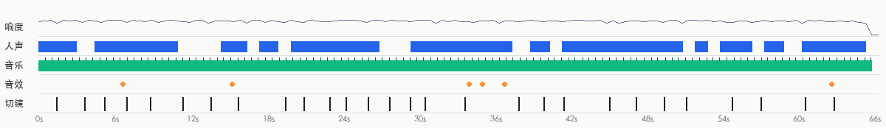

- ラウドネス -17.3 dBFS、ピーク -0.5 dBFS。音声はカット点をまたいで連続しており、ポストで全体に敷いたもの（カット点での背景音の変化 10.2dB、ショット内 9.6dB）
- 出所の判断：動画タイプ：ナレーション/語り + BGM → ナレーション（人の声）は TTS 音声。音楽は既存ライブラリ音楽（傾向、要確認）。効果音は効果音ライブラリ／編集ソフトでポスト追加（傾向、要確認）

**ナレーション（人の声）**

- 尺の 74% を占める。基本周波数は約 324.3Hz（女声寄り）
- 出所：TTS 音声（TTS 音声 64%、人の録音 27%、AI 動画のネイティブ台詞（映像と同時生成） 9%）
  - ナレーションと背景音がカット点をまたいで連続：ナレーション全体をポストで別途当てている（TTS または人による吹き替え）
- 復刻：TTS 音声：CapCut の「テキスト読み上げ」などの音声ツールで、近い声質と話速を選ぶ

**BGM**

- テンポ：110.0 BPM（55.0/219.9 の可能性もあり）。キー D major（信頼度 0.865）。尺の 99%（0.0–66.0s）。セクションの変化点 4.0s, 8.5s, 13.0s, 17.0s, 26.5s, 42.5s, 46.5s, 51.0s。終わり方 ends_with_video
- 編集と拍：カット点の 36% が拍に乗る（ランダムなら約 26%）
- 出所：要確認（既存ライブラリ音楽 52%、AI 生成音楽 30%、既存の有名曲 17%）
  - 音楽は映像の下に敷く BGM：一般的な動画の BGM はおそらく既存ライブラリ由来（事前分布）
  - ナレーション（人の声）は歌ではなく話し声/ナレーション（持続音高の比率 0.16）：「ナレーション + BGM」の一般的な動画形式にあたる
  - 音楽が動画と同時に終わる：尺に合わせて編集されたか、カスタムされたもの（どちらの出所でもありうる、弱い根拠）
  - 動画形式の事前分布や終わり方のような弱い根拠以外に、この音楽自体についての根拠はない（出所は聞き取れず、プラットフォームの音楽情報もない）：出所は要確認。ここでは AI 生成の BGM とライブラリ音楽を区別できない
  - 確認方法：抖音/小紅書の元動画ページで音楽タグを見る：曲名が表示される → 既存曲。「@作者のオリジナル音源」と表示される → 作者自身のアップロード（MV 系は AI 曲が多い）
  - 確認方法：汽水音楽/QQ 音楽の「曲を聴いて検索」や ACRCloud で識別：識別できれば既存曲
- 復刻：原曲は既存ライブラリ音楽の傾向：BPM/ムード/キーでライブラリから同系統の曲を探すか、AI で近いスタイルのロイヤリティフリー曲を生成する

**効果音**（6）

| 音 | 試聴 | 種類 | 回数 | 出現位置 | 対応する映像 |
|---|---|---|---|---|---|
| F1 | [試聴](sfx/sfx_01.wav) | other | 1 | 6.7s | — |
| F2 | [試聴](sfx/sfx_02.wav) | ding | 1 | 15.3s | — |
| F3 | [試聴](sfx/sfx_03.wav) | ding | 1 | 34.1s | タイトル「第3步·蛋白挤油」が出る |
| F4 | [試聴](sfx/sfx_04.wav) | click | 1 | 35.1s | — |
| F5 | [試聴](sfx/sfx_05.wav) | ding | 1 | 36.9s | — |
| F6 | [試聴](sfx/sfx_06.wav) | ding | 1 | 62.9s | 字幕「一滴也没少」が出る |

- 復刻：それぞれの音をまず「試聴」で聞く（単独で分離済みで、ナレーションと BGM は聞こえない）。編集ソフトの効果音ライブラリで同系統の音を探し、「出現位置」の時刻に合わせて各所に置く

- 分離したトラック：`stems/original.wav`（原音）、`stems/vocals.wav`（ナレーションのドライ音）、`stems/music.wav`（BGM + 環境音）、`stems/effects.wav`（効果音トラック）
<!--stems-->

## 不確定な点

- 音声は AI が聞いていない（レビューは映像のみ）：ナレーション（人の声）が人か TTS かは波形から推定したもの。効果音は単独で分離した効果音トラックから拾い、種類は音の特徴から見積もったもの。「音声」でステムと各効果音を試聴して確認できる
- BGM の出所は要確認：既存ライブラリ音楽の可能性が高い（52%）。確認方法は「音声」を参照

## 付録

### ショットごとの根拠

各ショットは 2 つに分かれる：画面で見えるものと、ツールが推定した制作方法（判断根拠つき）。最後に復刻用プロンプト。既定では折りたたみ、クリックで展開。

<details class="ref"><summary>#1 00:00.000–00:01.458 · 3D レンダリング + コード／編集オーバーレイ（テキストラベル、タイトル）</summary>

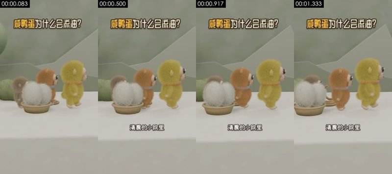

**画面で見えるもの**（スクリーンショットと照合して確認できる）
- 画面：ミディアムショット・アイレベル。白い台、セージグリーンの壁、ローポリの山の形の背景。黄緑のぬいぐるみ風の小猿（鸭宝）、橙茶のぬいぐるみ風の小猿（花猫）、灰茶のぬいぐるみ風の小猿が順に右へ歩き、左の竹かごには白い毛玉が 2 つ（アヒルの卵を表す）。カメラは固定。
- 撮り方／ライティング：ミディアムショット；固定カメラ位置（三脚／スタンド／机置き）；正面ソフトライト（フラット）；キーライト正面（光はカメラ方向から、被写体の左右の明るさはほぼ同じ）；ライティング比 約 1.0:1（差 0.0 段）；ソフトライト（明暗の境目がほとんどない）
- テキストトラック（テキスト/bottom）：清晨的小院里
- テキストトラック（タイトル/top）：咸鸭蛋为什么会流油？
- [AI アシスタント 目視] 3 体のぬいぐるみキャラクターとかごの白い毛玉 2 つの輪郭・位置がフレーム間で安定
- [AI アシスタント 目視] 毛がフレームごとに安定し、ちらつきや塊状の崩れがない
- [AI アシスタント 目視] しっぽ・首輪などのディテールはフレーム間で変わらず、キャラクター全体の平行移動とわずかな揺れのみ

**ツールが推定した制作方法**（推定であり、見えたものではない）
- 推定：3D レンダリング 83%、AI 生成動画 6%、コード／テンプレートレンダリング 4%（fused_agent）
- 素材の出所：制作者側のレンダリング
- 判断根拠（ツールの測定値。肉眼では分からないこともある）：
  - テクスチャがレンダリング的：平坦な色面 54%、95% のピクセルがわずか 56 色、水平・垂直エッジ 37%
  - フレームごとの鮮明度が周期的に上下する（周期 2 フレーム、相関 0.68）が、重複フレームはない：フレーム補間／フレームレート変換の可能性もあれば、再圧縮で残ったリズムにすぎない可能性もある（プラットフォームの透かしを除去したトランスコード済みファイルでも起こる）。この一点だけでは AI と断定できない

- 復刻：3D レンダリング：先頭・末尾フレームから AI 生成で近似可能。正確なマルチアングルが必要なら 3D モデリング + Blender レンダリング
  - 先頭フレーム画像プロンプト：被写体は画面上部中央。ミディアムショット・アイレベル、縦画面 9:16；白い台、奥のセージグリーンの壁に淡色のローポリの山の形；左の浅い竹編みかごに白い長毛の毛玉 2 つ、ぬいぐるみ風の小猿 3 匹（灰茶、橙茶、黄緑）が左から右へ一列に並び横向きで右を向く；柔らかな拡散光、Blender の毛レンダリング、低彩度の爽やかなトーン。
  - 動画プロンプト：被写体は画面上部中央。ミディアムショット・アイレベル、ぬいぐるみ風の小猿 3 匹が一列になって画面左から右へゆっくり歩き、体を少し左右に揺らす。竹かごの白い毛玉 2 つは左下に残って動かない；カメラ固定。

</details>

<details class="ref"><summary>#2 00:01.458–00:03.667 · 3D レンダリング + コード／編集オーバーレイ（字幕、タイトル）</summary>

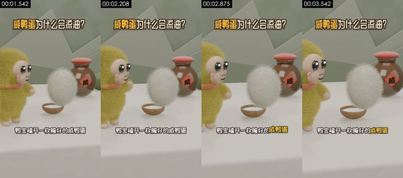

**画面で見えるもの**（スクリーンショットと照合して確認できる）
- 画面：クローズショット・アイレベル；黄緑のぬいぐるみ風の小猿・鸭宝が左に立ち、目の前で白い長毛の毛玉（アヒルの卵）が小さな木の椀の上に浮かんで回転する。右奥には赤い蓋と「咸」の字ラベルのある茶色の陶器の壺。カメラは固定。
- 撮り方／ライティング：クローズショット；固定カメラ位置（三脚／スタンド／机置き）；正面ソフトライト（フラット）；キーライト正面（光はカメラ方向から、被写体の左右の明るさはほぼ同じ）；ライティング比 約 1.2:1（差 0.3 段）；ソフトライト（明暗の境目がほとんどない）
- 画面内の物体上の文字（後付けの字幕ではない）：咸
- テキストトラック（字幕/bottom）：鸭宝磕开一枚腌好的咸鸭蛋 / 红亮的油涌了出来
- テキストトラック（タイトル/top）：咸鸭蛋为什么会流油？
- ショット内モーションの拍：2.33s
- [AI アシスタント 目視] 白い毛玉（アヒルの卵）が浮かぶ間も毛の形が安定
- [AI アシスタント 目視] 壺の「咸」の字の赤いひし形ラベルは鮮明で変形せず、テクスチャであって AI の崩れた文字ではない
- [AI アシスタント 目視] 幾何的な輪郭と材質がフレーム間で一致し、AI 動画によくある変形がない

**ツールが推定した制作方法**（推定であり、見えたものではない）
- 推定：3D レンダリング 79%、AI 生成動画 7%、コード／テンプレートレンダリング 4%（fused_agent）
- 素材の出所：制作者側のレンダリング
- 判断根拠（ツールの測定値。肉眼では分からないこともある）：
  - テクスチャがレンダリング的：平坦な色面 49%、95% のピクセルがわずか 70 色、水平・垂直エッジ 33%
  - サンプルフレームの 100% に正面の顔があり、カメラ位置は固定、音声トラックに人の声あり

- 復刻：3D レンダリング：先頭・末尾フレームから AI 生成で近似可能。正確なマルチアングルが必要なら 3D モデリング + Blender レンダリング
  - 先頭フレーム画像プロンプト：被写体は画面左側。クローズショット・アイレベル、縦画面；左に黄緑の長毛のぬいぐるみ風の小猿、ベージュの顔、黒く光る大きな目、ピンクの頬、朱色のネックウォーマー、右向き；画面中央で白い長毛の毛玉が小さなココナッツ殻の椀の上に浮かぶ；右奥に茶色の陶器の壺、赤い丸蓋、胴に赤いひし形の「咸」の字ラベル；白い台、セージグリーンの壁；ソフトライト、Blender の毛レンダリング。
  - 動画プロンプト：被写体は画面左側。クローズショット・アイレベル、黄緑のぬいぐるみ風の小猿が左に立って目の前の白い毛玉を見つめ、白い毛玉は小さな椀の上からゆっくり浮かび上がって軽く回転し、小猿が手を上げる；カメラ固定。

</details>

<details class="ref"><summary>#3 00:03.667–00:05.208 · 3D レンダリング + コード／編集オーバーレイ（テキストラベル、タイトル）</summary>

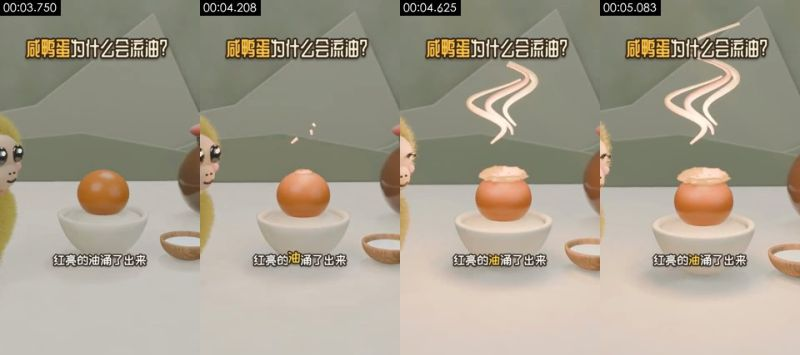

**画面で見えるもの**（スクリーンショットと照合して確認できる）
- 画面：ミディアムショット・アイレベル；白磁の椀にオレンジ色の卵黄が 1 つ、上部から淡い油の層がにじみ出し、その上にピンクがかった白の S 字の油煙カーブが立ち上る。左右にぬいぐるみキャラクターの一部がのぞき、右下に白い塩の小椀。カメラは固定。
- 撮り方／ライティング：ミディアムショット；移動カメラ位置（スタビライザー／手持ちのパン）；逆光／背景が被写体より明るい；キーライト正面（光はカメラ方向から、被写体の左右の明るさはほぼ同じ）；ライティング比 約 1.1:1（差 0.2 段）；ソフトライト（明暗の境目がほとんどない）
- テキストトラック（テキスト/bottom）：红亮的油涌了出来
- テキストトラック（タイトル/top）：咸鸭蛋为什么会流油？
- [AI アシスタント 目視] 卵黄の球体と白磁の椀の縁がきれいで規則的
- [AI アシスタント 目視] ピンクの油煙は規則的な S 字カーブで、太さが均一
- [AI アシスタント 目視] 幾何的な輪郭と材質がフレーム間で一致し、AI 動画によくある変形がない

**ツールが推定した制作方法**（推定であり、見えたものではない）
- 推定：3D レンダリング 80%、AI 生成動画 8%、コード／テンプレートレンダリング 4%（fused_agent）
- 素材の出所：制作者側のレンダリング
- 判断根拠（ツールの測定値。肉眼では分からないこともある）：
  - テクスチャがレンダリング的：平坦な色面 60%、95% のピクセルがわずか 79 色、水平・垂直エッジ 36%

- 復刻：3D レンダリング：先頭・末尾フレームから AI 生成で近似可能。正確なマルチアングルが必要なら 3D モデリング + Blender レンダリング
  - 先頭フレーム画像プロンプト：被写体は画面上部中央。ミディアムショット・アイレベル、縦画面；画面中央の白磁の椀になめらかなオレンジ色の卵黄が 1 つ、右下に白い塩を入れた木の椀、左右の端にぬいぐるみ風の小猿が半身ずつのぞく；セージグリーンの壁、白い台；ソフトライト、3D カートゥーンレンダリング。
  - 動画プロンプト：被写体は画面上部中央。ミディアムショット・アイレベル、卵黄の上部に淡黄色の油脂の層がゆっくり盛り上がり、小さな油滴がいくつか跳ね、続いて上方にピンクがかった白の S 字の油煙カーブが 3 本立ち上る；カメラ固定。

</details>

<details class="ref"><summary>#4 00:05.208–00:07.000 · 3D レンダリング + コード／編集オーバーレイ（テキストラベル、タイトル）</summary>

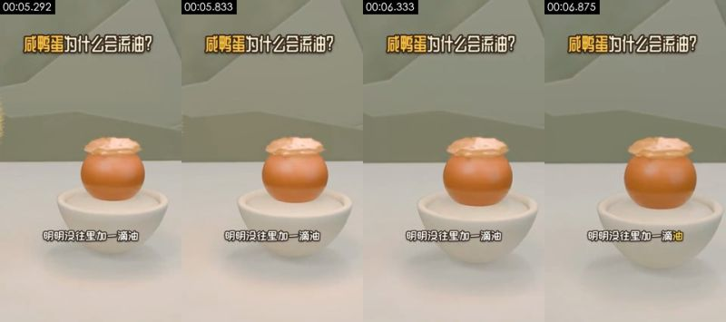

**画面で見えるもの**（スクリーンショットと照合して確認できる）
- 画面：ミディアムショット・アイレベル、白磁の椀で油の層をにじませる卵黄が中央、背景はセージグリーンの壁、カメラはゆっくりドリーイン。
- 撮り方／ライティング：ミディアムショット；固定カメラ位置（三脚／スタンド／机置き）；正面ソフトライト（フラット）；キーライト正面（光はカメラ方向から、被写体の左右の明るさはほぼ同じ）；ライティング比 約 1.2:1（差 0.2 段）；ソフトライト（明暗の境目がほとんどない）
- テキストトラック（テキスト/bottom）：明明没往里加一滴油
- テキストトラック（タイトル/top）：咸鸭蛋为什么会流油？
- [AI アシスタント 目視] 卵黄・油の層・磁器の椀の形がフレームごとに一致
- [AI アシスタント 目視] カメラはゆっくり滑らかなドリーインのみで、物体のドリフトがない
- [AI アシスタント 目視] 幾何的な輪郭と材質がフレーム間で一致し、AI 動画によくある変形がない

**ツールが推定した制作方法**（推定であり、見えたものではない）
- 推定：3D レンダリング 82%、コード／テンプレートレンダリング 5%、AI 生成動画 5%（fused_agent）
- 素材の出所：制作者側のレンダリング
- 判断根拠（ツールの測定値。肉眼では分からないこともある）：
  - テクスチャがレンダリング的：平坦な色面 59%、95% のピクセルがわずか 55 色、水平・垂直エッジ 42%

- 復刻：3D レンダリング：先頭・末尾フレームから AI 生成で近似可能。正確なマルチアングルが必要なら 3D モデリング + Blender レンダリング
  - 先頭フレーム画像プロンプト：被写体は画面上部中央。ミディアムショット・アイレベル、縦画面；画面中央の白磁の椀にオレンジ色の卵黄が 1 つ、上部はしわの寄った淡黄色の油脂の層に覆われる；すっきりした白い台とセージグリーンの壁；ソフトライト、3D カートゥーンレンダリング。
  - 動画プロンプト：被写体は画面上部中央。ミディアムショット・アイレベル、カメラが椀の中の油のにじむ卵黄へゆっくり一定速度でドリーインし、卵黄と油の層は動かない。

</details>

<details class="ref"><summary>#5 00:07.000–00:08.875 · 3D レンダリング + コード／編集オーバーレイ（テキストラベル、タイトル）</summary>

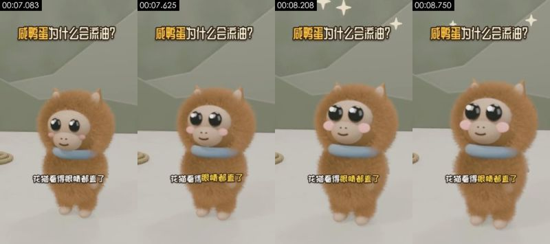

**画面で見えるもの**（スクリーンショットと照合して確認できる）
- 画面：クローズショット・アイレベル；橙茶の長毛のぬいぐるみ風の小猿・花猫が中央でカメラ正面を向き、青い首輪。大きな目がまばたきし、体がわずかに揺れ、頭上に白い四芒星のきらめきが光る。カメラは固定。
- 撮り方／ライティング：クローズショット；移動カメラ位置（スタビライザー／手持ちのパン）；正面ソフトライト（フラット）；キーライト正面（光はカメラ方向から、被写体の左右の明るさはほぼ同じ）；ライティング比 約 1.1:1（差 0.1 段）；ソフトライト（明暗の境目がほとんどない）
- テキストトラック（テキスト/bottom）：花猫看得眼睛都直了
- テキストトラック（タイトル/top）：咸鸭蛋为什么会流油？
- [AI アシスタント 目視] 長い毛が体全体に合わせて揺れ、ちらつきがない
- [AI アシスタント 目視] 目と頬紅の顔上の位置が安定
- [AI アシスタント 目視] 上方の白い四芒星のきらめきは規則的な図形

**ツールが推定した制作方法**（推定であり、見えたものではない）
- 推定：3D レンダリング 74%、AI 生成動画 12%、デジタルヒューマン 3%（fused_agent）
- 素材の出所：制作者側のレンダリング
- 判断根拠（ツールの測定値。肉眼では分からないこともある）：
  - 顔が画面の 7%、サンプルフレームの 100% に顔あり：人物のクローズショットで、平坦な色面は主に壁／服によるもののため、レンダリング特徴の重みを下げた
  - テクスチャが写真／動画的：ノイズ σ=0.04、使用色 61 色、平坦ブロック 54%

- 復刻：3D レンダリング：先頭・末尾フレームから AI 生成で近似可能。正確なマルチアングルが必要なら 3D モデリング + Blender レンダリング
  - 先頭フレーム画像プロンプト：被写体は画面中央。クローズショット・アイレベル、縦画面；橙茶色の長毛のぬいぐるみ風の小猿が中央でカメラ正面を向き、頭に小さな尖った耳が 2 つ、ベージュの顔、黒く光る大きな目、ピンクの頬、水色のリング状の首輪；セージグリーンの壁、白い台；ソフトライト、Blender の毛レンダリング。
  - 動画プロンプト：被写体は画面中央。クローズショット・アイレベル、橙茶のぬいぐるみ風の小猿がカメラ正面を向き、目をゆっくり大きく見開いて一度まばたきし、体を左右に軽く揺らし、頭上に白い四芒星のきらめきがいくつか順に光る；カメラ固定。

</details>

<details class="ref"><summary>#6 00:08.875–00:11.458 · 3D レンダリング + コード／編集オーバーレイ（字幕、タイトル）</summary>

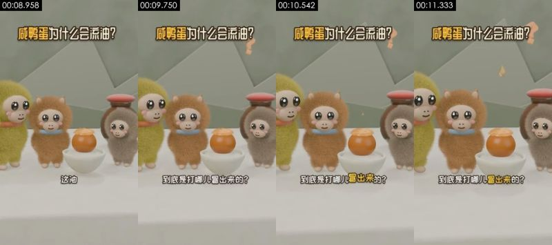

**画面で見えるもの**（スクリーンショットと照合して確認できる）
- 画面：ミディアムショット・アイレベル；鸭宝、花猫、灰茶のぬいぐるみ風の小猿と油のにじむ卵黄の椀が一列に並び、右に陶器の壺。画面右上にオレンジ色の疑問符が浮かび、キャラクターはわずかに揺れる。カメラは固定。
- 撮り方／ライティング：ミディアムショット；固定カメラ位置（三脚／スタンド／机置き）；正面ソフトライト（フラット）；キーライト正面（光はカメラ方向から、被写体の左右の明るさはほぼ同じ）；ライティング比 約 1.2:1（差 0.3 段）；ソフトライト（明暗の境目がほとんどない）
- テキストトラック（字幕/bottom）：这油 / 到底是打哪儿冒出来的？
- テキストトラック（タイトル/top）：咸鸭蛋为什么会流油？
- ショット内モーションの拍：9.62s
- [AI アシスタント 目視] 3 体のキャラクターと壺の位置がフレーム間で安定
- [AI アシスタント 目視] オレンジ色の疑問符には陰影があり、シーン内の 3D オブジェクト
- [AI アシスタント 目視] 毛がフレームごとに安定し、ちらつきや塊状の崩れがない

**ツールが推定した制作方法**（推定であり、見えたものではない）
- 推定：3D レンダリング 78%、AI 生成動画 8%、コード／テンプレートレンダリング 3%（fused_agent）
- 素材の出所：制作者側のレンダリング
- 判断根拠（ツールの測定値。肉眼では分からないこともある）：
  - テクスチャがレンダリング的：平坦な色面 47%、95% のピクセルがわずか 82 色、水平・垂直エッジ 33%
  - サンプルフレームの 83% に正面の顔があり、カメラ位置は固定、音声トラックに人の声あり

- 復刻：3D レンダリング：先頭・末尾フレームから AI 生成で近似可能。正確なマルチアングルが必要なら 3D モデリング + Blender レンダリング
  - 先頭フレーム画像プロンプト：被写体は画面左側。ミディアムショット・アイレベル、縦画面；左から右へ：黄緑のぬいぐるみ風の小猿、橙茶のぬいぐるみ風の小猿、白磁の椀で油のにじむ卵黄、灰茶のぬいぐるみ風の小猿。背後に赤い蓋の茶色の陶器の壺；セージグリーンの壁とローポリの山の形；ソフトライト、3D カートゥーンレンダリング。
  - 動画プロンプト：被写体は画面左側。ミディアムショット・アイレベル、ぬいぐるみ風の小猿 3 匹が油のにじむ卵黄を囲んで軽く揺れ、首をかしげる。画面右上にオレンジ色の疑問符が 2 つ順に浮かび出る；カメラ固定。

</details>

<details class="ref"><summary>#7 00:11.458–00:13.667 · 3D レンダリング + コード／編集オーバーレイ（字幕、タイトル）</summary>

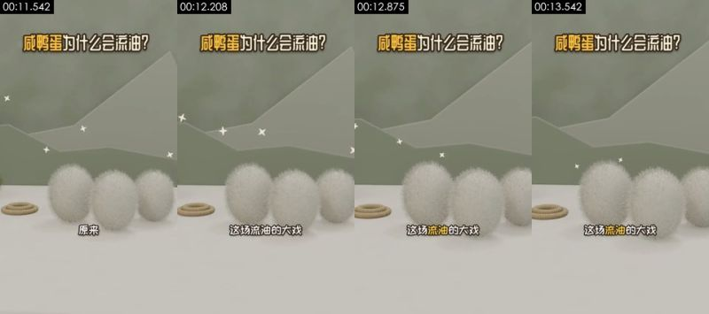

**画面で見えるもの**（スクリーンショットと照合して確認できる）
- 画面：ミディアムショット・アイレベル；白い長毛の毛玉（アヒルの卵）3 つが台の上に一列に並び、左に麻縄の輪、背景に白い四芒星のきらめき。カメラはゆっくり横移動。
- 撮り方／ライティング：ミディアムショット；移動カメラ位置（スタビライザー／手持ちのパン）；正面ソフトライト（フラット）；キーライト正面（光はカメラ方向から、被写体の左右の明るさはほぼ同じ）；ライティング比 約 1.0:1（差 0.0 段）；ソフトライト（明暗の境目がほとんどない）
- テキストトラック（字幕/bottom）：原来 / 这场流油的大戏 / 万后导演是普普通通的盐
- テキストトラック（タイトル/top）：咸鸭蛋为什么会流油？
- [AI アシスタント 目視] 3 つの白い毛玉の縁の毛が安定し、全体の平行移動のみ
- [AI アシスタント 目視] 左の麻縄の輪と背景の山の形は変わらない
- [AI アシスタント 目視] 幾何的な輪郭と材質がフレーム間で一致し、AI 動画によくある変形がない

**ツールが推定した制作方法**（推定であり、見えたものではない）
- 推定：3D レンダリング 83%、AI 生成動画 5%、コード／テンプレートレンダリング 4%（fused_agent）
- 素材の出所：制作者側のレンダリング
- 判断根拠（ツールの測定値。肉眼では分からないこともある）：
  - テクスチャがレンダリング的：平坦な色面 62%、95% のピクセルがわずか 21 色、水平・垂直エッジ 36%

- 復刻：3D レンダリング：先頭・末尾フレームから AI 生成で近似可能。正確なマルチアングルが必要なら 3D モデリング + Blender レンダリング
  - 先頭フレーム画像プロンプト：被写体は画面上部中央。ミディアムショット・アイレベル、縦画面；白い台の上に白い長毛の楕円形の毛玉 3 つが一列に並び、左に麻縄を巻いた輪、背後にセージグリーンの壁とローポリの山の形、空中に白い四芒星のきらめきがいくつか；ソフトライト、Blender の毛レンダリング。
  - 動画プロンプト：被写体は画面上部中央。ミディアムショット・アイレベル、カメラが 3 つの白い毛玉の前を右へゆっくり横移動し、背景の白い四芒星がちかちかと瞬く。

</details>

<details class="ref"><summary>#8 00:13.667–00:15.833 · 3D レンダリング + コード／編集オーバーレイ（テキストラベル、タイトル）</summary>

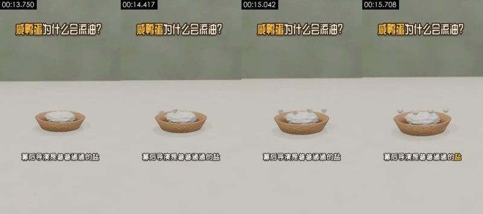

**画面で見えるもの**（スクリーンショットと照合して確認できる）
- 画面：ミディアムショット・やや俯瞰；白い台の上の淡色の木の椀に白い塩の山。黒い目のついた小さな白い玉（擬人化した塩の粒）がいくつか塩の山から順に飛び出す。カメラは固定。
- 撮り方／ライティング：ミディアムショット；固定カメラ位置（三脚／スタンド／机置き）；逆光／背景が被写体より明るい；キーライト正面（光はカメラ方向から、被写体の左右の明るさはほぼ同じ）；ライティング比 約 1.0:1（差 0.0 段）；ソフトライト（明暗の境目がほとんどない）
- テキストトラック（テキスト/bottom）：幕后导演是普普通通的盐
- テキストトラック（タイトル/top）：咸鸭蛋为什么会流油？
- [AI アシスタント 目視] 木の椀には木目と影があり、白い塩の山には体積と陰影がある。平面的なコード図形ではない
- [AI アシスタント 目視] 目のついた小さな白い玉が順に飛び出し、軌道は規則的
- [AI アシスタント 目視] 背景はぼかした緑の壁と台で、ピクセル単位で固まった単色ではない

**ツールが推定した制作方法**（推定であり、見えたものではない）
- 推定：3D レンダリング 78%、コード／テンプレートレンダリング 10%、2D アニメーション 3%（fused_agent）
- 素材の出所：制作者側のレンダリング
- 判断根拠（ツールの測定値。肉眼では分からないこともある）：
  - テクスチャがレンダリング的：平坦な色面 76%、95% のピクセルがわずか 25 色、水平・垂直エッジ 40%

- 復刻：3D レンダリング：先頭・末尾フレームから AI 生成で近似可能。正確なマルチアングルが必要なら 3D モデリング + Blender レンダリング
  - 先頭フレーム画像プロンプト：被写体は画面上部中央。ミディアムショット・やや俯瞰、縦画面；画面中下部の白い台に淡色の木目の丸い椀、椀には白い塩がこんもり；背景はぼかしたセージグリーンの壁；柔らかな拡散光、ミニマルな 3D カートゥーンレンダリング。
  - 動画プロンプト：被写体は画面上部中央。ミディアムショット・やや俯瞰、黒い小さな目のついた白い小さな玉 5〜6 個が椀の塩の山から順に飛び出し、塩の表面にとどまって軽く揺れる；カメラ固定。

</details>

<details class="ref"><summary>#9 00:15.833–00:19.583 · 3D レンダリング + コード／編集オーバーレイ（字幕、タイトル）</summary>

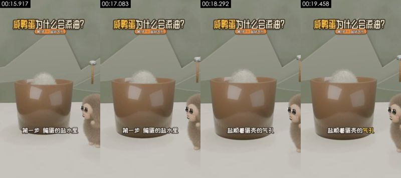

**画面で見えるもの**（スクリーンショットと照合して確認できる）
- 画面：ミディアムショット・アイレベル；茶色の半透明の大きなカップ（卵を漬ける塩水の甕を表す）、口から白い毛玉の卵がのぞき、右から灰茶のぬいぐるみ風の小猿が顔を出してのぞく。背景には木の柄の小槌が掛かる。カメラは固定。
- 撮り方／ライティング：ミディアムショット；固定カメラ位置（三脚／スタンド／机置き）；正面ソフトライト（フラット）；キーライト正面（光はカメラ方向から、被写体の左右の明るさはほぼ同じ）；ライティング比 約 1.0:1（差 0.1 段）；ソフトライト（明暗の境目がほとんどない）
- テキストトラック（字幕/bottom）：第一步腌蛋的盐水里 / 盐顺着蛋壳的气孔 / 一粒粒往里钻
- テキストトラック（タイトル/top）：咸鸭蛋为什么会流油？ / 第1步·盐钻气孔
- [AI アシスタント 目視] 茶色のカップの壁にハイライトの反射があり、形が整っている
- [AI アシスタント 目視] 右の灰茶のぬいぐるみ風の小猿の毛が安定
- [AI アシスタント 目視] 幾何的な輪郭と材質がフレーム間で一致し、AI 動画によくある変形がない

**ツールが推定した制作方法**（推定であり、見えたものではない）
- 推定：3D レンダリング 82%、コード／テンプレートレンダリング 6%、AI 生成動画 4%（fused_agent）
- 素材の出所：制作者側のレンダリング
- 判断根拠（ツールの測定値。肉眼では分からないこともある）：
  - テクスチャがレンダリング的：平坦な色面 53%、95% のピクセルがわずか 41 色、水平・垂直エッジ 38%

- 復刻：3D レンダリング：先頭・末尾フレームから AI 生成で近似可能。正確なマルチアングルが必要なら 3D モデリング + Blender レンダリング
  - 先頭フレーム画像プロンプト：被写体は画面上部中央。ミディアムショット・アイレベル、縦画面；画面中央に茶色の半透明の円筒形の大きなカップ、口から白い長毛の毛玉の上部がのぞく；右下から灰茶のぬいぐるみ風の小猿が半身を出して左を見る；背景にセージグリーンの壁、ローポリの山の形、木の柄の小槌；ソフトライト、3D カートゥーンレンダリング。
  - 動画プロンプト：被写体は画面上部中央。ミディアムショット・アイレベル、白い毛玉が茶色のカップの中で軽く沈み、右の灰茶のぬいぐるみ風の小猿がまばたきして見つめる；カメラ固定。

</details>

<details class="ref"><summary>#10 00:19.583–00:21.042 · 3D レンダリング + コード／編集オーバーレイ（字幕、タイトル）</summary>

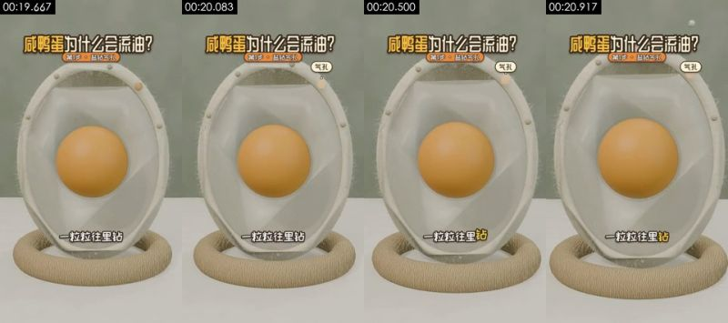

**画面で見えるもの**（スクリーンショットと照合して確認できる）
- 画面：クローズショット・アイレベル；縦に立てた卵の断面模型が麻縄の輪の台座に載る。オフホワイトの殻に細かい産毛、内部の半透明の卵白がオレンジ色の卵黄を包み、小さな塩の玉がいくつか殻の頂部の気孔から入り込む。カメラは固定。
- 撮り方／ライティング：ミディアムショット；移動カメラ位置（スタビライザー／手持ちのパン）；正面ソフトライト（フラット）；キーライト正面（光はカメラ方向から、被写体の左右の明るさはほぼ同じ）；ライティング比 約 1.1:1（差 0.1 段）；ソフトライト（明暗の境目がほとんどない）
- テキストトラック（字幕/bottom）：一粒粒往里钻 / 第二步盐先灌满蛋清
- テキストトラック（タイトル/top）：咸鸭蛋为什么会流油？ / 第1步·盐钻气孔 / 第2步·盐进蛋黄
- テキストトラック（タイトル/top）：气孔
- [AI アシスタント 目視] 卵の断面模型：オフホワイトの殻、半透明の卵白、真球の卵黄がフレーム間で不変
- [AI アシスタント 目視] 殻の縁の産毛と麻縄の台座に材質のテクスチャがある
- [AI アシスタント 目視] 小さな塩粒が規則的な軌道で殻の頂部から入り込む

**ツールが推定した制作方法**（推定であり、見えたものではない）
- 推定：3D レンダリング 80%、AI 生成動画 7%、コード／テンプレートレンダリング 4%（fused_agent）
- 素材の出所：制作者側のレンダリング
- 判断根拠（ツールの測定値。肉眼では分からないこともある）：
  - テクスチャがレンダリング的：平坦な色面 35%、95% のピクセルがわずか 57 色、水平・垂直エッジ 31%

- 復刻：3D レンダリング：先頭・末尾フレームから AI 生成で近似可能。正確なマルチアングルが必要なら 3D モデリング + Blender レンダリング
  - 先頭フレーム画像プロンプト：ミディアムショット、被写体は画面上部中央。クローズショット・アイレベル、縦画面；画面中央に縦に立てた楕円形の卵の断面模型、オフホワイトの殻の外縁に細かい産毛、内部は半透明の卵白、中央にオレンジ色の球形の卵黄、底は麻縄で編んだリングに載る；セージグリーンの背景；ソフトライト、3D 科学解説レンダリング。
  - 動画プロンプト：ミディアムショット、被写体は画面上部中央、カメラはドリーイン。クローズショット・アイレベル、小さな白い塩の玉がいくつか右上から殻の頂部に落ち、殻の小さな穴から順に入り込んで卵白へ進む；卵黄は動かない；カメラ固定。

</details>

<details class="ref"><summary>#11 00:21.042–00:23.042 · 3D レンダリング + コード／編集オーバーレイ（字幕、タイトル）</summary>

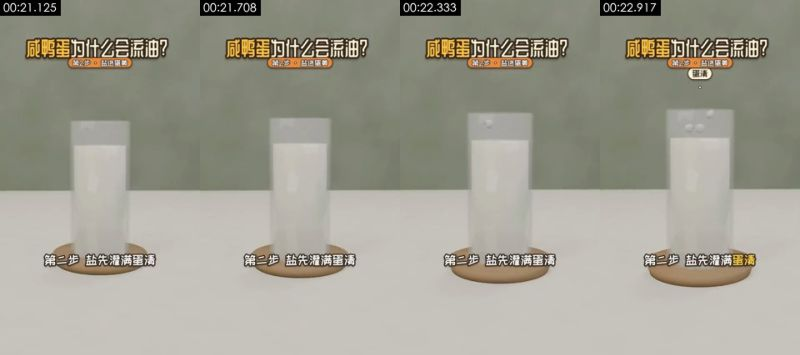

**画面で見えるもの**（スクリーンショットと照合して確認できる）
- 画面：ミディアムショット・アイレベル；白い台の上に白い液体の入ったガラスの円筒カップ（卵白を表す）が木のトレーに載り、小さな白い塩粒がいくつか上からカップに落ちる。カメラは固定。
- 撮り方／ライティング：ミディアムショット；固定カメラ位置（三脚／スタンド／机置き）；逆光／背景が被写体より明るい；キーライト正面（光はカメラ方向から、被写体の左右の明るさはほぼ同じ）；ライティング比 約 1.0:1（差 0.0 段）；ソフトライト（明暗の境目がほとんどない）
- テキストトラック（字幕/bottom）：第二步盐先灌满蛋清 / 再穿过蛋黄膜
- テキストトラック（タイトル/top）：咸鸭蛋为什么会流油？ / 第2步·盐进蛋黄
- [AI アシスタント 目視] ガラスのカップには屈折・厚み・影があり、木のトレーには木目がある
- [AI アシスタント 目視] 白い液体には体積があり、平面の色面ではない
- [AI アシスタント 目視] 小さな塩粒が液面に落ちる軌道は規則的

**ツールが推定した制作方法**（推定であり、見えたものではない）
- 推定：3D レンダリング 78%、コード／テンプレートレンダリング 10%、2D アニメーション 3%（fused_agent）
- 素材の出所：制作者側のレンダリング
- 判断根拠（ツールの測定値。肉眼では分からないこともある）：
  - テクスチャがレンダリング的：平坦な色面 70%、95% のピクセルがわずか 27 色、水平・垂直エッジ 41%
  - フレームごとの鮮明度が周期的に上下する（周期 2 フレーム、相関 0.47）が、重複フレームはない：フレーム補間／フレームレート変換の可能性もあれば、再圧縮で残ったリズムにすぎない可能性もある（プラットフォームの透かしを除去したトランスコード済みファイルでも起こる）。この一点だけでは AI と断定できない

- 復刻：3D レンダリング：先頭・末尾フレームから AI 生成で近似可能。正確なマルチアングルが必要なら 3D モデリング + Blender レンダリング
  - 先頭フレーム画像プロンプト：被写体は画面上部中央。ミディアムショット・アイレベル、縦画面；画面中央の白い台に透明なガラスの円筒カップ、乳白色の液体で満たされ、底に淡色の木の丸トレー；背景はセージグリーンの壁；柔らかな拡散光、ミニマルな 3D 科学解説レンダリング。
  - 動画プロンプト：被写体は画面上部中央。ミディアムショット・アイレベル、小さな白い塩粒がいくつかカップの口の上から順に乳白色の液体へ落ちる；カメラ固定。

</details>

<details class="ref"><summary>#12 00:23.042–00:24.333 · 3D レンダリング + コード／編集オーバーレイ（テキストラベル、タイトル）</summary>

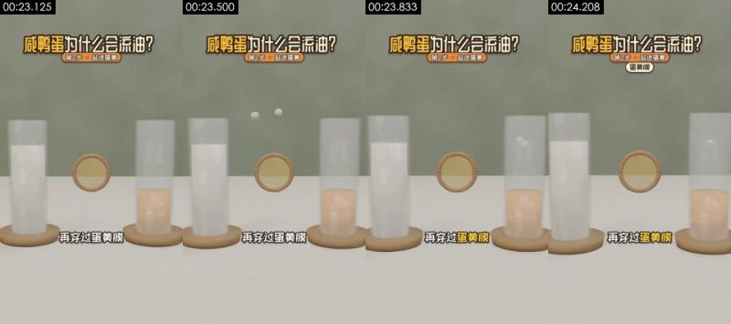

**画面で見えるもの**（スクリーンショットと照合して確認できる）
- 画面：ミディアムショット・アイレベル；左に白い液体のガラスカップ（卵白）、右に橙黄色の液体のガラスカップ（卵黄）、中央に木枠の円形の薄膜（卵黄膜）が立ち、白い塩粒が左から右へ膜を通り抜ける。カメラは固定。
- 撮り方／ライティング：ミディアムショット；固定カメラ位置（三脚／スタンド／机置き）；逆光／背景が被写体より明るい；キーライト正面（光はカメラ方向から、被写体の左右の明るさはほぼ同じ）；ライティング比 約 1.0:1（差 0.0 段）；ソフトライト（明暗の境目がほとんどない）
- テキストトラック（テキスト/bottom）：再穿过蛋黄膜
- テキストトラック（タイトル/top）：咸鸭蛋为什么会流油？ / 第2步·盐进蛋黄
- テキストトラック（タイトル/top）：蛋黄膜
- [AI アシスタント 目視] 2 つのガラスカップと中央の木枠の円膜に材質・透明度・影がある
- [AI アシスタント 目視] 白い小さな玉が円膜を通り抜けて右のカップへ飛び、軌道は規則的
- [AI アシスタント 目視] 幾何的な輪郭と材質がフレーム間で一致し、AI 動画によくある変形がない

**ツールが推定した制作方法**（推定であり、見えたものではない）
- 推定：3D レンダリング 82%、コード／テンプレートレンダリング 7%、AI 生成動画 3%（fused_agent）
- 素材の出所：制作者側のレンダリング
- 判断根拠（ツールの測定値。肉眼では分からないこともある）：
  - テクスチャがレンダリング的：平坦な色面 63%、95% のピクセルがわずか 41 色、水平・垂直エッジ 41%

- 復刻：3D レンダリング：先頭・末尾フレームから AI 生成で近似可能。正確なマルチアングルが必要なら 3D モデリング + Blender レンダリング
  - 先頭フレーム画像プロンプト：被写体は画面上部中央。ミディアムショット・アイレベル、縦画面；白い台の左に乳白色の液体のガラスカップ、右に橙黄色の液体が半分入ったガラスカップ、どちらも淡色の木のトレーに載り、中央に木枠の円形の半透明の薄膜が浮かぶ；セージグリーンの背景；ソフトライト、ミニマルな 3D 科学解説レンダリング。
  - 動画プロンプト：被写体は画面上部中央。ミディアムショット・アイレベル、白い小さな塩粒がいくつか左のカップの上から飛び出し、中央の木枠の円膜を通り抜けて右の橙黄色の液体に落ちる；カメラ固定。

</details>

<details class="ref"><summary>#13 00:24.333–00:26.125 · 3D レンダリング + コード／編集オーバーレイ（字幕、テキストラベル、タイトル）</summary>

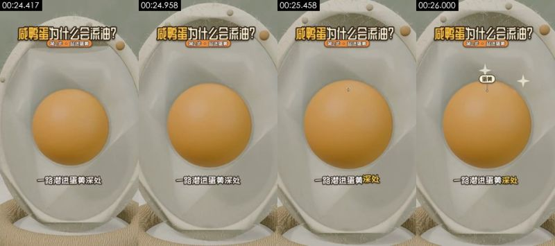

**画面で見えるもの**（スクリーンショットと照合して確認できる）
- 画面：クローズアップ・アイレベル；卵の断面模型の卵黄が中央、カメラはゆっくりドリーインし、卵黄の上に白い四芒星のきらめきと「蛋黄」の小さなラベルが光る。
- 撮り方／ライティング：ミディアムショット；移動カメラ位置（スタビライザー／手持ちのパン）；正面ソフトライト（フラット）；キーライト正面（光はカメラ方向から、被写体の左右の明るさはほぼ同じ）；ライティング比 約 1.0:1（差 0.0 段）；ソフトライト（明暗の境目がほとんどない）
- テキストトラック（字幕/bottom）：一路潜进蛋黄深处 / 蛋黄里存着的水分
- テキストトラック（テキスト/middle）：蛋黄
- テキストトラック（タイトル/top）：咸鸭蛋为什么会流油？ / 第2步·盐进蛋黄
- [AI アシスタント 目視] 第 10 ショットと同じ卵の断面模型で、構造は完全に一致
- [AI アシスタント 目視] ドリーインは滑らかで、卵黄は真球
- [AI アシスタント 目視] 幾何的な輪郭と材質がフレーム間で一致し、AI 動画によくある変形がない

**ツールが推定した制作方法**（推定であり、見えたものではない）
- 推定：3D レンダリング 79%、AI 生成動画 8%、コード／テンプレートレンダリング 3%（fused_agent）
- 素材の出所：制作者側のレンダリング
- 判断根拠（ツールの測定値。肉眼では分からないこともある）：
  - テクスチャがレンダリング的：平坦な色面 28%、95% のピクセルがわずか 62 色、水平・垂直エッジ 31%

- 復刻：3D レンダリング：先頭・末尾フレームから AI 生成で近似可能。正確なマルチアングルが必要なら 3D モデリング + Blender レンダリング
  - 先頭フレーム画像プロンプト：ミディアムショット、被写体は画面上部中央。クローズアップ・アイレベル、縦画面；卵の断面模型が画面いっぱい、オフホワイトの殻、半透明の卵白、中央にオレンジ色の球形の卵黄；ソフトライト、3D 科学解説レンダリング。
  - 動画プロンプト：ミディアムショット、被写体は画面上部中央。クローズアップ・アイレベル、カメラが中央のオレンジ色の卵黄へゆっくりドリーインし、卵黄の上に白い四芒星のきらめきが 2 つ光る；終わりには卵黄が画面の半分を占める。

</details>

<details class="ref"><summary>#14 00:26.125–00:27.792 · 3D レンダリング + コード／編集オーバーレイ（テキストラベル、タイトル）</summary>

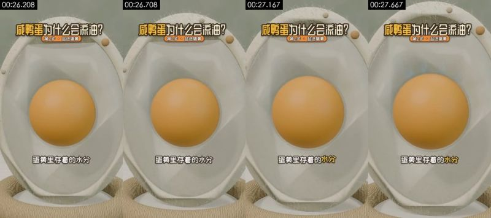

**画面で見えるもの**（スクリーンショットと照合して確認できる）
- 画面：クローズアップ・アイレベル；卵の断面模型の卵黄が中央、画面はほぼ静止し、カメラはごくゆっくりドリーイン。
- 撮り方／ライティング：ミディアムショット；移動カメラ位置（スタビライザー／手持ちのパン）；正面ソフトライト（フラット）；キーライト正面（光はカメラ方向から、被写体の左右の明るさはほぼ同じ）；ライティング比 約 1.0:1（差 0.1 段）；ソフトライト（明暗の境目がほとんどない）
- テキストトラック（テキスト/bottom）：蛋黄里存着的水分
- テキストトラック（タイトル/top）：咸鸭蛋为什么会流油？ / 第2步·盐进蛋黄
- [AI アシスタント 目視] 卵黄と殻の形がフレーム間で一致
- [AI アシスタント 目視] 殻の縁の小さな粒の位置が固定
- [AI アシスタント 目視] 幾何的な輪郭と材質がフレーム間で一致し、AI 動画によくある変形がない

**ツールが推定した制作方法**（推定であり、見えたものではない）
- 推定：3D レンダリング 79%、AI 生成動画 8%、コード／テンプレートレンダリング 3%（fused_agent）
- 素材の出所：制作者側のレンダリング
- 判断根拠（ツールの測定値。肉眼では分からないこともある）：
  - テクスチャがレンダリング的：平坦な色面 27%、95% のピクセルがわずか 61 色、水平・垂直エッジ 31%

- 復刻：3D レンダリング：先頭・末尾フレームから AI 生成で近似可能。正確なマルチアングルが必要なら 3D モデリング + Blender レンダリング
  - 先頭フレーム画像プロンプト：ミディアムショット、被写体は画面上部中央。クローズアップ・アイレベル、縦画面；卵の断面模型、中央にオレンジ色の球形の卵黄、周囲に半透明の卵白とオフホワイトの殻；ソフトライト、3D 科学解説レンダリング。
  - 動画プロンプト：ミディアムショット、被写体は画面上部中央、カメラはドリーイン。クローズアップ・アイレベル、卵黄の表面にかすかな湿ったハイライトが浮かび、カメラはごくゆっくりドリーインする。

</details>

<details class="ref"><summary>#15 00:27.792–00:29.458 · 3D レンダリング + コード／編集オーバーレイ（テキストラベル、タイトル）</summary>

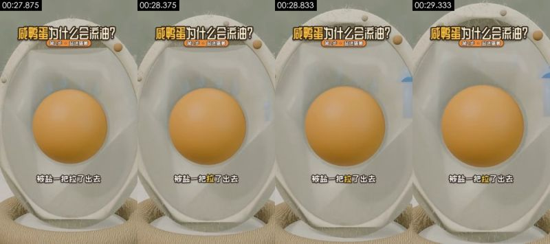

**画面に見えるもの**（スクリーンショットと照合して確認できる）
- 画面：クローズアップ・アイレベル。卵の断面模型、卵黄が中央、右側の殻の縁に水色の水滴が現れ外へ移動する。カメラは固定。
- 撮り方／ライティング：ミディアムショット。移動カメラ（スタビライザー／手持ちでの平行移動）。正面からのソフトライト（フラット）。キーライトは正面（光はカメラ方向から当たり、被写体の両側の明るさはほぼ同じ）。ライティング比 約 1.0:1（差 0.0 段）。ソフトな光（明暗の境界がほとんどない）
- テキストトラック（テキスト/bottom）：被盐一把拉了出去
- テキストトラック（タイトル/top）：咸鸭蛋为什么会流油？ / 第2步·盐进蛋黄
- [AI アシスタント 目視] 同じ断面模型で、卵黄の形は安定している
- [AI アシスタント 目視] 右側の殻の縁に水色の水滴の形が現れ、輪郭は規則的
- [AI アシスタント 目視] 幾何的な輪郭と質感がフレーム間で一貫しており、AI 動画によくある変形はない

**ツールが推定した制作方法**（推定であり、見えたものではない）
- 推定：3D レンダリング 78%、AI 生成動画 9%、コード／テンプレートレンダリング 3%（fused_agent）
- 素材の出所：制作者側のレンダリング
- 判断の根拠（ツールによる測定で、肉眼では分からない場合がある）：
  - テクスチャにレンダリングの特徴：フラットな色面 26%、95% のピクセルがわずか 63 色、水平・垂直の直線エッジ 31%

- 再現：3D レンダリング：先頭／末尾フレームを使った AI 生成で近似できる。正確な多角度が必要なら 3D モデリング + Blender レンダリング
  - 先頭フレーム画像プロンプト：ミディアムショット、被写体は画面上部中央。クローズアップ・アイレベル、縦画面。卵の断面模型、中央にオレンジ色の球形の卵黄、周囲は半透明の卵白。ソフトな光、3D 科学解説レンダリング。
  - 動画プロンプト：ミディアムショット、被写体は画面上部中央、カメラは寄る。クローズアップ・アイレベル、数粒の水色の小さな水滴が卵黄の表面からにじみ出て、卵白を通って右側の殻の縁へ移動し消える。カメラは固定。

</details>

<details class="ref"><summary>#16 00:29.458–00:30.625 · 3D レンダリング + コード／編集オーバーレイ（字幕、タイトル）</summary>

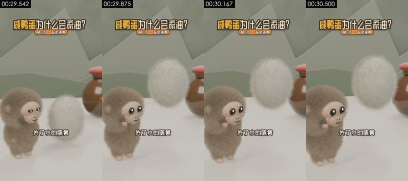

**画面に見えるもの**（スクリーンショットと照合して確認できる）
- 画面：クローズショット・アイレベル。灰褐色のぬいぐるみ風の小猿が左側で見上げ、そばの白い毛玉（卵黄の擬人化）が浮かび上がって大きくなる。背後に陶器の壺。カメラはゆっくり寄る。
- 撮り方／ライティング：クローズショット。移動カメラ（スタビライザー／手持ちでの平行移動）。正面からのソフトライト（フラット）。キーライトは正面（光はカメラ方向から当たり、被写体の両側の明るさはほぼ同じ）。ライティング比 約 1.2:1（差 0.3 段）。硬い光（明暗の境界がはっきり）
- テキストトラック（字幕/bottom）：失了水的蛋黄 / 缩成一团
- テキストトラック（タイトル/top）：咸鸭蛋为什么会流油？ / 第2步·盐进蛋黄
- [AI アシスタント 目視] 灰褐色のぬいぐるみ風の小猿と白い毛玉の毛並みは安定している
- [AI アシスタント 目視] 陶器の壺の赤い蓋と反射は一貫している
- [AI アシスタント 目視] 幾何的な輪郭と質感がフレーム間で一貫しており、AI 動画によくある変形はない

**ツールが推定した制作方法**（推定であり、見えたものではない）
- 推定：3D レンダリング 83%、AI 生成動画 5%、コード／テンプレートレンダリング 4%（fused_agent）
- 素材の出所：制作者側のレンダリング
- 判断の根拠（ツールによる測定で、肉眼では分からない場合がある）：
  - テクスチャにレンダリングの特徴：フラットな色面 50%、95% のピクセルがわずか 43 色、水平・垂直の直線エッジ 36%
  - フレームごとの鮮明度が周期的に上下する（周期 4 フレーム、相関 0.85）が、重複フレームはない。フレーム補間／フレームレート変換の可能性もあれば、再圧縮で残ったリズムにすぎない可能性もある（プラットフォームの識別情報を除去したトランスコード済みファイルも同様になる）。この一点だけでは AI と断定できない

- 再現：3D レンダリング：先頭／末尾フレームを使った AI 生成で近似できる。正確な多角度が必要なら 3D モデリング + Blender レンダリング
  - 先頭フレーム画像プロンプト：被写体は画面下部左側。クローズショット・アイレベル、縦画面。左側に灰褐色のぬいぐるみ風の小猿、ベージュの顔、大きな黒い目、ピンクの頬、体を横に向けて右向き。右側に白い長毛の楕円形の毛玉が台の上に浮かぶ。右奥に茶色で赤い蓋の陶器の壺。セージグリーンの壁、ローポリの山の形。ソフトな光、Blender の毛のレンダリング。
  - 動画プロンプト：被写体は画面下部左側。クローズショット・アイレベル、白い毛玉が台から浮かび上がってゆっくり回転し、左側の灰褐色の小猿が見上げてまばたきしながらそれを見つめる。カメラはゆっくり寄る。

</details>

<details class="ref"><summary>#17 00:30.625–00:33.750 · 3D レンダリング + コード／編集オーバーレイ（字幕、タイトル）</summary>

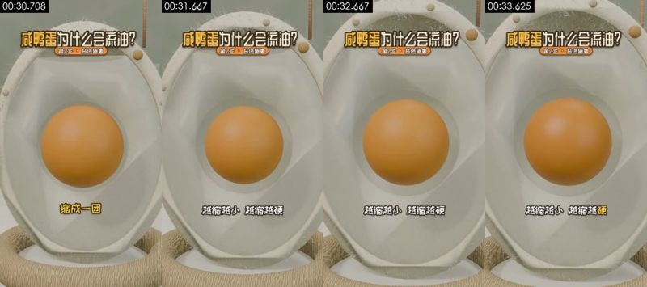

**画面に見えるもの**（スクリーンショットと照合して確認できる）
- 画面：クローズアップ・アイレベル。卵の断面模型、中央の卵黄が徐々に均一に縮み、周りにひと回りの隙間ができる。カメラは固定。
- 撮り方／ライティング：ミディアムショット。移動カメラ（スタビライザー／手持ちでの平行移動）。正面からのソフトライト（フラット）。キーライトは正面（光はカメラ方向から当たり、被写体の両側の明るさはほぼ同じ）。ライティング比 約 1.0:1（差 0.0 段）。ソフトな光（明暗の境界がほとんどない）
- テキストトラック（字幕/bottom）：缩成一团 / 越缩越小越缩越硬
- テキストトラック（タイトル/top）：咸鸭蛋为什么会流油？ / 第2步·盐进蛋黄
- [AI アシスタント 目視] 同じ断面模型で、卵黄の縮小は均一なスケーリング
- [AI アシスタント 目視] 殻と背景はまったく変わらない
- [AI アシスタント 目視] 幾何的な輪郭と質感がフレーム間で一貫しており、AI 動画によくある変形はない

**ツールが推定した制作方法**（推定であり、見えたものではない）
- 推定：3D レンダリング 78%、AI 生成動画 9%、コード／テンプレートレンダリング 3%（fused_agent）
- 素材の出所：制作者側のレンダリング
- 判断の根拠（ツールによる測定で、肉眼では分からない場合がある）：
  - テクスチャにレンダリングの特徴：フラットな色面 25%、95% のピクセルがわずか 59 色、水平・垂直の直線エッジ 28%

- 再現：3D レンダリング：先頭／末尾フレームを使った AI 生成で近似できる。正確な多角度が必要なら 3D モデリング + Blender レンダリング
  - 先頭フレーム画像プロンプト：ミディアムショット、被写体は画面上部中央。クローズアップ・アイレベル、縦画面。卵の断面模型、中央にオレンジ色の球形の卵黄、周囲は半透明の卵白とオフホワイトの殻。ソフトな光、3D 科学解説レンダリング。
  - 動画プロンプト：ミディアムショット、被写体は画面上部中央、カメラは寄る。クローズアップ・アイレベル、中央のオレンジ色の卵黄が均一に約 1 割縮み、卵黄と卵白の間に淡い色の隙間がひと回り現れ、最後に卵黄は静止する。カメラは固定。

</details>

<details class="ref"><summary>#18 00:33.750–00:38.042 · 3D レンダリング + コード／編集オーバーレイ（字幕、タイトル）</summary>

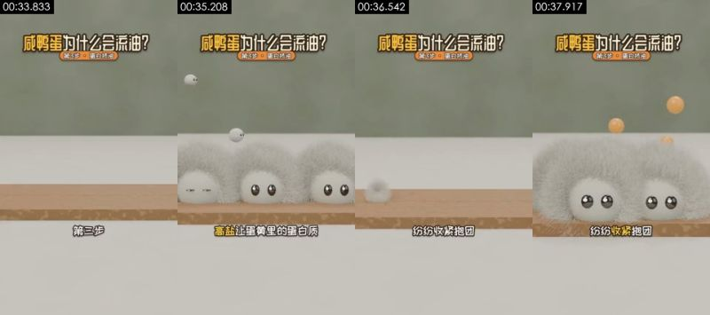

**画面に見えるもの**（スクリーンショットと照合して確認できる）
- 画面：ミディアムショット・アイレベル。白い台の上に木の板が横たわり、黒い目の白い毛玉（たんぱく質を表す）がいくつか次々と板の上に弾んで落ちて身を寄せ合い、続いてオレンジ色の小さな玉（油滴）がその間から弾け出る。カメラは固定。
- 撮り方／ライティング：ミディアムショット。固定カメラ（三脚／スタンド／机に置く）。正面からのソフトライト（フラット）。キーライトは正面（光はカメラ方向から当たり、被写体の両側の明るさはほぼ同じ）。ライティング比 約 1.0:1（差 0.0 段）。ソフトな光（明暗の境界がほとんどない）
- テキストトラック（字幕/bottom）：第三步 / 高盐让蛋黄里的蛋白质 / 纷纷收紧抱团 / 原本被裹得严严实实的油
- テキストトラック（タイトル/top）：咸鸭蛋为什么会流油？ / 第3步·蛋白挤油
- [AI アシスタント 目視] 白い毛玉キャラクターには細長い毛と立体的な影があり、木の板には木目がある
- [AI アシスタント 目視] 36.5s 前後で毛玉が丸ごと消えてから再び弾んで入ってくる。2 本のレンダリングをつないだようで、変形ではない
- [AI アシスタント 目視] オレンジ色の小さな玉が弾け出る軌道は規則的

**ツールが推定した制作方法**（推定であり、見えたものではない）
- 推定：3D レンダリング 83%、コード／テンプレートレンダリング 5%、AI 生成動画 4%（fused_agent）
- 素材の出所：制作者側のレンダリング
- 判断の根拠（ツールによる測定で、肉眼では分からない場合がある）：
  - テクスチャにレンダリングの特徴：フラットな色面 56%、95% のピクセルがわずか 36 色、水平・垂直の直線エッジ 42%

- 再現：3D レンダリング：先頭／末尾フレームを使った AI 生成で近似できる。正確な多角度が必要なら 3D モデリング + Blender レンダリング
  - 先頭フレーム画像プロンプト：被写体は画面上部中央。ミディアムショット・アイレベル、縦画面。画面下半分に明るい木目の細長い板が白い台の上に横向きに置かれ、背景は無地のセージグリーンの壁。ソフトな光、3D カートゥーンレンダリング。
  - 動画プロンプト：被写体は画面上部中央。ミディアムショット・アイレベル、つやのある黒い目をした白い長毛の毛玉がいくつか上から順に板の上へ弾んで落ち、互いにぎゅっと詰めて一列に並ぶ。続いてオレンジ色の小さな丸い玉がいくつかその間から上へ弾け出る。カメラは固定。

</details>

<details class="ref"><summary>#19 00:38.042–00:40.000 · 3D レンダリング + コード／編集オーバーレイ（テキストラベル、タイトル）</summary>

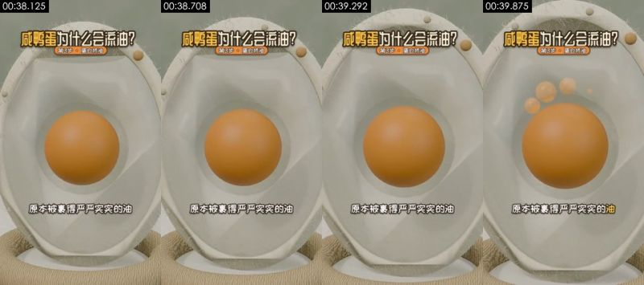

**画面に見えるもの**（スクリーンショットと照合して確認できる）
- 画面：クローズアップ・アイレベル。卵の断面模型、卵黄の上部からオレンジ色の半透明の油の粒がいくつか湧き出る。カメラは固定。
- 撮り方／ライティング：ミディアムショット。移動カメラ（スタビライザー／手持ちでの平行移動）。正面からのソフトライト（フラット）。キーライトは正面（光はカメラ方向から当たり、被写体の両側の明るさはほぼ同じ）。ライティング比 約 1.0:1（差 0.0 段）。ソフトな光（明暗の境界がほとんどない）
- テキストトラック（テキスト/bottom）：原本被裹得严严实实的油
- テキストトラック（タイトル/top）：咸鸭蛋为什么会流油？ / 第3步·蛋白挤油
- [AI アシスタント 目視] 同じ断面模型
- [AI アシスタント 目視] 卵黄の上に湧き出るオレンジ色の油の粒は規則的な球体で、1 粒ずつ現れる
- [AI アシスタント 目視] 幾何的な輪郭と質感がフレーム間で一貫しており、AI 動画によくある変形はない

**ツールが推定した制作方法**（推定であり、見えたものではない）
- 推定：3D レンダリング 78%、AI 生成動画 9%、コード／テンプレートレンダリング 3%（fused_agent）
- 素材の出所：制作者側のレンダリング
- 判断の根拠（ツールによる測定で、肉眼では分からない場合がある）：
  - テクスチャにレンダリングの特徴：フラットな色面 26%、95% のピクセルがわずか 63 色、水平・垂直の直線エッジ 30%

- 再現：3D レンダリング：先頭／末尾フレームを使った AI 生成で近似できる。正確な多角度が必要なら 3D モデリング + Blender レンダリング
  - 先頭フレーム画像プロンプト：ミディアムショット、被写体は画面上部中央。クローズアップ・アイレベル、縦画面。卵の断面模型、中央にオレンジ色の球形の卵黄、周囲は半透明の卵白。ソフトな光、3D 科学解説レンダリング。
  - 動画プロンプト：ミディアムショット、被写体は画面上部中央、カメラは寄る。クローズアップ・アイレベル、卵黄の上部から 4〜5 粒のオレンジ色の半透明な小さい油の粒が順に湧き出て、卵黄の上にとどまる。カメラは固定。

</details>

<details class="ref"><summary>#20 00:40.000–00:41.583 · 3D レンダリング + コード／編集オーバーレイ（字幕、タイトル）</summary>


**画面に見えるもの**（スクリーンショットと照合して確認できる）
- 画面：クローズアップ・アイレベル。卵の断面模型、卵黄の上の油の粒が散らばった後、上部に落ちて戻り油の層になる。カメラは固定。
- 撮り方／ライティング：ミディアムショット。移動カメラ（スタビライザー／手持ちでの平行移動）。正面からのソフトライト（フラット）。キーライトは正面（光はカメラ方向から当たり、被写体の両側の明るさはほぼ同じ）。ライティング比 約 1.0:1（差 0.0 段）。ソフトな光（明暗の境界がほとんどない）
- テキストトラック（字幕/bottom）：一下子全散开了 / 就像拧毛巾
- テキストトラック（タイトル/top）：咸鸭蛋为什么会流油？ / 第3步·蛋白挤油
- [AI アシスタント 目視] 同じ断面模型
- [AI アシスタント 目視] 油の粒が卵黄の上部に落ちて戻り油の層になる。遷移はなめらか
- [AI アシスタント 目視] 幾何的な輪郭と質感がフレーム間で一貫しており、AI 動画によくある変形はない

**ツールが推定した制作方法**（推定であり、見えたものではない）
- 推定：3D レンダリング 79%、AI 生成動画 8%、コード／テンプレートレンダリング 3%（fused_agent）
- 素材の出所：制作者側のレンダリング
- 判断の根拠（ツールによる測定で、肉眼では分からない場合がある）：
  - テクスチャにレンダリングの特徴：フラットな色面 26%、95% のピクセルがわずか 60 色、水平・垂直の直線エッジ 32%

- 再現：3D レンダリング：先頭／末尾フレームを使った AI 生成で近似できる。正確な多角度が必要なら 3D モデリング + Blender レンダリング
  - 先頭フレーム画像プロンプト：ミディアムショット、被写体は画面上部中央。クローズアップ・アイレベル、縦画面。卵の断面模型、中央にオレンジ色の球形の卵黄、その上にオレンジ色の油の粒がいくつか漂う。ソフトな光、3D 科学解説レンダリング。
  - 動画プロンプト：ミディアムショット、被写体は画面上部中央、カメラは寄る。クローズアップ・アイレベル、卵黄の上の油の粒がいくつか散らばってから卵黄の上部へ落ちて戻り、しわの寄った淡い黄色の油の層になる。カメラは固定。

</details>

<details class="ref"><summary>#21 00:41.583–00:45.250 · 3D レンダリング + コード／編集オーバーレイ（字幕、タイトル）</summary>


**画面に見えるもの**（スクリーンショットと照合して確認できる）
- 画面：ミディアムショット・アイレベル。水色の起毛した四角いタオルが金属の横棒に掛かり、横棒が両側へ伸びてタオルを T 字形に絞り、両側から透明な水滴が垂れる。カメラは固定。
- 撮り方／ライティング：ミディアムショット。固定カメラ（三脚／スタンド／机に置く）。逆光／背景が被写体より明るい。キーライトは正面（光はカメラ方向から当たり、被写体の両側の明るさはほぼ同じ）。ライティング比 約 1.0:1（差 0.0 段）。ソフトな光（明暗の境界がほとんどない）
- テキストトラック（字幕/bottom）：就像拧毛巾 / 手一收紧 / 水就被挤了出来
- テキストトラック（タイトル/top）：咸鸭蛋为什么会流油？ / 第3步·蛋白挤油
- [AI アシスタント 目視] タオルには起毛の質感、金属棒にはハイライト、水滴には屈折がある
- [AI アシスタント 目視] タオルは T 字形に絞られ、変形は規則的
- [AI アシスタント 目視] 背景は奥行きのある台と壁で、平面的な色面ではない

**ツールが推定した制作方法**（推定であり、見えたものではない）
- 推定：3D レンダリング 81%、コード／テンプレートレンダリング 8%、2D アニメーション 2%（fused_agent）
- 素材の出所：制作者側のレンダリング
- 判断の根拠（ツールによる測定で、肉眼では分からない場合がある）：
  - テクスチャにレンダリングの特徴：フラットな色面 68%、95% のピクセルがわずか 24 色、水平・垂直の直線エッジ 45%

- 再現：3D レンダリング：先頭／末尾フレームを使った AI 生成で近似できる。正確な多角度が必要なら 3D モデリング + Blender レンダリング
  - 先頭フレーム画像プロンプト：被写体は画面上部中央。ミディアムショット・アイレベル、縦画面。画面中央、白い台の上方に細い金属の横棒が 1 本あり、淡いグレーがかった青の起毛した四角いタオルが掛かっている。背景はセージグリーンの壁。柔らかな拡散光、ミニマルな 3D 科学解説レンダリング。
  - 動画プロンプト：被写体は画面上部中央。ミディアムショット・アイレベル、タオルが横棒で上へ持ち上げられ真ん中から絞られて細長い T 字形になり、両側から透明な水滴が絶えず垂れる。カメラは固定。

</details>

<details class="ref"><summary>#22 00:45.250–00:47.333 · 3D レンダリング + コード／編集オーバーレイ（テキストラベル、タイトル）</summary>


**画面に見えるもの**（スクリーンショットと照合して確認できる）
- 画面：ミディアムショット・アイレベル。花猫、鸭宝、灰褐色のぬいぐるみ風の小猿が並んで立ち軽く揺れる。右奥に陶器の壺、上から茶色の小片が絶えず落ちてくる（時間の経過を表す）。カメラは固定。
- 撮り方／ライティング：ミディアムショット。固定カメラ（三脚／スタンド／机に置く）。正面からのソフトライト（フラット）。キーライトは正面（光はカメラ方向から当たり、被写体の両側の明るさはほぼ同じ）。ライティング比 約 1.0:1（差 0.0 段）。ソフトな光（明暗の境界がほとんどない）
- 画面内の物体上の文字（後付けの字幕ではない）：盛
- テキストトラック（テキスト/bottom）：第四步剩下的交给时间
- テキストトラック（タイトル/top）：咸鸭蛋为什么会流油？ / 第4步·静待出油
- [AI アシスタント 目視] 3 体のキャラクターと陶器の壺の形は安定している
- [AI アシスタント 目視] 陶器の壺の「咸」の字のラベルはテクスチャ
- [AI アシスタント 目視] 落ちてくる茶色の小片は規則的な軌道で落下する

**ツールが推定した制作方法**（推定であり、見えたものではない）
- 推定：3D レンダリング 79%、AI 生成動画 8%、コード／テンプレートレンダリング 4%（fused_agent）
- 素材の出所：制作者側のレンダリング
- 判断の根拠（ツールによる測定で、肉眼では分からない場合がある）：
  - テクスチャにレンダリングの特徴：フラットな色面 47%、95% のピクセルがわずか 76 色、水平・垂直の直線エッジ 33%

- 再現：3D レンダリング：先頭／末尾フレームを使った AI 生成で近似できる。正確な多角度が必要なら 3D モデリング + Blender レンダリング
  - 先頭フレーム画像プロンプト：被写体は画面上部中央。ミディアムショット・アイレベル、縦画面。3 匹のぬいぐるみ風の小猿が並んでカメラに正対し、左はオレンジブラウン、中央は黄緑、右は灰褐色。右奥に茶色で赤い蓋の陶器の壺、赤い「咸」の字のひし形ラベル付き。左側に麻縄の輪がひとつ。セージグリーンの壁とローポリの山の形。ソフトな光、Blender の毛のレンダリング。
  - 動画プロンプト：被写体は画面上部中央。ミディアムショット・アイレベル、3 匹のぬいぐるみ風の小猿が並んで軽く左右に揺れ、上から茶色の小さな葉が絶えず舞い落ちる。カメラは固定。

</details>

<details class="ref"><summary>#23 00:47.333–00:49.583 · 3D レンダリング + コード／編集オーバーレイ（字幕、タイトル）</summary>


**画面に見えるもの**（スクリーンショットと照合して確認できる）
- 画面：クローズアップ・アイレベル。卵の断面模型、卵黄の上部の油の層が徐々に厚くなり、周りに白い四芒星のきらめきが光る。カメラはゆっくり寄る。
- 撮り方／ライティング：ミディアムショット。移動カメラ（スタビライザー／手持ちでの平行移動）。正面からのソフトライト（フラット）。キーライトは正面（光はカメラ方向から当たり、被写体の両側の明るさはほぼ同じ）。ライティング比 約 1.0:1（差 0.0 段）。ソフトな光（明暗の境界がほとんどない）
- テキストトラック（字幕/bottom）：家庭腌制要30~40天 / 腌足日子再敲开
- テキストトラック（タイトル/top）：咸鸭蛋为什么会流油？ / 第4步·静待出油
- [AI アシスタント 目視] 同じ断面模型
- [AI アシスタント 目視] 卵黄の上部の油の層が徐々に厚くなり、白い四芒星のきらめきが光る
- [AI アシスタント 目視] 幾何的な輪郭と質感がフレーム間で一貫しており、AI 動画によくある変形はない

**ツールが推定した制作方法**（推定であり、見えたものではない）
- 推定：3D レンダリング 77%、AI 生成動画 9%、コード／テンプレートレンダリング 3%（fused_agent）
- 素材の出所：制作者側のレンダリング

- 再現：3D レンダリング：先頭／末尾フレームを使った AI 生成で近似できる。正確な多角度が必要なら 3D モデリング + Blender レンダリング
  - 先頭フレーム画像プロンプト：ミディアムショット、被写体は画面上部中央。クローズアップ・アイレベル、縦画面。卵の断面模型、中央にオレンジ色の球形の卵黄、上部に淡い黄色の油脂の層。ソフトな光、3D 科学解説レンダリング。
  - 動画プロンプト：ミディアムショット、被写体は画面上部中央、カメラは寄る。クローズアップ・アイレベル、卵黄の上部の淡い黄色の油の層がゆっくり厚くなってあふれ広がり、周囲に白い四芒星のきらめきが順に光る。カメラはゆっくり寄る。

</details>

<details class="ref"><summary>#24 00:49.583–00:51.292 · 3D レンダリング + コード／編集オーバーレイ（テキストラベル、タイトル）</summary>


**画面に見えるもの**（スクリーンショットと照合して確認できる）
- 画面：クローズショット・アイレベル。鸭宝が左側に立ち、目の前の白い毛玉（アヒルの卵）が白い磁器の碗の中で油のにじむ卵黄に変わる。右奥に陶器の壺。カメラは固定。
- 撮り方／ライティング：クローズショット。固定カメラ（三脚／スタンド／机に置く）。正面からのソフトライト（フラット）。キーライトは正面（光はカメラ方向から当たり、被写体の両側の明るさはほぼ同じ）。ライティング比 約 1.2:1（差 0.3 段）。ソフトな光（明暗の境界がほとんどない）
- テキストトラック（テキスト/bottom）：腌足日子再敲开
- テキストトラック（タイトル/top）：咸鸭蛋为什么会流油？ / 第4步·静待出油
- ショット内のモーションの拍：50.38s
- [AI アシスタント 目視] 第 2 ショットと同じシーンとキャラクターで、構図はより寄り
- [AI アシスタント 目視] 白い毛玉が碗の中の卵黄に切り替わり、遷移はきれい
- [AI アシスタント 目視] 毛並みはフレームごとに安定し、ちらつきや塊状のつぶれはない

**ツールが推定した制作方法**（推定であり、見えたものではない）
- 推定：3D レンダリング 80%、AI 生成動画 7%、コード／テンプレートレンダリング 4%（fused_agent）
- 素材の出所：制作者側のレンダリング
- 判断の根拠（ツールによる測定で、肉眼では分からない場合がある）：
  - テクスチャにレンダリングの特徴：フラットな色面 51%、95% のピクセルがわずか 69 色、水平・垂直の直線エッジ 36%
  - サンプリングしたフレームの 100% に正面の顔があり、カメラ位置は固定、音声トラックに人の声がある

- 再現：3D レンダリング：先頭／末尾フレームを使った AI 生成で近似できる。正確な多角度が必要なら 3D モデリング + Blender レンダリング
  - 先頭フレーム画像プロンプト：被写体は画面左側。クローズショット・アイレベル、縦画面。左側に黄緑の長毛のぬいぐるみ風の小猿が右向きに立ち、目の前に白い長毛の毛玉が小さなココナッツの殻の碗の上に浮かぶ。右奥に茶色で赤い蓋の陶器の壺。セージグリーンの壁、白い台。ソフトな光、Blender の毛のレンダリング。
  - 動画プロンプト：被写体は画面左側。クローズショット・アイレベル、白い毛玉が軽くひと震えしてから、白い磁器の碗の中の、淡い黄色の油の層をのせたオレンジ色の卵黄に変わる。左側の小猿は手を上げて見つめる。カメラは固定。

</details>

<details class="ref"><summary>#25 00:51.292–00:54.958 · 3D レンダリング + コード／編集オーバーレイ（字幕、テキストラベル、タイトル）</summary>


**画面に見えるもの**（スクリーンショットと照合して確認できる）
- 画面：ミディアムショット・アイレベル。白い磁器の碗の中の油のにじむ卵黄が中央、その上にピンクがかった白の S 字形の湯気が立ちのぼり、「红油」の小さなラベルが現れる。カメラは固定。
- 撮り方／ライティング：クローズショット。固定カメラ（三脚／スタンド／机に置く）。逆光／背景が被写体より明るい。キーライトは正面（光はカメラ方向から当たり、被写体の両側の明るさはほぼ同じ）。ライティング比 約 1.2:1（差 0.3 段）。ソフトな光（明暗の境界がほとんどない）
- テキストトラック（字幕/bottom）：红油汪在蛋黄上 / 颤颤的亮亮的
- テキストトラック（テキスト/middle）：红油
- テキストトラック（タイトル/top）：咸鸭蛋为什么会流油？ / 第4步·静待出油
- [AI アシスタント 目視] 卵黄、油の層、磁器の碗の形は安定している
- [AI アシスタント 目視] ピンクがかった白の S 字形の湯気と「红油」ラベルは規則的に現れる
- [AI アシスタント 目視] 幾何的な輪郭と質感がフレーム間で一貫しており、AI 動画によくある変形はない

**ツールが推定した制作方法**（推定であり、見えたものではない）
- 推定：3D レンダリング 81%、AI 生成動画 5%、コード／テンプレートレンダリング 5%（fused_agent）
- 素材の出所：制作者側のレンダリング
- 判断の根拠（ツールによる測定で、肉眼では分からない場合がある）：
  - テクスチャにレンダリングの特徴：フラットな色面 56%、95% のピクセルがわずか 56 色、水平・垂直の直線エッジ 38%

- 再現：3D レンダリング：先頭／末尾フレームを使った AI 生成で近似できる。正確な多角度が必要なら 3D モデリング + Blender レンダリング
  - 先頭フレーム画像プロンプト：クローズショット、被写体は画面上部中央。ミディアムショット・アイレベル、縦画面。画面中央の白い磁器の碗にオレンジ色の卵黄がひとつ、上部をしわの寄った淡い黄色の油の層が覆う。セージグリーンの壁とローポリの山の形。ソフトな光、3D カートゥーンレンダリング。
  - 動画プロンプト：クローズショット、被写体は画面上部中央。ミディアムショット・アイレベル、卵黄の上にピンクがかった白の S 字形の湯気の曲線が 3 本立ちのぼってゆっくり漂い、油の層が軽く震える。カメラは固定。

</details>

<details class="ref"><summary>#26 00:54.958–00:57.208 · 3D レンダリング + コード／編集オーバーレイ（字幕、タイトル、装飾テキスト）</summary>


**画面に見えるもの**（スクリーンショットと照合して確認できる）
- 画面：クローズショット・アイレベル。鸭宝が中央で、油のにじむ卵黄を盛った白い碗を両手で頭上に掲げ、目を細めて笑う。両側の花猫と灰褐色のぬいぐるみ風の小猿も笑っており、周りに白い四芒星のきらめきが光る。カメラは固定。
- 撮り方／ライティング：クローズショット。固定カメラ（三脚／スタンド／机に置く）。正面からのソフトライト（フラット）。キーライトは正面（光はカメラ方向から当たり、被写体の両側の明るさはほぼ同じ）。ライティング比 約 1.1:1（差 0.1 段）。ソフトな光（明暗の境界がほとんどない）
- 画面内の物体上の文字（後付けの字幕ではない）：咸
- テキストトラック（字幕/bottom）：这就是流油咸鸭蛋 / 不过这油不是谁偷偷加的
- テキストトラック（字幕/middle）：流油咸鸭蛋！ / 流油咸鸭蛋！+
- テキストトラック（タイトル/top）：咸鸭蛋为什么会流油？ / 成了！ / 注营！
- [AI アシスタント 目視] 3 体のキャラクターの毛並みは安定している
- [AI アシスタント 目視] 鸭宝の頭上の碗と卵黄は腕と一緒に持ち上がり、めり込みや変形はない
- [AI アシスタント 目視] 四芒星のきらめきは規則的な図形

**ツールが推定した制作方法**（推定であり、見えたものではない）
- 推定：3D レンダリング 77%、AI 生成動画 8%、コード／テンプレートレンダリング 4%（fused_agent）
- 素材の出所：制作者側のレンダリング
- 判断の根拠（ツールによる測定で、肉眼では分からない場合がある）：
  - テクスチャにレンダリングの特徴：フラットな色面 41%、95% のピクセルがわずか 113 色、水平・垂直の直線エッジ 38%
  - サンプリングしたフレームの 100% に正面の顔があり、カメラ位置は固定、音声トラックに人の声がある

- 再現：3D レンダリング：先頭／末尾フレームを使った AI 生成で近似できる。正確な多角度が必要なら 3D モデリング + Blender レンダリング
  - 先頭フレーム画像プロンプト：被写体は画面中央。クローズショット・アイレベル、縦画面。画面中央の黄緑のぬいぐるみ風の小猿が両手で白い碗を持ち、碗には油の層をのせたオレンジ色の卵黄がひとつ。左側にオレンジブラウン、右側に灰褐色のぬいぐるみ風の小猿が上半身だけ映り込む。セージグリーンの壁。ソフトな光、Blender の毛のレンダリング。
  - 動画プロンプト：被写体は画面中央。クローズショット・アイレベル、真ん中の小猿が白い碗を頭上に掲げて目を細めて笑い、両側の小猿もつられて笑い、周りに白い四芒星のきらめきがいくつか光る。カメラはわずかに寄る。

</details>

<details class="ref"><summary>#27 00:57.208–01:00.750 · 3D レンダリング + コード／編集オーバーレイ（字幕、タイトル）</summary>


**画面に見えるもの**（スクリーンショットと照合して確認できる）
- 画面：クローズショット・アイレベル。鸭宝と花猫が油のにじむ卵黄の碗のそばに立ち、背後に「咸」の字のラベルを貼った陶器の壺、右側には紫色の小瓶もある。最後に右側から赤い禁止マークがスライドインする。カメラは固定。
- 撮り方／ライティング：ミディアムショット。固定カメラ（三脚／スタンド／机に置く）。正面からのソフトライト（フラット）。キーライトは正面（光はカメラ方向から当たり、被写体の両側の明るさはほぼ同じ）。ライティング比 約 1.2:1（差 0.3 段）。ソフトな光（明暗の境界がほとんどない）
- 画面内の物体上の文字（後付けの字幕ではない）：咸、威
- テキストトラック（字幕/bottom）：不过这油不是谁偷偷加的 / 神秘物质
- テキストトラック（タイトル/top）：咸鸭蛋为什么会流油？ / 注意！
- ショット内のモーションの拍：58.33s、59.54s
- [AI アシスタント 目視] キャラクター、陶器の壺、油の碗はフレーム間で安定している
- [AI アシスタント 目視] 「咸」の字のラベルは壺の胴のテクスチャ
- [AI アシスタント 目視] 右側の赤い禁止マークは厚みのある 3D の看板で、右側からスライドインする

**ツールが推定した制作方法**（推定であり、見えたものではない）
- 推定：3D レンダリング 77%、AI 生成動画 10%、デジタルヒューマン 3%（fused_agent）
- 素材の出所：制作者側のレンダリング
- 判断の根拠（ツールによる測定で、肉眼では分からない場合がある）：
  - サンプリングしたフレームの 100% に正面の顔があり、カメラ位置は固定、音声トラックに人の声がある

- 再現：3D レンダリング：先頭／末尾フレームを使った AI 生成で近似できる。正確な多角度が必要なら 3D モデリング + Blender レンダリング
  - 先頭フレーム画像プロンプト：ミディアムショット、被写体は画面左側。クローズショット・アイレベル、縦画面。左側に黄緑、中央にオレンジブラウンのぬいぐるみ風の小猿、そばの白い碗には油のにじむオレンジ色の卵黄がひとつ。後方に茶色で赤い蓋の陶器の壺、赤い「咸」の字のひし形ラベル付き。右側に紫色の小瓶。セージグリーンの壁。ソフトな光、Blender の毛のレンダリング。
  - 動画プロンプト：ミディアムショット、被写体は画面左側。クローズショット・アイレベル、2 匹のぬいぐるみ風の小猿が立ったまままばたきして軽く揺れ、オレンジブラウンの小猿が手を上げる。続いて赤い丸い禁止マークが画面右側からスライドインして紫色の小瓶を隠す。カメラは固定。

</details>

<details class="ref"><summary>#28 01:00.750–01:03.000 · 3D レンダリング + コード／編集オーバーレイ（テキストラベル、タイトル）</summary>


**画面に見えるもの**（スクリーンショットと照合して確認できる）
- 画面：ミディアムショット・アイレベル。木製の天秤の左皿にオレンジ色の卵黄の玉がひとつ載り、さおは左が低く右が高い。小さなオレンジの玉が上から落ちてきてさおが水平になり、上に白い四芒星のきらめきが光る。カメラは固定。
- 撮り方／ライティング：ミディアムショット。固定カメラ（三脚／スタンド／机に置く）。正面からのソフトライト（フラット）。キーライトは正面（光はカメラ方向から当たり、被写体の両側の明るさはほぼ同じ）。ライティング比 約 1.0:1（差 0.0 段）。ソフトな光（明暗の境界がほとんどない）
- テキストトラック（テキスト/bottom）：这些油本来就是蛋黄里的脂肪
- テキストトラック（タイトル/top）：咸鸭蛋为什么会流油？ / 注意！
- [AI アシスタント 目視] 木製の天秤には木目、支柱には麻縄の質感があり、皿には影が落ちている
- [AI アシスタント 目視] 小さなオレンジの玉の落下とさおが水平になる動きは正確
- [AI アシスタント 目視] 背景は奥行きのある台と壁

**ツールが推定した制作方法**（推定であり、見えたものではない）
- 推定：3D レンダリング 82%、コード／テンプレートレンダリング 7%、AI 生成動画 3%（fused_agent）
- 素材の出所：制作者側のレンダリング
- 判断の根拠（ツールによる測定で、肉眼では分からない場合がある）：
  - テクスチャにレンダリングの特徴：フラットな色面 64%、95% のピクセルがわずか 43 色、水平・垂直の直線エッジ 41%

- 再現：3D レンダリング：先頭／末尾フレームを使った AI 生成で近似できる。正確な多角度が必要なら 3D モデリング + Blender レンダリング
  - 先頭フレーム画像プロンプト：被写体は画面下部中央。ミディアムショット・アイレベル、縦画面。画面中央に明るい木目の両皿天秤が 1 台、支柱に麻縄が巻かれ、左皿にオレンジ色の玉がひとつ、さおは左が低く右が高い。白い台、セージグリーンの壁。ソフトな光、ミニマルな 3D 科学解説レンダリング。
  - 動画プロンプト：被写体は画面下部中央。ミディアムショット・アイレベル、小さなオレンジの玉が上から落ちてきて天秤のさおがゆっくり水平になり、続いて上に白い四芒星のきらめきが 3 つ光り、天秤は静止する。カメラは固定。

</details>

<details class="ref"><summary>#29 01:03.000–01:06.542 · 3D レンダリング + コード／編集オーバーレイ（字幕、タイトル）</summary>


**画面に見えるもの**（スクリーンショットと照合して確認できる）
- 画面：クローズショットからミディアムショットへ。鸭宝、花猫、灰褐色のぬいぐるみ風の小猿が並んで目を細めて笑いながら立ち、軽く揺れる。背景にピンクの丸い玉と白い短い棒が浮かぶ。カメラはゆっくり引く。
- 撮り方／ライティング：ミディアムショット。固定カメラ（三脚／スタンド／机に置く）。正面からのソフトライト（フラット）。キーライトは正面（光はカメラ方向から当たり、被写体の両側の明るさはほぼ同じ）。ライティング比 約 1.0:1（差 0.0 段）。ソフトな光（明暗の境界がほとんどない）
- テキストトラック（字幕/bottom）：一滴没多 / 一滴也没少
- テキストトラック（タイトル/top）：咸鸭蛋为什么会流油？ / 注意！
- [AI アシスタント 目視] 3 体のキャラクターと陶器の壺はフレーム間で安定している
- [AI アシスタント 目視] 背景に浮かぶピンクの丸い玉と白い短い棒は規則的な幾何形状
- [AI アシスタント 目視] 毛並みはフレームごとに安定し、ちらつきや塊状のつぶれはない

**ツールが推定した制作方法**（推定であり、見えたものではない）
- 推定：3D レンダリング 79%、AI 生成動画 8%、コード／テンプレートレンダリング 4%（fused_agent）
- 素材の出所：制作者側のレンダリング
- 判断の根拠（ツールによる測定で、肉眼では分からない場合がある）：
  - テクスチャにレンダリングの特徴：フラットな色面 49%、95% のピクセルがわずか 84 色、水平・垂直の直線エッジ 35%

- 再現：3D レンダリング：先頭／末尾フレームを使った AI 生成で近似できる。正確な多角度が必要なら 3D モデリング + Blender レンダリング
  - 先頭フレーム画像プロンプト：ミディアムショット、被写体は画面上部中央。クローズショット・アイレベル、縦画面。左に黄緑、中央にオレンジブラウン、右に灰褐色の 3 匹のぬいぐるみ風の小猿が並び、目を細めて笑う。後方に茶色で赤い蓋の陶器の壺と白い碗。背景はセージグリーンの壁、ローポリの山の形、空中にピンクの小さな丸い玉が 2 つと白い短い棒が 1 本浮かぶ。ソフトな光、Blender の毛のレンダリング。
  - 動画プロンプト：被写体は画面上部中央。クローズショット・アイレベル、3 匹のぬいぐるみ風の小猿が笑いながら軽く左右に揺れ、カメラはゆっくり後ろへ引いてミディアムショットになる。背景のピンクの小さな丸い玉が軽く浮遊する。

</details>

### メタデータの手がかり

- エンコーダー：`Lavf61.7.100`

### 注記

- 決定論的な根拠収集は「動いているか、画面全体のズームか、レンダリングのテクスチャか、24→30 のフレームレート変換か」については信頼性が高い。実写／AI／3D の区別は画像を見てのレビュー（画像を見るモデルまたは AI アシスタントによる確認）に頼る必要があり、できれば自分でもスクリーンショットと照らし合わせて一度見ておくとよい。
- メタデータはプラットフォームでのトランスコードで消されることが多く、欠けていても存在しなかったとは限らない。
- 完全なデータは `breakdown.json` にある。モデルに読ませる分解パッケージは `REEL.md` から始まる。
