# 这条视频是怎么做的：unboxing.mp4

**一句话**：无口播的俯拍开箱 vlog：一双手在地毯上逐件拆 7 样奶油色居家好物，靠拆包装的同期声和一句一句的小字幕撑住节奏
**怎么做的**：混合制作：实拍 99% + 静态图 + 推拉动效 1%

- 1:11 · 竖屏 9:16 · 69 个镜头，平均 1.0 秒一个
- 判断可靠度 79%，依据：工具测量 + AI 助手看图复核 69 镜
- ⚠️ 有 2 处拿不准，见「不确定点」

<!--mix-->

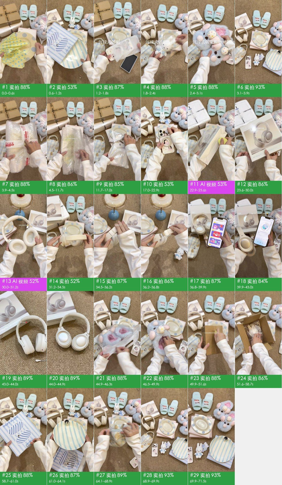

## 核心看点

- **开头怎么抓人**：0–3.1 秒连闪 5 个不到 0.7 秒的成品镜头（波点盘、企鹅条纹盘、手机壳、米菲、毛绒拖鞋），标题「沉浸式居家购物开箱」随之逐字打出；3.1 秒再给全部好物的平铺全家福，观众一开始就知道这期有什么
- 3.9 秒起每件都从拆包装拍起：指甲划快递胶带、扯气泡膜、解包布（7.3 秒波点盘才露面），拆的声音加上一层层揭开，让人想看到实物
- 每件只配一句很短的小字（12 秒「好久没买手机壳了」、17 秒「装上新皮肤」、20.6 秒「支架可以调整」），字小、放在画面中上部不挡商品，用来代替口播说理由和卖点
- 最贵的耳机给了 22.9–44.9 秒共 22 秒，一镜演示一个功能：可拆麦克风（32.5 秒）、伸缩头梁（34.5 秒）、App 和 50 分贝降噪（36.8–43 秒），卖点一条条看得见
- 68.9 秒回到全部好物的平铺「大合照」，69.9 秒「拜拜噜 下次见」，和 3.1 秒的平铺图首尾呼应

## 一眼看懂：画面、包装、声音三层

短视频都可以拆成三层：底下是画面本身，上面叠字幕、花字、贴纸，再配上声音。复刻时一层一层做。

| 层 | 这条视频里是什么 | 怎么做 | 细节 |
|---|---|---|---|
| **画面**（底层） | 实拍 68 镜、静态图 + 推拉动效 1 镜 | 分 3 个场景拍；一张图做静帧或推拉 | 「自己复刻」 |
| **包装**（叠在画面上） | 图形贴片、文字、字幕、静态贴纸 | 剪辑软件里加：字幕、花字、贴纸照时间轴摆 | 「剪辑包装层」 |
| **声音** | 人声（真人录音）、背景音乐（92 BPM、待确认） | 人声：自己录；配乐：按节奏和情绪找同类曲 | 「声音」 |

## 内容与结构

- 下面的叙事线来自逐镜看图；台词没有单独整理，字幕原文见「剪辑包装层」

**叙事线**

复刻时保留这条线：每一步的顺序和作用照搬，讲的那一点换成自己的案例、数据和素材，就不只是换个主角。

| 时间 | 镜头 | 作用 | 在讲什么 |
|---|---|---|---|
| 0.0–3.1s | #1–#5 | 抓注意 | 开头不到 1 秒一件，先快闪成品，告诉观众这期要开什么 → 第二件快闪，换颜色换形状保持新鲜感 → 第三件快闪，标题逐字打出 → 第四件快闪，可爱公仔加强风格预期 → 第五件快闪，用捏一捏的触感收住预告 |
| 3.1–3.9s | #6 | 交代背景 | 先给一张全部商品的平铺图，交代这期一共开了几样 |
| 3.9–7.3s | #7–#11 | 补信息 | 从撕快递胶带开始，进入第一件 → 一句话报出第一件是什么 → 一层层拆包装，拉长揭晓前的期待 → 停一下展示包装细节 → 解开最后一层包装 |
| 7.3–8.2s | #12 | 给结论 | 揭开包装，实物第一次完整出现 |
| 8.2–10.2s | #13 | 补信息 | 一句话说清用途 |
| 10.2–11.7s | #14 | 给证据 | 多角度看实物质感 |
| 11.7–12.5s | #15 | 交代背景 | 换下一件，一句话交代买它的理由 |
| 12.5–15.6s | #16–#19 | 补信息 | 展示包装盒 → 开盒揭晓 → 撕膜的过程感 → 继续拆掉附件 |
| 15.6–17.0s | #20 | 给结论 | 完整展示图案 |
| 17.0–20.6s | #21、#22 | 给证据 | 装到手机上看上身效果 → 装好后的整体效果 |
| 20.6–21.9s | #23 | 补信息 | 点出一个功能卖点 |
| 21.9–22.9s | #24 | 给证据 | 演示支架真能把手机立住 |
| 22.9–23.6s | #25 | 交代背景 | 引出全片最大的一件 |
| 23.6–28.1s | #26–#31 | 补信息 | 撕塑封的过程感 → 展示包装正面 → 停一下给包装特写 → 邀请观众一起拆 → 实物一点点露出 →（共 6 点，逐镜见「分镜表」） |
| 28.1–30.0s | #32 | 给结论 | 说出喜欢它的颜色 |
| 30.0–33.4s | #33–#35 | 补信息 | 用捏的动作说明佩戴舒适 → 展示头梁弹性 → 点出一个使用场景 |
| 33.4–34.5s | #36 | 给证据 | 展示带麦的完整形态 |
| 34.5–35.1s | #37 | 补信息 | 再点一个功能 |
| 35.1–36.8s | #38、#39 | 给证据 | 多角度看外观 → 重复演示调节 |
| 36.8–39.9s | #40 | 补信息 | 用手机 App 补充说明书式的信息 |
| 39.9–43.0s | #41 | 给证据 | 用试听收尾，报出音质和降噪 |
| 43.0–44.0s | #42 | 给结论 | 换低机位给一个结论镜头 |
| 44.0–44.9s | #43 | 渲染情绪 | 空镜收尾，给观众停一下 |
| 44.9–45.5s | #44 | 交代背景 | 引出下一件 |
| 45.5–47.7s | #45–#47 | 补信息 | 取出实物 → 拆掉附件 → 展示内里 |
| 47.7–48.6s | #48 | 给结论 | 完整展示一双 |
| 48.6–49.9s | #49 | 给证据 | 用触感证明柔软 |
| 49.9–50.5s | #50 | 交代背景 | 引出下一件，先猜里面是什么 |
| 50.5–51.0s | #51 | 补信息 | 开盒 |
| 51.0–51.6s | #52 | 给结论 | 揭晓时直接写出情绪 |
| 51.6–55.2s | #53–#55 | 补信息 | 取出 → 展示吊牌和挂件 → 取出实物 |
| 55.2–56.5s | #56 | 给结论 | 正面特写配一句感叹 |
| 56.5–57.2s | #57 | 补信息 | 去掉包装 |
| 57.2–58.7s | #58 | 给结论 | 停住给可爱特写 |
| 58.7–59.4s | #59 | 交代背景 | 引出下一件 |
| 59.4–61.0s | #60、#61 | 补信息 | 开袋 → 报出是什么 |
| 61.0–62.1s | #62 | 给结论 | 点出最萌的细节 |
| 62.1–64.1s | #63 | 给证据 | 多停一会儿看细节 |
| 64.1–64.7s | #64 | 交代背景 | 最后一件换成自己做的东西，带一点分享感 |
| 64.7–67.5s | #65、#66 | 补信息 | 展示容量和图案 → 收尾动作 |
| 67.5–69.9s | #67、#68 | 给结论 | 点出图案细节 → 回到全部好物的平铺大合照，和开头呼应 |
| 69.9–71.5s | #69 | 引导行动 | 道别并约下一期 |

## 分镜表

「画面」「运镜」「叠加层」是画面里看得到的；「制作方式」「素材来源」是工具推断的，依据见附录逐镜取证。

| # | 截图 | 时间 | 时长 | 在讲什么 | 画面 | 运镜 | 叠加层 | 制作方式（推断） | 素材来源（推断） | 复刻 |
|---|---|---|---|---|---|---|---|---|---|---|
| 1 | 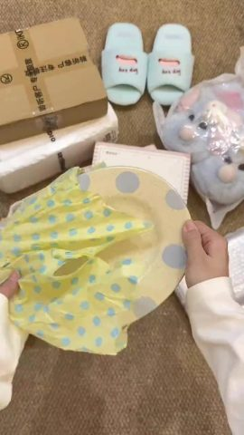 | 0:00.0 | 0.6s | 抓注意：开头不到 1 秒一件，先快闪成品，告诉观众这期要开什么 | 右手把一只浅黄色蓝波点椭圆盘从黄色波点包布里抽出来，盘子移到画面中央（主机位顶拍… | 平滑运镜 | 图形贴片 | 实拍 79% | 实拍视频素材 | 实拍 · S1 |
| 2 | 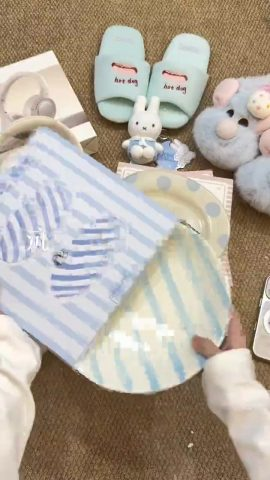 | 0:00.6 | 0.6s | 抓注意：第二件快闪，换颜色换形状保持新鲜感 | 双手把一只浅蓝竖条纹圆盘从条纹包装袋里抽出，盘沿立着一只黑色小企鹅（主机位顶拍） | 固定（主体在动） | 文字、图形贴片 | 实拍 79% | 实拍视频素材 | 实拍 · S1 |
| 3 | 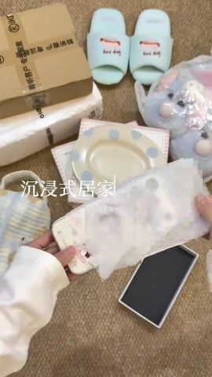 | 0:01.2 | 0.6s | 抓注意：第三件快闪，标题逐字打出 | 左手拿着印卡通女孩图案的奶白手机壳，右手揭掉外层透明膜，旁边是黑色内衬的空盒（主… | 固定 | 文字、图形贴片 | 实拍 79% | 实拍视频素材 | 实拍 · S1 |
| 4 | 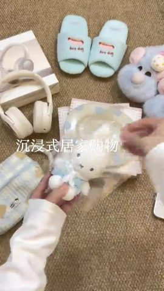 | 0:01.8 | 0.5s | 抓注意：第四件快闪，可爱公仔加强风格预期 | 左手托着穿蓝色水手服的米菲兔挂件，右手把透明包装袋扯下来（主机位顶拍） | 固定（主体在动） | 文字、图形贴片 | 实拍 79% | 实拍视频素材 | 实拍 · S1 |
| 5 |  | 0:02.4 | 0.7s | 抓注意：第五件快闪，用捏一捏的触感收住预告 | 双手捏着一只浅蓝色长毛毛绒拖鞋（鞋面有粉色小猪和蛋糕装饰）挤一挤，展示蓬松（主机… | 固定 | 文字、图形贴片 | 实拍 79% | 实拍视频素材 | 实拍 · S1 |
| 6 | 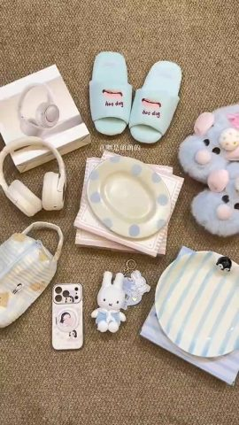 | 0:03.1 | 0.8s | 交代背景：先给一张全部商品的平铺图，交代这期一共开了几样 | 画面里没有手，全部好物平铺在地毯上，镜头缓慢平移（全部好物平铺全景） | 平滑运镜 | 文字 | 实拍 82% | 实拍视频素材 | 实拍 · S1 |
| 7 | 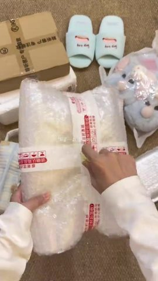 | 0:03.9 | 0.7s | 补信息：从撕快递胶带开始，进入第一件 | 左手按住裹着气泡膜的快递，右手指甲沿红白快递胶带划开（主机位顶拍） | 固定（主体在动） | 文字、图形贴片 | 实拍 80% | 实拍视频素材 | 实拍 · S1 |
| 8 | 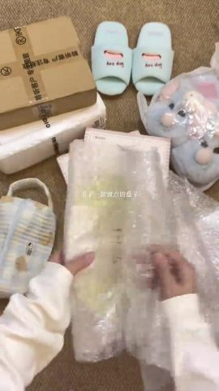 | 0:04.5 | 0.6s | 补信息：一句话报出第一件是什么 | 双手扒开气泡膜，露出里面黄色波点包布和 YUU 标签（主机位顶拍） | 固定（主体在动） | 图形贴片 | 实拍 80% | 实拍视频素材 | 实拍 · S1 |
| 9 | 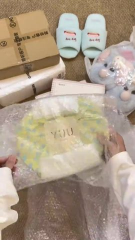 | 0:05.2 | 0.8s | 补信息：一层层拆包装，拉长揭晓前的期待 | 继续扯开气泡膜，捧出用黄色波点布包好的盘子，布上贴着 YUU 标签（主机位顶拍） | 固定（主体在动） | 图形贴片 | 实拍 80% | 实拍视频素材 | 实拍 · S1 |
| 10 |  | 0:06.0 | 0.6s | 补信息：停一下展示包装细节 | 双手捧着布包好的盘子停在画面中央，展示 YUU 标签（主机位顶拍） | 固定 | — | 实拍 80% | 实拍视频素材 | 实拍 · S1 |
| 11 | 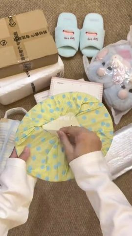 | 0:06.6 | 0.7s | 补信息：解开最后一层包装 | 右手解开包布顶部的结，把布扯松（主机位顶拍） | 固定（主体在动） | 图形贴片 | 实拍 80% | 实拍视频素材 | 实拍 · S1 |
| 12 | 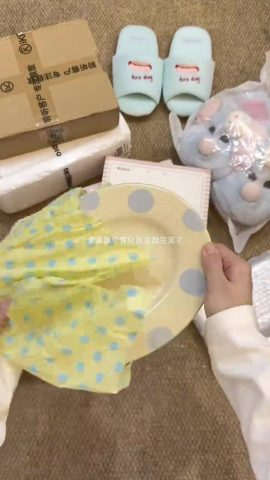 | 0:07.3 | 0.9s | 给结论：揭开包装，实物第一次完整出现 | 把浅黄色蓝波点椭圆盘从包布里抽出，包布滑到左边，盘子停在画面中央（主机位顶拍） | 固定 | 字幕、图形贴片 | 实拍 79% | 实拍视频素材 | 实拍 · S1 |
| 13 | 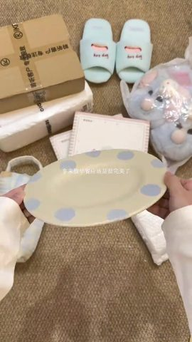 | 0:08.2 | 2.0s | 补信息：一句话说清用途 | 双手捏着盘沿把盘子前后倾斜，展示釉面反光和蓝色波点（主机位顶拍） | 固定 | 文字、图形贴片 | 实拍 79% | 实拍视频素材 | 实拍 · S1 |
| 14 | 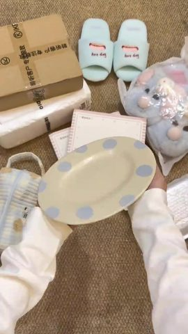 | 0:10.2 | 1.5s | 给证据：多角度看实物质感 | 把盘子移到左侧再换个角度，展示釉面（主机位顶拍） | 固定 | 图形贴片 | 实拍 78% | 实拍视频素材 | 实拍 · S1 |
| 15 | 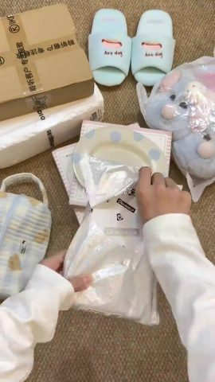 | 0:11.7 | 0.8s | 交代背景：换下一件，一句话交代买它的理由 | 从银白色快递袋里抽出一个白色印花小盒（主机位顶拍） | 固定（主体在动） | 文字、图形贴片 | 实拍 79% | 实拍视频素材 | 实拍 · S1 |
| 16 | 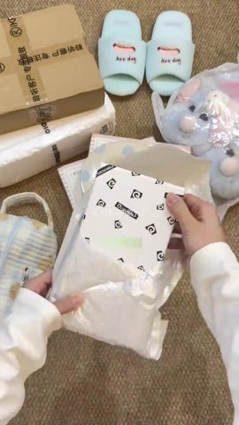 | 0:12.5 | 0.8s | 补信息：展示包装盒 | 把印着 STRONG PROTECTION 和黑白小图标的白盒从快递袋里完全拿出… | 固定（主体在动） | 图形贴片 | 实拍 79% | 实拍视频素材 | 实拍 · S1 |
| 17 | 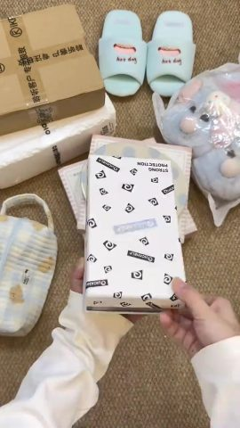 | 0:13.3 | 0.9s | 补信息：开盒揭晓 | 打开白盒盖，露出盒里的手机壳（主机位顶拍） | 固定（主体在动） | 图形贴片 | 实拍 78% | 实拍视频素材 | 实拍 · S1 |
| 18 | 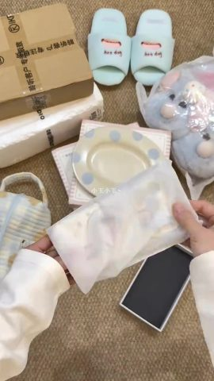 | 0:14.1 | 0.8s | 补信息：撕膜的过程感 | 揭开手机壳外面的透明膜，旁边放着黑色内衬的空盒（主机位顶拍） | 固定 | 图形贴片 | 实拍 79% | 实拍视频素材 | 实拍 · S1 |
| 19 | 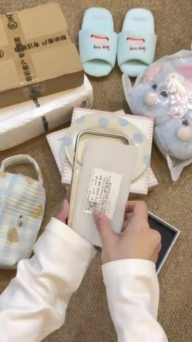 | 0:15.0 | 0.7s | 补信息：继续拆掉附件 | 撕下手机壳内侧的说明纸片（主机位顶拍） | 固定（主体在动） | 图形贴片 | 实拍 79% | 实拍视频素材 | 实拍 · S1 |
| 20 |  | 0:15.6 | 1.4s | 给结论：完整展示图案 | 双手举着手机壳展示背面的卡通女孩图案和磁吸圆环（主机位顶拍） | 固定 | 文字、图形贴片 | 实拍 79% | 实拍视频素材 | 实拍 · S1 |
| 21 | 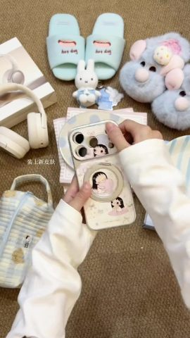 | 0:17.0 | 1.5s | 给证据：装到手机上看上身效果 | 把手机壳套到手机上，按压边缘卡紧（主机位顶拍） | 固定 | 文字、图形贴片 | 实拍 80% | 实拍视频素材 | 实拍 · S1 |
| 22 | 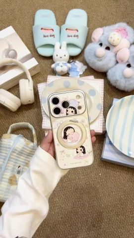 | 0:18.5 | 2.0s | 给证据：装好后的整体效果 | 举着装好壳的手机前后倾斜展示（主机位顶拍） | 固定（主体在动） | 文字、图形贴片 | 实拍 80% | 实拍视频素材 | 实拍 · S1 |
| 23 | 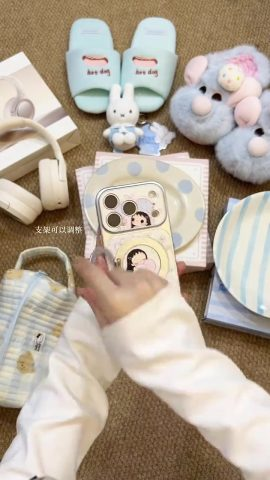 | 0:20.6 | 1.3s | 补信息：点出一个功能卖点 | 右手掰开背面的磁吸圆环支架，来回转动（主机位顶拍） | 固定（主体在动） | 文字、图形贴片 | 实拍 80% | 实拍视频素材 | 实拍 · S1 |
| 24 | 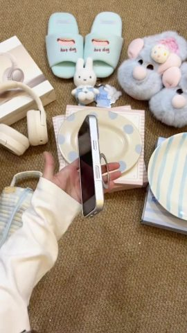 | 0:21.9 | 1.0s | 给证据：演示支架真能把手机立住 | 把手机侧立在圆环支架上，侧面朝向镜头（主机位顶拍） | 固定 | — | 实拍 80% | 实拍视频素材 | 实拍 · S1 |
| 25 | 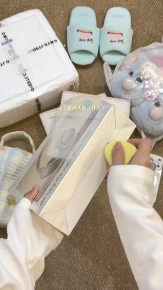 | 0:22.9 | 0.7s | 交代背景：引出全片最大的一件 | 左手按住白色耳机盒，右手拿黄色小开箱刀划开封口胶（主机位顶拍） | 固定（主体在动） | 文字、图形贴片 | 实拍 78% | 实拍视频素材 | 实拍 · S1 |
| 26 | 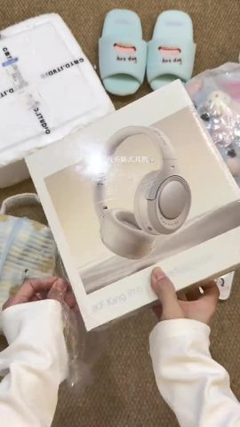 | 0:23.6 | 0.8s | 补信息：撕塑封的过程感 | 双手举起印着奶白头戴耳机图片的外盒，撕掉外层塑封（主机位顶拍） | 固定（主体在动） | 文字、图形贴片 | 实拍 78% | 实拍视频素材 | 实拍 · S1 |
| 27 | 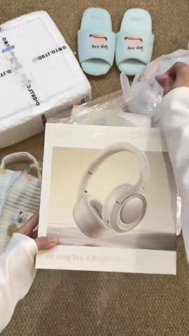 | 0:24.3 | 0.6s | 补信息：展示包装正面 | 把外盒摆正在画面中央，展示包装正面（主机位顶拍） | 固定（主体在动） | 图形贴片 | 实拍 78% | 实拍视频素材 | 实拍 · S1 |
| 28 | 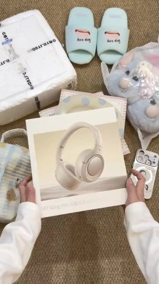 | 0:24.9 | 0.8s | 补信息：停一下给包装特写 | 双手扶着外盒停住，展示正面耳机图片（主机位顶拍） | 固定 | 文字 | 实拍 78% | 实拍视频素材 | 实拍 · S1 |
| 29 | 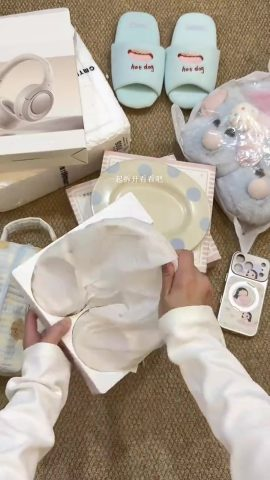 | 0:25.7 | 0.7s | 补信息：邀请观众一起拆 | 打开内盒，掀开包着耳机的白色棉纸（主机位顶拍） | 固定（主体在动） | 文字、图形贴片 | 实拍 78% | 实拍视频素材 | 实拍 · S1 |
| 30 | 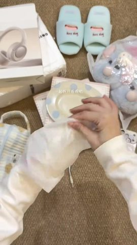 | 0:26.4 | 0.8s | 补信息：实物一点点露出 | 从棉纸里捧出奶白色耳机，耳罩先露出来（主机位顶拍） | 固定（主体在动） | 文字、图形贴片 | 实拍 78% | 实拍视频素材 | 实拍 · S1 |
| 31 | 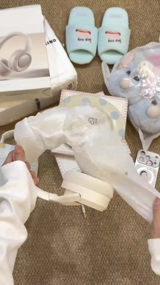 | 0:27.1 | 1.0s | 补信息：完全取出 | 继续抖开棉纸，耳机头梁弯出来（主机位顶拍） | 固定（主体在动） | 文字、图形贴片 | 实拍 78% | 实拍视频素材 | 实拍 · S1 |
| 32 | 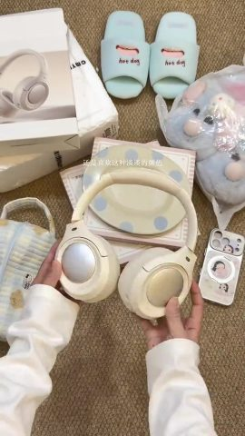 | 0:28.1 | 1.9s | 给结论：说出喜欢它的颜色 | 双手各拿一只耳罩，展示珠光外壳（主机位顶拍） | 固定 | 文字、图形贴片 | 实拍 79% | 实拍视频素材 | 实拍 · S1 |
| 33 | 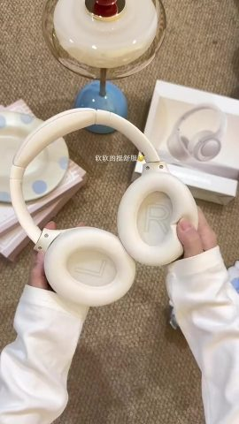 | 0:30.0 | 1.2s | 补信息：用捏的动作说明佩戴舒适 | 双手捏着两只耳罩的内侧海绵，耳罩里印着 L 和 R（台灯旁的近距离顶拍） | 固定 | 文字 | 实拍 77% | 实拍视频素材 | 实拍 · S2 |
| 34 | 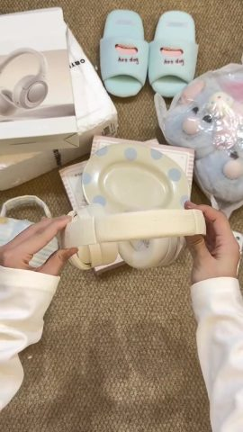 | 0:31.2 | 1.3s | 补信息：展示头梁弹性 | 双手把耳机头梁横向拉开、压一压（主机位顶拍） | 固定 | 图形贴片 | 实拍 79% | 实拍视频素材 | 实拍 · S1 |
| 35 | 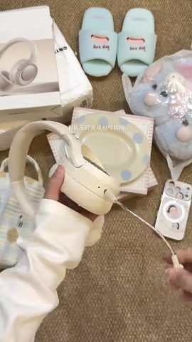 | 0:32.5 | 0.9s | 补信息：点出一个使用场景 | 一手拿耳机，另一手把可拆卸的麦克风拉出来（主机位顶拍） | 平滑运镜 | 文字、图形贴片 | 实拍 79% | 实拍视频素材 | 实拍 · S1 |
| 36 | 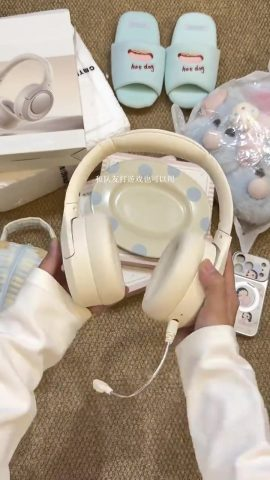 | 0:33.4 | 1.1s | 给证据：展示带麦的完整形态 | 双手举起耳机，麦克风垂在下面（主机位顶拍） | 固定 | 文字、图形贴片 | 实拍 78% | 实拍视频素材 | 实拍 · S1 |
| 37 | 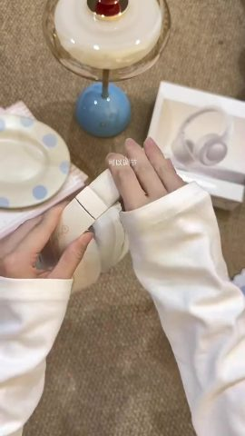 | 0:34.5 | 0.6s | 补信息：再点一个功能 | 双手把头梁伸缩段拉长，露出金属滑轨（台灯旁的近距离顶拍） | 固定（主体在动） | 字幕、图形贴片 | 实拍 78% | 实拍视频素材 | 实拍 · S2 |
| 38 | 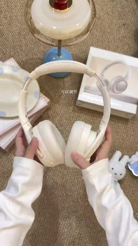 | 0:35.1 | 1.1s | 给证据：多角度看外观 | 举起耳机正面朝镜头，再翻到侧面（台灯旁的近距离顶拍） | 固定（主体在动） | 图形贴片 | 实拍 78% | 实拍视频素材 | 实拍 · S2 |
| 39 | 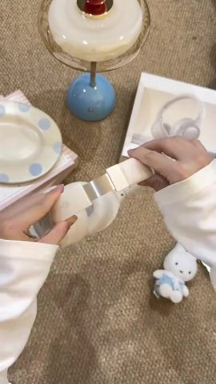 | 0:36.2 | 0.6s | 给证据：重复演示调节 | 再次拉动头梁伸缩段（台灯旁的近距离顶拍） | 固定（主体在动） | 图形贴片 | 实拍 78% | 实拍视频素材 | 实拍 · S2 |
| 40 |  | 0:36.8 | 3.1s | 补信息：用手机 App 补充说明书式的信息 | 左手拿手机靠近耳机，屏幕上是耳机 App 的介绍页，手指往下滑，最后进入设备连接… | 固定 | 字幕、文字、图形贴片 | 实拍 80% | 实拍视频素材 | 实拍 · S1 |
| 41 | 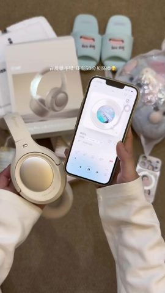 | 0:39.9 | 3.1s | 给证据：用试听收尾，报出音质和降噪 | 左手拿耳机，右手举着手机，屏幕在播放音乐（主机位顶拍） | 固定 | 字幕、文字、静态贴纸 | 实拍 76% | 实拍视频素材 | 实拍 · S1 |
| 42 | 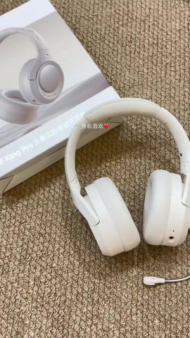 | 0:43.0 | 1.0s | 给结论：换低机位给一个结论镜头 | 耳机平放在地毯上，麦克风伸向右下，镜头缓慢移动（低机位近景） | 平滑运镜 | 文字、静态贴纸 | 实拍 67% | 实拍视频素材 | 实拍 · S3 |
| 43 | 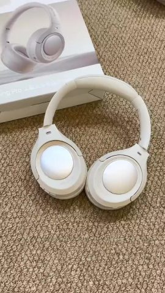 | 0:44.0 | 0.9s | 渲染情绪：空镜收尾，给观众停一下 | 耳机平放，镜头缓慢推近，两只珠光耳罩朝上（低机位近景） | 平滑运镜 | — | 实拍 68% | 实拍视频素材 | 实拍 · S3 |
| 44 | 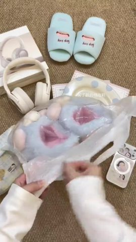 | 0:44.9 | 0.6s | 交代背景：引出下一件 | 撕开透明塑料袋，露出浅蓝毛绒拖鞋（主机位顶拍） | 固定 | 文字、图形贴片 | 实拍 79% | 实拍视频素材 | 实拍 · S1 |
| 45 | 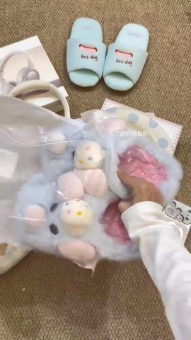 | 0:45.5 | 0.9s | 补信息：取出实物 | 从袋里取出毛绒拖鞋放到画面中央（主机位顶拍） | 固定 | 字幕、图形贴片 | 实拍 80% | 实拍视频素材 | 实拍 · S1 |
| 46 | 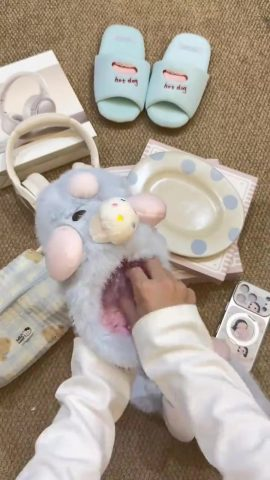 | 0:46.3 | 0.7s | 补信息：拆掉附件 | 手伸进拖鞋里，抽出撑形的透明塑料垫（主机位顶拍） | 固定 | 图形贴片 | 实拍 79% | 实拍视频素材 | 实拍 · S1 |
| 47 | 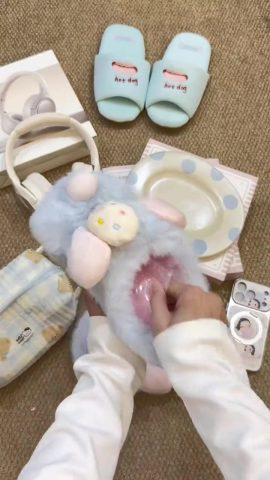 | 0:47.0 | 0.7s | 补信息：展示内里 | 把另一只拖鞋里的透明垫也抽出来，露出粉色内里（主机位顶拍） | 固定 | 文字、图形贴片 | 实拍 79% | 实拍视频素材 | 实拍 · S1 |
| 48 | 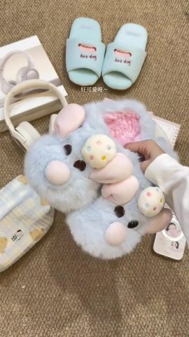 | 0:47.7 | 1.0s | 给结论：完整展示一双 | 双手把一双拖鞋并在一起摆好（主机位顶拍） | 固定 | 字幕、图形贴片 | 实拍 79% | 实拍视频素材 | 实拍 · S1 |
| 49 | 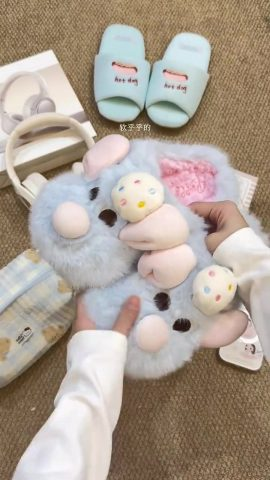 | 0:48.6 | 1.2s | 给证据：用触感证明柔软 | 双手捏拖鞋表面的长毛，展示蓬松（主机位顶拍） | 固定 | 字幕、图形贴片 | 实拍 79% | 实拍视频素材 | 实拍 · S1 |
| 50 | 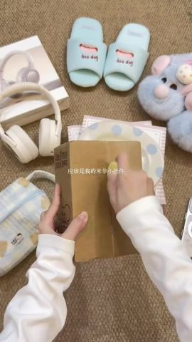 | 0:49.9 | 0.6s | 交代背景：引出下一件，先猜里面是什么 | 拿着牛皮纸盒，用黄色小开箱刀沿中缝划开（主机位顶拍） | 固定（主体在动） | 文字、图形贴片 | 实拍 79% | 实拍视频素材 | 实拍 · S1 |
| 51 | 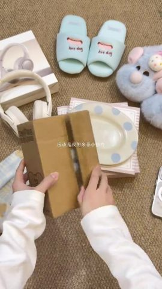 | 0:50.5 | 0.5s | 补信息：开盒 | 掰开纸盒两侧，露出里面的透明袋（主机位顶拍） | 固定（主体在动） | 文字、图形贴片 | 实拍 79% | 实拍视频素材 | 实拍 · S1 |
| 52 | 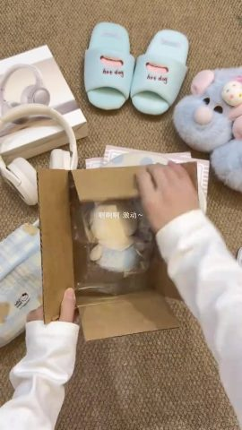 | 0:51.0 | 0.6s | 给结论：揭晓时直接写出情绪 | 打开纸盒，看到袋里的米菲兔（主机位顶拍） | 固定（主体在动） | 字幕、图形贴片 | 实拍 79% | 实拍视频素材 | 实拍 · S1 |
| 53 | 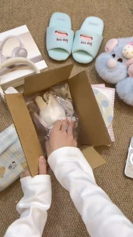 | 0:51.6 | 1.0s | 补信息：取出 | 把装着米菲的透明袋从纸盒里拎出来（主机位顶拍） | 固定（主体在动） | 文字、图形贴片 | 实拍 79% | 实拍视频素材 | 实拍 · S1 |
| 54 |  | 0:52.6 | 1.7s | 补信息：展示吊牌和挂件 | 举着透明袋展示米菲挂件和吊牌，然后撕袋（主机位顶拍） | 固定（主体在动） | 图形贴片 | 实拍 79% | 实拍视频素材 | 实拍 · S1 |
| 55 |  | 0:54.3 | 0.9s | 补信息：取出实物 | 从袋里抽出米菲挂件，金属挂环露出来（主机位顶拍） | 固定（主体在动） | 文字、图形贴片 | 实拍 78% | 实拍视频素材 | 实拍 · S1 |
| 56 |  | 0:55.2 | 1.2s | 给结论：正面特写配一句感叹 | 双手隔着透明袋举着米菲，正面朝镜头（主机位顶拍） | 固定 | 文字、图形贴片 | 实拍 79% | 实拍视频素材 | 实拍 · S1 |
| 57 |  | 0:56.5 | 0.7s | 补信息：去掉包装 | 扯掉袋子，米菲托在掌心（主机位顶拍） | 固定（主体在动） | 文字、图形贴片 | 实拍 79% | 实拍视频素材 | 实拍 · S1 |
| 58 |  | 0:57.2 | 1.6s | 给结论：停住给可爱特写 | 米菲托在掌心停住，展示正面（主机位顶拍） | 固定 | 文字 | 实拍 78% | 实拍视频素材 | 实拍 · S1 |
| 59 |  | 0:58.7 | 0.7s | 交代背景：引出下一件 | 双手拿起印着 PAPA PLATE 的蓝白条纹包装袋（主机位顶拍） | 固定（主体在动） | 图形贴片 | 实拍 79% | 实拍视频素材 | 实拍 · S1 |
| 60 |  | 0:59.4 | 0.7s | 补信息：开袋 | 把包装袋口打开，露出里面的盘子（主机位顶拍） | 固定（主体在动） | 字幕、图形贴片 | 实拍 79% | 实拍视频素材 | 实拍 · S1 |
| 61 |  | 1:00.1 | 0.9s | 补信息：报出是什么 | 从包装袋里抽出浅蓝竖条纹圆盘（主机位顶拍） | 固定（主体在动） | 字幕、图形贴片 | 实拍 79% | 实拍视频素材 | 实拍 · S1 |
| 62 |  | 1:01.0 | 1.1s | 给结论：点出最萌的细节 | 双手捧着条纹盘，盘沿立着黑色小企鹅（主机位顶拍） | 固定 | 文字、图形贴片 | 实拍 79% | 实拍视频素材 | 实拍 · S1 |
| 63 |  | 1:02.1 | 1.9s | 给证据：多停一会儿看细节 | 捧着盘子缓慢左右倾斜，展示企鹅摆件（主机位顶拍） | 固定 | 字幕、图形贴片 | 实拍 80% | 实拍视频素材 | 实拍 · S1 |
| 64 |  | 1:04.1 | 0.6s | 交代背景：最后一件换成自己做的东西，带一点分享感 | 拉开格子化妆包的拉链（主机位顶拍） | 固定（主体在动） | 文字、图形贴片 | 实拍 79% | 实拍视频素材 | 实拍 · S1 |
| 65 |  | 1:04.7 | 2.1s | 补信息：展示容量和图案 | 撑开化妆包展示内部，再翻到正面展示小熊印花和布标（主机位顶拍） | 固定（主体在动） | 字幕、图形贴片 | 实拍 80% | 实拍视频素材 | 实拍 · S1 |
| 66 |  | 1:06.7 | 0.7s | 补信息：收尾动作 | 把化妆包拉链拉上（主机位顶拍） | 固定（主体在动） | 文字、图形贴片 | 实拍 79% | 实拍视频素材 | 实拍 · S1 |
| 67 |  | 1:07.5 | 1.4s | 给结论：点出图案细节 | 举起化妆包左右转动，展示小熊印花（主机位顶拍） | 固定（主体在动） | 文字、图形贴片 | 实拍 80% | 实拍视频素材 | 实拍 · S1 |
| 68 |  | 1:08.9 | 1.0s | 给结论：回到全部好物的平铺大合照，和开头呼应 | 画面里没有手，镜头缓慢平移扫过平铺好的全部好物（全部好物平铺全景） | 平滑运镜 | 字幕 | 静态图 + 推拉动效 81% | 真实照片 | 本地 ffmpeg 推拉 |
| 69 |  | 1:09.9 | 1.6s | 引导行动：道别并约下一期 | 镜头从平铺全景继续缓慢移动，扫过拖鞋、波点盘、条纹盘、米菲和手机壳（全部好物平铺… | 平滑运镜 | 文字 | 实拍 85% | 实拍视频素材 | 实拍 · S1 |

## 自己复刻：按这个顺序做

复刻的是做法和节奏，不是照抄画面。

1. **定内容**：照「内容与结构」的叙事线写自己的脚本
2. **备素材**：见下方「要准备的素材」
3. **拍摄**：3 个场景、7 个机位，见下方「拍摄」
4. **静帧 / 推拉**：见下方「本地重建」
5. **剪辑**：见下方「剪辑」
6. **包装**：字幕文件 `packaging/subtitles.srt` 可以直接导入剪辑软件；样式和时间轴见「剪辑包装层」
7. **声音**：见「声音」，每处音效都能先试听
8. **对照检查**：成片和原片并排看一遍：镜头长短、字幕位置、音乐起落对不对得上

### 要准备的素材

- 画面里直接用的真实文件（截图、照片、录屏，要拿到原文件）：
  - **真实照片**（整个画面）：镜头 #68，共 1.0s
  - **真实照片**（画面局部），博主自己拍的全部好物平铺照片（整个画面）：镜头 #68，共 1.0s

### 拍摄

同一场景的镜头集中拍完再换场景；场景内先拍大景别再拍特写，不用重新布光。每条前后多留约 1s 余量。

**S1**：镜头 #1–#32、#34–#36、#40、#41、#44–#67、#69（成片 65.13s）；卧室地上的棕色编织地毯（正上方顶拍），地毯铺满画面，上方摆着浅蓝拖鞋、毛绒拖鞋、快递盒，拆完的商品逐渐摆进背景
- 布光：室内顶灯单光源柔光平光，手机正上方顶拍，靠浅色道具自然反光
- 机位 全景 · 移动机位（稳定器/手持平移） · 拉/摇/移：镜头 #6、#69，成片 2.4s，建议拍 6.4s
- 机位 中景 · 固定机位（三脚架/支架/放在桌上） · 固定：镜头 #2、#4、#5、#7、#16、#18、#20、#22、#23、#25、#28–#30、#32、#36、#50–#56、#58–#66，成片 31.77s，建议拍 93.8s
- 机位 近景 · 移动机位（稳定器/手持平移） · 固定：镜头 #1、#35，成片 1.5s，建议拍 5.5s
- 机位 近景 · 固定机位（三脚架/支架/放在桌上） · 固定：镜头 #3、#8–#15、#17、#19、#21、#24、#26、#27、#31、#34、#40、#41、#44–#46、#48、#49、#57、#67，成片 28.8s，建议拍 80.8s
- 机位 特写 · 固定机位（三脚架/支架/放在桌上） · 固定：镜头 #47，成片 0.67s，建议拍 2.7s

**S2**：镜头 #33、#37–#39（成片 3.5s）；同一块地毯上的台灯旁，画面上方是蓝色底座的蘑菇台灯和耳机包装盒
- 布光：室内顶灯单光源柔光平光，手机正上方顶拍，靠浅色道具自然反光
- 机位 近景 · 固定机位（三脚架/支架/放在桌上） · 固定：镜头 #33、#37–#39，成片 3.5s，建议拍 11.5s

**S3**：镜头 #42、#43（成片 1.87s）；同一块地毯（低机位近景），耳机平放在地毯上，左上角斜放包装盒
- 布光：室内顶灯单光源柔光平光，手机正上方顶拍，靠浅色道具自然反光
- 机位 近景 · 移动机位（稳定器/手持平移） · 推/摇/移：镜头 #42、#43，成片 1.87s，建议拍 5.9s

### 本地重建

- #68 静态图 + 推拉动效 1.0s：一张图 + 测得的缩放/平移参数，ffmpeg 直接出

### 剪辑

- 按「分镜表」的顺序和时长剪
- 手法：每分钟约 57 刀，开头 0–3.1 秒每镜不到 0.7 秒快闪预告；拆箱段按『撕快递→拆包装→揭晓→展示细节』一镜一个动作剪，同机位跳切为主；每件只配一句小字幕，结尾回到平铺全景
- 节奏：每分钟 57.0 刀，实拍镜头平均 1.04s；机位/场景 3 个；同机位跳切 11 处、推近切 9 处；插入画面（截图/录屏/卡片/素材）占 1%；80% 的切点落在说话停顿处（剪气口）；转场 硬切×21、跳剪×47

## 角色、场景与道具

| 编号 | 称呼 | 类型 | 外观 | 作用 | 声音 | 出场 |
|---|---|---|---|---|---|---|
| A | 开箱博主（只露手） | 真人 | 只出现一双手和白色宽松长袖卫衣的袖子，手指纤细、短甲、无美甲，不露脸 | 全程拆箱、展示商品 | 不说话，靠字幕代替口播 | #1–#5、#7–#41、#44–#67 |

**场景**

| 场景 | 地点 | 时间 | 布景 / 光线 | 镜头 |
|---|---|---|---|---|
| S1 | 卧室地上的棕色编织地毯（正上方顶拍） | 夜晚室内 | 地毯铺满画面，上方摆着浅蓝拖鞋、毛绒拖鞋、快递盒，拆完的商品逐渐摆进背景 | #1–#32、#34–#36、#40、#41、#44–#69 |
| S2 | 同一块地毯上的台灯旁 | 夜晚室内 | 画面上方是蓝色底座的蘑菇台灯和耳机包装盒 | #33、#37–#39 |
| S3 | 同一块地毯（低机位近景） | 夜晚室内 | 耳机平放在地毯上，左上角斜放包装盒 | #42、#43 |

**道具 / 商品 / Logo**

- 浅黄色蓝波点椭圆盘（YUU）（镜头 #1、#7–#14）：用黄色蓝波点布包着，外裹气泡膜
- 卡通女孩图案手机壳（镜头 #3、#15–#24）：奶白色、背面磁吸圆环支架，白色印花包装盒印 STRONG PROTECTION
- 奶白色头戴式耳机（镜头 #25–#43）：珠光耳罩、可拆麦克风、伸缩头梁，外盒印 King Pro，配手机 App
- 浅蓝毛绒拖鞋（镜头 #5、#44–#49）：长毛，鞋面有粉色小猪和蛋糕装饰，粉色内里
- 米菲兔挂件（镜头 #4、#50–#58）：穿蓝色水手服，金属挂环，装在牛皮纸盒和透明袋里
- 蓝白竖条纹企鹅盘（PAPA PLATE）（镜头 #2、#59–#63）：盘沿立着黑色小企鹅，装在蓝白条纹包装袋里
- 格子小熊化妆包（镜头 #64–#67）：浅蓝黄格子、小熊印花、Hello Kitty 布标，博主自己做的
- 浅蓝色 hot dog 拖鞋（镜头 #1–#32、#34–#36、#40、#41、#44–#69）：背景道具，鞋面印 hot dog，几乎每镜都在画面上方

## 拍法与打光

- 视觉风格：夜晚室内暖光下的俯拍平铺，奶油白、浅蓝、浅黄的马卡龙配色，低饱和柔光，日系可爱居家风
- 取景：景别 近景 51%、中景 45%、全景 3%；机位角度 顶拍；主体是画面清晰区域（没有人脸，景别为估算）
- 机位：固定机位（三脚架/支架/放在桌上） 92%、移动机位（稳定器/手持平移） 8%；常见运镜 摇/移
- 打光：夜晚室内顶灯一盏柔光，正上方偏前打下，靠白色袖子和浅色商品自然反光，没有补光和轮廓光；整体暖黄（看图判断；像素测量见下方折叠）
- 调色：日系清新（明亮、低饱和、黑位抬高）；饱和度正常、对比正常、黑位抬高（发灰的暗部）、整体中性
- 形式：桌面/物品拍摄（桌拍）（人脸为主体 3%、物品/手为主体 97%、手持 8%）；看图判断：无口播的俯拍 ASMR 开箱 vlog（好物分享）

逐项测量与看图结果（22 项）

| 维度 | 项目 | 结论 | 来源 |
|---|---|---|---|
| 取景 | 景别 | 近景 | 测量；看图 |
| 取景 | 机位角度 | 顶拍 | 看图 |
| 取景 | 构图 | 商品在画面中央偏下，上方三分之一留给已拆好的商品当背景，竖屏 | 看图 |
| 机位 | 拍摄方式 | 桌面俯拍支架 | 测量：固定机位（三脚架/支架/放在桌上）；看图 |
| 机位 | 镜头 | 手机后置主摄 | 看图 |
| 机位 | 速度 | 正常（手部动作和包装飘动速度正常） | 看图 |
| 机位 | 机位/场景 | 4 个机位：①主机位，手机架在地毯正上方顶拍，绝大多数开箱镜头；②台灯旁更近的顶拍（33、37–39 镜）；③低机位手持近景拍耳机（42–43 镜）；④全部好物平铺全景，手持缓慢平移（6、68、69 镜） | 看图 |
| 机位 | 推测设备 | 手机后置主摄 + 落地/桌面俯拍支架（悬臂把手机伸到地毯正上方）；平铺全景和耳机近景是手持拍 | 看图 |
| 打光 | 场景 | 室内；夜晚（手机屏幕时间 23:16）；卧室地毯上 | 看图 |
| 打光 | 主光 | 房间顶灯从正上方偏前打下，大面积散射，手和商品几乎没有明显投影 | 看图 |
| 打光 | 软硬 | 柔光（明暗过渡宽） | 测量；看图：柔光（手臂和盘子下的影子边缘很虚） |
| 打光 | 补光 | 无专门补光，白色袖子、白盒和浅色商品把光反回暗部，暗部不深 | 看图 |
| 打光 | 轮廓光 | 无轮廓光 | 看图 |
| 打光 | 眼神光 | 不适用（不露脸） | 看图 |
| 打光 | 可见光源 | 无（33、37–39 镜画面上方的蘑菇台灯未见明显点亮） | 看图 |
| 打光 | 色温 | 偏暖（约 3000–4000K） | 测量；看图：暖（约 3500K 的室内灯，地毯和奶白色商品都偏暖黄） |
| 打光 | 布光方案 | 室内顶灯单光源柔光平光，手机正上方顶拍，靠浅色道具自然反光 | 看图 |
| 打光 | 整体布光 | 夜晚室内顶灯一盏柔光，正上方偏前打下，靠白色袖子和浅色商品自然反光，没有补光和轮廓光；整体暖黄 | 看图 |
| 调色 | 调色风格 | 日系清新（明亮、低饱和、黑位抬高） | 测量；看图：奶油色低饱和暖调（日系清新）：黑位抬高、暗部发灰偏暖、整体亮而柔，没有强对比 |
| 调色 | 整体调色 | 奶油色低饱和暖调，黑位抬高，偏日系清新 | 看图 |
| 剪辑 | 剪辑手法 | 每分钟约 57 刀，开头 0–3.1 秒每镜不到 0.7 秒快闪预告；拆箱段按『撕快递→拆包装→揭晓→展示细节』一镜一个动作剪，同机位跳切为主；每件只配一句小字幕，结尾回到平铺全景 | 看图 |
| 形式 | 视频形式 | 无口播的俯拍 ASMR 开箱 vlog（好物分享） | 测量：桌面/物品拍摄（桌拍）；看图 |

- 说明：光比、软硬、色温、景别由主体像素测得（有人脸用人脸，没有用画面清晰区域，后者是估算）；平台转码会压暗部，软硬和补光偏保守；机位角度、光源种类、眼神光、轮廓光以看图结果为准。测量和看图不一致时两者都列出。

## 剪辑包装层（字幕 / 花字 / 贴纸 / 音效卡点）

- 字幕 28 句（中部，最多 1 行）：棕字、关键词白色高亮、字高 2.2%；入场：直接出现×13、缩放弹出×5、滑入×3；说到关键词时变色
- 标题 2 处：「沉浸式居家购物」、「沉浸式居家购物开箱」
- 贴纸/动图 笑脸 emoji（字幕末尾） 1 处、红心 emoji（字幕末尾） 1 处
- 按台词定位 2 处（换文案时跟着这句话走，不按原秒数放）：笑脸 emoji（字幕末尾） → 「app里有贴心的介绍」说完后 0.3s、红心 emoji（字幕末尾） → 「喜欢喜欢」开始后 0.0s
- 导出：`packaging/subtitles.srt`、`packaging/overlays.ass`、`packaging/timeline.json`（SRT 是字幕时间轴；ASS 带颜色、描边、位置和入场动画，字体需要换成原片字体；timeline.json 是完整时间轴）

文字时间轴（30 条）

| 时间 | 类型 | 文字 | 样式 | 入场 / 出场 | 音效 |
|---|---|---|---|---|---|
| 1.00–1.80s | 标题·跟随物体 | 沉浸式居家购物 | 白字、白底框、关键词棕色高亮、字高 4.9%（约 63px） | 逐字 | — |
| 1.80–3.10s | 标题 | 沉浸式居家购物开箱 | 白字、白底框、关键词灰色高亮、字高 4.7%（约 60px） | 直接消失 | — |
| 3.00–3.60s | 字幕 | 真嘟是萌萌的 | 棕字、关键词橙色高亮、字高 2.3%（约 29px） | 滑入 / 直接消失 | — |
| 4.50–4.80s | 字幕 | 款波点的体子 | 白字、字高 2.3%（约 30px） | 直接出现 / 直接消失 | — |
| 7.30–10.20s | 字幕 | 拿来放早餐应该是很完美了 | 黄字、字高 2.0%（约 26px） | 直接出现 / 直接消失 | — |
| 12.00–12.10s | 字幕 | 好久没买手机壳 | 灰字、关键词灰色高亮、字高 1.8%（约 23px） | 直接出现 / 直接消失 | — |
| 17.00–18.50s | 字幕 | 装上新皮肤 | 棕字、字高 2.3%（约 29px） | 直接出现 / 直接消失 | — |
| 20.50–21.80s | 字幕 | 支架可以调整 | 棕字、字高 2.0%（约 26px） | 弹出 / 直接消失 | — |
| 22.90–24.10s | 字幕 | 买了新的头戴式耳机 | 灰字、字高 2.5%（约 32px） | 直接出现 / 直接消失 | — |
| 25.50–27.10s | 字幕 | 起拆开看看吧 | 黄字、字高 2.1%（约 27px） | 直接消失 | — |
| 28.00–30.00s | 字幕 | 还是喜欢这种淡淡的颜色 | 橙字、字高 2.2%（约 28px） | 弹出 / 直接消失 | — |
| 30.00–31.20s | 字幕 | 软软的挺舒服 | 棕字、字高 1.9%（约 24px） | 直接出现 / 直接消失 | — |
| 32.50–34.50s | 字幕 | 和队友打游戏也可以用 | 黄字、字高 2.1%（约 27px） | 直接出现 | — |
| 34.50–35.80s | 字幕 | 可以调节 | 棕字、关键词白色高亮、字高 2.2%（约 28px） | 淡出 | — |
| 36.80–39.60s | 字幕 | app里有贴心的介绍 | 灰字、字高 2.3%（约 30px） | 直接出现 | — |
| 37.50–39.90s | 字幕 | 连接听一下 | 灰字、字高 2.3%（约 29px） | 直接消失 | — |
| 39.90–43.00s | 字幕 | 音质很不错还有50分贝降噪 | 灰字、字高 2.2%（约 28px） | 直接出现 / 直接消失 | — |
| 43.00–44.00s | 字幕 | 喜欢喜欢 | 红字、渐变、粗体、字高 2.3%（约 30px） | 直接出现 / 淡出 | — |
| 44.90–46.30s | 字幕 | 买了新的棉拖鞋 | 白字、字高 2.0%（约 26px） | 直接出现 / 滑出 | — |
| 47.40–48.50s | 字幕 | 好可爱呀 | 棕字、字高 2.3%（约 29px） | 弹出 | — |
| 48.50–49.90s | 字幕 | 平乎的 | 灰字、字高 1.9%（约 24px） | 直接消失 | — |
| 49.90–51.00s | 字幕 | 应该是我的米菲小挂件 | 橙字、关键词棕色高亮、字高 1.9%（约 25px） | 直接出现 / 直接消失 | — |
| 51.00–52.20s | 字幕 | 啊啊啊激动 | 灰字、关键词白色高亮、字高 2.3%（约 30px） | 直接消失 | — |
| 55.00–56.50s | 字幕 | 萌翻啦！ | 棕字、字高 2.3%（约 30px） | 直接消失 | — |
| 57.00–58.70s | 字幕 | 好可爱！ | 棕字、字高 2.3%（约 30px） | 弹出 / 直接消失 | — |
| 60.00–60.90s | 字幕 | 个小盘子 | 棕字、字高 1.9%（约 24px） | 滑入 / 缩小消失 | — |
| 61.00–63.00s | 字幕 | 立体小企鹅 | 棕字、字高 2.3%（约 29px） | 直接出现 / 直接消失 | — |
| 64.00–66.10s | 字幕 | 哈哈哈一定要分享这个自己做的化妆包 | 棕字、关键词蓝色高亮、字高 2.3%（约 29px） | 弹出 / 直接消失 | — |
| 66.50–68.90s | 字幕 | 蓝色小熊 | 灰字、字高 2.4%（约 31px） | 直接消失 | — |
| 70.00–71.10s | 字幕 | 拜拜噜下次见 | 白字、关键词棕色高亮、字高 1.8%（约 23px） | 滑入 / 淡出 | — |

**贴纸 / 动图 / 画中画**

| 时间 | 类型 | 位置 | 动态 | 置信 | 截图 |
|---|---|---|---|---|---|
| 39.90–43.00s | 笑脸 emoji（字幕末尾） | 画面中上部，字幕右端 | 静止 | confirmed | — |
| 43.00–44.00s | 红心 emoji（字幕末尾） | 画面中部，字幕右端 | 静止 | confirmed | — |

| 时间 | 元素 | 跟哪句台词 |
|---|---|---|
| 39.90s | 笑脸 emoji（字幕末尾） | 「app里有贴心的介绍」说完后 0.3s |
| 43.00s | 红心 emoji（字幕末尾） | 「喜欢喜欢」开始后 0.0s |

复刻：字幕和花字用 `packaging/overlays.ass` 直接压制（ffmpeg -vf ass=overlays.ass），或按 timeline.json 在剪映 / Remotion 里重建；贴纸和动图要找同款素材（表情包库 / GIF 库），截图在 packaging/ 下。

## 声音

- 响度 -28.2 dBFS，峰值 -0.1 dBFS；声音跨切点连续，是后期整体铺的（切点处背景声变化 8.0dB，镜头内 6.3dB）
- 来源判断：视频类型：实拍（同期声 + 后期配乐） → 人声真人录音；音乐现成曲库配乐（倾向，待确认）；音效实拍同期声

**人声**

- 占 29% 时长；基频约 128.2Hz（偏男声）
- 来源：真人录音（真人录音 73%，TTS 配音 20%，AI 视频原生对白（随画面生成） 7%）
  - 99% 的画面是实拍：人声多为同期录音或真人配音
- 复刻：自己录：手机或领夹麦贴近嘴，安静房间里录；台词照「内容与结构」的脚本表改写

**背景音乐**

- 节奏：92.3 BPM（也可能是 46.1/184.6）；调性 F major（置信 0.845）；占 90% 时长（0.5–71.0s）；段落变化点 7.5s, 39.5s, 43.5s, 50.0s, 55.0s；片尾ends_with_video
- 剪辑与节拍：15% 的切点落在节拍上（随机约 19%）
- 来源：待确认（现成曲库配乐 52%，AI 生成音乐 30%，现成知名歌曲 17%）
  - 音乐是给画面垫底的配乐：普通视频的配乐大概率来自现成曲库（先验）
  - 人声是说话/旁白而不是唱歌（持续音高占比 0.00）：属于「旁白 + BGM」的普通视频形式
  - 音乐与视频同时收尾：按片长剪辑或定制过（两种来源都可能，弱证据）
  - 除了视频形式的先验和片尾形状这类弱证据，没有关于这段音乐本身的证据（没听出来源、没有平台音乐信息）：来源待确认，AI 生成的配乐在这里和曲库配乐分不开
  - 确认方法：在抖音/小红书原视频页面看音乐标签：显示歌名 → 现成曲目；显示「@作者创作的原声」→ 作者自己上传（MV 类多为 AI 歌）
  - 确认方法：用汽水音乐/QQ 音乐「听歌识曲」或 ACRCloud 识别：识别得到就是现成歌曲
- 复刻：原曲倾向现成曲库配乐：按 BPM/情绪/调性在曲库检索同类曲，或用 AI 生成相近风格的免版权曲

**音效**（0）

- 没有找到后期加的音效

- 分离出的音轨：`stems/original.wav`（原声）、`stems/vocals.wav`（人声干声）、`stems/music.wav`（配乐 + 环境声）、`stems/effects.wav`（音效轨）
<!--stems-->

## 不确定点

- 声音没有 AI 听过（复核只看了画面）：人声是真人还是 TTS 是按波形推断的；音效是从单独分离出的音效轨里找的，类型是按声音特征估的。可以在「声音」里试听分轨和每处音效核对
- 背景音乐来源待确认：更像现成曲库配乐（52%），确认方法见「声音」

## 附录

### 逐镜取证

每个镜头分两块：画面里看得到的，和工具推断的制作方式（附判断依据）；最后是复刻提示词。默认折叠，点开看。

#1 00:00.000–00:00.633 · 实拍 + 代码/剪辑叠加（图形贴片）；引入真实素材（实拍视频素材）

**画面里看得到的**（可以对照截图核实）
- 画面：右手把一只浅黄色蓝波点椭圆盘从黄色波点包布里抽出来，盘子移到画面中央（主机位顶拍）
- 拍法/打光：近景；顶拍；桌面俯拍支架；正面柔光（平光）；主光正面（光从镜头方向来，主体两侧亮度接近）；光比约 1.2:1（相差 0.3 档）；柔光（几乎没有明暗分界）
- [AI 助手 看图] 真实的手部动作：撕胶带、扯气泡膜、拉拉链，手指和包装形变符合物理，包装上的印刷字（STRONG PROTECTION、YUU、PAPA PLATE、hot dog）清晰不乱码
- [AI 助手 看图] 背景道具（拖鞋、快递盒、毛绒拖鞋）在相邻镜头里位置连续，随拆箱进度变化

**工具推断的制作方式**（是推断，不是看到的）
- 推断：实拍 72%，AI 生成视频 11%，影视片段 5%（fused_agent）
- 素材来源：用户真实素材：实拍视频素材
- 判断依据（工具测量，肉眼不一定看得出）：
  - 纹理呈照片/视频特征：噪声 σ=0.35、用色 128 种、平坦块 6%
  - 整片是原生 30fps、实拍类镜头没有 24fps 源的重复帧（75% 时长）：手机直出常见，生成模型多输出 24fps
  - 经过平台二次转码（Douyin/TikTok），传感器噪声被压没了；但整片和这一镜都是原生 30fps、没有 24fps 源的重复帧，按手机实拍算

- 复刻：原片为实拍：按拍摄方案（景别/机位/打光）重新拍摄；没有拍摄条件时才用 AI 图生视频近似（以首帧为参考）；需要用户提供真实素材：实拍视频素材（整个画面）
  - 首帧图像提示词：近景，商品在画面中央偏下，上方三分之一留给已拆好的商品当背景。竖屏 9:16，手机在正上方顶拍，棕色编织地毯上，画面上方摆着浅蓝色拖鞋、浅蓝毛绒拖鞋和快递盒，一双穿白色宽松长袖的手在画面中下部操作；右手把一只浅黄色蓝波点椭圆盘从黄色波点包布里抽出来，盘子移到画面中央的起始瞬间；暖色室内顶灯柔光，奶油色低饱和，写实手机拍摄质感
  - 视频提示词：近景，商品在画面中央偏下，上方三分之一留给已拆好的商品当背景。竖屏 9:16，手机在正上方顶拍，棕色编织地毯上，画面上方摆着浅蓝色拖鞋、浅蓝毛绒拖鞋和快递盒，一双穿白色宽松长袖的手在画面中下部操作。右手把一只浅黄色蓝波点椭圆盘从黄色波点包布里抽出来，盘子移到画面中央，动作自然连贯，镜头固定不动。

#2 00:00.633–00:01.233 · 实拍 + 代码/剪辑叠加（文字标注、图形贴片）；引入真实素材（实拍视频素材）

**画面里看得到的**（可以对照截图核实）
- 画面：双手把一只浅蓝竖条纹圆盘从条纹包装袋里抽出，盘沿立着一只黑色小企鹅（主机位顶拍）
- 拍法/打光：中景；顶拍；桌面俯拍支架；逆光/背景比主体亮；主光正面（光从镜头方向来，主体两侧亮度接近）；光比约 1.0:1（相差 0.0 档）；柔光（几乎没有明暗分界）
- 画面里物体上的字（不是后期字幕）：hotdo
- 文字轨（文字/middle）：沉浸式居
- [AI 助手 看图] 真实的手部动作：撕胶带、扯气泡膜、拉拉链，手指和包装形变符合物理，包装上的印刷字（STRONG PROTECTION、YUU、PAPA PLATE、hot dog）清晰不乱码
- [AI 助手 看图] 背景道具（拖鞋、快递盒、毛绒拖鞋）在相邻镜头里位置连续，随拆箱进度变化

**工具推断的制作方式**（是推断，不是看到的）
- 推断：实拍 72%，AI 生成视频 11%，影视片段 5%（fused_agent）
- 素材来源：用户真实素材：实拍视频素材
- 判断依据（工具测量，肉眼不一定看得出）：
  - 纹理呈照片/视频特征：噪声 σ=0.51、用色 115 种、平坦块 4%
  - 整片是原生 30fps、实拍类镜头没有 24fps 源的重复帧（75% 时长）：手机直出常见，生成模型多输出 24fps
  - 经过平台二次转码（Douyin/TikTok），传感器噪声被压没了；但整片和这一镜都是原生 30fps、没有 24fps 源的重复帧，按手机实拍算

- 复刻：原片为实拍：按拍摄方案（景别/机位/打光）重新拍摄；没有拍摄条件时才用 AI 图生视频近似（以首帧为参考）；需要用户提供真实素材：实拍视频素材（整个画面）
  - 首帧图像提示词：中景，商品在画面中央偏下，上方三分之一留给已拆好的商品当背景。竖屏 9:16，手机在正上方顶拍，棕色编织地毯上，画面上方摆着浅蓝色拖鞋、浅蓝毛绒拖鞋和快递盒，一双穿白色宽松长袖的手在画面中下部操作；双手把一只浅蓝竖条纹圆盘从条纹包装袋里抽出，盘沿立着一只黑色小企鹅的起始瞬间；暖色室内顶灯柔光，奶油色低饱和，写实手机拍摄质感
  - 视频提示词：中景，商品在画面中央偏下，上方三分之一留给已拆好的商品当背景。竖屏 9:16，手机在正上方顶拍，棕色编织地毯上，画面上方摆着浅蓝色拖鞋、浅蓝毛绒拖鞋和快递盒，一双穿白色宽松长袖的手在画面中下部操作。双手把一只浅蓝竖条纹圆盘从条纹包装袋里抽出，盘沿立着一只黑色小企鹅，动作自然连贯，镜头固定不动。

#3 00:01.233–00:01.833 · 实拍 + 代码/剪辑叠加（文字标注、图形贴片）；引入真实素材（实拍视频素材）

**画面里看得到的**（可以对照截图核实）
- 画面：左手拿着印卡通女孩图案的奶白手机壳，右手揭掉外层透明膜，旁边是黑色内衬的空盒（主机位顶拍）
- 拍法/打光：近景；顶拍；桌面俯拍支架；正面柔光（平光）；主光正面（光从镜头方向来，主体两侧亮度接近）；光比约 1.3:1（相差 0.4 档）；柔光（明暗过渡宽）
- 画面里物体上的字（不是后期字幕）：hotdm
- 文字轨（文字/middle）：沉浸式居家购物
- [AI 助手 看图] 真实的手部动作：撕胶带、扯气泡膜、拉拉链，手指和包装形变符合物理，包装上的印刷字（STRONG PROTECTION、YUU、PAPA PLATE、hot dog）清晰不乱码
- [AI 助手 看图] 背景道具（拖鞋、快递盒、毛绒拖鞋）在相邻镜头里位置连续，随拆箱进度变化

**工具推断的制作方式**（是推断，不是看到的）
- 推断：实拍 71%，AI 生成视频 11%，影视片段 5%（fused_agent）
- 素材来源：用户真实素材：实拍视频素材
- 判断依据（工具测量，肉眼不一定看得出）：
  - 纹理呈照片/视频特征：噪声 σ=0.46、用色 112 种、平坦块 6%
  - 整片是原生 30fps、实拍类镜头没有 24fps 源的重复帧（75% 时长）：手机直出常见，生成模型多输出 24fps
  - 经过平台二次转码（Douyin/TikTok），传感器噪声被压没了；但整片和这一镜都是原生 30fps、没有 24fps 源的重复帧，按手机实拍算

- 复刻：原片为实拍：按拍摄方案（景别/机位/打光）重新拍摄；没有拍摄条件时才用 AI 图生视频近似（以首帧为参考）；需要用户提供真实素材：实拍视频素材（整个画面）
  - 首帧图像提示词：近景，商品在画面中央偏下，上方三分之一留给已拆好的商品当背景。竖屏 9:16，手机在正上方顶拍，棕色编织地毯上，画面上方摆着浅蓝色拖鞋、浅蓝毛绒拖鞋和快递盒，一双穿白色宽松长袖的手在画面中下部操作；左手拿着印卡通女孩图案的奶白手机壳，右手揭掉外层透明膜，旁边是黑色内衬的空盒的起始瞬间；暖色室内顶灯柔光，奶油色低饱和，写实手机拍摄质感
  - 视频提示词：近景，商品在画面中央偏下，上方三分之一留给已拆好的商品当背景。竖屏 9:16，手机在正上方顶拍，棕色编织地毯上，画面上方摆着浅蓝色拖鞋、浅蓝毛绒拖鞋和快递盒，一双穿白色宽松长袖的手在画面中下部操作。左手拿着印卡通女孩图案的奶白手机壳，右手揭掉外层透明膜，旁边是黑色内衬的空盒，动作自然连贯，镜头固定不动。

#4 00:01.833–00:02.367 · 实拍 + 代码/剪辑叠加（文字标注、图形贴片）；引入真实素材（实拍视频素材）

**画面里看得到的**（可以对照截图核实）
- 画面：左手托着穿蓝色水手服的米菲兔挂件，右手把透明包装袋扯下来（主机位顶拍）
- 拍法/打光：中景；顶拍；桌面俯拍支架；逆光/背景比主体亮；主光正面（光从镜头方向来，主体两侧亮度接近）；光比约 1.3:1（相差 0.3 档）；柔光（几乎没有明暗分界）
- 文字轨（文字/middle）：沉浸式居家购物开箱
- [AI 助手 看图] 真实的手部动作：撕胶带、扯气泡膜、拉拉链，手指和包装形变符合物理，包装上的印刷字（STRONG PROTECTION、YUU、PAPA PLATE、hot dog）清晰不乱码
- [AI 助手 看图] 背景道具（拖鞋、快递盒、毛绒拖鞋）在相邻镜头里位置连续，随拆箱进度变化

**工具推断的制作方式**（是推断，不是看到的）
- 推断：实拍 71%，AI 生成视频 11%，影视片段 5%（fused_agent）
- 素材来源：用户真实素材：实拍视频素材
- 判断依据（工具测量，肉眼不一定看得出）：
  - 纹理呈照片/视频特征：噪声 σ=0.58、用色 100 种、平坦块 1%
  - 整片是原生 30fps、实拍类镜头没有 24fps 源的重复帧（75% 时长）：手机直出常见，生成模型多输出 24fps
  - 经过平台二次转码（Douyin/TikTok），传感器噪声被压没了；但整片和这一镜都是原生 30fps、没有 24fps 源的重复帧，按手机实拍算

- 复刻：原片为实拍：按拍摄方案（景别/机位/打光）重新拍摄；没有拍摄条件时才用 AI 图生视频近似（以首帧为参考）；需要用户提供真实素材：实拍视频素材（整个画面）
  - 首帧图像提示词：中景，商品在画面中央偏下，上方三分之一留给已拆好的商品当背景。竖屏 9:16，手机在正上方顶拍，棕色编织地毯上，画面上方摆着浅蓝色拖鞋、浅蓝毛绒拖鞋和快递盒，一双穿白色宽松长袖的手在画面中下部操作；左手托着穿蓝色水手服的米菲兔挂件，右手把透明包装袋扯下来的起始瞬间；暖色室内顶灯柔光，奶油色低饱和，写实手机拍摄质感
  - 视频提示词：中景，商品在画面中央偏下，上方三分之一留给已拆好的商品当背景。竖屏 9:16，手机在正上方顶拍，棕色编织地毯上，画面上方摆着浅蓝色拖鞋、浅蓝毛绒拖鞋和快递盒，一双穿白色宽松长袖的手在画面中下部操作。左手托着穿蓝色水手服的米菲兔挂件，右手把透明包装袋扯下来，动作自然连贯，镜头固定不动。

#5 00:02.367–00:03.100 · 实拍 + 代码/剪辑叠加（文字标注、图形贴片）；引入真实素材（实拍视频素材）

**画面里看得到的**（可以对照截图核实）
- 画面：双手捏着一只浅蓝色长毛毛绒拖鞋（鞋面有粉色小猪和蛋糕装饰）挤一挤，展示蓬松（主机位顶拍）
- 拍法/打光：中景；顶拍；桌面俯拍支架；侧前方主光 + 补光（标准布光）；主光画面左侧偏前方；光比约 1.8:1（相差 0.8 档）；硬光（明暗分界清楚）
- 文字轨（文字/middle）：沉浸式居家购物开箱
- 文字轨（文字/middle）：真嘟是萌萌的
- [AI 助手 看图] 真实的手部动作：撕胶带、扯气泡膜、拉拉链，手指和包装形变符合物理，包装上的印刷字（STRONG PROTECTION、YUU、PAPA PLATE、hot dog）清晰不乱码
- [AI 助手 看图] 背景道具（拖鞋、快递盒、毛绒拖鞋）在相邻镜头里位置连续，随拆箱进度变化

**工具推断的制作方式**（是推断，不是看到的）
- 推断：实拍 72%，AI 生成视频 11%，影视片段 5%（fused_agent）
- 素材来源：用户真实素材：实拍视频素材
- 判断依据（工具测量，肉眼不一定看得出）：
  - 纹理呈照片/视频特征：噪声 σ=0.52、用色 113 种、平坦块 1%
  - 整片是原生 30fps、实拍类镜头没有 24fps 源的重复帧（75% 时长）：手机直出常见，生成模型多输出 24fps
  - 经过平台二次转码（Douyin/TikTok），传感器噪声被压没了；但整片和这一镜都是原生 30fps、没有 24fps 源的重复帧，按手机实拍算

- 复刻：原片为实拍：按拍摄方案（景别/机位/打光）重新拍摄；没有拍摄条件时才用 AI 图生视频近似（以首帧为参考）；需要用户提供真实素材：实拍视频素材（整个画面）
  - 首帧图像提示词：中景，商品在画面中央偏下，上方三分之一留给已拆好的商品当背景。竖屏 9:16，手机在正上方顶拍，棕色编织地毯上，画面上方摆着浅蓝色拖鞋、浅蓝毛绒拖鞋和快递盒，一双穿白色宽松长袖的手在画面中下部操作；双手捏着一只浅蓝色长毛毛绒拖鞋（鞋面有粉色小猪和蛋糕装饰）挤一挤，展示蓬松的起始瞬间；暖色室内顶灯柔光，奶油色低饱和，写实手机拍摄质感
  - 视频提示词：中景，商品在画面中央偏下，上方三分之一留给已拆好的商品当背景。竖屏 9:16，手机在正上方顶拍，棕色编织地毯上，画面上方摆着浅蓝色拖鞋、浅蓝毛绒拖鞋和快递盒，一双穿白色宽松长袖的手在画面中下部操作。双手捏着一只浅蓝色长毛毛绒拖鞋（鞋面有粉色小猪和蛋糕装饰）挤一挤，展示蓬松，动作自然连贯，镜头固定不动。

#6 00:03.100–00:03.867 · 实拍 + 代码/剪辑叠加（文字标注）；引入真实素材（实拍视频素材）

**画面里看得到的**（可以对照截图核实）
- 画面：画面里没有手，全部好物平铺在地毯上，镜头缓慢平移（全部好物平铺全景）
- 拍法/打光：全景；顶拍；手持（后置主摄，缓慢平移）；正面柔光（平光）；主光正面（光从镜头方向来，主体两侧亮度接近）；光比约 1.0:1（相差 0.1 档）；柔光（几乎没有明暗分界）
- 画面里物体上的字（不是后期字幕）：hot dog、hotdog
- 文字轨（文字/middle）：真嘟是萌萌的
- [AI 助手 看图] 全部商品与各开箱镜头里的实物一致，地毯纹理和商品轮廓稳定、没有形变
- [AI 助手 看图] 镜头轻微平移时透视自然，画面有传感器噪声

**工具推断的制作方式**（是推断，不是看到的）
- 推断：实拍 82%，3D 渲染 7%，代码/模板渲染 2%（fused_agent）
- 素材来源：用户真实素材：实拍视频素材
- 判断依据（工具测量，肉眼不一定看得出）：
  - 纹理呈照片/视频特征：噪声 σ=2.27、用色 97 种、平坦块 2%
  - 整片是原生 30fps、实拍类镜头没有 24fps 源的重复帧（75% 时长）：手机直出常见，生成模型多输出 24fps
  - 时域噪声 1.78、逐像素不变比例 14%：存在传感器噪声，符合实拍

- 复刻：原片为实拍：按拍摄方案（景别/机位/打光）重新拍摄；没有拍摄条件时才用 AI 图生视频近似（以首帧为参考）；需要用户提供真实素材：实拍视频素材（整个画面）
  - 首帧图像提示词：物品按网格平铺铺满画面，中间留缝。竖屏 9:16，手机正上方顶拍全景，所有开箱好物在棕色编织地毯上整齐平铺：耳机盒和耳机、浅蓝拖鞋、毛绒拖鞋、波点椭圆盘、蓝白条纹企鹅盘、格子化妆包、手机壳、米菲挂件；画面里没有手，全部好物平铺在地毯上，镜头缓慢平移的起始瞬间；暖色室内顶灯柔光，奶油色低饱和，写实手机拍摄质感
  - 视频提示词：物品按网格平铺铺满画面，中间留缝，镜头摇/移。竖屏 9:16，手机正上方顶拍全景，所有开箱好物在棕色编织地毯上整齐平铺：耳机盒和耳机、浅蓝拖鞋、毛绒拖鞋、波点椭圆盘、蓝白条纹企鹅盘、格子化妆包、手机壳、米菲挂件。画面里没有手，全部好物平铺在地毯上，镜头缓慢平移，动作自然连贯，镜头缓慢平移。

#7 00:03.867–00:04.533 · 实拍 + 代码/剪辑叠加（文字标注、图形贴片）；引入真实素材（实拍视频素材）

**画面里看得到的**（可以对照截图核实）
- 画面：左手按住裹着气泡膜的快递，右手指甲沿红白快递胶带划开（主机位顶拍）
- 拍法/打光：中景；顶拍；桌面俯拍支架；侧前方主光 + 补光（标准布光）；主光画面左侧偏前方；光比约 1.5:1（相差 0.6 档）；柔光（明暗过渡宽）
- 画面里物体上的字（不是后期字幕）：Y、感谢您健
- 文字轨（文字/middle）：款波点的体子
- [AI 助手 看图] 真实的手部动作：撕胶带、扯气泡膜、拉拉链，手指和包装形变符合物理，包装上的印刷字（STRONG PROTECTION、YUU、PAPA PLATE、hot dog）清晰不乱码
- [AI 助手 看图] 背景道具（拖鞋、快递盒、毛绒拖鞋）在相邻镜头里位置连续，随拆箱进度变化

**工具推断的制作方式**（是推断，不是看到的）
- 推断：实拍 72%，AI 生成视频 11%，影视片段 5%（fused_agent）
- 素材来源：用户真实素材：实拍视频素材
- 判断依据（工具测量，肉眼不一定看得出）：
  - 纹理呈照片/视频特征：噪声 σ=0.38、用色 123 种、平坦块 4%
  - 整片是原生 30fps、实拍类镜头没有 24fps 源的重复帧（75% 时长）：手机直出常见，生成模型多输出 24fps

- 复刻：原片为实拍：按拍摄方案（景别/机位/打光）重新拍摄；没有拍摄条件时才用 AI 图生视频近似（以首帧为参考）；需要用户提供真实素材：实拍视频素材（整个画面）
  - 首帧图像提示词：中景，商品在画面中央偏下，上方三分之一留给已拆好的商品当背景。竖屏 9:16，手机在正上方顶拍，棕色编织地毯上，画面上方摆着浅蓝色拖鞋、浅蓝毛绒拖鞋和快递盒，一双穿白色宽松长袖的手在画面中下部操作；左手按住裹着气泡膜的快递，右手指甲沿红白快递胶带划开的起始瞬间；暖色室内顶灯柔光，奶油色低饱和，写实手机拍摄质感
  - 视频提示词：中景，商品在画面中央偏下，上方三分之一留给已拆好的商品当背景。竖屏 9:16，手机在正上方顶拍，棕色编织地毯上，画面上方摆着浅蓝色拖鞋、浅蓝毛绒拖鞋和快递盒，一双穿白色宽松长袖的手在画面中下部操作。左手按住裹着气泡膜的快递，右手指甲沿红白快递胶带划开，动作自然连贯，镜头固定不动。

#8 00:04.533–00:05.167 · 实拍 + 代码/剪辑叠加（图形贴片）；引入真实素材（实拍视频素材）

**画面里看得到的**（可以对照截图核实）
- 画面：双手扒开气泡膜，露出里面黄色波点包布和 YUU 标签（主机位顶拍）
- 拍法/打光：近景；顶拍；桌面俯拍支架；正面柔光（平光）；主光正面（光从镜头方向来，主体两侧亮度接近）；光比约 1.2:1（相差 0.3 档）；柔光（几乎没有明暗分界）
- [AI 助手 看图] 真实的手部动作：撕胶带、扯气泡膜、拉拉链，手指和包装形变符合物理，包装上的印刷字（STRONG PROTECTION、YUU、PAPA PLATE、hot dog）清晰不乱码
- [AI 助手 看图] 背景道具（拖鞋、快递盒、毛绒拖鞋）在相邻镜头里位置连续，随拆箱进度变化

**工具推断的制作方式**（是推断，不是看到的）
- 推断：实拍 72%，AI 生成视频 10%，影视片段 5%（fused_agent）
- 素材来源：用户真实素材：实拍视频素材
- 判断依据（工具测量，肉眼不一定看得出）：
  - 纹理呈照片/视频特征：噪声 σ=0.35、用色 100 种、平坦块 3%
  - 整片是原生 30fps、实拍类镜头没有 24fps 源的重复帧（75% 时长）：手机直出常见，生成模型多输出 24fps
  - 时域噪声 0.91、逐像素不变比例 47%：存在传感器噪声，符合实拍

- 复刻：原片为实拍：按拍摄方案（景别/机位/打光）重新拍摄；没有拍摄条件时才用 AI 图生视频近似（以首帧为参考）；需要用户提供真实素材：实拍视频素材（整个画面）
  - 首帧图像提示词：近景，商品在画面中央偏下，上方三分之一留给已拆好的商品当背景。竖屏 9:16，手机在正上方顶拍，棕色编织地毯上，画面上方摆着浅蓝色拖鞋、浅蓝毛绒拖鞋和快递盒，一双穿白色宽松长袖的手在画面中下部操作；双手扒开气泡膜，露出里面黄色波点包布和 YUU 标签的起始瞬间；暖色室内顶灯柔光，奶油色低饱和，写实手机拍摄质感
  - 视频提示词：近景，商品在画面中央偏下，上方三分之一留给已拆好的商品当背景。竖屏 9:16，手机在正上方顶拍，棕色编织地毯上，画面上方摆着浅蓝色拖鞋、浅蓝毛绒拖鞋和快递盒，一双穿白色宽松长袖的手在画面中下部操作。双手扒开气泡膜，露出里面黄色波点包布和 YUU 标签，动作自然连贯，镜头固定不动。

#9 00:05.167–00:05.967 · 实拍 + 代码/剪辑叠加（图形贴片）；引入真实素材（实拍视频素材）

**画面里看得到的**（可以对照截图核实）
- 画面：继续扯开气泡膜，捧出用黄色波点布包好的盘子，布上贴着 YUU 标签（主机位顶拍）
- 拍法/打光：近景；顶拍；桌面俯拍支架；正面柔光（平光）；主光正面（光从镜头方向来，主体两侧亮度接近）；光比约 1.2:1（相差 0.3 档）；柔光（几乎没有明暗分界）
- [AI 助手 看图] 真实的手部动作：撕胶带、扯气泡膜、拉拉链，手指和包装形变符合物理，包装上的印刷字（STRONG PROTECTION、YUU、PAPA PLATE、hot dog）清晰不乱码
- [AI 助手 看图] 背景道具（拖鞋、快递盒、毛绒拖鞋）在相邻镜头里位置连续，随拆箱进度变化

**工具推断的制作方式**（是推断，不是看到的）
- 推断：实拍 72%，AI 生成视频 11%，影视片段 5%（fused_agent）
- 素材来源：用户真实素材：实拍视频素材
- 判断依据（工具测量，肉眼不一定看得出）：
  - 纹理呈照片/视频特征：噪声 σ=0.37、用色 128 种、平坦块 4%
  - 整片是原生 30fps、实拍类镜头没有 24fps 源的重复帧（75% 时长）：手机直出常见，生成模型多输出 24fps
  - 经过平台二次转码（Douyin/TikTok），传感器噪声被压没了；但整片和这一镜都是原生 30fps、没有 24fps 源的重复帧，按手机实拍算

- 复刻：原片为实拍：按拍摄方案（景别/机位/打光）重新拍摄；没有拍摄条件时才用 AI 图生视频近似（以首帧为参考）；需要用户提供真实素材：实拍视频素材（整个画面）
  - 首帧图像提示词：近景，商品在画面中央偏下，上方三分之一留给已拆好的商品当背景。竖屏 9:16，手机在正上方顶拍，棕色编织地毯上，画面上方摆着浅蓝色拖鞋、浅蓝毛绒拖鞋和快递盒，一双穿白色宽松长袖的手在画面中下部操作；继续扯开气泡膜，捧出用黄色波点布包好的盘子，布上贴着 YUU 标签的起始瞬间；暖色室内顶灯柔光，奶油色低饱和，写实手机拍摄质感
  - 视频提示词：近景，商品在画面中央偏下，上方三分之一留给已拆好的商品当背景。竖屏 9:16，手机在正上方顶拍，棕色编织地毯上，画面上方摆着浅蓝色拖鞋、浅蓝毛绒拖鞋和快递盒，一双穿白色宽松长袖的手在画面中下部操作。继续扯开气泡膜，捧出用黄色波点布包好的盘子，布上贴着 YUU 标签，动作自然连贯，镜头固定不动。

#10 00:05.967–00:06.567 · 实拍；引入真实素材（实拍视频素材）

**画面里看得到的**（可以对照截图核实）
- 画面：双手捧着布包好的盘子停在画面中央，展示 YUU 标签（主机位顶拍）
- 拍法/打光：近景；顶拍；桌面俯拍支架；正面柔光（平光）；主光正面（光从镜头方向来，主体两侧亮度接近）；光比约 1.2:1（相差 0.3 档）；柔光（几乎没有明暗分界）
- 画面里物体上的字（不是后期字幕）：YUU、tofarch
- [AI 助手 看图] 真实的手部动作：撕胶带、扯气泡膜、拉拉链，手指和包装形变符合物理，包装上的印刷字（STRONG PROTECTION、YUU、PAPA PLATE、hot dog）清晰不乱码
- [AI 助手 看图] 背景道具（拖鞋、快递盒、毛绒拖鞋）在相邻镜头里位置连续，随拆箱进度变化

**工具推断的制作方式**（是推断，不是看到的）
- 推断：实拍 72%，AI 生成视频 11%，影视片段 5%（fused_agent）
- 素材来源：用户真实素材：实拍视频素材
- 判断依据（工具测量，肉眼不一定看得出）：
  - 纹理呈照片/视频特征：噪声 σ=0.42、用色 141 种、平坦块 3%
  - 整片是原生 30fps、实拍类镜头没有 24fps 源的重复帧（75% 时长）：手机直出常见，生成模型多输出 24fps
  - 经过平台二次转码（Douyin/TikTok），传感器噪声被压没了；但整片和这一镜都是原生 30fps、没有 24fps 源的重复帧，按手机实拍算

- 复刻：原片为实拍：按拍摄方案（景别/机位/打光）重新拍摄；没有拍摄条件时才用 AI 图生视频近似（以首帧为参考）；需要用户提供真实素材：实拍视频素材（整个画面）
  - 首帧图像提示词：近景，商品在画面中央偏下，上方三分之一留给已拆好的商品当背景。竖屏 9:16，手机在正上方顶拍，棕色编织地毯上，画面上方摆着浅蓝色拖鞋、浅蓝毛绒拖鞋和快递盒，一双穿白色宽松长袖的手在画面中下部操作；双手捧着布包好的盘子停在画面中央，展示 YUU 标签的起始瞬间；暖色室内顶灯柔光，奶油色低饱和，写实手机拍摄质感
  - 视频提示词：近景，商品在画面中央偏下，上方三分之一留给已拆好的商品当背景。竖屏 9:16，手机在正上方顶拍，棕色编织地毯上，画面上方摆着浅蓝色拖鞋、浅蓝毛绒拖鞋和快递盒，一双穿白色宽松长袖的手在画面中下部操作。双手捧着布包好的盘子停在画面中央，展示 YUU 标签，动作自然连贯，镜头固定不动。

#11 00:06.567–00:07.300 · 实拍 + 代码/剪辑叠加（图形贴片）；引入真实素材（实拍视频素材）

**画面里看得到的**（可以对照截图核实）
- 画面：右手解开包布顶部的结，把布扯松（主机位顶拍）
- 拍法/打光：近景；顶拍；桌面俯拍支架；正面柔光（平光）；主光正面（光从镜头方向来，主体两侧亮度接近）；光比约 1.2:1（相差 0.3 档）；柔光（几乎没有明暗分界）
- [AI 助手 看图] 真实的手部动作：撕胶带、扯气泡膜、拉拉链，手指和包装形变符合物理，包装上的印刷字（STRONG PROTECTION、YUU、PAPA PLATE、hot dog）清晰不乱码
- [AI 助手 看图] 背景道具（拖鞋、快递盒、毛绒拖鞋）在相邻镜头里位置连续，随拆箱进度变化

**工具推断的制作方式**（是推断，不是看到的）
- 推断：实拍 72%，AI 生成视频 11%，影视片段 5%（fused_agent）
- 素材来源：用户真实素材：实拍视频素材
- 判断依据（工具测量，肉眼不一定看得出）：
  - 纹理呈照片/视频特征：噪声 σ=0.43、用色 148 种、平坦块 3%
  - 整片是原生 30fps、实拍类镜头没有 24fps 源的重复帧（75% 时长）：手机直出常见，生成模型多输出 24fps
  - 经过平台二次转码（Douyin/TikTok），传感器噪声被压没了；但整片和这一镜都是原生 30fps、没有 24fps 源的重复帧，按手机实拍算

- 复刻：原片为实拍：按拍摄方案（景别/机位/打光）重新拍摄；没有拍摄条件时才用 AI 图生视频近似（以首帧为参考）；需要用户提供真实素材：实拍视频素材（整个画面）
  - 首帧图像提示词：近景，商品在画面中央偏下，上方三分之一留给已拆好的商品当背景。竖屏 9:16，手机在正上方顶拍，棕色编织地毯上，画面上方摆着浅蓝色拖鞋、浅蓝毛绒拖鞋和快递盒，一双穿白色宽松长袖的手在画面中下部操作；右手解开包布顶部的结，把布扯松的起始瞬间；暖色室内顶灯柔光，奶油色低饱和，写实手机拍摄质感
  - 视频提示词：近景，商品在画面中央偏下，上方三分之一留给已拆好的商品当背景。竖屏 9:16，手机在正上方顶拍，棕色编织地毯上，画面上方摆着浅蓝色拖鞋、浅蓝毛绒拖鞋和快递盒，一双穿白色宽松长袖的手在画面中下部操作。右手解开包布顶部的结，把布扯松，动作自然连贯，镜头固定不动。

#12 00:07.300–00:08.233 · 实拍 + 代码/剪辑叠加（字幕、图形贴片）；引入真实素材（实拍视频素材）

**画面里看得到的**（可以对照截图核实）
- 画面：把浅黄色蓝波点椭圆盘从包布里抽出，包布滑到左边，盘子停在画面中央（主机位顶拍）
- 拍法/打光：近景；顶拍；桌面俯拍支架；正面柔光（平光）；主光正面（光从镜头方向来，主体两侧亮度接近）；光比约 1.2:1（相差 0.3 档）；柔光（几乎没有明暗分界）
- 文字轨（字幕/middle）：拿来放早应该是很完美了 / 拿来放早餐应该是很完美了
- [AI 助手 看图] 真实的手部动作：撕胶带、扯气泡膜、拉拉链，手指和包装形变符合物理，包装上的印刷字（STRONG PROTECTION、YUU、PAPA PLATE、hot dog）清晰不乱码
- [AI 助手 看图] 背景道具（拖鞋、快递盒、毛绒拖鞋）在相邻镜头里位置连续，随拆箱进度变化

**工具推断的制作方式**（是推断，不是看到的）
- 推断：实拍 71%，AI 生成视频 11%，影视片段 5%（fused_agent）
- 素材来源：用户真实素材：实拍视频素材
- 判断依据（工具测量，肉眼不一定看得出）：
  - 纹理呈照片/视频特征：噪声 σ=0.39、用色 101 种、平坦块 6%
  - 整片是原生 30fps、实拍类镜头没有 24fps 源的重复帧（75% 时长）：手机直出常见，生成模型多输出 24fps
  - 经过平台二次转码（Douyin/TikTok），传感器噪声被压没了；但整片和这一镜都是原生 30fps、没有 24fps 源的重复帧，按手机实拍算

- 复刻：原片为实拍：按拍摄方案（景别/机位/打光）重新拍摄；没有拍摄条件时才用 AI 图生视频近似（以首帧为参考）；需要用户提供真实素材：实拍视频素材（整个画面）
  - 首帧图像提示词：近景，商品在画面中央偏下，上方三分之一留给已拆好的商品当背景。竖屏 9:16，手机在正上方顶拍，棕色编织地毯上，画面上方摆着浅蓝色拖鞋、浅蓝毛绒拖鞋和快递盒，一双穿白色宽松长袖的手在画面中下部操作；把浅黄色蓝波点椭圆盘从包布里抽出，包布滑到左边，盘子停在画面中央的起始瞬间；暖色室内顶灯柔光，奶油色低饱和，写实手机拍摄质感
  - 视频提示词：近景，商品在画面中央偏下，上方三分之一留给已拆好的商品当背景。竖屏 9:16，手机在正上方顶拍，棕色编织地毯上，画面上方摆着浅蓝色拖鞋、浅蓝毛绒拖鞋和快递盒，一双穿白色宽松长袖的手在画面中下部操作。把浅黄色蓝波点椭圆盘从包布里抽出，包布滑到左边，盘子停在画面中央，动作自然连贯，镜头固定不动。

#13 00:08.233–00:10.233 · 实拍 + 代码/剪辑叠加（文字标注、图形贴片）；引入真实素材（实拍视频素材）

**画面里看得到的**（可以对照截图核实）
- 画面：双手捏着盘沿把盘子前后倾斜，展示釉面反光和蓝色波点（主机位顶拍）
- 拍法/打光：近景；顶拍；桌面俯拍支架；逆光/背景比主体亮；主光画面右侧偏前方；光比约 1.4:1（相差 0.5 档）；柔光（明暗过渡宽）
- 文字轨（文字/middle）：拿来放早餐应该是很完美了
- [AI 助手 看图] 真实的手部动作：撕胶带、扯气泡膜、拉拉链，手指和包装形变符合物理，包装上的印刷字（STRONG PROTECTION、YUU、PAPA PLATE、hot dog）清晰不乱码
- [AI 助手 看图] 背景道具（拖鞋、快递盒、毛绒拖鞋）在相邻镜头里位置连续，随拆箱进度变化

**工具推断的制作方式**（是推断，不是看到的）
- 推断：实拍 71%，AI 生成视频 11%，影视片段 5%（fused_agent）
- 素材来源：用户真实素材：实拍视频素材
- 判断依据（工具测量，肉眼不一定看得出）：
  - 纹理呈照片/视频特征：噪声 σ=0.47、用色 98 种、平坦块 5%
  - 整片是原生 30fps、实拍类镜头没有 24fps 源的重复帧（75% 时长）：手机直出常见，生成模型多输出 24fps
  - 经过平台二次转码（Douyin/TikTok），传感器噪声被压没了；但整片和这一镜都是原生 30fps、没有 24fps 源的重复帧，按手机实拍算

- 复刻：原片为实拍：按拍摄方案（景别/机位/打光）重新拍摄；没有拍摄条件时才用 AI 图生视频近似（以首帧为参考）；需要用户提供真实素材：实拍视频素材（整个画面）
  - 首帧图像提示词：近景，商品在画面中央偏下，上方三分之一留给已拆好的商品当背景。竖屏 9:16，手机在正上方顶拍，棕色编织地毯上，画面上方摆着浅蓝色拖鞋、浅蓝毛绒拖鞋和快递盒，一双穿白色宽松长袖的手在画面中下部操作；双手捏着盘沿把盘子前后倾斜，展示釉面反光和蓝色波点的起始瞬间；暖色室内顶灯柔光，奶油色低饱和，写实手机拍摄质感
  - 视频提示词：近景，商品在画面中央偏下，上方三分之一留给已拆好的商品当背景。竖屏 9:16，手机在正上方顶拍，棕色编织地毯上，画面上方摆着浅蓝色拖鞋、浅蓝毛绒拖鞋和快递盒，一双穿白色宽松长袖的手在画面中下部操作。双手捏着盘沿把盘子前后倾斜，展示釉面反光和蓝色波点，动作自然连贯，镜头固定不动。

#14 00:10.233–00:11.700 · 实拍 + 代码/剪辑叠加（图形贴片）；引入真实素材（实拍视频素材）

**画面里看得到的**（可以对照截图核实）
- 画面：把盘子移到左侧再换个角度，展示釉面（主机位顶拍）
- 拍法/打光：近景；顶拍；桌面俯拍支架；正面柔光（平光）；主光正面（光从镜头方向来，主体两侧亮度接近）；光比约 1.2:1（相差 0.3 档）；柔光（几乎没有明暗分界）
- [AI 助手 看图] 真实的手部动作：撕胶带、扯气泡膜、拉拉链，手指和包装形变符合物理，包装上的印刷字（STRONG PROTECTION、YUU、PAPA PLATE、hot dog）清晰不乱码
- [AI 助手 看图] 背景道具（拖鞋、快递盒、毛绒拖鞋）在相邻镜头里位置连续，随拆箱进度变化

**工具推断的制作方式**（是推断，不是看到的）
- 推断：实拍 71%，AI 生成视频 11%，影视片段 5%（fused_agent）
- 素材来源：用户真实素材：实拍视频素材
- 判断依据（工具测量，肉眼不一定看得出）：
  - 纹理呈照片/视频特征：噪声 σ=0.48、用色 91 种、平坦块 6%
  - 整片是原生 30fps、实拍类镜头没有 24fps 源的重复帧（75% 时长）：手机直出常见，生成模型多输出 24fps
  - 经过平台二次转码（Douyin/TikTok），传感器噪声被压没了；但整片和这一镜都是原生 30fps、没有 24fps 源的重复帧，按手机实拍算

- 复刻：原片为实拍：按拍摄方案（景别/机位/打光）重新拍摄；没有拍摄条件时才用 AI 图生视频近似（以首帧为参考）；需要用户提供真实素材：实拍视频素材（整个画面）
  - 首帧图像提示词：近景，商品在画面中央偏下，上方三分之一留给已拆好的商品当背景。竖屏 9:16，手机在正上方顶拍，棕色编织地毯上，画面上方摆着浅蓝色拖鞋、浅蓝毛绒拖鞋和快递盒，一双穿白色宽松长袖的手在画面中下部操作；把盘子移到左侧再换个角度，展示釉面的起始瞬间；暖色室内顶灯柔光，奶油色低饱和，写实手机拍摄质感
  - 视频提示词：近景，商品在画面中央偏下，上方三分之一留给已拆好的商品当背景。竖屏 9:16，手机在正上方顶拍，棕色编织地毯上，画面上方摆着浅蓝色拖鞋、浅蓝毛绒拖鞋和快递盒，一双穿白色宽松长袖的手在画面中下部操作。把盘子移到左侧再换个角度，展示釉面，动作自然连贯，镜头固定不动。

#15 00:11.700–00:12.467 · 实拍 + 代码/剪辑叠加（文字标注、图形贴片）；引入真实素材（实拍视频素材）

**画面里看得到的**（可以对照截图核实）
- 画面：从银白色快递袋里抽出一个白色印花小盒（主机位顶拍）
- 拍法/打光：近景；顶拍；桌面俯拍支架；正面柔光（平光）；主光正面（光从镜头方向来，主体两侧亮度接近）；光比约 1.2:1（相差 0.3 档）；柔光（几乎没有明暗分界）
- 文字轨（文字/middle）：好久没买手机壳
- [AI 助手 看图] 真实的手部动作：撕胶带、扯气泡膜、拉拉链，手指和包装形变符合物理，包装上的印刷字（STRONG PROTECTION、YUU、PAPA PLATE、hot dog）清晰不乱码
- [AI 助手 看图] 背景道具（拖鞋、快递盒、毛绒拖鞋）在相邻镜头里位置连续，随拆箱进度变化

**工具推断的制作方式**（是推断，不是看到的）
- 推断：实拍 71%，AI 生成视频 11%，影视片段 5%（fused_agent）
- 素材来源：用户真实素材：实拍视频素材
- 判断依据（工具测量，肉眼不一定看得出）：
  - 纹理呈照片/视频特征：噪声 σ=0.45、用色 101 种、平坦块 4%
  - 整片是原生 30fps、实拍类镜头没有 24fps 源的重复帧（75% 时长）：手机直出常见，生成模型多输出 24fps
  - 经过平台二次转码（Douyin/TikTok），传感器噪声被压没了；但整片和这一镜都是原生 30fps、没有 24fps 源的重复帧，按手机实拍算

- 复刻：原片为实拍：按拍摄方案（景别/机位/打光）重新拍摄；没有拍摄条件时才用 AI 图生视频近似（以首帧为参考）；需要用户提供真实素材：实拍视频素材（整个画面）
  - 首帧图像提示词：近景，商品在画面中央偏下，上方三分之一留给已拆好的商品当背景。竖屏 9:16，手机在正上方顶拍，棕色编织地毯上，画面上方摆着浅蓝色拖鞋、浅蓝毛绒拖鞋和快递盒，一双穿白色宽松长袖的手在画面中下部操作；从银白色快递袋里抽出一个白色印花小盒的起始瞬间；暖色室内顶灯柔光，奶油色低饱和，写实手机拍摄质感
  - 视频提示词：近景，商品在画面中央偏下，上方三分之一留给已拆好的商品当背景。竖屏 9:16，手机在正上方顶拍，棕色编织地毯上，画面上方摆着浅蓝色拖鞋、浅蓝毛绒拖鞋和快递盒，一双穿白色宽松长袖的手在画面中下部操作。从银白色快递袋里抽出一个白色印花小盒，动作自然连贯，镜头固定不动。

#16 00:12.467–00:13.267 · 实拍 + 代码/剪辑叠加（图形贴片）；引入真实素材（实拍视频素材）

**画面里看得到的**（可以对照截图核实）
- 画面：把印着 STRONG PROTECTION 和黑白小图标的白盒从快递袋里完全拿出来（主机位顶拍）
- 拍法/打光：中景；顶拍；桌面俯拍支架；正面柔光（平光）；主光正面（光从镜头方向来，主体两侧亮度接近）；光比约 1.1:1（相差 0.1 档）；柔光（几乎没有明暗分界）
- 画面里物体上的字（不是后期字幕）：D、QUIGKHELP、STRONG、OTECTON、PROTECTION、QUICKY
- [AI 助手 看图] 真实的手部动作：撕胶带、扯气泡膜、拉拉链，手指和包装形变符合物理，包装上的印刷字（STRONG PROTECTION、YUU、PAPA PLATE、hot dog）清晰不乱码
- [AI 助手 看图] 背景道具（拖鞋、快递盒、毛绒拖鞋）在相邻镜头里位置连续，随拆箱进度变化

**工具推断的制作方式**（是推断，不是看到的）
- 推断：实拍 71%，AI 生成视频 11%，影视片段 5%（fused_agent）
- 素材来源：用户真实素材：实拍视频素材
- 判断依据（工具测量，肉眼不一定看得出）：
  - 纹理呈照片/视频特征：噪声 σ=0.44、用色 105 种、平坦块 7%
  - 整片是原生 30fps、实拍类镜头没有 24fps 源的重复帧（75% 时长）：手机直出常见，生成模型多输出 24fps
  - 经过平台二次转码（Douyin/TikTok），传感器噪声被压没了；但整片和这一镜都是原生 30fps、没有 24fps 源的重复帧，按手机实拍算

- 复刻：原片为实拍：按拍摄方案（景别/机位/打光）重新拍摄；没有拍摄条件时才用 AI 图生视频近似（以首帧为参考）；需要用户提供真实素材：实拍视频素材（整个画面）
  - 首帧图像提示词：中景，商品在画面中央偏下，上方三分之一留给已拆好的商品当背景。竖屏 9:16，手机在正上方顶拍，棕色编织地毯上，画面上方摆着浅蓝色拖鞋、浅蓝毛绒拖鞋和快递盒，一双穿白色宽松长袖的手在画面中下部操作；把印着 STRONG PROTECTION 和黑白小图标的白盒从快递袋里完全拿出来的起始瞬间；暖色室内顶灯柔光，奶油色低饱和，写实手机拍摄质感
  - 视频提示词：中景，商品在画面中央偏下，上方三分之一留给已拆好的商品当背景。竖屏 9:16，手机在正上方顶拍，棕色编织地毯上，画面上方摆着浅蓝色拖鞋、浅蓝毛绒拖鞋和快递盒，一双穿白色宽松长袖的手在画面中下部操作。把印着 STRONG PROTECTION 和黑白小图标的白盒从快递袋里完全拿出来，动作自然连贯，镜头固定不动。

#17 00:13.267–00:14.133 · 实拍 + 代码/剪辑叠加（图形贴片）；引入真实素材（实拍视频素材）

**画面里看得到的**（可以对照截图核实）
- 画面：打开白盒盖，露出盒里的手机壳（主机位顶拍）
- 拍法/打光：近景；顶拍；桌面俯拍支架；正面柔光（平光）；主光正面（光从镜头方向来，主体两侧亮度接近）；光比约 1.3:1（相差 0.3 档）；柔光（明暗过渡宽）
- 画面里物体上的字（不是后期字幕）：小玉小王
- [AI 助手 看图] 真实的手部动作：撕胶带、扯气泡膜、拉拉链，手指和包装形变符合物理，包装上的印刷字（STRONG PROTECTION、YUU、PAPA PLATE、hot dog）清晰不乱码
- [AI 助手 看图] 背景道具（拖鞋、快递盒、毛绒拖鞋）在相邻镜头里位置连续，随拆箱进度变化

**工具推断的制作方式**（是推断，不是看到的）
- 推断：实拍 71%，AI 生成视频 11%，影视片段 5%（fused_agent）
- 素材来源：用户真实素材：实拍视频素材
- 判断依据（工具测量，肉眼不一定看得出）：
  - 纹理呈照片/视频特征：噪声 σ=0.42、用色 98 种、平坦块 6%
  - 整片是原生 30fps、实拍类镜头没有 24fps 源的重复帧（75% 时长）：手机直出常见，生成模型多输出 24fps
  - 经过平台二次转码（Douyin/TikTok），传感器噪声被压没了；但整片和这一镜都是原生 30fps、没有 24fps 源的重复帧，按手机实拍算

- 复刻：原片为实拍：按拍摄方案（景别/机位/打光）重新拍摄；没有拍摄条件时才用 AI 图生视频近似（以首帧为参考）；需要用户提供真实素材：实拍视频素材（整个画面）
  - 首帧图像提示词：近景，商品在画面中央偏下，上方三分之一留给已拆好的商品当背景。竖屏 9:16，手机在正上方顶拍，棕色编织地毯上，画面上方摆着浅蓝色拖鞋、浅蓝毛绒拖鞋和快递盒，一双穿白色宽松长袖的手在画面中下部操作；打开白盒盖，露出盒里的手机壳的起始瞬间；暖色室内顶灯柔光，奶油色低饱和，写实手机拍摄质感
  - 视频提示词：近景，商品在画面中央偏下，上方三分之一留给已拆好的商品当背景。竖屏 9:16，手机在正上方顶拍，棕色编织地毯上，画面上方摆着浅蓝色拖鞋、浅蓝毛绒拖鞋和快递盒，一双穿白色宽松长袖的手在画面中下部操作。打开白盒盖，露出盒里的手机壳，动作自然连贯，镜头固定不动。

#18 00:14.133–00:14.967 · 实拍 + 代码/剪辑叠加（图形贴片）；引入真实素材（实拍视频素材）

**画面里看得到的**（可以对照截图核实）
- 画面：揭开手机壳外面的透明膜，旁边放着黑色内衬的空盒（主机位顶拍）
- 拍法/打光：中景；顶拍；桌面俯拍支架；侧前方主光 + 补光（标准布光）；主光画面左侧偏前方；光比约 1.4:1（相差 0.5 档）；中等柔度
- [AI 助手 看图] 真实的手部动作：撕胶带、扯气泡膜、拉拉链，手指和包装形变符合物理，包装上的印刷字（STRONG PROTECTION、YUU、PAPA PLATE、hot dog）清晰不乱码
- [AI 助手 看图] 背景道具（拖鞋、快递盒、毛绒拖鞋）在相邻镜头里位置连续，随拆箱进度变化

**工具推断的制作方式**（是推断，不是看到的）
- 推断：实拍 71%，AI 生成视频 11%，影视片段 5%（fused_agent）
- 素材来源：用户真实素材：实拍视频素材
- 判断依据（工具测量，肉眼不一定看得出）：
  - 纹理呈照片/视频特征：噪声 σ=0.51、用色 109 种、平坦块 6%
  - 整片是原生 30fps、实拍类镜头没有 24fps 源的重复帧（75% 时长）：手机直出常见，生成模型多输出 24fps
  - 经过平台二次转码（Douyin/TikTok），传感器噪声被压没了；但整片和这一镜都是原生 30fps、没有 24fps 源的重复帧，按手机实拍算

- 复刻：原片为实拍：按拍摄方案（景别/机位/打光）重新拍摄；没有拍摄条件时才用 AI 图生视频近似（以首帧为参考）；需要用户提供真实素材：实拍视频素材（整个画面）
  - 首帧图像提示词：中景，商品在画面中央偏下，上方三分之一留给已拆好的商品当背景。竖屏 9:16，手机在正上方顶拍，棕色编织地毯上，画面上方摆着浅蓝色拖鞋、浅蓝毛绒拖鞋和快递盒，一双穿白色宽松长袖的手在画面中下部操作；揭开手机壳外面的透明膜，旁边放着黑色内衬的空盒的起始瞬间；暖色室内顶灯柔光，奶油色低饱和，写实手机拍摄质感
  - 视频提示词：中景，商品在画面中央偏下，上方三分之一留给已拆好的商品当背景。竖屏 9:16，手机在正上方顶拍，棕色编织地毯上，画面上方摆着浅蓝色拖鞋、浅蓝毛绒拖鞋和快递盒，一双穿白色宽松长袖的手在画面中下部操作。揭开手机壳外面的透明膜，旁边放着黑色内衬的空盒，动作自然连贯，镜头固定不动。

#19 00:14.967–00:15.633 · 实拍 + 代码/剪辑叠加（图形贴片）；引入真实素材（实拍视频素材）

**画面里看得到的**（可以对照截图核实）
- 画面：撕下手机壳内侧的说明纸片（主机位顶拍）
- 拍法/打光：近景；顶拍；桌面俯拍支架；正面柔光（平光）；主光正面（光从镜头方向来，主体两侧亮度接近）；光比约 1.3:1（相差 0.3 档）；柔光（明暗过渡宽）
- [AI 助手 看图] 真实的手部动作：撕胶带、扯气泡膜、拉拉链，手指和包装形变符合物理，包装上的印刷字（STRONG PROTECTION、YUU、PAPA PLATE、hot dog）清晰不乱码
- [AI 助手 看图] 背景道具（拖鞋、快递盒、毛绒拖鞋）在相邻镜头里位置连续，随拆箱进度变化

**工具推断的制作方式**（是推断，不是看到的）
- 推断：实拍 72%，AI 生成视频 11%，影视片段 5%（fused_agent）
- 素材来源：用户真实素材：实拍视频素材
- 判断依据（工具测量，肉眼不一定看得出）：
  - 纹理呈照片/视频特征：噪声 σ=0.40、用色 115 种、平坦块 5%
  - 整片是原生 30fps、实拍类镜头没有 24fps 源的重复帧（75% 时长）：手机直出常见，生成模型多输出 24fps
  - 经过平台二次转码（Douyin/TikTok），传感器噪声被压没了；但整片和这一镜都是原生 30fps、没有 24fps 源的重复帧，按手机实拍算

- 复刻：原片为实拍：按拍摄方案（景别/机位/打光）重新拍摄；没有拍摄条件时才用 AI 图生视频近似（以首帧为参考）；需要用户提供真实素材：实拍视频素材（整个画面）
  - 首帧图像提示词：近景，商品在画面中央偏下，上方三分之一留给已拆好的商品当背景。竖屏 9:16，手机在正上方顶拍，棕色编织地毯上，画面上方摆着浅蓝色拖鞋、浅蓝毛绒拖鞋和快递盒，一双穿白色宽松长袖的手在画面中下部操作；撕下手机壳内侧的说明纸片的起始瞬间；暖色室内顶灯柔光，奶油色低饱和，写实手机拍摄质感
  - 视频提示词：近景，商品在画面中央偏下，上方三分之一留给已拆好的商品当背景。竖屏 9:16，手机在正上方顶拍，棕色编织地毯上，画面上方摆着浅蓝色拖鞋、浅蓝毛绒拖鞋和快递盒，一双穿白色宽松长袖的手在画面中下部操作。撕下手机壳内侧的说明纸片，动作自然连贯，镜头固定不动。

#20 00:15.633–00:17.033 · 实拍 + 代码/剪辑叠加（文字标注、图形贴片）；引入真实素材（实拍视频素材）

**画面里看得到的**（可以对照截图核实）
- 画面：双手举着手机壳展示背面的卡通女孩图案和磁吸圆环（主机位顶拍）
- 拍法/打光：中景；顶拍；桌面俯拍支架；正面柔光（平光）；主光正面（光从镜头方向来，主体两侧亮度接近）；光比约 1.2:1（相差 0.2 档）；柔光（几乎没有明暗分界）
- 文字轨（文字/middle）：装上新皮肤
- [AI 助手 看图] 真实的手部动作：撕胶带、扯气泡膜、拉拉链，手指和包装形变符合物理，包装上的印刷字（STRONG PROTECTION、YUU、PAPA PLATE、hot dog）清晰不乱码
- [AI 助手 看图] 背景道具（拖鞋、快递盒、毛绒拖鞋）在相邻镜头里位置连续，随拆箱进度变化

**工具推断的制作方式**（是推断，不是看到的）
- 推断：实拍 72%，AI 生成视频 11%，影视片段 5%（fused_agent）
- 素材来源：用户真实素材：实拍视频素材
- 判断依据（工具测量，肉眼不一定看得出）：
  - 纹理呈照片/视频特征：噪声 σ=0.56、用色 118 种、平坦块 4%
  - 整片是原生 30fps、实拍类镜头没有 24fps 源的重复帧（75% 时长）：手机直出常见，生成模型多输出 24fps
  - 经过平台二次转码（Douyin/TikTok），传感器噪声被压没了；但整片和这一镜都是原生 30fps、没有 24fps 源的重复帧，按手机实拍算

- 复刻：原片为实拍：按拍摄方案（景别/机位/打光）重新拍摄；没有拍摄条件时才用 AI 图生视频近似（以首帧为参考）；需要用户提供真实素材：实拍视频素材（整个画面）
  - 首帧图像提示词：中景，商品在画面中央偏下，上方三分之一留给已拆好的商品当背景。竖屏 9:16，手机在正上方顶拍，棕色编织地毯上，画面上方摆着浅蓝色拖鞋、浅蓝毛绒拖鞋和快递盒，一双穿白色宽松长袖的手在画面中下部操作；双手举着手机壳展示背面的卡通女孩图案和磁吸圆环的起始瞬间；暖色室内顶灯柔光，奶油色低饱和，写实手机拍摄质感
  - 视频提示词：中景，商品在画面中央偏下，上方三分之一留给已拆好的商品当背景。竖屏 9:16，手机在正上方顶拍，棕色编织地毯上，画面上方摆着浅蓝色拖鞋、浅蓝毛绒拖鞋和快递盒，一双穿白色宽松长袖的手在画面中下部操作。双手举着手机壳展示背面的卡通女孩图案和磁吸圆环，动作自然连贯，镜头固定不动。

#21 00:17.033–00:18.533 · 实拍 + 代码/剪辑叠加（文字标注、图形贴片）；引入真实素材（实拍视频素材）

**画面里看得到的**（可以对照截图核实）
- 画面：把手机壳套到手机上，按压边缘卡紧（主机位顶拍）
- 拍法/打光：近景；顶拍；桌面俯拍支架；正面柔光（平光）；主光正面（光从镜头方向来，主体两侧亮度接近）；光比约 1.2:1（相差 0.3 档）；柔光（明暗过渡宽）
- 文字轨（文字/middle）：装上新皮肤
- [AI 助手 看图] 真实的手部动作：撕胶带、扯气泡膜、拉拉链，手指和包装形变符合物理，包装上的印刷字（STRONG PROTECTION、YUU、PAPA PLATE、hot dog）清晰不乱码
- [AI 助手 看图] 背景道具（拖鞋、快递盒、毛绒拖鞋）在相邻镜头里位置连续，随拆箱进度变化

**工具推断的制作方式**（是推断，不是看到的）
- 推断：实拍 72%，AI 生成视频 11%，影视片段 5%（fused_agent）
- 素材来源：用户真实素材：实拍视频素材
- 判断依据（工具测量，肉眼不一定看得出）：
  - 纹理呈照片/视频特征：噪声 σ=0.65、用色 122 种、平坦块 3%
  - 整片是原生 30fps、实拍类镜头没有 24fps 源的重复帧（75% 时长）：手机直出常见，生成模型多输出 24fps
  - 经过平台二次转码（Douyin/TikTok），传感器噪声被压没了；但整片和这一镜都是原生 30fps、没有 24fps 源的重复帧，按手机实拍算

- 复刻：原片为实拍：按拍摄方案（景别/机位/打光）重新拍摄；没有拍摄条件时才用 AI 图生视频近似（以首帧为参考）；需要用户提供真实素材：实拍视频素材（整个画面）
  - 首帧图像提示词：近景，商品在画面中央偏下，上方三分之一留给已拆好的商品当背景。竖屏 9:16，手机在正上方顶拍，棕色编织地毯上，画面上方摆着浅蓝色拖鞋、浅蓝毛绒拖鞋和快递盒，一双穿白色宽松长袖的手在画面中下部操作；把手机壳套到手机上，按压边缘卡紧的起始瞬间；暖色室内顶灯柔光，奶油色低饱和，写实手机拍摄质感
  - 视频提示词：近景，商品在画面中央偏下，上方三分之一留给已拆好的商品当背景。竖屏 9:16，手机在正上方顶拍，棕色编织地毯上，画面上方摆着浅蓝色拖鞋、浅蓝毛绒拖鞋和快递盒，一双穿白色宽松长袖的手在画面中下部操作。把手机壳套到手机上，按压边缘卡紧，动作自然连贯，镜头固定不动。

#22 00:18.533–00:20.567 · 实拍 + 代码/剪辑叠加（文字标注、图形贴片）；引入真实素材（实拍视频素材）

**画面里看得到的**（可以对照截图核实）
- 画面：举着装好壳的手机前后倾斜展示（主机位顶拍）
- 拍法/打光：中景；顶拍；桌面俯拍支架；侧前方主光 + 补光（标准布光）；主光画面右侧偏前方；光比约 1.4:1（相差 0.5 档）；柔光（明暗过渡宽）
- 文字轨（文字/middle）：支架可以调整
- [AI 助手 看图] 真实的手部动作：撕胶带、扯气泡膜、拉拉链，手指和包装形变符合物理，包装上的印刷字（STRONG PROTECTION、YUU、PAPA PLATE、hot dog）清晰不乱码
- [AI 助手 看图] 背景道具（拖鞋、快递盒、毛绒拖鞋）在相邻镜头里位置连续，随拆箱进度变化

**工具推断的制作方式**（是推断，不是看到的）
- 推断：实拍 72%，AI 生成视频 11%，影视片段 5%（fused_agent）
- 素材来源：用户真实素材：实拍视频素材
- 判断依据（工具测量，肉眼不一定看得出）：
  - 纹理呈照片/视频特征：噪声 σ=0.73、用色 126 种、平坦块 2%
  - 整片是原生 30fps、实拍类镜头没有 24fps 源的重复帧（75% 时长）：手机直出常见，生成模型多输出 24fps
  - 经过平台二次转码（Douyin/TikTok），传感器噪声被压没了；但整片和这一镜都是原生 30fps、没有 24fps 源的重复帧，按手机实拍算

- 复刻：原片为实拍：按拍摄方案（景别/机位/打光）重新拍摄；没有拍摄条件时才用 AI 图生视频近似（以首帧为参考）；需要用户提供真实素材：实拍视频素材（整个画面）
  - 首帧图像提示词：中景，商品在画面中央偏下，上方三分之一留给已拆好的商品当背景。竖屏 9:16，手机在正上方顶拍，棕色编织地毯上，画面上方摆着浅蓝色拖鞋、浅蓝毛绒拖鞋和快递盒，一双穿白色宽松长袖的手在画面中下部操作；举着装好壳的手机前后倾斜展示的起始瞬间；暖色室内顶灯柔光，奶油色低饱和，写实手机拍摄质感
  - 视频提示词：中景，商品在画面中央偏下，上方三分之一留给已拆好的商品当背景。竖屏 9:16，手机在正上方顶拍，棕色编织地毯上，画面上方摆着浅蓝色拖鞋、浅蓝毛绒拖鞋和快递盒，一双穿白色宽松长袖的手在画面中下部操作。举着装好壳的手机前后倾斜展示，动作自然连贯，镜头固定不动。

#23 00:20.567–00:21.900 · 实拍 + 代码/剪辑叠加（文字标注、图形贴片）；引入真实素材（实拍视频素材）

**画面里看得到的**（可以对照截图核实）
- 画面：右手掰开背面的磁吸圆环支架，来回转动（主机位顶拍）
- 拍法/打光：中景；顶拍；桌面俯拍支架；侧前方主光 + 补光（标准布光）；主光画面右侧偏前方；光比约 1.6:1（相差 0.7 档）；柔光（明暗过渡宽）
- 文字轨（文字/middle）：支架可以调整
- [AI 助手 看图] 真实的手部动作：撕胶带、扯气泡膜、拉拉链，手指和包装形变符合物理，包装上的印刷字（STRONG PROTECTION、YUU、PAPA PLATE、hot dog）清晰不乱码
- [AI 助手 看图] 背景道具（拖鞋、快递盒、毛绒拖鞋）在相邻镜头里位置连续，随拆箱进度变化

**工具推断的制作方式**（是推断，不是看到的）
- 推断：实拍 72%，AI 生成视频 11%，影视片段 5%（fused_agent）
- 素材来源：用户真实素材：实拍视频素材
- 判断依据（工具测量，肉眼不一定看得出）：
  - 纹理呈照片/视频特征：噪声 σ=0.64、用色 122 种、平坦块 2%
  - 整片是原生 30fps、实拍类镜头没有 24fps 源的重复帧（75% 时长）：手机直出常见，生成模型多输出 24fps
  - 经过平台二次转码（Douyin/TikTok），传感器噪声被压没了；但整片和这一镜都是原生 30fps、没有 24fps 源的重复帧，按手机实拍算

- 复刻：原片为实拍：按拍摄方案（景别/机位/打光）重新拍摄；没有拍摄条件时才用 AI 图生视频近似（以首帧为参考）；需要用户提供真实素材：实拍视频素材（整个画面）
  - 首帧图像提示词：中景，商品在画面中央偏下，上方三分之一留给已拆好的商品当背景。竖屏 9:16，手机在正上方顶拍，棕色编织地毯上，画面上方摆着浅蓝色拖鞋、浅蓝毛绒拖鞋和快递盒，一双穿白色宽松长袖的手在画面中下部操作；右手掰开背面的磁吸圆环支架，来回转动的起始瞬间；暖色室内顶灯柔光，奶油色低饱和，写实手机拍摄质感
  - 视频提示词：中景，商品在画面中央偏下，上方三分之一留给已拆好的商品当背景。竖屏 9:16，手机在正上方顶拍，棕色编织地毯上，画面上方摆着浅蓝色拖鞋、浅蓝毛绒拖鞋和快递盒，一双穿白色宽松长袖的手在画面中下部操作。右手掰开背面的磁吸圆环支架，来回转动，动作自然连贯，镜头固定不动。

#24 00:21.900–00:22.900 · 实拍；引入真实素材（实拍视频素材）

**画面里看得到的**（可以对照截图核实）
- 画面：把手机侧立在圆环支架上，侧面朝向镜头（主机位顶拍）
- 拍法/打光：近景；顶拍；桌面俯拍支架；逆光/背景比主体亮；主光画面左侧偏前方；光比约 1.4:1（相差 0.5 档）；硬光（明暗分界清楚）
- [AI 助手 看图] 真实的手部动作：撕胶带、扯气泡膜、拉拉链，手指和包装形变符合物理，包装上的印刷字（STRONG PROTECTION、YUU、PAPA PLATE、hot dog）清晰不乱码
- [AI 助手 看图] 背景道具（拖鞋、快递盒、毛绒拖鞋）在相邻镜头里位置连续，随拆箱进度变化

**工具推断的制作方式**（是推断，不是看到的）
- 推断：实拍 72%，AI 生成视频 11%，影视片段 5%（fused_agent）
- 素材来源：用户真实素材：实拍视频素材
- 判断依据（工具测量，肉眼不一定看得出）：
  - 纹理呈照片/视频特征：噪声 σ=0.83、用色 129 种、平坦块 2%
  - 整片是原生 30fps、实拍类镜头没有 24fps 源的重复帧（75% 时长）：手机直出常见，生成模型多输出 24fps

- 复刻：原片为实拍：按拍摄方案（景别/机位/打光）重新拍摄；没有拍摄条件时才用 AI 图生视频近似（以首帧为参考）；需要用户提供真实素材：实拍视频素材（整个画面）
  - 首帧图像提示词：近景，商品在画面中央偏下，上方三分之一留给已拆好的商品当背景。竖屏 9:16，手机在正上方顶拍，棕色编织地毯上，画面上方摆着浅蓝色拖鞋、浅蓝毛绒拖鞋和快递盒，一双穿白色宽松长袖的手在画面中下部操作；把手机侧立在圆环支架上，侧面朝向镜头的起始瞬间；暖色室内顶灯柔光，奶油色低饱和，写实手机拍摄质感
  - 视频提示词：近景，商品在画面中央偏下，上方三分之一留给已拆好的商品当背景。竖屏 9:16，手机在正上方顶拍，棕色编织地毯上，画面上方摆着浅蓝色拖鞋、浅蓝毛绒拖鞋和快递盒，一双穿白色宽松长袖的手在画面中下部操作。把手机侧立在圆环支架上，侧面朝向镜头，动作自然连贯，镜头固定不动。

#25 00:22.900–00:23.567 · 实拍 + 代码/剪辑叠加（文字标注、图形贴片）；引入真实素材（实拍视频素材）

**画面里看得到的**（可以对照截图核实）
- 画面：左手按住白色耳机盒，右手拿黄色小开箱刀划开封口胶（主机位顶拍）
- 拍法/打光：中景；顶拍；桌面俯拍支架；高调光（整体明亮、几乎没有暗部）；主光正面（光从镜头方向来，主体两侧亮度接近）；光比约 1.3:1（相差 0.4 档）；柔光（几乎没有明暗分界）
- 文字轨（文字/middle）：买了新的头戴式耳机
- [AI 助手 看图] 真实的手部动作：撕胶带、扯气泡膜、拉拉链，手指和包装形变符合物理，包装上的印刷字（STRONG PROTECTION、YUU、PAPA PLATE、hot dog）清晰不乱码
- [AI 助手 看图] 背景道具（拖鞋、快递盒、毛绒拖鞋）在相邻镜头里位置连续，随拆箱进度变化

**工具推断的制作方式**（是推断，不是看到的）
- 推断：实拍 71%，AI 生成视频 11%，影视片段 5%（fused_agent）
- 素材来源：用户真实素材：实拍视频素材
- 判断依据（工具测量，肉眼不一定看得出）：
  - 纹理呈照片/视频特征：噪声 σ=0.40、用色 96 种、平坦块 4%
  - 整片是原生 30fps、实拍类镜头没有 24fps 源的重复帧（75% 时长）：手机直出常见，生成模型多输出 24fps
  - 经过平台二次转码（Douyin/TikTok），传感器噪声被压没了；但整片和这一镜都是原生 30fps、没有 24fps 源的重复帧，按手机实拍算

- 复刻：原片为实拍：按拍摄方案（景别/机位/打光）重新拍摄；没有拍摄条件时才用 AI 图生视频近似（以首帧为参考）；需要用户提供真实素材：实拍视频素材（整个画面）
  - 首帧图像提示词：中景，商品在画面中央偏下，上方三分之一留给已拆好的商品当背景。竖屏 9:16，手机在正上方顶拍，棕色编织地毯上，画面上方摆着浅蓝色拖鞋、浅蓝毛绒拖鞋和快递盒，一双穿白色宽松长袖的手在画面中下部操作；左手按住白色耳机盒，右手拿黄色小开箱刀划开封口胶的起始瞬间；暖色室内顶灯柔光，奶油色低饱和，写实手机拍摄质感
  - 视频提示词：中景，商品在画面中央偏下，上方三分之一留给已拆好的商品当背景。竖屏 9:16，手机在正上方顶拍，棕色编织地毯上，画面上方摆着浅蓝色拖鞋、浅蓝毛绒拖鞋和快递盒，一双穿白色宽松长袖的手在画面中下部操作。左手按住白色耳机盒，右手拿黄色小开箱刀划开封口胶，动作自然连贯，镜头固定不动。

#26 00:23.567–00:24.333 · 实拍 + 代码/剪辑叠加（文字标注、图形贴片）；引入真实素材（实拍视频素材）

**画面里看得到的**（可以对照截图核实）
- 画面：双手举起印着奶白头戴耳机图片的外盒，撕掉外层塑封（主机位顶拍）
- 拍法/打光：近景；顶拍；桌面俯拍支架；高调光（整体明亮、几乎没有暗部）；主光画面左侧偏前方；光比约 1.5:1（相差 0.5 档）；柔光（明暗过渡宽）
- 文字轨（文字/middle）：了新的头戴式耳机
- [AI 助手 看图] 真实的手部动作：撕胶带、扯气泡膜、拉拉链，手指和包装形变符合物理，包装上的印刷字（STRONG PROTECTION、YUU、PAPA PLATE、hot dog）清晰不乱码
- [AI 助手 看图] 背景道具（拖鞋、快递盒、毛绒拖鞋）在相邻镜头里位置连续，随拆箱进度变化

**工具推断的制作方式**（是推断，不是看到的）
- 推断：实拍 70%，AI 生成视频 10%，影视片段 5%（fused_agent）
- 素材来源：用户真实素材：实拍视频素材
- 判断依据（工具测量，肉眼不一定看得出）：
  - 纹理呈照片/视频特征：噪声 σ=0.29、用色 82 种、平坦块 11%
  - 整片是原生 30fps、实拍类镜头没有 24fps 源的重复帧（75% 时长）：手机直出常见，生成模型多输出 24fps
  - 时域噪声 0.91、逐像素不变比例 45%：存在传感器噪声，符合实拍

- 复刻：原片为实拍：按拍摄方案（景别/机位/打光）重新拍摄；没有拍摄条件时才用 AI 图生视频近似（以首帧为参考）；需要用户提供真实素材：实拍视频素材（整个画面）
  - 首帧图像提示词：近景，商品在画面中央偏下，上方三分之一留给已拆好的商品当背景。竖屏 9:16，手机在正上方顶拍，棕色编织地毯上，画面上方摆着浅蓝色拖鞋、浅蓝毛绒拖鞋和快递盒，一双穿白色宽松长袖的手在画面中下部操作；双手举起印着奶白头戴耳机图片的外盒，撕掉外层塑封的起始瞬间；暖色室内顶灯柔光，奶油色低饱和，写实手机拍摄质感
  - 视频提示词：近景，商品在画面中央偏下，上方三分之一留给已拆好的商品当背景。竖屏 9:16，手机在正上方顶拍，棕色编织地毯上，画面上方摆着浅蓝色拖鞋、浅蓝毛绒拖鞋和快递盒，一双穿白色宽松长袖的手在画面中下部操作。双手举起印着奶白头戴耳机图片的外盒，撕掉外层塑封，动作自然连贯，镜头固定不动。

#27 00:24.333–00:24.900 · 实拍 + 代码/剪辑叠加（图形贴片）；引入真实素材（实拍视频素材）

**画面里看得到的**（可以对照截图核实）
- 画面：把外盒摆正在画面中央，展示包装正面（主机位顶拍）
- 拍法/打光：近景；顶拍；桌面俯拍支架；侧前方主光 + 补光（标准布光）；主光画面左侧偏前方；光比约 1.4:1（相差 0.5 档）；柔光（明暗过渡宽）
- [AI 助手 看图] 真实的手部动作：撕胶带、扯气泡膜、拉拉链，手指和包装形变符合物理，包装上的印刷字（STRONG PROTECTION、YUU、PAPA PLATE、hot dog）清晰不乱码
- [AI 助手 看图] 背景道具（拖鞋、快递盒、毛绒拖鞋）在相邻镜头里位置连续，随拆箱进度变化

**工具推断的制作方式**（是推断，不是看到的）
- 推断：实拍 71%，AI 生成视频 10%，影视片段 5%（fused_agent）
- 素材来源：用户真实素材：实拍视频素材
- 判断依据（工具测量，肉眼不一定看得出）：
  - 纹理呈照片/视频特征：噪声 σ=0.32、用色 82 种、平坦块 10%
  - 整片是原生 30fps、实拍类镜头没有 24fps 源的重复帧（75% 时长）：手机直出常见，生成模型多输出 24fps
  - 时域噪声 0.92、逐像素不变比例 47%：存在传感器噪声，符合实拍

- 复刻：原片为实拍：按拍摄方案（景别/机位/打光）重新拍摄；没有拍摄条件时才用 AI 图生视频近似（以首帧为参考）；需要用户提供真实素材：实拍视频素材（整个画面）
  - 首帧图像提示词：近景，商品在画面中央偏下，上方三分之一留给已拆好的商品当背景。竖屏 9:16，手机在正上方顶拍，棕色编织地毯上，画面上方摆着浅蓝色拖鞋、浅蓝毛绒拖鞋和快递盒，一双穿白色宽松长袖的手在画面中下部操作；把外盒摆正在画面中央，展示包装正面的起始瞬间；暖色室内顶灯柔光，奶油色低饱和，写实手机拍摄质感
  - 视频提示词：近景，商品在画面中央偏下，上方三分之一留给已拆好的商品当背景。竖屏 9:16，手机在正上方顶拍，棕色编织地毯上，画面上方摆着浅蓝色拖鞋、浅蓝毛绒拖鞋和快递盒，一双穿白色宽松长袖的手在画面中下部操作。把外盒摆正在画面中央，展示包装正面，动作自然连贯，镜头固定不动。

#28 00:24.900–00:25.667 · 实拍 + 代码/剪辑叠加（文字标注）；引入真实素材（实拍视频素材）

**画面里看得到的**（可以对照截图核实）
- 画面：双手扶着外盒停住，展示正面耳机图片（主机位顶拍）
- 拍法/打光：中景；顶拍；桌面俯拍支架；逆光/背景比主体亮；主光正面（光从镜头方向来，主体两侧亮度接近）；光比约 1.1:1（相差 0.1 档）；柔光（几乎没有明暗分界）
- 文字轨（文字/middle）：起拆开看看吧
- [AI 助手 看图] 真实的手部动作：撕胶带、扯气泡膜、拉拉链，手指和包装形变符合物理，包装上的印刷字（STRONG PROTECTION、YUU、PAPA PLATE、hot dog）清晰不乱码
- [AI 助手 看图] 背景道具（拖鞋、快递盒、毛绒拖鞋）在相邻镜头里位置连续，随拆箱进度变化

**工具推断的制作方式**（是推断，不是看到的）
- 推断：实拍 70%，AI 生成视频 11%，影视片段 5%（fused_agent）
- 素材来源：用户真实素材：实拍视频素材
- 判断依据（工具测量，肉眼不一定看得出）：
  - 纹理呈照片/视频特征：噪声 σ=0.55、用色 89 种、平坦块 7%
  - 整片是原生 30fps、实拍类镜头没有 24fps 源的重复帧（75% 时长）：手机直出常见，生成模型多输出 24fps
  - 经过平台二次转码（Douyin/TikTok），传感器噪声被压没了；但整片和这一镜都是原生 30fps、没有 24fps 源的重复帧，按手机实拍算

- 复刻：原片为实拍：按拍摄方案（景别/机位/打光）重新拍摄；没有拍摄条件时才用 AI 图生视频近似（以首帧为参考）；需要用户提供真实素材：实拍视频素材（整个画面）
  - 首帧图像提示词：中景，商品在画面中央偏下，上方三分之一留给已拆好的商品当背景。竖屏 9:16，手机在正上方顶拍，棕色编织地毯上，画面上方摆着浅蓝色拖鞋、浅蓝毛绒拖鞋和快递盒，一双穿白色宽松长袖的手在画面中下部操作；双手扶着外盒停住，展示正面耳机图片的起始瞬间；暖色室内顶灯柔光，奶油色低饱和，写实手机拍摄质感
  - 视频提示词：中景，商品在画面中央偏下，上方三分之一留给已拆好的商品当背景。竖屏 9:16，手机在正上方顶拍，棕色编织地毯上，画面上方摆着浅蓝色拖鞋、浅蓝毛绒拖鞋和快递盒，一双穿白色宽松长袖的手在画面中下部操作。双手扶着外盒停住，展示正面耳机图片，动作自然连贯，镜头固定不动。

#29 00:25.667–00:26.367 · 实拍 + 代码/剪辑叠加（文字标注、图形贴片）；引入真实素材（实拍视频素材）

**画面里看得到的**（可以对照截图核实）
- 画面：打开内盒，掀开包着耳机的白色棉纸（主机位顶拍）
- 拍法/打光：中景；顶拍；桌面俯拍支架；逆光/背景比主体亮；主光正面（光从镜头方向来，主体两侧亮度接近）；光比约 1.3:1（相差 0.3 档）；柔光（几乎没有明暗分界）
- 文字轨（文字/middle）：起拆开看看吧
- [AI 助手 看图] 真实的手部动作：撕胶带、扯气泡膜、拉拉链，手指和包装形变符合物理，包装上的印刷字（STRONG PROTECTION、YUU、PAPA PLATE、hot dog）清晰不乱码
- [AI 助手 看图] 背景道具（拖鞋、快递盒、毛绒拖鞋）在相邻镜头里位置连续，随拆箱进度变化

**工具推断的制作方式**（是推断，不是看到的）
- 推断：实拍 70%，AI 生成视频 11%，影视片段 5%（fused_agent）
- 素材来源：用户真实素材：实拍视频素材
- 判断依据（工具测量，肉眼不一定看得出）：
  - 纹理呈照片/视频特征：噪声 σ=0.51、用色 88 种、平坦块 4%
  - 整片是原生 30fps、实拍类镜头没有 24fps 源的重复帧（75% 时长）：手机直出常见，生成模型多输出 24fps
  - 经过平台二次转码（Douyin/TikTok），传感器噪声被压没了；但整片和这一镜都是原生 30fps、没有 24fps 源的重复帧，按手机实拍算

- 复刻：原片为实拍：按拍摄方案（景别/机位/打光）重新拍摄；没有拍摄条件时才用 AI 图生视频近似（以首帧为参考）；需要用户提供真实素材：实拍视频素材（整个画面）
  - 首帧图像提示词：中景，商品在画面中央偏下，上方三分之一留给已拆好的商品当背景。竖屏 9:16，手机在正上方顶拍，棕色编织地毯上，画面上方摆着浅蓝色拖鞋、浅蓝毛绒拖鞋和快递盒，一双穿白色宽松长袖的手在画面中下部操作；打开内盒，掀开包着耳机的白色棉纸的起始瞬间；暖色室内顶灯柔光，奶油色低饱和，写实手机拍摄质感
  - 视频提示词：中景，商品在画面中央偏下，上方三分之一留给已拆好的商品当背景。竖屏 9:16，手机在正上方顶拍，棕色编织地毯上，画面上方摆着浅蓝色拖鞋、浅蓝毛绒拖鞋和快递盒，一双穿白色宽松长袖的手在画面中下部操作。打开内盒，掀开包着耳机的白色棉纸，动作自然连贯，镜头固定不动。

#30 00:26.367–00:27.133 · 实拍 + 代码/剪辑叠加（文字标注、图形贴片）；引入真实素材（实拍视频素材）

**画面里看得到的**（可以对照截图核实）
- 画面：从棉纸里捧出奶白色耳机，耳罩先露出来（主机位顶拍）
- 拍法/打光：中景；顶拍；桌面俯拍支架；逆光/背景比主体亮；主光正面（光从镜头方向来，主体两侧亮度接近）；光比约 1.2:1（相差 0.2 档）；柔光（明暗过渡宽）
- 画面里物体上的字（不是后期字幕）：hotdng、hoedog
- 文字轨（文字/middle）：起拆开看看吧
- [AI 助手 看图] 真实的手部动作：撕胶带、扯气泡膜、拉拉链，手指和包装形变符合物理，包装上的印刷字（STRONG PROTECTION、YUU、PAPA PLATE、hot dog）清晰不乱码
- [AI 助手 看图] 背景道具（拖鞋、快递盒、毛绒拖鞋）在相邻镜头里位置连续，随拆箱进度变化

**工具推断的制作方式**（是推断，不是看到的）
- 推断：实拍 71%，AI 生成视频 11%，影视片段 5%（fused_agent）
- 素材来源：用户真实素材：实拍视频素材
- 判断依据（工具测量，肉眼不一定看得出）：
  - 纹理呈照片/视频特征：噪声 σ=0.39、用色 89 种、平坦块 4%
  - 整片是原生 30fps、实拍类镜头没有 24fps 源的重复帧（75% 时长）：手机直出常见，生成模型多输出 24fps
  - 经过平台二次转码（Douyin/TikTok），传感器噪声被压没了；但整片和这一镜都是原生 30fps、没有 24fps 源的重复帧，按手机实拍算

- 复刻：原片为实拍：按拍摄方案（景别/机位/打光）重新拍摄；没有拍摄条件时才用 AI 图生视频近似（以首帧为参考）；需要用户提供真实素材：实拍视频素材（整个画面）
  - 首帧图像提示词：中景，商品在画面中央偏下，上方三分之一留给已拆好的商品当背景。竖屏 9:16，手机在正上方顶拍，棕色编织地毯上，画面上方摆着浅蓝色拖鞋、浅蓝毛绒拖鞋和快递盒，一双穿白色宽松长袖的手在画面中下部操作；从棉纸里捧出奶白色耳机，耳罩先露出来的起始瞬间；暖色室内顶灯柔光，奶油色低饱和，写实手机拍摄质感
  - 视频提示词：中景，商品在画面中央偏下，上方三分之一留给已拆好的商品当背景。竖屏 9:16，手机在正上方顶拍，棕色编织地毯上，画面上方摆着浅蓝色拖鞋、浅蓝毛绒拖鞋和快递盒，一双穿白色宽松长袖的手在画面中下部操作。从棉纸里捧出奶白色耳机，耳罩先露出来，动作自然连贯，镜头固定不动。

#31 00:27.133–00:28.100 · 实拍 + 代码/剪辑叠加（文字标注、图形贴片）；引入真实素材（实拍视频素材）

**画面里看得到的**（可以对照截图核实）
- 画面：继续抖开棉纸，耳机头梁弯出来（主机位顶拍）
- 拍法/打光：近景；顶拍；桌面俯拍支架；逆光/背景比主体亮；主光正面（光从镜头方向来，主体两侧亮度接近）；光比约 1.2:1（相差 0.3 档）；柔光（明暗过渡宽）
- 文字轨（文字/middle）：还是喜欢这种淡淡的颜色
- [AI 助手 看图] 真实的手部动作：撕胶带、扯气泡膜、拉拉链，手指和包装形变符合物理，包装上的印刷字（STRONG PROTECTION、YUU、PAPA PLATE、hot dog）清晰不乱码
- [AI 助手 看图] 背景道具（拖鞋、快递盒、毛绒拖鞋）在相邻镜头里位置连续，随拆箱进度变化

**工具推断的制作方式**（是推断，不是看到的）
- 推断：实拍 70%，AI 生成视频 11%，影视片段 5%（fused_agent）
- 素材来源：用户真实素材：实拍视频素材
- 判断依据（工具测量，肉眼不一定看得出）：
  - 纹理呈照片/视频特征：噪声 σ=0.50、用色 84 种、平坦块 4%
  - 整片是原生 30fps、实拍类镜头没有 24fps 源的重复帧（75% 时长）：手机直出常见，生成模型多输出 24fps
  - 经过平台二次转码（Douyin/TikTok），传感器噪声被压没了；但整片和这一镜都是原生 30fps、没有 24fps 源的重复帧，按手机实拍算

- 复刻：原片为实拍：按拍摄方案（景别/机位/打光）重新拍摄；没有拍摄条件时才用 AI 图生视频近似（以首帧为参考）；需要用户提供真实素材：实拍视频素材（整个画面）
  - 首帧图像提示词：近景，商品在画面中央偏下，上方三分之一留给已拆好的商品当背景。竖屏 9:16，手机在正上方顶拍，棕色编织地毯上，画面上方摆着浅蓝色拖鞋、浅蓝毛绒拖鞋和快递盒，一双穿白色宽松长袖的手在画面中下部操作；继续抖开棉纸，耳机头梁弯出来的起始瞬间；暖色室内顶灯柔光，奶油色低饱和，写实手机拍摄质感
  - 视频提示词：近景，商品在画面中央偏下，上方三分之一留给已拆好的商品当背景。竖屏 9:16，手机在正上方顶拍，棕色编织地毯上，画面上方摆着浅蓝色拖鞋、浅蓝毛绒拖鞋和快递盒，一双穿白色宽松长袖的手在画面中下部操作。继续抖开棉纸，耳机头梁弯出来，动作自然连贯，镜头固定不动。

#32 00:28.100–00:30.000 · 实拍 + 代码/剪辑叠加（文字标注、图形贴片）；引入真实素材（实拍视频素材）

**画面里看得到的**（可以对照截图核实）
- 画面：双手各拿一只耳罩，展示珠光外壳（主机位顶拍）
- 拍法/打光：中景；顶拍；桌面俯拍支架；逆光/背景比主体亮；主光画面左侧偏前方；光比约 1.8:1（相差 0.8 档）；柔光（明暗过渡宽）
- 文字轨（文字/middle）：还是喜欢这种淡淡的颜色
- 镜头内动效节拍：28.93s
- [AI 助手 看图] 真实的手部动作：撕胶带、扯气泡膜、拉拉链，手指和包装形变符合物理，包装上的印刷字（STRONG PROTECTION、YUU、PAPA PLATE、hot dog）清晰不乱码
- [AI 助手 看图] 背景道具（拖鞋、快递盒、毛绒拖鞋）在相邻镜头里位置连续，随拆箱进度变化

**工具推断的制作方式**（是推断，不是看到的）
- 推断：实拍 71%，AI 生成视频 11%，影视片段 5%（fused_agent）
- 素材来源：用户真实素材：实拍视频素材
- 判断依据（工具测量，肉眼不一定看得出）：
  - 纹理呈照片/视频特征：噪声 σ=0.81、用色 100 种、平坦块 3%
  - 整片是原生 30fps、实拍类镜头没有 24fps 源的重复帧（75% 时长）：手机直出常见，生成模型多输出 24fps

- 复刻：原片为实拍：按拍摄方案（景别/机位/打光）重新拍摄；没有拍摄条件时才用 AI 图生视频近似（以首帧为参考）；需要用户提供真实素材：实拍视频素材（整个画面）
  - 首帧图像提示词：中景，商品在画面中央偏下，上方三分之一留给已拆好的商品当背景。竖屏 9:16，手机在正上方顶拍，棕色编织地毯上，画面上方摆着浅蓝色拖鞋、浅蓝毛绒拖鞋和快递盒，一双穿白色宽松长袖的手在画面中下部操作；双手各拿一只耳罩，展示珠光外壳的起始瞬间；暖色室内顶灯柔光，奶油色低饱和，写实手机拍摄质感
  - 视频提示词：中景，商品在画面中央偏下，上方三分之一留给已拆好的商品当背景。竖屏 9:16，手机在正上方顶拍，棕色编织地毯上，画面上方摆着浅蓝色拖鞋、浅蓝毛绒拖鞋和快递盒，一双穿白色宽松长袖的手在画面中下部操作。双手各拿一只耳罩，展示珠光外壳，动作自然连贯，镜头固定不动。

#33 00:30.000–00:31.200 · 实拍 + 代码/剪辑叠加（文字标注）；引入真实素材（实拍视频素材）

**画面里看得到的**（可以对照截图核实）
- 画面：双手捏着两只耳罩的内侧海绵，耳罩里印着 L 和 R（台灯旁的近距离顶拍）
- 拍法/打光：近景；顶拍；桌面俯拍支架；逆光/背景比主体亮；主光正面（光从镜头方向来，主体两侧亮度接近）；光比约 1.3:1（相差 0.4 档）；柔光（几乎没有明暗分界）
- 文字轨（文字/middle）：软软的挺舒服
- [AI 助手 看图] 真实的手部动作：撕胶带、扯气泡膜、拉拉链，手指和包装形变符合物理，包装上的印刷字（STRONG PROTECTION、YUU、PAPA PLATE、hot dog）清晰不乱码
- [AI 助手 看图] 背景道具（拖鞋、快递盒、毛绒拖鞋）在相邻镜头里位置连续，随拆箱进度变化

**工具推断的制作方式**（是推断，不是看到的）
- 推断：实拍 70%，AI 生成视频 11%，影视片段 5%（fused_agent）
- 素材来源：用户真实素材：实拍视频素材
- 判断依据（工具测量，肉眼不一定看得出）：
  - 纹理呈照片/视频特征：噪声 σ=0.55、用色 76 种、平坦块 2%
  - 整片是原生 30fps、实拍类镜头没有 24fps 源的重复帧（75% 时长）：手机直出常见，生成模型多输出 24fps
  - 经过平台二次转码（Douyin/TikTok），传感器噪声被压没了；但整片和这一镜都是原生 30fps、没有 24fps 源的重复帧，按手机实拍算

- 复刻：原片为实拍：按拍摄方案（景别/机位/打光）重新拍摄；没有拍摄条件时才用 AI 图生视频近似（以首帧为参考）；需要用户提供真实素材：实拍视频素材（整个画面）
  - 首帧图像提示词：近景，耳机居中，台灯和包装盒压在画面上沿。竖屏 9:16，手机正上方顶拍、比主机位更低更近，画面上方是蓝色底座的蘑菇台灯和耳机包装盒，左侧露出波点盘，一双穿白色长袖的手在中部；双手捏着两只耳罩的内侧海绵，耳罩里印着 L 和 R的起始瞬间；暖色室内顶灯柔光，奶油色低饱和，写实手机拍摄质感
  - 视频提示词：近景，耳机居中，台灯和包装盒压在画面上沿。竖屏 9:16，手机正上方顶拍、比主机位更低更近，画面上方是蓝色底座的蘑菇台灯和耳机包装盒，左侧露出波点盘，一双穿白色长袖的手在中部。双手捏着两只耳罩的内侧海绵，耳罩里印着 L 和 R，动作自然连贯，镜头固定不动。

#34 00:31.200–00:32.500 · 实拍 + 代码/剪辑叠加（图形贴片）；引入真实素材（实拍视频素材）

**画面里看得到的**（可以对照截图核实）
- 画面：双手把耳机头梁横向拉开、压一压（主机位顶拍）
- 拍法/打光：近景；顶拍；桌面俯拍支架；逆光/背景比主体亮；主光画面左侧偏前方；光比约 1.8:1（相差 0.8 档）；柔光（明暗过渡宽）
- [AI 助手 看图] 真实的手部动作：撕胶带、扯气泡膜、拉拉链，手指和包装形变符合物理，包装上的印刷字（STRONG PROTECTION、YUU、PAPA PLATE、hot dog）清晰不乱码
- [AI 助手 看图] 背景道具（拖鞋、快递盒、毛绒拖鞋）在相邻镜头里位置连续，随拆箱进度变化

**工具推断的制作方式**（是推断，不是看到的）
- 推断：实拍 71%，AI 生成视频 11%，影视片段 5%（fused_agent）
- 素材来源：用户真实素材：实拍视频素材
- 判断依据（工具测量，肉眼不一定看得出）：
  - 纹理呈照片/视频特征：噪声 σ=0.62、用色 99 种、平坦块 4%
  - 整片是原生 30fps、实拍类镜头没有 24fps 源的重复帧（75% 时长）：手机直出常见，生成模型多输出 24fps
  - 经过平台二次转码（Douyin/TikTok），传感器噪声被压没了；但整片和这一镜都是原生 30fps、没有 24fps 源的重复帧，按手机实拍算

- 复刻：原片为实拍：按拍摄方案（景别/机位/打光）重新拍摄；没有拍摄条件时才用 AI 图生视频近似（以首帧为参考）；需要用户提供真实素材：实拍视频素材（整个画面）
  - 首帧图像提示词：近景，商品在画面中央偏下，上方三分之一留给已拆好的商品当背景。竖屏 9:16，手机在正上方顶拍，棕色编织地毯上，画面上方摆着浅蓝色拖鞋、浅蓝毛绒拖鞋和快递盒，一双穿白色宽松长袖的手在画面中下部操作；双手把耳机头梁横向拉开、压一压的起始瞬间；暖色室内顶灯柔光，奶油色低饱和，写实手机拍摄质感
  - 视频提示词：近景，商品在画面中央偏下，上方三分之一留给已拆好的商品当背景。竖屏 9:16，手机在正上方顶拍，棕色编织地毯上，画面上方摆着浅蓝色拖鞋、浅蓝毛绒拖鞋和快递盒，一双穿白色宽松长袖的手在画面中下部操作。双手把耳机头梁横向拉开、压一压，动作自然连贯，镜头固定不动。

#35 00:32.500–00:33.367 · 实拍 + 代码/剪辑叠加（文字标注、图形贴片）；引入真实素材（实拍视频素材）

**画面里看得到的**（可以对照截图核实）
- 画面：一手拿耳机，另一手把可拆卸的麦克风拉出来（主机位顶拍）
- 拍法/打光：近景；顶拍；桌面俯拍支架；逆光/背景比主体亮；主光正面（光从镜头方向来，主体两侧亮度接近）；光比约 1.1:1（相差 0.2 档）；柔光（几乎没有明暗分界）
- 画面里物体上的字（不是后期字幕）：hoedeg、hee day、hee dag
- 文字轨（文字/middle）：和队友打游戏也可以用
- [AI 助手 看图] 真实的手部动作：撕胶带、扯气泡膜、拉拉链，手指和包装形变符合物理，包装上的印刷字（STRONG PROTECTION、YUU、PAPA PLATE、hot dog）清晰不乱码
- [AI 助手 看图] 背景道具（拖鞋、快递盒、毛绒拖鞋）在相邻镜头里位置连续，随拆箱进度变化

**工具推断的制作方式**（是推断，不是看到的）
- 推断：实拍 72%，AI 生成视频 11%，影视片段 5%（fused_agent）
- 素材来源：用户真实素材：实拍视频素材
- 判断依据（工具测量，肉眼不一定看得出）：
  - 纹理呈照片/视频特征：噪声 σ=0.45、用色 107 种、平坦块 4%
  - 整片是原生 30fps、实拍类镜头没有 24fps 源的重复帧（75% 时长）：手机直出常见，生成模型多输出 24fps
  - 经过平台二次转码（Douyin/TikTok），传感器噪声被压没了；但整片和这一镜都是原生 30fps、没有 24fps 源的重复帧，按手机实拍算

- 复刻：原片为实拍：按拍摄方案（景别/机位/打光）重新拍摄；没有拍摄条件时才用 AI 图生视频近似（以首帧为参考）；需要用户提供真实素材：实拍视频素材（整个画面）
  - 首帧图像提示词：近景，商品在画面中央偏下，上方三分之一留给已拆好的商品当背景。竖屏 9:16，手机在正上方顶拍，棕色编织地毯上，画面上方摆着浅蓝色拖鞋、浅蓝毛绒拖鞋和快递盒，一双穿白色宽松长袖的手在画面中下部操作；一手拿耳机，另一手把可拆卸的麦克风拉出来的起始瞬间；暖色室内顶灯柔光，奶油色低饱和，写实手机拍摄质感
  - 视频提示词：近景，商品在画面中央偏下，上方三分之一留给已拆好的商品当背景。竖屏 9:16，手机在正上方顶拍，棕色编织地毯上，画面上方摆着浅蓝色拖鞋、浅蓝毛绒拖鞋和快递盒，一双穿白色宽松长袖的手在画面中下部操作。一手拿耳机，另一手把可拆卸的麦克风拉出来，动作自然连贯，镜头固定不动。

#36 00:33.367–00:34.500 · 实拍 + 代码/剪辑叠加（文字标注、图形贴片）；引入真实素材（实拍视频素材）

**画面里看得到的**（可以对照截图核实）
- 画面：双手举起耳机，麦克风垂在下面（主机位顶拍）
- 拍法/打光：中景；顶拍；桌面俯拍支架；逆光/背景比主体亮；主光画面左侧偏前方；光比约 2.0:1（相差 1.0 档）；柔光（明暗过渡宽）
- 文字轨（文字/middle）：和队友打游戏也可以用
- [AI 助手 看图] 真实的手部动作：撕胶带、扯气泡膜、拉拉链，手指和包装形变符合物理，包装上的印刷字（STRONG PROTECTION、YUU、PAPA PLATE、hot dog）清晰不乱码
- [AI 助手 看图] 背景道具（拖鞋、快递盒、毛绒拖鞋）在相邻镜头里位置连续，随拆箱进度变化

**工具推断的制作方式**（是推断，不是看到的）
- 推断：实拍 71%，AI 生成视频 11%，影视片段 5%（fused_agent）
- 素材来源：用户真实素材：实拍视频素材
- 判断依据（工具测量，肉眼不一定看得出）：
  - 纹理呈照片/视频特征：噪声 σ=0.59、用色 95 种、平坦块 3%
  - 整片是原生 30fps、实拍类镜头没有 24fps 源的重复帧（75% 时长）：手机直出常见，生成模型多输出 24fps
  - 经过平台二次转码（Douyin/TikTok），传感器噪声被压没了；但整片和这一镜都是原生 30fps、没有 24fps 源的重复帧，按手机实拍算

- 复刻：原片为实拍：按拍摄方案（景别/机位/打光）重新拍摄；没有拍摄条件时才用 AI 图生视频近似（以首帧为参考）；需要用户提供真实素材：实拍视频素材（整个画面）
  - 首帧图像提示词：中景，商品在画面中央偏下，上方三分之一留给已拆好的商品当背景。竖屏 9:16，手机在正上方顶拍，棕色编织地毯上，画面上方摆着浅蓝色拖鞋、浅蓝毛绒拖鞋和快递盒，一双穿白色宽松长袖的手在画面中下部操作；双手举起耳机，麦克风垂在下面的起始瞬间；暖色室内顶灯柔光，奶油色低饱和，写实手机拍摄质感
  - 视频提示词：中景，商品在画面中央偏下，上方三分之一留给已拆好的商品当背景。竖屏 9:16，手机在正上方顶拍，棕色编织地毯上，画面上方摆着浅蓝色拖鞋、浅蓝毛绒拖鞋和快递盒，一双穿白色宽松长袖的手在画面中下部操作。双手举起耳机，麦克风垂在下面，动作自然连贯，镜头固定不动。

#37 00:34.500–00:35.100 · 实拍 + 代码/剪辑叠加（字幕、图形贴片）；引入真实素材（实拍视频素材）

**画面里看得到的**（可以对照截图核实）
- 画面：双手把头梁伸缩段拉长，露出金属滑轨（台灯旁的近距离顶拍）
- 拍法/打光：近景；顶拍；桌面俯拍支架；正面柔光（平光）；主光正面（光从镜头方向来，主体两侧亮度接近）；光比约 1.1:1（相差 0.1 档）；柔光（几乎没有明暗分界）
- 文字轨（字幕/middle）：可以 / 可以调节
- [AI 助手 看图] 真实的手部动作：撕胶带、扯气泡膜、拉拉链，手指和包装形变符合物理，包装上的印刷字（STRONG PROTECTION、YUU、PAPA PLATE、hot dog）清晰不乱码
- [AI 助手 看图] 背景道具（拖鞋、快递盒、毛绒拖鞋）在相邻镜头里位置连续，随拆箱进度变化

**工具推断的制作方式**（是推断，不是看到的）
- 推断：实拍 70%，AI 生成视频 11%，影视片段 5%（fused_agent）
- 素材来源：用户真实素材：实拍视频素材
- 判断依据（工具测量，肉眼不一定看得出）：
  - 纹理呈照片/视频特征：噪声 σ=0.39、用色 87 种、平坦块 2%
  - 整片是原生 30fps、实拍类镜头没有 24fps 源的重复帧（75% 时长）：手机直出常见，生成模型多输出 24fps
  - 经过平台二次转码（Douyin/TikTok），传感器噪声被压没了；但整片和这一镜都是原生 30fps、没有 24fps 源的重复帧，按手机实拍算

- 复刻：原片为实拍：按拍摄方案（景别/机位/打光）重新拍摄；没有拍摄条件时才用 AI 图生视频近似（以首帧为参考）；需要用户提供真实素材：实拍视频素材（整个画面）
  - 首帧图像提示词：近景，耳机居中，台灯和包装盒压在画面上沿。竖屏 9:16，手机正上方顶拍、比主机位更低更近，画面上方是蓝色底座的蘑菇台灯和耳机包装盒，左侧露出波点盘，一双穿白色长袖的手在中部；双手把头梁伸缩段拉长，露出金属滑轨的起始瞬间；暖色室内顶灯柔光，奶油色低饱和，写实手机拍摄质感
  - 视频提示词：近景，耳机居中，台灯和包装盒压在画面上沿。竖屏 9:16，手机正上方顶拍、比主机位更低更近，画面上方是蓝色底座的蘑菇台灯和耳机包装盒，左侧露出波点盘，一双穿白色长袖的手在中部。双手把头梁伸缩段拉长，露出金属滑轨，动作自然连贯，镜头固定不动。

#38 00:35.100–00:36.167 · 实拍 + 代码/剪辑叠加（图形贴片）；引入真实素材（实拍视频素材）

**画面里看得到的**（可以对照截图核实）
- 画面：举起耳机正面朝镜头，再翻到侧面（台灯旁的近距离顶拍）
- 拍法/打光：近景；顶拍；桌面俯拍支架；正面柔光（平光）；主光正面（光从镜头方向来，主体两侧亮度接近）；光比约 1.2:1（相差 0.3 档）；柔光（几乎没有明暗分界）
- 文字轨（文字/middle）：可以调
- [AI 助手 看图] 真实的手部动作：撕胶带、扯气泡膜、拉拉链，手指和包装形变符合物理，包装上的印刷字（STRONG PROTECTION、YUU、PAPA PLATE、hot dog）清晰不乱码
- [AI 助手 看图] 背景道具（拖鞋、快递盒、毛绒拖鞋）在相邻镜头里位置连续，随拆箱进度变化

**工具推断的制作方式**（是推断，不是看到的）
- 推断：实拍 70%，AI 生成视频 11%，影视片段 5%（fused_agent）
- 素材来源：用户真实素材：实拍视频素材
- 判断依据（工具测量，肉眼不一定看得出）：
  - 纹理呈照片/视频特征：噪声 σ=0.51、用色 86 种、平坦块 2%
  - 整片是原生 30fps、实拍类镜头没有 24fps 源的重复帧（75% 时长）：手机直出常见，生成模型多输出 24fps
  - 经过平台二次转码（Douyin/TikTok），传感器噪声被压没了；但整片和这一镜都是原生 30fps、没有 24fps 源的重复帧，按手机实拍算

- 复刻：原片为实拍：按拍摄方案（景别/机位/打光）重新拍摄；没有拍摄条件时才用 AI 图生视频近似（以首帧为参考）；需要用户提供真实素材：实拍视频素材（整个画面）
  - 首帧图像提示词：近景，耳机居中，台灯和包装盒压在画面上沿。竖屏 9:16，手机正上方顶拍、比主机位更低更近，画面上方是蓝色底座的蘑菇台灯和耳机包装盒，左侧露出波点盘，一双穿白色长袖的手在中部；举起耳机正面朝镜头，再翻到侧面的起始瞬间；暖色室内顶灯柔光，奶油色低饱和，写实手机拍摄质感
  - 视频提示词：近景，耳机居中，台灯和包装盒压在画面上沿。竖屏 9:16，手机正上方顶拍、比主机位更低更近，画面上方是蓝色底座的蘑菇台灯和耳机包装盒，左侧露出波点盘，一双穿白色长袖的手在中部。举起耳机正面朝镜头，再翻到侧面，动作自然连贯，镜头固定不动。

#39 00:36.167–00:36.800 · 实拍 + 代码/剪辑叠加（图形贴片）；引入真实素材（实拍视频素材）

**画面里看得到的**（可以对照截图核实）
- 画面：再次拉动头梁伸缩段（台灯旁的近距离顶拍）
- 拍法/打光：近景；顶拍；桌面俯拍支架；侧前方主光 + 补光（标准布光）；主光画面右侧偏前方；光比约 1.4:1（相差 0.5 档）；柔光（明暗过渡宽）
- [AI 助手 看图] 真实的手部动作：撕胶带、扯气泡膜、拉拉链，手指和包装形变符合物理，包装上的印刷字（STRONG PROTECTION、YUU、PAPA PLATE、hot dog）清晰不乱码
- [AI 助手 看图] 背景道具（拖鞋、快递盒、毛绒拖鞋）在相邻镜头里位置连续，随拆箱进度变化

**工具推断的制作方式**（是推断，不是看到的）
- 推断：实拍 71%，AI 生成视频 11%，影视片段 5%（fused_agent）
- 素材来源：用户真实素材：实拍视频素材
- 判断依据（工具测量，肉眼不一定看得出）：
  - 纹理呈照片/视频特征：噪声 σ=0.54、用色 88 种、平坦块 2%
  - 整片是原生 30fps、实拍类镜头没有 24fps 源的重复帧（75% 时长）：手机直出常见，生成模型多输出 24fps
  - 经过平台二次转码（Douyin/TikTok），传感器噪声被压没了；但整片和这一镜都是原生 30fps、没有 24fps 源的重复帧，按手机实拍算

- 复刻：原片为实拍：按拍摄方案（景别/机位/打光）重新拍摄；没有拍摄条件时才用 AI 图生视频近似（以首帧为参考）；需要用户提供真实素材：实拍视频素材（整个画面）
  - 首帧图像提示词：近景，耳机居中，台灯和包装盒压在画面上沿。竖屏 9:16，手机正上方顶拍、比主机位更低更近，画面上方是蓝色底座的蘑菇台灯和耳机包装盒，左侧露出波点盘，一双穿白色长袖的手在中部；再次拉动头梁伸缩段的起始瞬间；暖色室内顶灯柔光，奶油色低饱和，写实手机拍摄质感
  - 视频提示词：近景，耳机居中，台灯和包装盒压在画面上沿。竖屏 9:16，手机正上方顶拍、比主机位更低更近，画面上方是蓝色底座的蘑菇台灯和耳机包装盒，左侧露出波点盘，一双穿白色长袖的手在中部。再次拉动头梁伸缩段，动作自然连贯，镜头固定不动。

#40 00:36.800–00:39.933 · 实拍 + 代码/剪辑叠加（字幕、文字标注、图形贴片）；引入真实素材（实拍视频素材）

**画面里看得到的**（可以对照截图核实）
- 画面：左手拿手机靠近耳机，屏幕上是耳机 App 的介绍页，手指往下滑，最后进入设备连接页（主机位顶拍）
- 拍法/打光：近景；顶拍；桌面俯拍支架；正面柔光（平光）；主光正面（光从镜头方向来，主体两侧亮度接近）；光比约 1.1:1（相差 0.2 档）；柔光（几乎没有明暗分界）
- 画面里物体上的字（不是后期字幕）：将模升级！、23:16、升级、质升级、三便利升级！、使利升息！
- 文字轨（字幕/middle）：app里有贴心的介绍
- [AI 助手 看图] 真实的手部动作：撕胶带、扯气泡膜、拉拉链，手指和包装形变符合物理，包装上的印刷字（STRONG PROTECTION、YUU、PAPA PLATE、hot dog）清晰不乱码
- [AI 助手 看图] 背景道具（拖鞋、快递盒、毛绒拖鞋）在相邻镜头里位置连续，随拆箱进度变化

**工具推断的制作方式**（是推断，不是看到的）
- 推断：实拍 72%，AI 生成视频 11%，影视片段 5%（fused_agent）
- 素材来源：用户真实素材：实拍视频素材
- 判断依据（工具测量，肉眼不一定看得出）：
  - 纹理呈照片/视频特征：噪声 σ=0.40、用色 150 种、平坦块 4%
  - 整片是原生 30fps、实拍类镜头没有 24fps 源的重复帧（75% 时长）：手机直出常见，生成模型多输出 24fps
  - 经过平台二次转码（Douyin/TikTok），传感器噪声被压没了；但整片和这一镜都是原生 30fps、没有 24fps 源的重复帧，按手机实拍算

- 复刻：原片为实拍：按拍摄方案（景别/机位/打光）重新拍摄；没有拍摄条件时才用 AI 图生视频近似（以首帧为参考）；需要用户提供真实素材：实拍视频素材（整个画面）
  - 首帧图像提示词：近景，商品在画面中央偏下，上方三分之一留给已拆好的商品当背景。竖屏 9:16，手机在正上方顶拍，棕色编织地毯上，画面上方摆着浅蓝色拖鞋、浅蓝毛绒拖鞋和快递盒，一双穿白色宽松长袖的手在画面中下部操作；左手拿手机靠近耳机，屏幕上是耳机 App 的介绍页，手指往下滑，最后进入设备连接页的起始瞬间；暖色室内顶灯柔光，奶油色低饱和，写实手机拍摄质感
  - 视频提示词：近景，商品在画面中央偏下，上方三分之一留给已拆好的商品当背景。竖屏 9:16，手机在正上方顶拍，棕色编织地毯上，画面上方摆着浅蓝色拖鞋、浅蓝毛绒拖鞋和快递盒，一双穿白色宽松长袖的手在画面中下部操作。左手拿手机靠近耳机，屏幕上是耳机 App 的介绍页，手指往下滑，最后进入设备连接页，动作自然连贯，镜头固定不动。

#41 00:39.933–00:43.033 · 实拍 + 代码/剪辑叠加（字幕、文字标注、静态贴纸）；引入真实素材（实拍视频素材）

**画面里看得到的**（可以对照截图核实）
- 画面：左手拿耳机，右手举着手机，屏幕在播放音乐（主机位顶拍）
- 拍法/打光：近景；顶拍；桌面俯拍支架；正面柔光（平光）；主光正面（光从镜头方向来，主体两侧亮度接近）；光比约 1.1:1（相差 0.1 档）；柔光（几乎没有明暗分界）
- 画面里物体上的字（不是后期字幕）：O、放狱L、放纵L、King Pro 头惠
- 文字轨（字幕/middle）：音质很不错还有50分贝降噪
- 文字轨（文字/middle）：喜欢喜欢?
- [AI 助手 看图] 手机屏幕上的播放器界面文字清楚、按钮位置稳定，手指和耳机反光自然，是实拍的手机屏幕而不是 AI 画面
- [AI 助手 看图] 和前后镜头同一块地毯、同一批道具，位置连续

**工具推断的制作方式**（是推断，不是看到的）
- 推断：实拍 68%，AI 生成视频 12%，影视片段 5%（fused_agent）
- 素材来源：用户真实素材：实拍视频素材
- 判断依据（工具测量，肉眼不一定看得出）：
  - 纹理呈照片/视频特征：噪声 σ=0.32、用色 107 种、平坦块 6%
  - 经过平台二次转码（Douyin/TikTok），传感器噪声被压没了：噪声类证据失效，实拍还是 AI 主要看帧率和画面内容

- 复刻：原片为实拍：按拍摄方案（景别/机位/打光）重新拍摄；没有拍摄条件时才用 AI 图生视频近似（以首帧为参考）；需要用户提供真实素材：实拍视频素材（整个画面）
  - 首帧图像提示词：近景，商品在画面中央偏下，上方三分之一留给已拆好的商品当背景。竖屏 9:16，手机在正上方顶拍，棕色编织地毯上，画面上方摆着浅蓝色拖鞋、浅蓝毛绒拖鞋和快递盒，一双穿白色宽松长袖的手在画面中下部操作；左手拿耳机，右手举着手机，屏幕在播放音乐的起始瞬间；暖色室内顶灯柔光，奶油色低饱和，写实手机拍摄质感
  - 视频提示词：近景，商品在画面中央偏下，上方三分之一留给已拆好的商品当背景。竖屏 9:16，手机在正上方顶拍，棕色编织地毯上，画面上方摆着浅蓝色拖鞋、浅蓝毛绒拖鞋和快递盒，一双穿白色宽松长袖的手在画面中下部操作。左手拿耳机，右手举着手机，屏幕在播放音乐，动作自然连贯，镜头固定不动。

#42 00:43.033–00:44.000 · 实拍 + 代码/剪辑叠加（文字标注、静态贴纸）；引入真实素材（实拍视频素材）

**画面里看得到的**（可以对照截图核实）
- 画面：耳机平放在地毯上，麦克风伸向右下，镜头缓慢移动（低机位近景）
- 拍法/打光：近景；略俯拍；手持（后置主摄，缓慢移动）；正面柔光（平光）；主光正面（光从镜头方向来，主体两侧亮度接近）；光比约 1.1:1（相差 0.2 档）；柔光（几乎没有明暗分界）
- 画面里物体上的字（不是后期字幕）：O
- 文字轨（文字/middle）：喜欢喜欢
- [AI 助手 看图] 地毯纹理、耳机边缘和包装盒印刷字稳定，镜头缓慢移动时透视自然，没有 AI 形变
- [AI 助手 看图] 和前后镜头同一款耳机、同一块地毯

**工具推断的制作方式**（是推断，不是看到的）
- 推断：实拍 67%，3D 渲染 20%，代码/模板渲染 5%（fused_agent）
- 素材来源：用户真实素材：实拍视频素材
- 判断依据（工具测量，肉眼不一定看得出）：
  - 纹理呈照片/视频特征：噪声 σ=2.22、用色 68 种、平坦块 4%
  - 整片是原生 30fps、实拍类镜头没有 24fps 源的重复帧（75% 时长）：手机直出常见，生成模型多输出 24fps
  - 时域噪声 1.69、逐像素不变比例 10%：存在传感器噪声，符合实拍

- 复刻：原片为实拍：按拍摄方案（景别/机位/打光）重新拍摄；没有拍摄条件时才用 AI 图生视频近似（以首帧为参考）；需要用户提供真实素材：实拍视频素材（整个画面）
  - 首帧图像提示词：耳机占画面中下部，包装盒斜切左上角，地毯纹理铺满背景。竖屏 9:16，低机位略俯拍近景，奶白色头戴耳机平放在棕色编织地毯上，左上角斜放着耳机包装盒；耳机平放在地毯上，麦克风伸向右下，镜头缓慢移动的起始瞬间；暖色室内顶灯柔光，奶油色低饱和，写实手机拍摄质感
  - 视频提示词：耳机占画面中下部，包装盒斜切左上角，地毯纹理铺满背景，镜头摇/移。竖屏 9:16，低机位略俯拍近景，奶白色头戴耳机平放在棕色编织地毯上，左上角斜放着耳机包装盒。耳机平放在地毯上，麦克风伸向右下，镜头缓慢移动，动作自然连贯，镜头缓慢平移。

#43 00:44.000–00:44.900 · 实拍；引入真实素材（实拍视频素材）

**画面里看得到的**（可以对照截图核实）
- 画面：耳机平放，镜头缓慢推近，两只珠光耳罩朝上（低机位近景）
- 拍法/打光：近景；略俯拍；手持（后置主摄，缓慢移动）；正面柔光（平光）；主光正面（光从镜头方向来，主体两侧亮度接近）；光比约 1.1:1（相差 0.1 档）；柔光（几乎没有明暗分界）
- 画面里物体上的字（不是后期字幕）：O
- [AI 助手 看图] 地毯纹理、耳机边缘和包装盒印刷字稳定，镜头缓慢移动时透视自然，没有 AI 形变
- [AI 助手 看图] 和前后镜头同一款耳机、同一块地毯

**工具推断的制作方式**（是推断，不是看到的）
- 推断：实拍 68%，3D 渲染 19%，代码/模板渲染 5%（fused_agent）
- 素材来源：用户真实素材：实拍视频素材
- 判断依据（工具测量，肉眼不一定看得出）：
  - 纹理呈照片/视频特征：噪声 σ=1.74、用色 69 种、平坦块 4%
  - 整片是原生 30fps、实拍类镜头没有 24fps 源的重复帧（75% 时长）：手机直出常见，生成模型多输出 24fps
  - 时域噪声 1.64、逐像素不变比例 14%：存在传感器噪声，符合实拍

- 复刻：原片为实拍：按拍摄方案（景别/机位/打光）重新拍摄；没有拍摄条件时才用 AI 图生视频近似（以首帧为参考）；需要用户提供真实素材：实拍视频素材（整个画面）
  - 首帧图像提示词：耳机占画面中下部，包装盒斜切左上角，地毯纹理铺满背景。竖屏 9:16，低机位略俯拍近景，奶白色头戴耳机平放在棕色编织地毯上，左上角斜放着耳机包装盒；耳机平放，镜头缓慢推近，两只珠光耳罩朝上的起始瞬间；暖色室内顶灯柔光，奶油色低饱和，写实手机拍摄质感
  - 视频提示词：耳机占画面中下部，包装盒斜切左上角，地毯纹理铺满背景，镜头推。竖屏 9:16，低机位略俯拍近景，奶白色头戴耳机平放在棕色编织地毯上，左上角斜放着耳机包装盒。耳机平放，镜头缓慢推近，两只珠光耳罩朝上，动作自然连贯，镜头缓慢平移。

#44 00:44.900–00:45.467 · 实拍 + 代码/剪辑叠加（文字标注、图形贴片）；引入真实素材（实拍视频素材）

**画面里看得到的**（可以对照截图核实）
- 画面：撕开透明塑料袋，露出浅蓝毛绒拖鞋（主机位顶拍）
- 拍法/打光：近景；顶拍；桌面俯拍支架；正面柔光（平光）；主光正面（光从镜头方向来，主体两侧亮度接近）；光比约 1.2:1（相差 0.2 档）；柔光（几乎没有明暗分界）
- 文字轨（文字/middle）：买了新的棉拖鞋
- [AI 助手 看图] 真实的手部动作：撕胶带、扯气泡膜、拉拉链，手指和包装形变符合物理，包装上的印刷字（STRONG PROTECTION、YUU、PAPA PLATE、hot dog）清晰不乱码
- [AI 助手 看图] 背景道具（拖鞋、快递盒、毛绒拖鞋）在相邻镜头里位置连续，随拆箱进度变化

**工具推断的制作方式**（是推断，不是看到的）
- 推断：实拍 71%，AI 生成视频 11%，影视片段 5%（fused_agent）
- 素材来源：用户真实素材：实拍视频素材
- 判断依据（工具测量，肉眼不一定看得出）：
  - 纹理呈照片/视频特征：噪声 σ=0.57、用色 101 种、平坦块 1%
  - 整片是原生 30fps、实拍类镜头没有 24fps 源的重复帧（75% 时长）：手机直出常见，生成模型多输出 24fps
  - 经过平台二次转码（Douyin/TikTok），传感器噪声被压没了；但整片和这一镜都是原生 30fps、没有 24fps 源的重复帧，按手机实拍算

- 复刻：原片为实拍：按拍摄方案（景别/机位/打光）重新拍摄；没有拍摄条件时才用 AI 图生视频近似（以首帧为参考）；需要用户提供真实素材：实拍视频素材（整个画面）
  - 首帧图像提示词：近景，商品在画面中央偏下，上方三分之一留给已拆好的商品当背景。竖屏 9:16，手机在正上方顶拍，棕色编织地毯上，画面上方摆着浅蓝色拖鞋、浅蓝毛绒拖鞋和快递盒，一双穿白色宽松长袖的手在画面中下部操作；撕开透明塑料袋，露出浅蓝毛绒拖鞋的起始瞬间；暖色室内顶灯柔光，奶油色低饱和，写实手机拍摄质感
  - 视频提示词：近景，商品在画面中央偏下，上方三分之一留给已拆好的商品当背景。竖屏 9:16，手机在正上方顶拍，棕色编织地毯上，画面上方摆着浅蓝色拖鞋、浅蓝毛绒拖鞋和快递盒，一双穿白色宽松长袖的手在画面中下部操作。撕开透明塑料袋，露出浅蓝毛绒拖鞋，动作自然连贯，镜头固定不动。

#45 00:45.467–00:46.333 · 实拍 + 代码/剪辑叠加（字幕、图形贴片）；引入真实素材（实拍视频素材）

**画面里看得到的**（可以对照截图核实）
- 画面：从袋里取出毛绒拖鞋放到画面中央（主机位顶拍）
- 拍法/打光：近景；顶拍；桌面俯拍支架；正面柔光（平光）；主光正面（光从镜头方向来，主体两侧亮度接近）；光比约 1.1:1（相差 0.2 档）；柔光（几乎没有明暗分界）
- 文字轨（字幕/middle）：美了新的棉拖鞋 / 买了新的棉拖鞋
- [AI 助手 看图] 真实的手部动作：撕胶带、扯气泡膜、拉拉链，手指和包装形变符合物理，包装上的印刷字（STRONG PROTECTION、YUU、PAPA PLATE、hot dog）清晰不乱码
- [AI 助手 看图] 背景道具（拖鞋、快递盒、毛绒拖鞋）在相邻镜头里位置连续，随拆箱进度变化

**工具推断的制作方式**（是推断，不是看到的）
- 推断：实拍 72%，AI 生成视频 11%，影视片段 5%（fused_agent）
- 素材来源：用户真实素材：实拍视频素材
- 判断依据（工具测量，肉眼不一定看得出）：
  - 纹理呈照片/视频特征：噪声 σ=0.53、用色 112 种、平坦块 1%
  - 整片是原生 30fps、实拍类镜头没有 24fps 源的重复帧（75% 时长）：手机直出常见，生成模型多输出 24fps

- 复刻：原片为实拍：按拍摄方案（景别/机位/打光）重新拍摄；没有拍摄条件时才用 AI 图生视频近似（以首帧为参考）；需要用户提供真实素材：实拍视频素材（整个画面）
  - 首帧图像提示词：近景，商品在画面中央偏下，上方三分之一留给已拆好的商品当背景。竖屏 9:16，手机在正上方顶拍，棕色编织地毯上，画面上方摆着浅蓝色拖鞋、浅蓝毛绒拖鞋和快递盒，一双穿白色宽松长袖的手在画面中下部操作；从袋里取出毛绒拖鞋放到画面中央的起始瞬间；暖色室内顶灯柔光，奶油色低饱和，写实手机拍摄质感
  - 视频提示词：近景，商品在画面中央偏下，上方三分之一留给已拆好的商品当背景。竖屏 9:16，手机在正上方顶拍，棕色编织地毯上，画面上方摆着浅蓝色拖鞋、浅蓝毛绒拖鞋和快递盒，一双穿白色宽松长袖的手在画面中下部操作。从袋里取出毛绒拖鞋放到画面中央，动作自然连贯，镜头固定不动。

#46 00:46.333–00:47.000 · 实拍 + 代码/剪辑叠加（图形贴片）；引入真实素材（实拍视频素材）

**画面里看得到的**（可以对照截图核实）
- 画面：手伸进拖鞋里，抽出撑形的透明塑料垫（主机位顶拍）
- 拍法/打光：近景；顶拍；桌面俯拍支架；正面柔光（平光）；主光正面（光从镜头方向来，主体两侧亮度接近）；光比约 1.1:1（相差 0.2 档）；柔光（几乎没有明暗分界）
- [AI 助手 看图] 真实的手部动作：撕胶带、扯气泡膜、拉拉链，手指和包装形变符合物理，包装上的印刷字（STRONG PROTECTION、YUU、PAPA PLATE、hot dog）清晰不乱码
- [AI 助手 看图] 背景道具（拖鞋、快递盒、毛绒拖鞋）在相邻镜头里位置连续，随拆箱进度变化

**工具推断的制作方式**（是推断，不是看到的）
- 推断：实拍 72%，AI 生成视频 11%，影视片段 5%（fused_agent）
- 素材来源：用户真实素材：实拍视频素材
- 判断依据（工具测量，肉眼不一定看得出）：
  - 纹理呈照片/视频特征：噪声 σ=0.51、用色 112 种、平坦块 1%
  - 整片是原生 30fps、实拍类镜头没有 24fps 源的重复帧（75% 时长）：手机直出常见，生成模型多输出 24fps
  - 经过平台二次转码（Douyin/TikTok），传感器噪声被压没了；但整片和这一镜都是原生 30fps、没有 24fps 源的重复帧，按手机实拍算

- 复刻：原片为实拍：按拍摄方案（景别/机位/打光）重新拍摄；没有拍摄条件时才用 AI 图生视频近似（以首帧为参考）；需要用户提供真实素材：实拍视频素材（整个画面）
  - 首帧图像提示词：近景，商品在画面中央偏下，上方三分之一留给已拆好的商品当背景。竖屏 9:16，手机在正上方顶拍，棕色编织地毯上，画面上方摆着浅蓝色拖鞋、浅蓝毛绒拖鞋和快递盒，一双穿白色宽松长袖的手在画面中下部操作；手伸进拖鞋里，抽出撑形的透明塑料垫的起始瞬间；暖色室内顶灯柔光，奶油色低饱和，写实手机拍摄质感
  - 视频提示词：近景，商品在画面中央偏下，上方三分之一留给已拆好的商品当背景。竖屏 9:16，手机在正上方顶拍，棕色编织地毯上，画面上方摆着浅蓝色拖鞋、浅蓝毛绒拖鞋和快递盒，一双穿白色宽松长袖的手在画面中下部操作。手伸进拖鞋里，抽出撑形的透明塑料垫，动作自然连贯，镜头固定不动。

#47 00:47.000–00:47.667 · 实拍 + 代码/剪辑叠加（文字标注、图形贴片）；引入真实素材（实拍视频素材）

**画面里看得到的**（可以对照截图核实）
- 画面：把另一只拖鞋里的透明垫也抽出来，露出粉色内里（主机位顶拍）
- 拍法/打光：特写；顶拍；桌面俯拍支架；正面柔光（平光）；主光正面（光从镜头方向来，主体两侧亮度接近）；光比约 1.1:1（相差 0.2 档）；柔光（几乎没有明暗分界）
- 文字轨（文字/middle）：好可爱呀
- [AI 助手 看图] 真实的手部动作：撕胶带、扯气泡膜、拉拉链，手指和包装形变符合物理，包装上的印刷字（STRONG PROTECTION、YUU、PAPA PLATE、hot dog）清晰不乱码
- [AI 助手 看图] 背景道具（拖鞋、快递盒、毛绒拖鞋）在相邻镜头里位置连续，随拆箱进度变化

**工具推断的制作方式**（是推断，不是看到的）
- 推断：实拍 72%，AI 生成视频 11%，影视片段 5%（fused_agent）
- 素材来源：用户真实素材：实拍视频素材
- 判断依据（工具测量，肉眼不一定看得出）：
  - 纹理呈照片/视频特征：噪声 σ=0.53、用色 110 种、平坦块 1%
  - 整片是原生 30fps、实拍类镜头没有 24fps 源的重复帧（75% 时长）：手机直出常见，生成模型多输出 24fps
  - 经过平台二次转码（Douyin/TikTok），传感器噪声被压没了；但整片和这一镜都是原生 30fps、没有 24fps 源的重复帧，按手机实拍算

- 复刻：原片为实拍：按拍摄方案（景别/机位/打光）重新拍摄；没有拍摄条件时才用 AI 图生视频近似（以首帧为参考）；需要用户提供真实素材：实拍视频素材（整个画面）
  - 首帧图像提示词：特写，商品在画面中央偏下，上方三分之一留给已拆好的商品当背景。竖屏 9:16，手机在正上方顶拍，棕色编织地毯上，画面上方摆着浅蓝色拖鞋、浅蓝毛绒拖鞋和快递盒，一双穿白色宽松长袖的手在画面中下部操作；把另一只拖鞋里的透明垫也抽出来，露出粉色内里的起始瞬间；暖色室内顶灯柔光，奶油色低饱和，写实手机拍摄质感
  - 视频提示词：特写，商品在画面中央偏下，上方三分之一留给已拆好的商品当背景。竖屏 9:16，手机在正上方顶拍，棕色编织地毯上，画面上方摆着浅蓝色拖鞋、浅蓝毛绒拖鞋和快递盒，一双穿白色宽松长袖的手在画面中下部操作。把另一只拖鞋里的透明垫也抽出来，露出粉色内里，动作自然连贯，镜头固定不动。

#48 00:47.667–00:48.633 · 实拍 + 代码/剪辑叠加（字幕、图形贴片）；引入真实素材（实拍视频素材）

**画面里看得到的**（可以对照截图核实）
- 画面：双手把一双拖鞋并在一起摆好（主机位顶拍）
- 拍法/打光：近景；顶拍；桌面俯拍支架；正面柔光（平光）；主光正面（光从镜头方向来，主体两侧亮度接近）；光比约 1.2:1（相差 0.3 档）；柔光（几乎没有明暗分界）
- 文字轨（字幕/middle）：好可爱呀 / 软乎乎的
- [AI 助手 看图] 真实的手部动作：撕胶带、扯气泡膜、拉拉链，手指和包装形变符合物理，包装上的印刷字（STRONG PROTECTION、YUU、PAPA PLATE、hot dog）清晰不乱码
- [AI 助手 看图] 背景道具（拖鞋、快递盒、毛绒拖鞋）在相邻镜头里位置连续，随拆箱进度变化

**工具推断的制作方式**（是推断，不是看到的）
- 推断：实拍 72%，AI 生成视频 10%，影视片段 5%（fused_agent）
- 素材来源：用户真实素材：实拍视频素材
- 判断依据（工具测量，肉眼不一定看得出）：
  - 纹理呈照片/视频特征：噪声 σ=0.89、用色 103 种、平坦块 1%
  - 整片是原生 30fps、实拍类镜头没有 24fps 源的重复帧（75% 时长）：手机直出常见，生成模型多输出 24fps
  - 时域噪声 0.49、逐像素不变比例 72%：存在传感器噪声，符合实拍
  - 83% 的采样帧有正脸且机位固定，音轨有人声

- 复刻：原片为实拍：按拍摄方案（景别/机位/打光）重新拍摄；没有拍摄条件时才用 AI 图生视频近似（以首帧为参考）；需要用户提供真实素材：实拍视频素材（整个画面）
  - 首帧图像提示词：近景，商品在画面中央偏下，上方三分之一留给已拆好的商品当背景。竖屏 9:16，手机在正上方顶拍，棕色编织地毯上，画面上方摆着浅蓝色拖鞋、浅蓝毛绒拖鞋和快递盒，一双穿白色宽松长袖的手在画面中下部操作；双手把一双拖鞋并在一起摆好的起始瞬间；暖色室内顶灯柔光，奶油色低饱和，写实手机拍摄质感
  - 视频提示词：近景，商品在画面中央偏下，上方三分之一留给已拆好的商品当背景。竖屏 9:16，手机在正上方顶拍，棕色编织地毯上，画面上方摆着浅蓝色拖鞋、浅蓝毛绒拖鞋和快递盒，一双穿白色宽松长袖的手在画面中下部操作。双手把一双拖鞋并在一起摆好，动作自然连贯，镜头固定不动。

#49 00:48.633–00:49.867 · 实拍 + 代码/剪辑叠加（字幕、图形贴片）；引入真实素材（实拍视频素材）

**画面里看得到的**（可以对照截图核实）
- 画面：双手捏拖鞋表面的长毛，展示蓬松（主机位顶拍）
- 拍法/打光：近景；顶拍；桌面俯拍支架；正面柔光（平光）；主光正面（光从镜头方向来，主体两侧亮度接近）；光比约 1.2:1（相差 0.3 档）；柔光（几乎没有明暗分界）
- 文字轨（字幕/middle）：平乎的 / 乎的
- [AI 助手 看图] 真实的手部动作：撕胶带、扯气泡膜、拉拉链，手指和包装形变符合物理，包装上的印刷字（STRONG PROTECTION、YUU、PAPA PLATE、hot dog）清晰不乱码
- [AI 助手 看图] 背景道具（拖鞋、快递盒、毛绒拖鞋）在相邻镜头里位置连续，随拆箱进度变化

**工具推断的制作方式**（是推断，不是看到的）
- 推断：实拍 72%，AI 生成视频 11%，影视片段 5%（fused_agent）
- 素材来源：用户真实素材：实拍视频素材
- 判断依据（工具测量，肉眼不一定看得出）：
  - 纹理呈照片/视频特征：噪声 σ=0.67、用色 115 种、平坦块 1%
  - 整片是原生 30fps、实拍类镜头没有 24fps 源的重复帧（75% 时长）：手机直出常见，生成模型多输出 24fps
  - 经过平台二次转码（Douyin/TikTok），传感器噪声被压没了；但整片和这一镜都是原生 30fps、没有 24fps 源的重复帧，按手机实拍算

- 复刻：原片为实拍：按拍摄方案（景别/机位/打光）重新拍摄；没有拍摄条件时才用 AI 图生视频近似（以首帧为参考）；需要用户提供真实素材：实拍视频素材（整个画面）
  - 首帧图像提示词：近景，商品在画面中央偏下，上方三分之一留给已拆好的商品当背景。竖屏 9:16，手机在正上方顶拍，棕色编织地毯上，画面上方摆着浅蓝色拖鞋、浅蓝毛绒拖鞋和快递盒，一双穿白色宽松长袖的手在画面中下部操作；双手捏拖鞋表面的长毛，展示蓬松的起始瞬间；暖色室内顶灯柔光，奶油色低饱和，写实手机拍摄质感
  - 视频提示词：近景，商品在画面中央偏下，上方三分之一留给已拆好的商品当背景。竖屏 9:16，手机在正上方顶拍，棕色编织地毯上，画面上方摆着浅蓝色拖鞋、浅蓝毛绒拖鞋和快递盒，一双穿白色宽松长袖的手在画面中下部操作。双手捏拖鞋表面的长毛，展示蓬松，动作自然连贯，镜头固定不动。

#50 00:49.867–00:50.500 · 实拍 + 代码/剪辑叠加（文字标注、图形贴片）；引入真实素材（实拍视频素材）

**画面里看得到的**（可以对照截图核实）
- 画面：拿着牛皮纸盒，用黄色小开箱刀沿中缝划开（主机位顶拍）
- 拍法/打光：中景；顶拍；桌面俯拍支架；正面柔光（平光）；主光正面（光从镜头方向来，主体两侧亮度接近）；光比约 1.0:1（相差 0.0 档）；柔光（明暗过渡宽）
- 文字轨（文字/middle）：应该是我的米菲小挂件
- [AI 助手 看图] 真实的手部动作：撕胶带、扯气泡膜、拉拉链，手指和包装形变符合物理，包装上的印刷字（STRONG PROTECTION、YUU、PAPA PLATE、hot dog）清晰不乱码
- [AI 助手 看图] 背景道具（拖鞋、快递盒、毛绒拖鞋）在相邻镜头里位置连续，随拆箱进度变化

**工具推断的制作方式**（是推断，不是看到的）
- 推断：实拍 71%，AI 生成视频 11%，影视片段 5%（fused_agent）
- 素材来源：用户真实素材：实拍视频素材
- 判断依据（工具测量，肉眼不一定看得出）：
  - 纹理呈照片/视频特征：噪声 σ=0.52、用色 104 种、平坦块 3%
  - 整片是原生 30fps、实拍类镜头没有 24fps 源的重复帧（75% 时长）：手机直出常见，生成模型多输出 24fps
  - 经过平台二次转码（Douyin/TikTok），传感器噪声被压没了；但整片和这一镜都是原生 30fps、没有 24fps 源的重复帧，按手机实拍算

- 复刻：原片为实拍：按拍摄方案（景别/机位/打光）重新拍摄；没有拍摄条件时才用 AI 图生视频近似（以首帧为参考）；需要用户提供真实素材：实拍视频素材（整个画面）
  - 首帧图像提示词：中景，商品在画面中央偏下，上方三分之一留给已拆好的商品当背景。竖屏 9:16，手机在正上方顶拍，棕色编织地毯上，画面上方摆着浅蓝色拖鞋、浅蓝毛绒拖鞋和快递盒，一双穿白色宽松长袖的手在画面中下部操作；拿着牛皮纸盒，用黄色小开箱刀沿中缝划开的起始瞬间；暖色室内顶灯柔光，奶油色低饱和，写实手机拍摄质感
  - 视频提示词：中景，商品在画面中央偏下，上方三分之一留给已拆好的商品当背景。竖屏 9:16，手机在正上方顶拍，棕色编织地毯上，画面上方摆着浅蓝色拖鞋、浅蓝毛绒拖鞋和快递盒，一双穿白色宽松长袖的手在画面中下部操作。拿着牛皮纸盒，用黄色小开箱刀沿中缝划开，动作自然连贯，镜头固定不动。

#51 00:50.500–00:51.000 · 实拍 + 代码/剪辑叠加（文字标注、图形贴片）；引入真实素材（实拍视频素材）

**画面里看得到的**（可以对照截图核实）
- 画面：掰开纸盒两侧，露出里面的透明袋（主机位顶拍）
- 拍法/打光：中景；顶拍；桌面俯拍支架；逆光/背景比主体亮；主光画面右侧偏前方；光比约 1.4:1（相差 0.4 档）；硬光（明暗分界清楚）
- 文字轨（文字/middle）：应该是我的米菲小打件
- [AI 助手 看图] 真实的手部动作：撕胶带、扯气泡膜、拉拉链，手指和包装形变符合物理，包装上的印刷字（STRONG PROTECTION、YUU、PAPA PLATE、hot dog）清晰不乱码
- [AI 助手 看图] 背景道具（拖鞋、快递盒、毛绒拖鞋）在相邻镜头里位置连续，随拆箱进度变化

**工具推断的制作方式**（是推断，不是看到的）
- 推断：实拍 72%，AI 生成视频 11%，影视片段 5%（fused_agent）
- 素材来源：用户真实素材：实拍视频素材
- 判断依据（工具测量，肉眼不一定看得出）：
  - 纹理呈照片/视频特征：噪声 σ=0.57、用色 106 种、平坦块 3%
  - 整片是原生 30fps、实拍类镜头没有 24fps 源的重复帧（75% 时长）：手机直出常见，生成模型多输出 24fps
  - 经过平台二次转码（Douyin/TikTok），传感器噪声被压没了；但整片和这一镜都是原生 30fps、没有 24fps 源的重复帧，按手机实拍算

- 复刻：原片为实拍：按拍摄方案（景别/机位/打光）重新拍摄；没有拍摄条件时才用 AI 图生视频近似（以首帧为参考）；需要用户提供真实素材：实拍视频素材（整个画面）
  - 首帧图像提示词：中景，商品在画面中央偏下，上方三分之一留给已拆好的商品当背景。竖屏 9:16，手机在正上方顶拍，棕色编织地毯上，画面上方摆着浅蓝色拖鞋、浅蓝毛绒拖鞋和快递盒，一双穿白色宽松长袖的手在画面中下部操作；掰开纸盒两侧，露出里面的透明袋的起始瞬间；暖色室内顶灯柔光，奶油色低饱和，写实手机拍摄质感
  - 视频提示词：中景，商品在画面中央偏下，上方三分之一留给已拆好的商品当背景。竖屏 9:16，手机在正上方顶拍，棕色编织地毯上，画面上方摆着浅蓝色拖鞋、浅蓝毛绒拖鞋和快递盒，一双穿白色宽松长袖的手在画面中下部操作。掰开纸盒两侧，露出里面的透明袋，动作自然连贯，镜头固定不动。

#52 00:51.000–00:51.600 · 实拍 + 代码/剪辑叠加（字幕、图形贴片）；引入真实素材（实拍视频素材）

**画面里看得到的**（可以对照截图核实）
- 画面：打开纸盒，看到袋里的米菲兔（主机位顶拍）
- 拍法/打光：中景；顶拍；桌面俯拍支架；逆光/背景比主体亮；主光画面右侧偏前方；光比约 1.4:1（相差 0.5 档）；柔光（明暗过渡宽）
- 文字轨（字幕/middle）：啊啊啊激动 / 啊啊啊激动~
- [AI 助手 看图] 真实的手部动作：撕胶带、扯气泡膜、拉拉链，手指和包装形变符合物理，包装上的印刷字（STRONG PROTECTION、YUU、PAPA PLATE、hot dog）清晰不乱码
- [AI 助手 看图] 背景道具（拖鞋、快递盒、毛绒拖鞋）在相邻镜头里位置连续，随拆箱进度变化

**工具推断的制作方式**（是推断，不是看到的）
- 推断：实拍 72%，AI 生成视频 11%，影视片段 5%（fused_agent）
- 素材来源：用户真实素材：实拍视频素材
- 判断依据（工具测量，肉眼不一定看得出）：
  - 纹理呈照片/视频特征：噪声 σ=0.57、用色 108 种、平坦块 2%
  - 整片是原生 30fps、实拍类镜头没有 24fps 源的重复帧（75% 时长）：手机直出常见，生成模型多输出 24fps
  - 经过平台二次转码（Douyin/TikTok），传感器噪声被压没了；但整片和这一镜都是原生 30fps、没有 24fps 源的重复帧，按手机实拍算

- 复刻：原片为实拍：按拍摄方案（景别/机位/打光）重新拍摄；没有拍摄条件时才用 AI 图生视频近似（以首帧为参考）；需要用户提供真实素材：实拍视频素材（整个画面）
  - 首帧图像提示词：中景，商品在画面中央偏下，上方三分之一留给已拆好的商品当背景。竖屏 9:16，手机在正上方顶拍，棕色编织地毯上，画面上方摆着浅蓝色拖鞋、浅蓝毛绒拖鞋和快递盒，一双穿白色宽松长袖的手在画面中下部操作；打开纸盒，看到袋里的米菲兔的起始瞬间；暖色室内顶灯柔光，奶油色低饱和，写实手机拍摄质感
  - 视频提示词：中景，商品在画面中央偏下，上方三分之一留给已拆好的商品当背景。竖屏 9:16，手机在正上方顶拍，棕色编织地毯上，画面上方摆着浅蓝色拖鞋、浅蓝毛绒拖鞋和快递盒，一双穿白色宽松长袖的手在画面中下部操作。打开纸盒，看到袋里的米菲兔，动作自然连贯，镜头固定不动。

#53 00:51.600–00:52.600 · 实拍 + 代码/剪辑叠加（文字标注、图形贴片）；引入真实素材（实拍视频素材）

**画面里看得到的**（可以对照截图核实）
- 画面：把装着米菲的透明袋从纸盒里拎出来（主机位顶拍）
- 拍法/打光：中景；顶拍；桌面俯拍支架；逆光/背景比主体亮；主光画面右侧偏前方；光比约 1.7:1（相差 0.8 档）；柔光（明暗过渡宽）
- 文字轨（文字/middle）：啊激动~
- [AI 助手 看图] 真实的手部动作：撕胶带、扯气泡膜、拉拉链，手指和包装形变符合物理，包装上的印刷字（STRONG PROTECTION、YUU、PAPA PLATE、hot dog）清晰不乱码
- [AI 助手 看图] 背景道具（拖鞋、快递盒、毛绒拖鞋）在相邻镜头里位置连续，随拆箱进度变化

**工具推断的制作方式**（是推断，不是看到的）
- 推断：实拍 71%，AI 生成视频 11%，影视片段 5%（fused_agent）
- 素材来源：用户真实素材：实拍视频素材
- 判断依据（工具测量，肉眼不一定看得出）：
  - 纹理呈照片/视频特征：噪声 σ=0.57、用色 104 种、平坦块 2%
  - 整片是原生 30fps、实拍类镜头没有 24fps 源的重复帧（75% 时长）：手机直出常见，生成模型多输出 24fps
  - 经过平台二次转码（Douyin/TikTok），传感器噪声被压没了；但整片和这一镜都是原生 30fps、没有 24fps 源的重复帧，按手机实拍算

- 复刻：原片为实拍：按拍摄方案（景别/机位/打光）重新拍摄；没有拍摄条件时才用 AI 图生视频近似（以首帧为参考）；需要用户提供真实素材：实拍视频素材（整个画面）
  - 首帧图像提示词：中景，商品在画面中央偏下，上方三分之一留给已拆好的商品当背景。竖屏 9:16，手机在正上方顶拍，棕色编织地毯上，画面上方摆着浅蓝色拖鞋、浅蓝毛绒拖鞋和快递盒，一双穿白色宽松长袖的手在画面中下部操作；把装着米菲的透明袋从纸盒里拎出来的起始瞬间；暖色室内顶灯柔光，奶油色低饱和，写实手机拍摄质感
  - 视频提示词：中景，商品在画面中央偏下，上方三分之一留给已拆好的商品当背景。竖屏 9:16，手机在正上方顶拍，棕色编织地毯上，画面上方摆着浅蓝色拖鞋、浅蓝毛绒拖鞋和快递盒，一双穿白色宽松长袖的手在画面中下部操作。把装着米菲的透明袋从纸盒里拎出来，动作自然连贯，镜头固定不动。

#54 00:52.600–00:54.333 · 实拍 + 代码/剪辑叠加（图形贴片）；引入真实素材（实拍视频素材）

**画面里看得到的**（可以对照截图核实）
- 画面：举着透明袋展示米菲挂件和吊牌，然后撕袋（主机位顶拍）
- 拍法/打光：中景；顶拍；桌面俯拍支架；逆光/背景比主体亮；主光画面右侧偏前方；光比约 1.4:1（相差 0.5 档）；柔光（明暗过渡宽）
- [AI 助手 看图] 真实的手部动作：撕胶带、扯气泡膜、拉拉链，手指和包装形变符合物理，包装上的印刷字（STRONG PROTECTION、YUU、PAPA PLATE、hot dog）清晰不乱码
- [AI 助手 看图] 背景道具（拖鞋、快递盒、毛绒拖鞋）在相邻镜头里位置连续，随拆箱进度变化

**工具推断的制作方式**（是推断，不是看到的）
- 推断：实拍 72%，AI 生成视频 11%，影视片段 5%（fused_agent）
- 素材来源：用户真实素材：实拍视频素材
- 判断依据（工具测量，肉眼不一定看得出）：
  - 纹理呈照片/视频特征：噪声 σ=0.67、用色 106 种、平坦块 1%
  - 整片是原生 30fps、实拍类镜头没有 24fps 源的重复帧（75% 时长）：手机直出常见，生成模型多输出 24fps
  - 经过平台二次转码（Douyin/TikTok），传感器噪声被压没了；但整片和这一镜都是原生 30fps、没有 24fps 源的重复帧，按手机实拍算

- 复刻：原片为实拍：按拍摄方案（景别/机位/打光）重新拍摄；没有拍摄条件时才用 AI 图生视频近似（以首帧为参考）；需要用户提供真实素材：实拍视频素材（整个画面）
  - 首帧图像提示词：中景，商品在画面中央偏下，上方三分之一留给已拆好的商品当背景。竖屏 9:16，手机在正上方顶拍，棕色编织地毯上，画面上方摆着浅蓝色拖鞋、浅蓝毛绒拖鞋和快递盒，一双穿白色宽松长袖的手在画面中下部操作；举着透明袋展示米菲挂件和吊牌，然后撕袋的起始瞬间；暖色室内顶灯柔光，奶油色低饱和，写实手机拍摄质感
  - 视频提示词：中景，商品在画面中央偏下，上方三分之一留给已拆好的商品当背景。竖屏 9:16，手机在正上方顶拍，棕色编织地毯上，画面上方摆着浅蓝色拖鞋、浅蓝毛绒拖鞋和快递盒，一双穿白色宽松长袖的手在画面中下部操作。举着透明袋展示米菲挂件和吊牌，然后撕袋，动作自然连贯，镜头固定不动。

#55 00:54.333–00:55.233 · 实拍 + 代码/剪辑叠加（文字标注、图形贴片）；引入真实素材（实拍视频素材）

**画面里看得到的**（可以对照截图核实）
- 画面：从袋里抽出米菲挂件，金属挂环露出来（主机位顶拍）
- 拍法/打光：中景；顶拍；桌面俯拍支架；逆光/背景比主体亮；主光正面（光从镜头方向来，主体两侧亮度接近）；光比约 1.1:1（相差 0.2 档）；柔光（几乎没有明暗分界）
- 文字轨（文字/middle）：萌翻啦！
- [AI 助手 看图] 真实的手部动作：撕胶带、扯气泡膜、拉拉链，手指和包装形变符合物理，包装上的印刷字（STRONG PROTECTION、YUU、PAPA PLATE、hot dog）清晰不乱码
- [AI 助手 看图] 背景道具（拖鞋、快递盒、毛绒拖鞋）在相邻镜头里位置连续，随拆箱进度变化

**工具推断的制作方式**（是推断，不是看到的）
- 推断：实拍 71%，AI 生成视频 11%，影视片段 5%（fused_agent）
- 素材来源：用户真实素材：实拍视频素材
- 判断依据（工具测量，肉眼不一定看得出）：
  - 纹理呈照片/视频特征：噪声 σ=0.75、用色 94 种、平坦块 1%
  - 整片是原生 30fps、实拍类镜头没有 24fps 源的重复帧（75% 时长）：手机直出常见，生成模型多输出 24fps
  - 经过平台二次转码（Douyin/TikTok），传感器噪声被压没了；但整片和这一镜都是原生 30fps、没有 24fps 源的重复帧，按手机实拍算

- 复刻：原片为实拍：按拍摄方案（景别/机位/打光）重新拍摄；没有拍摄条件时才用 AI 图生视频近似（以首帧为参考）；需要用户提供真实素材：实拍视频素材（整个画面）
  - 首帧图像提示词：中景，商品在画面中央偏下，上方三分之一留给已拆好的商品当背景。竖屏 9:16，手机在正上方顶拍，棕色编织地毯上，画面上方摆着浅蓝色拖鞋、浅蓝毛绒拖鞋和快递盒，一双穿白色宽松长袖的手在画面中下部操作；从袋里抽出米菲挂件，金属挂环露出来的起始瞬间；暖色室内顶灯柔光，奶油色低饱和，写实手机拍摄质感
  - 视频提示词：中景，商品在画面中央偏下，上方三分之一留给已拆好的商品当背景。竖屏 9:16，手机在正上方顶拍，棕色编织地毯上，画面上方摆着浅蓝色拖鞋、浅蓝毛绒拖鞋和快递盒，一双穿白色宽松长袖的手在画面中下部操作。从袋里抽出米菲挂件，金属挂环露出来，动作自然连贯，镜头固定不动。

#56 00:55.233–00:56.467 · 实拍 + 代码/剪辑叠加（文字标注、图形贴片）；引入真实素材（实拍视频素材）

**画面里看得到的**（可以对照截图核实）
- 画面：双手隔着透明袋举着米菲，正面朝镜头（主机位顶拍）
- 拍法/打光：中景；顶拍；桌面俯拍支架；正面柔光（平光）；主光正面（光从镜头方向来，主体两侧亮度接近）；光比约 1.0:1（相差 0.0 档）；柔光（几乎没有明暗分界）
- 画面里物体上的字（不是后期字幕）：BE、UBE
- 文字轨（文字/middle）：萌翻啦！
- [AI 助手 看图] 真实的手部动作：撕胶带、扯气泡膜、拉拉链，手指和包装形变符合物理，包装上的印刷字（STRONG PROTECTION、YUU、PAPA PLATE、hot dog）清晰不乱码
- [AI 助手 看图] 背景道具（拖鞋、快递盒、毛绒拖鞋）在相邻镜头里位置连续，随拆箱进度变化

**工具推断的制作方式**（是推断，不是看到的）
- 推断：实拍 71%，AI 生成视频 11%，影视片段 5%（fused_agent）
- 素材来源：用户真实素材：实拍视频素材
- 判断依据（工具测量，肉眼不一定看得出）：
  - 纹理呈照片/视频特征：噪声 σ=0.58、用色 102 种、平坦块 1%
  - 整片是原生 30fps、实拍类镜头没有 24fps 源的重复帧（75% 时长）：手机直出常见，生成模型多输出 24fps
  - 经过平台二次转码（Douyin/TikTok），传感器噪声被压没了；但整片和这一镜都是原生 30fps、没有 24fps 源的重复帧，按手机实拍算

- 复刻：原片为实拍：按拍摄方案（景别/机位/打光）重新拍摄；没有拍摄条件时才用 AI 图生视频近似（以首帧为参考）；需要用户提供真实素材：实拍视频素材（整个画面）
  - 首帧图像提示词：中景，商品在画面中央偏下，上方三分之一留给已拆好的商品当背景。竖屏 9:16，手机在正上方顶拍，棕色编织地毯上，画面上方摆着浅蓝色拖鞋、浅蓝毛绒拖鞋和快递盒，一双穿白色宽松长袖的手在画面中下部操作；双手隔着透明袋举着米菲，正面朝镜头的起始瞬间；暖色室内顶灯柔光，奶油色低饱和，写实手机拍摄质感
  - 视频提示词：中景，商品在画面中央偏下，上方三分之一留给已拆好的商品当背景。竖屏 9:16，手机在正上方顶拍，棕色编织地毯上，画面上方摆着浅蓝色拖鞋、浅蓝毛绒拖鞋和快递盒，一双穿白色宽松长袖的手在画面中下部操作。双手隔着透明袋举着米菲，正面朝镜头，动作自然连贯，镜头固定不动。

#57 00:56.467–00:57.167 · 实拍 + 代码/剪辑叠加（文字标注、图形贴片）；引入真实素材（实拍视频素材）

**画面里看得到的**（可以对照截图核实）
- 画面：扯掉袋子，米菲托在掌心（主机位顶拍）
- 拍法/打光：近景；顶拍；桌面俯拍支架；逆光/背景比主体亮；主光正面（光从镜头方向来，主体两侧亮度接近）；光比约 1.1:1（相差 0.2 档）；柔光（几乎没有明暗分界）
- 文字轨（文字/middle）：好可爱！
- [AI 助手 看图] 真实的手部动作：撕胶带、扯气泡膜、拉拉链，手指和包装形变符合物理，包装上的印刷字（STRONG PROTECTION、YUU、PAPA PLATE、hot dog）清晰不乱码
- [AI 助手 看图] 背景道具（拖鞋、快递盒、毛绒拖鞋）在相邻镜头里位置连续，随拆箱进度变化

**工具推断的制作方式**（是推断，不是看到的）
- 推断：实拍 72%，AI 生成视频 10%，影视片段 5%（fused_agent）
- 素材来源：用户真实素材：实拍视频素材
- 判断依据（工具测量，肉眼不一定看得出）：
  - 纹理呈照片/视频特征：噪声 σ=0.86、用色 94 种、平坦块 1%
  - 整片是原生 30fps、实拍类镜头没有 24fps 源的重复帧（75% 时长）：手机直出常见，生成模型多输出 24fps

- 复刻：原片为实拍：按拍摄方案（景别/机位/打光）重新拍摄；没有拍摄条件时才用 AI 图生视频近似（以首帧为参考）；需要用户提供真实素材：实拍视频素材（整个画面）
  - 首帧图像提示词：近景，商品在画面中央偏下，上方三分之一留给已拆好的商品当背景。竖屏 9:16，手机在正上方顶拍，棕色编织地毯上，画面上方摆着浅蓝色拖鞋、浅蓝毛绒拖鞋和快递盒，一双穿白色宽松长袖的手在画面中下部操作；扯掉袋子，米菲托在掌心的起始瞬间；暖色室内顶灯柔光，奶油色低饱和，写实手机拍摄质感
  - 视频提示词：近景，商品在画面中央偏下，上方三分之一留给已拆好的商品当背景。竖屏 9:16，手机在正上方顶拍，棕色编织地毯上，画面上方摆着浅蓝色拖鞋、浅蓝毛绒拖鞋和快递盒，一双穿白色宽松长袖的手在画面中下部操作。扯掉袋子，米菲托在掌心，动作自然连贯，镜头固定不动。

#58 00:57.167–00:58.733 · 实拍 + 代码/剪辑叠加（文字标注）；引入真实素材（实拍视频素材）

**画面里看得到的**（可以对照截图核实）
- 画面：米菲托在掌心停住，展示正面（主机位顶拍）
- 拍法/打光：中景；顶拍；桌面俯拍支架；逆光/背景比主体亮；主光正面（光从镜头方向来，主体两侧亮度接近）；光比约 1.0:1（相差 0.0 档）；柔光（几乎没有明暗分界）
- 文字轨（文字/middle）：好可爱！
- [AI 助手 看图] 真实的手部动作：撕胶带、扯气泡膜、拉拉链，手指和包装形变符合物理，包装上的印刷字（STRONG PROTECTION、YUU、PAPA PLATE、hot dog）清晰不乱码
- [AI 助手 看图] 背景道具（拖鞋、快递盒、毛绒拖鞋）在相邻镜头里位置连续，随拆箱进度变化

**工具推断的制作方式**（是推断，不是看到的）
- 推断：实拍 71%，AI 生成视频 11%，影视片段 5%（fused_agent）
- 素材来源：用户真实素材：实拍视频素材
- 判断依据（工具测量，肉眼不一定看得出）：
  - 纹理呈照片/视频特征：噪声 σ=0.75、用色 94 种、平坦块 1%
  - 整片是原生 30fps、实拍类镜头没有 24fps 源的重复帧（75% 时长）：手机直出常见，生成模型多输出 24fps
  - 经过平台二次转码（Douyin/TikTok），传感器噪声被压没了；但整片和这一镜都是原生 30fps、没有 24fps 源的重复帧，按手机实拍算

- 复刻：原片为实拍：按拍摄方案（景别/机位/打光）重新拍摄；没有拍摄条件时才用 AI 图生视频近似（以首帧为参考）；需要用户提供真实素材：实拍视频素材（整个画面）
  - 首帧图像提示词：中景，商品在画面中央偏下，上方三分之一留给已拆好的商品当背景。竖屏 9:16，手机在正上方顶拍，棕色编织地毯上，画面上方摆着浅蓝色拖鞋、浅蓝毛绒拖鞋和快递盒，一双穿白色宽松长袖的手在画面中下部操作；米菲托在掌心停住，展示正面的起始瞬间；暖色室内顶灯柔光，奶油色低饱和，写实手机拍摄质感
  - 视频提示词：中景，商品在画面中央偏下，上方三分之一留给已拆好的商品当背景。竖屏 9:16，手机在正上方顶拍，棕色编织地毯上，画面上方摆着浅蓝色拖鞋、浅蓝毛绒拖鞋和快递盒，一双穿白色宽松长袖的手在画面中下部操作。米菲托在掌心停住，展示正面，动作自然连贯，镜头固定不动。

#59 00:58.733–00:59.433 · 实拍 + 代码/剪辑叠加（图形贴片）；引入真实素材（实拍视频素材）

**画面里看得到的**（可以对照截图核实）
- 画面：双手拿起印着 PAPA PLATE 的蓝白条纹包装袋（主机位顶拍）
- 拍法/打光：中景；顶拍；桌面俯拍支架；逆光/背景比主体亮；主光正面（光从镜头方向来，主体两侧亮度接近）；光比约 1.0:1（相差 0.0 档）；柔光（几乎没有明暗分界）
- [AI 助手 看图] 真实的手部动作：撕胶带、扯气泡膜、拉拉链，手指和包装形变符合物理，包装上的印刷字（STRONG PROTECTION、YUU、PAPA PLATE、hot dog）清晰不乱码
- [AI 助手 看图] 背景道具（拖鞋、快递盒、毛绒拖鞋）在相邻镜头里位置连续，随拆箱进度变化

**工具推断的制作方式**（是推断，不是看到的）
- 推断：实拍 72%，AI 生成视频 11%，影视片段 5%（fused_agent）
- 素材来源：用户真实素材：实拍视频素材
- 判断依据（工具测量，肉眼不一定看得出）：
  - 纹理呈照片/视频特征：噪声 σ=0.59、用色 111 种、平坦块 3%
  - 整片是原生 30fps、实拍类镜头没有 24fps 源的重复帧（75% 时长）：手机直出常见，生成模型多输出 24fps
  - 经过平台二次转码（Douyin/TikTok），传感器噪声被压没了；但整片和这一镜都是原生 30fps、没有 24fps 源的重复帧，按手机实拍算

- 复刻：原片为实拍：按拍摄方案（景别/机位/打光）重新拍摄；没有拍摄条件时才用 AI 图生视频近似（以首帧为参考）；需要用户提供真实素材：实拍视频素材（整个画面）
  - 首帧图像提示词：中景，商品在画面中央偏下，上方三分之一留给已拆好的商品当背景。竖屏 9:16，手机在正上方顶拍，棕色编织地毯上，画面上方摆着浅蓝色拖鞋、浅蓝毛绒拖鞋和快递盒，一双穿白色宽松长袖的手在画面中下部操作；双手拿起印着 PAPA PLATE 的蓝白条纹包装袋的起始瞬间；暖色室内顶灯柔光，奶油色低饱和，写实手机拍摄质感
  - 视频提示词：中景，商品在画面中央偏下，上方三分之一留给已拆好的商品当背景。竖屏 9:16，手机在正上方顶拍，棕色编织地毯上，画面上方摆着浅蓝色拖鞋、浅蓝毛绒拖鞋和快递盒，一双穿白色宽松长袖的手在画面中下部操作。双手拿起印着 PAPA PLATE 的蓝白条纹包装袋，动作自然连贯，镜头固定不动。

#60 00:59.433–01:00.133 · 实拍 + 代码/剪辑叠加（字幕、图形贴片）；引入真实素材（实拍视频素材）

**画面里看得到的**（可以对照截图核实）
- 画面：把包装袋口打开，露出里面的盘子（主机位顶拍）
- 拍法/打光：中景；顶拍；桌面俯拍支架；高调光（整体明亮、几乎没有暗部）；主光正面（光从镜头方向来，主体两侧亮度接近）；光比约 1.0:1（相差 0.1 档）；柔光（几乎没有明暗分界）
- 画面里物体上的字（不是后期字幕）：是
- 文字轨（字幕/middle）：个小盘子
- [AI 助手 看图] 真实的手部动作：撕胶带、扯气泡膜、拉拉链，手指和包装形变符合物理，包装上的印刷字（STRONG PROTECTION、YUU、PAPA PLATE、hot dog）清晰不乱码
- [AI 助手 看图] 背景道具（拖鞋、快递盒、毛绒拖鞋）在相邻镜头里位置连续，随拆箱进度变化

**工具推断的制作方式**（是推断，不是看到的）
- 推断：实拍 72%，AI 生成视频 11%，影视片段 5%（fused_agent）
- 素材来源：用户真实素材：实拍视频素材
- 判断依据（工具测量，肉眼不一定看得出）：
  - 纹理呈照片/视频特征：噪声 σ=0.62、用色 113 种、平坦块 3%
  - 整片是原生 30fps、实拍类镜头没有 24fps 源的重复帧（75% 时长）：手机直出常见，生成模型多输出 24fps
  - 经过平台二次转码（Douyin/TikTok），传感器噪声被压没了；但整片和这一镜都是原生 30fps、没有 24fps 源的重复帧，按手机实拍算

- 复刻：原片为实拍：按拍摄方案（景别/机位/打光）重新拍摄；没有拍摄条件时才用 AI 图生视频近似（以首帧为参考）；需要用户提供真实素材：实拍视频素材（整个画面）
  - 首帧图像提示词：中景，商品在画面中央偏下，上方三分之一留给已拆好的商品当背景。竖屏 9:16，手机在正上方顶拍，棕色编织地毯上，画面上方摆着浅蓝色拖鞋、浅蓝毛绒拖鞋和快递盒，一双穿白色宽松长袖的手在画面中下部操作；把包装袋口打开，露出里面的盘子的起始瞬间；暖色室内顶灯柔光，奶油色低饱和，写实手机拍摄质感
  - 视频提示词：中景，商品在画面中央偏下，上方三分之一留给已拆好的商品当背景。竖屏 9:16，手机在正上方顶拍，棕色编织地毯上，画面上方摆着浅蓝色拖鞋、浅蓝毛绒拖鞋和快递盒，一双穿白色宽松长袖的手在画面中下部操作。把包装袋口打开，露出里面的盘子，动作自然连贯，镜头固定不动。

#61 01:00.133–01:01.033 · 实拍 + 代码/剪辑叠加（字幕、图形贴片）；引入真实素材（实拍视频素材）

**画面里看得到的**（可以对照截图核实）
- 画面：从包装袋里抽出浅蓝竖条纹圆盘（主机位顶拍）
- 拍法/打光：中景；顶拍；桌面俯拍支架；逆光/背景比主体亮；主光正面（光从镜头方向来，主体两侧亮度接近）；光比约 1.0:1（相差 0.0 档）；柔光（几乎没有明暗分界）
- 文字轨（字幕/middle）：是一个小盘子 / 立体小企鹅
- [AI 助手 看图] 真实的手部动作：撕胶带、扯气泡膜、拉拉链，手指和包装形变符合物理，包装上的印刷字（STRONG PROTECTION、YUU、PAPA PLATE、hot dog）清晰不乱码
- [AI 助手 看图] 背景道具（拖鞋、快递盒、毛绒拖鞋）在相邻镜头里位置连续，随拆箱进度变化

**工具推断的制作方式**（是推断，不是看到的）
- 推断：实拍 72%，AI 生成视频 11%，影视片段 5%（fused_agent）
- 素材来源：用户真实素材：实拍视频素材
- 判断依据（工具测量，肉眼不一定看得出）：
  - 纹理呈照片/视频特征：噪声 σ=0.65、用色 113 种、平坦块 3%
  - 整片是原生 30fps、实拍类镜头没有 24fps 源的重复帧（75% 时长）：手机直出常见，生成模型多输出 24fps

- 复刻：原片为实拍：按拍摄方案（景别/机位/打光）重新拍摄；没有拍摄条件时才用 AI 图生视频近似（以首帧为参考）；需要用户提供真实素材：实拍视频素材（整个画面）
  - 首帧图像提示词：中景，商品在画面中央偏下，上方三分之一留给已拆好的商品当背景。竖屏 9:16，手机在正上方顶拍，棕色编织地毯上，画面上方摆着浅蓝色拖鞋、浅蓝毛绒拖鞋和快递盒，一双穿白色宽松长袖的手在画面中下部操作；从包装袋里抽出浅蓝竖条纹圆盘的起始瞬间；暖色室内顶灯柔光，奶油色低饱和，写实手机拍摄质感
  - 视频提示词：中景，商品在画面中央偏下，上方三分之一留给已拆好的商品当背景。竖屏 9:16，手机在正上方顶拍，棕色编织地毯上，画面上方摆着浅蓝色拖鞋、浅蓝毛绒拖鞋和快递盒，一双穿白色宽松长袖的手在画面中下部操作。从包装袋里抽出浅蓝竖条纹圆盘，动作自然连贯，镜头固定不动。

#62 01:01.033–01:02.133 · 实拍 + 代码/剪辑叠加（文字标注、图形贴片）；引入真实素材（实拍视频素材）

**画面里看得到的**（可以对照截图核实）
- 画面：双手捧着条纹盘，盘沿立着黑色小企鹅（主机位顶拍）
- 拍法/打光：中景；顶拍；桌面俯拍支架；高调光（整体明亮、几乎没有暗部）；主光正面（光从镜头方向来，主体两侧亮度接近）；光比约 1.0:1（相差 0.1 档）；柔光（几乎没有明暗分界）
- 文字轨（文字/middle）：立体小企鹅
- [AI 助手 看图] 真实的手部动作：撕胶带、扯气泡膜、拉拉链，手指和包装形变符合物理，包装上的印刷字（STRONG PROTECTION、YUU、PAPA PLATE、hot dog）清晰不乱码
- [AI 助手 看图] 背景道具（拖鞋、快递盒、毛绒拖鞋）在相邻镜头里位置连续，随拆箱进度变化

**工具推断的制作方式**（是推断，不是看到的）
- 推断：实拍 72%，AI 生成视频 11%，影视片段 5%（fused_agent）
- 素材来源：用户真实素材：实拍视频素材
- 判断依据（工具测量，肉眼不一定看得出）：
  - 纹理呈照片/视频特征：噪声 σ=0.50、用色 121 种、平坦块 4%
  - 整片是原生 30fps、实拍类镜头没有 24fps 源的重复帧（75% 时长）：手机直出常见，生成模型多输出 24fps
  - 经过平台二次转码（Douyin/TikTok），传感器噪声被压没了；但整片和这一镜都是原生 30fps、没有 24fps 源的重复帧，按手机实拍算

- 复刻：原片为实拍：按拍摄方案（景别/机位/打光）重新拍摄；没有拍摄条件时才用 AI 图生视频近似（以首帧为参考）；需要用户提供真实素材：实拍视频素材（整个画面）
  - 首帧图像提示词：中景，商品在画面中央偏下，上方三分之一留给已拆好的商品当背景。竖屏 9:16，手机在正上方顶拍，棕色编织地毯上，画面上方摆着浅蓝色拖鞋、浅蓝毛绒拖鞋和快递盒，一双穿白色宽松长袖的手在画面中下部操作；双手捧着条纹盘，盘沿立着黑色小企鹅的起始瞬间；暖色室内顶灯柔光，奶油色低饱和，写实手机拍摄质感
  - 视频提示词：中景，商品在画面中央偏下，上方三分之一留给已拆好的商品当背景。竖屏 9:16，手机在正上方顶拍，棕色编织地毯上，画面上方摆着浅蓝色拖鞋、浅蓝毛绒拖鞋和快递盒，一双穿白色宽松长袖的手在画面中下部操作。双手捧着条纹盘，盘沿立着黑色小企鹅，动作自然连贯，镜头固定不动。

#63 01:02.133–01:04.067 · 实拍 + 代码/剪辑叠加（字幕、图形贴片）；引入真实素材（实拍视频素材）

**画面里看得到的**（可以对照截图核实）
- 画面：捧着盘子缓慢左右倾斜，展示企鹅摆件（主机位顶拍）
- 拍法/打光：中景；顶拍；桌面俯拍支架；高调光（整体明亮、几乎没有暗部）；主光正面（光从镜头方向来，主体两侧亮度接近）；光比约 1.0:1（相差 0.1 档）；柔光（几乎没有明暗分界）
- 文字轨（字幕/middle）：立体小企鹅 / 哈哈哈一定要分享这个自己做的化妆包
- [AI 助手 看图] 真实的手部动作：撕胶带、扯气泡膜、拉拉链，手指和包装形变符合物理，包装上的印刷字（STRONG PROTECTION、YUU、PAPA PLATE、hot dog）清晰不乱码
- [AI 助手 看图] 背景道具（拖鞋、快递盒、毛绒拖鞋）在相邻镜头里位置连续，随拆箱进度变化

**工具推断的制作方式**（是推断，不是看到的）
- 推断：实拍 72%，AI 生成视频 11%，影视片段 5%（fused_agent）
- 素材来源：用户真实素材：实拍视频素材
- 判断依据（工具测量，肉眼不一定看得出）：
  - 纹理呈照片/视频特征：噪声 σ=0.49、用色 123 种、平坦块 3%
  - 整片是原生 30fps、实拍类镜头没有 24fps 源的重复帧（75% 时长）：手机直出常见，生成模型多输出 24fps
  - 经过平台二次转码（Douyin/TikTok），传感器噪声被压没了；但整片和这一镜都是原生 30fps、没有 24fps 源的重复帧，按手机实拍算

- 复刻：原片为实拍：按拍摄方案（景别/机位/打光）重新拍摄；没有拍摄条件时才用 AI 图生视频近似（以首帧为参考）；需要用户提供真实素材：实拍视频素材（整个画面）
  - 首帧图像提示词：中景，商品在画面中央偏下，上方三分之一留给已拆好的商品当背景。竖屏 9:16，手机在正上方顶拍，棕色编织地毯上，画面上方摆着浅蓝色拖鞋、浅蓝毛绒拖鞋和快递盒，一双穿白色宽松长袖的手在画面中下部操作；捧着盘子缓慢左右倾斜，展示企鹅摆件的起始瞬间；暖色室内顶灯柔光，奶油色低饱和，写实手机拍摄质感
  - 视频提示词：中景，商品在画面中央偏下，上方三分之一留给已拆好的商品当背景。竖屏 9:16，手机在正上方顶拍，棕色编织地毯上，画面上方摆着浅蓝色拖鞋、浅蓝毛绒拖鞋和快递盒，一双穿白色宽松长袖的手在画面中下部操作。捧着盘子缓慢左右倾斜，展示企鹅摆件，动作自然连贯，镜头固定不动。

#64 01:04.067–01:04.667 · 实拍 + 代码/剪辑叠加（文字标注、图形贴片）；引入真实素材（实拍视频素材）

**画面里看得到的**（可以对照截图核实）
- 画面：拉开格子化妆包的拉链（主机位顶拍）
- 拍法/打光：中景；顶拍；桌面俯拍支架；正面柔光（平光）；主光正面（光从镜头方向来，主体两侧亮度接近）；光比约 1.0:1（相差 0.1 档）；柔光（几乎没有明暗分界）
- 文字轨（文字/middle）：哈哈哈一定要分享这个自己做的化妆包
- [AI 助手 看图] 真实的手部动作：撕胶带、扯气泡膜、拉拉链，手指和包装形变符合物理，包装上的印刷字（STRONG PROTECTION、YUU、PAPA PLATE、hot dog）清晰不乱码
- [AI 助手 看图] 背景道具（拖鞋、快递盒、毛绒拖鞋）在相邻镜头里位置连续，随拆箱进度变化

**工具推断的制作方式**（是推断，不是看到的）
- 推断：实拍 72%，AI 生成视频 11%，影视片段 5%（fused_agent）
- 素材来源：用户真实素材：实拍视频素材
- 判断依据（工具测量，肉眼不一定看得出）：
  - 纹理呈照片/视频特征：噪声 σ=0.55、用色 113 种、平坦块 1%
  - 整片是原生 30fps、实拍类镜头没有 24fps 源的重复帧（75% 时长）：手机直出常见，生成模型多输出 24fps
  - 经过平台二次转码（Douyin/TikTok），传感器噪声被压没了；但整片和这一镜都是原生 30fps、没有 24fps 源的重复帧，按手机实拍算

- 复刻：原片为实拍：按拍摄方案（景别/机位/打光）重新拍摄；没有拍摄条件时才用 AI 图生视频近似（以首帧为参考）；需要用户提供真实素材：实拍视频素材（整个画面）
  - 首帧图像提示词：中景，商品在画面中央偏下，上方三分之一留给已拆好的商品当背景。竖屏 9:16，手机在正上方顶拍，棕色编织地毯上，画面上方摆着浅蓝色拖鞋、浅蓝毛绒拖鞋和快递盒，一双穿白色宽松长袖的手在画面中下部操作；拉开格子化妆包的拉链的起始瞬间；暖色室内顶灯柔光，奶油色低饱和，写实手机拍摄质感
  - 视频提示词：中景，商品在画面中央偏下，上方三分之一留给已拆好的商品当背景。竖屏 9:16，手机在正上方顶拍，棕色编织地毯上，画面上方摆着浅蓝色拖鞋、浅蓝毛绒拖鞋和快递盒，一双穿白色宽松长袖的手在画面中下部操作。拉开格子化妆包的拉链，动作自然连贯，镜头固定不动。

#65 01:04.667–01:06.733 · 实拍 + 代码/剪辑叠加（字幕、图形贴片）；引入真实素材（实拍视频素材）

**画面里看得到的**（可以对照截图核实）
- 画面：撑开化妆包展示内部，再翻到正面展示小熊印花和布标（主机位顶拍）
- 拍法/打光：中景；顶拍；桌面俯拍支架；逆光/背景比主体亮；主光正面（光从镜头方向来，主体两侧亮度接近）；光比约 1.3:1（相差 0.4 档）；柔光（几乎没有明暗分界）
- 文字轨（字幕/middle）：哈哈哈一定要分享这个自己做的化妆包 / 蓝色小熊
- [AI 助手 看图] 真实的手部动作：撕胶带、扯气泡膜、拉拉链，手指和包装形变符合物理，包装上的印刷字（STRONG PROTECTION、YUU、PAPA PLATE、hot dog）清晰不乱码
- [AI 助手 看图] 背景道具（拖鞋、快递盒、毛绒拖鞋）在相邻镜头里位置连续，随拆箱进度变化

**工具推断的制作方式**（是推断，不是看到的）
- 推断：实拍 72%，AI 生成视频 11%，影视片段 5%（fused_agent）
- 素材来源：用户真实素材：实拍视频素材
- 判断依据（工具测量，肉眼不一定看得出）：
  - 纹理呈照片/视频特征：噪声 σ=0.69、用色 115 种、平坦块 1%
  - 整片是原生 30fps、实拍类镜头没有 24fps 源的重复帧（75% 时长）：手机直出常见，生成模型多输出 24fps
  - 经过平台二次转码（Douyin/TikTok），传感器噪声被压没了；但整片和这一镜都是原生 30fps、没有 24fps 源的重复帧，按手机实拍算

- 复刻：原片为实拍：按拍摄方案（景别/机位/打光）重新拍摄；没有拍摄条件时才用 AI 图生视频近似（以首帧为参考）；需要用户提供真实素材：实拍视频素材（整个画面）
  - 首帧图像提示词：中景，商品在画面中央偏下，上方三分之一留给已拆好的商品当背景。竖屏 9:16，手机在正上方顶拍，棕色编织地毯上，画面上方摆着浅蓝色拖鞋、浅蓝毛绒拖鞋和快递盒，一双穿白色宽松长袖的手在画面中下部操作；撑开化妆包展示内部，再翻到正面展示小熊印花和布标的起始瞬间；暖色室内顶灯柔光，奶油色低饱和，写实手机拍摄质感
  - 视频提示词：中景，商品在画面中央偏下，上方三分之一留给已拆好的商品当背景。竖屏 9:16，手机在正上方顶拍，棕色编织地毯上，画面上方摆着浅蓝色拖鞋、浅蓝毛绒拖鞋和快递盒，一双穿白色宽松长袖的手在画面中下部操作。撑开化妆包展示内部，再翻到正面展示小熊印花和布标，动作自然连贯，镜头固定不动。

#66 01:06.733–01:07.467 · 实拍 + 代码/剪辑叠加（文字标注、图形贴片）；引入真实素材（实拍视频素材）

**画面里看得到的**（可以对照截图核实）
- 画面：把化妆包拉链拉上（主机位顶拍）
- 拍法/打光：中景；顶拍；桌面俯拍支架；逆光/背景比主体亮；主光正面（光从镜头方向来，主体两侧亮度接近）；光比约 1.1:1（相差 0.1 档）；柔光（几乎没有明暗分界）
- 文字轨（文字/middle）：蓝色小熊
- [AI 助手 看图] 真实的手部动作：撕胶带、扯气泡膜、拉拉链，手指和包装形变符合物理，包装上的印刷字（STRONG PROTECTION、YUU、PAPA PLATE、hot dog）清晰不乱码
- [AI 助手 看图] 背景道具（拖鞋、快递盒、毛绒拖鞋）在相邻镜头里位置连续，随拆箱进度变化

**工具推断的制作方式**（是推断，不是看到的）
- 推断：实拍 72%，AI 生成视频 11%，影视片段 5%（fused_agent）
- 素材来源：用户真实素材：实拍视频素材
- 判断依据（工具测量，肉眼不一定看得出）：
  - 纹理呈照片/视频特征：噪声 σ=0.57、用色 108 种、平坦块 1%
  - 整片是原生 30fps、实拍类镜头没有 24fps 源的重复帧（75% 时长）：手机直出常见，生成模型多输出 24fps
  - 经过平台二次转码（Douyin/TikTok），传感器噪声被压没了；但整片和这一镜都是原生 30fps、没有 24fps 源的重复帧，按手机实拍算

- 复刻：原片为实拍：按拍摄方案（景别/机位/打光）重新拍摄；没有拍摄条件时才用 AI 图生视频近似（以首帧为参考）；需要用户提供真实素材：实拍视频素材（整个画面）
  - 首帧图像提示词：中景，商品在画面中央偏下，上方三分之一留给已拆好的商品当背景。竖屏 9:16，手机在正上方顶拍，棕色编织地毯上，画面上方摆着浅蓝色拖鞋、浅蓝毛绒拖鞋和快递盒，一双穿白色宽松长袖的手在画面中下部操作；把化妆包拉链拉上的起始瞬间；暖色室内顶灯柔光，奶油色低饱和，写实手机拍摄质感
  - 视频提示词：中景，商品在画面中央偏下，上方三分之一留给已拆好的商品当背景。竖屏 9:16，手机在正上方顶拍，棕色编织地毯上，画面上方摆着浅蓝色拖鞋、浅蓝毛绒拖鞋和快递盒，一双穿白色宽松长袖的手在画面中下部操作。把化妆包拉链拉上，动作自然连贯，镜头固定不动。

#67 01:07.467–01:08.867 · 实拍 + 代码/剪辑叠加（文字标注、图形贴片）；引入真实素材（实拍视频素材）

**画面里看得到的**（可以对照截图核实）
- 画面：举起化妆包左右转动，展示小熊印花（主机位顶拍）
- 拍法/打光：近景；顶拍；桌面俯拍支架；逆光/背景比主体亮；主光正面（光从镜头方向来，主体两侧亮度接近）；光比约 1.1:1（相差 0.1 档）；柔光（几乎没有明暗分界）
- 文字轨（文字/middle）：蓝色小熊
- [AI 助手 看图] 真实的手部动作：撕胶带、扯气泡膜、拉拉链，手指和包装形变符合物理，包装上的印刷字（STRONG PROTECTION、YUU、PAPA PLATE、hot dog）清晰不乱码
- [AI 助手 看图] 背景道具（拖鞋、快递盒、毛绒拖鞋）在相邻镜头里位置连续，随拆箱进度变化

**工具推断的制作方式**（是推断，不是看到的）
- 推断：实拍 72%，AI 生成视频 11%，影视片段 5%（fused_agent）
- 素材来源：用户真实素材：实拍视频素材
- 判断依据（工具测量，肉眼不一定看得出）：
  - 纹理呈照片/视频特征：噪声 σ=0.76、用色 115 种、平坦块 1%
  - 整片是原生 30fps、实拍类镜头没有 24fps 源的重复帧（75% 时长）：手机直出常见，生成模型多输出 24fps

- 复刻：原片为实拍：按拍摄方案（景别/机位/打光）重新拍摄；没有拍摄条件时才用 AI 图生视频近似（以首帧为参考）；需要用户提供真实素材：实拍视频素材（整个画面）
  - 首帧图像提示词：近景，商品在画面中央偏下，上方三分之一留给已拆好的商品当背景。竖屏 9:16，手机在正上方顶拍，棕色编织地毯上，画面上方摆着浅蓝色拖鞋、浅蓝毛绒拖鞋和快递盒，一双穿白色宽松长袖的手在画面中下部操作；举起化妆包左右转动，展示小熊印花的起始瞬间；暖色室内顶灯柔光，奶油色低饱和，写实手机拍摄质感
  - 视频提示词：近景，商品在画面中央偏下，上方三分之一留给已拆好的商品当背景。竖屏 9:16，手机在正上方顶拍，棕色编织地毯上，画面上方摆着浅蓝色拖鞋、浅蓝毛绒拖鞋和快递盒，一双穿白色宽松长袖的手在画面中下部操作。举起化妆包左右转动，展示小熊印花，动作自然连贯，镜头固定不动。

#68 01:08.867–01:09.900 · 静态图 + 推拉动效（真实照片） + 代码/剪辑叠加（字幕）；引入真实素材（真实照片）

**画面里看得到的**（可以对照截图核实）
- 画面：画面里没有手，镜头缓慢平移扫过平铺好的全部好物（全部好物平铺全景）
- [AI 助手 看图] 整帧只有一个平滑的缩放 + 平移，画面里没有任何局部运动（没有手、没有物体在动），字幕写着「大合照」：像是把一张平铺照片做了慢推拉
- [AI 助手 看图] 平铺的是平面物体，手机贴着平面缓慢移动拍也会得到同样的单一运动，所以也可能是实拍：倾向照片推拉 65%

**工具推断的制作方式**（是推断，不是看到的）
- 推断：静态图 + 推拉动效 81%，AI 生成视频 4%，2D 动画 3%（fused_agent）
- 静帧来源：photo
- 素材来源：用户真实素材：真实照片
- 判断依据（工具测量，肉眼不一定看得出）：
  - 整帧按单一刚体变换运动（拟合内点 98%，残差 0.08px，无局部运动）→ 静态图推拉：缩放 -0.7%/s，平移 64px/s
  - 纹理呈照片/视频特征：噪声 σ=2.39、用色 98 种、平坦块 2%
  - 整片是原生 30fps、实拍类镜头没有 24fps 源的重复帧（75% 时长）：手机直出常见，生成模型多输出 24fps
  - 时域噪声 1.80、逐像素不变比例 13%：存在传感器噪声，符合实拍

- 复刻：静态图推拉：用一张图 + 测得的缩放/平移参数在本地 ffmpeg 精确复刻；需要用户提供真实素材：真实照片（整个画面）、真实照片（画面局部）

#69 01:09.900–01:11.533 · 实拍 + 代码/剪辑叠加（文字标注）；引入真实素材（实拍视频素材）

**画面里看得到的**（可以对照截图核实）
- 画面：镜头从平铺全景继续缓慢移动，扫过拖鞋、波点盘、条纹盘、米菲和手机壳（全部好物平铺全景）
- 拍法/打光：全景；顶拍；手持（后置主摄，缓慢平移）；正面柔光（平光）；主光正面（光从镜头方向来，主体两侧亮度接近）；光比约 1.2:1（相差 0.2 档）；硬光（明暗分界清楚）
- 文字轨（文字/middle）：拜拜噜下次见
- [AI 助手 看图] 全部商品与各开箱镜头里的实物一致，地毯纹理和商品轮廓稳定、没有形变
- [AI 助手 看图] 镜头轻微平移时透视自然，画面有传感器噪声

**工具推断的制作方式**（是推断，不是看到的）
- 推断：实拍 85%，3D 渲染 5%，代码/模板渲染 2%（fused_agent）
- 素材来源：用户真实素材：实拍视频素材
- 判断依据（工具测量，肉眼不一定看得出）：
  - 纹理呈照片/视频特征：噪声 σ=1.26、用色 110 种、平坦块 3%
  - 整片是原生 30fps、实拍类镜头没有 24fps 源的重复帧（75% 时长）：手机直出常见，生成模型多输出 24fps
  - 时域噪声 1.87、逐像素不变比例 11%：存在传感器噪声，符合实拍

- 复刻：原片为实拍：按拍摄方案（景别/机位/打光）重新拍摄；没有拍摄条件时才用 AI 图生视频近似（以首帧为参考）；需要用户提供真实素材：实拍视频素材（整个画面）
  - 首帧图像提示词：物品按网格平铺铺满画面，中间留缝。竖屏 9:16，手机正上方顶拍全景，所有开箱好物在棕色编织地毯上整齐平铺：耳机盒和耳机、浅蓝拖鞋、毛绒拖鞋、波点椭圆盘、蓝白条纹企鹅盘、格子化妆包、手机壳、米菲挂件；镜头从平铺全景继续缓慢移动，扫过拖鞋、波点盘、条纹盘、米菲和手机壳的起始瞬间；暖色室内顶灯柔光，奶油色低饱和，写实手机拍摄质感
  - 视频提示词：物品按网格平铺铺满画面，中间留缝，镜头拉。竖屏 9:16，手机正上方顶拍全景，所有开箱好物在棕色编织地毯上整齐平铺：耳机盒和耳机、浅蓝拖鞋、毛绒拖鞋、波点椭圆盘、蓝白条纹企鹅盘、格子化妆包、手机壳、米菲挂件。镜头从平铺全景继续缓慢移动，扫过拖鞋、波点盘、条纹盘、米菲和手机壳，动作自然连贯，镜头缓慢平移。

### 元数据线索

- 编码器：`Lavf61.7.100`
- platform：Douyin/TikTok

### 说明

- 确定性取证对「是否在动、是否整图推拉、是否渲染纹理、是否 24→30 帧率转换」很可靠；对实拍 / AI / 3D 的区分要靠看图（看图模型或 AI 助手复核），最好再自己对照截图看一眼。
- 元数据经平台转码常被清除，缺失不代表没有。
- 完整数据在 `breakdown.json`；给模型读的拆片包从 `REEL.md` 开始。
