# How this video was made: unboxing.mp4

**In one line**: A top-down unboxing vlog with no voice-over: one pair of hands opens 7 creamy home items on a carpet, paced by the live unwrapping sound and one short subtitle at a time
**How it was made**: Mixed production: live action 99% + still image + pan/zoom 1%

- 1:11 · vertical 9:16 · 69 shots, 1.0s each on average
- Confidence 79%, based on: tool measurements + AI assistant reviewed 69 shots
- ⚠️ 2 points are uncertain, see “Open questions”

<!--mix-->

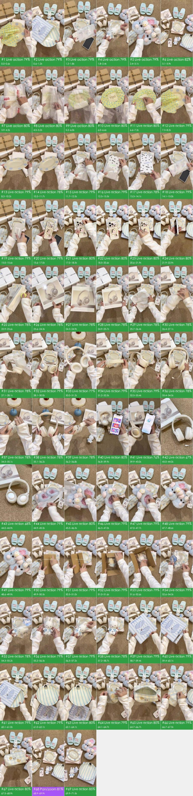

## What makes it work

- **The hook**: 0–3.1 s flashes 5 product shots of under 0.7 s each (two plates, phone case, Miffy, slippers) as the title 沉浸式居家购物开箱 types out; a flat lay of everything at 3.1 s shows what is coming
- From 3.9 s each item starts in its packaging: tape slit, bubble wrap pulled, cloth untied (the plate only shows at 7.3 s); the tearing sound and slow reveal keep viewers waiting for the product
- Each item gets one very short line (12 s 好久没买手机壳了, 17 s 装上新皮肤, 20.6 s 支架可以调整), set small in the upper middle so it never covers the product, standing in for a voice-over
- The priciest item, the headphones, gets 22 s (22.9–44.9 s), one feature per shot: detachable mic (32.5 s), sliding headband (34.5 s), app and 50 dB noise cancelling (36.8–43 s)
- 68.9 s returns to the flat lay of all items (大合照) and 69.9 s says 拜拜噜 下次见, echoing the flat lay at 3.1 s

## At a glance: picture, packaging, sound

Any short video splits into three layers: the picture, what is laid on top of it (subtitles, styled text, stickers), and the sound. Remake it one layer at a time.

| Layer | In this video | How to make it | Detail |
|---|---|---|---|
| **Picture** (base) | live action 68 shots, still image + pan/zoom 1 shot | filmed in 3 scenes; a single image held or moved | “Remake it yourself” |
| **Packaging** (on top) | graphic, text, subtitle, static sticker | add in the editor: subtitles, styled text and stickers by the timeline | “Packaging layer” |
| **Sound** | voice（human recording）, music (92 BPM, to confirm) | voice: record it yourself; music: find a track with the same tempo and mood | “Sound” |

## Content and structure

- The narrative line below comes from reading each shot; the lines were not transcribed separately, subtitle text is under “Packaging layer”

**Narrative line**

Keep this line in a remake: same order, same job at each step, with the point refilled from your own cases, numbers and material, so it is more than a change of subject.

| Time | Shots | Job | What it says |
|---|---|---|---|
| 0.0–3.1s | #1–#5 | grab attention | Under a second per item: flash the finished products first so viewers know what this episode opens → Second flash: a new colour and shape keeps it fresh → Third flash while the title types itself out → Fourth flash: a cute plush sets the style expectation → Fifth flash: a squeeze to show the texture closes the preview |
| 3.1–3.9s | #6 | set the scene | A flat lay of everything up front shows how many items this episode covers |
| 3.9–7.3s | #7–#11 | add information | Start from slitting the courier tape to enter the first item → One line names the first item → Layer after layer of wrapping stretches out the wait before the reveal → Pause on the packaging details → Undo the last layer of wrapping |
| 7.3–8.2s | #12 | deliver the conclusion | Wrapping off: the product appears in full for the first time |
| 8.2–10.2s | #13 | add information | One line says what it is for |
| 10.2–11.7s | #14 | show evidence | Several angles to show the material |
| 11.7–12.5s | #15 | set the scene | Next item: one line gives the reason for buying it |
| 12.5–15.6s | #16–#19 | add information | Show the packaging box → Open the box for the reveal → The feel of peeling the film → Keep removing the extras |
| 15.6–17.0s | #20 | deliver the conclusion | Show the whole print |
| 17.0–20.6s | #21, #22 | show evidence | Put it on the phone to see how it looks → The finished look once fitted |
| 20.6–21.9s | #23 | add information | Point out one feature |
| 21.9–22.9s | #24 | show evidence | Prove the stand really holds the phone up |
| 22.9–23.6s | #25 | set the scene | Introduce the biggest item of the video |
| 23.6–28.1s | #26–#31 | add information | The feel of stripping the shrink wrap → Show the front of the package → Pause for a close look at the box → Invite the viewer to open it together → The product comes out bit by bit → (… 6 points, each shot in the shot list) |
| 28.1–30.0s | #32 | deliver the conclusion | Say why the colour is liked |
| 30.0–33.4s | #33–#35 | add information | A squeeze shows it is comfortable to wear → Show the headband's flex → Name a use case |
| 33.4–34.5s | #36 | show evidence | Show the full set with the mic |
| 34.5–35.1s | #37 | add information | Point out another feature |
| 35.1–36.8s | #38, #39 | show evidence | Look at the design from several angles → Repeat the adjustment demo |
| 36.8–39.9s | #40 | add information | Use the phone app to add manual-style information |
| 39.9–43.0s | #41 | show evidence | Close with a listening test and name the sound quality and noise cancelling |
| 43.0–44.0s | #42 | deliver the conclusion | Switch to a low angle for a conclusion shot |
| 44.0–44.9s | #43 | set the mood | An empty shot to let the viewer pause |
| 44.9–45.5s | #44 | set the scene | Introduce the next item |
| 45.5–47.7s | #45–#47 | add information | Take the product out → Remove the extras → Show the lining |
| 47.7–48.6s | #48 | deliver the conclusion | Show the full pair |
| 48.6–49.9s | #49 | show evidence | Touch proves it is soft |
| 49.9–50.5s | #50 | set the scene | Introduce the next item by guessing what is inside |
| 50.5–51.0s | #51 | add information | Open the box |
| 51.0–51.6s | #52 | deliver the conclusion | Write the emotion out at the reveal |
| 51.6–55.2s | #53–#55 | add information | Take it out → Show the tag and the keychain → Take the product out |
| 55.2–56.5s | #56 | deliver the conclusion | A front close-up with an exclamation |
| 56.5–57.2s | #57 | add information | Remove the packaging |
| 57.2–58.7s | #58 | deliver the conclusion | Hold still for a cute close-up |
| 58.7–59.4s | #59 | set the scene | Introduce the next item |
| 59.4–61.0s | #60, #61 | add information | Open the bag → Say what it is |
| 61.0–62.1s | #62 | deliver the conclusion | Point out the cutest detail |
| 62.1–64.1s | #63 | show evidence | Stay longer on the detail |
| 64.1–64.7s | #64 | set the scene | The last item is something self-made, with a sharing tone |
| 64.7–67.5s | #65, #66 | add information | Show the capacity and the print → A closing action |
| 67.5–69.9s | #67, #68 | deliver the conclusion | Point out the print detail → Back to the flat lay of everything, echoing the opening |
| 69.9–71.5s | #69 | call to action | Say goodbye and promise the next episode |

## Shot list

Picture, Camera and Overlays are what is visible on screen; Made with and Material are the tools' inference, with the basis in the shot-by-shot appendix.

| # | Frames | Time | Length | What it says | Picture | Camera | Overlays | Made with (inferred) | Material (inferred) | Remake |
|---|---|---|---|---|---|---|---|---|---|---|
| 1 | 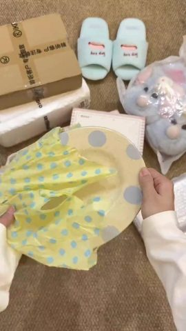 | 0:00.0 | 0.6s | grab attention: Under a second per item: flash t… | The right hand pulls a pale-yellow oval … | smooth move | graphic | live action 79% | live footage | reshoot · S1 |
| 2 | 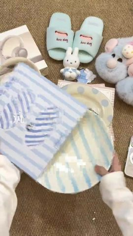 | 0:00.6 | 0.6s | grab attention: Second flash: a new colour and s… | Both hands slide a round plate with pale… | static (subject moves) | text, graphic | live action 79% | live footage | reshoot · S1 |
| 3 | 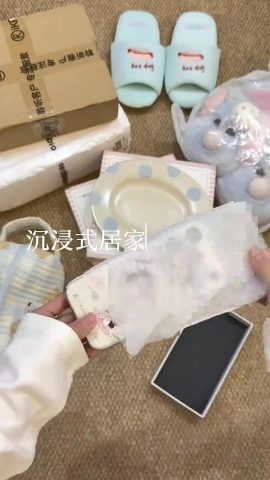 | 0:01.2 | 0.6s | grab attention: Third flash while the title type… | The left hand holds a cream phone case p… | static | text, graphic | live action 79% | live footage | reshoot · S1 |
| 4 |  | 0:01.8 | 0.5s | grab attention: Fourth flash: a cute plush sets … | The left hand holds a Miffy keychain in … | static (subject moves) | text, graphic | live action 79% | live footage | reshoot · S1 |
| 5 |  | 0:02.4 | 0.7s | grab attention: Fifth flash: a squeeze to show t… | Both hands squeeze a fluffy light-blue p… | static | text, graphic | live action 79% | live footage | reshoot · S1 |
| 6 | 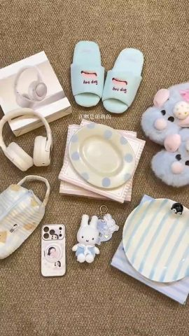 | 0:03.1 | 0.8s | set the scene: A flat lay of everything up front… | No hands in frame, all items laid out fl… | smooth move | text | live action 82% | live footage | reshoot · S1 |
| 7 | 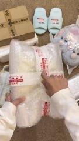 | 0:03.9 | 0.7s | add information: Start from slitting the courier… | The left hand holds a bubble-wrapped par… | static (subject moves) | text, graphic | live action 80% | live footage | reshoot · S1 |
| 8 | 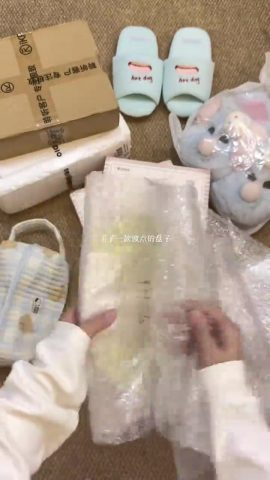 | 0:04.5 | 0.6s | add information: One line names the first item | Both hands pull the bubble wrap apart, r… | static (subject moves) | graphic | live action 80% | live footage | reshoot · S1 |
| 9 | 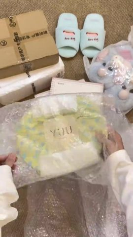 | 0:05.2 | 0.8s | add information: Layer after layer of wrapping s… | Keep pulling off the bubble wrap and lif… | static (subject moves) | graphic | live action 80% | live footage | reshoot · S1 |
| 10 |  | 0:06.0 | 0.6s | add information: Pause on the packaging details | Both hands hold the cloth-wrapped plate … | static | — | live action 80% | live footage | reshoot · S1 |
| 11 | 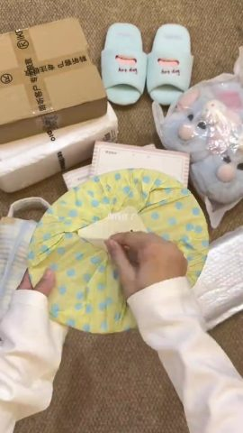 | 0:06.6 | 0.7s | add information: Undo the last layer of wrapping | The right hand unties the knot on top of… | static (subject moves) | graphic | live action 80% | live footage | reshoot · S1 |
| 12 | 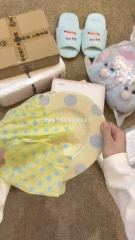 | 0:07.3 | 0.9s | deliver the conclusion: Wrapping off: the produc… | Pull the pale-yellow blue-dotted oval pl… | static | subtitle, graphic | live action 79% | live footage | reshoot · S1 |
| 13 | 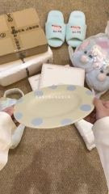 | 0:08.2 | 2.0s | add information: One line says what it is for | Both hands hold the rim and tilt the pla… | static | text, graphic | live action 79% | live footage | reshoot · S1 |
| 14 | 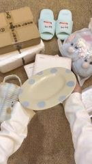 | 0:10.2 | 1.5s | show evidence: Several angles to show the materi… | Move the plate to the left and turn it t… | static | graphic | live action 78% | live footage | reshoot · S1 |
| 15 | 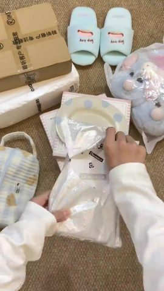 | 0:11.7 | 0.8s | set the scene: Next item: one line gives the rea… | Pull a small white printed box out of a … | static (subject moves) | text, graphic | live action 79% | live footage | reshoot · S1 |
| 16 | 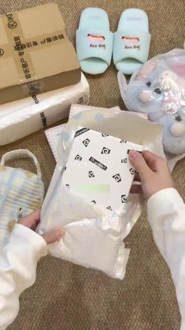 | 0:12.5 | 0.8s | add information: Show the packaging box | Take the white box printed with STRONG P… | static (subject moves) | graphic | live action 79% | live footage | reshoot · S1 |
| 17 | 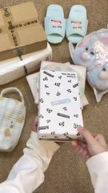 | 0:13.3 | 0.9s | add information: Open the box for the reveal | Open the lid of the white box to reveal … | static (subject moves) | graphic | live action 78% | live footage | reshoot · S1 |
| 18 | 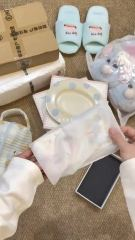 | 0:14.1 | 0.8s | add information: The feel of peeling the film | Peel the clear film off the phone case; … | static | graphic | live action 79% | live footage | reshoot · S1 |
| 19 | 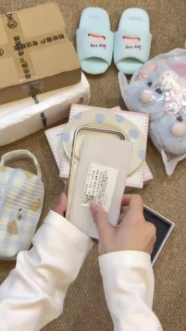 | 0:15.0 | 0.7s | add information: Keep removing the extras | Tear the paper insert out of the inside … | static (subject moves) | graphic | live action 79% | live footage | reshoot · S1 |
| 20 |  | 0:15.6 | 1.4s | deliver the conclusion: Show the whole print | Both hands hold up the case to show the … | static | text, graphic | live action 79% | live footage | reshoot · S1 |
| 21 | 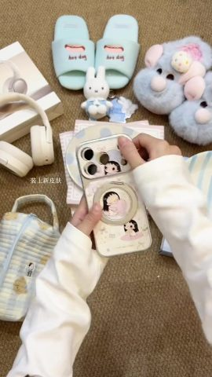 | 0:17.0 | 1.5s | show evidence: Put it on the phone to see how it… | Fit the case onto a phone and press the … | static | text, graphic | live action 80% | live footage | reshoot · S1 |
| 22 | 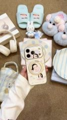 | 0:18.5 | 2.0s | show evidence: The finished look once fitted | Hold up the phone in its new case and ti… | static (subject moves) | text, graphic | live action 80% | live footage | reshoot · S1 |
| 23 | 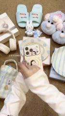 | 0:20.6 | 1.3s | add information: Point out one feature | The right hand flips open the magnetic r… | static (subject moves) | text, graphic | live action 80% | live footage | reshoot · S1 |
| 24 | 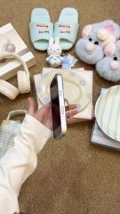 | 0:21.9 | 1.0s | show evidence: Prove the stand really holds the … | Stand the phone on its ring stand with i… | static | — | live action 80% | live footage | reshoot · S1 |
| 25 | 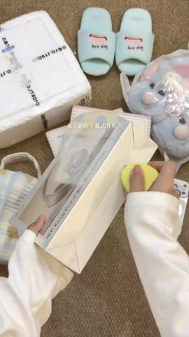 | 0:22.9 | 0.7s | set the scene: Introduce the biggest item of the… | The left hand holds the white headphone … | static (subject moves) | text, graphic | live action 78% | live footage | reshoot · S1 |
| 26 | 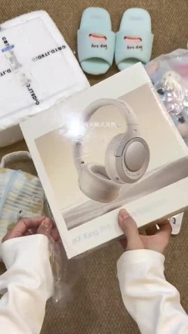 | 0:23.6 | 0.8s | add information: The feel of stripping the shrin… | Both hands lift the outer box printed wi… | static (subject moves) | text, graphic | live action 78% | live footage | reshoot · S1 |
| 27 | 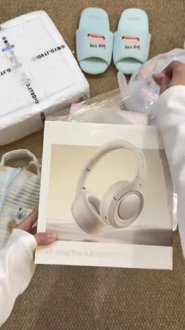 | 0:24.3 | 0.6s | add information: Show the front of the package | Set the box straight in the center to sh… | static (subject moves) | graphic | live action 78% | live footage | reshoot · S1 |
| 28 | 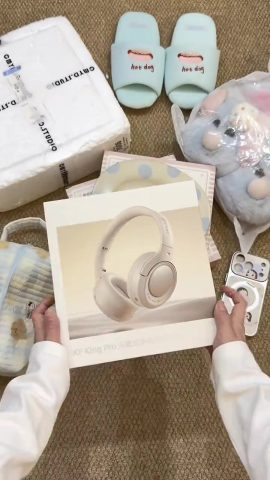 | 0:24.9 | 0.8s | add information: Pause for a close look at the b… | Both hands hold the box still, showing t… | static | text | live action 78% | live footage | reshoot · S1 |
| 29 | 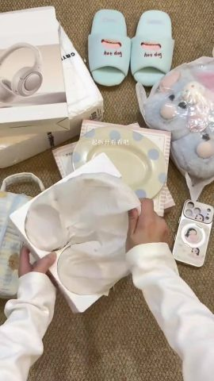 | 0:25.7 | 0.7s | add information: Invite the viewer to open it to… | Open the inner box and lift the white ti… | static (subject moves) | text, graphic | live action 78% | live footage | reshoot · S1 |
| 30 | 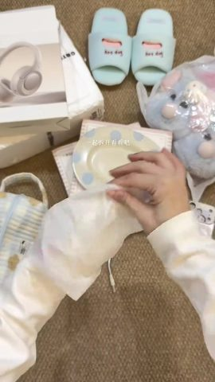 | 0:26.4 | 0.8s | add information: The product comes out bit by bi… | Lift the cream headphones out of the tis… | static (subject moves) | text, graphic | live action 78% | live footage | reshoot · S1 |
| 31 | 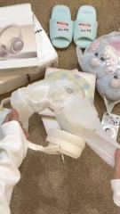 | 0:27.1 | 1.0s | add information: Fully out of the wrapping | Shake the tissue off; the headband swing… | static (subject moves) | text, graphic | live action 78% | live footage | reshoot · S1 |
| 32 | 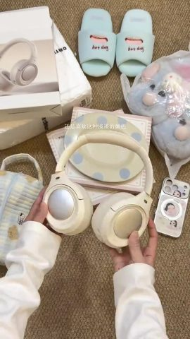 | 0:28.1 | 1.9s | deliver the conclusion: Say why the colour is li… | Each hand holds one ear cup, showing the… | static | text, graphic | live action 79% | live footage | reshoot · S1 |
| 33 | 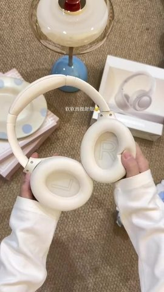 | 0:30.0 | 1.2s | add information: A squeeze shows it is comfortab… | Both hands squeeze the inner cushions of… | static | text | live action 77% | live footage | reshoot · S2 |
| 34 | 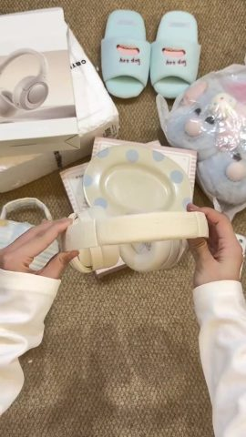 | 0:31.2 | 1.3s | add information: Show the headband's flex | Both hands stretch the headband sideways… | static | graphic | live action 79% | live footage | reshoot · S1 |
| 35 | 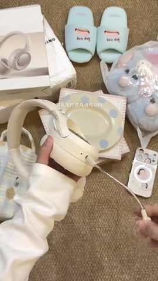 | 0:32.5 | 0.9s | add information: Name a use case | One hand holds the headphones while the … | smooth move | text, graphic | live action 79% | live footage | reshoot · S1 |
| 36 | 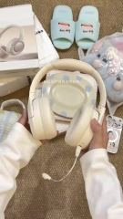 | 0:33.4 | 1.1s | show evidence: Show the full set with the mic | Both hands lift the headphones with the … | static | text, graphic | live action 78% | live footage | reshoot · S1 |
| 37 | 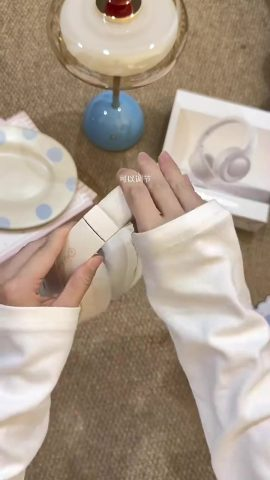 | 0:34.5 | 0.6s | add information: Point out another feature | Both hands extend the headband slider, s… | static (subject moves) | subtitle, graphic | live action 78% | live footage | reshoot · S2 |
| 38 | 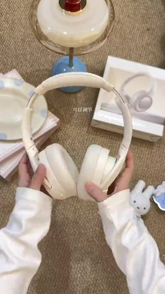 | 0:35.1 | 1.1s | show evidence: Look at the design from several a… | Hold the headphones up facing the camera… | static (subject moves) | graphic | live action 78% | live footage | reshoot · S2 |
| 39 |  | 0:36.2 | 0.6s | show evidence: Repeat the adjustment demo | Pull the headband slider once more (clos… | static (subject moves) | graphic | live action 78% | live footage | reshoot · S2 |
| 40 |  | 0:36.8 | 3.1s | add information: Use the phone app to add manual… | The left hand holds a phone next to the … | static | subtitle, text, graphic | live action 80% | live footage | reshoot · S1 |
| 41 | 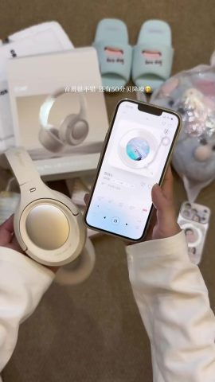 | 0:39.9 | 3.1s | show evidence: Close with a listening test and n… | The left hand holds the headphones, the … | static | subtitle, text, static sticker | live action 76% | live footage | reshoot · S1 |
| 42 | 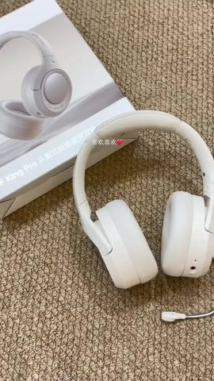 | 0:43.0 | 1.0s | deliver the conclusion: Switch to a low angle fo… | The headphones lie flat with the mic rea… | smooth move | text, static sticker | live action 67% | live footage | reshoot · S3 |
| 43 | 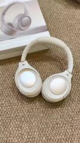 | 0:44.0 | 0.9s | set the mood: An empty shot to let the viewer pa… | The headphones lie flat with both pearly… | smooth move | — | live action 68% | live footage | reshoot · S3 |
| 44 | 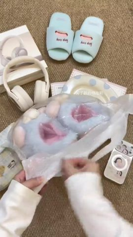 | 0:44.9 | 0.6s | set the scene: Introduce the next item | Tear open a clear plastic bag to reveal … | static | text, graphic | live action 79% | live footage | reshoot · S1 |
| 45 | 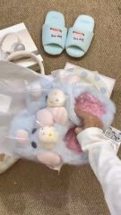 | 0:45.5 | 0.9s | add information: Take the product out | Take the plush slippers out of the bag a… | static | subtitle, graphic | live action 80% | live footage | reshoot · S1 |
| 46 | 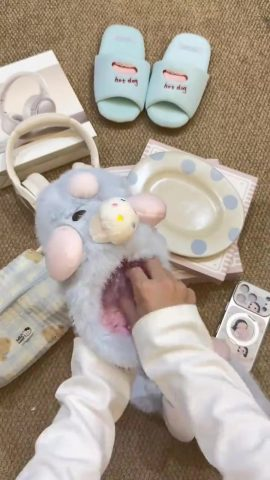 | 0:46.3 | 0.7s | add information: Remove the extras | Reach into a slipper and pull out the cl… | static | graphic | live action 79% | live footage | reshoot · S1 |
| 47 | 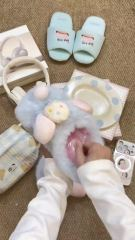 | 0:47.0 | 0.7s | add information: Show the lining | Pull the insert out of the other slipper… | static | text, graphic | live action 79% | live footage | reshoot · S1 |
| 48 | 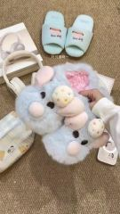 | 0:47.7 | 1.0s | deliver the conclusion: Show the full pair | Both hands set the pair of slippers side… | static | subtitle, graphic | live action 79% | live footage | reshoot · S1 |
| 49 | 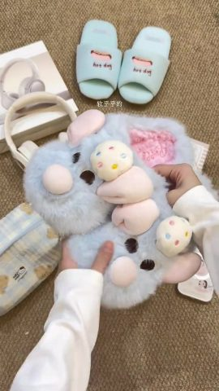 | 0:48.6 | 1.2s | show evidence: Touch proves it is soft | Both hands squeeze the long fur on the s… | static | subtitle, graphic | live action 79% | live footage | reshoot · S1 |
| 50 | 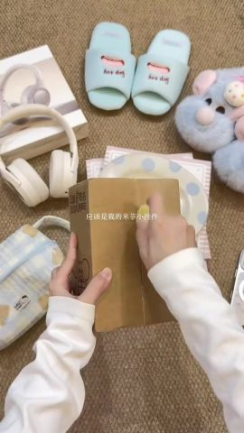 | 0:49.9 | 0.6s | set the scene: Introduce the next item by guessi… | Hold a kraft box and slit it along the c… | static (subject moves) | text, graphic | live action 79% | live footage | reshoot · S1 |
| 51 | 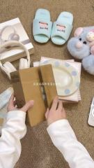 | 0:50.5 | 0.5s | add information: Open the box | Fold back both flaps to reveal a clear b… | static (subject moves) | text, graphic | live action 79% | live footage | reshoot · S1 |
| 52 | 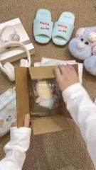 | 0:51.0 | 0.6s | deliver the conclusion: Write the emotion out at… | Open the box to see Miffy inside the bag… | static (subject moves) | subtitle, graphic | live action 79% | live footage | reshoot · S1 |
| 53 | 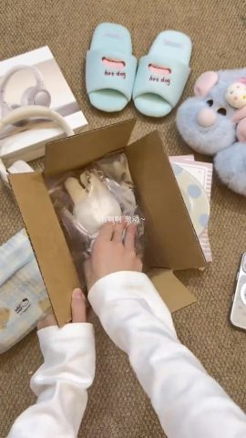 | 0:51.6 | 1.0s | add information: Take it out | Lift the clear bag with Miffy out of the… | static (subject moves) | text, graphic | live action 79% | live footage | reshoot · S1 |
| 54 |  | 0:52.6 | 1.7s | add information: Show the tag and the keychain | Hold up the bag to show the Miffy keycha… | static (subject moves) | graphic | live action 79% | live footage | reshoot · S1 |
| 55 | 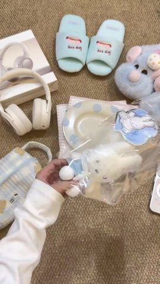 | 0:54.3 | 0.9s | add information: Take the product out | Pull the Miffy keychain out of the bag, … | static (subject moves) | text, graphic | live action 78% | live footage | reshoot · S1 |
| 56 | 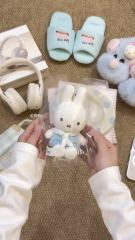 | 0:55.2 | 1.2s | deliver the conclusion: A front close-up with an… | Both hands hold Miffy up through the cle… | static | text, graphic | live action 79% | live footage | reshoot · S1 |
| 57 |  | 0:56.5 | 0.7s | add information: Remove the packaging | Pull the bag away and hold Miffy in the … | static (subject moves) | text, graphic | live action 79% | live footage | reshoot · S1 |
| 58 |  | 0:57.2 | 1.6s | deliver the conclusion: Hold still for a cute cl… | Miffy rests in the palm, facing the came… | static | text | live action 78% | live footage | reshoot · S1 |
| 59 |  | 0:58.7 | 0.7s | set the scene: Introduce the next item | Both hands pick up a blue-and-white stri… | static (subject moves) | graphic | live action 79% | live footage | reshoot · S1 |
| 60 |  | 0:59.4 | 0.7s | add information: Open the bag | Open the mouth of the bag to show the pl… | static (subject moves) | subtitle, graphic | live action 79% | live footage | reshoot · S1 |
| 61 |  | 1:00.1 | 0.9s | add information: Say what it is | Slide the pale-blue striped round plate … | static (subject moves) | subtitle, graphic | live action 79% | live footage | reshoot · S1 |
| 62 |  | 1:01.0 | 1.1s | deliver the conclusion: Point out the cutest det… | Both hands hold the striped plate with t… | static | text, graphic | live action 79% | live footage | reshoot · S1 |
| 63 |  | 1:02.1 | 1.9s | show evidence: Stay longer on the detail | Slowly tilt the plate side to side to sh… | static | subtitle, graphic | live action 80% | live footage | reshoot · S1 |
| 64 |  | 1:04.1 | 0.6s | set the scene: The last item is something self-m… | Unzip a gingham pouch (main top-down ang… | static (subject moves) | text, graphic | live action 79% | live footage | reshoot · S1 |
| 65 |  | 1:04.7 | 2.1s | add information: Show the capacity and the print | Open the pouch to show the inside, then … | static (subject moves) | subtitle, graphic | live action 80% | live footage | reshoot · S1 |
| 66 |  | 1:06.7 | 0.7s | add information: A closing action | Zip the pouch closed (main top-down angl… | static (subject moves) | text, graphic | live action 79% | live footage | reshoot · S1 |
| 67 |  | 1:07.5 | 1.4s | deliver the conclusion: Point out the print deta… | Lift the pouch and turn it side to side … | static (subject moves) | text, graphic | live action 80% | live footage | reshoot · S1 |
| 68 |  | 1:08.9 | 1.0s | deliver the conclusion: Back to the flat lay of … | No hands in frame, the camera slowly pan… | smooth move | subtitle | still image + pan/zoom 81% | photo | local ffmpeg move |
| 69 |  | 1:09.9 | 1.6s | call to action: Say goodbye and promise the next… | The camera keeps drifting across the fla… | smooth move | text | live action 85% | live footage | reshoot · S1 |

## Remake it yourself: do it in this order

Copy the method and the rhythm, not the pictures.

1. **Plan the content**: write your script on the narrative line under “Content and structure”
2. **Collect material**: see “What to prepare” below
3. **Shoot**: 3 scenes, 7 camera setups, see “Shoot” below
4. **Stills / moves**: see “Local rebuild” below
5. **Edit**: see “Edit” below
6. **Packaging**: the subtitle file `packaging/subtitles.srt` imports straight into an editor; styles and timeline under “Packaging layer”
7. **Sound**: see “Sound”; every effect can be played first
8. **Compare**: watch yours next to the original: shot lengths, subtitle positions, where the music comes in and drops

### What to prepare

- Real files shown in the picture (screenshots, photos, recordings; get the originals):
  - **photo** (whole frame): shots #68, 1.0s in all
  - **photo** (part of the frame), The creator's own flat-lay photo of all items (whole frame): shots #68, 1.0s in all

### Shoot

Shoot every shot of one scene before moving to the next; within a scene, shoot the wider sizes first and the close-ups last so the lighting is set only once. Leave about 1s of handle at both ends of every take.

**S1**: shots #1–#32, #34–#36, #40, #41, #44–#67, #69 (65.13s on screen); Brown woven carpet on a bedroom floor (shot from directly above), Carpet fills the frame; light-blue slippers, plush slippers and parcels along the top; unboxed items gradually join the background
- Lighting: Single soft ceiling light, flat lighting, phone directly overhead, pale props as natural bounce
- Setup full shot · moving camera (gimbal / handheld pan) · pan / track/pull-out: shots #6, #69, 2.4s on screen, shoot about 6.4s
- Setup medium shot · fixed camera (tripod / mount / on the desk) · static: shots #2, #4, #5, #7, #16, #18, #20, #22, #23, #25, #28–#30, #32, #36, #50–#56, #58–#66, 31.77s on screen, shoot about 93.8s
- Setup medium close-up · moving camera (gimbal / handheld pan) · static: shots #1, #35, 1.5s on screen, shoot about 5.5s
- Setup medium close-up · fixed camera (tripod / mount / on the desk) · static: shots #3, #8–#15, #17, #19, #21, #24, #26, #27, #31, #34, #40, #41, #44–#46, #48, #49, #57, #67, 28.8s on screen, shoot about 80.8s
- Setup close-up · fixed camera (tripod / mount / on the desk) · static: shots #47, 0.67s on screen, shoot about 2.7s

**S2**: shots #33, #37–#39 (3.5s on screen); By the lamp on the same carpet, A mushroom lamp with a blue base and the headphone box at the top of the frame
- Lighting: Single soft ceiling light, flat lighting, phone directly overhead, pale props as natural bounce
- Setup medium close-up · fixed camera (tripod / mount / on the desk) · static: shots #33, #37–#39, 3.5s on screen, shoot about 11.5s

**S3**: shots #42, #43 (1.87s on screen); Same carpet (low-angle close shot), Headphones lying flat on the carpet, the box at an angle in the top-left corner
- Lighting: Single soft ceiling light, flat lighting, phone directly overhead, pale props as natural bounce
- Setup medium close-up · moving camera (gimbal / handheld pan) · pan / track/push-in: shots #42, #43, 1.87s on screen, shoot about 5.9s

### Local rebuild

- #68 still image + pan/zoom 1.0s: one image + the measured zoom / pan parameters, rendered straight from ffmpeg

### Edit

- Cut in the order and lengths of the shot list
- Approach: About 57 cuts per minute; 0–3.1 s flashes each item for under 0.7 s as a preview; the unboxing is cut one action per shot (open parcel → unwrap → reveal → show details), mostly jump cuts on the same angle; one short subtitle per item; ends back on the flat lay
- Rhythm: 57.0 cuts per minute, 1.04s average live-action shot; 3 camera set-up(s) / location(s); 11 jump cut(s) and 9 punch-in(s) within the same set-up; inserts (screenshots / screen recordings / cards / stock) take 1%; 80% of cuts land in pauses of the speech (cutting on breaths); transitions cut×21, jump cut×47

## Cast, scenes and props

| Id | Name | Kind | Look | Role | Voice | Shots |
|---|---|---|---|---|---|---|
| A | Unboxing creator (hands only) | person | Only a pair of hands and the sleeves of a loose white sweatshirt; slim fingers, short plain nails, face never shown | Unboxes and shows every product | Does not speak; subtitles stand in for a voice-over | #1–#5, #7–#41, #44–#67 |

**Scenes**

| Scene | Where | When | Set / light | Shots |
|---|---|---|---|---|
| S1 | Brown woven carpet on a bedroom floor (shot from directly above) | Indoors at night | Carpet fills the frame; light-blue slippers, plush slippers and parcels along the top; unboxed items gradually join the background | #1–#32, #34–#36, #40, #41, #44–#69 |
| S2 | By the lamp on the same carpet | Indoors at night | A mushroom lamp with a blue base and the headphone box at the top of the frame | #33, #37–#39 |
| S3 | Same carpet (low-angle close shot) | Indoors at night | Headphones lying flat on the carpet, the box at an angle in the top-left corner | #42, #43 |

**Props / products / logos**

- Pale-yellow oval plate with blue polka dots (YUU) (shots #1, #7–#14): Wrapped in a yellow blue-dotted cloth, then bubble wrap
- Phone case with a cartoon-girl print (shots #3, #15–#24): Cream, magnetic ring stand on the back; white printed box reading STRONG PROTECTION
- Cream over-ear headphones (shots #25–#43): Pearly ear cups, detachable mic, sliding headband; box printed King Pro; comes with a phone app
- Light-blue plush slippers (shots #5, #44–#49): Long fur, pink piggy and cupcake details on top, pink lining
- Miffy keychain (shots #4, #50–#58): Blue sailor outfit, metal ring; packed in a kraft box and a clear bag
- Blue-and-white striped penguin plate (PAPA PLATE) (shots #2, #59–#63): A small black penguin stands on the rim; packed in a blue-and-white striped bag
- Gingham bear pouch (shots #64–#67): Pale blue/yellow gingham, bear print, Hello Kitty fabric label; made by the creator
- Light-blue hot dog slippers (shots #1–#32, #34–#36, #40, #41, #44–#69): Background prop with hot dog printed on top, at the top of almost every shot

## Camera and lighting

- Visual style: Top-down flat lay under warm indoor light at night; macaron palette of cream, pale blue and pale yellow; soft, low-saturation, cute Japanese home style
- Framing: shot size medium close-up 51%, medium shot 45%, full shot 3%; camera angle top-down; subject is the in-focus region (no face; shot size is an estimate)
- Camera: fixed camera (tripod / mount / on the desk) 92%, moving camera (gimbal / handheld pan) 8%; typical move pan / track
- Lighting: One soft indoor ceiling light at night, overhead and slightly in front; white sleeves and pale products bounce the light; no fill or rim light; warm yellow overall (image reading; pixel measurements in the fold below)
- Grade: airy Japanese-style (bright, low saturation, lifted blacks); normal saturation, normal contrast, lifted blacks (greyish shadows), overall neutral
- Format: tabletop / object shoot (face as subject 3%, objects / hands as subject 97%, handheld 8%); image readers: Top-down ASMR unboxing vlog with no voice-over (haul / favourite finds)

Per-item measurements and image readings (22)

| Aspect | Item | Verdict | Sources |
|---|---|---|---|
| Framing | shot size | medium close-up | measured; agent review |
| Framing | camera angle | top-down (directly overhead) | agent review |
| Framing | composition | Product centred slightly low; the top third is left for already-unboxed items as background; vertical | agent review |
| Camera | camera support | Overhead phone stand | measured: fixed camera (tripod / mount / on the desk); agent review |
| Camera | lens | Phone rear main camera | agent review |
| Camera | speed | Normal (hand movements and packaging move at normal speed) | agent review |
| Camera | set-ups / locations | 4 setups: (1) main angle, phone on a stand directly above the carpet, most unboxing shots; (2) a closer top-down shot by the lamp (shots 33, 37–39); (3) a low handheld close shot of the headphones (shots 42–43); (4) a wide flat lay of all items, handheld slow pan (shots 6, 68, 69) | agent review |
| Camera | likely gear | Phone rear main camera + floor/desk overhead stand (an arm holding the phone above the carpet); the flat lay and the headphone close shots are handheld | agent review |
| Lighting | location | Indoors; night (phone clock shows 23:16); on a bedroom carpet | agent review |
| Lighting | key light | Room ceiling light from overhead, slightly in front, broad and diffuse; hands and products cast almost no visible shadows | agent review |
| Lighting | soft / hard | soft light (wide lit-to-shadow ramp) | measured; agent review: Soft (shadow edges under arms and plates are very blurred) |
| Lighting | fill | No dedicated fill; white sleeves, white boxes and pale products bounce light into the shadows, which stay light | agent review |
| Lighting | rim / backlight | No rim light | agent review |
| Lighting | catchlight | Not applicable (no face) | agent review |
| Lighting | practicals | None (the mushroom lamp at the top of shots 33, 37–39 does not look switched on) | agent review |
| Lighting | colour temperature | warm (about 3000–4000K) | measured; agent review: Warm (indoor light around 3500K; carpet and cream products lean warm yellow) |
| Lighting | lighting set-up | Single soft ceiling light, flat lighting, phone directly overhead, pale props as natural bounce | agent review |
| Lighting | overall lighting | One soft indoor ceiling light at night, overhead and slightly in front; white sleeves and pale products bounce the light; no fill or rim light; warm yellow overall | agent review |
| Grade | colour grade | airy Japanese-style (bright, low saturation, lifted blacks) | measured; agent review: Creamy, low-saturation warm look (Japanese clean style): lifted blacks, greyish warm shadows, bright and soft overall with no strong contrast |
| Grade | overall grade | Creamy, low-saturation warm look with lifted blacks, close to a Japanese clean style | agent review |
| Editing | editing style | About 57 cuts per minute; 0–3.1 s flashes each item for under 0.7 s as a preview; the unboxing is cut one action per shot (open parcel → unwrap → reveal → show details), mostly jump cuts on the same angle; one short subtitle per item; ends back on the flat lay | agent review |
| Format | video format | Top-down ASMR unboxing vlog with no voice-over (haul / favourite finds) | measured: tabletop / object shoot; agent review |

- Note: lighting ratio, soft / hard, colour temperature and shot size are measured on the subject's pixels (the face when there is one, otherwise the in-focus region, which is an estimate); platform transcodes crush the shadows, so hardness and fill read conservative; camera angle, light source, catchlight and rim light follow the image readers. Where measurement and readers disagree, both are listed.

## Packaging layer (subtitles / styled text / stickers / sound-effect hits)

- 28 subtitle lines (middle, up to 1 rows): brown text, keywords highlighted in white, line height 2.2%; entrance: hard in×13, scale pop×5, slide in×3; keywords change colour as they are spoken
- title ×2: "沉浸式居家购物", "沉浸式居家购物开箱"
- Stickers / GIFs: Smiley emoji ×1, Red heart emoji ×1
- Placed by spoken line ×2 (with new wording they follow the line, not the old second): Smiley emoji → 0.3s after "app里有贴心的介绍", Red heart emoji → 0.0s into "喜欢喜欢"
- Exports: `packaging/subtitles.srt`, `packaging/overlays.ass`, `packaging/timeline.json` (SRT is the subtitle timeline; ASS carries colour, outline, position and entrance animation, swap in the original font; timeline.json is the full timeline)

text timeline (30 rows)

| Time | Kind | Text | Style | In / out | SFX |
|---|---|---|---|---|---|
| 1.00–1.80s | title · follows an object | 沉浸式居家购物 | white text, white box, keywords highlighted in brown, line height 4.9% (about 63px) | type-on | — |
| 1.80–3.10s | title | 沉浸式居家购物开箱 | white text, white box, keywords highlighted in grey, line height 4.7% (about 60px) | hard out | — |
| 3.00–3.60s | subtitle | 真嘟是萌萌的 | brown text, keywords highlighted in orange, line height 2.3% (about 29px) | slide in / hard out | — |
| 4.50–4.80s | subtitle | 款波点的体子 | white text, line height 2.3% (about 30px) | hard in / hard out | — |
| 7.30–10.20s | subtitle | 拿来放早餐应该是很完美了 | yellow text, line height 2.0% (about 26px) | hard in / hard out | — |
| 12.00–12.10s | subtitle | 好久没买手机壳 | grey text, keywords highlighted in grey, line height 1.8% (about 23px) | hard in / hard out | — |
| 17.00–18.50s | subtitle | 装上新皮肤 | brown text, line height 2.3% (about 29px) | hard in / hard out | — |
| 20.50–21.80s | subtitle | 支架可以调整 | brown text, line height 2.0% (about 26px) | pop / hard out | — |
| 22.90–24.10s | subtitle | 买了新的头戴式耳机 | grey text, line height 2.5% (about 32px) | hard in / hard out | — |
| 25.50–27.10s | subtitle | 起拆开看看吧 | yellow text, line height 2.1% (about 27px) | hard out | — |
| 28.00–30.00s | subtitle | 还是喜欢这种淡淡的颜色 | orange text, line height 2.2% (about 28px) | pop / hard out | — |
| 30.00–31.20s | subtitle | 软软的挺舒服 | brown text, line height 1.9% (about 24px) | hard in / hard out | — |
| 32.50–34.50s | subtitle | 和队友打游戏也可以用 | yellow text, line height 2.1% (about 27px) | hard in | — |
| 34.50–35.80s | subtitle | 可以调节 | brown text, keywords highlighted in white, line height 2.2% (about 28px) | fade out | — |
| 36.80–39.60s | subtitle | app里有贴心的介绍 | grey text, line height 2.3% (about 30px) | hard in | — |
| 37.50–39.90s | subtitle | 连接听一下 | grey text, line height 2.3% (about 29px) | hard out | — |
| 39.90–43.00s | subtitle | 音质很不错还有50分贝降噪 | grey text, line height 2.2% (about 28px) | hard in / hard out | — |
| 43.00–44.00s | subtitle | 喜欢喜欢 | red text, gradient, bold, line height 2.3% (about 30px) | hard in / fade out | — |
| 44.90–46.30s | subtitle | 买了新的棉拖鞋 | white text, line height 2.0% (about 26px) | hard in / slide out | — |
| 47.40–48.50s | subtitle | 好可爱呀 | brown text, line height 2.3% (about 29px) | pop | — |
| 48.50–49.90s | subtitle | 平乎的 | grey text, line height 1.9% (about 24px) | hard out | — |
| 49.90–51.00s | subtitle | 应该是我的米菲小挂件 | orange text, keywords highlighted in brown, line height 1.9% (about 25px) | hard in / hard out | — |
| 51.00–52.20s | subtitle | 啊啊啊激动 | grey text, keywords highlighted in white, line height 2.3% (about 30px) | hard out | — |
| 55.00–56.50s | subtitle | 萌翻啦！ | brown text, line height 2.3% (about 30px) | hard out | — |
| 57.00–58.70s | subtitle | 好可爱！ | brown text, line height 2.3% (about 30px) | pop / hard out | — |
| 60.00–60.90s | subtitle | 个小盘子 | brown text, line height 1.9% (about 24px) | slide in / shrink out | — |
| 61.00–63.00s | subtitle | 立体小企鹅 | brown text, line height 2.3% (about 29px) | hard in / hard out | — |
| 64.00–66.10s | subtitle | 哈哈哈一定要分享这个自己做的化妆包 | brown text, keywords highlighted in blue, line height 2.3% (about 29px) | pop / hard out | — |
| 66.50–68.90s | subtitle | 蓝色小熊 | grey text, line height 2.4% (about 31px) | hard out | — |
| 70.00–71.10s | subtitle | 拜拜噜下次见 | white text, keywords highlighted in brown, line height 1.8% (about 23px) | slide in / fade out | — |

**Stickers / GIFs / picture-in-picture**

| Time | Kind | Position | Motion | Confidence | Crop |
|---|---|---|---|---|---|
| 39.90–43.00s | Smiley emoji | Upper middle, right end of the subtitle | static | confirmed | — |
| 43.00–44.00s | Red heart emoji | Middle, right end of the subtitle | static | confirmed | — |

| Time | Layer | Spoken line |
|---|---|---|
| 39.90s | Smiley emoji | 0.3s after "app里有贴心的介绍" |
| 43.00s | Red heart emoji | 0.0s into "喜欢喜欢" |

Remake: burn subtitles and styled text in with `packaging/overlays.ass` (ffmpeg -vf ass=overlays.ass), or rebuild them from timeline.json in CapCut / Remotion; stickers and GIFs need matching assets (meme / GIF libraries), crops are under packaging/.

## Sound

- loudness -28.2 dBFS, peak -0.1 dBFS; sound runs across cuts, laid in post as one bed (background changes 8.0dB at cuts vs 6.3dB within shots)
- Sources: Video type: live footage (location sound + music added in post) → voice: human recording; music: stock library music (leaning, to confirm); SFX: location sound

**Voice**

- 29% of the duration; pitch about 128.2Hz (male-leaning)
- Source: human recording (human recording 73%, TTS voice-over 20%, native dialogue from the AI video model 7%)
  - 99% of the picture is live footage: the voice is most likely location sound or a human voice-over
- Remake: record it yourself: phone or lavalier mic close to the mouth, in a quiet room; rewrite the lines from the script table

**Music**

- Tempo: 92.3 BPM (or 46.1/184.6); key F major (confidence 0.845); 90% of the duration (0.5–71.0s); section changes at 7.5s, 39.5s, 43.5s, 50.0s, 55.0s; ending: ends_with_video
- Cuts vs beat: 15% of cuts land on a beat (chance: about 19%)
- Source: to confirm (stock library music 52%, AI-generated music 30%, well-known song 17%)
  - The music is a bed under the picture: in a regular video the bed usually comes from a stock library (prior)
  - The voice is speech / narration, not singing (sustained-pitch ratio 0.00): a regular "voice-over + music bed" video
  - Music and video end together: edited to length or custom-made (either source possible, weak evidence)
  - Nothing about this track beyond the format prior and weak cues like the ending (no source heard, no platform music tag): source to confirm; an AI-generated bed cannot be told from a library bed here
  - How to confirm: Check the music tag on the original Douyin / Xiaohongshu / TikTok post: a song title → existing track; "original sound - @creator" → uploaded by the creator (for music videos, usually an AI song)
  - How to confirm: Run it through Shazam / ACRCloud or another song-ID service: a hit means an existing song
- Remake: The original track leans stock library music: search a library by BPM / mood / key for a similar track, or generate a royalty-free track in a similar style with AI

**Sound effects** (0)

- No effects added in the edit were found

- Separated stems: `stems/original.wav` (original), `stems/vocals.wav` (dry voice), `stems/music.wav` (music + ambience), `stems/effects.wav` (effects track)
<!--stems-->

## Open questions

- No AI listened to the soundtrack (the review covered the picture only): real voice versus TTS is inferred from the waveform; the effects were found on the separated effects track and their types are estimated from the sound. Play the stems and each effect under “Sound” to check
- music source to confirm: most likely stock library music (52%); how to check is under “Sound”

## Appendix

### Shot by shot

Each shot has two parts: what is visible on screen, and how the tools infer it was made (with the basis); remake prompts last. Folded by default.

#1 00:00.000–00:00.633 · live action + code / editor overlays (static graphics); brings in real material (live footage)

**Visible on screen** (check against the frames)
- Picture: The right hand pulls a pale-yellow oval plate with blue polka dots out of a yellow polka-dot wrapping cloth and slides it to the center (main top-down angle)
- Camera / lighting: medium close-up; top-down; Overhead phone stand; soft frontal light (flat light); key light frontal (from the camera side; both sides of the subject about equally bright); lighting ratio about 1.2:1 (0.3 stops); soft light (almost no lit / shadow edge)
- [AI assistant review] Real hand actions: slitting tape, pulling bubble wrap, zipping; fingers and packaging deform physically, and printed words on the packaging (STRONG PROTECTION, YUU, PAPA PLATE, hot dog) are sharp, not garbled
- [AI assistant review] Background props (slippers, parcels, plush slippers) stay in place across neighbouring shots and change as the unboxing goes on

**How it was made, as inferred by the tools** (inferred, not seen)
- Inference: live action 72%, AI-generated video 11%, film / TV footage 5% (fused_agent)
- Material: the user's real material: live footage
- Basis (tool measurements, not necessarily visible to the eye):
  - Photographic texture: noise σ=0.35, 128 colours, 6% flat blocks
  - The whole file is native 30fps and photographic shots carry no 24fps-source duplicate frames (75% of the duration): typical of straight-from-phone footage, generators mostly output 24fps
  - Platform transcode (Douyin/TikTok) has compressed the sensor noise away, but the file and this shot are native 30fps with no 24fps-source duplicate frames: counted as phone footage

- Remake: Source is live action: reshoot per the shooting plan (shot size / camera setup / lighting); only fall back to AI image-to-video (first frame as reference) when a shoot is not possible; real material the user must supply: live footage (whole frame)
  - First-frame image prompt: medium close-up, top-down, Product centred slightly low; the top third is left for already-unboxed items as background; vertical. Vertical 9:16, phone directly overhead looking straight down at a brown woven carpet; light-blue slippers, fluffy blue plush slippers and parcels along the top; two hands in loose white long sleeves working in the lower middle; the first moment of: the right hand pulls a pale-yellow oval plate with blue polka dots out of a yellow polka-dot wrapping cloth and slides it to the center; soft warm indoor ceiling light, creamy low saturation, realistic phone-camera look
  - Video prompt: medium close-up, top-down, Product centred slightly low; the top third is left for already-unboxed items as background; vertical. Vertical 9:16, phone directly overhead looking straight down at a brown woven carpet; light-blue slippers, fluffy blue plush slippers and parcels along the top; two hands in loose white long sleeves working in the lower middle. The right hand pulls a pale-yellow oval plate with blue polka dots out of a yellow polka-dot wrapping cloth and slides it to the center, natural continuous motion, locked-off camera.

#2 00:00.633–00:01.233 · live action + code / editor overlays (text labels, static graphics); brings in real material (live footage)

**Visible on screen** (check against the frames)
- Picture: Both hands slide a round plate with pale-blue vertical stripes out of a striped bag; a small black penguin figure stands on the rim (main top-down angle)
- Camera / lighting: medium shot; top-down; Overhead phone stand; backlit / background brighter than subject; key light frontal (from the camera side; both sides of the subject about equally bright); lighting ratio about 1.0:1 (0.0 stops); soft light (almost no lit / shadow edge)
- Text on objects in the scene (not subtitles): hotdo
- Text track (text/middle): 沉浸式居
- [AI assistant review] Real hand actions: slitting tape, pulling bubble wrap, zipping; fingers and packaging deform physically, and printed words on the packaging (STRONG PROTECTION, YUU, PAPA PLATE, hot dog) are sharp, not garbled
- [AI assistant review] Background props (slippers, parcels, plush slippers) stay in place across neighbouring shots and change as the unboxing goes on

**How it was made, as inferred by the tools** (inferred, not seen)
- Inference: live action 72%, AI-generated video 11%, film / TV footage 5% (fused_agent)
- Material: the user's real material: live footage
- Basis (tool measurements, not necessarily visible to the eye):
  - Photographic texture: noise σ=0.51, 115 colours, 4% flat blocks
  - The whole file is native 30fps and photographic shots carry no 24fps-source duplicate frames (75% of the duration): typical of straight-from-phone footage, generators mostly output 24fps
  - Platform transcode (Douyin/TikTok) has compressed the sensor noise away, but the file and this shot are native 30fps with no 24fps-source duplicate frames: counted as phone footage

- Remake: Source is live action: reshoot per the shooting plan (shot size / camera setup / lighting); only fall back to AI image-to-video (first frame as reference) when a shoot is not possible; real material the user must supply: live footage (whole frame)
  - First-frame image prompt: medium shot, top-down, Product centred slightly low; the top third is left for already-unboxed items as background; vertical. Vertical 9:16, phone directly overhead looking straight down at a brown woven carpet; light-blue slippers, fluffy blue plush slippers and parcels along the top; two hands in loose white long sleeves working in the lower middle; the first moment of: both hands slide a round plate with pale-blue vertical stripes out of a striped bag; a small black penguin figure stands on the rim; soft warm indoor ceiling light, creamy low saturation, realistic phone-camera look
  - Video prompt: medium shot, top-down, Product centred slightly low; the top third is left for already-unboxed items as background; vertical. Vertical 9:16, phone directly overhead looking straight down at a brown woven carpet; light-blue slippers, fluffy blue plush slippers and parcels along the top; two hands in loose white long sleeves working in the lower middle. Both hands slide a round plate with pale-blue vertical stripes out of a striped bag; a small black penguin figure stands on the rim, natural continuous motion, locked-off camera.

#3 00:01.233–00:01.833 · live action + code / editor overlays (text labels, static graphics); brings in real material (live footage)

**Visible on screen** (check against the frames)
- Picture: The left hand holds a cream phone case printed with a cartoon girl while the right hand peels off the clear film; an empty black-lined box lies beside it (main top-down angle)
- Camera / lighting: medium close-up; top-down; Overhead phone stand; soft frontal light (flat light); key light frontal (from the camera side; both sides of the subject about equally bright); lighting ratio about 1.3:1 (0.4 stops); soft light (wide lit-to-shadow ramp)
- Text on objects in the scene (not subtitles): hotdm
- Text track (text/middle): 沉浸式居家购物
- [AI assistant review] Real hand actions: slitting tape, pulling bubble wrap, zipping; fingers and packaging deform physically, and printed words on the packaging (STRONG PROTECTION, YUU, PAPA PLATE, hot dog) are sharp, not garbled
- [AI assistant review] Background props (slippers, parcels, plush slippers) stay in place across neighbouring shots and change as the unboxing goes on

**How it was made, as inferred by the tools** (inferred, not seen)
- Inference: live action 71%, AI-generated video 11%, film / TV footage 5% (fused_agent)
- Material: the user's real material: live footage
- Basis (tool measurements, not necessarily visible to the eye):
  - Photographic texture: noise σ=0.46, 112 colours, 6% flat blocks
  - The whole file is native 30fps and photographic shots carry no 24fps-source duplicate frames (75% of the duration): typical of straight-from-phone footage, generators mostly output 24fps
  - Platform transcode (Douyin/TikTok) has compressed the sensor noise away, but the file and this shot are native 30fps with no 24fps-source duplicate frames: counted as phone footage

- Remake: Source is live action: reshoot per the shooting plan (shot size / camera setup / lighting); only fall back to AI image-to-video (first frame as reference) when a shoot is not possible; real material the user must supply: live footage (whole frame)
  - First-frame image prompt: medium close-up, top-down, Product centred slightly low; the top third is left for already-unboxed items as background; vertical. Vertical 9:16, phone directly overhead looking straight down at a brown woven carpet; light-blue slippers, fluffy blue plush slippers and parcels along the top; two hands in loose white long sleeves working in the lower middle; the first moment of: the left hand holds a cream phone case printed with a cartoon girl while the right hand peels off the clear film; an empty black-lined box lies beside it; soft warm indoor ceiling light, creamy low saturation, realistic phone-camera look
  - Video prompt: medium close-up, top-down, Product centred slightly low; the top third is left for already-unboxed items as background; vertical. Vertical 9:16, phone directly overhead looking straight down at a brown woven carpet; light-blue slippers, fluffy blue plush slippers and parcels along the top; two hands in loose white long sleeves working in the lower middle. The left hand holds a cream phone case printed with a cartoon girl while the right hand peels off the clear film; an empty black-lined box lies beside it, natural continuous motion, locked-off camera.

#4 00:01.833–00:02.367 · live action + code / editor overlays (text labels, static graphics); brings in real material (live footage)

**Visible on screen** (check against the frames)
- Picture: The left hand holds a Miffy keychain in a blue sailor outfit while the right hand pulls the clear bag off (main top-down angle)
- Camera / lighting: medium shot; top-down; Overhead phone stand; backlit / background brighter than subject; key light frontal (from the camera side; both sides of the subject about equally bright); lighting ratio about 1.3:1 (0.3 stops); soft light (almost no lit / shadow edge)
- Text track (text/middle): 沉浸式居家购物开箱
- [AI assistant review] Real hand actions: slitting tape, pulling bubble wrap, zipping; fingers and packaging deform physically, and printed words on the packaging (STRONG PROTECTION, YUU, PAPA PLATE, hot dog) are sharp, not garbled
- [AI assistant review] Background props (slippers, parcels, plush slippers) stay in place across neighbouring shots and change as the unboxing goes on

**How it was made, as inferred by the tools** (inferred, not seen)
- Inference: live action 71%, AI-generated video 11%, film / TV footage 5% (fused_agent)
- Material: the user's real material: live footage
- Basis (tool measurements, not necessarily visible to the eye):
  - Photographic texture: noise σ=0.58, 100 colours, 1% flat blocks
  - The whole file is native 30fps and photographic shots carry no 24fps-source duplicate frames (75% of the duration): typical of straight-from-phone footage, generators mostly output 24fps
  - Platform transcode (Douyin/TikTok) has compressed the sensor noise away, but the file and this shot are native 30fps with no 24fps-source duplicate frames: counted as phone footage

- Remake: Source is live action: reshoot per the shooting plan (shot size / camera setup / lighting); only fall back to AI image-to-video (first frame as reference) when a shoot is not possible; real material the user must supply: live footage (whole frame)
  - First-frame image prompt: medium shot, top-down, Product centred slightly low; the top third is left for already-unboxed items as background; vertical. Vertical 9:16, phone directly overhead looking straight down at a brown woven carpet; light-blue slippers, fluffy blue plush slippers and parcels along the top; two hands in loose white long sleeves working in the lower middle; the first moment of: the left hand holds a Miffy keychain in a blue sailor outfit while the right hand pulls the clear bag off; soft warm indoor ceiling light, creamy low saturation, realistic phone-camera look
  - Video prompt: medium shot, top-down, Product centred slightly low; the top third is left for already-unboxed items as background; vertical. Vertical 9:16, phone directly overhead looking straight down at a brown woven carpet; light-blue slippers, fluffy blue plush slippers and parcels along the top; two hands in loose white long sleeves working in the lower middle. The left hand holds a Miffy keychain in a blue sailor outfit while the right hand pulls the clear bag off, natural continuous motion, locked-off camera.

#5 00:02.367–00:03.100 · live action + code / editor overlays (text labels, static graphics); brings in real material (live footage)

**Visible on screen** (check against the frames)
- Picture: Both hands squeeze a fluffy light-blue plush slipper decorated with pink piggy and cupcake details to show how soft it is (main top-down angle)
- Camera / lighting: medium shot; top-down; Overhead phone stand; three-quarter key + fill (standard set-up); key light frame left, three-quarter front; lighting ratio about 1.8:1 (0.8 stops); hard light (sharp shadow edge)
- Text track (text/middle): 沉浸式居家购物开箱
- Text track (text/middle): 真嘟是萌萌的
- [AI assistant review] Real hand actions: slitting tape, pulling bubble wrap, zipping; fingers and packaging deform physically, and printed words on the packaging (STRONG PROTECTION, YUU, PAPA PLATE, hot dog) are sharp, not garbled
- [AI assistant review] Background props (slippers, parcels, plush slippers) stay in place across neighbouring shots and change as the unboxing goes on

**How it was made, as inferred by the tools** (inferred, not seen)
- Inference: live action 72%, AI-generated video 11%, film / TV footage 5% (fused_agent)
- Material: the user's real material: live footage
- Basis (tool measurements, not necessarily visible to the eye):
  - Photographic texture: noise σ=0.52, 113 colours, 1% flat blocks
  - The whole file is native 30fps and photographic shots carry no 24fps-source duplicate frames (75% of the duration): typical of straight-from-phone footage, generators mostly output 24fps
  - Platform transcode (Douyin/TikTok) has compressed the sensor noise away, but the file and this shot are native 30fps with no 24fps-source duplicate frames: counted as phone footage

- Remake: Source is live action: reshoot per the shooting plan (shot size / camera setup / lighting); only fall back to AI image-to-video (first frame as reference) when a shoot is not possible; real material the user must supply: live footage (whole frame)
  - First-frame image prompt: medium shot, top-down, Product centred slightly low; the top third is left for already-unboxed items as background; vertical. Vertical 9:16, phone directly overhead looking straight down at a brown woven carpet; light-blue slippers, fluffy blue plush slippers and parcels along the top; two hands in loose white long sleeves working in the lower middle; the first moment of: both hands squeeze a fluffy light-blue plush slipper decorated with pink piggy and cupcake details to show how soft it is; soft warm indoor ceiling light, creamy low saturation, realistic phone-camera look
  - Video prompt: medium shot, top-down, Product centred slightly low; the top third is left for already-unboxed items as background; vertical. Vertical 9:16, phone directly overhead looking straight down at a brown woven carpet; light-blue slippers, fluffy blue plush slippers and parcels along the top; two hands in loose white long sleeves working in the lower middle. Both hands squeeze a fluffy light-blue plush slipper decorated with pink piggy and cupcake details to show how soft it is, natural continuous motion, locked-off camera.

#6 00:03.100–00:03.867 · live action + code / editor overlays (text labels); brings in real material (live footage)

**Visible on screen** (check against the frames)
- Picture: No hands in frame, all items laid out flat, the camera drifts slowly (wide flat lay of all items)
- Camera / lighting: full shot; top-down; Handheld (rear main camera, slow pan); soft frontal light (flat light); key light frontal (from the camera side; both sides of the subject about equally bright); lighting ratio about 1.0:1 (0.1 stops); soft light (almost no lit / shadow edge)
- Text on objects in the scene (not subtitles): hot dog, hotdog
- Text track (text/middle): 真嘟是萌萌的
- [AI assistant review] Every item matches the real products in the unboxing shots; carpet texture and outlines are stable with no warping
- [AI assistant review] Perspective is natural during the slight pan and the picture has sensor noise

**How it was made, as inferred by the tools** (inferred, not seen)
- Inference: live action 82%, 3D render 7%, code / template render 2% (fused_agent)
- Material: the user's real material: live footage
- Basis (tool measurements, not necessarily visible to the eye):
  - Photographic texture: noise σ=2.27, 97 colours, 2% flat blocks
  - The whole file is native 30fps and photographic shots carry no 24fps-source duplicate frames (75% of the duration): typical of straight-from-phone footage, generators mostly output 24fps
  - Temporal noise 1.78, 14% of pixels unchanged frame to frame: sensor noise is present, consistent with live action

- Remake: Source is live action: reshoot per the shooting plan (shot size / camera setup / lighting); only fall back to AI image-to-video (first frame as reference) when a shoot is not possible; real material the user must supply: live footage (whole frame)
  - First-frame image prompt: full shot, Items laid out in a grid filling the frame with gaps between; vertical. Vertical 9:16, top-down wide flat lay from directly overhead: all the unboxed items neatly arranged on a brown woven carpet - headphone box and headphones, light-blue slippers, plush slippers, polka-dot oval plate, blue-striped penguin plate, gingham pouch, phone case, Miffy keychain; the first moment of: no hands in frame, all items laid out flat, the camera drifts slowly; soft warm indoor ceiling light, creamy low saturation, realistic phone-camera look
  - Video prompt: full shot, Items laid out in a grid filling the frame with gaps between; vertical, camera pan / track. Vertical 9:16, top-down wide flat lay from directly overhead: all the unboxed items neatly arranged on a brown woven carpet - headphone box and headphones, light-blue slippers, plush slippers, polka-dot oval plate, blue-striped penguin plate, gingham pouch, phone case, Miffy keychain. No hands in frame, all items laid out flat, the camera drifts slowly, natural continuous motion, slow drifting camera.

#7 00:03.867–00:04.533 · live action + code / editor overlays (text labels, static graphics); brings in real material (live footage)

**Visible on screen** (check against the frames)
- Picture: The left hand holds a bubble-wrapped parcel while the right fingernail slits along the red-and-white courier tape (main top-down angle)
- Camera / lighting: medium shot; top-down; Overhead phone stand; three-quarter key + fill (standard set-up); key light frame left, three-quarter front; lighting ratio about 1.5:1 (0.6 stops); soft light (wide lit-to-shadow ramp)
- Text on objects in the scene (not subtitles): Y, 感谢您健
- Text track (text/middle): 款波点的体子
- [AI assistant review] Real hand actions: slitting tape, pulling bubble wrap, zipping; fingers and packaging deform physically, and printed words on the packaging (STRONG PROTECTION, YUU, PAPA PLATE, hot dog) are sharp, not garbled
- [AI assistant review] Background props (slippers, parcels, plush slippers) stay in place across neighbouring shots and change as the unboxing goes on

**How it was made, as inferred by the tools** (inferred, not seen)
- Inference: live action 72%, AI-generated video 11%, film / TV footage 5% (fused_agent)
- Material: the user's real material: live footage
- Basis (tool measurements, not necessarily visible to the eye):
  - Photographic texture: noise σ=0.38, 123 colours, 4% flat blocks
  - The whole file is native 30fps and photographic shots carry no 24fps-source duplicate frames (75% of the duration): typical of straight-from-phone footage, generators mostly output 24fps

- Remake: Source is live action: reshoot per the shooting plan (shot size / camera setup / lighting); only fall back to AI image-to-video (first frame as reference) when a shoot is not possible; real material the user must supply: live footage (whole frame)
  - First-frame image prompt: medium shot, top-down, Product centred slightly low; the top third is left for already-unboxed items as background; vertical. Vertical 9:16, phone directly overhead looking straight down at a brown woven carpet; light-blue slippers, fluffy blue plush slippers and parcels along the top; two hands in loose white long sleeves working in the lower middle; the first moment of: the left hand holds a bubble-wrapped parcel while the right fingernail slits along the red-and-white courier tape; soft warm indoor ceiling light, creamy low saturation, realistic phone-camera look
  - Video prompt: medium shot, top-down, Product centred slightly low; the top third is left for already-unboxed items as background; vertical. Vertical 9:16, phone directly overhead looking straight down at a brown woven carpet; light-blue slippers, fluffy blue plush slippers and parcels along the top; two hands in loose white long sleeves working in the lower middle. The left hand holds a bubble-wrapped parcel while the right fingernail slits along the red-and-white courier tape, natural continuous motion, locked-off camera.

#8 00:04.533–00:05.167 · live action + code / editor overlays (static graphics); brings in real material (live footage)

**Visible on screen** (check against the frames)
- Picture: Both hands pull the bubble wrap apart, revealing a yellow polka-dot cloth with a YUU tag inside (main top-down angle)
- Camera / lighting: medium close-up; top-down; Overhead phone stand; soft frontal light (flat light); key light frontal (from the camera side; both sides of the subject about equally bright); lighting ratio about 1.2:1 (0.3 stops); soft light (almost no lit / shadow edge)
- [AI assistant review] Real hand actions: slitting tape, pulling bubble wrap, zipping; fingers and packaging deform physically, and printed words on the packaging (STRONG PROTECTION, YUU, PAPA PLATE, hot dog) are sharp, not garbled
- [AI assistant review] Background props (slippers, parcels, plush slippers) stay in place across neighbouring shots and change as the unboxing goes on

**How it was made, as inferred by the tools** (inferred, not seen)
- Inference: live action 72%, AI-generated video 10%, film / TV footage 5% (fused_agent)
- Material: the user's real material: live footage
- Basis (tool measurements, not necessarily visible to the eye):
  - Photographic texture: noise σ=0.35, 100 colours, 3% flat blocks
  - The whole file is native 30fps and photographic shots carry no 24fps-source duplicate frames (75% of the duration): typical of straight-from-phone footage, generators mostly output 24fps
  - Temporal noise 0.91, 47% of pixels unchanged frame to frame: sensor noise is present, consistent with live action

- Remake: Source is live action: reshoot per the shooting plan (shot size / camera setup / lighting); only fall back to AI image-to-video (first frame as reference) when a shoot is not possible; real material the user must supply: live footage (whole frame)
  - First-frame image prompt: medium close-up, top-down, Product centred slightly low; the top third is left for already-unboxed items as background; vertical. Vertical 9:16, phone directly overhead looking straight down at a brown woven carpet; light-blue slippers, fluffy blue plush slippers and parcels along the top; two hands in loose white long sleeves working in the lower middle; the first moment of: both hands pull the bubble wrap apart, revealing a yellow polka-dot cloth with a YUU tag inside; soft warm indoor ceiling light, creamy low saturation, realistic phone-camera look
  - Video prompt: medium close-up, top-down, Product centred slightly low; the top third is left for already-unboxed items as background; vertical. Vertical 9:16, phone directly overhead looking straight down at a brown woven carpet; light-blue slippers, fluffy blue plush slippers and parcels along the top; two hands in loose white long sleeves working in the lower middle. Both hands pull the bubble wrap apart, revealing a yellow polka-dot cloth with a YUU tag inside, natural continuous motion, locked-off camera.

#9 00:05.167–00:05.967 · live action + code / editor overlays (static graphics); brings in real material (live footage)

**Visible on screen** (check against the frames)
- Picture: Keep pulling off the bubble wrap and lift out the plate wrapped in yellow polka-dot cloth with a YUU tag (main top-down angle)
- Camera / lighting: medium close-up; top-down; Overhead phone stand; soft frontal light (flat light); key light frontal (from the camera side; both sides of the subject about equally bright); lighting ratio about 1.2:1 (0.3 stops); soft light (almost no lit / shadow edge)
- [AI assistant review] Real hand actions: slitting tape, pulling bubble wrap, zipping; fingers and packaging deform physically, and printed words on the packaging (STRONG PROTECTION, YUU, PAPA PLATE, hot dog) are sharp, not garbled
- [AI assistant review] Background props (slippers, parcels, plush slippers) stay in place across neighbouring shots and change as the unboxing goes on

**How it was made, as inferred by the tools** (inferred, not seen)
- Inference: live action 72%, AI-generated video 11%, film / TV footage 5% (fused_agent)
- Material: the user's real material: live footage
- Basis (tool measurements, not necessarily visible to the eye):
  - Photographic texture: noise σ=0.37, 128 colours, 4% flat blocks
  - The whole file is native 30fps and photographic shots carry no 24fps-source duplicate frames (75% of the duration): typical of straight-from-phone footage, generators mostly output 24fps
  - Platform transcode (Douyin/TikTok) has compressed the sensor noise away, but the file and this shot are native 30fps with no 24fps-source duplicate frames: counted as phone footage

- Remake: Source is live action: reshoot per the shooting plan (shot size / camera setup / lighting); only fall back to AI image-to-video (first frame as reference) when a shoot is not possible; real material the user must supply: live footage (whole frame)
  - First-frame image prompt: medium close-up, top-down, Product centred slightly low; the top third is left for already-unboxed items as background; vertical. Vertical 9:16, phone directly overhead looking straight down at a brown woven carpet; light-blue slippers, fluffy blue plush slippers and parcels along the top; two hands in loose white long sleeves working in the lower middle; the first moment of: keep pulling off the bubble wrap and lift out the plate wrapped in yellow polka-dot cloth with a YUU tag; soft warm indoor ceiling light, creamy low saturation, realistic phone-camera look
  - Video prompt: medium close-up, top-down, Product centred slightly low; the top third is left for already-unboxed items as background; vertical. Vertical 9:16, phone directly overhead looking straight down at a brown woven carpet; light-blue slippers, fluffy blue plush slippers and parcels along the top; two hands in loose white long sleeves working in the lower middle. Keep pulling off the bubble wrap and lift out the plate wrapped in yellow polka-dot cloth with a YUU tag, natural continuous motion, locked-off camera.

#10 00:05.967–00:06.567 · live action; brings in real material (live footage)

**Visible on screen** (check against the frames)
- Picture: Both hands hold the cloth-wrapped plate still in the center, showing the YUU tag (main top-down angle)
- Camera / lighting: medium close-up; top-down; Overhead phone stand; soft frontal light (flat light); key light frontal (from the camera side; both sides of the subject about equally bright); lighting ratio about 1.2:1 (0.3 stops); soft light (almost no lit / shadow edge)
- Text on objects in the scene (not subtitles): YUU, tofarch
- [AI assistant review] Real hand actions: slitting tape, pulling bubble wrap, zipping; fingers and packaging deform physically, and printed words on the packaging (STRONG PROTECTION, YUU, PAPA PLATE, hot dog) are sharp, not garbled
- [AI assistant review] Background props (slippers, parcels, plush slippers) stay in place across neighbouring shots and change as the unboxing goes on

**How it was made, as inferred by the tools** (inferred, not seen)
- Inference: live action 72%, AI-generated video 11%, film / TV footage 5% (fused_agent)
- Material: the user's real material: live footage
- Basis (tool measurements, not necessarily visible to the eye):
  - Photographic texture: noise σ=0.42, 141 colours, 3% flat blocks
  - The whole file is native 30fps and photographic shots carry no 24fps-source duplicate frames (75% of the duration): typical of straight-from-phone footage, generators mostly output 24fps
  - Platform transcode (Douyin/TikTok) has compressed the sensor noise away, but the file and this shot are native 30fps with no 24fps-source duplicate frames: counted as phone footage

- Remake: Source is live action: reshoot per the shooting plan (shot size / camera setup / lighting); only fall back to AI image-to-video (first frame as reference) when a shoot is not possible; real material the user must supply: live footage (whole frame)
  - First-frame image prompt: medium close-up, top-down, Product centred slightly low; the top third is left for already-unboxed items as background; vertical. Vertical 9:16, phone directly overhead looking straight down at a brown woven carpet; light-blue slippers, fluffy blue plush slippers and parcels along the top; two hands in loose white long sleeves working in the lower middle; the first moment of: both hands hold the cloth-wrapped plate still in the center, showing the YUU tag; soft warm indoor ceiling light, creamy low saturation, realistic phone-camera look
  - Video prompt: medium close-up, top-down, Product centred slightly low; the top third is left for already-unboxed items as background; vertical. Vertical 9:16, phone directly overhead looking straight down at a brown woven carpet; light-blue slippers, fluffy blue plush slippers and parcels along the top; two hands in loose white long sleeves working in the lower middle. Both hands hold the cloth-wrapped plate still in the center, showing the YUU tag, natural continuous motion, locked-off camera.

#11 00:06.567–00:07.300 · live action + code / editor overlays (static graphics); brings in real material (live footage)

**Visible on screen** (check against the frames)
- Picture: The right hand unties the knot on top of the cloth and loosens it (main top-down angle)
- Camera / lighting: medium close-up; top-down; Overhead phone stand; soft frontal light (flat light); key light frontal (from the camera side; both sides of the subject about equally bright); lighting ratio about 1.2:1 (0.3 stops); soft light (almost no lit / shadow edge)
- [AI assistant review] Real hand actions: slitting tape, pulling bubble wrap, zipping; fingers and packaging deform physically, and printed words on the packaging (STRONG PROTECTION, YUU, PAPA PLATE, hot dog) are sharp, not garbled
- [AI assistant review] Background props (slippers, parcels, plush slippers) stay in place across neighbouring shots and change as the unboxing goes on

**How it was made, as inferred by the tools** (inferred, not seen)
- Inference: live action 72%, AI-generated video 11%, film / TV footage 5% (fused_agent)
- Material: the user's real material: live footage
- Basis (tool measurements, not necessarily visible to the eye):
  - Photographic texture: noise σ=0.43, 148 colours, 3% flat blocks
  - The whole file is native 30fps and photographic shots carry no 24fps-source duplicate frames (75% of the duration): typical of straight-from-phone footage, generators mostly output 24fps
  - Platform transcode (Douyin/TikTok) has compressed the sensor noise away, but the file and this shot are native 30fps with no 24fps-source duplicate frames: counted as phone footage

- Remake: Source is live action: reshoot per the shooting plan (shot size / camera setup / lighting); only fall back to AI image-to-video (first frame as reference) when a shoot is not possible; real material the user must supply: live footage (whole frame)
  - First-frame image prompt: medium close-up, top-down, Product centred slightly low; the top third is left for already-unboxed items as background; vertical. Vertical 9:16, phone directly overhead looking straight down at a brown woven carpet; light-blue slippers, fluffy blue plush slippers and parcels along the top; two hands in loose white long sleeves working in the lower middle; the first moment of: the right hand unties the knot on top of the cloth and loosens it; soft warm indoor ceiling light, creamy low saturation, realistic phone-camera look
  - Video prompt: medium close-up, top-down, Product centred slightly low; the top third is left for already-unboxed items as background; vertical. Vertical 9:16, phone directly overhead looking straight down at a brown woven carpet; light-blue slippers, fluffy blue plush slippers and parcels along the top; two hands in loose white long sleeves working in the lower middle. The right hand unties the knot on top of the cloth and loosens it, natural continuous motion, locked-off camera.

#12 00:07.300–00:08.233 · live action + code / editor overlays (subtitles, static graphics); brings in real material (live footage)

**Visible on screen** (check against the frames)
- Picture: Pull the pale-yellow blue-dotted oval plate out of the cloth; the cloth slides to the left and the plate settles in the center (main top-down angle)
- Camera / lighting: medium close-up; top-down; Overhead phone stand; soft frontal light (flat light); key light frontal (from the camera side; both sides of the subject about equally bright); lighting ratio about 1.2:1 (0.3 stops); soft light (almost no lit / shadow edge)
- Text track (subtitle/middle): 拿来放早应该是很完美了 / 拿来放早餐应该是很完美了
- [AI assistant review] Real hand actions: slitting tape, pulling bubble wrap, zipping; fingers and packaging deform physically, and printed words on the packaging (STRONG PROTECTION, YUU, PAPA PLATE, hot dog) are sharp, not garbled
- [AI assistant review] Background props (slippers, parcels, plush slippers) stay in place across neighbouring shots and change as the unboxing goes on

**How it was made, as inferred by the tools** (inferred, not seen)
- Inference: live action 71%, AI-generated video 11%, film / TV footage 5% (fused_agent)
- Material: the user's real material: live footage
- Basis (tool measurements, not necessarily visible to the eye):
  - Photographic texture: noise σ=0.39, 101 colours, 6% flat blocks
  - The whole file is native 30fps and photographic shots carry no 24fps-source duplicate frames (75% of the duration): typical of straight-from-phone footage, generators mostly output 24fps
  - Platform transcode (Douyin/TikTok) has compressed the sensor noise away, but the file and this shot are native 30fps with no 24fps-source duplicate frames: counted as phone footage

- Remake: Source is live action: reshoot per the shooting plan (shot size / camera setup / lighting); only fall back to AI image-to-video (first frame as reference) when a shoot is not possible; real material the user must supply: live footage (whole frame)
  - First-frame image prompt: medium close-up, top-down, Product centred slightly low; the top third is left for already-unboxed items as background; vertical. Vertical 9:16, phone directly overhead looking straight down at a brown woven carpet; light-blue slippers, fluffy blue plush slippers and parcels along the top; two hands in loose white long sleeves working in the lower middle; the first moment of: pull the pale-yellow blue-dotted oval plate out of the cloth; the cloth slides to the left and the plate settles in the center; soft warm indoor ceiling light, creamy low saturation, realistic phone-camera look
  - Video prompt: medium close-up, top-down, Product centred slightly low; the top third is left for already-unboxed items as background; vertical. Vertical 9:16, phone directly overhead looking straight down at a brown woven carpet; light-blue slippers, fluffy blue plush slippers and parcels along the top; two hands in loose white long sleeves working in the lower middle. Pull the pale-yellow blue-dotted oval plate out of the cloth; the cloth slides to the left and the plate settles in the center, natural continuous motion, locked-off camera.

#13 00:08.233–00:10.233 · live action + code / editor overlays (text labels, static graphics); brings in real material (live footage)

**Visible on screen** (check against the frames)
- Picture: Both hands hold the rim and tilt the plate back and forth, showing the glaze highlights and blue dots (main top-down angle)
- Camera / lighting: medium close-up; top-down; Overhead phone stand; backlit / background brighter than subject; key light frame right, three-quarter front; lighting ratio about 1.4:1 (0.5 stops); soft light (wide lit-to-shadow ramp)
- Text track (text/middle): 拿来放早餐应该是很完美了
- [AI assistant review] Real hand actions: slitting tape, pulling bubble wrap, zipping; fingers and packaging deform physically, and printed words on the packaging (STRONG PROTECTION, YUU, PAPA PLATE, hot dog) are sharp, not garbled
- [AI assistant review] Background props (slippers, parcels, plush slippers) stay in place across neighbouring shots and change as the unboxing goes on

**How it was made, as inferred by the tools** (inferred, not seen)
- Inference: live action 71%, AI-generated video 11%, film / TV footage 5% (fused_agent)
- Material: the user's real material: live footage
- Basis (tool measurements, not necessarily visible to the eye):
  - Photographic texture: noise σ=0.47, 98 colours, 5% flat blocks
  - The whole file is native 30fps and photographic shots carry no 24fps-source duplicate frames (75% of the duration): typical of straight-from-phone footage, generators mostly output 24fps
  - Platform transcode (Douyin/TikTok) has compressed the sensor noise away, but the file and this shot are native 30fps with no 24fps-source duplicate frames: counted as phone footage

- Remake: Source is live action: reshoot per the shooting plan (shot size / camera setup / lighting); only fall back to AI image-to-video (first frame as reference) when a shoot is not possible; real material the user must supply: live footage (whole frame)
  - First-frame image prompt: medium close-up, top-down, Product centred slightly low; the top third is left for already-unboxed items as background; vertical. Vertical 9:16, phone directly overhead looking straight down at a brown woven carpet; light-blue slippers, fluffy blue plush slippers and parcels along the top; two hands in loose white long sleeves working in the lower middle; the first moment of: both hands hold the rim and tilt the plate back and forth, showing the glaze highlights and blue dots; soft warm indoor ceiling light, creamy low saturation, realistic phone-camera look
  - Video prompt: medium close-up, top-down, Product centred slightly low; the top third is left for already-unboxed items as background; vertical. Vertical 9:16, phone directly overhead looking straight down at a brown woven carpet; light-blue slippers, fluffy blue plush slippers and parcels along the top; two hands in loose white long sleeves working in the lower middle. Both hands hold the rim and tilt the plate back and forth, showing the glaze highlights and blue dots, natural continuous motion, locked-off camera.

#14 00:10.233–00:11.700 · live action + code / editor overlays (static graphics); brings in real material (live footage)

**Visible on screen** (check against the frames)
- Picture: Move the plate to the left and turn it to another angle to show the glaze (main top-down angle)
- Camera / lighting: medium close-up; top-down; Overhead phone stand; soft frontal light (flat light); key light frontal (from the camera side; both sides of the subject about equally bright); lighting ratio about 1.2:1 (0.3 stops); soft light (almost no lit / shadow edge)
- [AI assistant review] Real hand actions: slitting tape, pulling bubble wrap, zipping; fingers and packaging deform physically, and printed words on the packaging (STRONG PROTECTION, YUU, PAPA PLATE, hot dog) are sharp, not garbled
- [AI assistant review] Background props (slippers, parcels, plush slippers) stay in place across neighbouring shots and change as the unboxing goes on

**How it was made, as inferred by the tools** (inferred, not seen)
- Inference: live action 71%, AI-generated video 11%, film / TV footage 5% (fused_agent)
- Material: the user's real material: live footage
- Basis (tool measurements, not necessarily visible to the eye):
  - Photographic texture: noise σ=0.48, 91 colours, 6% flat blocks
  - The whole file is native 30fps and photographic shots carry no 24fps-source duplicate frames (75% of the duration): typical of straight-from-phone footage, generators mostly output 24fps
  - Platform transcode (Douyin/TikTok) has compressed the sensor noise away, but the file and this shot are native 30fps with no 24fps-source duplicate frames: counted as phone footage

- Remake: Source is live action: reshoot per the shooting plan (shot size / camera setup / lighting); only fall back to AI image-to-video (first frame as reference) when a shoot is not possible; real material the user must supply: live footage (whole frame)
  - First-frame image prompt: medium close-up, top-down, Product centred slightly low; the top third is left for already-unboxed items as background; vertical. Vertical 9:16, phone directly overhead looking straight down at a brown woven carpet; light-blue slippers, fluffy blue plush slippers and parcels along the top; two hands in loose white long sleeves working in the lower middle; the first moment of: move the plate to the left and turn it to another angle to show the glaze; soft warm indoor ceiling light, creamy low saturation, realistic phone-camera look
  - Video prompt: medium close-up, top-down, Product centred slightly low; the top third is left for already-unboxed items as background; vertical. Vertical 9:16, phone directly overhead looking straight down at a brown woven carpet; light-blue slippers, fluffy blue plush slippers and parcels along the top; two hands in loose white long sleeves working in the lower middle. Move the plate to the left and turn it to another angle to show the glaze, natural continuous motion, locked-off camera.

#15 00:11.700–00:12.467 · live action + code / editor overlays (text labels, static graphics); brings in real material (live footage)

**Visible on screen** (check against the frames)
- Picture: Pull a small white printed box out of a silver courier bag (main top-down angle)
- Camera / lighting: medium close-up; top-down; Overhead phone stand; soft frontal light (flat light); key light frontal (from the camera side; both sides of the subject about equally bright); lighting ratio about 1.2:1 (0.3 stops); soft light (almost no lit / shadow edge)
- Text track (text/middle): 好久没买手机壳
- [AI assistant review] Real hand actions: slitting tape, pulling bubble wrap, zipping; fingers and packaging deform physically, and printed words on the packaging (STRONG PROTECTION, YUU, PAPA PLATE, hot dog) are sharp, not garbled
- [AI assistant review] Background props (slippers, parcels, plush slippers) stay in place across neighbouring shots and change as the unboxing goes on

**How it was made, as inferred by the tools** (inferred, not seen)
- Inference: live action 71%, AI-generated video 11%, film / TV footage 5% (fused_agent)
- Material: the user's real material: live footage
- Basis (tool measurements, not necessarily visible to the eye):
  - Photographic texture: noise σ=0.45, 101 colours, 4% flat blocks
  - The whole file is native 30fps and photographic shots carry no 24fps-source duplicate frames (75% of the duration): typical of straight-from-phone footage, generators mostly output 24fps
  - Platform transcode (Douyin/TikTok) has compressed the sensor noise away, but the file and this shot are native 30fps with no 24fps-source duplicate frames: counted as phone footage

- Remake: Source is live action: reshoot per the shooting plan (shot size / camera setup / lighting); only fall back to AI image-to-video (first frame as reference) when a shoot is not possible; real material the user must supply: live footage (whole frame)
  - First-frame image prompt: medium close-up, top-down, Product centred slightly low; the top third is left for already-unboxed items as background; vertical. Vertical 9:16, phone directly overhead looking straight down at a brown woven carpet; light-blue slippers, fluffy blue plush slippers and parcels along the top; two hands in loose white long sleeves working in the lower middle; the first moment of: pull a small white printed box out of a silver courier bag; soft warm indoor ceiling light, creamy low saturation, realistic phone-camera look
  - Video prompt: medium close-up, top-down, Product centred slightly low; the top third is left for already-unboxed items as background; vertical. Vertical 9:16, phone directly overhead looking straight down at a brown woven carpet; light-blue slippers, fluffy blue plush slippers and parcels along the top; two hands in loose white long sleeves working in the lower middle. Pull a small white printed box out of a silver courier bag, natural continuous motion, locked-off camera.

#16 00:12.467–00:13.267 · live action + code / editor overlays (static graphics); brings in real material (live footage)

**Visible on screen** (check against the frames)
- Picture: Take the white box printed with STRONG PROTECTION and small black icons fully out of the bag (main top-down angle)
- Camera / lighting: medium shot; top-down; Overhead phone stand; soft frontal light (flat light); key light frontal (from the camera side; both sides of the subject about equally bright); lighting ratio about 1.1:1 (0.1 stops); soft light (almost no lit / shadow edge)
- Text on objects in the scene (not subtitles): D, QUIGKHELP, STRONG, OTECTON, PROTECTION, QUICKY
- [AI assistant review] Real hand actions: slitting tape, pulling bubble wrap, zipping; fingers and packaging deform physically, and printed words on the packaging (STRONG PROTECTION, YUU, PAPA PLATE, hot dog) are sharp, not garbled
- [AI assistant review] Background props (slippers, parcels, plush slippers) stay in place across neighbouring shots and change as the unboxing goes on

**How it was made, as inferred by the tools** (inferred, not seen)
- Inference: live action 71%, AI-generated video 11%, film / TV footage 5% (fused_agent)
- Material: the user's real material: live footage
- Basis (tool measurements, not necessarily visible to the eye):
  - Photographic texture: noise σ=0.44, 105 colours, 7% flat blocks
  - The whole file is native 30fps and photographic shots carry no 24fps-source duplicate frames (75% of the duration): typical of straight-from-phone footage, generators mostly output 24fps
  - Platform transcode (Douyin/TikTok) has compressed the sensor noise away, but the file and this shot are native 30fps with no 24fps-source duplicate frames: counted as phone footage

- Remake: Source is live action: reshoot per the shooting plan (shot size / camera setup / lighting); only fall back to AI image-to-video (first frame as reference) when a shoot is not possible; real material the user must supply: live footage (whole frame)
  - First-frame image prompt: medium shot, top-down, Product centred slightly low; the top third is left for already-unboxed items as background; vertical. Vertical 9:16, phone directly overhead looking straight down at a brown woven carpet; light-blue slippers, fluffy blue plush slippers and parcels along the top; two hands in loose white long sleeves working in the lower middle; the first moment of: take the white box printed with STRONG PROTECTION and small black icons fully out of the bag; soft warm indoor ceiling light, creamy low saturation, realistic phone-camera look
  - Video prompt: medium shot, top-down, Product centred slightly low; the top third is left for already-unboxed items as background; vertical. Vertical 9:16, phone directly overhead looking straight down at a brown woven carpet; light-blue slippers, fluffy blue plush slippers and parcels along the top; two hands in loose white long sleeves working in the lower middle. Take the white box printed with STRONG PROTECTION and small black icons fully out of the bag, natural continuous motion, locked-off camera.

#17 00:13.267–00:14.133 · live action + code / editor overlays (static graphics); brings in real material (live footage)

**Visible on screen** (check against the frames)
- Picture: Open the lid of the white box to reveal the phone case inside (main top-down angle)
- Camera / lighting: medium close-up; top-down; Overhead phone stand; soft frontal light (flat light); key light frontal (from the camera side; both sides of the subject about equally bright); lighting ratio about 1.3:1 (0.3 stops); soft light (wide lit-to-shadow ramp)
- Text on objects in the scene (not subtitles): 小玉小王
- [AI assistant review] Real hand actions: slitting tape, pulling bubble wrap, zipping; fingers and packaging deform physically, and printed words on the packaging (STRONG PROTECTION, YUU, PAPA PLATE, hot dog) are sharp, not garbled
- [AI assistant review] Background props (slippers, parcels, plush slippers) stay in place across neighbouring shots and change as the unboxing goes on

**How it was made, as inferred by the tools** (inferred, not seen)
- Inference: live action 71%, AI-generated video 11%, film / TV footage 5% (fused_agent)
- Material: the user's real material: live footage
- Basis (tool measurements, not necessarily visible to the eye):
  - Photographic texture: noise σ=0.42, 98 colours, 6% flat blocks
  - The whole file is native 30fps and photographic shots carry no 24fps-source duplicate frames (75% of the duration): typical of straight-from-phone footage, generators mostly output 24fps
  - Platform transcode (Douyin/TikTok) has compressed the sensor noise away, but the file and this shot are native 30fps with no 24fps-source duplicate frames: counted as phone footage

- Remake: Source is live action: reshoot per the shooting plan (shot size / camera setup / lighting); only fall back to AI image-to-video (first frame as reference) when a shoot is not possible; real material the user must supply: live footage (whole frame)
  - First-frame image prompt: medium close-up, top-down, Product centred slightly low; the top third is left for already-unboxed items as background; vertical. Vertical 9:16, phone directly overhead looking straight down at a brown woven carpet; light-blue slippers, fluffy blue plush slippers and parcels along the top; two hands in loose white long sleeves working in the lower middle; the first moment of: open the lid of the white box to reveal the phone case inside; soft warm indoor ceiling light, creamy low saturation, realistic phone-camera look
  - Video prompt: medium close-up, top-down, Product centred slightly low; the top third is left for already-unboxed items as background; vertical. Vertical 9:16, phone directly overhead looking straight down at a brown woven carpet; light-blue slippers, fluffy blue plush slippers and parcels along the top; two hands in loose white long sleeves working in the lower middle. Open the lid of the white box to reveal the phone case inside, natural continuous motion, locked-off camera.

#18 00:14.133–00:14.967 · live action + code / editor overlays (static graphics); brings in real material (live footage)

**Visible on screen** (check against the frames)
- Picture: Peel the clear film off the phone case; the empty black-lined box lies beside it (main top-down angle)
- Camera / lighting: medium shot; top-down; Overhead phone stand; three-quarter key + fill (standard set-up); key light frame left, three-quarter front; lighting ratio about 1.4:1 (0.5 stops); medium-soft
- [AI assistant review] Real hand actions: slitting tape, pulling bubble wrap, zipping; fingers and packaging deform physically, and printed words on the packaging (STRONG PROTECTION, YUU, PAPA PLATE, hot dog) are sharp, not garbled
- [AI assistant review] Background props (slippers, parcels, plush slippers) stay in place across neighbouring shots and change as the unboxing goes on

**How it was made, as inferred by the tools** (inferred, not seen)
- Inference: live action 71%, AI-generated video 11%, film / TV footage 5% (fused_agent)
- Material: the user's real material: live footage
- Basis (tool measurements, not necessarily visible to the eye):
  - Photographic texture: noise σ=0.51, 109 colours, 6% flat blocks
  - The whole file is native 30fps and photographic shots carry no 24fps-source duplicate frames (75% of the duration): typical of straight-from-phone footage, generators mostly output 24fps
  - Platform transcode (Douyin/TikTok) has compressed the sensor noise away, but the file and this shot are native 30fps with no 24fps-source duplicate frames: counted as phone footage

- Remake: Source is live action: reshoot per the shooting plan (shot size / camera setup / lighting); only fall back to AI image-to-video (first frame as reference) when a shoot is not possible; real material the user must supply: live footage (whole frame)
  - First-frame image prompt: medium shot, top-down, Product centred slightly low; the top third is left for already-unboxed items as background; vertical. Vertical 9:16, phone directly overhead looking straight down at a brown woven carpet; light-blue slippers, fluffy blue plush slippers and parcels along the top; two hands in loose white long sleeves working in the lower middle; the first moment of: peel the clear film off the phone case; the empty black-lined box lies beside it; soft warm indoor ceiling light, creamy low saturation, realistic phone-camera look
  - Video prompt: medium shot, top-down, Product centred slightly low; the top third is left for already-unboxed items as background; vertical. Vertical 9:16, phone directly overhead looking straight down at a brown woven carpet; light-blue slippers, fluffy blue plush slippers and parcels along the top; two hands in loose white long sleeves working in the lower middle. Peel the clear film off the phone case; the empty black-lined box lies beside it, natural continuous motion, locked-off camera.

#19 00:14.967–00:15.633 · live action + code / editor overlays (static graphics); brings in real material (live footage)

**Visible on screen** (check against the frames)
- Picture: Tear the paper insert out of the inside of the case (main top-down angle)
- Camera / lighting: medium close-up; top-down; Overhead phone stand; soft frontal light (flat light); key light frontal (from the camera side; both sides of the subject about equally bright); lighting ratio about 1.3:1 (0.3 stops); soft light (wide lit-to-shadow ramp)
- [AI assistant review] Real hand actions: slitting tape, pulling bubble wrap, zipping; fingers and packaging deform physically, and printed words on the packaging (STRONG PROTECTION, YUU, PAPA PLATE, hot dog) are sharp, not garbled
- [AI assistant review] Background props (slippers, parcels, plush slippers) stay in place across neighbouring shots and change as the unboxing goes on

**How it was made, as inferred by the tools** (inferred, not seen)
- Inference: live action 72%, AI-generated video 11%, film / TV footage 5% (fused_agent)
- Material: the user's real material: live footage
- Basis (tool measurements, not necessarily visible to the eye):
  - Photographic texture: noise σ=0.40, 115 colours, 5% flat blocks
  - The whole file is native 30fps and photographic shots carry no 24fps-source duplicate frames (75% of the duration): typical of straight-from-phone footage, generators mostly output 24fps
  - Platform transcode (Douyin/TikTok) has compressed the sensor noise away, but the file and this shot are native 30fps with no 24fps-source duplicate frames: counted as phone footage

- Remake: Source is live action: reshoot per the shooting plan (shot size / camera setup / lighting); only fall back to AI image-to-video (first frame as reference) when a shoot is not possible; real material the user must supply: live footage (whole frame)
  - First-frame image prompt: medium close-up, top-down, Product centred slightly low; the top third is left for already-unboxed items as background; vertical. Vertical 9:16, phone directly overhead looking straight down at a brown woven carpet; light-blue slippers, fluffy blue plush slippers and parcels along the top; two hands in loose white long sleeves working in the lower middle; the first moment of: tear the paper insert out of the inside of the case; soft warm indoor ceiling light, creamy low saturation, realistic phone-camera look
  - Video prompt: medium close-up, top-down, Product centred slightly low; the top third is left for already-unboxed items as background; vertical. Vertical 9:16, phone directly overhead looking straight down at a brown woven carpet; light-blue slippers, fluffy blue plush slippers and parcels along the top; two hands in loose white long sleeves working in the lower middle. Tear the paper insert out of the inside of the case, natural continuous motion, locked-off camera.

#20 00:15.633–00:17.033 · live action + code / editor overlays (text labels, static graphics); brings in real material (live footage)

**Visible on screen** (check against the frames)
- Picture: Both hands hold up the case to show the cartoon-girl print and the magnetic ring on the back (main top-down angle)
- Camera / lighting: medium shot; top-down; Overhead phone stand; soft frontal light (flat light); key light frontal (from the camera side; both sides of the subject about equally bright); lighting ratio about 1.2:1 (0.2 stops); soft light (almost no lit / shadow edge)
- Text track (text/middle): 装上新皮肤
- [AI assistant review] Real hand actions: slitting tape, pulling bubble wrap, zipping; fingers and packaging deform physically, and printed words on the packaging (STRONG PROTECTION, YUU, PAPA PLATE, hot dog) are sharp, not garbled
- [AI assistant review] Background props (slippers, parcels, plush slippers) stay in place across neighbouring shots and change as the unboxing goes on

**How it was made, as inferred by the tools** (inferred, not seen)
- Inference: live action 72%, AI-generated video 11%, film / TV footage 5% (fused_agent)
- Material: the user's real material: live footage
- Basis (tool measurements, not necessarily visible to the eye):
  - Photographic texture: noise σ=0.56, 118 colours, 4% flat blocks
  - The whole file is native 30fps and photographic shots carry no 24fps-source duplicate frames (75% of the duration): typical of straight-from-phone footage, generators mostly output 24fps
  - Platform transcode (Douyin/TikTok) has compressed the sensor noise away, but the file and this shot are native 30fps with no 24fps-source duplicate frames: counted as phone footage

- Remake: Source is live action: reshoot per the shooting plan (shot size / camera setup / lighting); only fall back to AI image-to-video (first frame as reference) when a shoot is not possible; real material the user must supply: live footage (whole frame)
  - First-frame image prompt: medium shot, top-down, Product centred slightly low; the top third is left for already-unboxed items as background; vertical. Vertical 9:16, phone directly overhead looking straight down at a brown woven carpet; light-blue slippers, fluffy blue plush slippers and parcels along the top; two hands in loose white long sleeves working in the lower middle; the first moment of: both hands hold up the case to show the cartoon-girl print and the magnetic ring on the back; soft warm indoor ceiling light, creamy low saturation, realistic phone-camera look
  - Video prompt: medium shot, top-down, Product centred slightly low; the top third is left for already-unboxed items as background; vertical. Vertical 9:16, phone directly overhead looking straight down at a brown woven carpet; light-blue slippers, fluffy blue plush slippers and parcels along the top; two hands in loose white long sleeves working in the lower middle. Both hands hold up the case to show the cartoon-girl print and the magnetic ring on the back, natural continuous motion, locked-off camera.

#21 00:17.033–00:18.533 · live action + code / editor overlays (text labels, static graphics); brings in real material (live footage)

**Visible on screen** (check against the frames)
- Picture: Fit the case onto a phone and press the edges in (main top-down angle)
- Camera / lighting: medium close-up; top-down; Overhead phone stand; soft frontal light (flat light); key light frontal (from the camera side; both sides of the subject about equally bright); lighting ratio about 1.2:1 (0.3 stops); soft light (wide lit-to-shadow ramp)
- Text track (text/middle): 装上新皮肤
- [AI assistant review] Real hand actions: slitting tape, pulling bubble wrap, zipping; fingers and packaging deform physically, and printed words on the packaging (STRONG PROTECTION, YUU, PAPA PLATE, hot dog) are sharp, not garbled
- [AI assistant review] Background props (slippers, parcels, plush slippers) stay in place across neighbouring shots and change as the unboxing goes on

**How it was made, as inferred by the tools** (inferred, not seen)
- Inference: live action 72%, AI-generated video 11%, film / TV footage 5% (fused_agent)
- Material: the user's real material: live footage
- Basis (tool measurements, not necessarily visible to the eye):
  - Photographic texture: noise σ=0.65, 122 colours, 3% flat blocks
  - The whole file is native 30fps and photographic shots carry no 24fps-source duplicate frames (75% of the duration): typical of straight-from-phone footage, generators mostly output 24fps
  - Platform transcode (Douyin/TikTok) has compressed the sensor noise away, but the file and this shot are native 30fps with no 24fps-source duplicate frames: counted as phone footage

- Remake: Source is live action: reshoot per the shooting plan (shot size / camera setup / lighting); only fall back to AI image-to-video (first frame as reference) when a shoot is not possible; real material the user must supply: live footage (whole frame)
  - First-frame image prompt: medium close-up, top-down, Product centred slightly low; the top third is left for already-unboxed items as background; vertical. Vertical 9:16, phone directly overhead looking straight down at a brown woven carpet; light-blue slippers, fluffy blue plush slippers and parcels along the top; two hands in loose white long sleeves working in the lower middle; the first moment of: fit the case onto a phone and press the edges in; soft warm indoor ceiling light, creamy low saturation, realistic phone-camera look
  - Video prompt: medium close-up, top-down, Product centred slightly low; the top third is left for already-unboxed items as background; vertical. Vertical 9:16, phone directly overhead looking straight down at a brown woven carpet; light-blue slippers, fluffy blue plush slippers and parcels along the top; two hands in loose white long sleeves working in the lower middle. Fit the case onto a phone and press the edges in, natural continuous motion, locked-off camera.

#22 00:18.533–00:20.567 · live action + code / editor overlays (text labels, static graphics); brings in real material (live footage)

**Visible on screen** (check against the frames)
- Picture: Hold up the phone in its new case and tilt it back and forth (main top-down angle)
- Camera / lighting: medium shot; top-down; Overhead phone stand; three-quarter key + fill (standard set-up); key light frame right, three-quarter front; lighting ratio about 1.4:1 (0.5 stops); soft light (wide lit-to-shadow ramp)
- Text track (text/middle): 支架可以调整
- [AI assistant review] Real hand actions: slitting tape, pulling bubble wrap, zipping; fingers and packaging deform physically, and printed words on the packaging (STRONG PROTECTION, YUU, PAPA PLATE, hot dog) are sharp, not garbled
- [AI assistant review] Background props (slippers, parcels, plush slippers) stay in place across neighbouring shots and change as the unboxing goes on

**How it was made, as inferred by the tools** (inferred, not seen)
- Inference: live action 72%, AI-generated video 11%, film / TV footage 5% (fused_agent)
- Material: the user's real material: live footage
- Basis (tool measurements, not necessarily visible to the eye):
  - Photographic texture: noise σ=0.73, 126 colours, 2% flat blocks
  - The whole file is native 30fps and photographic shots carry no 24fps-source duplicate frames (75% of the duration): typical of straight-from-phone footage, generators mostly output 24fps
  - Platform transcode (Douyin/TikTok) has compressed the sensor noise away, but the file and this shot are native 30fps with no 24fps-source duplicate frames: counted as phone footage

- Remake: Source is live action: reshoot per the shooting plan (shot size / camera setup / lighting); only fall back to AI image-to-video (first frame as reference) when a shoot is not possible; real material the user must supply: live footage (whole frame)
  - First-frame image prompt: medium shot, top-down, Product centred slightly low; the top third is left for already-unboxed items as background; vertical. Vertical 9:16, phone directly overhead looking straight down at a brown woven carpet; light-blue slippers, fluffy blue plush slippers and parcels along the top; two hands in loose white long sleeves working in the lower middle; the first moment of: hold up the phone in its new case and tilt it back and forth; soft warm indoor ceiling light, creamy low saturation, realistic phone-camera look
  - Video prompt: medium shot, top-down, Product centred slightly low; the top third is left for already-unboxed items as background; vertical. Vertical 9:16, phone directly overhead looking straight down at a brown woven carpet; light-blue slippers, fluffy blue plush slippers and parcels along the top; two hands in loose white long sleeves working in the lower middle. Hold up the phone in its new case and tilt it back and forth, natural continuous motion, locked-off camera.

#23 00:20.567–00:21.900 · live action + code / editor overlays (text labels, static graphics); brings in real material (live footage)

**Visible on screen** (check against the frames)
- Picture: The right hand flips open the magnetic ring stand on the back and rotates it (main top-down angle)
- Camera / lighting: medium shot; top-down; Overhead phone stand; three-quarter key + fill (standard set-up); key light frame right, three-quarter front; lighting ratio about 1.6:1 (0.7 stops); soft light (wide lit-to-shadow ramp)
- Text track (text/middle): 支架可以调整
- [AI assistant review] Real hand actions: slitting tape, pulling bubble wrap, zipping; fingers and packaging deform physically, and printed words on the packaging (STRONG PROTECTION, YUU, PAPA PLATE, hot dog) are sharp, not garbled
- [AI assistant review] Background props (slippers, parcels, plush slippers) stay in place across neighbouring shots and change as the unboxing goes on

**How it was made, as inferred by the tools** (inferred, not seen)
- Inference: live action 72%, AI-generated video 11%, film / TV footage 5% (fused_agent)
- Material: the user's real material: live footage
- Basis (tool measurements, not necessarily visible to the eye):
  - Photographic texture: noise σ=0.64, 122 colours, 2% flat blocks
  - The whole file is native 30fps and photographic shots carry no 24fps-source duplicate frames (75% of the duration): typical of straight-from-phone footage, generators mostly output 24fps
  - Platform transcode (Douyin/TikTok) has compressed the sensor noise away, but the file and this shot are native 30fps with no 24fps-source duplicate frames: counted as phone footage

- Remake: Source is live action: reshoot per the shooting plan (shot size / camera setup / lighting); only fall back to AI image-to-video (first frame as reference) when a shoot is not possible; real material the user must supply: live footage (whole frame)
  - First-frame image prompt: medium shot, top-down, Product centred slightly low; the top third is left for already-unboxed items as background; vertical. Vertical 9:16, phone directly overhead looking straight down at a brown woven carpet; light-blue slippers, fluffy blue plush slippers and parcels along the top; two hands in loose white long sleeves working in the lower middle; the first moment of: the right hand flips open the magnetic ring stand on the back and rotates it; soft warm indoor ceiling light, creamy low saturation, realistic phone-camera look
  - Video prompt: medium shot, top-down, Product centred slightly low; the top third is left for already-unboxed items as background; vertical. Vertical 9:16, phone directly overhead looking straight down at a brown woven carpet; light-blue slippers, fluffy blue plush slippers and parcels along the top; two hands in loose white long sleeves working in the lower middle. The right hand flips open the magnetic ring stand on the back and rotates it, natural continuous motion, locked-off camera.

#24 00:21.900–00:22.900 · live action; brings in real material (live footage)

**Visible on screen** (check against the frames)
- Picture: Stand the phone on its ring stand with its side facing the camera (main top-down angle)
- Camera / lighting: medium close-up; top-down; Overhead phone stand; backlit / background brighter than subject; key light frame left, three-quarter front; lighting ratio about 1.4:1 (0.5 stops); hard light (sharp shadow edge)
- [AI assistant review] Real hand actions: slitting tape, pulling bubble wrap, zipping; fingers and packaging deform physically, and printed words on the packaging (STRONG PROTECTION, YUU, PAPA PLATE, hot dog) are sharp, not garbled
- [AI assistant review] Background props (slippers, parcels, plush slippers) stay in place across neighbouring shots and change as the unboxing goes on

**How it was made, as inferred by the tools** (inferred, not seen)
- Inference: live action 72%, AI-generated video 11%, film / TV footage 5% (fused_agent)
- Material: the user's real material: live footage
- Basis (tool measurements, not necessarily visible to the eye):
  - Photographic texture: noise σ=0.83, 129 colours, 2% flat blocks
  - The whole file is native 30fps and photographic shots carry no 24fps-source duplicate frames (75% of the duration): typical of straight-from-phone footage, generators mostly output 24fps

- Remake: Source is live action: reshoot per the shooting plan (shot size / camera setup / lighting); only fall back to AI image-to-video (first frame as reference) when a shoot is not possible; real material the user must supply: live footage (whole frame)
  - First-frame image prompt: medium close-up, top-down, Product centred slightly low; the top third is left for already-unboxed items as background; vertical. Vertical 9:16, phone directly overhead looking straight down at a brown woven carpet; light-blue slippers, fluffy blue plush slippers and parcels along the top; two hands in loose white long sleeves working in the lower middle; the first moment of: stand the phone on its ring stand with its side facing the camera; soft warm indoor ceiling light, creamy low saturation, realistic phone-camera look
  - Video prompt: medium close-up, top-down, Product centred slightly low; the top third is left for already-unboxed items as background; vertical. Vertical 9:16, phone directly overhead looking straight down at a brown woven carpet; light-blue slippers, fluffy blue plush slippers and parcels along the top; two hands in loose white long sleeves working in the lower middle. Stand the phone on its ring stand with its side facing the camera, natural continuous motion, locked-off camera.

#25 00:22.900–00:23.567 · live action + code / editor overlays (text labels, static graphics); brings in real material (live footage)

**Visible on screen** (check against the frames)
- Picture: The left hand holds the white headphone box while the right hand slits the seal with a small yellow box cutter (main top-down angle)
- Camera / lighting: medium shot; top-down; Overhead phone stand; high key (bright overall, almost no shadows); key light frontal (from the camera side; both sides of the subject about equally bright); lighting ratio about 1.3:1 (0.4 stops); soft light (almost no lit / shadow edge)
- Text track (text/middle): 买了新的头戴式耳机
- [AI assistant review] Real hand actions: slitting tape, pulling bubble wrap, zipping; fingers and packaging deform physically, and printed words on the packaging (STRONG PROTECTION, YUU, PAPA PLATE, hot dog) are sharp, not garbled
- [AI assistant review] Background props (slippers, parcels, plush slippers) stay in place across neighbouring shots and change as the unboxing goes on

**How it was made, as inferred by the tools** (inferred, not seen)
- Inference: live action 71%, AI-generated video 11%, film / TV footage 5% (fused_agent)
- Material: the user's real material: live footage
- Basis (tool measurements, not necessarily visible to the eye):
  - Photographic texture: noise σ=0.40, 96 colours, 4% flat blocks
  - The whole file is native 30fps and photographic shots carry no 24fps-source duplicate frames (75% of the duration): typical of straight-from-phone footage, generators mostly output 24fps
  - Platform transcode (Douyin/TikTok) has compressed the sensor noise away, but the file and this shot are native 30fps with no 24fps-source duplicate frames: counted as phone footage

- Remake: Source is live action: reshoot per the shooting plan (shot size / camera setup / lighting); only fall back to AI image-to-video (first frame as reference) when a shoot is not possible; real material the user must supply: live footage (whole frame)
  - First-frame image prompt: medium shot, top-down, Product centred slightly low; the top third is left for already-unboxed items as background; vertical. Vertical 9:16, phone directly overhead looking straight down at a brown woven carpet; light-blue slippers, fluffy blue plush slippers and parcels along the top; two hands in loose white long sleeves working in the lower middle; the first moment of: the left hand holds the white headphone box while the right hand slits the seal with a small yellow box cutter; soft warm indoor ceiling light, creamy low saturation, realistic phone-camera look
  - Video prompt: medium shot, top-down, Product centred slightly low; the top third is left for already-unboxed items as background; vertical. Vertical 9:16, phone directly overhead looking straight down at a brown woven carpet; light-blue slippers, fluffy blue plush slippers and parcels along the top; two hands in loose white long sleeves working in the lower middle. The left hand holds the white headphone box while the right hand slits the seal with a small yellow box cutter, natural continuous motion, locked-off camera.

#26 00:23.567–00:24.333 · live action + code / editor overlays (text labels, static graphics); brings in real material (live footage)

**Visible on screen** (check against the frames)
- Picture: Both hands lift the outer box printed with a photo of cream headphones and strip off the shrink wrap (main top-down angle)
- Camera / lighting: medium close-up; top-down; Overhead phone stand; high key (bright overall, almost no shadows); key light frame left, three-quarter front; lighting ratio about 1.5:1 (0.5 stops); soft light (wide lit-to-shadow ramp)
- Text track (text/middle): 了新的头戴式耳机
- [AI assistant review] Real hand actions: slitting tape, pulling bubble wrap, zipping; fingers and packaging deform physically, and printed words on the packaging (STRONG PROTECTION, YUU, PAPA PLATE, hot dog) are sharp, not garbled
- [AI assistant review] Background props (slippers, parcels, plush slippers) stay in place across neighbouring shots and change as the unboxing goes on

**How it was made, as inferred by the tools** (inferred, not seen)
- Inference: live action 70%, AI-generated video 10%, film / TV footage 5% (fused_agent)
- Material: the user's real material: live footage
- Basis (tool measurements, not necessarily visible to the eye):
  - Photographic texture: noise σ=0.29, 82 colours, 11% flat blocks
  - The whole file is native 30fps and photographic shots carry no 24fps-source duplicate frames (75% of the duration): typical of straight-from-phone footage, generators mostly output 24fps
  - Temporal noise 0.91, 45% of pixels unchanged frame to frame: sensor noise is present, consistent with live action

- Remake: Source is live action: reshoot per the shooting plan (shot size / camera setup / lighting); only fall back to AI image-to-video (first frame as reference) when a shoot is not possible; real material the user must supply: live footage (whole frame)
  - First-frame image prompt: medium close-up, top-down, Product centred slightly low; the top third is left for already-unboxed items as background; vertical. Vertical 9:16, phone directly overhead looking straight down at a brown woven carpet; light-blue slippers, fluffy blue plush slippers and parcels along the top; two hands in loose white long sleeves working in the lower middle; the first moment of: both hands lift the outer box printed with a photo of cream headphones and strip off the shrink wrap; soft warm indoor ceiling light, creamy low saturation, realistic phone-camera look
  - Video prompt: medium close-up, top-down, Product centred slightly low; the top third is left for already-unboxed items as background; vertical. Vertical 9:16, phone directly overhead looking straight down at a brown woven carpet; light-blue slippers, fluffy blue plush slippers and parcels along the top; two hands in loose white long sleeves working in the lower middle. Both hands lift the outer box printed with a photo of cream headphones and strip off the shrink wrap, natural continuous motion, locked-off camera.

#27 00:24.333–00:24.900 · live action + code / editor overlays (static graphics); brings in real material (live footage)

**Visible on screen** (check against the frames)
- Picture: Set the box straight in the center to show the front of the package (main top-down angle)
- Camera / lighting: medium close-up; top-down; Overhead phone stand; three-quarter key + fill (standard set-up); key light frame left, three-quarter front; lighting ratio about 1.4:1 (0.5 stops); soft light (wide lit-to-shadow ramp)
- [AI assistant review] Real hand actions: slitting tape, pulling bubble wrap, zipping; fingers and packaging deform physically, and printed words on the packaging (STRONG PROTECTION, YUU, PAPA PLATE, hot dog) are sharp, not garbled
- [AI assistant review] Background props (slippers, parcels, plush slippers) stay in place across neighbouring shots and change as the unboxing goes on

**How it was made, as inferred by the tools** (inferred, not seen)
- Inference: live action 71%, AI-generated video 10%, film / TV footage 5% (fused_agent)
- Material: the user's real material: live footage
- Basis (tool measurements, not necessarily visible to the eye):
  - Photographic texture: noise σ=0.32, 82 colours, 10% flat blocks
  - The whole file is native 30fps and photographic shots carry no 24fps-source duplicate frames (75% of the duration): typical of straight-from-phone footage, generators mostly output 24fps
  - Temporal noise 0.92, 47% of pixels unchanged frame to frame: sensor noise is present, consistent with live action

- Remake: Source is live action: reshoot per the shooting plan (shot size / camera setup / lighting); only fall back to AI image-to-video (first frame as reference) when a shoot is not possible; real material the user must supply: live footage (whole frame)
  - First-frame image prompt: medium close-up, top-down, Product centred slightly low; the top third is left for already-unboxed items as background; vertical. Vertical 9:16, phone directly overhead looking straight down at a brown woven carpet; light-blue slippers, fluffy blue plush slippers and parcels along the top; two hands in loose white long sleeves working in the lower middle; the first moment of: set the box straight in the center to show the front of the package; soft warm indoor ceiling light, creamy low saturation, realistic phone-camera look
  - Video prompt: medium close-up, top-down, Product centred slightly low; the top third is left for already-unboxed items as background; vertical. Vertical 9:16, phone directly overhead looking straight down at a brown woven carpet; light-blue slippers, fluffy blue plush slippers and parcels along the top; two hands in loose white long sleeves working in the lower middle. Set the box straight in the center to show the front of the package, natural continuous motion, locked-off camera.

#28 00:24.900–00:25.667 · live action + code / editor overlays (text labels); brings in real material (live footage)

**Visible on screen** (check against the frames)
- Picture: Both hands hold the box still, showing the headphone photo on the front (main top-down angle)
- Camera / lighting: medium shot; top-down; Overhead phone stand; backlit / background brighter than subject; key light frontal (from the camera side; both sides of the subject about equally bright); lighting ratio about 1.1:1 (0.1 stops); soft light (almost no lit / shadow edge)
- Text track (text/middle): 起拆开看看吧
- [AI assistant review] Real hand actions: slitting tape, pulling bubble wrap, zipping; fingers and packaging deform physically, and printed words on the packaging (STRONG PROTECTION, YUU, PAPA PLATE, hot dog) are sharp, not garbled
- [AI assistant review] Background props (slippers, parcels, plush slippers) stay in place across neighbouring shots and change as the unboxing goes on

**How it was made, as inferred by the tools** (inferred, not seen)
- Inference: live action 70%, AI-generated video 11%, film / TV footage 5% (fused_agent)
- Material: the user's real material: live footage
- Basis (tool measurements, not necessarily visible to the eye):
  - Photographic texture: noise σ=0.55, 89 colours, 7% flat blocks
  - The whole file is native 30fps and photographic shots carry no 24fps-source duplicate frames (75% of the duration): typical of straight-from-phone footage, generators mostly output 24fps
  - Platform transcode (Douyin/TikTok) has compressed the sensor noise away, but the file and this shot are native 30fps with no 24fps-source duplicate frames: counted as phone footage

- Remake: Source is live action: reshoot per the shooting plan (shot size / camera setup / lighting); only fall back to AI image-to-video (first frame as reference) when a shoot is not possible; real material the user must supply: live footage (whole frame)
  - First-frame image prompt: medium shot, top-down, Product centred slightly low; the top third is left for already-unboxed items as background; vertical. Vertical 9:16, phone directly overhead looking straight down at a brown woven carpet; light-blue slippers, fluffy blue plush slippers and parcels along the top; two hands in loose white long sleeves working in the lower middle; the first moment of: both hands hold the box still, showing the headphone photo on the front; soft warm indoor ceiling light, creamy low saturation, realistic phone-camera look
  - Video prompt: medium shot, top-down, Product centred slightly low; the top third is left for already-unboxed items as background; vertical. Vertical 9:16, phone directly overhead looking straight down at a brown woven carpet; light-blue slippers, fluffy blue plush slippers and parcels along the top; two hands in loose white long sleeves working in the lower middle. Both hands hold the box still, showing the headphone photo on the front, natural continuous motion, locked-off camera.

#29 00:25.667–00:26.367 · live action + code / editor overlays (text labels, static graphics); brings in real material (live footage)

**Visible on screen** (check against the frames)
- Picture: Open the inner box and lift the white tissue wrapped around the headphones (main top-down angle)
- Camera / lighting: medium shot; top-down; Overhead phone stand; backlit / background brighter than subject; key light frontal (from the camera side; both sides of the subject about equally bright); lighting ratio about 1.3:1 (0.3 stops); soft light (almost no lit / shadow edge)
- Text track (text/middle): 起拆开看看吧
- [AI assistant review] Real hand actions: slitting tape, pulling bubble wrap, zipping; fingers and packaging deform physically, and printed words on the packaging (STRONG PROTECTION, YUU, PAPA PLATE, hot dog) are sharp, not garbled
- [AI assistant review] Background props (slippers, parcels, plush slippers) stay in place across neighbouring shots and change as the unboxing goes on

**How it was made, as inferred by the tools** (inferred, not seen)
- Inference: live action 70%, AI-generated video 11%, film / TV footage 5% (fused_agent)
- Material: the user's real material: live footage
- Basis (tool measurements, not necessarily visible to the eye):
  - Photographic texture: noise σ=0.51, 88 colours, 4% flat blocks
  - The whole file is native 30fps and photographic shots carry no 24fps-source duplicate frames (75% of the duration): typical of straight-from-phone footage, generators mostly output 24fps
  - Platform transcode (Douyin/TikTok) has compressed the sensor noise away, but the file and this shot are native 30fps with no 24fps-source duplicate frames: counted as phone footage

- Remake: Source is live action: reshoot per the shooting plan (shot size / camera setup / lighting); only fall back to AI image-to-video (first frame as reference) when a shoot is not possible; real material the user must supply: live footage (whole frame)
  - First-frame image prompt: medium shot, top-down, Product centred slightly low; the top third is left for already-unboxed items as background; vertical. Vertical 9:16, phone directly overhead looking straight down at a brown woven carpet; light-blue slippers, fluffy blue plush slippers and parcels along the top; two hands in loose white long sleeves working in the lower middle; the first moment of: open the inner box and lift the white tissue wrapped around the headphones; soft warm indoor ceiling light, creamy low saturation, realistic phone-camera look
  - Video prompt: medium shot, top-down, Product centred slightly low; the top third is left for already-unboxed items as background; vertical. Vertical 9:16, phone directly overhead looking straight down at a brown woven carpet; light-blue slippers, fluffy blue plush slippers and parcels along the top; two hands in loose white long sleeves working in the lower middle. Open the inner box and lift the white tissue wrapped around the headphones, natural continuous motion, locked-off camera.

#30 00:26.367–00:27.133 · live action + code / editor overlays (text labels, static graphics); brings in real material (live footage)

**Visible on screen** (check against the frames)
- Picture: Lift the cream headphones out of the tissue, ear cup first (main top-down angle)
- Camera / lighting: medium shot; top-down; Overhead phone stand; backlit / background brighter than subject; key light frontal (from the camera side; both sides of the subject about equally bright); lighting ratio about 1.2:1 (0.2 stops); soft light (wide lit-to-shadow ramp)
- Text on objects in the scene (not subtitles): hotdng, hoedog
- Text track (text/middle): 起拆开看看吧
- [AI assistant review] Real hand actions: slitting tape, pulling bubble wrap, zipping; fingers and packaging deform physically, and printed words on the packaging (STRONG PROTECTION, YUU, PAPA PLATE, hot dog) are sharp, not garbled
- [AI assistant review] Background props (slippers, parcels, plush slippers) stay in place across neighbouring shots and change as the unboxing goes on

**How it was made, as inferred by the tools** (inferred, not seen)
- Inference: live action 71%, AI-generated video 11%, film / TV footage 5% (fused_agent)
- Material: the user's real material: live footage
- Basis (tool measurements, not necessarily visible to the eye):
  - Photographic texture: noise σ=0.39, 89 colours, 4% flat blocks
  - The whole file is native 30fps and photographic shots carry no 24fps-source duplicate frames (75% of the duration): typical of straight-from-phone footage, generators mostly output 24fps
  - Platform transcode (Douyin/TikTok) has compressed the sensor noise away, but the file and this shot are native 30fps with no 24fps-source duplicate frames: counted as phone footage

- Remake: Source is live action: reshoot per the shooting plan (shot size / camera setup / lighting); only fall back to AI image-to-video (first frame as reference) when a shoot is not possible; real material the user must supply: live footage (whole frame)
  - First-frame image prompt: medium shot, top-down, Product centred slightly low; the top third is left for already-unboxed items as background; vertical. Vertical 9:16, phone directly overhead looking straight down at a brown woven carpet; light-blue slippers, fluffy blue plush slippers and parcels along the top; two hands in loose white long sleeves working in the lower middle; the first moment of: lift the cream headphones out of the tissue, ear cup first; soft warm indoor ceiling light, creamy low saturation, realistic phone-camera look
  - Video prompt: medium shot, top-down, Product centred slightly low; the top third is left for already-unboxed items as background; vertical. Vertical 9:16, phone directly overhead looking straight down at a brown woven carpet; light-blue slippers, fluffy blue plush slippers and parcels along the top; two hands in loose white long sleeves working in the lower middle. Lift the cream headphones out of the tissue, ear cup first, natural continuous motion, locked-off camera.

#31 00:27.133–00:28.100 · live action + code / editor overlays (text labels, static graphics); brings in real material (live footage)

**Visible on screen** (check against the frames)
- Picture: Shake the tissue off; the headband swings out (main top-down angle)
- Camera / lighting: medium close-up; top-down; Overhead phone stand; backlit / background brighter than subject; key light frontal (from the camera side; both sides of the subject about equally bright); lighting ratio about 1.2:1 (0.3 stops); soft light (wide lit-to-shadow ramp)
- Text track (text/middle): 还是喜欢这种淡淡的颜色
- [AI assistant review] Real hand actions: slitting tape, pulling bubble wrap, zipping; fingers and packaging deform physically, and printed words on the packaging (STRONG PROTECTION, YUU, PAPA PLATE, hot dog) are sharp, not garbled
- [AI assistant review] Background props (slippers, parcels, plush slippers) stay in place across neighbouring shots and change as the unboxing goes on

**How it was made, as inferred by the tools** (inferred, not seen)
- Inference: live action 70%, AI-generated video 11%, film / TV footage 5% (fused_agent)
- Material: the user's real material: live footage
- Basis (tool measurements, not necessarily visible to the eye):
  - Photographic texture: noise σ=0.50, 84 colours, 4% flat blocks
  - The whole file is native 30fps and photographic shots carry no 24fps-source duplicate frames (75% of the duration): typical of straight-from-phone footage, generators mostly output 24fps
  - Platform transcode (Douyin/TikTok) has compressed the sensor noise away, but the file and this shot are native 30fps with no 24fps-source duplicate frames: counted as phone footage

- Remake: Source is live action: reshoot per the shooting plan (shot size / camera setup / lighting); only fall back to AI image-to-video (first frame as reference) when a shoot is not possible; real material the user must supply: live footage (whole frame)
  - First-frame image prompt: medium close-up, top-down, Product centred slightly low; the top third is left for already-unboxed items as background; vertical. Vertical 9:16, phone directly overhead looking straight down at a brown woven carpet; light-blue slippers, fluffy blue plush slippers and parcels along the top; two hands in loose white long sleeves working in the lower middle; the first moment of: shake the tissue off; the headband swings out; soft warm indoor ceiling light, creamy low saturation, realistic phone-camera look
  - Video prompt: medium close-up, top-down, Product centred slightly low; the top third is left for already-unboxed items as background; vertical. Vertical 9:16, phone directly overhead looking straight down at a brown woven carpet; light-blue slippers, fluffy blue plush slippers and parcels along the top; two hands in loose white long sleeves working in the lower middle. Shake the tissue off; the headband swings out, natural continuous motion, locked-off camera.

#32 00:28.100–00:30.000 · live action + code / editor overlays (text labels, static graphics); brings in real material (live footage)

**Visible on screen** (check against the frames)
- Picture: Each hand holds one ear cup, showing the pearly shells (main top-down angle)
- Camera / lighting: medium shot; top-down; Overhead phone stand; backlit / background brighter than subject; key light frame left, three-quarter front; lighting ratio about 1.8:1 (0.8 stops); soft light (wide lit-to-shadow ramp)
- Text track (text/middle): 还是喜欢这种淡淡的颜色
- Motion beats within the shot: 28.93s
- [AI assistant review] Real hand actions: slitting tape, pulling bubble wrap, zipping; fingers and packaging deform physically, and printed words on the packaging (STRONG PROTECTION, YUU, PAPA PLATE, hot dog) are sharp, not garbled
- [AI assistant review] Background props (slippers, parcels, plush slippers) stay in place across neighbouring shots and change as the unboxing goes on

**How it was made, as inferred by the tools** (inferred, not seen)
- Inference: live action 71%, AI-generated video 11%, film / TV footage 5% (fused_agent)
- Material: the user's real material: live footage
- Basis (tool measurements, not necessarily visible to the eye):
  - Photographic texture: noise σ=0.81, 100 colours, 3% flat blocks
  - The whole file is native 30fps and photographic shots carry no 24fps-source duplicate frames (75% of the duration): typical of straight-from-phone footage, generators mostly output 24fps

- Remake: Source is live action: reshoot per the shooting plan (shot size / camera setup / lighting); only fall back to AI image-to-video (first frame as reference) when a shoot is not possible; real material the user must supply: live footage (whole frame)
  - First-frame image prompt: medium shot, top-down, Product centred slightly low; the top third is left for already-unboxed items as background; vertical. Vertical 9:16, phone directly overhead looking straight down at a brown woven carpet; light-blue slippers, fluffy blue plush slippers and parcels along the top; two hands in loose white long sleeves working in the lower middle; the first moment of: each hand holds one ear cup, showing the pearly shells; soft warm indoor ceiling light, creamy low saturation, realistic phone-camera look
  - Video prompt: medium shot, top-down, Product centred slightly low; the top third is left for already-unboxed items as background; vertical. Vertical 9:16, phone directly overhead looking straight down at a brown woven carpet; light-blue slippers, fluffy blue plush slippers and parcels along the top; two hands in loose white long sleeves working in the lower middle. Each hand holds one ear cup, showing the pearly shells, natural continuous motion, locked-off camera.

#33 00:30.000–00:31.200 · live action + code / editor overlays (text labels); brings in real material (live footage)

**Visible on screen** (check against the frames)
- Picture: Both hands squeeze the inner cushions of the two ear cups, marked L and R (closer top-down shot by the lamp)
- Camera / lighting: medium close-up; top-down; Overhead phone stand; backlit / background brighter than subject; key light frontal (from the camera side; both sides of the subject about equally bright); lighting ratio about 1.3:1 (0.4 stops); soft light (almost no lit / shadow edge)
- Text track (text/middle): 软软的挺舒服
- [AI assistant review] Real hand actions: slitting tape, pulling bubble wrap, zipping; fingers and packaging deform physically, and printed words on the packaging (STRONG PROTECTION, YUU, PAPA PLATE, hot dog) are sharp, not garbled
- [AI assistant review] Background props (slippers, parcels, plush slippers) stay in place across neighbouring shots and change as the unboxing goes on

**How it was made, as inferred by the tools** (inferred, not seen)
- Inference: live action 70%, AI-generated video 11%, film / TV footage 5% (fused_agent)
- Material: the user's real material: live footage
- Basis (tool measurements, not necessarily visible to the eye):
  - Photographic texture: noise σ=0.55, 76 colours, 2% flat blocks
  - The whole file is native 30fps and photographic shots carry no 24fps-source duplicate frames (75% of the duration): typical of straight-from-phone footage, generators mostly output 24fps
  - Platform transcode (Douyin/TikTok) has compressed the sensor noise away, but the file and this shot are native 30fps with no 24fps-source duplicate frames: counted as phone footage

- Remake: Source is live action: reshoot per the shooting plan (shot size / camera setup / lighting); only fall back to AI image-to-video (first frame as reference) when a shoot is not possible; real material the user must supply: live footage (whole frame)
  - First-frame image prompt: medium close-up, Headphones centred, lamp and box along the top edge; vertical. Vertical 9:16, top-down from directly overhead, lower and closer than the main angle; a mushroom lamp with a blue base and the headphone box at the top, a polka-dot plate at the left edge, two hands in white sleeves in the middle; the first moment of: both hands squeeze the inner cushions of the two ear cups, marked L and R; soft warm indoor ceiling light, creamy low saturation, realistic phone-camera look
  - Video prompt: medium close-up, Headphones centred, lamp and box along the top edge; vertical. Vertical 9:16, top-down from directly overhead, lower and closer than the main angle; a mushroom lamp with a blue base and the headphone box at the top, a polka-dot plate at the left edge, two hands in white sleeves in the middle. Both hands squeeze the inner cushions of the two ear cups, marked L and R, natural continuous motion, locked-off camera.

#34 00:31.200–00:32.500 · live action + code / editor overlays (static graphics); brings in real material (live footage)

**Visible on screen** (check against the frames)
- Picture: Both hands stretch the headband sideways and press it (main top-down angle)
- Camera / lighting: medium close-up; top-down; Overhead phone stand; backlit / background brighter than subject; key light frame left, three-quarter front; lighting ratio about 1.8:1 (0.8 stops); soft light (wide lit-to-shadow ramp)
- [AI assistant review] Real hand actions: slitting tape, pulling bubble wrap, zipping; fingers and packaging deform physically, and printed words on the packaging (STRONG PROTECTION, YUU, PAPA PLATE, hot dog) are sharp, not garbled
- [AI assistant review] Background props (slippers, parcels, plush slippers) stay in place across neighbouring shots and change as the unboxing goes on

**How it was made, as inferred by the tools** (inferred, not seen)
- Inference: live action 71%, AI-generated video 11%, film / TV footage 5% (fused_agent)
- Material: the user's real material: live footage
- Basis (tool measurements, not necessarily visible to the eye):
  - Photographic texture: noise σ=0.62, 99 colours, 4% flat blocks
  - The whole file is native 30fps and photographic shots carry no 24fps-source duplicate frames (75% of the duration): typical of straight-from-phone footage, generators mostly output 24fps
  - Platform transcode (Douyin/TikTok) has compressed the sensor noise away, but the file and this shot are native 30fps with no 24fps-source duplicate frames: counted as phone footage

- Remake: Source is live action: reshoot per the shooting plan (shot size / camera setup / lighting); only fall back to AI image-to-video (first frame as reference) when a shoot is not possible; real material the user must supply: live footage (whole frame)
  - First-frame image prompt: medium close-up, top-down, Product centred slightly low; the top third is left for already-unboxed items as background; vertical. Vertical 9:16, phone directly overhead looking straight down at a brown woven carpet; light-blue slippers, fluffy blue plush slippers and parcels along the top; two hands in loose white long sleeves working in the lower middle; the first moment of: both hands stretch the headband sideways and press it; soft warm indoor ceiling light, creamy low saturation, realistic phone-camera look
  - Video prompt: medium close-up, top-down, Product centred slightly low; the top third is left for already-unboxed items as background; vertical. Vertical 9:16, phone directly overhead looking straight down at a brown woven carpet; light-blue slippers, fluffy blue plush slippers and parcels along the top; two hands in loose white long sleeves working in the lower middle. Both hands stretch the headband sideways and press it, natural continuous motion, locked-off camera.

#35 00:32.500–00:33.367 · live action + code / editor overlays (text labels, static graphics); brings in real material (live footage)

**Visible on screen** (check against the frames)
- Picture: One hand holds the headphones while the other pulls out the detachable mic (main top-down angle)
- Camera / lighting: medium close-up; top-down; Overhead phone stand; backlit / background brighter than subject; key light frontal (from the camera side; both sides of the subject about equally bright); lighting ratio about 1.1:1 (0.2 stops); soft light (almost no lit / shadow edge)
- Text on objects in the scene (not subtitles): hoedeg, hee day, hee dag
- Text track (text/middle): 和队友打游戏也可以用
- [AI assistant review] Real hand actions: slitting tape, pulling bubble wrap, zipping; fingers and packaging deform physically, and printed words on the packaging (STRONG PROTECTION, YUU, PAPA PLATE, hot dog) are sharp, not garbled
- [AI assistant review] Background props (slippers, parcels, plush slippers) stay in place across neighbouring shots and change as the unboxing goes on

**How it was made, as inferred by the tools** (inferred, not seen)
- Inference: live action 72%, AI-generated video 11%, film / TV footage 5% (fused_agent)
- Material: the user's real material: live footage
- Basis (tool measurements, not necessarily visible to the eye):
  - Photographic texture: noise σ=0.45, 107 colours, 4% flat blocks
  - The whole file is native 30fps and photographic shots carry no 24fps-source duplicate frames (75% of the duration): typical of straight-from-phone footage, generators mostly output 24fps
  - Platform transcode (Douyin/TikTok) has compressed the sensor noise away, but the file and this shot are native 30fps with no 24fps-source duplicate frames: counted as phone footage

- Remake: Source is live action: reshoot per the shooting plan (shot size / camera setup / lighting); only fall back to AI image-to-video (first frame as reference) when a shoot is not possible; real material the user must supply: live footage (whole frame)
  - First-frame image prompt: medium close-up, top-down, Product centred slightly low; the top third is left for already-unboxed items as background; vertical. Vertical 9:16, phone directly overhead looking straight down at a brown woven carpet; light-blue slippers, fluffy blue plush slippers and parcels along the top; two hands in loose white long sleeves working in the lower middle; the first moment of: one hand holds the headphones while the other pulls out the detachable mic; soft warm indoor ceiling light, creamy low saturation, realistic phone-camera look
  - Video prompt: medium close-up, top-down, Product centred slightly low; the top third is left for already-unboxed items as background; vertical. Vertical 9:16, phone directly overhead looking straight down at a brown woven carpet; light-blue slippers, fluffy blue plush slippers and parcels along the top; two hands in loose white long sleeves working in the lower middle. One hand holds the headphones while the other pulls out the detachable mic, natural continuous motion, locked-off camera.

#36 00:33.367–00:34.500 · live action + code / editor overlays (text labels, static graphics); brings in real material (live footage)

**Visible on screen** (check against the frames)
- Picture: Both hands lift the headphones with the mic hanging below (main top-down angle)
- Camera / lighting: medium shot; top-down; Overhead phone stand; backlit / background brighter than subject; key light frame left, three-quarter front; lighting ratio about 2.0:1 (1.0 stops); soft light (wide lit-to-shadow ramp)
- Text track (text/middle): 和队友打游戏也可以用
- [AI assistant review] Real hand actions: slitting tape, pulling bubble wrap, zipping; fingers and packaging deform physically, and printed words on the packaging (STRONG PROTECTION, YUU, PAPA PLATE, hot dog) are sharp, not garbled
- [AI assistant review] Background props (slippers, parcels, plush slippers) stay in place across neighbouring shots and change as the unboxing goes on

**How it was made, as inferred by the tools** (inferred, not seen)
- Inference: live action 71%, AI-generated video 11%, film / TV footage 5% (fused_agent)
- Material: the user's real material: live footage
- Basis (tool measurements, not necessarily visible to the eye):
  - Photographic texture: noise σ=0.59, 95 colours, 3% flat blocks
  - The whole file is native 30fps and photographic shots carry no 24fps-source duplicate frames (75% of the duration): typical of straight-from-phone footage, generators mostly output 24fps
  - Platform transcode (Douyin/TikTok) has compressed the sensor noise away, but the file and this shot are native 30fps with no 24fps-source duplicate frames: counted as phone footage

- Remake: Source is live action: reshoot per the shooting plan (shot size / camera setup / lighting); only fall back to AI image-to-video (first frame as reference) when a shoot is not possible; real material the user must supply: live footage (whole frame)
  - First-frame image prompt: medium shot, top-down, Product centred slightly low; the top third is left for already-unboxed items as background; vertical. Vertical 9:16, phone directly overhead looking straight down at a brown woven carpet; light-blue slippers, fluffy blue plush slippers and parcels along the top; two hands in loose white long sleeves working in the lower middle; the first moment of: both hands lift the headphones with the mic hanging below; soft warm indoor ceiling light, creamy low saturation, realistic phone-camera look
  - Video prompt: medium shot, top-down, Product centred slightly low; the top third is left for already-unboxed items as background; vertical. Vertical 9:16, phone directly overhead looking straight down at a brown woven carpet; light-blue slippers, fluffy blue plush slippers and parcels along the top; two hands in loose white long sleeves working in the lower middle. Both hands lift the headphones with the mic hanging below, natural continuous motion, locked-off camera.

#37 00:34.500–00:35.100 · live action + code / editor overlays (subtitles, static graphics); brings in real material (live footage)

**Visible on screen** (check against the frames)
- Picture: Both hands extend the headband slider, showing the metal rail (closer top-down shot by the lamp)
- Camera / lighting: medium close-up; top-down; Overhead phone stand; soft frontal light (flat light); key light frontal (from the camera side; both sides of the subject about equally bright); lighting ratio about 1.1:1 (0.1 stops); soft light (almost no lit / shadow edge)
- Text track (subtitle/middle): 可以 / 可以调节
- [AI assistant review] Real hand actions: slitting tape, pulling bubble wrap, zipping; fingers and packaging deform physically, and printed words on the packaging (STRONG PROTECTION, YUU, PAPA PLATE, hot dog) are sharp, not garbled
- [AI assistant review] Background props (slippers, parcels, plush slippers) stay in place across neighbouring shots and change as the unboxing goes on

**How it was made, as inferred by the tools** (inferred, not seen)
- Inference: live action 70%, AI-generated video 11%, film / TV footage 5% (fused_agent)
- Material: the user's real material: live footage
- Basis (tool measurements, not necessarily visible to the eye):
  - Photographic texture: noise σ=0.39, 87 colours, 2% flat blocks
  - The whole file is native 30fps and photographic shots carry no 24fps-source duplicate frames (75% of the duration): typical of straight-from-phone footage, generators mostly output 24fps
  - Platform transcode (Douyin/TikTok) has compressed the sensor noise away, but the file and this shot are native 30fps with no 24fps-source duplicate frames: counted as phone footage

- Remake: Source is live action: reshoot per the shooting plan (shot size / camera setup / lighting); only fall back to AI image-to-video (first frame as reference) when a shoot is not possible; real material the user must supply: live footage (whole frame)
  - First-frame image prompt: medium close-up, Headphones centred, lamp and box along the top edge; vertical. Vertical 9:16, top-down from directly overhead, lower and closer than the main angle; a mushroom lamp with a blue base and the headphone box at the top, a polka-dot plate at the left edge, two hands in white sleeves in the middle; the first moment of: both hands extend the headband slider, showing the metal rail; soft warm indoor ceiling light, creamy low saturation, realistic phone-camera look
  - Video prompt: medium close-up, Headphones centred, lamp and box along the top edge; vertical. Vertical 9:16, top-down from directly overhead, lower and closer than the main angle; a mushroom lamp with a blue base and the headphone box at the top, a polka-dot plate at the left edge, two hands in white sleeves in the middle. Both hands extend the headband slider, showing the metal rail, natural continuous motion, locked-off camera.

#38 00:35.100–00:36.167 · live action + code / editor overlays (static graphics); brings in real material (live footage)

**Visible on screen** (check against the frames)
- Picture: Hold the headphones up facing the camera, then turn them to the side (closer top-down shot by the lamp)
- Camera / lighting: medium close-up; top-down; Overhead phone stand; soft frontal light (flat light); key light frontal (from the camera side; both sides of the subject about equally bright); lighting ratio about 1.2:1 (0.3 stops); soft light (almost no lit / shadow edge)
- Text track (text/middle): 可以调
- [AI assistant review] Real hand actions: slitting tape, pulling bubble wrap, zipping; fingers and packaging deform physically, and printed words on the packaging (STRONG PROTECTION, YUU, PAPA PLATE, hot dog) are sharp, not garbled
- [AI assistant review] Background props (slippers, parcels, plush slippers) stay in place across neighbouring shots and change as the unboxing goes on

**How it was made, as inferred by the tools** (inferred, not seen)
- Inference: live action 70%, AI-generated video 11%, film / TV footage 5% (fused_agent)
- Material: the user's real material: live footage
- Basis (tool measurements, not necessarily visible to the eye):
  - Photographic texture: noise σ=0.51, 86 colours, 2% flat blocks
  - The whole file is native 30fps and photographic shots carry no 24fps-source duplicate frames (75% of the duration): typical of straight-from-phone footage, generators mostly output 24fps
  - Platform transcode (Douyin/TikTok) has compressed the sensor noise away, but the file and this shot are native 30fps with no 24fps-source duplicate frames: counted as phone footage

- Remake: Source is live action: reshoot per the shooting plan (shot size / camera setup / lighting); only fall back to AI image-to-video (first frame as reference) when a shoot is not possible; real material the user must supply: live footage (whole frame)
  - First-frame image prompt: medium close-up, Headphones centred, lamp and box along the top edge; vertical. Vertical 9:16, top-down from directly overhead, lower and closer than the main angle; a mushroom lamp with a blue base and the headphone box at the top, a polka-dot plate at the left edge, two hands in white sleeves in the middle; the first moment of: hold the headphones up facing the camera, then turn them to the side; soft warm indoor ceiling light, creamy low saturation, realistic phone-camera look
  - Video prompt: medium close-up, Headphones centred, lamp and box along the top edge; vertical. Vertical 9:16, top-down from directly overhead, lower and closer than the main angle; a mushroom lamp with a blue base and the headphone box at the top, a polka-dot plate at the left edge, two hands in white sleeves in the middle. Hold the headphones up facing the camera, then turn them to the side, natural continuous motion, locked-off camera.

#39 00:36.167–00:36.800 · live action + code / editor overlays (static graphics); brings in real material (live footage)

**Visible on screen** (check against the frames)
- Picture: Pull the headband slider once more (closer top-down shot by the lamp)
- Camera / lighting: medium close-up; top-down; Overhead phone stand; three-quarter key + fill (standard set-up); key light frame right, three-quarter front; lighting ratio about 1.4:1 (0.5 stops); soft light (wide lit-to-shadow ramp)
- [AI assistant review] Real hand actions: slitting tape, pulling bubble wrap, zipping; fingers and packaging deform physically, and printed words on the packaging (STRONG PROTECTION, YUU, PAPA PLATE, hot dog) are sharp, not garbled
- [AI assistant review] Background props (slippers, parcels, plush slippers) stay in place across neighbouring shots and change as the unboxing goes on

**How it was made, as inferred by the tools** (inferred, not seen)
- Inference: live action 71%, AI-generated video 11%, film / TV footage 5% (fused_agent)
- Material: the user's real material: live footage
- Basis (tool measurements, not necessarily visible to the eye):
  - Photographic texture: noise σ=0.54, 88 colours, 2% flat blocks
  - The whole file is native 30fps and photographic shots carry no 24fps-source duplicate frames (75% of the duration): typical of straight-from-phone footage, generators mostly output 24fps
  - Platform transcode (Douyin/TikTok) has compressed the sensor noise away, but the file and this shot are native 30fps with no 24fps-source duplicate frames: counted as phone footage

- Remake: Source is live action: reshoot per the shooting plan (shot size / camera setup / lighting); only fall back to AI image-to-video (first frame as reference) when a shoot is not possible; real material the user must supply: live footage (whole frame)
  - First-frame image prompt: medium close-up, Headphones centred, lamp and box along the top edge; vertical. Vertical 9:16, top-down from directly overhead, lower and closer than the main angle; a mushroom lamp with a blue base and the headphone box at the top, a polka-dot plate at the left edge, two hands in white sleeves in the middle; the first moment of: pull the headband slider once more; soft warm indoor ceiling light, creamy low saturation, realistic phone-camera look
  - Video prompt: medium close-up, Headphones centred, lamp and box along the top edge; vertical. Vertical 9:16, top-down from directly overhead, lower and closer than the main angle; a mushroom lamp with a blue base and the headphone box at the top, a polka-dot plate at the left edge, two hands in white sleeves in the middle. Pull the headband slider once more, natural continuous motion, locked-off camera.

#40 00:36.800–00:39.933 · live action + code / editor overlays (subtitles, text labels, static graphics); brings in real material (live footage)

**Visible on screen** (check against the frames)
- Picture: The left hand holds a phone next to the headphones; the screen shows the headphone app's intro pages, a finger scrolls down and opens the device page (main top-down angle)
- Camera / lighting: medium close-up; top-down; Overhead phone stand; soft frontal light (flat light); key light frontal (from the camera side; both sides of the subject about equally bright); lighting ratio about 1.1:1 (0.2 stops); soft light (almost no lit / shadow edge)
- Text on objects in the scene (not subtitles): 将模升级！, 23:16, 升级, 质升级, 三便利升级！, 使利升息！
- Text track (subtitle/middle): app里有贴心的介绍
- [AI assistant review] Real hand actions: slitting tape, pulling bubble wrap, zipping; fingers and packaging deform physically, and printed words on the packaging (STRONG PROTECTION, YUU, PAPA PLATE, hot dog) are sharp, not garbled
- [AI assistant review] Background props (slippers, parcels, plush slippers) stay in place across neighbouring shots and change as the unboxing goes on

**How it was made, as inferred by the tools** (inferred, not seen)
- Inference: live action 72%, AI-generated video 11%, film / TV footage 5% (fused_agent)
- Material: the user's real material: live footage
- Basis (tool measurements, not necessarily visible to the eye):
  - Photographic texture: noise σ=0.40, 150 colours, 4% flat blocks
  - The whole file is native 30fps and photographic shots carry no 24fps-source duplicate frames (75% of the duration): typical of straight-from-phone footage, generators mostly output 24fps
  - Platform transcode (Douyin/TikTok) has compressed the sensor noise away, but the file and this shot are native 30fps with no 24fps-source duplicate frames: counted as phone footage

- Remake: Source is live action: reshoot per the shooting plan (shot size / camera setup / lighting); only fall back to AI image-to-video (first frame as reference) when a shoot is not possible; real material the user must supply: live footage (whole frame)
  - First-frame image prompt: medium close-up, top-down, Product centred slightly low; the top third is left for already-unboxed items as background; vertical. Vertical 9:16, phone directly overhead looking straight down at a brown woven carpet; light-blue slippers, fluffy blue plush slippers and parcels along the top; two hands in loose white long sleeves working in the lower middle; the first moment of: the left hand holds a phone next to the headphones; the screen shows the headphone app's intro pages, a finger scrolls down and opens the device page; soft warm indoor ceiling light, creamy low saturation, realistic phone-camera look
  - Video prompt: medium close-up, top-down, Product centred slightly low; the top third is left for already-unboxed items as background; vertical. Vertical 9:16, phone directly overhead looking straight down at a brown woven carpet; light-blue slippers, fluffy blue plush slippers and parcels along the top; two hands in loose white long sleeves working in the lower middle. The left hand holds a phone next to the headphones; the screen shows the headphone app's intro pages, a finger scrolls down and opens the device page, natural continuous motion, locked-off camera.

#41 00:39.933–00:43.033 · live action + code / editor overlays (subtitles, text labels, static sticker); brings in real material (live footage)

**Visible on screen** (check against the frames)
- Picture: The left hand holds the headphones, the right hand holds a phone playing music (main top-down angle)
- Camera / lighting: medium close-up; top-down; Overhead phone stand; soft frontal light (flat light); key light frontal (from the camera side; both sides of the subject about equally bright); lighting ratio about 1.1:1 (0.1 stops); soft light (almost no lit / shadow edge)
- Text on objects in the scene (not subtitles): O, 放狱L, 放纵L, King Pro 头惠
- Text track (subtitle/middle): 音质很不错还有50分贝降噪
- Text track (text/middle): 喜欢喜欢?
- [AI assistant review] The player UI on the phone screen is legible with buttons in stable positions; fingers and headphone reflections look natural: a filmed phone screen, not an AI picture
- [AI assistant review] Same carpet and same props as the shots around it, positions continuous

**How it was made, as inferred by the tools** (inferred, not seen)
- Inference: live action 68%, AI-generated video 12%, film / TV footage 5% (fused_agent)
- Material: the user's real material: live footage
- Basis (tool measurements, not necessarily visible to the eye):
  - Photographic texture: noise σ=0.32, 107 colours, 6% flat blocks
  - Platform transcode (Douyin/TikTok) has compressed the sensor noise away: noise cues no longer apply, live action vs AI rests on frame rate and picture content

- Remake: Source is live action: reshoot per the shooting plan (shot size / camera setup / lighting); only fall back to AI image-to-video (first frame as reference) when a shoot is not possible; real material the user must supply: live footage (whole frame)
  - First-frame image prompt: medium close-up, top-down, Product centred slightly low; the top third is left for already-unboxed items as background; vertical. Vertical 9:16, phone directly overhead looking straight down at a brown woven carpet; light-blue slippers, fluffy blue plush slippers and parcels along the top; two hands in loose white long sleeves working in the lower middle; the first moment of: the left hand holds the headphones, the right hand holds a phone playing music; soft warm indoor ceiling light, creamy low saturation, realistic phone-camera look
  - Video prompt: medium close-up, top-down, Product centred slightly low; the top third is left for already-unboxed items as background; vertical. Vertical 9:16, phone directly overhead looking straight down at a brown woven carpet; light-blue slippers, fluffy blue plush slippers and parcels along the top; two hands in loose white long sleeves working in the lower middle. The left hand holds the headphones, the right hand holds a phone playing music, natural continuous motion, locked-off camera.

#42 00:43.033–00:44.000 · live action + code / editor overlays (text labels, static sticker); brings in real material (live footage)

**Visible on screen** (check against the frames)
- Picture: The headphones lie flat with the mic reaching to the bottom right; the camera drifts slowly (low-angle close shot)
- Camera / lighting: medium close-up; slightly high angle; Handheld (rear main camera, slow drift); soft frontal light (flat light); key light frontal (from the camera side; both sides of the subject about equally bright); lighting ratio about 1.1:1 (0.2 stops); soft light (almost no lit / shadow edge)
- Text on objects in the scene (not subtitles): O
- Text track (text/middle): 喜欢喜欢
- [AI assistant review] Carpet texture, headphone edges and the print on the box stay stable; perspective is natural as the camera drifts, no AI warping
- [AI assistant review] Same headphones and same carpet as the shots before and after

**How it was made, as inferred by the tools** (inferred, not seen)
- Inference: live action 67%, 3D render 20%, code / template render 5% (fused_agent)
- Material: the user's real material: live footage
- Basis (tool measurements, not necessarily visible to the eye):
  - Photographic texture: noise σ=2.22, 68 colours, 4% flat blocks
  - The whole file is native 30fps and photographic shots carry no 24fps-source duplicate frames (75% of the duration): typical of straight-from-phone footage, generators mostly output 24fps
  - Temporal noise 1.69, 10% of pixels unchanged frame to frame: sensor noise is present, consistent with live action

- Remake: Source is live action: reshoot per the shooting plan (shot size / camera setup / lighting); only fall back to AI image-to-video (first frame as reference) when a shoot is not possible; real material the user must supply: live footage (whole frame)
  - First-frame image prompt: medium close-up, slightly high angle, Headphones in the lower middle, box cutting across the top-left corner, carpet texture filling the background; vertical. Vertical 9:16, low camera tilted slightly down, close shot of cream-white over-ear headphones lying flat on a brown woven carpet, the headphone box at an angle in the top-left corner; the first moment of: the headphones lie flat with the mic reaching to the bottom right; the camera drifts slowly; soft warm indoor ceiling light, creamy low saturation, realistic phone-camera look
  - Video prompt: medium close-up, slightly high angle, Headphones in the lower middle, box cutting across the top-left corner, carpet texture filling the background; vertical, camera pan / track. Vertical 9:16, low camera tilted slightly down, close shot of cream-white over-ear headphones lying flat on a brown woven carpet, the headphone box at an angle in the top-left corner. The headphones lie flat with the mic reaching to the bottom right; the camera drifts slowly, natural continuous motion, slow drifting camera.

#43 00:44.000–00:44.900 · live action; brings in real material (live footage)

**Visible on screen** (check against the frames)
- Picture: The headphones lie flat with both pearly ear cups facing up; the camera slowly pushes in (low-angle close shot)
- Camera / lighting: medium close-up; slightly high angle; Handheld (rear main camera, slow drift); soft frontal light (flat light); key light frontal (from the camera side; both sides of the subject about equally bright); lighting ratio about 1.1:1 (0.1 stops); soft light (almost no lit / shadow edge)
- Text on objects in the scene (not subtitles): O
- [AI assistant review] Carpet texture, headphone edges and the print on the box stay stable; perspective is natural as the camera drifts, no AI warping
- [AI assistant review] Same headphones and same carpet as the shots before and after

**How it was made, as inferred by the tools** (inferred, not seen)
- Inference: live action 68%, 3D render 19%, code / template render 5% (fused_agent)
- Material: the user's real material: live footage
- Basis (tool measurements, not necessarily visible to the eye):
  - Photographic texture: noise σ=1.74, 69 colours, 4% flat blocks
  - The whole file is native 30fps and photographic shots carry no 24fps-source duplicate frames (75% of the duration): typical of straight-from-phone footage, generators mostly output 24fps
  - Temporal noise 1.64, 14% of pixels unchanged frame to frame: sensor noise is present, consistent with live action

- Remake: Source is live action: reshoot per the shooting plan (shot size / camera setup / lighting); only fall back to AI image-to-video (first frame as reference) when a shoot is not possible; real material the user must supply: live footage (whole frame)
  - First-frame image prompt: medium close-up, slightly high angle, Headphones in the lower middle, box cutting across the top-left corner, carpet texture filling the background; vertical. Vertical 9:16, low camera tilted slightly down, close shot of cream-white over-ear headphones lying flat on a brown woven carpet, the headphone box at an angle in the top-left corner; the first moment of: the headphones lie flat with both pearly ear cups facing up; the camera slowly pushes in; soft warm indoor ceiling light, creamy low saturation, realistic phone-camera look
  - Video prompt: medium close-up, slightly high angle, Headphones in the lower middle, box cutting across the top-left corner, carpet texture filling the background; vertical, camera push-in. Vertical 9:16, low camera tilted slightly down, close shot of cream-white over-ear headphones lying flat on a brown woven carpet, the headphone box at an angle in the top-left corner. The headphones lie flat with both pearly ear cups facing up; the camera slowly pushes in, natural continuous motion, slow drifting camera.

#44 00:44.900–00:45.467 · live action + code / editor overlays (text labels, static graphics); brings in real material (live footage)

**Visible on screen** (check against the frames)
- Picture: Tear open a clear plastic bag to reveal fluffy light-blue slippers (main top-down angle)
- Camera / lighting: medium close-up; top-down; Overhead phone stand; soft frontal light (flat light); key light frontal (from the camera side; both sides of the subject about equally bright); lighting ratio about 1.2:1 (0.2 stops); soft light (almost no lit / shadow edge)
- Text track (text/middle): 买了新的棉拖鞋
- [AI assistant review] Real hand actions: slitting tape, pulling bubble wrap, zipping; fingers and packaging deform physically, and printed words on the packaging (STRONG PROTECTION, YUU, PAPA PLATE, hot dog) are sharp, not garbled
- [AI assistant review] Background props (slippers, parcels, plush slippers) stay in place across neighbouring shots and change as the unboxing goes on

**How it was made, as inferred by the tools** (inferred, not seen)
- Inference: live action 71%, AI-generated video 11%, film / TV footage 5% (fused_agent)
- Material: the user's real material: live footage
- Basis (tool measurements, not necessarily visible to the eye):
  - Photographic texture: noise σ=0.57, 101 colours, 1% flat blocks
  - The whole file is native 30fps and photographic shots carry no 24fps-source duplicate frames (75% of the duration): typical of straight-from-phone footage, generators mostly output 24fps
  - Platform transcode (Douyin/TikTok) has compressed the sensor noise away, but the file and this shot are native 30fps with no 24fps-source duplicate frames: counted as phone footage

- Remake: Source is live action: reshoot per the shooting plan (shot size / camera setup / lighting); only fall back to AI image-to-video (first frame as reference) when a shoot is not possible; real material the user must supply: live footage (whole frame)
  - First-frame image prompt: medium close-up, top-down, Product centred slightly low; the top third is left for already-unboxed items as background; vertical. Vertical 9:16, phone directly overhead looking straight down at a brown woven carpet; light-blue slippers, fluffy blue plush slippers and parcels along the top; two hands in loose white long sleeves working in the lower middle; the first moment of: tear open a clear plastic bag to reveal fluffy light-blue slippers; soft warm indoor ceiling light, creamy low saturation, realistic phone-camera look
  - Video prompt: medium close-up, top-down, Product centred slightly low; the top third is left for already-unboxed items as background; vertical. Vertical 9:16, phone directly overhead looking straight down at a brown woven carpet; light-blue slippers, fluffy blue plush slippers and parcels along the top; two hands in loose white long sleeves working in the lower middle. Tear open a clear plastic bag to reveal fluffy light-blue slippers, natural continuous motion, locked-off camera.

#45 00:45.467–00:46.333 · live action + code / editor overlays (subtitles, static graphics); brings in real material (live footage)

**Visible on screen** (check against the frames)
- Picture: Take the plush slippers out of the bag and place them in the center (main top-down angle)
- Camera / lighting: medium close-up; top-down; Overhead phone stand; soft frontal light (flat light); key light frontal (from the camera side; both sides of the subject about equally bright); lighting ratio about 1.1:1 (0.2 stops); soft light (almost no lit / shadow edge)
- Text track (subtitle/middle): 美了新的棉拖鞋 / 买了新的棉拖鞋
- [AI assistant review] Real hand actions: slitting tape, pulling bubble wrap, zipping; fingers and packaging deform physically, and printed words on the packaging (STRONG PROTECTION, YUU, PAPA PLATE, hot dog) are sharp, not garbled
- [AI assistant review] Background props (slippers, parcels, plush slippers) stay in place across neighbouring shots and change as the unboxing goes on

**How it was made, as inferred by the tools** (inferred, not seen)
- Inference: live action 72%, AI-generated video 11%, film / TV footage 5% (fused_agent)
- Material: the user's real material: live footage
- Basis (tool measurements, not necessarily visible to the eye):
  - Photographic texture: noise σ=0.53, 112 colours, 1% flat blocks
  - The whole file is native 30fps and photographic shots carry no 24fps-source duplicate frames (75% of the duration): typical of straight-from-phone footage, generators mostly output 24fps

- Remake: Source is live action: reshoot per the shooting plan (shot size / camera setup / lighting); only fall back to AI image-to-video (first frame as reference) when a shoot is not possible; real material the user must supply: live footage (whole frame)
  - First-frame image prompt: medium close-up, top-down, Product centred slightly low; the top third is left for already-unboxed items as background; vertical. Vertical 9:16, phone directly overhead looking straight down at a brown woven carpet; light-blue slippers, fluffy blue plush slippers and parcels along the top; two hands in loose white long sleeves working in the lower middle; the first moment of: take the plush slippers out of the bag and place them in the center; soft warm indoor ceiling light, creamy low saturation, realistic phone-camera look
  - Video prompt: medium close-up, top-down, Product centred slightly low; the top third is left for already-unboxed items as background; vertical. Vertical 9:16, phone directly overhead looking straight down at a brown woven carpet; light-blue slippers, fluffy blue plush slippers and parcels along the top; two hands in loose white long sleeves working in the lower middle. Take the plush slippers out of the bag and place them in the center, natural continuous motion, locked-off camera.

#46 00:46.333–00:47.000 · live action + code / editor overlays (static graphics); brings in real material (live footage)

**Visible on screen** (check against the frames)
- Picture: Reach into a slipper and pull out the clear plastic shaping insert (main top-down angle)
- Camera / lighting: medium close-up; top-down; Overhead phone stand; soft frontal light (flat light); key light frontal (from the camera side; both sides of the subject about equally bright); lighting ratio about 1.1:1 (0.2 stops); soft light (almost no lit / shadow edge)
- [AI assistant review] Real hand actions: slitting tape, pulling bubble wrap, zipping; fingers and packaging deform physically, and printed words on the packaging (STRONG PROTECTION, YUU, PAPA PLATE, hot dog) are sharp, not garbled
- [AI assistant review] Background props (slippers, parcels, plush slippers) stay in place across neighbouring shots and change as the unboxing goes on

**How it was made, as inferred by the tools** (inferred, not seen)
- Inference: live action 72%, AI-generated video 11%, film / TV footage 5% (fused_agent)
- Material: the user's real material: live footage
- Basis (tool measurements, not necessarily visible to the eye):
  - Photographic texture: noise σ=0.51, 112 colours, 1% flat blocks
  - The whole file is native 30fps and photographic shots carry no 24fps-source duplicate frames (75% of the duration): typical of straight-from-phone footage, generators mostly output 24fps
  - Platform transcode (Douyin/TikTok) has compressed the sensor noise away, but the file and this shot are native 30fps with no 24fps-source duplicate frames: counted as phone footage

- Remake: Source is live action: reshoot per the shooting plan (shot size / camera setup / lighting); only fall back to AI image-to-video (first frame as reference) when a shoot is not possible; real material the user must supply: live footage (whole frame)
  - First-frame image prompt: medium close-up, top-down, Product centred slightly low; the top third is left for already-unboxed items as background; vertical. Vertical 9:16, phone directly overhead looking straight down at a brown woven carpet; light-blue slippers, fluffy blue plush slippers and parcels along the top; two hands in loose white long sleeves working in the lower middle; the first moment of: reach into a slipper and pull out the clear plastic shaping insert; soft warm indoor ceiling light, creamy low saturation, realistic phone-camera look
  - Video prompt: medium close-up, top-down, Product centred slightly low; the top third is left for already-unboxed items as background; vertical. Vertical 9:16, phone directly overhead looking straight down at a brown woven carpet; light-blue slippers, fluffy blue plush slippers and parcels along the top; two hands in loose white long sleeves working in the lower middle. Reach into a slipper and pull out the clear plastic shaping insert, natural continuous motion, locked-off camera.

#47 00:47.000–00:47.667 · live action + code / editor overlays (text labels, static graphics); brings in real material (live footage)

**Visible on screen** (check against the frames)
- Picture: Pull the insert out of the other slipper, showing the pink lining (main top-down angle)
- Camera / lighting: close-up; top-down; Overhead phone stand; soft frontal light (flat light); key light frontal (from the camera side; both sides of the subject about equally bright); lighting ratio about 1.1:1 (0.2 stops); soft light (almost no lit / shadow edge)
- Text track (text/middle): 好可爱呀
- [AI assistant review] Real hand actions: slitting tape, pulling bubble wrap, zipping; fingers and packaging deform physically, and printed words on the packaging (STRONG PROTECTION, YUU, PAPA PLATE, hot dog) are sharp, not garbled
- [AI assistant review] Background props (slippers, parcels, plush slippers) stay in place across neighbouring shots and change as the unboxing goes on

**How it was made, as inferred by the tools** (inferred, not seen)
- Inference: live action 72%, AI-generated video 11%, film / TV footage 5% (fused_agent)
- Material: the user's real material: live footage
- Basis (tool measurements, not necessarily visible to the eye):
  - Photographic texture: noise σ=0.53, 110 colours, 1% flat blocks
  - The whole file is native 30fps and photographic shots carry no 24fps-source duplicate frames (75% of the duration): typical of straight-from-phone footage, generators mostly output 24fps
  - Platform transcode (Douyin/TikTok) has compressed the sensor noise away, but the file and this shot are native 30fps with no 24fps-source duplicate frames: counted as phone footage

- Remake: Source is live action: reshoot per the shooting plan (shot size / camera setup / lighting); only fall back to AI image-to-video (first frame as reference) when a shoot is not possible; real material the user must supply: live footage (whole frame)
  - First-frame image prompt: close-up, top-down, Product centred slightly low; the top third is left for already-unboxed items as background; vertical. Vertical 9:16, phone directly overhead looking straight down at a brown woven carpet; light-blue slippers, fluffy blue plush slippers and parcels along the top; two hands in loose white long sleeves working in the lower middle; the first moment of: pull the insert out of the other slipper, showing the pink lining; soft warm indoor ceiling light, creamy low saturation, realistic phone-camera look
  - Video prompt: close-up, top-down, Product centred slightly low; the top third is left for already-unboxed items as background; vertical. Vertical 9:16, phone directly overhead looking straight down at a brown woven carpet; light-blue slippers, fluffy blue plush slippers and parcels along the top; two hands in loose white long sleeves working in the lower middle. Pull the insert out of the other slipper, showing the pink lining, natural continuous motion, locked-off camera.

#48 00:47.667–00:48.633 · live action + code / editor overlays (subtitles, static graphics); brings in real material (live footage)

**Visible on screen** (check against the frames)
- Picture: Both hands set the pair of slippers side by side (main top-down angle)
- Camera / lighting: medium close-up; top-down; Overhead phone stand; soft frontal light (flat light); key light frontal (from the camera side; both sides of the subject about equally bright); lighting ratio about 1.2:1 (0.3 stops); soft light (almost no lit / shadow edge)
- Text track (subtitle/middle): 好可爱呀 / 软乎乎的
- [AI assistant review] Real hand actions: slitting tape, pulling bubble wrap, zipping; fingers and packaging deform physically, and printed words on the packaging (STRONG PROTECTION, YUU, PAPA PLATE, hot dog) are sharp, not garbled
- [AI assistant review] Background props (slippers, parcels, plush slippers) stay in place across neighbouring shots and change as the unboxing goes on

**How it was made, as inferred by the tools** (inferred, not seen)
- Inference: live action 72%, AI-generated video 10%, film / TV footage 5% (fused_agent)
- Material: the user's real material: live footage
- Basis (tool measurements, not necessarily visible to the eye):
  - Photographic texture: noise σ=0.89, 103 colours, 1% flat blocks
  - The whole file is native 30fps and photographic shots carry no 24fps-source duplicate frames (75% of the duration): typical of straight-from-phone footage, generators mostly output 24fps
  - Temporal noise 0.49, 72% of pixels unchanged frame to frame: sensor noise is present, consistent with live action
  - 83% of sampled frames show a frontal face on a fixed camera, voice on the audio track

- Remake: Source is live action: reshoot per the shooting plan (shot size / camera setup / lighting); only fall back to AI image-to-video (first frame as reference) when a shoot is not possible; real material the user must supply: live footage (whole frame)
  - First-frame image prompt: medium close-up, top-down, Product centred slightly low; the top third is left for already-unboxed items as background; vertical. Vertical 9:16, phone directly overhead looking straight down at a brown woven carpet; light-blue slippers, fluffy blue plush slippers and parcels along the top; two hands in loose white long sleeves working in the lower middle; the first moment of: both hands set the pair of slippers side by side; soft warm indoor ceiling light, creamy low saturation, realistic phone-camera look
  - Video prompt: medium close-up, top-down, Product centred slightly low; the top third is left for already-unboxed items as background; vertical. Vertical 9:16, phone directly overhead looking straight down at a brown woven carpet; light-blue slippers, fluffy blue plush slippers and parcels along the top; two hands in loose white long sleeves working in the lower middle. Both hands set the pair of slippers side by side, natural continuous motion, locked-off camera.

#49 00:48.633–00:49.867 · live action + code / editor overlays (subtitles, static graphics); brings in real material (live footage)

**Visible on screen** (check against the frames)
- Picture: Both hands squeeze the long fur on the slippers to show the fluff (main top-down angle)
- Camera / lighting: medium close-up; top-down; Overhead phone stand; soft frontal light (flat light); key light frontal (from the camera side; both sides of the subject about equally bright); lighting ratio about 1.2:1 (0.3 stops); soft light (almost no lit / shadow edge)
- Text track (subtitle/middle): 平乎的 / 乎的
- [AI assistant review] Real hand actions: slitting tape, pulling bubble wrap, zipping; fingers and packaging deform physically, and printed words on the packaging (STRONG PROTECTION, YUU, PAPA PLATE, hot dog) are sharp, not garbled
- [AI assistant review] Background props (slippers, parcels, plush slippers) stay in place across neighbouring shots and change as the unboxing goes on

**How it was made, as inferred by the tools** (inferred, not seen)
- Inference: live action 72%, AI-generated video 11%, film / TV footage 5% (fused_agent)
- Material: the user's real material: live footage
- Basis (tool measurements, not necessarily visible to the eye):
  - Photographic texture: noise σ=0.67, 115 colours, 1% flat blocks
  - The whole file is native 30fps and photographic shots carry no 24fps-source duplicate frames (75% of the duration): typical of straight-from-phone footage, generators mostly output 24fps
  - Platform transcode (Douyin/TikTok) has compressed the sensor noise away, but the file and this shot are native 30fps with no 24fps-source duplicate frames: counted as phone footage

- Remake: Source is live action: reshoot per the shooting plan (shot size / camera setup / lighting); only fall back to AI image-to-video (first frame as reference) when a shoot is not possible; real material the user must supply: live footage (whole frame)
  - First-frame image prompt: medium close-up, top-down, Product centred slightly low; the top third is left for already-unboxed items as background; vertical. Vertical 9:16, phone directly overhead looking straight down at a brown woven carpet; light-blue slippers, fluffy blue plush slippers and parcels along the top; two hands in loose white long sleeves working in the lower middle; the first moment of: both hands squeeze the long fur on the slippers to show the fluff; soft warm indoor ceiling light, creamy low saturation, realistic phone-camera look
  - Video prompt: medium close-up, top-down, Product centred slightly low; the top third is left for already-unboxed items as background; vertical. Vertical 9:16, phone directly overhead looking straight down at a brown woven carpet; light-blue slippers, fluffy blue plush slippers and parcels along the top; two hands in loose white long sleeves working in the lower middle. Both hands squeeze the long fur on the slippers to show the fluff, natural continuous motion, locked-off camera.

#50 00:49.867–00:50.500 · live action + code / editor overlays (text labels, static graphics); brings in real material (live footage)

**Visible on screen** (check against the frames)
- Picture: Hold a kraft box and slit it along the center seam with the small yellow cutter (main top-down angle)
- Camera / lighting: medium shot; top-down; Overhead phone stand; soft frontal light (flat light); key light frontal (from the camera side; both sides of the subject about equally bright); lighting ratio about 1.0:1 (0.0 stops); soft light (wide lit-to-shadow ramp)
- Text track (text/middle): 应该是我的米菲小挂件
- [AI assistant review] Real hand actions: slitting tape, pulling bubble wrap, zipping; fingers and packaging deform physically, and printed words on the packaging (STRONG PROTECTION, YUU, PAPA PLATE, hot dog) are sharp, not garbled
- [AI assistant review] Background props (slippers, parcels, plush slippers) stay in place across neighbouring shots and change as the unboxing goes on

**How it was made, as inferred by the tools** (inferred, not seen)
- Inference: live action 71%, AI-generated video 11%, film / TV footage 5% (fused_agent)
- Material: the user's real material: live footage
- Basis (tool measurements, not necessarily visible to the eye):
  - Photographic texture: noise σ=0.52, 104 colours, 3% flat blocks
  - The whole file is native 30fps and photographic shots carry no 24fps-source duplicate frames (75% of the duration): typical of straight-from-phone footage, generators mostly output 24fps
  - Platform transcode (Douyin/TikTok) has compressed the sensor noise away, but the file and this shot are native 30fps with no 24fps-source duplicate frames: counted as phone footage

- Remake: Source is live action: reshoot per the shooting plan (shot size / camera setup / lighting); only fall back to AI image-to-video (first frame as reference) when a shoot is not possible; real material the user must supply: live footage (whole frame)
  - First-frame image prompt: medium shot, top-down, Product centred slightly low; the top third is left for already-unboxed items as background; vertical. Vertical 9:16, phone directly overhead looking straight down at a brown woven carpet; light-blue slippers, fluffy blue plush slippers and parcels along the top; two hands in loose white long sleeves working in the lower middle; the first moment of: hold a kraft box and slit it along the center seam with the small yellow cutter; soft warm indoor ceiling light, creamy low saturation, realistic phone-camera look
  - Video prompt: medium shot, top-down, Product centred slightly low; the top third is left for already-unboxed items as background; vertical. Vertical 9:16, phone directly overhead looking straight down at a brown woven carpet; light-blue slippers, fluffy blue plush slippers and parcels along the top; two hands in loose white long sleeves working in the lower middle. Hold a kraft box and slit it along the center seam with the small yellow cutter, natural continuous motion, locked-off camera.

#51 00:50.500–00:51.000 · live action + code / editor overlays (text labels, static graphics); brings in real material (live footage)

**Visible on screen** (check against the frames)
- Picture: Fold back both flaps to reveal a clear bag inside (main top-down angle)
- Camera / lighting: medium shot; top-down; Overhead phone stand; backlit / background brighter than subject; key light frame right, three-quarter front; lighting ratio about 1.4:1 (0.4 stops); hard light (sharp shadow edge)
- Text track (text/middle): 应该是我的米菲小打件
- [AI assistant review] Real hand actions: slitting tape, pulling bubble wrap, zipping; fingers and packaging deform physically, and printed words on the packaging (STRONG PROTECTION, YUU, PAPA PLATE, hot dog) are sharp, not garbled
- [AI assistant review] Background props (slippers, parcels, plush slippers) stay in place across neighbouring shots and change as the unboxing goes on

**How it was made, as inferred by the tools** (inferred, not seen)
- Inference: live action 72%, AI-generated video 11%, film / TV footage 5% (fused_agent)
- Material: the user's real material: live footage
- Basis (tool measurements, not necessarily visible to the eye):
  - Photographic texture: noise σ=0.57, 106 colours, 3% flat blocks
  - The whole file is native 30fps and photographic shots carry no 24fps-source duplicate frames (75% of the duration): typical of straight-from-phone footage, generators mostly output 24fps
  - Platform transcode (Douyin/TikTok) has compressed the sensor noise away, but the file and this shot are native 30fps with no 24fps-source duplicate frames: counted as phone footage

- Remake: Source is live action: reshoot per the shooting plan (shot size / camera setup / lighting); only fall back to AI image-to-video (first frame as reference) when a shoot is not possible; real material the user must supply: live footage (whole frame)
  - First-frame image prompt: medium shot, top-down, Product centred slightly low; the top third is left for already-unboxed items as background; vertical. Vertical 9:16, phone directly overhead looking straight down at a brown woven carpet; light-blue slippers, fluffy blue plush slippers and parcels along the top; two hands in loose white long sleeves working in the lower middle; the first moment of: fold back both flaps to reveal a clear bag inside; soft warm indoor ceiling light, creamy low saturation, realistic phone-camera look
  - Video prompt: medium shot, top-down, Product centred slightly low; the top third is left for already-unboxed items as background; vertical. Vertical 9:16, phone directly overhead looking straight down at a brown woven carpet; light-blue slippers, fluffy blue plush slippers and parcels along the top; two hands in loose white long sleeves working in the lower middle. Fold back both flaps to reveal a clear bag inside, natural continuous motion, locked-off camera.

#52 00:51.000–00:51.600 · live action + code / editor overlays (subtitles, static graphics); brings in real material (live footage)

**Visible on screen** (check against the frames)
- Picture: Open the box to see Miffy inside the bag (main top-down angle)
- Camera / lighting: medium shot; top-down; Overhead phone stand; backlit / background brighter than subject; key light frame right, three-quarter front; lighting ratio about 1.4:1 (0.5 stops); soft light (wide lit-to-shadow ramp)
- Text track (subtitle/middle): 啊啊啊激动 / 啊啊啊激动~
- [AI assistant review] Real hand actions: slitting tape, pulling bubble wrap, zipping; fingers and packaging deform physically, and printed words on the packaging (STRONG PROTECTION, YUU, PAPA PLATE, hot dog) are sharp, not garbled
- [AI assistant review] Background props (slippers, parcels, plush slippers) stay in place across neighbouring shots and change as the unboxing goes on

**How it was made, as inferred by the tools** (inferred, not seen)
- Inference: live action 72%, AI-generated video 11%, film / TV footage 5% (fused_agent)
- Material: the user's real material: live footage
- Basis (tool measurements, not necessarily visible to the eye):
  - Photographic texture: noise σ=0.57, 108 colours, 2% flat blocks
  - The whole file is native 30fps and photographic shots carry no 24fps-source duplicate frames (75% of the duration): typical of straight-from-phone footage, generators mostly output 24fps
  - Platform transcode (Douyin/TikTok) has compressed the sensor noise away, but the file and this shot are native 30fps with no 24fps-source duplicate frames: counted as phone footage

- Remake: Source is live action: reshoot per the shooting plan (shot size / camera setup / lighting); only fall back to AI image-to-video (first frame as reference) when a shoot is not possible; real material the user must supply: live footage (whole frame)
  - First-frame image prompt: medium shot, top-down, Product centred slightly low; the top third is left for already-unboxed items as background; vertical. Vertical 9:16, phone directly overhead looking straight down at a brown woven carpet; light-blue slippers, fluffy blue plush slippers and parcels along the top; two hands in loose white long sleeves working in the lower middle; the first moment of: open the box to see Miffy inside the bag; soft warm indoor ceiling light, creamy low saturation, realistic phone-camera look
  - Video prompt: medium shot, top-down, Product centred slightly low; the top third is left for already-unboxed items as background; vertical. Vertical 9:16, phone directly overhead looking straight down at a brown woven carpet; light-blue slippers, fluffy blue plush slippers and parcels along the top; two hands in loose white long sleeves working in the lower middle. Open the box to see Miffy inside the bag, natural continuous motion, locked-off camera.

#53 00:51.600–00:52.600 · live action + code / editor overlays (text labels, static graphics); brings in real material (live footage)

**Visible on screen** (check against the frames)
- Picture: Lift the clear bag with Miffy out of the box (main top-down angle)
- Camera / lighting: medium shot; top-down; Overhead phone stand; backlit / background brighter than subject; key light frame right, three-quarter front; lighting ratio about 1.7:1 (0.8 stops); soft light (wide lit-to-shadow ramp)
- Text track (text/middle): 啊激动~
- [AI assistant review] Real hand actions: slitting tape, pulling bubble wrap, zipping; fingers and packaging deform physically, and printed words on the packaging (STRONG PROTECTION, YUU, PAPA PLATE, hot dog) are sharp, not garbled
- [AI assistant review] Background props (slippers, parcels, plush slippers) stay in place across neighbouring shots and change as the unboxing goes on

**How it was made, as inferred by the tools** (inferred, not seen)
- Inference: live action 71%, AI-generated video 11%, film / TV footage 5% (fused_agent)
- Material: the user's real material: live footage
- Basis (tool measurements, not necessarily visible to the eye):
  - Photographic texture: noise σ=0.57, 104 colours, 2% flat blocks
  - The whole file is native 30fps and photographic shots carry no 24fps-source duplicate frames (75% of the duration): typical of straight-from-phone footage, generators mostly output 24fps
  - Platform transcode (Douyin/TikTok) has compressed the sensor noise away, but the file and this shot are native 30fps with no 24fps-source duplicate frames: counted as phone footage

- Remake: Source is live action: reshoot per the shooting plan (shot size / camera setup / lighting); only fall back to AI image-to-video (first frame as reference) when a shoot is not possible; real material the user must supply: live footage (whole frame)
  - First-frame image prompt: medium shot, top-down, Product centred slightly low; the top third is left for already-unboxed items as background; vertical. Vertical 9:16, phone directly overhead looking straight down at a brown woven carpet; light-blue slippers, fluffy blue plush slippers and parcels along the top; two hands in loose white long sleeves working in the lower middle; the first moment of: lift the clear bag with Miffy out of the box; soft warm indoor ceiling light, creamy low saturation, realistic phone-camera look
  - Video prompt: medium shot, top-down, Product centred slightly low; the top third is left for already-unboxed items as background; vertical. Vertical 9:16, phone directly overhead looking straight down at a brown woven carpet; light-blue slippers, fluffy blue plush slippers and parcels along the top; two hands in loose white long sleeves working in the lower middle. Lift the clear bag with Miffy out of the box, natural continuous motion, locked-off camera.

#54 00:52.600–00:54.333 · live action + code / editor overlays (static graphics); brings in real material (live footage)

**Visible on screen** (check against the frames)
- Picture: Hold up the bag to show the Miffy keychain and its tag, then tear the bag (main top-down angle)
- Camera / lighting: medium shot; top-down; Overhead phone stand; backlit / background brighter than subject; key light frame right, three-quarter front; lighting ratio about 1.4:1 (0.5 stops); soft light (wide lit-to-shadow ramp)
- [AI assistant review] Real hand actions: slitting tape, pulling bubble wrap, zipping; fingers and packaging deform physically, and printed words on the packaging (STRONG PROTECTION, YUU, PAPA PLATE, hot dog) are sharp, not garbled
- [AI assistant review] Background props (slippers, parcels, plush slippers) stay in place across neighbouring shots and change as the unboxing goes on

**How it was made, as inferred by the tools** (inferred, not seen)
- Inference: live action 72%, AI-generated video 11%, film / TV footage 5% (fused_agent)
- Material: the user's real material: live footage
- Basis (tool measurements, not necessarily visible to the eye):
  - Photographic texture: noise σ=0.67, 106 colours, 1% flat blocks
  - The whole file is native 30fps and photographic shots carry no 24fps-source duplicate frames (75% of the duration): typical of straight-from-phone footage, generators mostly output 24fps
  - Platform transcode (Douyin/TikTok) has compressed the sensor noise away, but the file and this shot are native 30fps with no 24fps-source duplicate frames: counted as phone footage

- Remake: Source is live action: reshoot per the shooting plan (shot size / camera setup / lighting); only fall back to AI image-to-video (first frame as reference) when a shoot is not possible; real material the user must supply: live footage (whole frame)
  - First-frame image prompt: medium shot, top-down, Product centred slightly low; the top third is left for already-unboxed items as background; vertical. Vertical 9:16, phone directly overhead looking straight down at a brown woven carpet; light-blue slippers, fluffy blue plush slippers and parcels along the top; two hands in loose white long sleeves working in the lower middle; the first moment of: hold up the bag to show the Miffy keychain and its tag, then tear the bag; soft warm indoor ceiling light, creamy low saturation, realistic phone-camera look
  - Video prompt: medium shot, top-down, Product centred slightly low; the top third is left for already-unboxed items as background; vertical. Vertical 9:16, phone directly overhead looking straight down at a brown woven carpet; light-blue slippers, fluffy blue plush slippers and parcels along the top; two hands in loose white long sleeves working in the lower middle. Hold up the bag to show the Miffy keychain and its tag, then tear the bag, natural continuous motion, locked-off camera.

#55 00:54.333–00:55.233 · live action + code / editor overlays (text labels, static graphics); brings in real material (live footage)

**Visible on screen** (check against the frames)
- Picture: Pull the Miffy keychain out of the bag, the metal ring showing (main top-down angle)
- Camera / lighting: medium shot; top-down; Overhead phone stand; backlit / background brighter than subject; key light frontal (from the camera side; both sides of the subject about equally bright); lighting ratio about 1.1:1 (0.2 stops); soft light (almost no lit / shadow edge)
- Text track (text/middle): 萌翻啦！
- [AI assistant review] Real hand actions: slitting tape, pulling bubble wrap, zipping; fingers and packaging deform physically, and printed words on the packaging (STRONG PROTECTION, YUU, PAPA PLATE, hot dog) are sharp, not garbled
- [AI assistant review] Background props (slippers, parcels, plush slippers) stay in place across neighbouring shots and change as the unboxing goes on

**How it was made, as inferred by the tools** (inferred, not seen)
- Inference: live action 71%, AI-generated video 11%, film / TV footage 5% (fused_agent)
- Material: the user's real material: live footage
- Basis (tool measurements, not necessarily visible to the eye):
  - Photographic texture: noise σ=0.75, 94 colours, 1% flat blocks
  - The whole file is native 30fps and photographic shots carry no 24fps-source duplicate frames (75% of the duration): typical of straight-from-phone footage, generators mostly output 24fps
  - Platform transcode (Douyin/TikTok) has compressed the sensor noise away, but the file and this shot are native 30fps with no 24fps-source duplicate frames: counted as phone footage

- Remake: Source is live action: reshoot per the shooting plan (shot size / camera setup / lighting); only fall back to AI image-to-video (first frame as reference) when a shoot is not possible; real material the user must supply: live footage (whole frame)
  - First-frame image prompt: medium shot, top-down, Product centred slightly low; the top third is left for already-unboxed items as background; vertical. Vertical 9:16, phone directly overhead looking straight down at a brown woven carpet; light-blue slippers, fluffy blue plush slippers and parcels along the top; two hands in loose white long sleeves working in the lower middle; the first moment of: pull the Miffy keychain out of the bag, the metal ring showing; soft warm indoor ceiling light, creamy low saturation, realistic phone-camera look
  - Video prompt: medium shot, top-down, Product centred slightly low; the top third is left for already-unboxed items as background; vertical. Vertical 9:16, phone directly overhead looking straight down at a brown woven carpet; light-blue slippers, fluffy blue plush slippers and parcels along the top; two hands in loose white long sleeves working in the lower middle. Pull the Miffy keychain out of the bag, the metal ring showing, natural continuous motion, locked-off camera.

#56 00:55.233–00:56.467 · live action + code / editor overlays (text labels, static graphics); brings in real material (live footage)

**Visible on screen** (check against the frames)
- Picture: Both hands hold Miffy up through the clear bag, facing the camera (main top-down angle)
- Camera / lighting: medium shot; top-down; Overhead phone stand; soft frontal light (flat light); key light frontal (from the camera side; both sides of the subject about equally bright); lighting ratio about 1.0:1 (0.0 stops); soft light (almost no lit / shadow edge)
- Text on objects in the scene (not subtitles): BE, UBE
- Text track (text/middle): 萌翻啦！
- [AI assistant review] Real hand actions: slitting tape, pulling bubble wrap, zipping; fingers and packaging deform physically, and printed words on the packaging (STRONG PROTECTION, YUU, PAPA PLATE, hot dog) are sharp, not garbled
- [AI assistant review] Background props (slippers, parcels, plush slippers) stay in place across neighbouring shots and change as the unboxing goes on

**How it was made, as inferred by the tools** (inferred, not seen)
- Inference: live action 71%, AI-generated video 11%, film / TV footage 5% (fused_agent)
- Material: the user's real material: live footage
- Basis (tool measurements, not necessarily visible to the eye):
  - Photographic texture: noise σ=0.58, 102 colours, 1% flat blocks
  - The whole file is native 30fps and photographic shots carry no 24fps-source duplicate frames (75% of the duration): typical of straight-from-phone footage, generators mostly output 24fps
  - Platform transcode (Douyin/TikTok) has compressed the sensor noise away, but the file and this shot are native 30fps with no 24fps-source duplicate frames: counted as phone footage

- Remake: Source is live action: reshoot per the shooting plan (shot size / camera setup / lighting); only fall back to AI image-to-video (first frame as reference) when a shoot is not possible; real material the user must supply: live footage (whole frame)
  - First-frame image prompt: medium shot, top-down, Product centred slightly low; the top third is left for already-unboxed items as background; vertical. Vertical 9:16, phone directly overhead looking straight down at a brown woven carpet; light-blue slippers, fluffy blue plush slippers and parcels along the top; two hands in loose white long sleeves working in the lower middle; the first moment of: both hands hold Miffy up through the clear bag, facing the camera; soft warm indoor ceiling light, creamy low saturation, realistic phone-camera look
  - Video prompt: medium shot, top-down, Product centred slightly low; the top third is left for already-unboxed items as background; vertical. Vertical 9:16, phone directly overhead looking straight down at a brown woven carpet; light-blue slippers, fluffy blue plush slippers and parcels along the top; two hands in loose white long sleeves working in the lower middle. Both hands hold Miffy up through the clear bag, facing the camera, natural continuous motion, locked-off camera.

#57 00:56.467–00:57.167 · live action + code / editor overlays (text labels, static graphics); brings in real material (live footage)

**Visible on screen** (check against the frames)
- Picture: Pull the bag away and hold Miffy in the palm (main top-down angle)
- Camera / lighting: medium close-up; top-down; Overhead phone stand; backlit / background brighter than subject; key light frontal (from the camera side; both sides of the subject about equally bright); lighting ratio about 1.1:1 (0.2 stops); soft light (almost no lit / shadow edge)
- Text track (text/middle): 好可爱！
- [AI assistant review] Real hand actions: slitting tape, pulling bubble wrap, zipping; fingers and packaging deform physically, and printed words on the packaging (STRONG PROTECTION, YUU, PAPA PLATE, hot dog) are sharp, not garbled
- [AI assistant review] Background props (slippers, parcels, plush slippers) stay in place across neighbouring shots and change as the unboxing goes on

**How it was made, as inferred by the tools** (inferred, not seen)
- Inference: live action 72%, AI-generated video 10%, film / TV footage 5% (fused_agent)
- Material: the user's real material: live footage
- Basis (tool measurements, not necessarily visible to the eye):
  - Photographic texture: noise σ=0.86, 94 colours, 1% flat blocks
  - The whole file is native 30fps and photographic shots carry no 24fps-source duplicate frames (75% of the duration): typical of straight-from-phone footage, generators mostly output 24fps

- Remake: Source is live action: reshoot per the shooting plan (shot size / camera setup / lighting); only fall back to AI image-to-video (first frame as reference) when a shoot is not possible; real material the user must supply: live footage (whole frame)
  - First-frame image prompt: medium close-up, top-down, Product centred slightly low; the top third is left for already-unboxed items as background; vertical. Vertical 9:16, phone directly overhead looking straight down at a brown woven carpet; light-blue slippers, fluffy blue plush slippers and parcels along the top; two hands in loose white long sleeves working in the lower middle; the first moment of: pull the bag away and hold Miffy in the palm; soft warm indoor ceiling light, creamy low saturation, realistic phone-camera look
  - Video prompt: medium close-up, top-down, Product centred slightly low; the top third is left for already-unboxed items as background; vertical. Vertical 9:16, phone directly overhead looking straight down at a brown woven carpet; light-blue slippers, fluffy blue plush slippers and parcels along the top; two hands in loose white long sleeves working in the lower middle. Pull the bag away and hold Miffy in the palm, natural continuous motion, locked-off camera.

#58 00:57.167–00:58.733 · live action + code / editor overlays (text labels); brings in real material (live footage)

**Visible on screen** (check against the frames)
- Picture: Miffy rests in the palm, facing the camera (main top-down angle)
- Camera / lighting: medium shot; top-down; Overhead phone stand; backlit / background brighter than subject; key light frontal (from the camera side; both sides of the subject about equally bright); lighting ratio about 1.0:1 (0.0 stops); soft light (almost no lit / shadow edge)
- Text track (text/middle): 好可爱！
- [AI assistant review] Real hand actions: slitting tape, pulling bubble wrap, zipping; fingers and packaging deform physically, and printed words on the packaging (STRONG PROTECTION, YUU, PAPA PLATE, hot dog) are sharp, not garbled
- [AI assistant review] Background props (slippers, parcels, plush slippers) stay in place across neighbouring shots and change as the unboxing goes on

**How it was made, as inferred by the tools** (inferred, not seen)
- Inference: live action 71%, AI-generated video 11%, film / TV footage 5% (fused_agent)
- Material: the user's real material: live footage
- Basis (tool measurements, not necessarily visible to the eye):
  - Photographic texture: noise σ=0.75, 94 colours, 1% flat blocks
  - The whole file is native 30fps and photographic shots carry no 24fps-source duplicate frames (75% of the duration): typical of straight-from-phone footage, generators mostly output 24fps
  - Platform transcode (Douyin/TikTok) has compressed the sensor noise away, but the file and this shot are native 30fps with no 24fps-source duplicate frames: counted as phone footage

- Remake: Source is live action: reshoot per the shooting plan (shot size / camera setup / lighting); only fall back to AI image-to-video (first frame as reference) when a shoot is not possible; real material the user must supply: live footage (whole frame)
  - First-frame image prompt: medium shot, top-down, Product centred slightly low; the top third is left for already-unboxed items as background; vertical. Vertical 9:16, phone directly overhead looking straight down at a brown woven carpet; light-blue slippers, fluffy blue plush slippers and parcels along the top; two hands in loose white long sleeves working in the lower middle; the first moment of: Miffy rests in the palm, facing the camera; soft warm indoor ceiling light, creamy low saturation, realistic phone-camera look
  - Video prompt: medium shot, top-down, Product centred slightly low; the top third is left for already-unboxed items as background; vertical. Vertical 9:16, phone directly overhead looking straight down at a brown woven carpet; light-blue slippers, fluffy blue plush slippers and parcels along the top; two hands in loose white long sleeves working in the lower middle. Miffy rests in the palm, facing the camera, natural continuous motion, locked-off camera.

#59 00:58.733–00:59.433 · live action + code / editor overlays (static graphics); brings in real material (live footage)

**Visible on screen** (check against the frames)
- Picture: Both hands pick up a blue-and-white striped bag printed PAPA PLATE (main top-down angle)
- Camera / lighting: medium shot; top-down; Overhead phone stand; backlit / background brighter than subject; key light frontal (from the camera side; both sides of the subject about equally bright); lighting ratio about 1.0:1 (0.0 stops); soft light (almost no lit / shadow edge)
- [AI assistant review] Real hand actions: slitting tape, pulling bubble wrap, zipping; fingers and packaging deform physically, and printed words on the packaging (STRONG PROTECTION, YUU, PAPA PLATE, hot dog) are sharp, not garbled
- [AI assistant review] Background props (slippers, parcels, plush slippers) stay in place across neighbouring shots and change as the unboxing goes on

**How it was made, as inferred by the tools** (inferred, not seen)
- Inference: live action 72%, AI-generated video 11%, film / TV footage 5% (fused_agent)
- Material: the user's real material: live footage
- Basis (tool measurements, not necessarily visible to the eye):
  - Photographic texture: noise σ=0.59, 111 colours, 3% flat blocks
  - The whole file is native 30fps and photographic shots carry no 24fps-source duplicate frames (75% of the duration): typical of straight-from-phone footage, generators mostly output 24fps
  - Platform transcode (Douyin/TikTok) has compressed the sensor noise away, but the file and this shot are native 30fps with no 24fps-source duplicate frames: counted as phone footage

- Remake: Source is live action: reshoot per the shooting plan (shot size / camera setup / lighting); only fall back to AI image-to-video (first frame as reference) when a shoot is not possible; real material the user must supply: live footage (whole frame)
  - First-frame image prompt: medium shot, top-down, Product centred slightly low; the top third is left for already-unboxed items as background; vertical. Vertical 9:16, phone directly overhead looking straight down at a brown woven carpet; light-blue slippers, fluffy blue plush slippers and parcels along the top; two hands in loose white long sleeves working in the lower middle; the first moment of: both hands pick up a blue-and-white striped bag printed PAPA PLATE; soft warm indoor ceiling light, creamy low saturation, realistic phone-camera look
  - Video prompt: medium shot, top-down, Product centred slightly low; the top third is left for already-unboxed items as background; vertical. Vertical 9:16, phone directly overhead looking straight down at a brown woven carpet; light-blue slippers, fluffy blue plush slippers and parcels along the top; two hands in loose white long sleeves working in the lower middle. Both hands pick up a blue-and-white striped bag printed PAPA PLATE, natural continuous motion, locked-off camera.

#60 00:59.433–01:00.133 · live action + code / editor overlays (subtitles, static graphics); brings in real material (live footage)

**Visible on screen** (check against the frames)
- Picture: Open the mouth of the bag to show the plate inside (main top-down angle)
- Camera / lighting: medium shot; top-down; Overhead phone stand; high key (bright overall, almost no shadows); key light frontal (from the camera side; both sides of the subject about equally bright); lighting ratio about 1.0:1 (0.1 stops); soft light (almost no lit / shadow edge)
- Text on objects in the scene (not subtitles): 是
- Text track (subtitle/middle): 个小盘子
- [AI assistant review] Real hand actions: slitting tape, pulling bubble wrap, zipping; fingers and packaging deform physically, and printed words on the packaging (STRONG PROTECTION, YUU, PAPA PLATE, hot dog) are sharp, not garbled
- [AI assistant review] Background props (slippers, parcels, plush slippers) stay in place across neighbouring shots and change as the unboxing goes on

**How it was made, as inferred by the tools** (inferred, not seen)
- Inference: live action 72%, AI-generated video 11%, film / TV footage 5% (fused_agent)
- Material: the user's real material: live footage
- Basis (tool measurements, not necessarily visible to the eye):
  - Photographic texture: noise σ=0.62, 113 colours, 3% flat blocks
  - The whole file is native 30fps and photographic shots carry no 24fps-source duplicate frames (75% of the duration): typical of straight-from-phone footage, generators mostly output 24fps
  - Platform transcode (Douyin/TikTok) has compressed the sensor noise away, but the file and this shot are native 30fps with no 24fps-source duplicate frames: counted as phone footage

- Remake: Source is live action: reshoot per the shooting plan (shot size / camera setup / lighting); only fall back to AI image-to-video (first frame as reference) when a shoot is not possible; real material the user must supply: live footage (whole frame)
  - First-frame image prompt: medium shot, top-down, Product centred slightly low; the top third is left for already-unboxed items as background; vertical. Vertical 9:16, phone directly overhead looking straight down at a brown woven carpet; light-blue slippers, fluffy blue plush slippers and parcels along the top; two hands in loose white long sleeves working in the lower middle; the first moment of: open the mouth of the bag to show the plate inside; soft warm indoor ceiling light, creamy low saturation, realistic phone-camera look
  - Video prompt: medium shot, top-down, Product centred slightly low; the top third is left for already-unboxed items as background; vertical. Vertical 9:16, phone directly overhead looking straight down at a brown woven carpet; light-blue slippers, fluffy blue plush slippers and parcels along the top; two hands in loose white long sleeves working in the lower middle. Open the mouth of the bag to show the plate inside, natural continuous motion, locked-off camera.

#61 01:00.133–01:01.033 · live action + code / editor overlays (subtitles, static graphics); brings in real material (live footage)

**Visible on screen** (check against the frames)
- Picture: Slide the pale-blue striped round plate out of the bag (main top-down angle)
- Camera / lighting: medium shot; top-down; Overhead phone stand; backlit / background brighter than subject; key light frontal (from the camera side; both sides of the subject about equally bright); lighting ratio about 1.0:1 (0.0 stops); soft light (almost no lit / shadow edge)
- Text track (subtitle/middle): 是一个小盘子 / 立体小企鹅
- [AI assistant review] Real hand actions: slitting tape, pulling bubble wrap, zipping; fingers and packaging deform physically, and printed words on the packaging (STRONG PROTECTION, YUU, PAPA PLATE, hot dog) are sharp, not garbled
- [AI assistant review] Background props (slippers, parcels, plush slippers) stay in place across neighbouring shots and change as the unboxing goes on

**How it was made, as inferred by the tools** (inferred, not seen)
- Inference: live action 72%, AI-generated video 11%, film / TV footage 5% (fused_agent)
- Material: the user's real material: live footage
- Basis (tool measurements, not necessarily visible to the eye):
  - Photographic texture: noise σ=0.65, 113 colours, 3% flat blocks
  - The whole file is native 30fps and photographic shots carry no 24fps-source duplicate frames (75% of the duration): typical of straight-from-phone footage, generators mostly output 24fps

- Remake: Source is live action: reshoot per the shooting plan (shot size / camera setup / lighting); only fall back to AI image-to-video (first frame as reference) when a shoot is not possible; real material the user must supply: live footage (whole frame)
  - First-frame image prompt: medium shot, top-down, Product centred slightly low; the top third is left for already-unboxed items as background; vertical. Vertical 9:16, phone directly overhead looking straight down at a brown woven carpet; light-blue slippers, fluffy blue plush slippers and parcels along the top; two hands in loose white long sleeves working in the lower middle; the first moment of: slide the pale-blue striped round plate out of the bag; soft warm indoor ceiling light, creamy low saturation, realistic phone-camera look
  - Video prompt: medium shot, top-down, Product centred slightly low; the top third is left for already-unboxed items as background; vertical. Vertical 9:16, phone directly overhead looking straight down at a brown woven carpet; light-blue slippers, fluffy blue plush slippers and parcels along the top; two hands in loose white long sleeves working in the lower middle. Slide the pale-blue striped round plate out of the bag, natural continuous motion, locked-off camera.

#62 01:01.033–01:02.133 · live action + code / editor overlays (text labels, static graphics); brings in real material (live footage)

**Visible on screen** (check against the frames)
- Picture: Both hands hold the striped plate with the black penguin figure on its rim (main top-down angle)
- Camera / lighting: medium shot; top-down; Overhead phone stand; high key (bright overall, almost no shadows); key light frontal (from the camera side; both sides of the subject about equally bright); lighting ratio about 1.0:1 (0.1 stops); soft light (almost no lit / shadow edge)
- Text track (text/middle): 立体小企鹅
- [AI assistant review] Real hand actions: slitting tape, pulling bubble wrap, zipping; fingers and packaging deform physically, and printed words on the packaging (STRONG PROTECTION, YUU, PAPA PLATE, hot dog) are sharp, not garbled
- [AI assistant review] Background props (slippers, parcels, plush slippers) stay in place across neighbouring shots and change as the unboxing goes on

**How it was made, as inferred by the tools** (inferred, not seen)
- Inference: live action 72%, AI-generated video 11%, film / TV footage 5% (fused_agent)
- Material: the user's real material: live footage
- Basis (tool measurements, not necessarily visible to the eye):
  - Photographic texture: noise σ=0.50, 121 colours, 4% flat blocks
  - The whole file is native 30fps and photographic shots carry no 24fps-source duplicate frames (75% of the duration): typical of straight-from-phone footage, generators mostly output 24fps
  - Platform transcode (Douyin/TikTok) has compressed the sensor noise away, but the file and this shot are native 30fps with no 24fps-source duplicate frames: counted as phone footage

- Remake: Source is live action: reshoot per the shooting plan (shot size / camera setup / lighting); only fall back to AI image-to-video (first frame as reference) when a shoot is not possible; real material the user must supply: live footage (whole frame)
  - First-frame image prompt: medium shot, top-down, Product centred slightly low; the top third is left for already-unboxed items as background; vertical. Vertical 9:16, phone directly overhead looking straight down at a brown woven carpet; light-blue slippers, fluffy blue plush slippers and parcels along the top; two hands in loose white long sleeves working in the lower middle; the first moment of: both hands hold the striped plate with the black penguin figure on its rim; soft warm indoor ceiling light, creamy low saturation, realistic phone-camera look
  - Video prompt: medium shot, top-down, Product centred slightly low; the top third is left for already-unboxed items as background; vertical. Vertical 9:16, phone directly overhead looking straight down at a brown woven carpet; light-blue slippers, fluffy blue plush slippers and parcels along the top; two hands in loose white long sleeves working in the lower middle. Both hands hold the striped plate with the black penguin figure on its rim, natural continuous motion, locked-off camera.

#63 01:02.133–01:04.067 · live action + code / editor overlays (subtitles, static graphics); brings in real material (live footage)

**Visible on screen** (check against the frames)
- Picture: Slowly tilt the plate side to side to show the penguin figure (main top-down angle)
- Camera / lighting: medium shot; top-down; Overhead phone stand; high key (bright overall, almost no shadows); key light frontal (from the camera side; both sides of the subject about equally bright); lighting ratio about 1.0:1 (0.1 stops); soft light (almost no lit / shadow edge)
- Text track (subtitle/middle): 立体小企鹅 / 哈哈哈一定要分享这个自己做的化妆包
- [AI assistant review] Real hand actions: slitting tape, pulling bubble wrap, zipping; fingers and packaging deform physically, and printed words on the packaging (STRONG PROTECTION, YUU, PAPA PLATE, hot dog) are sharp, not garbled
- [AI assistant review] Background props (slippers, parcels, plush slippers) stay in place across neighbouring shots and change as the unboxing goes on

**How it was made, as inferred by the tools** (inferred, not seen)
- Inference: live action 72%, AI-generated video 11%, film / TV footage 5% (fused_agent)
- Material: the user's real material: live footage
- Basis (tool measurements, not necessarily visible to the eye):
  - Photographic texture: noise σ=0.49, 123 colours, 3% flat blocks
  - The whole file is native 30fps and photographic shots carry no 24fps-source duplicate frames (75% of the duration): typical of straight-from-phone footage, generators mostly output 24fps
  - Platform transcode (Douyin/TikTok) has compressed the sensor noise away, but the file and this shot are native 30fps with no 24fps-source duplicate frames: counted as phone footage

- Remake: Source is live action: reshoot per the shooting plan (shot size / camera setup / lighting); only fall back to AI image-to-video (first frame as reference) when a shoot is not possible; real material the user must supply: live footage (whole frame)
  - First-frame image prompt: medium shot, top-down, Product centred slightly low; the top third is left for already-unboxed items as background; vertical. Vertical 9:16, phone directly overhead looking straight down at a brown woven carpet; light-blue slippers, fluffy blue plush slippers and parcels along the top; two hands in loose white long sleeves working in the lower middle; the first moment of: slowly tilt the plate side to side to show the penguin figure; soft warm indoor ceiling light, creamy low saturation, realistic phone-camera look
  - Video prompt: medium shot, top-down, Product centred slightly low; the top third is left for already-unboxed items as background; vertical. Vertical 9:16, phone directly overhead looking straight down at a brown woven carpet; light-blue slippers, fluffy blue plush slippers and parcels along the top; two hands in loose white long sleeves working in the lower middle. Slowly tilt the plate side to side to show the penguin figure, natural continuous motion, locked-off camera.

#64 01:04.067–01:04.667 · live action + code / editor overlays (text labels, static graphics); brings in real material (live footage)

**Visible on screen** (check against the frames)
- Picture: Unzip a gingham pouch (main top-down angle)
- Camera / lighting: medium shot; top-down; Overhead phone stand; soft frontal light (flat light); key light frontal (from the camera side; both sides of the subject about equally bright); lighting ratio about 1.0:1 (0.1 stops); soft light (almost no lit / shadow edge)
- Text track (text/middle): 哈哈哈一定要分享这个自己做的化妆包
- [AI assistant review] Real hand actions: slitting tape, pulling bubble wrap, zipping; fingers and packaging deform physically, and printed words on the packaging (STRONG PROTECTION, YUU, PAPA PLATE, hot dog) are sharp, not garbled
- [AI assistant review] Background props (slippers, parcels, plush slippers) stay in place across neighbouring shots and change as the unboxing goes on

**How it was made, as inferred by the tools** (inferred, not seen)
- Inference: live action 72%, AI-generated video 11%, film / TV footage 5% (fused_agent)
- Material: the user's real material: live footage
- Basis (tool measurements, not necessarily visible to the eye):
  - Photographic texture: noise σ=0.55, 113 colours, 1% flat blocks
  - The whole file is native 30fps and photographic shots carry no 24fps-source duplicate frames (75% of the duration): typical of straight-from-phone footage, generators mostly output 24fps
  - Platform transcode (Douyin/TikTok) has compressed the sensor noise away, but the file and this shot are native 30fps with no 24fps-source duplicate frames: counted as phone footage

- Remake: Source is live action: reshoot per the shooting plan (shot size / camera setup / lighting); only fall back to AI image-to-video (first frame as reference) when a shoot is not possible; real material the user must supply: live footage (whole frame)
  - First-frame image prompt: medium shot, top-down, Product centred slightly low; the top third is left for already-unboxed items as background; vertical. Vertical 9:16, phone directly overhead looking straight down at a brown woven carpet; light-blue slippers, fluffy blue plush slippers and parcels along the top; two hands in loose white long sleeves working in the lower middle; the first moment of: unzip a gingham pouch; soft warm indoor ceiling light, creamy low saturation, realistic phone-camera look
  - Video prompt: medium shot, top-down, Product centred slightly low; the top third is left for already-unboxed items as background; vertical. Vertical 9:16, phone directly overhead looking straight down at a brown woven carpet; light-blue slippers, fluffy blue plush slippers and parcels along the top; two hands in loose white long sleeves working in the lower middle. Unzip a gingham pouch, natural continuous motion, locked-off camera.

#65 01:04.667–01:06.733 · live action + code / editor overlays (subtitles, static graphics); brings in real material (live footage)

**Visible on screen** (check against the frames)
- Picture: Open the pouch to show the inside, then turn it to show the bear print and fabric label (main top-down angle)
- Camera / lighting: medium shot; top-down; Overhead phone stand; backlit / background brighter than subject; key light frontal (from the camera side; both sides of the subject about equally bright); lighting ratio about 1.3:1 (0.4 stops); soft light (almost no lit / shadow edge)
- Text track (subtitle/middle): 哈哈哈一定要分享这个自己做的化妆包 / 蓝色小熊
- [AI assistant review] Real hand actions: slitting tape, pulling bubble wrap, zipping; fingers and packaging deform physically, and printed words on the packaging (STRONG PROTECTION, YUU, PAPA PLATE, hot dog) are sharp, not garbled
- [AI assistant review] Background props (slippers, parcels, plush slippers) stay in place across neighbouring shots and change as the unboxing goes on

**How it was made, as inferred by the tools** (inferred, not seen)
- Inference: live action 72%, AI-generated video 11%, film / TV footage 5% (fused_agent)
- Material: the user's real material: live footage
- Basis (tool measurements, not necessarily visible to the eye):
  - Photographic texture: noise σ=0.69, 115 colours, 1% flat blocks
  - The whole file is native 30fps and photographic shots carry no 24fps-source duplicate frames (75% of the duration): typical of straight-from-phone footage, generators mostly output 24fps
  - Platform transcode (Douyin/TikTok) has compressed the sensor noise away, but the file and this shot are native 30fps with no 24fps-source duplicate frames: counted as phone footage

- Remake: Source is live action: reshoot per the shooting plan (shot size / camera setup / lighting); only fall back to AI image-to-video (first frame as reference) when a shoot is not possible; real material the user must supply: live footage (whole frame)
  - First-frame image prompt: medium shot, top-down, Product centred slightly low; the top third is left for already-unboxed items as background; vertical. Vertical 9:16, phone directly overhead looking straight down at a brown woven carpet; light-blue slippers, fluffy blue plush slippers and parcels along the top; two hands in loose white long sleeves working in the lower middle; the first moment of: open the pouch to show the inside, then turn it to show the bear print and fabric label; soft warm indoor ceiling light, creamy low saturation, realistic phone-camera look
  - Video prompt: medium shot, top-down, Product centred slightly low; the top third is left for already-unboxed items as background; vertical. Vertical 9:16, phone directly overhead looking straight down at a brown woven carpet; light-blue slippers, fluffy blue plush slippers and parcels along the top; two hands in loose white long sleeves working in the lower middle. Open the pouch to show the inside, then turn it to show the bear print and fabric label, natural continuous motion, locked-off camera.

#66 01:06.733–01:07.467 · live action + code / editor overlays (text labels, static graphics); brings in real material (live footage)

**Visible on screen** (check against the frames)
- Picture: Zip the pouch closed (main top-down angle)
- Camera / lighting: medium shot; top-down; Overhead phone stand; backlit / background brighter than subject; key light frontal (from the camera side; both sides of the subject about equally bright); lighting ratio about 1.1:1 (0.1 stops); soft light (almost no lit / shadow edge)
- Text track (text/middle): 蓝色小熊
- [AI assistant review] Real hand actions: slitting tape, pulling bubble wrap, zipping; fingers and packaging deform physically, and printed words on the packaging (STRONG PROTECTION, YUU, PAPA PLATE, hot dog) are sharp, not garbled
- [AI assistant review] Background props (slippers, parcels, plush slippers) stay in place across neighbouring shots and change as the unboxing goes on

**How it was made, as inferred by the tools** (inferred, not seen)
- Inference: live action 72%, AI-generated video 11%, film / TV footage 5% (fused_agent)
- Material: the user's real material: live footage
- Basis (tool measurements, not necessarily visible to the eye):
  - Photographic texture: noise σ=0.57, 108 colours, 1% flat blocks
  - The whole file is native 30fps and photographic shots carry no 24fps-source duplicate frames (75% of the duration): typical of straight-from-phone footage, generators mostly output 24fps
  - Platform transcode (Douyin/TikTok) has compressed the sensor noise away, but the file and this shot are native 30fps with no 24fps-source duplicate frames: counted as phone footage

- Remake: Source is live action: reshoot per the shooting plan (shot size / camera setup / lighting); only fall back to AI image-to-video (first frame as reference) when a shoot is not possible; real material the user must supply: live footage (whole frame)
  - First-frame image prompt: medium shot, top-down, Product centred slightly low; the top third is left for already-unboxed items as background; vertical. Vertical 9:16, phone directly overhead looking straight down at a brown woven carpet; light-blue slippers, fluffy blue plush slippers and parcels along the top; two hands in loose white long sleeves working in the lower middle; the first moment of: zip the pouch closed; soft warm indoor ceiling light, creamy low saturation, realistic phone-camera look
  - Video prompt: medium shot, top-down, Product centred slightly low; the top third is left for already-unboxed items as background; vertical. Vertical 9:16, phone directly overhead looking straight down at a brown woven carpet; light-blue slippers, fluffy blue plush slippers and parcels along the top; two hands in loose white long sleeves working in the lower middle. Zip the pouch closed, natural continuous motion, locked-off camera.

#67 01:07.467–01:08.867 · live action + code / editor overlays (text labels, static graphics); brings in real material (live footage)

**Visible on screen** (check against the frames)
- Picture: Lift the pouch and turn it side to side to show the bear print (main top-down angle)
- Camera / lighting: medium close-up; top-down; Overhead phone stand; backlit / background brighter than subject; key light frontal (from the camera side; both sides of the subject about equally bright); lighting ratio about 1.1:1 (0.1 stops); soft light (almost no lit / shadow edge)
- Text track (text/middle): 蓝色小熊
- [AI assistant review] Real hand actions: slitting tape, pulling bubble wrap, zipping; fingers and packaging deform physically, and printed words on the packaging (STRONG PROTECTION, YUU, PAPA PLATE, hot dog) are sharp, not garbled
- [AI assistant review] Background props (slippers, parcels, plush slippers) stay in place across neighbouring shots and change as the unboxing goes on

**How it was made, as inferred by the tools** (inferred, not seen)
- Inference: live action 72%, AI-generated video 11%, film / TV footage 5% (fused_agent)
- Material: the user's real material: live footage
- Basis (tool measurements, not necessarily visible to the eye):
  - Photographic texture: noise σ=0.76, 115 colours, 1% flat blocks
  - The whole file is native 30fps and photographic shots carry no 24fps-source duplicate frames (75% of the duration): typical of straight-from-phone footage, generators mostly output 24fps

- Remake: Source is live action: reshoot per the shooting plan (shot size / camera setup / lighting); only fall back to AI image-to-video (first frame as reference) when a shoot is not possible; real material the user must supply: live footage (whole frame)
  - First-frame image prompt: medium close-up, top-down, Product centred slightly low; the top third is left for already-unboxed items as background; vertical. Vertical 9:16, phone directly overhead looking straight down at a brown woven carpet; light-blue slippers, fluffy blue plush slippers and parcels along the top; two hands in loose white long sleeves working in the lower middle; the first moment of: lift the pouch and turn it side to side to show the bear print; soft warm indoor ceiling light, creamy low saturation, realistic phone-camera look
  - Video prompt: medium close-up, top-down, Product centred slightly low; the top third is left for already-unboxed items as background; vertical. Vertical 9:16, phone directly overhead looking straight down at a brown woven carpet; light-blue slippers, fluffy blue plush slippers and parcels along the top; two hands in loose white long sleeves working in the lower middle. Lift the pouch and turn it side to side to show the bear print, natural continuous motion, locked-off camera.

#68 01:08.867–01:09.900 · still image + pan/zoom (photo) + code / editor overlays (subtitles); brings in real material (photo)

**Visible on screen** (check against the frames)
- Picture: No hands in frame, the camera slowly pans across all the items laid out (wide flat lay of all items)
- [AI assistant review] The whole frame moves with one smooth zoom + pan and nothing inside it moves (no hands, no objects); the subtitle says 大合照 (group photo): looks like a slow push on a flat-lay photo
- [AI assistant review] The flat lay is a flat surface, so a phone moving slowly over it would give the same single motion: it could also be filmed; leaning photo push 65%

**How it was made, as inferred by the tools** (inferred, not seen)
- Inference: still image + pan/zoom 81%, AI-generated video 4%, 2D animation 3% (fused_agent)
- Still source: photo
- Material: the user's real material: photo
- Basis (tool measurements, not necessarily visible to the eye):
  - Whole frame moves as one rigid transform (98% inliers, 0.08px residual, no local motion) → pan/zoom on a still image: zoom -0.7%/s, pan 64px/s
  - Photographic texture: noise σ=2.39, 98 colours, 2% flat blocks
  - The whole file is native 30fps and photographic shots carry no 24fps-source duplicate frames (75% of the duration): typical of straight-from-phone footage, generators mostly output 24fps
  - Temporal noise 1.80, 13% of pixels unchanged frame to frame: sensor noise is present, consistent with live action

- Remake: Still-image move: one image + the measured zoom / pan parameters, reproduced exactly with local ffmpeg; real material the user must supply: photo (whole frame), photo (part of the frame)

#69 01:09.900–01:11.533 · live action + code / editor overlays (text labels); brings in real material (live footage)

**Visible on screen** (check against the frames)
- Picture: The camera keeps drifting across the flat lay over the slippers, polka-dot plate, striped plate, Miffy and phone case (wide flat lay of all items)
- Camera / lighting: full shot; top-down; Handheld (rear main camera, slow pan); soft frontal light (flat light); key light frontal (from the camera side; both sides of the subject about equally bright); lighting ratio about 1.2:1 (0.2 stops); hard light (sharp shadow edge)
- Text track (text/middle): 拜拜噜下次见
- [AI assistant review] Every item matches the real products in the unboxing shots; carpet texture and outlines are stable with no warping
- [AI assistant review] Perspective is natural during the slight pan and the picture has sensor noise

**How it was made, as inferred by the tools** (inferred, not seen)
- Inference: live action 85%, 3D render 5%, code / template render 2% (fused_agent)
- Material: the user's real material: live footage
- Basis (tool measurements, not necessarily visible to the eye):
  - Photographic texture: noise σ=1.26, 110 colours, 3% flat blocks
  - The whole file is native 30fps and photographic shots carry no 24fps-source duplicate frames (75% of the duration): typical of straight-from-phone footage, generators mostly output 24fps
  - Temporal noise 1.87, 11% of pixels unchanged frame to frame: sensor noise is present, consistent with live action

- Remake: Source is live action: reshoot per the shooting plan (shot size / camera setup / lighting); only fall back to AI image-to-video (first frame as reference) when a shoot is not possible; real material the user must supply: live footage (whole frame)
  - First-frame image prompt: full shot, Items laid out in a grid filling the frame with gaps between; vertical. Vertical 9:16, top-down wide flat lay from directly overhead: all the unboxed items neatly arranged on a brown woven carpet - headphone box and headphones, light-blue slippers, plush slippers, polka-dot oval plate, blue-striped penguin plate, gingham pouch, phone case, Miffy keychain; the first moment of: the camera keeps drifting across the flat lay over the slippers, polka-dot plate, striped plate, Miffy and phone case; soft warm indoor ceiling light, creamy low saturation, realistic phone-camera look
  - Video prompt: full shot, Items laid out in a grid filling the frame with gaps between; vertical, camera pull-out. Vertical 9:16, top-down wide flat lay from directly overhead: all the unboxed items neatly arranged on a brown woven carpet - headphone box and headphones, light-blue slippers, plush slippers, polka-dot oval plate, blue-striped penguin plate, gingham pouch, phone case, Miffy keychain. The camera keeps drifting across the flat lay over the slippers, polka-dot plate, striped plate, Miffy and phone case, natural continuous motion, slow drifting camera.

### Metadata clues

- Encoder: `Lavf61.7.100`
- platform: Douyin/TikTok

### Notes

- Deterministic forensics is reliable on motion, whole-frame pan/zoom, rendered texture and 24→30 fps conversion; telling live action from AI from 3D needs image reading (a VLM or an AI assistant's review), and a look at the frames yourself.
- Platform transcoding usually strips metadata; missing metadata proves nothing.
- The full data is in `breakdown.json`; the package for models starts at `VIDEO.md`.
