# この動画はどう作られたか：unboxing.mp4

> [report.md](report.md) の日本語訳です。セクションの順序と内容はツールが出力した report.md に従っています。画面上の文字（字幕・タイトル・パッケージの文字）と生成用プロンプトは原文の中国語のまま残しています。

**ひとことで**：ナレーションなしの俯瞰開封 vlog。一対の手がラグの上でクリーム色の暮らしグッズ 7 点を順に開け、開封の同時録音と一言ずつの小さな字幕でテンポを保つ
**どう作られたか**：ミックス制作：実写 99% + 静止画＋パン/ズーム 1%

- 1:11 · 縦型 9:16 · 69 ショット、平均 1.0 秒に 1 ショット
- 判定の信頼度 79%、根拠：ツールによる測定 + AI アシスタントの画像レビュー 69 ショット
- ⚠️ 判断しきれない点が 2 か所あり、「不確かな点」を参照

<!--mix-->

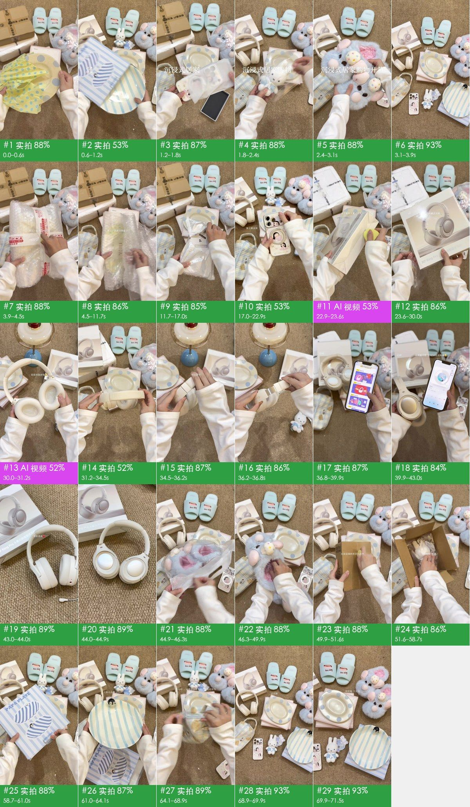

## 見どころ

- **冒頭のつかみ**：0–3.1 秒に 0.7 秒未満の完成品ショットを 5 つ連続で見せ（水玉皿、ペンギンのストライプ皿、スマホケース、ミッフィー、もこもこスリッパ）、タイトル「沉浸式居家购物开箱」が 1 文字ずつ表示される。3.1 秒で全グッズを並べた集合カットを見せ、今回何が出てくるかを最初に伝える
- 3.9 秒以降はどれも開封から撮る：爪で配送テープを切る、プチプチを剥がす、包み布をほどく（7.3 秒でやっと水玉皿が登場）。開ける音と一枚ずつめくる動きで、実物を見たい気持ちにさせる
- 1 点につきごく短い小さなテキストを 1 つだけ添える（12 秒「好久没买手机壳了」、17 秒「装上新皮肤」、20.6 秒「支架可以调整」）。文字は小さく画面の中央上寄りに置いて商品を隠さず、ナレーションの代わりに購入理由と売りを伝える
- いちばん高価なヘッドホンには 22.9–44.9 秒の計 22 秒を割き、1 ショットで 1 機能を見せる：着脱式マイク（32.5 秒）、伸縮ヘッドバンド（34.5 秒）、App と 50 dB ノイズキャンセリング（36.8–43 秒）。売りが一つずつ目で確認できる
- 68.9 秒で全グッズを並べた「大合照」（集合写真）に戻り、69.9 秒で「拜拜噜 下次见」。3.1 秒の並べ置きカットと冒頭・結末で呼応する

## ひと目でわかる：映像・パッケージ・音声の 3 層

ショート動画はどれも 3 層に分けられる。下が映像そのもの、その上に字幕・装飾テキスト・ステッカーを重ね、さらに音声を乗せる。再現するときは 1 層ずつ作る。

| 層 | この動画では何か | 作り方 | 詳細 |
|---|---|---|---|
| **映像**（下層） | 実写 68 ショット、静止画＋パン/ズーム 1 ショット | 3 シーンに分けて撮影。1 枚の画像から静止フレームまたはパン/ズームを作る | 「自分で再現」 |
| **パッケージ**（映像の上に重ねる） | グラフィック素材、テキスト、字幕、静止ステッカー | 編集ソフトで追加：字幕・装飾テキスト・ステッカーをタイムラインどおりに配置 | 「編集パッケージ層」 |
| **音声** | 人の声（本人の録音）、BGM（92 BPM、要確認） | 人の声：自分で録音。BGM：テンポとムードで似た曲を探す | 「音声」 |

## 内容と構成

- 下のストーリーラインはショットごとの画像レビューによる。セリフは別途まとめておらず、字幕の原文は「編集パッケージ層」を参照

**ストーリーライン**

再現するときはこの流れを残す。各ステップの順序と役割はそのまま使い、語る中身を自分の事例・データ・素材に差し替えれば、単なる主役の入れ替えに終わらない。

| 時間 | ショット | 役割 | 何を伝えているか |
|---|---|---|---|
| 0.0–3.1s | #1–#5 | 注意を引く | 冒頭は 1 点 1 秒未満で完成品をフラッシュ表示し、今回何を開けるかを伝える → 2 点目のフラッシュ、色と形を変えて新鮮さを保つ → 3 点目のフラッシュ、タイトルが 1 文字ずつ表示される → 4 点目のフラッシュ、かわいいマスコットで世界観への期待を強める → 5 点目のフラッシュ、ぎゅっとつまむ触感で予告を締める |
| 3.1–3.9s | #6 | 背景説明 | まず全商品を並べたカットを見せ、今回何点開けたかを伝える |
| 3.9–7.3s | #7–#11 | 情報補足 | 配送テープを剥がすところから 1 点目に入る → 1 点目が何かを一言で示す → 包装を一枚ずつ開け、お披露目までの期待を引き延ばす → いったん止めて包装の細部を見せる → 最後の包装をほどく |
| 7.3–8.2s | #12 | 結論 | 包装を開け、実物が初めて全体を現す |
| 8.2–10.2s | #13 | 情報補足 | 用途を一言で伝える |
| 10.2–11.7s | #14 | 根拠を見せる | 実物の質感をいろいろな角度から見せる |
| 11.7–12.5s | #15 | 背景説明 | 次の 1 点へ移り、買った理由を一言で伝える |
| 12.5–15.6s | #16–#19 | 情報補足 | パッケージ箱を見せる → 箱を開けてお披露目 → フィルムを剥がす過程感 → 付属物も外していく |
| 15.6–17.0s | #20 | 結論 | 柄を全体で見せる |
| 17.0–20.6s | #21、#22 | 根拠を見せる | スマホに装着して見た目を確認 → 装着後の全体像 |
| 20.6–21.9s | #23 | 情報補足 | 機能面の売りを一つ示す |
| 21.9–22.9s | #24 | 根拠を見せる | スタンドで本当にスマホが立つことを実演 |
| 22.9–23.6s | #25 | 背景説明 | 全編でいちばん大きな 1 点を導入する |
| 23.6–28.1s | #26–#31 | 情報補足 | シュリンクを剥がす過程感 → パッケージ正面を見せる → いったん止めてパッケージのクローズアップ → 視聴者を一緒に開けるよう誘う → 実物が少しずつ現れる →（計 6 点、ショットごとは「ショット一覧」参照） |
| 28.1–30.0s | #32 | 結論 | 色が好きだと伝える |
| 30.0–33.4s | #33–#35 | 情報補足 | つまむ動作で着け心地のよさを示す → ヘッドバンドの弾力を見せる → 使用シーンを一つ示す |
| 33.4–34.5s | #36 | 根拠を見せる | マイク付きの完成形を見せる |
| 34.5–35.1s | #37 | 情報補足 | もう一つ機能を示す |
| 35.1–36.8s | #38、#39 | 根拠を見せる | 外観をいろいろな角度から見せる → 調節をもう一度実演 |
| 36.8–39.9s | #40 | 情報補足 | スマホ App で説明書的な情報を補う |
| 39.9–43.0s | #41 | 根拠を見せる | 試聴で締め、音質とノイズキャンセリングを伝える |
| 43.0–44.0s | #42 | 結論 | 低いカメラ位置に切り替えて結論のショットを入れる |
| 44.0–44.9s | #43 | ムード演出 | 人のいない実景カットで締め、視聴者に一呼吸置かせる |
| 44.9–45.5s | #44 | 背景説明 | 次の 1 点を導入する |
| 45.5–47.7s | #45–#47 | 情報補足 | 実物を取り出す → 付属物を外す → 内側を見せる |
| 47.7–48.6s | #48 | 結論 | 1 足そろえて全体を見せる |
| 48.6–49.9s | #49 | 根拠を見せる | 触感でやわらかさを示す |
| 49.9–50.5s | #50 | 背景説明 | 次の 1 点を導入し、まず中身を予想させる |
| 50.5–51.0s | #51 | 情報補足 | 箱を開ける |
| 51.0–51.6s | #52 | 結論 | お披露目の瞬間に感情をそのまま文字にする |
| 51.6–55.2s | #53–#55 | 情報補足 | 取り出す → タグとチャームを見せる → 実物を取り出す |
| 55.2–56.5s | #56 | 結論 | 正面のクローズアップに感嘆の一言を添える |
| 56.5–57.2s | #57 | 情報補足 | 包装を外す |
| 57.2–58.7s | #58 | 結論 | 止めてかわいさをクローズアップで見せる |
| 58.7–59.4s | #59 | 背景説明 | 次の 1 点を導入する |
| 59.4–61.0s | #60、#61 | 情報補足 | 袋を開ける → 何かを伝える |
| 61.0–62.1s | #62 | 結論 | いちばんかわいい細部を示す |
| 62.1–64.1s | #63 | 根拠を見せる | 少し長めに止めて細部を見せる |
| 64.1–64.7s | #64 | 背景説明 | 最後の 1 点は自作のものにし、少しシェアする感じを出す |
| 64.7–67.5s | #65、#66 | 情報補足 | 容量と柄を見せる → 締めの動作 |
| 67.5–69.9s | #67、#68 | 結論 | 柄の細部を示す → 全グッズの並べ置き集合写真に戻り、冒頭と呼応する |
| 69.9–71.5s | #69 | 行動喚起 | 別れのあいさつと次回の予告 |

## ショット一覧

「映像」「カメラワーク」「オーバーレイ」は画面で見えるもの。「制作方法」「素材の出どころ」はツールの推定で、根拠は付録のショット別の根拠を参照。

| # | スクリーンショット | 時間 | 長さ | 何を伝えているか | 映像 | カメラワーク | オーバーレイ | 制作方法（推定） | 素材の出どころ（推定） | 再現 |
|---|---|---|---|---|---|---|---|---|---|---|
| 1 | 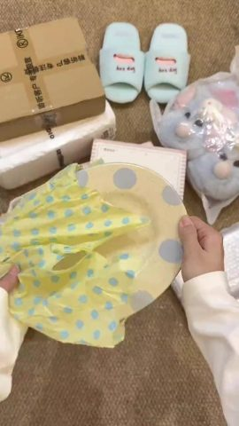 | 0:00.0 | 0.6s | 注意を引く：冒頭は 1 点 1 秒未満で完成品をフラッシュ表示し、今回何を開けるかを伝える | 右手で淡い黄色に青い水玉の楕円皿を黄色の水玉包み布から引き出し、皿を画面中央へ移す（メインアングルの真上俯瞰… | なめらかなカメラワーク | グラフィック素材 | 実写 79% | 実写映像素材 | 実写 · S1 |
| 2 | 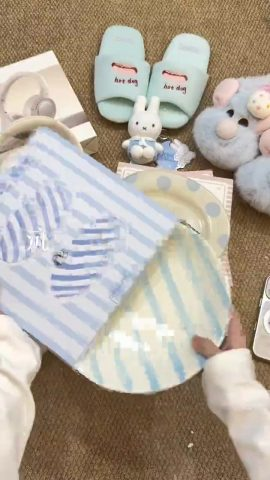 | 0:00.6 | 0.6s | 注意を引く：2 点目のフラッシュ、色と形を変えて新鮮さを保つ | 両手で水色の縦ストライプの丸皿をストライプの包装袋から引き出す。皿の縁に黒い小さなペンギンが立っている（メインアングルの真上俯瞰） | 固定（被写体が動く） | テキスト、グラフィック素材 | 実写 79% | 実写映像素材 | 実写 · S1 |
| 3 | 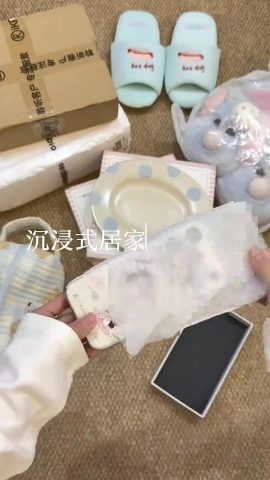 | 0:01.2 | 0.6s | 注意を引く：3 点目のフラッシュ、タイトルが 1 文字ずつ表示される | 左手にアニメの女の子柄のミルクホワイトのスマホケースを持ち、右手で外側の透明フィルムを剥がす。横に黒い内張りの空箱（メ… | 固定 | テキスト、グラフィック素材 | 実写 79% | 実写映像素材 | 実写 · S1 |
| 4 | 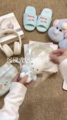 | 0:01.8 | 0.5s | 注意を引く：4 点目のフラッシュ、かわいいマスコットで世界観への期待を強める | 左手に青いセーラー服のミッフィーのチャームを乗せ、右手で透明の包装袋を引き剥がす（メインアングルの真上俯瞰） | 固定（被写体が動く） | テキスト、グラフィック素材 | 実写 79% | 実写映像素材 | 実写 · S1 |
| 5 |  | 0:02.4 | 0.7s | 注意を引く：5 点目のフラッシュ、ぎゅっとつまむ触感で予告を締める | 両手で水色の長毛もこもこスリッパ（甲にピンクの子豚とケーキの飾り）をぎゅっと押して、ふわふわ感を見せる（メイン… | 固定 | テキスト、グラフィック素材 | 実写 79% | 実写映像素材 | 実写 · S1 |
| 6 | 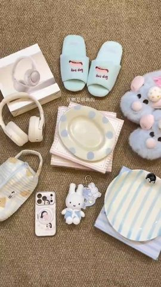 | 0:03.1 | 0.8s | 背景説明：まず全商品を並べたカットを見せ、今回何点開けたかを伝える | 手は映らず、全グッズがラグの上に並べられ、カメラがゆっくりパンする（全グッズ並べ置きのフルショット） | なめらかなカメラワーク | テキスト | 実写 82% | 実写映像素材 | 実写 · S1 |
| 7 | 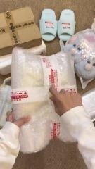 | 0:03.9 | 0.7s | 情報補足：配送テープを剥がすところから 1 点目に入る | 左手でプチプチに包まれた荷物を押さえ、右手の爪で赤白の配送テープに沿って切る（メインアングルの真上俯瞰） | 固定（被写体が動く） | テキスト、グラフィック素材 | 実写 80% | 実写映像素材 | 実写 · S1 |
| 8 | 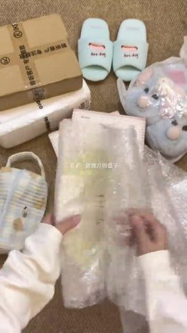 | 0:04.5 | 0.6s | 情報補足：1 点目が何かを一言で示す | 両手でプチプチを開き、中の黄色い水玉の包み布と YUU のラベルが見える（メインアングルの真上俯瞰） | 固定（被写体が動く） | グラフィック素材 | 実写 80% | 実写映像素材 | 実写 · S1 |
| 9 | 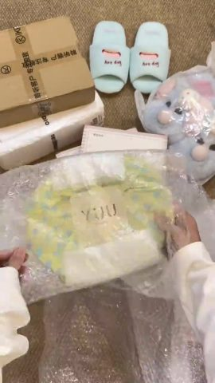 | 0:05.2 | 0.8s | 情報補足：包装を一枚ずつ開け、お披露目までの期待を引き延ばす | さらにプチプチを開き、黄色い水玉布で包んだ皿を取り出す。布には YUU のラベル（メインアングルの真上俯瞰） | 固定（被写体が動く） | グラフィック素材 | 実写 80% | 実写映像素材 | 実写 · S1 |
| 10 | 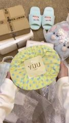 | 0:06.0 | 0.6s | 情報補足：いったん止めて包装の細部を見せる | 布に包んだ皿を両手で持って画面中央で止め、YUU のラベルを見せる（メインアングルの真上俯瞰） | 固定 | — | 実写 80% | 実写映像素材 | 実写 · S1 |
| 11 | 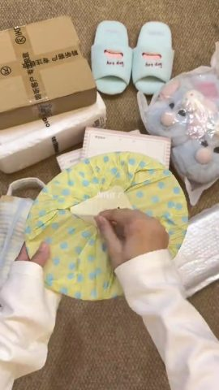 | 0:06.6 | 0.7s | 情報補足：最後の包装をほどく | 右手で包み布の上の結び目をほどき、布をゆるめる（メインアングルの真上俯瞰） | 固定（被写体が動く） | グラフィック素材 | 実写 80% | 実写映像素材 | 実写 · S1 |
| 12 | 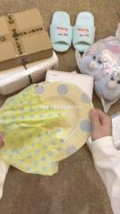 | 0:07.3 | 0.9s | 結論：包装を開け、実物が初めて全体を現す | 淡い黄色に青い水玉の楕円皿を包み布から引き出し、布は左へ滑り、皿は画面中央で止まる（メインアングルの真上俯瞰） | 固定 | 字幕、グラフィック素材 | 実写 79% | 実写映像素材 | 実写 · S1 |
| 13 | 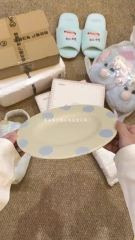 | 0:08.2 | 2.0s | 情報補足：用途を一言で伝える | 両手で皿の縁を持って前後に傾け、釉薬の反射と青い水玉を見せる（メインアングルの真上俯瞰） | 固定 | テキスト、グラフィック素材 | 実写 79% | 実写映像素材 | 実写 · S1 |
| 14 | 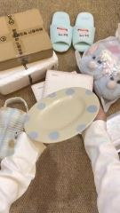 | 0:10.2 | 1.5s | 根拠を見せる：実物の質感をいろいろな角度から見せる | 皿を左側へ移して角度を変え、釉面を見せる（メインアングルの真上俯瞰） | 固定 | グラフィック素材 | 実写 78% | 実写映像素材 | 実写 · S1 |
| 15 | 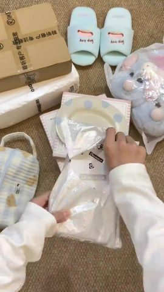 | 0:11.7 | 0.8s | 背景説明：次の 1 点へ移り、買った理由を一言で伝える | シルバーの配送袋から白いプリント柄の小箱を引き出す（メインアングルの真上俯瞰） | 固定（被写体が動く） | テキスト、グラフィック素材 | 実写 79% | 実写映像素材 | 実写 · S1 |
| 16 | 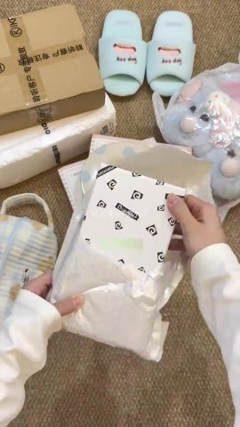 | 0:12.5 | 0.8s | 情報補足：パッケージ箱を見せる | STRONG PROTECTION と白黒の小アイコンが印刷された白い箱を配送袋から完全に取り出す… | 固定（被写体が動く） | グラフィック素材 | 実写 79% | 実写映像素材 | 実写 · S1 |
| 17 | 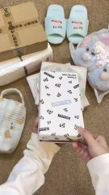 | 0:13.3 | 0.9s | 情報補足：箱を開けてお披露目 | 白い箱のふたを開け、中のスマホケースが見える（メインアングルの真上俯瞰） | 固定（被写体が動く） | グラフィック素材 | 実写 78% | 実写映像素材 | 実写 · S1 |
| 18 | 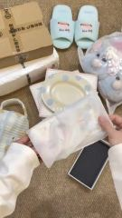 | 0:14.1 | 0.8s | 情報補足：フィルムを剥がす過程感 | スマホケース外側の透明フィルムを剥がす。横に黒い内張りの空箱（メインアングルの真上俯瞰） | 固定 | グラフィック素材 | 実写 79% | 実写映像素材 | 実写 · S1 |
| 19 | 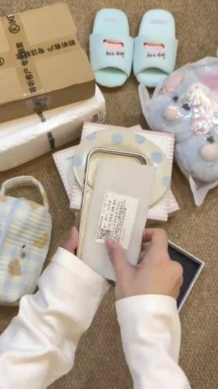 | 0:15.0 | 0.7s | 情報補足：付属物も外していく | スマホケース内側の説明紙を剥がす（メインアングルの真上俯瞰） | 固定（被写体が動く） | グラフィック素材 | 実写 79% | 実写映像素材 | 実写 · S1 |
| 20 | 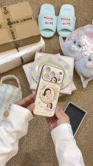 | 0:15.6 | 1.4s | 結論：柄を全体で見せる | 両手でスマホケースを掲げ、背面のアニメの女の子柄とマグネットリングを見せる（メインアングルの真上俯瞰） | 固定 | テキスト、グラフィック素材 | 実写 79% | 実写映像素材 | 実写 · S1 |
| 21 | 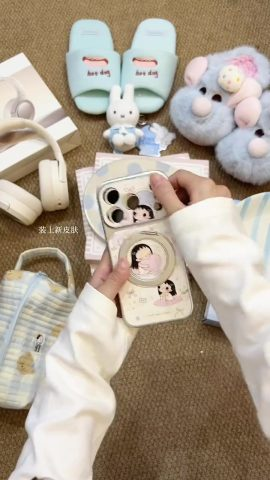 | 0:17.0 | 1.5s | 根拠を見せる：スマホに装着して見た目を確認 | スマホケースをスマホにはめ、縁を押してしっかり固定する（メインアングルの真上俯瞰） | 固定 | テキスト、グラフィック素材 | 実写 80% | 実写映像素材 | 実写 · S1 |
| 22 | 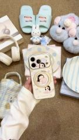 | 0:18.5 | 2.0s | 根拠を見せる：装着後の全体像 | ケースを付けたスマホを掲げて前後に傾けて見せる（メインアングルの真上俯瞰） | 固定（被写体が動く） | テキスト、グラフィック素材 | 実写 80% | 実写映像素材 | 実写 · S1 |
| 23 | 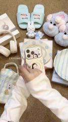 | 0:20.6 | 1.3s | 情報補足：機能面の売りを一つ示す | 右手で背面のマグネットリングスタンドを起こし、回してみせる（メインアングルの真上俯瞰） | 固定（被写体が動く） | テキスト、グラフィック素材 | 実写 80% | 実写映像素材 | 実写 · S1 |
| 24 | 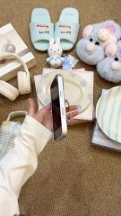 | 0:21.9 | 1.0s | 根拠を見せる：スタンドで本当にスマホが立つことを実演 | スマホをリングスタンドで横向きに立て、側面をカメラに向ける（メインアングルの真上俯瞰） | 固定 | — | 実写 80% | 実写映像素材 | 実写 · S1 |
| 25 | 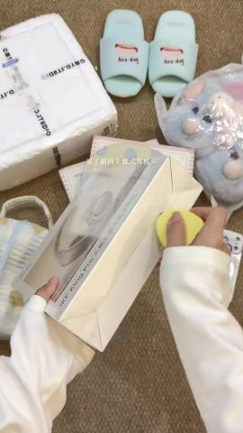 | 0:22.9 | 0.7s | 背景説明：全編でいちばん大きな 1 点を導入する | 左手で白いヘッドホンの箱を押さえ、右手の黄色い小型カッターで封のテープを切る（メインアングルの真上俯瞰） | 固定（被写体が動く） | テキスト、グラフィック素材 | 実写 78% | 実写映像素材 | 実写 · S1 |
| 26 | 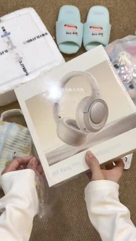 | 0:23.6 | 0.8s | 情報補足：シュリンクを剥がす過程感 | ミルクホワイトのヘッドホン写真が印刷された外箱を両手で持ち上げ、外側のシュリンクを剥がす（メインアングルの真上俯瞰） | 固定（被写体が動く） | テキスト、グラフィック素材 | 実写 78% | 実写映像素材 | 実写 · S1 |
| 27 | 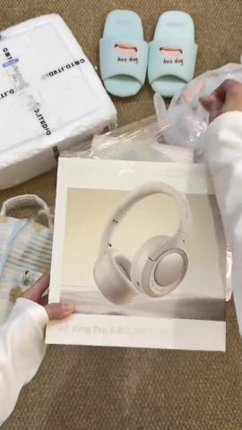 | 0:24.3 | 0.6s | 情報補足：パッケージ正面を見せる | 外箱を画面中央にまっすぐ置き、パッケージ正面を見せる（メインアングルの真上俯瞰） | 固定（被写体が動く） | グラフィック素材 | 実写 78% | 実写映像素材 | 実写 · S1 |
| 28 | 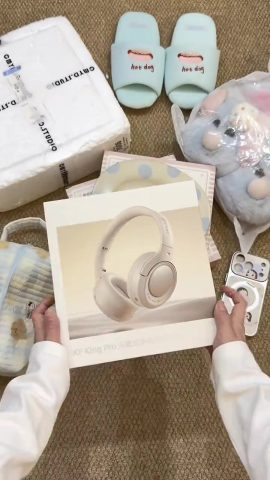 | 0:24.9 | 0.8s | 情報補足：いったん止めてパッケージのクローズアップ | 両手で外箱を支えて止め、正面のヘッドホン写真を見せる（メインアングルの真上俯瞰） | 固定 | テキスト | 実写 78% | 実写映像素材 | 実写 · S1 |
| 29 | 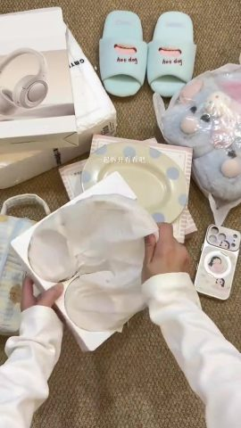 | 0:25.7 | 0.7s | 情報補足：視聴者を一緒に開けるよう誘う | 内箱を開け、ヘッドホンを包む白い薄紙をめくる（メインアングルの真上俯瞰） | 固定（被写体が動く） | テキスト、グラフィック素材 | 実写 78% | 実写映像素材 | 実写 · S1 |
| 30 | 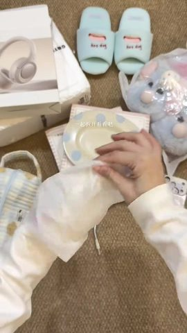 | 0:26.4 | 0.8s | 情報補足：実物が少しずつ現れる | 薄紙からミルクホワイトのヘッドホンを取り出し、まずイヤーカップが見える（メインアングルの真上俯瞰） | 固定（被写体が動く） | テキスト、グラフィック素材 | 実写 78% | 実写映像素材 | 実写 · S1 |
| 31 | 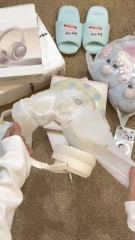 | 0:27.1 | 1.0s | 情報補足：完全に取り出す | さらに薄紙を広げ、ヘッドホンのヘッドバンドが弧を描いて出てくる（メインアングルの真上俯瞰） | 固定（被写体が動く） | テキスト、グラフィック素材 | 実写 78% | 実写映像素材 | 実写 · S1 |
| 32 | 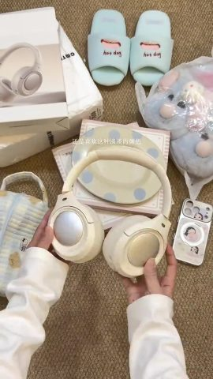 | 0:28.1 | 1.9s | 結論：色が好きだと伝える | 両手にイヤーカップを 1 つずつ持ち、パール調のシェルを見せる（メインアングルの真上俯瞰） | 固定 | テキスト、グラフィック素材 | 実写 79% | 実写映像素材 | 実写 · S1 |
| 33 | 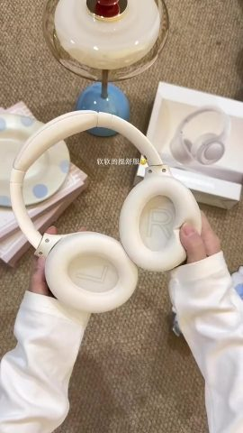 | 0:30.0 | 1.2s | 情報補足：つまむ動作で着け心地のよさを示す | 両手で 2 つのイヤーカップ内側のクッションをつまむ。カップ内に L と R の印字（デスクライト横の近距離での真上俯瞰） | 固定 | テキスト | 実写 77% | 実写映像素材 | 実写 · S2 |
| 34 | 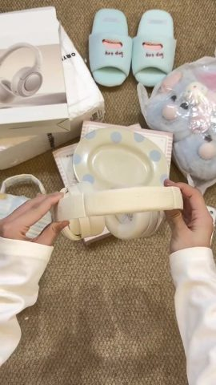 | 0:31.2 | 1.3s | 情報補足：ヘッドバンドの弾力を見せる | 両手でヘッドホンのヘッドバンドを横に広げ、押してみせる（メインアングルの真上俯瞰） | 固定 | グラフィック素材 | 実写 79% | 実写映像素材 | 実写 · S1 |
| 35 | 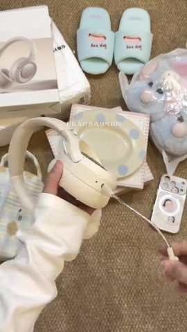 | 0:32.5 | 0.9s | 情報補足：使用シーンを一つ示す | 片手でヘッドホンを持ち、もう片手で着脱式マイクを引き出す（メインアングルの真上俯瞰） | なめらかなカメラワーク | テキスト、グラフィック素材 | 実写 79% | 実写映像素材 | 実写 · S1 |
| 36 | 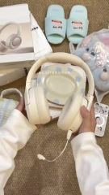 | 0:33.4 | 1.1s | 根拠を見せる：マイク付きの完成形を見せる | 両手でヘッドホンを掲げ、マイクが下に垂れる（メインアングルの真上俯瞰） | 固定 | テキスト、グラフィック素材 | 実写 78% | 実写映像素材 | 実写 · S1 |
| 37 | 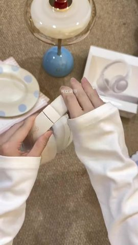 | 0:34.5 | 0.6s | 情報補足：もう一つ機能を示す | 両手でヘッドバンドの伸縮部を伸ばし、金属のスライダーが見える（デスクライト横の近距離での真上俯瞰） | 固定（被写体が動く） | 字幕、グラフィック素材 | 実写 78% | 実写映像素材 | 実写 · S2 |
| 38 | 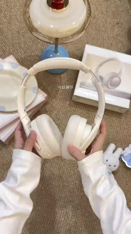 | 0:35.1 | 1.1s | 根拠を見せる：外観をいろいろな角度から見せる | ヘッドホンを掲げて正面をカメラに向け、次に側面へ返す（デスクライト横の近距離での真上俯瞰） | 固定（被写体が動く） | グラフィック素材 | 実写 78% | 実写映像素材 | 実写 · S2 |
| 39 | 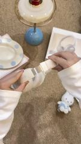 | 0:36.2 | 0.6s | 根拠を見せる：調節をもう一度実演 | もう一度ヘッドバンドの伸縮部を引く（デスクライト横の近距離での真上俯瞰） | 固定（被写体が動く） | グラフィック素材 | 実写 78% | 実写映像素材 | 実写 · S2 |
| 40 | 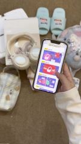 | 0:36.8 | 3.1s | 情報補足：スマホ App で説明書的な情報を補う | 左手でスマホをヘッドホンに近づける。画面はヘッドホン App の紹介ページで、指で下へスクロールし、最後にデバイス接続… | 固定 | 字幕、テキスト、グラフィック素材 | 実写 80% | 実写映像素材 | 実写 · S1 |
| 41 | 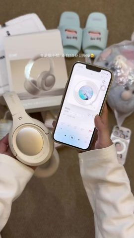 | 0:39.9 | 3.1s | 根拠を見せる：試聴で締め、音質とノイズキャンセリングを伝える | 左手にヘッドホン、右手にスマホを持ち、画面で音楽を再生している（メインアングルの真上俯瞰） | 固定 | 字幕、テキスト、静止ステッカー | 実写 76% | 実写映像素材 | 実写 · S1 |
| 42 | 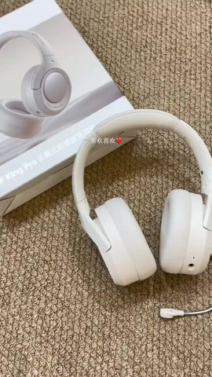 | 0:43.0 | 1.0s | 結論：低いカメラ位置に切り替えて結論のショットを入れる | ヘッドホンがラグに平置きされ、マイクは右下へ伸びる。カメラがゆっくり動く（低いカメラ位置のミディアムクローズアップ） | なめらかなカメラワーク | テキスト、静止ステッカー | 実写 67% | 実写映像素材 | 実写 · S3 |
| 43 | 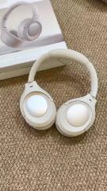 | 0:44.0 | 0.9s | ムード演出：人のいない実景カットで締め、視聴者に一呼吸置かせる | ヘッドホンが平置きされ、カメラがゆっくり寄る。パール調のイヤーカップ 2 つが上を向く（低いカメラ位置のミディアムクローズアップ） | なめらかなカメラワーク | — | 実写 68% | 実写映像素材 | 実写 · S3 |
| 44 | 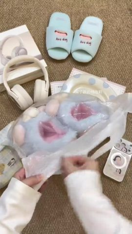 | 0:44.9 | 0.6s | 背景説明：次の 1 点を導入する | 透明のビニール袋を破り、水色のもこもこスリッパが見える（メインアングルの真上俯瞰） | 固定 | テキスト、グラフィック素材 | 実写 79% | 実写映像素材 | 実写 · S1 |
| 45 | 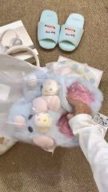 | 0:45.5 | 0.9s | 情報補足：実物を取り出す | 袋からもこもこスリッパを取り出して画面中央に置く（メインアングルの真上俯瞰） | 固定 | 字幕、グラフィック素材 | 実写 80% | 実写映像素材 | 実写 · S1 |
| 46 | 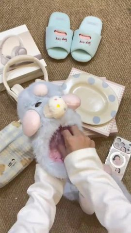 | 0:46.3 | 0.7s | 情報補足：付属物を外す | スリッパの中に手を入れ、形を保つための透明プラスチック板を抜き出す（メインアングルの真上俯瞰） | 固定 | グラフィック素材 | 実写 79% | 実写映像素材 | 実写 · S1 |
| 47 | 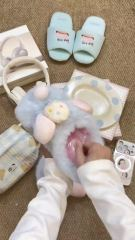 | 0:47.0 | 0.7s | 情報補足：内側を見せる | もう片方のスリッパの透明板も抜き、ピンクの内側が見える（メインアングルの真上俯瞰） | 固定 | テキスト、グラフィック素材 | 実写 79% | 実写映像素材 | 実写 · S1 |
| 48 | 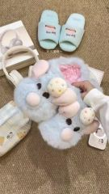 | 0:47.7 | 1.0s | 結論：1 足そろえて全体を見せる | 両手でスリッパ 1 足を並べてそろえる（メインアングルの真上俯瞰） | 固定 | 字幕、グラフィック素材 | 実写 79% | 実写映像素材 | 実写 · S1 |
| 49 | 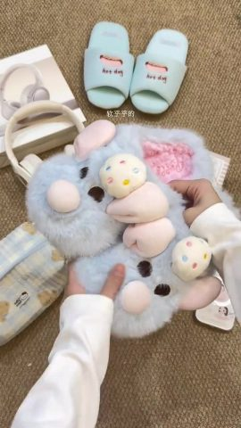 | 0:48.6 | 1.2s | 根拠を見せる：触感でやわらかさを示す | 両手でスリッパ表面の長い毛をつまみ、ふわふわ感を見せる（メインアングルの真上俯瞰） | 固定 | 字幕、グラフィック素材 | 実写 79% | 実写映像素材 | 実写 · S1 |
| 50 | 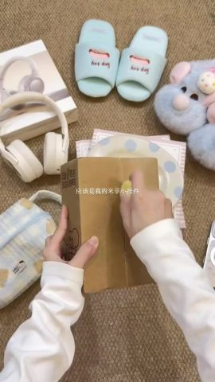 | 0:49.9 | 0.6s | 背景説明：次の 1 点を導入し、まず中身を予想させる | クラフト紙の箱を持ち、黄色い小型カッターで中央の継ぎ目に沿って切る（メインアングルの真上俯瞰） | 固定（被写体が動く） | テキスト、グラフィック素材 | 実写 79% | 実写映像素材 | 実写 · S1 |
| 51 |  | 0:50.5 | 0.5s | 情報補足：箱を開ける | 紙箱の両側を開き、中の透明袋が見える（メインアングルの真上俯瞰） | 固定（被写体が動く） | テキスト、グラフィック素材 | 実写 79% | 実写映像素材 | 実写 · S1 |
| 52 |  | 0:51.0 | 0.6s | 結論：お披露目の瞬間に感情をそのまま文字にする | 紙箱を開け、袋の中のミッフィーが見える（メインアングルの真上俯瞰） | 固定（被写体が動く） | 字幕、グラフィック素材 | 実写 79% | 実写映像素材 | 実写 · S1 |
| 53 |  | 0:51.6 | 1.0s | 情報補足：取り出す | ミッフィー入りの透明袋を紙箱から持ち上げる（メインアングルの真上俯瞰） | 固定（被写体が動く） | テキスト、グラフィック素材 | 実写 79% | 実写映像素材 | 実写 · S1 |
| 54 |  | 0:52.6 | 1.7s | 情報補足：タグとチャームを見せる | 透明袋を掲げてミッフィーのチャームとタグを見せ、そのあと袋を破る（メインアングルの真上俯瞰） | 固定（被写体が動く） | グラフィック素材 | 実写 79% | 実写映像素材 | 実写 · S1 |
| 55 |  | 0:54.3 | 0.9s | 情報補足：実物を取り出す | 袋からミッフィーのチャームを引き出し、金属のリングが見える（メインアングルの真上俯瞰） | 固定（被写体が動く） | テキスト、グラフィック素材 | 実写 78% | 実写映像素材 | 実写 · S1 |
| 56 |  | 0:55.2 | 1.2s | 結論：正面のクローズアップに感嘆の一言を添える | 透明袋越しに両手でミッフィーを掲げ、正面をカメラに向ける（メインアングルの真上俯瞰） | 固定 | テキスト、グラフィック素材 | 実写 79% | 実写映像素材 | 実写 · S1 |
| 57 |  | 0:56.5 | 0.7s | 情報補足：包装を外す | 袋を引き剥がし、ミッフィーを手のひらに乗せる（メインアングルの真上俯瞰） | 固定（被写体が動く） | テキスト、グラフィック素材 | 実写 79% | 実写映像素材 | 実写 · S1 |
| 58 |  | 0:57.2 | 1.6s | 結論：止めてかわいさをクローズアップで見せる | ミッフィーを手のひらに乗せたまま止め、正面を見せる（メインアングルの真上俯瞰） | 固定 | テキスト | 実写 78% | 実写映像素材 | 実写 · S1 |
| 59 |  | 0:58.7 | 0.7s | 背景説明：次の 1 点を導入する | 両手で PAPA PLATE と印刷された青白ストライプの包装袋を持ち上げる（メインアングルの真上俯瞰） | 固定（被写体が動く） | グラフィック素材 | 実写 79% | 実写映像素材 | 実写 · S1 |
| 60 |  | 0:59.4 | 0.7s | 情報補足：袋を開ける | 包装袋の口を開け、中の皿が見える（メインアングルの真上俯瞰） | 固定（被写体が動く） | 字幕、グラフィック素材 | 実写 79% | 実写映像素材 | 実写 · S1 |
| 61 |  | 1:00.1 | 0.9s | 情報補足：何かを伝える | 包装袋から水色の縦ストライプの丸皿を引き出す（メインアングルの真上俯瞰） | 固定（被写体が動く） | 字幕、グラフィック素材 | 実写 79% | 実写映像素材 | 実写 · S1 |
| 62 |  | 1:01.0 | 1.1s | 結論：いちばんかわいい細部を示す | 両手でストライプ皿を持ち、皿の縁に黒い小さなペンギンが立っている（メインアングルの真上俯瞰） | 固定 | テキスト、グラフィック素材 | 実写 79% | 実写映像素材 | 実写 · S1 |
| 63 |  | 1:02.1 | 1.9s | 根拠を見せる：少し長めに止めて細部を見せる | 皿を持ってゆっくり左右に傾け、ペンギンの置物を見せる（メインアングルの真上俯瞰） | 固定 | 字幕、グラフィック素材 | 実写 80% | 実写映像素材 | 実写 · S1 |
| 64 |  | 1:04.1 | 0.6s | 背景説明：最後の 1 点は自作のものにし、少しシェアする感じを出す | チェック柄のポーチのファスナーを開ける（メインアングルの真上俯瞰） | 固定（被写体が動く） | テキスト、グラフィック素材 | 実写 79% | 実写映像素材 | 実写 · S1 |
| 65 |  | 1:04.7 | 2.1s | 情報補足：容量と柄を見せる | ポーチを広げて内側を見せ、次に表に返してクマのプリントと布タグを見せる（メインアングルの真上俯瞰） | 固定（被写体が動く） | 字幕、グラフィック素材 | 実写 80% | 実写映像素材 | 実写 · S1 |
| 66 |  | 1:06.7 | 0.7s | 情報補足：締めの動作 | ポーチのファスナーを閉める（メインアングルの真上俯瞰） | 固定（被写体が動く） | テキスト、グラフィック素材 | 実写 79% | 実写映像素材 | 実写 · S1 |
| 67 |  | 1:07.5 | 1.4s | 結論：柄の細部を示す | ポーチを掲げて左右に回し、クマのプリントを見せる（メインアングルの真上俯瞰） | 固定（被写体が動く） | テキスト、グラフィック素材 | 実写 80% | 実写映像素材 | 実写 · S1 |
| 68 |  | 1:08.9 | 1.0s | 結論：全グッズの並べ置き集合写真に戻り、冒頭と呼応する | 手は映らず、カメラがゆっくりパンして並べた全グッズをなめる（全グッズ並べ置きのフルショット） | なめらかなカメラワーク | 字幕 | 静止画＋パン/ズーム 81% | 実写真 | ローカル ffmpeg でパン/ズーム |
| 69 |  | 1:09.9 | 1.6s | 行動喚起：別れのあいさつと次回の予告 | 並べ置きのフルショットからカメラがさらにゆっくり動き、スリッパ、水玉皿、ストライプ皿、ミッフィー、スマホケースをなめる（全グッズ並べ置き… | なめらかなカメラワーク | テキスト | 実写 85% | 実写映像素材 | 実写 · S1 |

## 自分で再現：この順番で作る

再現するのは作り方とテンポで、映像を丸写しすることではない。

1. **内容を決める**：「内容と構成」のストーリーラインに沿って自分の台本を書く
2. **素材を用意する**：下の「用意する素材」を参照
3. **撮影**：3 シーン、7 カメラ位置。下の「撮影」を参照
4. **静止フレーム / パン・ズーム**：下の「ローカルで再構築」を参照
5. **編集**：下の「編集」を参照
6. **パッケージ**：字幕ファイル `packaging/subtitles.srt` は編集ソフトにそのまま読み込める。スタイルとタイムラインは「編集パッケージ層」を参照
7. **音声**：「音声」を参照。効果音はどれも先に試聴できる
8. **照らし合わせ**：完成版と原本を並べて見て、ショットの長さ、字幕の位置、音楽の入りと抜けが合っているか確認する

### 用意する素材

- 画面でそのまま使う実ファイル（スクリーンショット、写真、画面録画。元ファイルを入手すること）：
  - **実写真**（画面全体）：ショット #68、計 1.0s
  - **実写真**（画面の一部）、投稿者本人が撮った全グッズの並べ置き写真（画面全体）：ショット #68、計 1.0s

### 撮影

同じシーンのショットはまとめて撮ってから次のシーンへ。シーン内では引きの画から撮ってクローズアップへ進めば、ライティングを組み直さずに済む。各テイクの前後に約 1s の余裕を残す。

**S1**：ショット #1–#32、#34–#36、#40、#41、#44–#67、#69（完成尺 65.13s）。寝室の床の茶色い編みラグ（真上から俯瞰）。ラグが画面いっぱいに広がり、上側に水色のスリッパ、もこもこスリッパ、配送箱が置かれ、開け終わった商品が少しずつ背景に並んでいく
- ライティング：室内の天井灯 1 灯のソフトライトでフラットに照らし、スマホで真上から俯瞰、淡い色の小道具の自然な反射に頼る
- カメラ位置 フルショット · 移動カメラ（スタビライザー/手持ちでパン） · 引き/パン/移動：ショット #6、#69、完成尺 2.4s、撮影推奨 6.4s
- カメラ位置 ミディアムショット · 固定カメラ（三脚/スタンド/テーブル置き） · 固定：ショット #2、#4、#5、#7、#16、#18、#20、#22、#23、#25、#28–#30、#32、#36、#50–#56、#58–#66、完成尺 31.77s、撮影推奨 93.8s
- カメラ位置 ミディアムクローズアップ · 移動カメラ（スタビライザー/手持ちでパン） · 固定：ショット #1、#35、完成尺 1.5s、撮影推奨 5.5s
- カメラ位置 ミディアムクローズアップ · 固定カメラ（三脚/スタンド/テーブル置き） · 固定：ショット #3、#8–#15、#17、#19、#21、#24、#26、#27、#31、#34、#40、#41、#44–#46、#48、#49、#57、#67、完成尺 28.8s、撮影推奨 80.8s
- カメラ位置 クローズアップ · 固定カメラ（三脚/スタンド/テーブル置き） · 固定：ショット #47、完成尺 0.67s、撮影推奨 2.7s

**S2**：ショット #33、#37–#39（完成尺 3.5s）。同じラグの上のデスクライト横。画面上側に青い台座のきのこ型デスクライトとヘッドホンのパッケージ箱
- ライティング：室内の天井灯 1 灯のソフトライトでフラットに照らし、スマホで真上から俯瞰、淡い色の小道具の自然な反射に頼る
- カメラ位置 ミディアムクローズアップ · 固定カメラ（三脚/スタンド/テーブル置き） · 固定：ショット #33、#37–#39、完成尺 3.5s、撮影推奨 11.5s

**S3**：ショット #42、#43（完成尺 1.87s）。同じラグ（低いカメラ位置のミディアムクローズアップ）。ヘッドホンがラグに平置きされ、左上にパッケージ箱が斜めに置かれている
- ライティング：室内の天井灯 1 灯のソフトライトでフラットに照らし、スマホで真上から俯瞰、淡い色の小道具の自然な反射に頼る
- カメラ位置 ミディアムクローズアップ · 移動カメラ（スタビライザー/手持ちでパン） · 寄り/パン/移動：ショット #42、#43、完成尺 1.87s、撮影推奨 5.9s

### ローカルで再構築

- #68 静止画＋パン/ズーム 1.0s：画像 1 枚 + 測定したズーム/パンのパラメータで、ffmpeg から直接出力する

### 編集

- 「ショット一覧」の順序と長さどおりに編集する
- 手法：1 分あたり約 57 カット。冒頭 0–3.1 秒は 1 ショット 0.7 秒未満のフラッシュ予告。開封パートは『配送袋を破る→包装を開ける→お披露目→細部を見せる』の順に 1 ショット 1 動作で切り、同じカメラ位置でのジャンプカットが中心。1 点につき小さな字幕を 1 つだけ付け、最後は並べ置きのフルショットに戻る
- テンポ：1 分あたり 57.0 カット、実写ショットの平均 1.04s。カメラ位置/シーン 3 つ。同カメラ位置のジャンプカット 11 か所、寄りへのカット 9 か所。インサート（スクリーンショット/画面録画/カード/素材）は 1%。カット点の 80% が話の切れ目に落ちる（息継ぎで切る）。トランジション：ハードカット×21、ジャンプカット×47

## 登場人物・シーン・小道具

| 番号 | 呼び名 | 種類 | 見た目 | 役割 | 音声 | 登場 |
|---|---|---|---|---|---|---|
| A | 開封する投稿者（手のみ） | 人物 | 両手と白いゆったりした長袖スウェットの袖だけが映る。指は細く、爪は短くネイルなし。顔は出さない | 全編で開封し、商品を見せる | 話さず、字幕でナレーションを代替 | #1–#5、#7–#41、#44–#67 |

**シーン**

| シーン | 場所 | 時間帯 | セット / 光 | ショット |
|---|---|---|---|---|
| S1 | 寝室の床の茶色い編みラグ（真上から俯瞰） | 夜・室内 | ラグが画面いっぱいに広がり、上側に水色のスリッパ、もこもこスリッパ、配送箱が置かれ、開け終わった商品が少しずつ背景に並んでいく | #1–#32、#34–#36、#40、#41、#44–#69 |
| S2 | 同じラグの上のデスクライト横 | 夜・室内 | 画面上側に青い台座のきのこ型デスクライトとヘッドホンのパッケージ箱 | #33、#37–#39 |
| S3 | 同じラグ（低いカメラ位置のミディアムクローズアップ） | 夜・室内 | ヘッドホンがラグに平置きされ、左上にパッケージ箱が斜めに置かれている | #42、#43 |

**小道具 / 商品 / ロゴ**

- 淡い黄色に青い水玉の楕円皿（YUU）（ショット #1、#7–#14）：黄色地に青い水玉の布で包まれ、外側はプチプチ
- アニメの女の子柄のスマホケース（ショット #3、#15–#24）：ミルクホワイト、背面にマグネットリングスタンド。白いプリント柄のパッケージ箱に STRONG PROTECTION の印字
- ミルクホワイトのヘッドホン（ショット #25–#43）：パール調イヤーカップ、着脱式マイク、伸縮ヘッドバンド。外箱に King Pro の印字、スマホ App 対応
- 水色のもこもこスリッパ（ショット #5、#44–#49）：長毛、甲にピンクの子豚とケーキの飾り、内側はピンク
- ミッフィーのチャーム（ショット #4、#50–#58）：青いセーラー服、金属リング。クラフト紙の箱と透明袋に入っている
- 青白縦ストライプのペンギン皿（PAPA PLATE）（ショット #2、#59–#63）：皿の縁に黒い小さなペンギンが立つ。青白ストライプの包装袋入り
- チェック柄のクマのポーチ（ショット #64–#67）：水色と黄色のチェック、クマのプリント、Hello Kitty の布タグ。投稿者の自作
- 水色の hot dog スリッパ（ショット #1–#32、#34–#36、#40、#41、#44–#69）：背景の小道具。甲に hot dog の印字があり、ほぼ全ショットで画面上側に映る

## 撮り方とライティング

- ビジュアルスタイル：夜の室内の暖色光での俯瞰並べ置き。クリームホワイト・水色・淡い黄色のマカロンカラー、低彩度のソフトライト、日系のかわいい暮らし系
- 画づくり：ショットサイズ ミディアムクローズアップ 51%、ミディアムショット 45%、フルショット 3%。カメラアングル 真上から俯瞰。被写体は画面内のピントが合った領域（人の顔がないため、ショットサイズは推定値）
- カメラ位置：固定カメラ（三脚/スタンド/テーブル置き） 92%、移動カメラ（スタビライザー/手持ちでパン） 8%。よく使うカメラワークは パン/移動
- ライティング：夜の室内で天井灯 1 灯のソフトライトを真上やや前方から当て、白い袖と淡い色の商品の自然な反射に頼る。補助光も輪郭光もなし。全体に暖かい黄み（画像レビューによる判断。ピクセル測定は下の折りたたみ参照）
- カラーグレーディング：日系クリア（明るく、低彩度、黒浮き）。彩度は標準、コントラストは標準、黒浮き（灰色がかった暗部）、全体はニュートラル
- 形式：卓上/モノ撮影（卓上撮り）（顔が主体 3%、モノ/手が主体 97%、手持ち 8%）。画像レビューによる判断：ナレーションなしの俯瞰 ASMR 開封 vlog（おすすめグッズ紹介）

項目別の測定と画像レビューの結果（22 項目）

| 観点 | 項目 | 結論 | 出どころ |
|---|---|---|---|
| 画づくり | ショットサイズ | ミディアムクローズアップ | 測定；画像レビュー |
| 画づくり | カメラアングル | 真上から俯瞰 | 画像レビュー |
| 画づくり | 構図 | 商品は画面中央やや下。上部 3 分の 1 は開封済みの商品を背景として置く。縦型 | 画像レビュー |
| カメラ位置 | 撮影方法 | 俯瞰撮影スタンド | 測定：固定カメラ（三脚/スタンド/テーブル置き）；画像レビュー |
| カメラ位置 | レンズ | スマホ背面のメインカメラ | 画像レビュー |
| カメラ位置 | 速度 | 通常（手の動きや包装の揺れの速さは通常） | 画像レビュー |
| カメラ位置 | カメラ位置/シーン | 4 つのカメラ位置：①メインアングル。スマホをラグの真上に固定して俯瞰、開封ショットの大半；②デスクライト横のより近い真上俯瞰（33、37–39 ショット）；③低い位置の手持ちミディアムクローズアップでヘッドホンを撮影（42–43 ショット）；④全グッズ並べ置きのフルショット、手持ちでゆっくりパン（6、68、69 ショット） | 画像レビュー |
| カメラ位置 | 推定機材 | スマホ背面のメインカメラ + 床置き/卓上の俯瞰撮影スタンド（アームでスマホをラグの真上に出す）。並べ置きのフルショットとヘッドホンのミディアムクローズアップは手持ち | 画像レビュー |
| ライティング | 場面 | 室内；夜（スマホ画面の時刻 23:16）；寝室のラグの上 | 画像レビュー |
| ライティング | キーライト | 部屋の天井灯が真上やや前方から当たり、広く拡散。手や商品にはっきりした影はほとんどない | 画像レビュー |
| ライティング | 硬さ | ソフトライト（明暗の移り変わりが広い） | 測定；画像レビュー：ソフトライト（腕や皿の下の影の輪郭がぼやけている） |
| ライティング | 補助光 | 専用の補助光はなく、白い袖・白い箱・淡い色の商品が光を暗部へ返し、暗部は深くない | 画像レビュー |
| ライティング | 輪郭光 | 輪郭光なし | 画像レビュー |
| ライティング | キャッチライト | 該当なし（顔を出さない） | 画像レビュー |
| ライティング | 画面内の光源 | なし（33、37–39 ショットの画面上側のきのこ型デスクライトは点灯しているようには見えない） | 画像レビュー |
| ライティング | 色温度 | 暖色寄り（約 3000–4000K） | 測定；画像レビュー：暖色（約 3500K の室内灯。ラグもミルクホワイトの商品も暖かい黄み寄り） |
| ライティング | ライティング案 | 室内の天井灯 1 灯のソフトライトでフラットに照らし、スマホで真上から俯瞰、淡い色の小道具の自然な反射に頼る | 画像レビュー |
| ライティング | 全体のライティング | 夜の室内で天井灯 1 灯のソフトライトを真上やや前方から当て、白い袖と淡い色の商品の自然な反射に頼る。補助光も輪郭光もなし。全体に暖かい黄み | 画像レビュー |
| カラーグレーディング | グレーディングのスタイル | 日系クリア（明るく、低彩度、黒浮き） | 測定；画像レビュー：クリーム色の低彩度な暖色トーン（日系クリア）。黒浮き、暗部は灰色がかって暖色寄り、全体に明るくやわらかく、強いコントラストはない |
| カラーグレーディング | 全体のグレーディング | クリーム色の低彩度な暖色トーン、黒浮き、日系クリア寄り | 画像レビュー |
| 編集 | 編集手法 | 1 分あたり約 57 カット。冒頭 0–3.1 秒は 1 ショット 0.7 秒未満のフラッシュ予告。開封パートは『配送袋を破る→包装を開ける→お披露目→細部を見せる』の順に 1 ショット 1 動作で切り、同じカメラ位置でのジャンプカットが中心。1 点につき小さな字幕を 1 つだけ付け、最後は並べ置きのフルショットに戻る | 画像レビュー |
| 形式 | 動画形式 | ナレーションなしの俯瞰 ASMR 開封 vlog（おすすめグッズ紹介） | 測定：卓上/モノ撮影（卓上撮り）；画像レビュー |

- 補足：光比・硬さ・色温度・ショットサイズは被写体のピクセルから測定（顔があれば顔、なければ画面内のピントが合った領域で、後者は推定値）。プラットフォームの再エンコードで暗部がつぶれるため、硬さと補助光の判定は控えめになる。カメラアングル・光源の種類・キャッチライト・輪郭光は画像レビューの結果を優先する。測定と画像レビューが食い違う場合は両方を記載する。

## 編集パッケージ層（字幕 / 装飾テキスト / ステッカー / 効果音のタイミング合わせ）

- 字幕 28 行（中央、最大 1 行）：茶色の文字、キーワードを白でハイライト、文字の高さ 2.2%。登場：そのまま表示×13、拡大ポップ×5、スライドイン×3。キーワードを言うタイミングで色が変わる
- タイトル 2 か所：「沉浸式居家购物」、「沉浸式居家购物开箱」
- ステッカー/GIF 笑顔の絵文字（字幕末尾） 1 か所、赤いハートの絵文字（字幕末尾） 1 か所
- セリフ基準で配置するもの 2 か所（文言を差し替えるときは元の秒数ではなくこのセリフに合わせる）：笑顔の絵文字（字幕末尾） → 「app里有贴心的介绍」の言い終わりから 0.3s、赤いハートの絵文字（字幕末尾） → 「喜欢喜欢」の言い始めから 0.0s
- 書き出し：`packaging/subtitles.srt`、`packaging/overlays.ass`、`packaging/timeline.json`（SRT は字幕のタイムライン。ASS は色・縁取り・位置・登場アニメーション付きで、フォントは原本のものに差し替える必要あり。timeline.json は完全なタイムライン）

テキストのタイムライン（30 件）

| 時間 | 種類 | 文字 | スタイル | 登場 / 退場 | 効果音 |
|---|---|---|---|---|---|
| 1.00–1.80s | タイトル·物体に追従 | 沉浸式居家购物 | 白文字、白い背景枠、キーワードを茶色でハイライト、文字の高さ 4.9%（約 63px） | 1 文字ずつ | — |
| 1.80–3.10s | タイトル | 沉浸式居家购物开箱 | 白文字、白い背景枠、キーワードをグレーでハイライト、文字の高さ 4.7%（約 60px） | そのまま消える | — |
| 3.00–3.60s | 字幕 | 真嘟是萌萌的 | 茶色の文字、キーワードをオレンジでハイライト、文字の高さ 2.3%（約 29px） | スライドイン / そのまま消える | — |
| 4.50–4.80s | 字幕 | 款波点的体子 | 白文字、文字の高さ 2.3%（約 30px） | そのまま表示 / そのまま消える | — |
| 7.30–10.20s | 字幕 | 拿来放早餐应该是很完美了 | 黄色の文字、文字の高さ 2.0%（約 26px） | そのまま表示 / そのまま消える | — |
| 12.00–12.10s | 字幕 | 好久没买手机壳 | グレーの文字、キーワードをグレーでハイライト、文字の高さ 1.8%（約 23px） | そのまま表示 / そのまま消える | — |
| 17.00–18.50s | 字幕 | 装上新皮肤 | 茶色の文字、文字の高さ 2.3%（約 29px） | そのまま表示 / そのまま消える | — |
| 20.50–21.80s | 字幕 | 支架可以调整 | 茶色の文字、文字の高さ 2.0%（約 26px） | ポップ / そのまま消える | — |
| 22.90–24.10s | 字幕 | 买了新的头戴式耳机 | グレーの文字、文字の高さ 2.5%（約 32px） | そのまま表示 / そのまま消える | — |
| 25.50–27.10s | 字幕 | 起拆开看看吧 | 黄色の文字、文字の高さ 2.1%（約 27px） | そのまま消える | — |
| 28.00–30.00s | 字幕 | 还是喜欢这种淡淡的颜色 | オレンジの文字、文字の高さ 2.2%（約 28px） | ポップ / そのまま消える | — |
| 30.00–31.20s | 字幕 | 软软的挺舒服 | 茶色の文字、文字の高さ 1.9%（約 24px） | そのまま表示 / そのまま消える | — |
| 32.50–34.50s | 字幕 | 和队友打游戏也可以用 | 黄色の文字、文字の高さ 2.1%（約 27px） | そのまま表示 | — |
| 34.50–35.80s | 字幕 | 可以调节 | 茶色の文字、キーワードを白でハイライト、文字の高さ 2.2%（約 28px） | フェードアウト | — |
| 36.80–39.60s | 字幕 | app里有贴心的介绍 | グレーの文字、文字の高さ 2.3%（約 30px） | そのまま表示 | — |
| 37.50–39.90s | 字幕 | 连接听一下 | グレーの文字、文字の高さ 2.3%（約 29px） | そのまま消える | — |
| 39.90–43.00s | 字幕 | 音质很不错还有50分贝降噪 | グレーの文字、文字の高さ 2.2%（約 28px） | そのまま表示 / そのまま消える | — |
| 43.00–44.00s | 字幕 | 喜欢喜欢 | 赤い文字、グラデーション、太字、文字の高さ 2.3%（約 30px） | そのまま表示 / フェードアウト | — |
| 44.90–46.30s | 字幕 | 买了新的棉拖鞋 | 白文字、文字の高さ 2.0%（約 26px） | そのまま表示 / スライドアウト | — |
| 47.40–48.50s | 字幕 | 好可爱呀 | 茶色の文字、文字の高さ 2.3%（約 29px） | ポップ | — |
| 48.50–49.90s | 字幕 | 平乎的 | グレーの文字、文字の高さ 1.9%（約 24px） | そのまま消える | — |
| 49.90–51.00s | 字幕 | 应该是我的米菲小挂件 | オレンジの文字、キーワードを茶色でハイライト、文字の高さ 1.9%（約 25px） | そのまま表示 / そのまま消える | — |
| 51.00–52.20s | 字幕 | 啊啊啊激动 | グレーの文字、キーワードを白でハイライト、文字の高さ 2.3%（約 30px） | そのまま消える | — |
| 55.00–56.50s | 字幕 | 萌翻啦！ | 茶色の文字、文字の高さ 2.3%（約 30px） | そのまま消える | — |
| 57.00–58.70s | 字幕 | 好可爱！ | 茶色の文字、文字の高さ 2.3%（約 30px） | ポップ / そのまま消える | — |
| 60.00–60.90s | 字幕 | 个小盘子 | 茶色の文字、文字の高さ 1.9%（約 24px） | スライドイン / 縮小して消える | — |
| 61.00–63.00s | 字幕 | 立体小企鹅 | 茶色の文字、文字の高さ 2.3%（約 29px） | そのまま表示 / そのまま消える | — |
| 64.00–66.10s | 字幕 | 哈哈哈一定要分享这个自己做的化妆包 | 茶色の文字、キーワードを青でハイライト、文字の高さ 2.3%（約 29px） | ポップ / そのまま消える | — |
| 66.50–68.90s | 字幕 | 蓝色小熊 | グレーの文字、文字の高さ 2.4%（約 31px） | そのまま消える | — |
| 70.00–71.10s | 字幕 | 拜拜噜下次见 | 白文字、キーワードを茶色でハイライト、文字の高さ 1.8%（約 23px） | スライドイン / フェードアウト | — |

**ステッカー / GIF / ピクチャー・イン・ピクチャー**

| 時間 | 種類 | 位置 | 動き | 信頼度 | スクリーンショット |
|---|---|---|---|---|---|
| 39.90–43.00s | 笑顔の絵文字（字幕末尾） | 画面の中央上寄り、字幕の右端 | 静止 | confirmed | — |
| 43.00–44.00s | 赤いハートの絵文字（字幕末尾） | 画面中央、字幕の右端 | 静止 | confirmed | — |

| 時間 | 要素 | 合わせるセリフ |
|---|---|---|
| 39.90s | 笑顔の絵文字（字幕末尾） | 「app里有贴心的介绍」の言い終わりから 0.3s |
| 43.00s | 赤いハートの絵文字（字幕末尾） | 「喜欢喜欢」の言い始めから 0.0s |

再現：字幕と装飾テキストは `packaging/overlays.ass` でそのまま焼き込む（ffmpeg -vf ass=overlays.ass）か、timeline.json をもとに剪映 / Remotion で組み直す。ステッカーと GIF は同じ素材を探す必要がある（絵文字・スタンプ素材集 / GIF ライブラリ）。スクリーンショットは packaging/ にある。

## 音声

- ラウドネス -28.2 dBFS、ピーク -0.1 dBFS。音声はカット点をまたいで連続しており、後から全体に敷いたもの（カット点での背景音の変化 8.0dB、ショット内 6.3dB）
- 出どころの判定：動画タイプ：実写（同時録音 + 後付けの BGM） → 人の声は本人の録音。BGM は既存のライブラリ音源（傾向、要確認）。効果音は撮影時の同時録音

**人の声**

- 尺の 29% を占める。基本周波数は約 128.2Hz（男性の声寄り）
- 出どころ：本人の録音（本人の録音 73%、TTS 音声 20%、AI 動画ネイティブのセリフ（映像と同時生成） 7%）
  - 映像の 99% が実写：人の声は同時録音か本人のアフレコである可能性が高い
- 再現：自分で録音。スマホかピンマイクを口元に近づけ、静かな部屋で録る。セリフは「内容と構成」の台本表に沿って書き直す

**BGM**

- テンポ：92.3 BPM（46.1/184.6 の可能性もあり）。調 F major（信頼度 0.845）。尺の 90% を占める（0.5–71.0s）。セクションの変化点 7.5s, 39.5s, 43.5s, 50.0s, 55.0s。終わり方 ends_with_video
- 編集とビート：カット点の 15% がビートに乗る（ランダムなら約 19%）
- 出どころ：要確認（既存のライブラリ音源 52%、AI 生成音楽 30%、既存の有名曲 17%）
  - 音楽は映像の下支えとしての BGM：一般的な動画の BGM は既存のライブラリ音源である可能性が高い（事前分布）
  - 人の声は歌ではなく話し声/ナレーション（持続音高の割合 0.00）：「ナレーション + BGM」の一般的な動画形式にあたる
  - 音楽と動画が同時に終わる：尺に合わせて編集したか、カスタムしたもの（どちらの出どころでもありうる、弱い根拠）
  - 動画形式の事前分布や終わり方といった弱い根拠以外に、この音楽そのものについての根拠はない（出どころは聞き取れず、プラットフォームの音楽情報もない）：出どころは要確認で、ここでは AI 生成の BGM とライブラリ音源を区別できない
  - 確認方法：抖音/小紅書の元動画ページで音楽タグを見る。曲名が表示 → 既存曲。「@作者创作的原声」と表示 → 作者自身のアップロード（MV 系は AI 曲が多い）
  - 確認方法：汽水音楽/QQ 音楽の「听歌识曲」や ACRCloud で識別する。識別できれば既存曲
- 再現：原曲は既存のライブラリ音源の傾向。BPM/ムード/調でライブラリから似た曲を探すか、AI で近いスタイルの著作権フリー曲を生成する

**効果音**（0）

- 後から追加された効果音は見つからなかった

- 分離した音声トラック：`stems/original.wav`（元音声）、`stems/vocals.wav`（人の声のドライ音）、`stems/music.wav`（BGM + 環境音）、`stems/effects.wav`（効果音トラック）
<!--stems-->

## 不確かな点

- 音声は AI が聴いていない（レビューは映像のみ）：人の声が本人か TTS かは波形からの推定。効果音は単独で分離した効果音トラックから拾ったもので、種類は音の特徴からの推定。「音声」で分離トラックと各効果音を試聴して確認できる
- BGM の出どころは要確認：既存のライブラリ音源の可能性が高い（52%）。確認方法は「音声」を参照

## 付録

### ショット別の根拠

各ショットは 2 つに分かれる：画面で見えるものと、ツールの推定による制作方法（判定の根拠付き）。最後に再現用のプロンプト。デフォルトでは折りたたまれているので、クリックして開く。

#1 00:00.000–00:00.633 · 実写＋コード/編集ソフトでの重ね（グラフィック素材）；実素材を使用（実写映像素材）

**画面で見えるもの**（スクショと照らして確認できる）
- 画面：右手で淡い黄色に青い水玉の楕円皿を黄色い水玉の包み布から引き出し、皿を画面中央へ移す（メインアングルの真上俯瞰）
- 撮り方/ライティング：ミディアムクローズアップ；真上から俯瞰；俯瞰撮影スタンド；正面ソフトライト（フラット）；キーライトは正面（カメラ方向からの光で、被写体の左右の明るさはほぼ同じ）；光量比 約 1.2:1（差 0.3 段）；ソフトライト（明暗の境目はほぼなし）
- [AI アシスタント 確認] 実際の手の動き：テープをはがす、プチプチを引っぱる、ファスナーを開ける。指と包装の変形は物理的に自然で、包装の印字（STRONG PROTECTION、YUU、PAPA PLATE、hot dog）も崩れずはっきり読める
- [AI アシスタント 確認] 背景の小物（スリッパ、配送箱、ファースリッパ）は隣接ショット間で位置がつながっており、開封の進み具合に応じて変化している

**ツールが推定した制作方法**（推定であり、目で見たものではない）
- 推定：実写 72%、AI生成動画 11%、映画・ドラマ素材 5%（fused_agent）
- 素材の出所：ユーザーの実素材：実写映像素材
- 判断根拠（ツール計測。肉眼では分からないこともある）：
  - テクスチャは写真/映像の特徴：ノイズ σ=0.35、使用色数 128、平坦ブロック 6%
  - 動画全体がネイティブ 30fps で、実写系ショットに 24fps 由来の重複フレームがない（尺の 75%）：スマホ撮って出しによくある特徴。生成モデルは 24fps 出力が多い
  - プラットフォームで再エンコード（Douyin/TikTok）されており、センサーノイズは潰れている。ただし動画全体もこのショットもネイティブ 30fps で 24fps 由来の重複フレームがないため、スマホでの実写と判断

- 再現：元動画は実写：撮影プラン（ショットサイズ/カメラ位置/ライティング）どおりに撮り直す。撮影できない場合に限り AI の画像→動画生成で近似する（先頭フレームを参照）。ユーザーから実素材の提供が必要：実写映像素材（画面全体）
  - 先頭フレームの画像プロンプト：近景，商品在画面中央偏下，上方三分之一留给已拆好的商品当背景。竖屏 9:16，手机在正上方顶拍，棕色编织地毯上，画面上方摆着浅蓝色拖鞋、浅蓝毛绒拖鞋和快递盒，一双穿白色宽松长袖的手在画面中下部操作；右手把一只浅黄色蓝波点椭圆盘从黄色波点包布里抽出来，盘子移到画面中央的起始瞬间；暖色室内顶灯柔光，奶油色低饱和，写实手机拍摄质感
  - 動画プロンプト：近景，商品在画面中央偏下，上方三分之一留给已拆好的商品当背景。竖屏 9:16，手机在正上方顶拍，棕色编织地毯上，画面上方摆着浅蓝色拖鞋、浅蓝毛绒拖鞋和快递盒，一双穿白色宽松长袖的手在画面中下部操作。右手把一只浅黄色蓝波点椭圆盘从黄色波点包布里抽出来，盘子移到画面中央，动作自然连贯，镜头固定不动。

#2 00:00.633–00:01.233 · 実写＋コード/編集ソフトでの重ね（テキストラベル、グラフィック素材）；実素材を使用（実写映像素材）

**画面で見えるもの**（スクショと照らして確認できる）
- 画面：両手で淡い青の縦ストライプの丸皿をストライプの包装袋から取り出す。皿の縁には黒い小さなペンギンが立っている（メインアングルの真上俯瞰）
- 撮り方/ライティング：ミディアムショット；真上から俯瞰；俯瞰撮影スタンド；逆光／背景が被写体より明るい；キーライトは正面（カメラ方向からの光で、被写体の左右の明るさはほぼ同じ）；光量比 約 1.0:1（差 0.0 段）；ソフトライト（明暗の境目はほぼなし）
- 画面内の物体上の文字（後付け字幕ではない）：hotdo
- 文字トラック（テキスト/middle）：沉浸式居
- [AI アシスタント 確認] 実際の手の動き：テープをはがす、プチプチを引っぱる、ファスナーを開ける。指と包装の変形は物理的に自然で、包装の印字（STRONG PROTECTION、YUU、PAPA PLATE、hot dog）も崩れずはっきり読める
- [AI アシスタント 確認] 背景の小物（スリッパ、配送箱、ファースリッパ）は隣接ショット間で位置がつながっており、開封の進み具合に応じて変化している

**ツールが推定した制作方法**（推定であり、目で見たものではない）
- 推定：実写 72%、AI生成動画 11%、映画・ドラマ素材 5%（fused_agent）
- 素材の出所：ユーザーの実素材：実写映像素材
- 判断根拠（ツール計測。肉眼では分からないこともある）：
  - テクスチャは写真/映像の特徴：ノイズ σ=0.51、使用色数 115、平坦ブロック 4%
  - 動画全体がネイティブ 30fps で、実写系ショットに 24fps 由来の重複フレームがない（尺の 75%）：スマホ撮って出しによくある特徴。生成モデルは 24fps 出力が多い
  - プラットフォームで再エンコード（Douyin/TikTok）されており、センサーノイズは潰れている。ただし動画全体もこのショットもネイティブ 30fps で 24fps 由来の重複フレームがないため、スマホでの実写と判断

- 再現：元動画は実写：撮影プラン（ショットサイズ/カメラ位置/ライティング）どおりに撮り直す。撮影できない場合に限り AI の画像→動画生成で近似する（先頭フレームを参照）。ユーザーから実素材の提供が必要：実写映像素材（画面全体）
  - 先頭フレームの画像プロンプト：中景，商品在画面中央偏下，上方三分之一留给已拆好的商品当背景。竖屏 9:16，手机在正上方顶拍，棕色编织地毯上，画面上方摆着浅蓝色拖鞋、浅蓝毛绒拖鞋和快递盒，一双穿白色宽松长袖的手在画面中下部操作；双手把一只浅蓝竖条纹圆盘从条纹包装袋里抽出，盘沿立着一只黑色小企鹅的起始瞬间；暖色室内顶灯柔光，奶油色低饱和，写实手机拍摄质感
  - 動画プロンプト：中景，商品在画面中央偏下，上方三分之一留给已拆好的商品当背景。竖屏 9:16，手机在正上方顶拍，棕色编织地毯上，画面上方摆着浅蓝色拖鞋、浅蓝毛绒拖鞋和快递盒，一双穿白色宽松长袖的手在画面中下部操作。双手把一只浅蓝竖条纹圆盘从条纹包装袋里抽出，盘沿立着一只黑色小企鹅，动作自然连贯，镜头固定不动。

#3 00:01.233–00:01.833 · 実写＋コード/編集ソフトでの重ね（テキストラベル、グラフィック素材）；実素材を使用（実写映像素材）

**画面で見えるもの**（スクショと照らして確認できる）
- 画面：左手にアニメ風の女の子柄のミルキーホワイトのスマホケースを持ち、右手で外側の透明フィルムをはがす。横には黒い内張りの空き箱（メインアングルの真上俯瞰）
- 撮り方/ライティング：ミディアムクローズアップ；真上から俯瞰；俯瞰撮影スタンド；正面ソフトライト（フラット）；キーライトは正面（カメラ方向からの光で、被写体の左右の明るさはほぼ同じ）；光量比 約 1.3:1（差 0.4 段）；ソフトライト（明暗の移り変わりが広い）
- 画面内の物体上の文字（後付け字幕ではない）：hotdm
- 文字トラック（テキスト/middle）：沉浸式居家购物
- [AI アシスタント 確認] 実際の手の動き：テープをはがす、プチプチを引っぱる、ファスナーを開ける。指と包装の変形は物理的に自然で、包装の印字（STRONG PROTECTION、YUU、PAPA PLATE、hot dog）も崩れずはっきり読める
- [AI アシスタント 確認] 背景の小物（スリッパ、配送箱、ファースリッパ）は隣接ショット間で位置がつながっており、開封の進み具合に応じて変化している

**ツールが推定した制作方法**（推定であり、目で見たものではない）
- 推定：実写 71%、AI生成動画 11%、映画・ドラマ素材 5%（fused_agent）
- 素材の出所：ユーザーの実素材：実写映像素材
- 判断根拠（ツール計測。肉眼では分からないこともある）：
  - テクスチャは写真/映像の特徴：ノイズ σ=0.46、使用色数 112、平坦ブロック 6%
  - 動画全体がネイティブ 30fps で、実写系ショットに 24fps 由来の重複フレームがない（尺の 75%）：スマホ撮って出しによくある特徴。生成モデルは 24fps 出力が多い
  - プラットフォームで再エンコード（Douyin/TikTok）されており、センサーノイズは潰れている。ただし動画全体もこのショットもネイティブ 30fps で 24fps 由来の重複フレームがないため、スマホでの実写と判断

- 再現：元動画は実写：撮影プラン（ショットサイズ/カメラ位置/ライティング）どおりに撮り直す。撮影できない場合に限り AI の画像→動画生成で近似する（先頭フレームを参照）。ユーザーから実素材の提供が必要：実写映像素材（画面全体）
  - 先頭フレームの画像プロンプト：近景，商品在画面中央偏下，上方三分之一留给已拆好的商品当背景。竖屏 9:16，手机在正上方顶拍，棕色编织地毯上，画面上方摆着浅蓝色拖鞋、浅蓝毛绒拖鞋和快递盒，一双穿白色宽松长袖的手在画面中下部操作；左手拿着印卡通女孩图案的奶白手机壳，右手揭掉外层透明膜，旁边是黑色内衬的空盒的起始瞬间；暖色室内顶灯柔光，奶油色低饱和，写实手机拍摄质感
  - 動画プロンプト：近景，商品在画面中央偏下，上方三分之一留给已拆好的商品当背景。竖屏 9:16，手机在正上方顶拍，棕色编织地毯上，画面上方摆着浅蓝色拖鞋、浅蓝毛绒拖鞋和快递盒，一双穿白色宽松长袖的手在画面中下部操作。左手拿着印卡通女孩图案的奶白手机壳，右手揭掉外层透明膜，旁边是黑色内衬的空盒，动作自然连贯，镜头固定不动。

#4 00:01.833–00:02.367 · 実写＋コード/編集ソフトでの重ね（テキストラベル、グラフィック素材）；実素材を使用（実写映像素材）

**画面で見えるもの**（スクショと照らして確認できる）
- 画面：左手に青いセーラー服のミッフィーのチャームを載せ、右手で透明な包装袋を引きはがす（メインアングルの真上俯瞰）
- 撮り方/ライティング：ミディアムショット；真上から俯瞰；俯瞰撮影スタンド；逆光／背景が被写体より明るい；キーライトは正面（カメラ方向からの光で、被写体の左右の明るさはほぼ同じ）；光量比 約 1.3:1（差 0.3 段）；ソフトライト（明暗の境目はほぼなし）
- 文字トラック（テキスト/middle）：沉浸式居家购物开箱
- [AI アシスタント 確認] 実際の手の動き：テープをはがす、プチプチを引っぱる、ファスナーを開ける。指と包装の変形は物理的に自然で、包装の印字（STRONG PROTECTION、YUU、PAPA PLATE、hot dog）も崩れずはっきり読める
- [AI アシスタント 確認] 背景の小物（スリッパ、配送箱、ファースリッパ）は隣接ショット間で位置がつながっており、開封の進み具合に応じて変化している

**ツールが推定した制作方法**（推定であり、目で見たものではない）
- 推定：実写 71%、AI生成動画 11%、映画・ドラマ素材 5%（fused_agent）
- 素材の出所：ユーザーの実素材：実写映像素材
- 判断根拠（ツール計測。肉眼では分からないこともある）：
  - テクスチャは写真/映像の特徴：ノイズ σ=0.58、使用色数 100、平坦ブロック 1%
  - 動画全体がネイティブ 30fps で、実写系ショットに 24fps 由来の重複フレームがない（尺の 75%）：スマホ撮って出しによくある特徴。生成モデルは 24fps 出力が多い
  - プラットフォームで再エンコード（Douyin/TikTok）されており、センサーノイズは潰れている。ただし動画全体もこのショットもネイティブ 30fps で 24fps 由来の重複フレームがないため、スマホでの実写と判断

- 再現：元動画は実写：撮影プラン（ショットサイズ/カメラ位置/ライティング）どおりに撮り直す。撮影できない場合に限り AI の画像→動画生成で近似する（先頭フレームを参照）。ユーザーから実素材の提供が必要：実写映像素材（画面全体）
  - 先頭フレームの画像プロンプト：中景，商品在画面中央偏下，上方三分之一留给已拆好的商品当背景。竖屏 9:16，手机在正上方顶拍，棕色编织地毯上，画面上方摆着浅蓝色拖鞋、浅蓝毛绒拖鞋和快递盒，一双穿白色宽松长袖的手在画面中下部操作；左手托着穿蓝色水手服的米菲兔挂件，右手把透明包装袋扯下来的起始瞬间；暖色室内顶灯柔光，奶油色低饱和，写实手机拍摄质感
  - 動画プロンプト：中景，商品在画面中央偏下，上方三分之一留给已拆好的商品当背景。竖屏 9:16，手机在正上方顶拍，棕色编织地毯上，画面上方摆着浅蓝色拖鞋、浅蓝毛绒拖鞋和快递盒，一双穿白色宽松长袖的手在画面中下部操作。左手托着穿蓝色水手服的米菲兔挂件，右手把透明包装袋扯下来，动作自然连贯，镜头固定不动。

#5 00:02.367–00:03.100 · 実写＋コード/編集ソフトでの重ね（テキストラベル、グラフィック素材）；実素材を使用（実写映像素材）

**画面で見えるもの**（スクショと照らして確認できる）
- 画面：両手で淡い青の長毛ファースリッパ（甲にピンクの子豚とケーキの飾り）をつまんで押し、ふわふわ感を見せる（メインアングルの真上俯瞰）
- 撮り方/ライティング：ミディアムショット；真上から俯瞰；俯瞰撮影スタンド；斜め前からのキーライト＋フィルライト（標準的なライティング）；キーライトは画面左のやや前方；光量比 約 1.8:1（差 0.8 段）；ハードライト（明暗の境目がはっきり）
- 文字トラック（テキスト/middle）：沉浸式居家购物开箱
- 文字トラック（テキスト/middle）：真嘟是萌萌的
- [AI アシスタント 確認] 実際の手の動き：テープをはがす、プチプチを引っぱる、ファスナーを開ける。指と包装の変形は物理的に自然で、包装の印字（STRONG PROTECTION、YUU、PAPA PLATE、hot dog）も崩れずはっきり読める
- [AI アシスタント 確認] 背景の小物（スリッパ、配送箱、ファースリッパ）は隣接ショット間で位置がつながっており、開封の進み具合に応じて変化している

**ツールが推定した制作方法**（推定であり、目で見たものではない）
- 推定：実写 72%、AI生成動画 11%、映画・ドラマ素材 5%（fused_agent）
- 素材の出所：ユーザーの実素材：実写映像素材
- 判断根拠（ツール計測。肉眼では分からないこともある）：
  - テクスチャは写真/映像の特徴：ノイズ σ=0.52、使用色数 113、平坦ブロック 1%
  - 動画全体がネイティブ 30fps で、実写系ショットに 24fps 由来の重複フレームがない（尺の 75%）：スマホ撮って出しによくある特徴。生成モデルは 24fps 出力が多い
  - プラットフォームで再エンコード（Douyin/TikTok）されており、センサーノイズは潰れている。ただし動画全体もこのショットもネイティブ 30fps で 24fps 由来の重複フレームがないため、スマホでの実写と判断

- 再現：元動画は実写：撮影プラン（ショットサイズ/カメラ位置/ライティング）どおりに撮り直す。撮影できない場合に限り AI の画像→動画生成で近似する（先頭フレームを参照）。ユーザーから実素材の提供が必要：実写映像素材（画面全体）
  - 先頭フレームの画像プロンプト：中景，商品在画面中央偏下，上方三分之一留给已拆好的商品当背景。竖屏 9:16，手机在正上方顶拍，棕色编织地毯上，画面上方摆着浅蓝色拖鞋、浅蓝毛绒拖鞋和快递盒，一双穿白色宽松长袖的手在画面中下部操作；双手捏着一只浅蓝色长毛毛绒拖鞋（鞋面有粉色小猪和蛋糕装饰）挤一挤，展示蓬松的起始瞬间；暖色室内顶灯柔光，奶油色低饱和，写实手机拍摄质感
  - 動画プロンプト：中景，商品在画面中央偏下，上方三分之一留给已拆好的商品当背景。竖屏 9:16，手机在正上方顶拍，棕色编织地毯上，画面上方摆着浅蓝色拖鞋、浅蓝毛绒拖鞋和快递盒，一双穿白色宽松长袖的手在画面中下部操作。双手捏着一只浅蓝色长毛毛绒拖鞋（鞋面有粉色小猪和蛋糕装饰）挤一挤，展示蓬松，动作自然连贯，镜头固定不动。

#6 00:03.100–00:03.867 · 実写＋コード/編集ソフトでの重ね（テキストラベル）；実素材を使用（実写映像素材）

**画面で見えるもの**（スクショと照らして確認できる）
- 画面：手は映っておらず、全アイテムがラグの上に平置きされ、カメラがゆっくり横移動する（全アイテムの平置き全景）
- 撮り方/ライティング：フルショット；真上から俯瞰；手持ち（背面メインカメラ、ゆっくり横移動）；正面ソフトライト（フラット）；キーライトは正面（カメラ方向からの光で、被写体の左右の明るさはほぼ同じ）；光量比 約 1.0:1（差 0.1 段）；ソフトライト（明暗の境目はほぼなし）
- 画面内の物体上の文字（後付け字幕ではない）：hot dog、hotdog
- 文字トラック（テキスト/middle）：真嘟是萌萌的
- [AI アシスタント 確認] 全商品が各開封ショットの実物と一致し、ラグの模様や商品の輪郭も安定していて変形がない
- [AI アシスタント 確認] カメラがわずかに横移動する際のパースが自然で、画面にセンサーノイズがある

**ツールが推定した制作方法**（推定であり、目で見たものではない）
- 推定：実写 82%、3Dレンダリング 7%、コード/テンプレート描画 2%（fused_agent）
- 素材の出所：ユーザーの実素材：実写映像素材
- 判断根拠（ツール計測。肉眼では分からないこともある）：
  - テクスチャは写真/映像の特徴：ノイズ σ=2.27、使用色数 97、平坦ブロック 2%
  - 動画全体がネイティブ 30fps で、実写系ショットに 24fps 由来の重複フレームがない（尺の 75%）：スマホ撮って出しによくある特徴。生成モデルは 24fps 出力が多い
  - 時間方向ノイズ 1.78、画素不変率 14%：センサーノイズあり、実写と整合

- 再現：元動画は実写：撮影プラン（ショットサイズ/カメラ位置/ライティング）どおりに撮り直す。撮影できない場合に限り AI の画像→動画生成で近似する（先頭フレームを参照）。ユーザーから実素材の提供が必要：実写映像素材（画面全体）
  - 先頭フレームの画像プロンプト：物品按网格平铺铺满画面，中间留缝。竖屏 9:16，手机正上方顶拍全景，所有开箱好物在棕色编织地毯上整齐平铺：耳机盒和耳机、浅蓝拖鞋、毛绒拖鞋、波点椭圆盘、蓝白条纹企鹅盘、格子化妆包、手机壳、米菲挂件；画面里没有手，全部好物平铺在地毯上，镜头缓慢平移的起始瞬间；暖色室内顶灯柔光，奶油色低饱和，写实手机拍摄质感
  - 動画プロンプト：物品按网格平铺铺满画面，中间留缝，镜头摇/移。竖屏 9:16，手机正上方顶拍全景，所有开箱好物在棕色编织地毯上整齐平铺：耳机盒和耳机、浅蓝拖鞋、毛绒拖鞋、波点椭圆盘、蓝白条纹企鹅盘、格子化妆包、手机壳、米菲挂件。画面里没有手，全部好物平铺在地毯上，镜头缓慢平移，动作自然连贯，镜头缓慢平移。

#7 00:03.867–00:04.533 · 実写＋コード/編集ソフトでの重ね（テキストラベル、グラフィック素材）；実素材を使用（実写映像素材）

**画面で見えるもの**（スクショと照らして確認できる）
- 画面：左手でプチプチに包まれた荷物を押さえ、右手の爪で赤白の配送テープに沿って切り開く（メインアングルの真上俯瞰）
- 撮り方/ライティング：ミディアムショット；真上から俯瞰；俯瞰撮影スタンド；斜め前からのキーライト＋フィルライト（標準的なライティング）；キーライトは画面左のやや前方；光量比 約 1.5:1（差 0.6 段）；ソフトライト（明暗の移り変わりが広い）
- 画面内の物体上の文字（後付け字幕ではない）：Y、感谢您健
- 文字トラック（テキスト/middle）：款波点的体子
- [AI アシスタント 確認] 実際の手の動き：テープをはがす、プチプチを引っぱる、ファスナーを開ける。指と包装の変形は物理的に自然で、包装の印字（STRONG PROTECTION、YUU、PAPA PLATE、hot dog）も崩れずはっきり読める
- [AI アシスタント 確認] 背景の小物（スリッパ、配送箱、ファースリッパ）は隣接ショット間で位置がつながっており、開封の進み具合に応じて変化している

**ツールが推定した制作方法**（推定であり、目で見たものではない）
- 推定：実写 72%、AI生成動画 11%、映画・ドラマ素材 5%（fused_agent）
- 素材の出所：ユーザーの実素材：実写映像素材
- 判断根拠（ツール計測。肉眼では分からないこともある）：
  - テクスチャは写真/映像の特徴：ノイズ σ=0.38、使用色数 123、平坦ブロック 4%
  - 動画全体がネイティブ 30fps で、実写系ショットに 24fps 由来の重複フレームがない（尺の 75%）：スマホ撮って出しによくある特徴。生成モデルは 24fps 出力が多い

- 再現：元動画は実写：撮影プラン（ショットサイズ/カメラ位置/ライティング）どおりに撮り直す。撮影できない場合に限り AI の画像→動画生成で近似する（先頭フレームを参照）。ユーザーから実素材の提供が必要：実写映像素材（画面全体）
  - 先頭フレームの画像プロンプト：中景，商品在画面中央偏下，上方三分之一留给已拆好的商品当背景。竖屏 9:16，手机在正上方顶拍，棕色编织地毯上，画面上方摆着浅蓝色拖鞋、浅蓝毛绒拖鞋和快递盒，一双穿白色宽松长袖的手在画面中下部操作；左手按住裹着气泡膜的快递，右手指甲沿红白快递胶带划开的起始瞬间；暖色室内顶灯柔光，奶油色低饱和，写实手机拍摄质感
  - 動画プロンプト：中景，商品在画面中央偏下，上方三分之一留给已拆好的商品当背景。竖屏 9:16，手机在正上方顶拍，棕色编织地毯上，画面上方摆着浅蓝色拖鞋、浅蓝毛绒拖鞋和快递盒，一双穿白色宽松长袖的手在画面中下部操作。左手按住裹着气泡膜的快递，右手指甲沿红白快递胶带划开，动作自然连贯，镜头固定不动。

#8 00:04.533–00:05.167 · 実写＋コード/編集ソフトでの重ね（グラフィック素材）；実素材を使用（実写映像素材）

**画面で見えるもの**（スクショと照らして確認できる）
- 画面：両手でプチプチを開き、中の黄色い水玉の包み布と YUU のラベルを見せる（メインアングルの真上俯瞰）
- 撮り方/ライティング：ミディアムクローズアップ；真上から俯瞰；俯瞰撮影スタンド；正面ソフトライト（フラット）；キーライトは正面（カメラ方向からの光で、被写体の左右の明るさはほぼ同じ）；光量比 約 1.2:1（差 0.3 段）；ソフトライト（明暗の境目はほぼなし）
- [AI アシスタント 確認] 実際の手の動き：テープをはがす、プチプチを引っぱる、ファスナーを開ける。指と包装の変形は物理的に自然で、包装の印字（STRONG PROTECTION、YUU、PAPA PLATE、hot dog）も崩れずはっきり読める
- [AI アシスタント 確認] 背景の小物（スリッパ、配送箱、ファースリッパ）は隣接ショット間で位置がつながっており、開封の進み具合に応じて変化している

**ツールが推定した制作方法**（推定であり、目で見たものではない）
- 推定：実写 72%、AI生成動画 10%、映画・ドラマ素材 5%（fused_agent）
- 素材の出所：ユーザーの実素材：実写映像素材
- 判断根拠（ツール計測。肉眼では分からないこともある）：
  - テクスチャは写真/映像の特徴：ノイズ σ=0.35、使用色数 100、平坦ブロック 3%
  - 動画全体がネイティブ 30fps で、実写系ショットに 24fps 由来の重複フレームがない（尺の 75%）：スマホ撮って出しによくある特徴。生成モデルは 24fps 出力が多い
  - 時間方向ノイズ 0.91、画素不変率 47%：センサーノイズあり、実写と整合

- 再現：元動画は実写：撮影プラン（ショットサイズ/カメラ位置/ライティング）どおりに撮り直す。撮影できない場合に限り AI の画像→動画生成で近似する（先頭フレームを参照）。ユーザーから実素材の提供が必要：実写映像素材（画面全体）
  - 先頭フレームの画像プロンプト：近景，商品在画面中央偏下，上方三分之一留给已拆好的商品当背景。竖屏 9:16，手机在正上方顶拍，棕色编织地毯上，画面上方摆着浅蓝色拖鞋、浅蓝毛绒拖鞋和快递盒，一双穿白色宽松长袖的手在画面中下部操作；双手扒开气泡膜，露出里面黄色波点包布和 YUU 标签的起始瞬间；暖色室内顶灯柔光，奶油色低饱和，写实手机拍摄质感
  - 動画プロンプト：近景，商品在画面中央偏下，上方三分之一留给已拆好的商品当背景。竖屏 9:16，手机在正上方顶拍，棕色编织地毯上，画面上方摆着浅蓝色拖鞋、浅蓝毛绒拖鞋和快递盒，一双穿白色宽松长袖的手在画面中下部操作。双手扒开气泡膜，露出里面黄色波点包布和 YUU 标签，动作自然连贯，镜头固定不动。

#9 00:05.167–00:05.967 · 実写＋コード/編集ソフトでの重ね（グラフィック素材）；実素材を使用（実写映像素材）

**画面で見えるもの**（スクショと照らして確認できる）
- 画面：さらにプチプチをはがし、黄色い水玉の布で包まれた皿を取り出す。布には YUU のラベルが貼られている（メインアングルの真上俯瞰）
- 撮り方/ライティング：ミディアムクローズアップ；真上から俯瞰；俯瞰撮影スタンド；正面ソフトライト（フラット）；キーライトは正面（カメラ方向からの光で、被写体の左右の明るさはほぼ同じ）；光量比 約 1.2:1（差 0.3 段）；ソフトライト（明暗の境目はほぼなし）
- [AI アシスタント 確認] 実際の手の動き：テープをはがす、プチプチを引っぱる、ファスナーを開ける。指と包装の変形は物理的に自然で、包装の印字（STRONG PROTECTION、YUU、PAPA PLATE、hot dog）も崩れずはっきり読める
- [AI アシスタント 確認] 背景の小物（スリッパ、配送箱、ファースリッパ）は隣接ショット間で位置がつながっており、開封の進み具合に応じて変化している

**ツールが推定した制作方法**（推定であり、目で見たものではない）
- 推定：実写 72%、AI生成動画 11%、映画・ドラマ素材 5%（fused_agent）
- 素材の出所：ユーザーの実素材：実写映像素材
- 判断根拠（ツール計測。肉眼では分からないこともある）：
  - テクスチャは写真/映像の特徴：ノイズ σ=0.37、使用色数 128、平坦ブロック 4%
  - 動画全体がネイティブ 30fps で、実写系ショットに 24fps 由来の重複フレームがない（尺の 75%）：スマホ撮って出しによくある特徴。生成モデルは 24fps 出力が多い
  - プラットフォームで再エンコード（Douyin/TikTok）されており、センサーノイズは潰れている。ただし動画全体もこのショットもネイティブ 30fps で 24fps 由来の重複フレームがないため、スマホでの実写と判断

- 再現：元動画は実写：撮影プラン（ショットサイズ/カメラ位置/ライティング）どおりに撮り直す。撮影できない場合に限り AI の画像→動画生成で近似する（先頭フレームを参照）。ユーザーから実素材の提供が必要：実写映像素材（画面全体）
  - 先頭フレームの画像プロンプト：近景，商品在画面中央偏下，上方三分之一留给已拆好的商品当背景。竖屏 9:16，手机在正上方顶拍，棕色编织地毯上，画面上方摆着浅蓝色拖鞋、浅蓝毛绒拖鞋和快递盒，一双穿白色宽松长袖的手在画面中下部操作；继续扯开气泡膜，捧出用黄色波点布包好的盘子，布上贴着 YUU 标签的起始瞬间；暖色室内顶灯柔光，奶油色低饱和，写实手机拍摄质感
  - 動画プロンプト：近景，商品在画面中央偏下，上方三分之一留给已拆好的商品当背景。竖屏 9:16，手机在正上方顶拍，棕色编织地毯上，画面上方摆着浅蓝色拖鞋、浅蓝毛绒拖鞋和快递盒，一双穿白色宽松长袖的手在画面中下部操作。继续扯开气泡膜，捧出用黄色波点布包好的盘子，布上贴着 YUU 标签，动作自然连贯，镜头固定不动。

#10 00:05.967–00:06.567 · 実写；実素材を使用（実写映像素材）

**画面で見えるもの**（スクショと照らして確認できる）
- 画面：両手で布に包まれた皿を持って画面中央で止め、YUU のラベルを見せる（メインアングルの真上俯瞰）
- 撮り方/ライティング：ミディアムクローズアップ；真上から俯瞰；俯瞰撮影スタンド；正面ソフトライト（フラット）；キーライトは正面（カメラ方向からの光で、被写体の左右の明るさはほぼ同じ）；光量比 約 1.2:1（差 0.3 段）；ソフトライト（明暗の境目はほぼなし）
- 画面内の物体上の文字（後付け字幕ではない）：YUU、tofarch
- [AI アシスタント 確認] 実際の手の動き：テープをはがす、プチプチを引っぱる、ファスナーを開ける。指と包装の変形は物理的に自然で、包装の印字（STRONG PROTECTION、YUU、PAPA PLATE、hot dog）も崩れずはっきり読める
- [AI アシスタント 確認] 背景の小物（スリッパ、配送箱、ファースリッパ）は隣接ショット間で位置がつながっており、開封の進み具合に応じて変化している

**ツールが推定した制作方法**（推定であり、目で見たものではない）
- 推定：実写 72%、AI生成動画 11%、映画・ドラマ素材 5%（fused_agent）
- 素材の出所：ユーザーの実素材：実写映像素材
- 判断根拠（ツール計測。肉眼では分からないこともある）：
  - テクスチャは写真/映像の特徴：ノイズ σ=0.42、使用色数 141、平坦ブロック 3%
  - 動画全体がネイティブ 30fps で、実写系ショットに 24fps 由来の重複フレームがない（尺の 75%）：スマホ撮って出しによくある特徴。生成モデルは 24fps 出力が多い
  - プラットフォームで再エンコード（Douyin/TikTok）されており、センサーノイズは潰れている。ただし動画全体もこのショットもネイティブ 30fps で 24fps 由来の重複フレームがないため、スマホでの実写と判断

- 再現：元動画は実写：撮影プラン（ショットサイズ/カメラ位置/ライティング）どおりに撮り直す。撮影できない場合に限り AI の画像→動画生成で近似する（先頭フレームを参照）。ユーザーから実素材の提供が必要：実写映像素材（画面全体）
  - 先頭フレームの画像プロンプト：近景，商品在画面中央偏下，上方三分之一留给已拆好的商品当背景。竖屏 9:16，手机在正上方顶拍，棕色编织地毯上，画面上方摆着浅蓝色拖鞋、浅蓝毛绒拖鞋和快递盒，一双穿白色宽松长袖的手在画面中下部操作；双手捧着布包好的盘子停在画面中央，展示 YUU 标签的起始瞬间；暖色室内顶灯柔光，奶油色低饱和，写实手机拍摄质感
  - 動画プロンプト：近景，商品在画面中央偏下，上方三分之一留给已拆好的商品当背景。竖屏 9:16，手机在正上方顶拍，棕色编织地毯上，画面上方摆着浅蓝色拖鞋、浅蓝毛绒拖鞋和快递盒，一双穿白色宽松长袖的手在画面中下部操作。双手捧着布包好的盘子停在画面中央，展示 YUU 标签，动作自然连贯，镜头固定不动。

#11 00:06.567–00:07.300 · 実写＋コード/編集ソフトでの重ね（グラフィック素材）；実素材を使用（実写映像素材）

**画面で見えるもの**（スクショと照らして確認できる）
- 画面：右手で包み布の上の結び目をほどき、布を緩める（メインアングルの真上俯瞰）
- 撮り方/ライティング：ミディアムクローズアップ；真上から俯瞰；俯瞰撮影スタンド；正面ソフトライト（フラット）；キーライトは正面（カメラ方向からの光で、被写体の左右の明るさはほぼ同じ）；光量比 約 1.2:1（差 0.3 段）；ソフトライト（明暗の境目はほぼなし）
- [AI アシスタント 確認] 実際の手の動き：テープをはがす、プチプチを引っぱる、ファスナーを開ける。指と包装の変形は物理的に自然で、包装の印字（STRONG PROTECTION、YUU、PAPA PLATE、hot dog）も崩れずはっきり読める
- [AI アシスタント 確認] 背景の小物（スリッパ、配送箱、ファースリッパ）は隣接ショット間で位置がつながっており、開封の進み具合に応じて変化している

**ツールが推定した制作方法**（推定であり、目で見たものではない）
- 推定：実写 72%、AI生成動画 11%、映画・ドラマ素材 5%（fused_agent）
- 素材の出所：ユーザーの実素材：実写映像素材
- 判断根拠（ツール計測。肉眼では分からないこともある）：
  - テクスチャは写真/映像の特徴：ノイズ σ=0.43、使用色数 148、平坦ブロック 3%
  - 動画全体がネイティブ 30fps で、実写系ショットに 24fps 由来の重複フレームがない（尺の 75%）：スマホ撮って出しによくある特徴。生成モデルは 24fps 出力が多い
  - プラットフォームで再エンコード（Douyin/TikTok）されており、センサーノイズは潰れている。ただし動画全体もこのショットもネイティブ 30fps で 24fps 由来の重複フレームがないため、スマホでの実写と判断

- 再現：元動画は実写：撮影プラン（ショットサイズ/カメラ位置/ライティング）どおりに撮り直す。撮影できない場合に限り AI の画像→動画生成で近似する（先頭フレームを参照）。ユーザーから実素材の提供が必要：実写映像素材（画面全体）
  - 先頭フレームの画像プロンプト：近景，商品在画面中央偏下，上方三分之一留给已拆好的商品当背景。竖屏 9:16，手机在正上方顶拍，棕色编织地毯上，画面上方摆着浅蓝色拖鞋、浅蓝毛绒拖鞋和快递盒，一双穿白色宽松长袖的手在画面中下部操作；右手解开包布顶部的结，把布扯松的起始瞬间；暖色室内顶灯柔光，奶油色低饱和，写实手机拍摄质感
  - 動画プロンプト：近景，商品在画面中央偏下，上方三分之一留给已拆好的商品当背景。竖屏 9:16，手机在正上方顶拍，棕色编织地毯上，画面上方摆着浅蓝色拖鞋、浅蓝毛绒拖鞋和快递盒，一双穿白色宽松长袖的手在画面中下部操作。右手解开包布顶部的结，把布扯松，动作自然连贯，镜头固定不动。

#12 00:07.300–00:08.233 · 実写＋コード/編集ソフトでの重ね（字幕、グラフィック素材）；実素材を使用（実写映像素材）

**画面で見えるもの**（スクショと照らして確認できる）
- 画面：淡い黄色に青い水玉の楕円皿を包み布から引き出す。布は左へずれ、皿は画面中央で止まる（メインアングルの真上俯瞰）
- 撮り方/ライティング：ミディアムクローズアップ；真上から俯瞰；俯瞰撮影スタンド；正面ソフトライト（フラット）；キーライトは正面（カメラ方向からの光で、被写体の左右の明るさはほぼ同じ）；光量比 約 1.2:1（差 0.3 段）；ソフトライト（明暗の境目はほぼなし）
- 文字トラック（字幕/middle）：拿来放早应该是很完美了 / 拿来放早餐应该是很完美了
- [AI アシスタント 確認] 実際の手の動き：テープをはがす、プチプチを引っぱる、ファスナーを開ける。指と包装の変形は物理的に自然で、包装の印字（STRONG PROTECTION、YUU、PAPA PLATE、hot dog）も崩れずはっきり読める
- [AI アシスタント 確認] 背景の小物（スリッパ、配送箱、ファースリッパ）は隣接ショット間で位置がつながっており、開封の進み具合に応じて変化している

**ツールが推定した制作方法**（推定であり、目で見たものではない）
- 推定：実写 71%、AI生成動画 11%、映画・ドラマ素材 5%（fused_agent）
- 素材の出所：ユーザーの実素材：実写映像素材
- 判断根拠（ツール計測。肉眼では分からないこともある）：
  - テクスチャは写真/映像の特徴：ノイズ σ=0.39、使用色数 101、平坦ブロック 6%
  - 動画全体がネイティブ 30fps で、実写系ショットに 24fps 由来の重複フレームがない（尺の 75%）：スマホ撮って出しによくある特徴。生成モデルは 24fps 出力が多い
  - プラットフォームで再エンコード（Douyin/TikTok）されており、センサーノイズは潰れている。ただし動画全体もこのショットもネイティブ 30fps で 24fps 由来の重複フレームがないため、スマホでの実写と判断

- 再現：元動画は実写：撮影プラン（ショットサイズ/カメラ位置/ライティング）どおりに撮り直す。撮影できない場合に限り AI の画像→動画生成で近似する（先頭フレームを参照）。ユーザーから実素材の提供が必要：実写映像素材（画面全体）
  - 先頭フレームの画像プロンプト：近景，商品在画面中央偏下，上方三分之一留给已拆好的商品当背景。竖屏 9:16，手机在正上方顶拍，棕色编织地毯上，画面上方摆着浅蓝色拖鞋、浅蓝毛绒拖鞋和快递盒，一双穿白色宽松长袖的手在画面中下部操作；把浅黄色蓝波点椭圆盘从包布里抽出，包布滑到左边，盘子停在画面中央的起始瞬间；暖色室内顶灯柔光，奶油色低饱和，写实手机拍摄质感
  - 動画プロンプト：近景，商品在画面中央偏下，上方三分之一留给已拆好的商品当背景。竖屏 9:16，手机在正上方顶拍，棕色编织地毯上，画面上方摆着浅蓝色拖鞋、浅蓝毛绒拖鞋和快递盒，一双穿白色宽松长袖的手在画面中下部操作。把浅黄色蓝波点椭圆盘从包布里抽出，包布滑到左边，盘子停在画面中央，动作自然连贯，镜头固定不动。

#13 00:08.233–00:10.233 · 実写＋コード/編集ソフトでの重ね（テキストラベル、グラフィック素材）；実素材を使用（実写映像素材）

**画面で見えるもの**（スクショと照らして確認できる）
- 画面：両手で皿の縁をつまんで前後に傾け、釉薬の照り返しと青い水玉を見せる（メインアングルの真上俯瞰）
- 撮り方/ライティング：ミディアムクローズアップ；真上から俯瞰；俯瞰撮影スタンド；逆光／背景が被写体より明るい；キーライトは画面右のやや前方；光量比 約 1.4:1（差 0.5 段）；ソフトライト（明暗の移り変わりが広い）
- 文字トラック（テキスト/middle）：拿来放早餐应该是很完美了
- [AI アシスタント 確認] 実際の手の動き：テープをはがす、プチプチを引っぱる、ファスナーを開ける。指と包装の変形は物理的に自然で、包装の印字（STRONG PROTECTION、YUU、PAPA PLATE、hot dog）も崩れずはっきり読める
- [AI アシスタント 確認] 背景の小物（スリッパ、配送箱、ファースリッパ）は隣接ショット間で位置がつながっており、開封の進み具合に応じて変化している

**ツールが推定した制作方法**（推定であり、目で見たものではない）
- 推定：実写 71%、AI生成動画 11%、映画・ドラマ素材 5%（fused_agent）
- 素材の出所：ユーザーの実素材：実写映像素材
- 判断根拠（ツール計測。肉眼では分からないこともある）：
  - テクスチャは写真/映像の特徴：ノイズ σ=0.47、使用色数 98、平坦ブロック 5%
  - 動画全体がネイティブ 30fps で、実写系ショットに 24fps 由来の重複フレームがない（尺の 75%）：スマホ撮って出しによくある特徴。生成モデルは 24fps 出力が多い
  - プラットフォームで再エンコード（Douyin/TikTok）されており、センサーノイズは潰れている。ただし動画全体もこのショットもネイティブ 30fps で 24fps 由来の重複フレームがないため、スマホでの実写と判断

- 再現：元動画は実写：撮影プラン（ショットサイズ/カメラ位置/ライティング）どおりに撮り直す。撮影できない場合に限り AI の画像→動画生成で近似する（先頭フレームを参照）。ユーザーから実素材の提供が必要：実写映像素材（画面全体）
  - 先頭フレームの画像プロンプト：近景，商品在画面中央偏下，上方三分之一留给已拆好的商品当背景。竖屏 9:16，手机在正上方顶拍，棕色编织地毯上，画面上方摆着浅蓝色拖鞋、浅蓝毛绒拖鞋和快递盒，一双穿白色宽松长袖的手在画面中下部操作；双手捏着盘沿把盘子前后倾斜，展示釉面反光和蓝色波点的起始瞬间；暖色室内顶灯柔光，奶油色低饱和，写实手机拍摄质感
  - 動画プロンプト：近景，商品在画面中央偏下，上方三分之一留给已拆好的商品当背景。竖屏 9:16，手机在正上方顶拍，棕色编织地毯上，画面上方摆着浅蓝色拖鞋、浅蓝毛绒拖鞋和快递盒，一双穿白色宽松长袖的手在画面中下部操作。双手捏着盘沿把盘子前后倾斜，展示釉面反光和蓝色波点，动作自然连贯，镜头固定不动。

#14 00:10.233–00:11.700 · 実写＋コード/編集ソフトでの重ね（グラフィック素材）；実素材を使用（実写映像素材）

**画面で見えるもの**（スクショと照らして確認できる）
- 画面：皿を左側へ移して角度を変え、釉面を見せる（メインアングルの真上俯瞰）
- 撮り方/ライティング：ミディアムクローズアップ；真上から俯瞰；俯瞰撮影スタンド；正面ソフトライト（フラット）；キーライトは正面（カメラ方向からの光で、被写体の左右の明るさはほぼ同じ）；光量比 約 1.2:1（差 0.3 段）；ソフトライト（明暗の境目はほぼなし）
- [AI アシスタント 確認] 実際の手の動き：テープをはがす、プチプチを引っぱる、ファスナーを開ける。指と包装の変形は物理的に自然で、包装の印字（STRONG PROTECTION、YUU、PAPA PLATE、hot dog）も崩れずはっきり読める
- [AI アシスタント 確認] 背景の小物（スリッパ、配送箱、ファースリッパ）は隣接ショット間で位置がつながっており、開封の進み具合に応じて変化している

**ツールが推定した制作方法**（推定であり、目で見たものではない）
- 推定：実写 71%、AI生成動画 11%、映画・ドラマ素材 5%（fused_agent）
- 素材の出所：ユーザーの実素材：実写映像素材
- 判断根拠（ツール計測。肉眼では分からないこともある）：
  - テクスチャは写真/映像の特徴：ノイズ σ=0.48、使用色数 91、平坦ブロック 6%
  - 動画全体がネイティブ 30fps で、実写系ショットに 24fps 由来の重複フレームがない（尺の 75%）：スマホ撮って出しによくある特徴。生成モデルは 24fps 出力が多い
  - プラットフォームで再エンコード（Douyin/TikTok）されており、センサーノイズは潰れている。ただし動画全体もこのショットもネイティブ 30fps で 24fps 由来の重複フレームがないため、スマホでの実写と判断

- 再現：元動画は実写：撮影プラン（ショットサイズ/カメラ位置/ライティング）どおりに撮り直す。撮影できない場合に限り AI の画像→動画生成で近似する（先頭フレームを参照）。ユーザーから実素材の提供が必要：実写映像素材（画面全体）
  - 先頭フレームの画像プロンプト：近景，商品在画面中央偏下，上方三分之一留给已拆好的商品当背景。竖屏 9:16，手机在正上方顶拍，棕色编织地毯上，画面上方摆着浅蓝色拖鞋、浅蓝毛绒拖鞋和快递盒，一双穿白色宽松长袖的手在画面中下部操作；把盘子移到左侧再换个角度，展示釉面的起始瞬间；暖色室内顶灯柔光，奶油色低饱和，写实手机拍摄质感
  - 動画プロンプト：近景，商品在画面中央偏下，上方三分之一留给已拆好的商品当背景。竖屏 9:16，手机在正上方顶拍，棕色编织地毯上，画面上方摆着浅蓝色拖鞋、浅蓝毛绒拖鞋和快递盒，一双穿白色宽松长袖的手在画面中下部操作。把盘子移到左侧再换个角度，展示釉面，动作自然连贯，镜头固定不动。

#15 00:11.700–00:12.467 · 実写 + コード/編集ソフトでの重ね（テキストラベル、グラフィック素材）；実素材を使用（実写映像素材）

**画面で見えるもの**（スクショと照らして確認できる）
- 画面：シルバーの宅配袋から白いプリント柄の小箱を引き出す（メインアングルの真上俯瞰）
- 撮り方/ライティング：ミディアムクローズアップ；真上から俯瞰；俯瞰撮影スタンド；正面ソフトライト（フラット）；キーライトは正面（光はカメラ方向から、被写体の左右の明るさはほぼ同じ）；光量比 約 1.2:1（差 0.3 段）；ソフトライト（明暗の境目がほぼない）
- テキストトラック（テキスト/middle）：好久没买手机壳
- [AI アシスタント 確認] 実際の手の動き：テープをはがす、緩衝材を引っ張る、ジッパーを開ける。指と包装の変形は物理的に自然で、包装の印刷文字（STRONG PROTECTION、YUU、PAPA PLATE、hot dog）は鮮明で文字化けなし
- [AI アシスタント 確認] 背景の小道具（スリッパ、宅配箱、もこもこスリッパ）は隣接ショット間で位置が連続し、開封の進行に合わせて変化

**ツールが推定した制作方法**（推定であり、目で見たものではない）
- 推定：実写 71%、AI生成動画 11%、映画・ドラマ素材 5%（fused_agent）
- 素材の出所：ユーザーの実素材：実写映像素材
- 判断根拠（ツール計測。肉眼では分からないこともある）：
  - テクスチャは写真/映像の特徴：ノイズ σ=0.45、使用色数 101、平坦ブロック 4%
  - 動画全体がネイティブ 30fps で、実写系ショットに 24fps ソース由来の重複フレームがない（尺の 75%）：スマホ撮って出しによく見られる。生成モデルは 24fps 出力が多い
  - プラットフォームでの再エンコード（Douyin/TikTok）でセンサーノイズは潰れているが、動画全体もこのショットもネイティブ 30fps で 24fps ソース由来の重複フレームがないため、スマホでの実写と判断

- 再現：元動画は実写：撮影プラン（ショットサイズ/カメラ位置/ライティング）どおりに撮り直す。撮影できない場合のみ AI の画像→動画生成で近似（先頭フレームを参照）。ユーザーから実素材の提供が必要：実写映像素材（画面全体）
  - 先頭フレームの画像プロンプト：近景，商品在画面中央偏下，上方三分之一留给已拆好的商品当背景。竖屏 9:16，手机在正上方顶拍，棕色编织地毯上，画面上方摆着浅蓝色拖鞋、浅蓝毛绒拖鞋和快递盒，一双穿白色宽松长袖的手在画面中下部操作；从银白色快递袋里抽出一个白色印花小盒的起始瞬间；暖色室内顶灯柔光，奶油色低饱和，写实手机拍摄质感
  - 動画プロンプト：近景，商品在画面中央偏下，上方三分之一留给已拆好的商品当背景。竖屏 9:16，手机在正上方顶拍，棕色编织地毯上，画面上方摆着浅蓝色拖鞋、浅蓝毛绒拖鞋和快递盒，一双穿白色宽松长袖的手在画面中下部操作。从银白色快递袋里抽出一个白色印花小盒，动作自然连贯，镜头固定不动。

#16 00:12.467–00:13.267 · 実写 + コード/編集ソフトでの重ね（グラフィック素材）；実素材を使用（実写映像素材）

**画面で見えるもの**（スクショと照らして確認できる）
- 画面：STRONG PROTECTION と白黒の小さなアイコンが印刷された白い箱を宅配袋から完全に取り出す（メインアングルの真上俯瞰）
- 撮り方/ライティング：ミディアムショット；真上から俯瞰；俯瞰撮影スタンド；正面ソフトライト（フラット）；キーライトは正面（光はカメラ方向から、被写体の左右の明るさはほぼ同じ）；光量比 約 1.1:1（差 0.1 段）；ソフトライト（明暗の境目がほぼない）
- 画面内の物体に写っている文字（後付けの字幕ではない）：D、QUIGKHELP、STRONG、OTECTON、PROTECTION、QUICKY
- [AI アシスタント 確認] 実際の手の動き：テープをはがす、緩衝材を引っ張る、ジッパーを開ける。指と包装の変形は物理的に自然で、包装の印刷文字（STRONG PROTECTION、YUU、PAPA PLATE、hot dog）は鮮明で文字化けなし
- [AI アシスタント 確認] 背景の小道具（スリッパ、宅配箱、もこもこスリッパ）は隣接ショット間で位置が連続し、開封の進行に合わせて変化

**ツールが推定した制作方法**（推定であり、目で見たものではない）
- 推定：実写 71%、AI生成動画 11%、映画・ドラマ素材 5%（fused_agent）
- 素材の出所：ユーザーの実素材：実写映像素材
- 判断根拠（ツール計測。肉眼では分からないこともある）：
  - テクスチャは写真/映像の特徴：ノイズ σ=0.44、使用色数 105、平坦ブロック 7%
  - 動画全体がネイティブ 30fps で、実写系ショットに 24fps ソース由来の重複フレームがない（尺の 75%）：スマホ撮って出しによく見られる。生成モデルは 24fps 出力が多い
  - プラットフォームでの再エンコード（Douyin/TikTok）でセンサーノイズは潰れているが、動画全体もこのショットもネイティブ 30fps で 24fps ソース由来の重複フレームがないため、スマホでの実写と判断

- 再現：元動画は実写：撮影プラン（ショットサイズ/カメラ位置/ライティング）どおりに撮り直す。撮影できない場合のみ AI の画像→動画生成で近似（先頭フレームを参照）。ユーザーから実素材の提供が必要：実写映像素材（画面全体）
  - 先頭フレームの画像プロンプト：中景，商品在画面中央偏下，上方三分之一留给已拆好的商品当背景。竖屏 9:16，手机在正上方顶拍，棕色编织地毯上，画面上方摆着浅蓝色拖鞋、浅蓝毛绒拖鞋和快递盒，一双穿白色宽松长袖的手在画面中下部操作；把印着 STRONG PROTECTION 和黑白小图标的白盒从快递袋里完全拿出来的起始瞬间；暖色室内顶灯柔光，奶油色低饱和，写实手机拍摄质感
  - 動画プロンプト：中景，商品在画面中央偏下，上方三分之一留给已拆好的商品当背景。竖屏 9:16，手机在正上方顶拍，棕色编织地毯上，画面上方摆着浅蓝色拖鞋、浅蓝毛绒拖鞋和快递盒，一双穿白色宽松长袖的手在画面中下部操作。把印着 STRONG PROTECTION 和黑白小图标的白盒从快递袋里完全拿出来，动作自然连贯，镜头固定不动。

#17 00:13.267–00:14.133 · 実写 + コード/編集ソフトでの重ね（グラフィック素材）；実素材を使用（実写映像素材）

**画面で見えるもの**（スクショと照らして確認できる）
- 画面：白い箱のふたを開け、中のスマホケースを見せる（メインアングルの真上俯瞰）
- 撮り方/ライティング：ミディアムクローズアップ；真上から俯瞰；俯瞰撮影スタンド；正面ソフトライト（フラット）；キーライトは正面（光はカメラ方向から、被写体の左右の明るさはほぼ同じ）；光量比 約 1.3:1（差 0.3 段）；ソフトライト（明暗の移行がなだらか）
- 画面内の物体に写っている文字（後付けの字幕ではない）：小玉小王
- [AI アシスタント 確認] 実際の手の動き：テープをはがす、緩衝材を引っ張る、ジッパーを開ける。指と包装の変形は物理的に自然で、包装の印刷文字（STRONG PROTECTION、YUU、PAPA PLATE、hot dog）は鮮明で文字化けなし
- [AI アシスタント 確認] 背景の小道具（スリッパ、宅配箱、もこもこスリッパ）は隣接ショット間で位置が連続し、開封の進行に合わせて変化

**ツールが推定した制作方法**（推定であり、目で見たものではない）
- 推定：実写 71%、AI生成動画 11%、映画・ドラマ素材 5%（fused_agent）
- 素材の出所：ユーザーの実素材：実写映像素材
- 判断根拠（ツール計測。肉眼では分からないこともある）：
  - テクスチャは写真/映像の特徴：ノイズ σ=0.42、使用色数 98、平坦ブロック 6%
  - 動画全体がネイティブ 30fps で、実写系ショットに 24fps ソース由来の重複フレームがない（尺の 75%）：スマホ撮って出しによく見られる。生成モデルは 24fps 出力が多い
  - プラットフォームでの再エンコード（Douyin/TikTok）でセンサーノイズは潰れているが、動画全体もこのショットもネイティブ 30fps で 24fps ソース由来の重複フレームがないため、スマホでの実写と判断

- 再現：元動画は実写：撮影プラン（ショットサイズ/カメラ位置/ライティング）どおりに撮り直す。撮影できない場合のみ AI の画像→動画生成で近似（先頭フレームを参照）。ユーザーから実素材の提供が必要：実写映像素材（画面全体）
  - 先頭フレームの画像プロンプト：近景，商品在画面中央偏下，上方三分之一留给已拆好的商品当背景。竖屏 9:16，手机在正上方顶拍，棕色编织地毯上，画面上方摆着浅蓝色拖鞋、浅蓝毛绒拖鞋和快递盒，一双穿白色宽松长袖的手在画面中下部操作；打开白盒盖，露出盒里的手机壳的起始瞬间；暖色室内顶灯柔光，奶油色低饱和，写实手机拍摄质感
  - 動画プロンプト：近景，商品在画面中央偏下，上方三分之一留给已拆好的商品当背景。竖屏 9:16，手机在正上方顶拍，棕色编织地毯上，画面上方摆着浅蓝色拖鞋、浅蓝毛绒拖鞋和快递盒，一双穿白色宽松长袖的手在画面中下部操作。打开白盒盖，露出盒里的手机壳，动作自然连贯，镜头固定不动。

#18 00:14.133–00:14.967 · 実写 + コード/編集ソフトでの重ね（グラフィック素材）；実素材を使用（実写映像素材）

**画面で見えるもの**（スクショと照らして確認できる）
- 画面：スマホケースの外側の透明フィルムをはがす。横には黒い内張りの空箱（メインアングルの真上俯瞰）
- 撮り方/ライティング：ミディアムショット；真上から俯瞰；俯瞰撮影スタンド；斜め前からのキーライト＋フィルライト（標準的なライティング）；キーライトは画面左のやや前方；光量比 約 1.4:1（差 0.5 段）；中程度の柔らかさ
- [AI アシスタント 確認] 実際の手の動き：テープをはがす、緩衝材を引っ張る、ジッパーを開ける。指と包装の変形は物理的に自然で、包装の印刷文字（STRONG PROTECTION、YUU、PAPA PLATE、hot dog）は鮮明で文字化けなし
- [AI アシスタント 確認] 背景の小道具（スリッパ、宅配箱、もこもこスリッパ）は隣接ショット間で位置が連続し、開封の進行に合わせて変化

**ツールが推定した制作方法**（推定であり、目で見たものではない）
- 推定：実写 71%、AI生成動画 11%、映画・ドラマ素材 5%（fused_agent）
- 素材の出所：ユーザーの実素材：実写映像素材
- 判断根拠（ツール計測。肉眼では分からないこともある）：
  - テクスチャは写真/映像の特徴：ノイズ σ=0.51、使用色数 109、平坦ブロック 6%
  - 動画全体がネイティブ 30fps で、実写系ショットに 24fps ソース由来の重複フレームがない（尺の 75%）：スマホ撮って出しによく見られる。生成モデルは 24fps 出力が多い
  - プラットフォームでの再エンコード（Douyin/TikTok）でセンサーノイズは潰れているが、動画全体もこのショットもネイティブ 30fps で 24fps ソース由来の重複フレームがないため、スマホでの実写と判断

- 再現：元動画は実写：撮影プラン（ショットサイズ/カメラ位置/ライティング）どおりに撮り直す。撮影できない場合のみ AI の画像→動画生成で近似（先頭フレームを参照）。ユーザーから実素材の提供が必要：実写映像素材（画面全体）
  - 先頭フレームの画像プロンプト：中景，商品在画面中央偏下，上方三分之一留给已拆好的商品当背景。竖屏 9:16，手机在正上方顶拍，棕色编织地毯上，画面上方摆着浅蓝色拖鞋、浅蓝毛绒拖鞋和快递盒，一双穿白色宽松长袖的手在画面中下部操作；揭开手机壳外面的透明膜，旁边放着黑色内衬的空盒的起始瞬间；暖色室内顶灯柔光，奶油色低饱和，写实手机拍摄质感
  - 動画プロンプト：中景，商品在画面中央偏下，上方三分之一留给已拆好的商品当背景。竖屏 9:16，手机在正上方顶拍，棕色编织地毯上，画面上方摆着浅蓝色拖鞋、浅蓝毛绒拖鞋和快递盒，一双穿白色宽松长袖的手在画面中下部操作。揭开手机壳外面的透明膜，旁边放着黑色内衬的空盒，动作自然连贯，镜头固定不动。

#19 00:14.967–00:15.633 · 実写 + コード/編集ソフトでの重ね（グラフィック素材）；実素材を使用（実写映像素材）

**画面で見えるもの**（スクショと照らして確認できる）
- 画面：スマホケース内側の説明用の紙片をはがす（メインアングルの真上俯瞰）
- 撮り方/ライティング：ミディアムクローズアップ；真上から俯瞰；俯瞰撮影スタンド；正面ソフトライト（フラット）；キーライトは正面（光はカメラ方向から、被写体の左右の明るさはほぼ同じ）；光量比 約 1.3:1（差 0.3 段）；ソフトライト（明暗の移行がなだらか）
- [AI アシスタント 確認] 実際の手の動き：テープをはがす、緩衝材を引っ張る、ジッパーを開ける。指と包装の変形は物理的に自然で、包装の印刷文字（STRONG PROTECTION、YUU、PAPA PLATE、hot dog）は鮮明で文字化けなし
- [AI アシスタント 確認] 背景の小道具（スリッパ、宅配箱、もこもこスリッパ）は隣接ショット間で位置が連続し、開封の進行に合わせて変化

**ツールが推定した制作方法**（推定であり、目で見たものではない）
- 推定：実写 72%、AI生成動画 11%、映画・ドラマ素材 5%（fused_agent）
- 素材の出所：ユーザーの実素材：実写映像素材
- 判断根拠（ツール計測。肉眼では分からないこともある）：
  - テクスチャは写真/映像の特徴：ノイズ σ=0.40、使用色数 115、平坦ブロック 5%
  - 動画全体がネイティブ 30fps で、実写系ショットに 24fps ソース由来の重複フレームがない（尺の 75%）：スマホ撮って出しによく見られる。生成モデルは 24fps 出力が多い
  - プラットフォームでの再エンコード（Douyin/TikTok）でセンサーノイズは潰れているが、動画全体もこのショットもネイティブ 30fps で 24fps ソース由来の重複フレームがないため、スマホでの実写と判断

- 再現：元動画は実写：撮影プラン（ショットサイズ/カメラ位置/ライティング）どおりに撮り直す。撮影できない場合のみ AI の画像→動画生成で近似（先頭フレームを参照）。ユーザーから実素材の提供が必要：実写映像素材（画面全体）
  - 先頭フレームの画像プロンプト：近景，商品在画面中央偏下，上方三分之一留给已拆好的商品当背景。竖屏 9:16，手机在正上方顶拍，棕色编织地毯上，画面上方摆着浅蓝色拖鞋、浅蓝毛绒拖鞋和快递盒，一双穿白色宽松长袖的手在画面中下部操作；撕下手机壳内侧的说明纸片的起始瞬间；暖色室内顶灯柔光，奶油色低饱和，写实手机拍摄质感
  - 動画プロンプト：近景，商品在画面中央偏下，上方三分之一留给已拆好的商品当背景。竖屏 9:16，手机在正上方顶拍，棕色编织地毯上，画面上方摆着浅蓝色拖鞋、浅蓝毛绒拖鞋和快递盒，一双穿白色宽松长袖的手在画面中下部操作。撕下手机壳内侧的说明纸片，动作自然连贯，镜头固定不动。

#20 00:15.633–00:17.033 · 実写 + コード/編集ソフトでの重ね（テキストラベル、グラフィック素材）；実素材を使用（実写映像素材）

**画面で見えるもの**（スクショと照らして確認できる）
- 画面：両手でスマホケースを持ち、背面の女の子のイラストとマグネットリングを見せる（メインアングルの真上俯瞰）
- 撮り方/ライティング：ミディアムショット；真上から俯瞰；俯瞰撮影スタンド；正面ソフトライト（フラット）；キーライトは正面（光はカメラ方向から、被写体の左右の明るさはほぼ同じ）；光量比 約 1.2:1（差 0.2 段）；ソフトライト（明暗の境目がほぼない）
- テキストトラック（テキスト/middle）：装上新皮肤
- [AI アシスタント 確認] 実際の手の動き：テープをはがす、緩衝材を引っ張る、ジッパーを開ける。指と包装の変形は物理的に自然で、包装の印刷文字（STRONG PROTECTION、YUU、PAPA PLATE、hot dog）は鮮明で文字化けなし
- [AI アシスタント 確認] 背景の小道具（スリッパ、宅配箱、もこもこスリッパ）は隣接ショット間で位置が連続し、開封の進行に合わせて変化

**ツールが推定した制作方法**（推定であり、目で見たものではない）
- 推定：実写 72%、AI生成動画 11%、映画・ドラマ素材 5%（fused_agent）
- 素材の出所：ユーザーの実素材：実写映像素材
- 判断根拠（ツール計測。肉眼では分からないこともある）：
  - テクスチャは写真/映像の特徴：ノイズ σ=0.56、使用色数 118、平坦ブロック 4%
  - 動画全体がネイティブ 30fps で、実写系ショットに 24fps ソース由来の重複フレームがない（尺の 75%）：スマホ撮って出しによく見られる。生成モデルは 24fps 出力が多い
  - プラットフォームでの再エンコード（Douyin/TikTok）でセンサーノイズは潰れているが、動画全体もこのショットもネイティブ 30fps で 24fps ソース由来の重複フレームがないため、スマホでの実写と判断

- 再現：元動画は実写：撮影プラン（ショットサイズ/カメラ位置/ライティング）どおりに撮り直す。撮影できない場合のみ AI の画像→動画生成で近似（先頭フレームを参照）。ユーザーから実素材の提供が必要：実写映像素材（画面全体）
  - 先頭フレームの画像プロンプト：中景，商品在画面中央偏下，上方三分之一留给已拆好的商品当背景。竖屏 9:16，手机在正上方顶拍，棕色编织地毯上，画面上方摆着浅蓝色拖鞋、浅蓝毛绒拖鞋和快递盒，一双穿白色宽松长袖的手在画面中下部操作；双手举着手机壳展示背面的卡通女孩图案和磁吸圆环的起始瞬间；暖色室内顶灯柔光，奶油色低饱和，写实手机拍摄质感
  - 動画プロンプト：中景，商品在画面中央偏下，上方三分之一留给已拆好的商品当背景。竖屏 9:16，手机在正上方顶拍，棕色编织地毯上，画面上方摆着浅蓝色拖鞋、浅蓝毛绒拖鞋和快递盒，一双穿白色宽松长袖的手在画面中下部操作。双手举着手机壳展示背面的卡通女孩图案和磁吸圆环，动作自然连贯，镜头固定不动。

#21 00:17.033–00:18.533 · 実写 + コード/編集ソフトでの重ね（テキストラベル、グラフィック素材）；実素材を使用（実写映像素材）

**画面で見えるもの**（スクショと照らして確認できる）
- 画面：スマホにケースをはめ、縁を押してしっかり固定する（メインアングルの真上俯瞰）
- 撮り方/ライティング：ミディアムクローズアップ；真上から俯瞰；俯瞰撮影スタンド；正面ソフトライト（フラット）；キーライトは正面（光はカメラ方向から、被写体の左右の明るさはほぼ同じ）；光量比 約 1.2:1（差 0.3 段）；ソフトライト（明暗の移行がなだらか）
- テキストトラック（テキスト/middle）：装上新皮肤
- [AI アシスタント 確認] 実際の手の動き：テープをはがす、緩衝材を引っ張る、ジッパーを開ける。指と包装の変形は物理的に自然で、包装の印刷文字（STRONG PROTECTION、YUU、PAPA PLATE、hot dog）は鮮明で文字化けなし
- [AI アシスタント 確認] 背景の小道具（スリッパ、宅配箱、もこもこスリッパ）は隣接ショット間で位置が連続し、開封の進行に合わせて変化

**ツールが推定した制作方法**（推定であり、目で見たものではない）
- 推定：実写 72%、AI生成動画 11%、映画・ドラマ素材 5%（fused_agent）
- 素材の出所：ユーザーの実素材：実写映像素材
- 判断根拠（ツール計測。肉眼では分からないこともある）：
  - テクスチャは写真/映像の特徴：ノイズ σ=0.65、使用色数 122、平坦ブロック 3%
  - 動画全体がネイティブ 30fps で、実写系ショットに 24fps ソース由来の重複フレームがない（尺の 75%）：スマホ撮って出しによく見られる。生成モデルは 24fps 出力が多い
  - プラットフォームでの再エンコード（Douyin/TikTok）でセンサーノイズは潰れているが、動画全体もこのショットもネイティブ 30fps で 24fps ソース由来の重複フレームがないため、スマホでの実写と判断

- 再現：元動画は実写：撮影プラン（ショットサイズ/カメラ位置/ライティング）どおりに撮り直す。撮影できない場合のみ AI の画像→動画生成で近似（先頭フレームを参照）。ユーザーから実素材の提供が必要：実写映像素材（画面全体）
  - 先頭フレームの画像プロンプト：近景，商品在画面中央偏下，上方三分之一留给已拆好的商品当背景。竖屏 9:16，手机在正上方顶拍，棕色编织地毯上，画面上方摆着浅蓝色拖鞋、浅蓝毛绒拖鞋和快递盒，一双穿白色宽松长袖的手在画面中下部操作；把手机壳套到手机上，按压边缘卡紧的起始瞬间；暖色室内顶灯柔光，奶油色低饱和，写实手机拍摄质感
  - 動画プロンプト：近景，商品在画面中央偏下，上方三分之一留给已拆好的商品当背景。竖屏 9:16，手机在正上方顶拍，棕色编织地毯上，画面上方摆着浅蓝色拖鞋、浅蓝毛绒拖鞋和快递盒，一双穿白色宽松长袖的手在画面中下部操作。把手机壳套到手机上，按压边缘卡紧，动作自然连贯，镜头固定不动。

#22 00:18.533–00:20.567 · 実写 + コード/編集ソフトでの重ね（テキストラベル、グラフィック素材）；実素材を使用（実写映像素材）

**画面で見えるもの**（スクショと照らして確認できる）
- 画面：ケースを付けたスマホを持ち、前後に傾けて見せる（メインアングルの真上俯瞰）
- 撮り方/ライティング：ミディアムショット；真上から俯瞰；俯瞰撮影スタンド；斜め前からのキーライト＋フィルライト（標準的なライティング）；キーライトは画面右のやや前方；光量比 約 1.4:1（差 0.5 段）；ソフトライト（明暗の移行がなだらか）
- テキストトラック（テキスト/middle）：支架可以调整
- [AI アシスタント 確認] 実際の手の動き：テープをはがす、緩衝材を引っ張る、ジッパーを開ける。指と包装の変形は物理的に自然で、包装の印刷文字（STRONG PROTECTION、YUU、PAPA PLATE、hot dog）は鮮明で文字化けなし
- [AI アシスタント 確認] 背景の小道具（スリッパ、宅配箱、もこもこスリッパ）は隣接ショット間で位置が連続し、開封の進行に合わせて変化

**ツールが推定した制作方法**（推定であり、目で見たものではない）
- 推定：実写 72%、AI生成動画 11%、映画・ドラマ素材 5%（fused_agent）
- 素材の出所：ユーザーの実素材：実写映像素材
- 判断根拠（ツール計測。肉眼では分からないこともある）：
  - テクスチャは写真/映像の特徴：ノイズ σ=0.73、使用色数 126、平坦ブロック 2%
  - 動画全体がネイティブ 30fps で、実写系ショットに 24fps ソース由来の重複フレームがない（尺の 75%）：スマホ撮って出しによく見られる。生成モデルは 24fps 出力が多い
  - プラットフォームでの再エンコード（Douyin/TikTok）でセンサーノイズは潰れているが、動画全体もこのショットもネイティブ 30fps で 24fps ソース由来の重複フレームがないため、スマホでの実写と判断

- 再現：元動画は実写：撮影プラン（ショットサイズ/カメラ位置/ライティング）どおりに撮り直す。撮影できない場合のみ AI の画像→動画生成で近似（先頭フレームを参照）。ユーザーから実素材の提供が必要：実写映像素材（画面全体）
  - 先頭フレームの画像プロンプト：中景，商品在画面中央偏下，上方三分之一留给已拆好的商品当背景。竖屏 9:16，手机在正上方顶拍，棕色编织地毯上，画面上方摆着浅蓝色拖鞋、浅蓝毛绒拖鞋和快递盒，一双穿白色宽松长袖的手在画面中下部操作；举着装好壳的手机前后倾斜展示的起始瞬间；暖色室内顶灯柔光，奶油色低饱和，写实手机拍摄质感
  - 動画プロンプト：中景，商品在画面中央偏下，上方三分之一留给已拆好的商品当背景。竖屏 9:16，手机在正上方顶拍，棕色编织地毯上，画面上方摆着浅蓝色拖鞋、浅蓝毛绒拖鞋和快递盒，一双穿白色宽松长袖的手在画面中下部操作。举着装好壳的手机前后倾斜展示，动作自然连贯，镜头固定不动。

#23 00:20.567–00:21.900 · 実写 + コード/編集ソフトでの重ね（テキストラベル、グラフィック素材）；実素材を使用（実写映像素材）

**画面で見えるもの**（スクショと照らして確認できる）
- 画面：右手で背面のマグネットリングスタンドを起こし、前後に回す（メインアングルの真上俯瞰）
- 撮り方/ライティング：ミディアムショット；真上から俯瞰；俯瞰撮影スタンド；斜め前からのキーライト＋フィルライト（標準的なライティング）；キーライトは画面右のやや前方；光量比 約 1.6:1（差 0.7 段）；ソフトライト（明暗の移行がなだらか）
- テキストトラック（テキスト/middle）：支架可以调整
- [AI アシスタント 確認] 実際の手の動き：テープをはがす、緩衝材を引っ張る、ジッパーを開ける。指と包装の変形は物理的に自然で、包装の印刷文字（STRONG PROTECTION、YUU、PAPA PLATE、hot dog）は鮮明で文字化けなし
- [AI アシスタント 確認] 背景の小道具（スリッパ、宅配箱、もこもこスリッパ）は隣接ショット間で位置が連続し、開封の進行に合わせて変化

**ツールが推定した制作方法**（推定であり、目で見たものではない）
- 推定：実写 72%、AI生成動画 11%、映画・ドラマ素材 5%（fused_agent）
- 素材の出所：ユーザーの実素材：実写映像素材
- 判断根拠（ツール計測。肉眼では分からないこともある）：
  - テクスチャは写真/映像の特徴：ノイズ σ=0.64、使用色数 122、平坦ブロック 2%
  - 動画全体がネイティブ 30fps で、実写系ショットに 24fps ソース由来の重複フレームがない（尺の 75%）：スマホ撮って出しによく見られる。生成モデルは 24fps 出力が多い
  - プラットフォームでの再エンコード（Douyin/TikTok）でセンサーノイズは潰れているが、動画全体もこのショットもネイティブ 30fps で 24fps ソース由来の重複フレームがないため、スマホでの実写と判断

- 再現：元動画は実写：撮影プラン（ショットサイズ/カメラ位置/ライティング）どおりに撮り直す。撮影できない場合のみ AI の画像→動画生成で近似（先頭フレームを参照）。ユーザーから実素材の提供が必要：実写映像素材（画面全体）
  - 先頭フレームの画像プロンプト：中景，商品在画面中央偏下，上方三分之一留给已拆好的商品当背景。竖屏 9:16，手机在正上方顶拍，棕色编织地毯上，画面上方摆着浅蓝色拖鞋、浅蓝毛绒拖鞋和快递盒，一双穿白色宽松长袖的手在画面中下部操作；右手掰开背面的磁吸圆环支架，来回转动的起始瞬间；暖色室内顶灯柔光，奶油色低饱和，写实手机拍摄质感
  - 動画プロンプト：中景，商品在画面中央偏下，上方三分之一留给已拆好的商品当背景。竖屏 9:16，手机在正上方顶拍，棕色编织地毯上，画面上方摆着浅蓝色拖鞋、浅蓝毛绒拖鞋和快递盒，一双穿白色宽松长袖的手在画面中下部操作。右手掰开背面的磁吸圆环支架，来回转动，动作自然连贯，镜头固定不动。

#24 00:21.900–00:22.900 · 実写；実素材を使用（実写映像素材）

**画面で見えるもの**（スクショと照らして確認できる）
- 画面：リングスタンドでスマホを立て、側面をカメラに向ける（メインアングルの真上俯瞰）
- 撮り方/ライティング：ミディアムクローズアップ；真上から俯瞰；俯瞰撮影スタンド；逆光/背景が被写体より明るい；キーライトは画面左のやや前方；光量比 約 1.4:1（差 0.5 段）；ハードライト（明暗の境目がはっきり）
- [AI アシスタント 確認] 実際の手の動き：テープをはがす、緩衝材を引っ張る、ジッパーを開ける。指と包装の変形は物理的に自然で、包装の印刷文字（STRONG PROTECTION、YUU、PAPA PLATE、hot dog）は鮮明で文字化けなし
- [AI アシスタント 確認] 背景の小道具（スリッパ、宅配箱、もこもこスリッパ）は隣接ショット間で位置が連続し、開封の進行に合わせて変化

**ツールが推定した制作方法**（推定であり、目で見たものではない）
- 推定：実写 72%、AI生成動画 11%、映画・ドラマ素材 5%（fused_agent）
- 素材の出所：ユーザーの実素材：実写映像素材
- 判断根拠（ツール計測。肉眼では分からないこともある）：
  - テクスチャは写真/映像の特徴：ノイズ σ=0.83、使用色数 129、平坦ブロック 2%
  - 動画全体がネイティブ 30fps で、実写系ショットに 24fps ソース由来の重複フレームがない（尺の 75%）：スマホ撮って出しによく見られる。生成モデルは 24fps 出力が多い

- 再現：元動画は実写：撮影プラン（ショットサイズ/カメラ位置/ライティング）どおりに撮り直す。撮影できない場合のみ AI の画像→動画生成で近似（先頭フレームを参照）。ユーザーから実素材の提供が必要：実写映像素材（画面全体）
  - 先頭フレームの画像プロンプト：近景，商品在画面中央偏下，上方三分之一留给已拆好的商品当背景。竖屏 9:16，手机在正上方顶拍，棕色编织地毯上，画面上方摆着浅蓝色拖鞋、浅蓝毛绒拖鞋和快递盒，一双穿白色宽松长袖的手在画面中下部操作；把手机侧立在圆环支架上，侧面朝向镜头的起始瞬间；暖色室内顶灯柔光，奶油色低饱和，写实手机拍摄质感
  - 動画プロンプト：近景，商品在画面中央偏下，上方三分之一留给已拆好的商品当背景。竖屏 9:16，手机在正上方顶拍，棕色编织地毯上，画面上方摆着浅蓝色拖鞋、浅蓝毛绒拖鞋和快递盒，一双穿白色宽松长袖的手在画面中下部操作。把手机侧立在圆环支架上，侧面朝向镜头，动作自然连贯，镜头固定不动。

#25 00:22.900–00:23.567 · 実写 + コード/編集ソフトでの重ね（テキストラベル、グラフィック素材）；実素材を使用（実写映像素材）

**画面で見えるもの**（スクショと照らして確認できる）
- 画面：左手で白いヘッドホンの箱を押さえ、右手の黄色い小型開封カッターで封のテープを切る（メインアングルの真上俯瞰）
- 撮り方/ライティング：ミディアムショット；真上から俯瞰；俯瞰撮影スタンド；ハイキー（全体に明るく、暗部がほぼない）；キーライトは正面（光はカメラ方向から、被写体の左右の明るさはほぼ同じ）；光量比 約 1.3:1（差 0.4 段）；ソフトライト（明暗の境目がほぼない）
- テキストトラック（テキスト/middle）：买了新的头戴式耳机
- [AI アシスタント 確認] 実際の手の動き：テープをはがす、緩衝材を引っ張る、ジッパーを開ける。指と包装の変形は物理的に自然で、包装の印刷文字（STRONG PROTECTION、YUU、PAPA PLATE、hot dog）は鮮明で文字化けなし
- [AI アシスタント 確認] 背景の小道具（スリッパ、宅配箱、もこもこスリッパ）は隣接ショット間で位置が連続し、開封の進行に合わせて変化

**ツールが推定した制作方法**（推定であり、目で見たものではない）
- 推定：実写 71%、AI生成動画 11%、映画・ドラマ素材 5%（fused_agent）
- 素材の出所：ユーザーの実素材：実写映像素材
- 判断根拠（ツール計測。肉眼では分からないこともある）：
  - テクスチャは写真/映像の特徴：ノイズ σ=0.40、使用色数 96、平坦ブロック 4%
  - 動画全体がネイティブ 30fps で、実写系ショットに 24fps ソース由来の重複フレームがない（尺の 75%）：スマホ撮って出しによく見られる。生成モデルは 24fps 出力が多い
  - プラットフォームでの再エンコード（Douyin/TikTok）でセンサーノイズは潰れているが、動画全体もこのショットもネイティブ 30fps で 24fps ソース由来の重複フレームがないため、スマホでの実写と判断

- 再現：元動画は実写：撮影プラン（ショットサイズ/カメラ位置/ライティング）どおりに撮り直す。撮影できない場合のみ AI の画像→動画生成で近似（先頭フレームを参照）。ユーザーから実素材の提供が必要：実写映像素材（画面全体）
  - 先頭フレームの画像プロンプト：中景，商品在画面中央偏下，上方三分之一留给已拆好的商品当背景。竖屏 9:16，手机在正上方顶拍，棕色编织地毯上，画面上方摆着浅蓝色拖鞋、浅蓝毛绒拖鞋和快递盒，一双穿白色宽松长袖的手在画面中下部操作；左手按住白色耳机盒，右手拿黄色小开箱刀划开封口胶的起始瞬间；暖色室内顶灯柔光，奶油色低饱和，写实手机拍摄质感
  - 動画プロンプト：中景，商品在画面中央偏下，上方三分之一留给已拆好的商品当背景。竖屏 9:16，手机在正上方顶拍，棕色编织地毯上，画面上方摆着浅蓝色拖鞋、浅蓝毛绒拖鞋和快递盒，一双穿白色宽松长袖的手在画面中下部操作。左手按住白色耳机盒，右手拿黄色小开箱刀划开封口胶，动作自然连贯，镜头固定不动。

#26 00:23.567–00:24.333 · 実写 + コード/編集ソフトでの重ね（テキストラベル、グラフィック素材）；実素材を使用（実写映像素材）

**画面で見えるもの**（スクショと照らして確認できる）
- 画面：ミルキーホワイトのヘッドホンの写真が印刷された外箱を両手で持ち上げ、外側のシュリンク包装をはがす（メインアングルの真上俯瞰）
- 撮り方/ライティング：ミディアムクローズアップ；真上から俯瞰；俯瞰撮影スタンド；ハイキー（全体に明るく、暗部がほぼない）；キーライトは画面左のやや前方；光量比 約 1.5:1（差 0.5 段）；ソフトライト（明暗の移行がなだらか）
- テキストトラック（テキスト/middle）：了新的头戴式耳机
- [AI アシスタント 確認] 実際の手の動き：テープをはがす、緩衝材を引っ張る、ジッパーを開ける。指と包装の変形は物理的に自然で、包装の印刷文字（STRONG PROTECTION、YUU、PAPA PLATE、hot dog）は鮮明で文字化けなし
- [AI アシスタント 確認] 背景の小道具（スリッパ、宅配箱、もこもこスリッパ）は隣接ショット間で位置が連続し、開封の進行に合わせて変化

**ツールが推定した制作方法**（推定であり、目で見たものではない）
- 推定：実写 70%、AI生成動画 10%、映画・ドラマ素材 5%（fused_agent）
- 素材の出所：ユーザーの実素材：実写映像素材
- 判断根拠（ツール計測。肉眼では分からないこともある）：
  - テクスチャは写真/映像の特徴：ノイズ σ=0.29、使用色数 82、平坦ブロック 11%
  - 動画全体がネイティブ 30fps で、実写系ショットに 24fps ソース由来の重複フレームがない（尺の 75%）：スマホ撮って出しによく見られる。生成モデルは 24fps 出力が多い
  - 時間方向ノイズ 0.91、画素不変率 45%：センサーノイズあり、実写と整合

- 再現：元動画は実写：撮影プラン（ショットサイズ/カメラ位置/ライティング）どおりに撮り直す。撮影できない場合のみ AI の画像→動画生成で近似（先頭フレームを参照）。ユーザーから実素材の提供が必要：実写映像素材（画面全体）
  - 先頭フレームの画像プロンプト：近景，商品在画面中央偏下，上方三分之一留给已拆好的商品当背景。竖屏 9:16，手机在正上方顶拍，棕色编织地毯上，画面上方摆着浅蓝色拖鞋、浅蓝毛绒拖鞋和快递盒，一双穿白色宽松长袖的手在画面中下部操作；双手举起印着奶白头戴耳机图片的外盒，撕掉外层塑封的起始瞬间；暖色室内顶灯柔光，奶油色低饱和，写实手机拍摄质感
  - 動画プロンプト：近景，商品在画面中央偏下，上方三分之一留给已拆好的商品当背景。竖屏 9:16，手机在正上方顶拍，棕色编织地毯上，画面上方摆着浅蓝色拖鞋、浅蓝毛绒拖鞋和快递盒，一双穿白色宽松长袖的手在画面中下部操作。双手举起印着奶白头戴耳机图片的外盒，撕掉外层塑封，动作自然连贯，镜头固定不动。

#27 00:24.333–00:24.900 · 実写 + コード/編集ソフトでの重ね（グラフィック素材）；実素材を使用（実写映像素材）

**画面で見えるもの**（スクショと照らして確認できる）
- 画面：外箱を画面中央にまっすぐ置き、パッケージ正面を見せる（メインアングルの真上俯瞰）
- 撮り方/ライティング：ミディアムクローズアップ；真上から俯瞰；俯瞰撮影スタンド；斜め前からのキーライト＋フィルライト（標準的なライティング）；キーライトは画面左のやや前方；光量比 約 1.4:1（差 0.5 段）；ソフトライト（明暗の移行がなだらか）
- [AI アシスタント 確認] 実際の手の動き：テープをはがす、緩衝材を引っ張る、ジッパーを開ける。指と包装の変形は物理的に自然で、包装の印刷文字（STRONG PROTECTION、YUU、PAPA PLATE、hot dog）は鮮明で文字化けなし
- [AI アシスタント 確認] 背景の小道具（スリッパ、宅配箱、もこもこスリッパ）は隣接ショット間で位置が連続し、開封の進行に合わせて変化

**ツールが推定した制作方法**（推定であり、目で見たものではない）
- 推定：実写 71%、AI生成動画 10%、映画・ドラマ素材 5%（fused_agent）
- 素材の出所：ユーザーの実素材：実写映像素材
- 判断根拠（ツール計測。肉眼では分からないこともある）：
  - テクスチャは写真/映像の特徴：ノイズ σ=0.32、使用色数 82、平坦ブロック 10%
  - 動画全体がネイティブ 30fps で、実写系ショットに 24fps ソース由来の重複フレームがない（尺の 75%）：スマホ撮って出しによく見られる。生成モデルは 24fps 出力が多い
  - 時間方向ノイズ 0.92、画素不変率 47%：センサーノイズあり、実写と整合

- 再現：元動画は実写：撮影プラン（ショットサイズ/カメラ位置/ライティング）どおりに撮り直す。撮影できない場合のみ AI の画像→動画生成で近似（先頭フレームを参照）。ユーザーから実素材の提供が必要：実写映像素材（画面全体）
  - 先頭フレームの画像プロンプト：近景，商品在画面中央偏下，上方三分之一留给已拆好的商品当背景。竖屏 9:16，手机在正上方顶拍，棕色编织地毯上，画面上方摆着浅蓝色拖鞋、浅蓝毛绒拖鞋和快递盒，一双穿白色宽松长袖的手在画面中下部操作；把外盒摆正在画面中央，展示包装正面的起始瞬间；暖色室内顶灯柔光，奶油色低饱和，写实手机拍摄质感
  - 動画プロンプト：近景，商品在画面中央偏下，上方三分之一留给已拆好的商品当背景。竖屏 9:16，手机在正上方顶拍，棕色编织地毯上，画面上方摆着浅蓝色拖鞋、浅蓝毛绒拖鞋和快递盒，一双穿白色宽松长袖的手在画面中下部操作。把外盒摆正在画面中央，展示包装正面，动作自然连贯，镜头固定不动。

#28 00:24.900–00:25.667 · 実写 + コード/編集ソフトでの重ね（テキストラベル）；実素材を使用（実写映像素材）

**画面で見えるもの**（スクショと照らして確認できる）
- 画面：両手で外箱を支えて止め、正面のヘッドホンの写真を見せる（メインアングルの真上俯瞰）
- 撮り方/ライティング：ミディアムショット；真上から俯瞰；俯瞰撮影スタンド；逆光/背景が被写体より明るい；キーライトは正面（光はカメラ方向から、被写体の左右の明るさはほぼ同じ）；光量比 約 1.1:1（差 0.1 段）；ソフトライト（明暗の境目がほぼない）
- テキストトラック（テキスト/middle）：起拆开看看吧
- [AI アシスタント 確認] 実際の手の動き：テープをはがす、緩衝材を引っ張る、ジッパーを開ける。指と包装の変形は物理的に自然で、包装の印刷文字（STRONG PROTECTION、YUU、PAPA PLATE、hot dog）は鮮明で文字化けなし
- [AI アシスタント 確認] 背景の小道具（スリッパ、宅配箱、もこもこスリッパ）は隣接ショット間で位置が連続し、開封の進行に合わせて変化

**ツールが推定した制作方法**（推定であり、目で見たものではない）
- 推定：実写 70%、AI生成動画 11%、映画・ドラマ素材 5%（fused_agent）
- 素材の出所：ユーザーの実素材：実写映像素材
- 判断根拠（ツール計測。肉眼では分からないこともある）：
  - テクスチャは写真/映像の特徴：ノイズ σ=0.55、使用色数 89、平坦ブロック 7%
  - 動画全体がネイティブ 30fps で、実写系ショットに 24fps ソース由来の重複フレームがない（尺の 75%）：スマホ撮って出しによく見られる。生成モデルは 24fps 出力が多い
  - プラットフォームでの再エンコード（Douyin/TikTok）でセンサーノイズは潰れているが、動画全体もこのショットもネイティブ 30fps で 24fps ソース由来の重複フレームがないため、スマホでの実写と判断

- 再現：元動画は実写：撮影プラン（ショットサイズ/カメラ位置/ライティング）どおりに撮り直す。撮影できない場合のみ AI の画像→動画生成で近似（先頭フレームを参照）。ユーザーから実素材の提供が必要：実写映像素材（画面全体）
  - 先頭フレームの画像プロンプト：中景，商品在画面中央偏下，上方三分之一留给已拆好的商品当背景。竖屏 9:16，手机在正上方顶拍，棕色编织地毯上，画面上方摆着浅蓝色拖鞋、浅蓝毛绒拖鞋和快递盒，一双穿白色宽松长袖的手在画面中下部操作；双手扶着外盒停住，展示正面耳机图片的起始瞬间；暖色室内顶灯柔光，奶油色低饱和，写实手机拍摄质感
  - 動画プロンプト：中景，商品在画面中央偏下，上方三分之一留给已拆好的商品当背景。竖屏 9:16，手机在正上方顶拍，棕色编织地毯上，画面上方摆着浅蓝色拖鞋、浅蓝毛绒拖鞋和快递盒，一双穿白色宽松长袖的手在画面中下部操作。双手扶着外盒停住，展示正面耳机图片，动作自然连贯，镜头固定不动。

#29 00:25.667–00:26.367 · 実写＋コード/編集ソフトでの重ね（テキストラベル、グラフィック素材）；実素材を使用（実写映像素材）

**画面で見えるもの**（スクショと照らして確認できる）
- 画面：内箱を開け、ヘッドホンを包んだ白い薄紙をめくる（メインアングルの真上俯瞰）
- 撮り方/ライティング：ミディアムショット；真上から俯瞰；俯瞰撮影スタンド；逆光／背景が被写体より明るい；キーライトは正面（カメラ方向からの光で、被写体の左右の明るさはほぼ同じ）；光量比 約 1.3:1（差 0.3 段）；ソフトライト（明暗の境目はほぼなし）
- 文字トラック（テキスト/middle）：起拆开看看吧
- [AI アシスタント 確認] 実際の手の動き：テープをはがす、プチプチを引っぱる、ファスナーを開ける。指と包装の変形は物理的に自然で、包装の印字（STRONG PROTECTION、YUU、PAPA PLATE、hot dog）も崩れずはっきり読める
- [AI アシスタント 確認] 背景の小物（スリッパ、配送箱、ファースリッパ）は隣接ショット間で位置がつながっており、開封の進み具合に応じて変化している

**ツールが推定した制作方法**（推定であり、目で見たものではない）
- 推定：実写 70%、AI生成動画 11%、映画・ドラマ素材 5%（fused_agent）
- 素材の出所：ユーザーの実素材：実写映像素材
- 判断根拠（ツール計測。肉眼では分からないこともある）：
  - テクスチャは写真/映像の特徴：ノイズ σ=0.51、使用色数 88、平坦ブロック 4%
  - 動画全体がネイティブ 30fps で、実写系ショットに 24fps 由来の重複フレームがない（尺の 75%）：スマホ撮って出しによくある特徴。生成モデルは 24fps 出力が多い
  - プラットフォームで再エンコード（Douyin/TikTok）されており、センサーノイズは潰れている。ただし動画全体もこのショットもネイティブ 30fps で 24fps 由来の重複フレームがないため、スマホでの実写と判断

- 再現：元動画は実写：撮影プラン（ショットサイズ/カメラ位置/ライティング）どおりに撮り直す。撮影できない場合に限り AI の画像→動画生成で近似する（先頭フレームを参照）。ユーザーから実素材の提供が必要：実写映像素材（画面全体）
  - 先頭フレームの画像プロンプト：中景，商品在画面中央偏下，上方三分之一留给已拆好的商品当背景。竖屏 9:16，手机在正上方顶拍，棕色编织地毯上，画面上方摆着浅蓝色拖鞋、浅蓝毛绒拖鞋和快递盒，一双穿白色宽松长袖的手在画面中下部操作；打开内盒，掀开包着耳机的白色棉纸的起始瞬间；暖色室内顶灯柔光，奶油色低饱和，写实手机拍摄质感
  - 動画プロンプト：中景，商品在画面中央偏下，上方三分之一留给已拆好的商品当背景。竖屏 9:16，手机在正上方顶拍，棕色编织地毯上，画面上方摆着浅蓝色拖鞋、浅蓝毛绒拖鞋和快递盒，一双穿白色宽松长袖的手在画面中下部操作。打开内盒，掀开包着耳机的白色棉纸，动作自然连贯，镜头固定不动。

#30 00:26.367–00:27.133 · 実写＋コード/編集ソフトでの重ね（テキストラベル、グラフィック素材）；実素材を使用（実写映像素材）

**画面で見えるもの**（スクショと照らして確認できる）
- 画面：薄紙からミルキーホワイトのヘッドホンを両手で取り出す。先にイヤーカップが見える（メインアングルの真上俯瞰）
- 撮り方/ライティング：ミディアムショット；真上から俯瞰；俯瞰撮影スタンド；逆光／背景が被写体より明るい；キーライトは正面（カメラ方向からの光で、被写体の左右の明るさはほぼ同じ）；光量比 約 1.2:1（差 0.2 段）；ソフトライト（明暗の移り変わりが広い）
- 画面内の物体上の文字（後付け字幕ではない）：hotdng、hoedog
- 文字トラック（テキスト/middle）：起拆开看看吧
- [AI アシスタント 確認] 実際の手の動き：テープをはがす、プチプチを引っぱる、ファスナーを開ける。指と包装の変形は物理的に自然で、包装の印字（STRONG PROTECTION、YUU、PAPA PLATE、hot dog）も崩れずはっきり読める
- [AI アシスタント 確認] 背景の小物（スリッパ、配送箱、ファースリッパ）は隣接ショット間で位置がつながっており、開封の進み具合に応じて変化している

**ツールが推定した制作方法**（推定であり、目で見たものではない）
- 推定：実写 71%、AI生成動画 11%、映画・ドラマ素材 5%（fused_agent）
- 素材の出所：ユーザーの実素材：実写映像素材
- 判断根拠（ツール計測。肉眼では分からないこともある）：
  - テクスチャは写真/映像の特徴：ノイズ σ=0.39、使用色数 89、平坦ブロック 4%
  - 動画全体がネイティブ 30fps で、実写系ショットに 24fps 由来の重複フレームがない（尺の 75%）：スマホ撮って出しによくある特徴。生成モデルは 24fps 出力が多い
  - プラットフォームで再エンコード（Douyin/TikTok）されており、センサーノイズは潰れている。ただし動画全体もこのショットもネイティブ 30fps で 24fps 由来の重複フレームがないため、スマホでの実写と判断

- 再現：元動画は実写：撮影プラン（ショットサイズ/カメラ位置/ライティング）どおりに撮り直す。撮影できない場合に限り AI の画像→動画生成で近似する（先頭フレームを参照）。ユーザーから実素材の提供が必要：実写映像素材（画面全体）
  - 先頭フレームの画像プロンプト：中景，商品在画面中央偏下，上方三分之一留给已拆好的商品当背景。竖屏 9:16，手机在正上方顶拍，棕色编织地毯上，画面上方摆着浅蓝色拖鞋、浅蓝毛绒拖鞋和快递盒，一双穿白色宽松长袖的手在画面中下部操作；从棉纸里捧出奶白色耳机，耳罩先露出来的起始瞬间；暖色室内顶灯柔光，奶油色低饱和，写实手机拍摄质感
  - 動画プロンプト：中景，商品在画面中央偏下，上方三分之一留给已拆好的商品当背景。竖屏 9:16，手机在正上方顶拍，棕色编织地毯上，画面上方摆着浅蓝色拖鞋、浅蓝毛绒拖鞋和快递盒，一双穿白色宽松长袖的手在画面中下部操作。从棉纸里捧出奶白色耳机，耳罩先露出来，动作自然连贯，镜头固定不动。

#31 00:27.133–00:28.100 · 実写＋コード/編集ソフトでの重ね（テキストラベル、グラフィック素材）；実素材を使用（実写映像素材）

**画面で見えるもの**（スクショと照らして確認できる）
- 画面：さらに薄紙を振りほどくと、ヘッドホンのヘッドバンドのカーブが現れる（メインアングルの真上俯瞰）
- 撮り方/ライティング：ミディアムクローズアップ；真上から俯瞰；俯瞰撮影スタンド；逆光／背景が被写体より明るい；キーライトは正面（カメラ方向からの光で、被写体の左右の明るさはほぼ同じ）；光量比 約 1.2:1（差 0.3 段）；ソフトライト（明暗の移り変わりが広い）
- 文字トラック（テキスト/middle）：还是喜欢这种淡淡的颜色
- [AI アシスタント 確認] 実際の手の動き：テープをはがす、プチプチを引っぱる、ファスナーを開ける。指と包装の変形は物理的に自然で、包装の印字（STRONG PROTECTION、YUU、PAPA PLATE、hot dog）も崩れずはっきり読める
- [AI アシスタント 確認] 背景の小物（スリッパ、配送箱、ファースリッパ）は隣接ショット間で位置がつながっており、開封の進み具合に応じて変化している

**ツールが推定した制作方法**（推定であり、目で見たものではない）
- 推定：実写 70%、AI生成動画 11%、映画・ドラマ素材 5%（fused_agent）
- 素材の出所：ユーザーの実素材：実写映像素材
- 判断根拠（ツール計測。肉眼では分からないこともある）：
  - テクスチャは写真/映像の特徴：ノイズ σ=0.50、使用色数 84、平坦ブロック 4%
  - 動画全体がネイティブ 30fps で、実写系ショットに 24fps 由来の重複フレームがない（尺の 75%）：スマホ撮って出しによくある特徴。生成モデルは 24fps 出力が多い
  - プラットフォームで再エンコード（Douyin/TikTok）されており、センサーノイズは潰れている。ただし動画全体もこのショットもネイティブ 30fps で 24fps 由来の重複フレームがないため、スマホでの実写と判断

- 再現：元動画は実写：撮影プラン（ショットサイズ/カメラ位置/ライティング）どおりに撮り直す。撮影できない場合に限り AI の画像→動画生成で近似する（先頭フレームを参照）。ユーザーから実素材の提供が必要：実写映像素材（画面全体）
  - 先頭フレームの画像プロンプト：近景，商品在画面中央偏下，上方三分之一留给已拆好的商品当背景。竖屏 9:16，手机在正上方顶拍，棕色编织地毯上，画面上方摆着浅蓝色拖鞋、浅蓝毛绒拖鞋和快递盒，一双穿白色宽松长袖的手在画面中下部操作；继续抖开棉纸，耳机头梁弯出来的起始瞬间；暖色室内顶灯柔光，奶油色低饱和，写实手机拍摄质感
  - 動画プロンプト：近景，商品在画面中央偏下，上方三分之一留给已拆好的商品当背景。竖屏 9:16，手机在正上方顶拍，棕色编织地毯上，画面上方摆着浅蓝色拖鞋、浅蓝毛绒拖鞋和快递盒，一双穿白色宽松长袖的手在画面中下部操作。继续抖开棉纸，耳机头梁弯出来，动作自然连贯，镜头固定不动。

#32 00:28.100–00:30.000 · 実写＋コード/編集ソフトでの重ね（テキストラベル、グラフィック素材）；実素材を使用（実写映像素材）

**画面で見えるもの**（スクショと照らして確認できる）
- 画面：両手でイヤーカップを片方ずつ持ち、パール調のシェルを見せる（メインアングルの真上俯瞰）
- 撮り方/ライティング：ミディアムショット；真上から俯瞰；俯瞰撮影スタンド；逆光／背景が被写体より明るい；キーライトは画面左のやや前方；光量比 約 1.8:1（差 0.8 段）；ソフトライト（明暗の移り変わりが広い）
- 文字トラック（テキスト/middle）：还是喜欢这种淡淡的颜色
- ショット内エフェクトのビート：28.93s
- [AI アシスタント 確認] 実際の手の動き：テープをはがす、プチプチを引っぱる、ファスナーを開ける。指と包装の変形は物理的に自然で、包装の印字（STRONG PROTECTION、YUU、PAPA PLATE、hot dog）も崩れずはっきり読める
- [AI アシスタント 確認] 背景の小物（スリッパ、配送箱、ファースリッパ）は隣接ショット間で位置がつながっており、開封の進み具合に応じて変化している

**ツールが推定した制作方法**（推定であり、目で見たものではない）
- 推定：実写 71%、AI生成動画 11%、映画・ドラマ素材 5%（fused_agent）
- 素材の出所：ユーザーの実素材：実写映像素材
- 判断根拠（ツール計測。肉眼では分からないこともある）：
  - テクスチャは写真/映像の特徴：ノイズ σ=0.81、使用色数 100、平坦ブロック 3%
  - 動画全体がネイティブ 30fps で、実写系ショットに 24fps 由来の重複フレームがない（尺の 75%）：スマホ撮って出しによくある特徴。生成モデルは 24fps 出力が多い

- 再現：元動画は実写：撮影プラン（ショットサイズ/カメラ位置/ライティング）どおりに撮り直す。撮影できない場合に限り AI の画像→動画生成で近似する（先頭フレームを参照）。ユーザーから実素材の提供が必要：実写映像素材（画面全体）
  - 先頭フレームの画像プロンプト：中景，商品在画面中央偏下，上方三分之一留给已拆好的商品当背景。竖屏 9:16，手机在正上方顶拍，棕色编织地毯上，画面上方摆着浅蓝色拖鞋、浅蓝毛绒拖鞋和快递盒，一双穿白色宽松长袖的手在画面中下部操作；双手各拿一只耳罩，展示珠光外壳的起始瞬间；暖色室内顶灯柔光，奶油色低饱和，写实手机拍摄质感
  - 動画プロンプト：中景，商品在画面中央偏下，上方三分之一留给已拆好的商品当背景。竖屏 9:16，手机在正上方顶拍，棕色编织地毯上，画面上方摆着浅蓝色拖鞋、浅蓝毛绒拖鞋和快递盒，一双穿白色宽松长袖的手在画面中下部操作。双手各拿一只耳罩，展示珠光外壳，动作自然连贯，镜头固定不动。

#33 00:30.000–00:31.200 · 実写＋コード/編集ソフトでの重ね（テキストラベル）；実素材を使用（実写映像素材）

**画面で見えるもの**（スクショと照らして確認できる）
- 画面：両手で左右のイヤーカップ内側のクッションをつまむ。イヤーカップ内には L と R の印字がある（スタンドライト横の近距離俯瞰）
- 撮り方/ライティング：ミディアムクローズアップ；真上から俯瞰；俯瞰撮影スタンド；逆光／背景が被写体より明るい；キーライトは正面（カメラ方向からの光で、被写体の左右の明るさはほぼ同じ）；光量比 約 1.3:1（差 0.4 段）；ソフトライト（明暗の境目はほぼなし）
- 文字トラック（テキスト/middle）：软软的挺舒服
- [AI アシスタント 確認] 実際の手の動き：テープをはがす、プチプチを引っぱる、ファスナーを開ける。指と包装の変形は物理的に自然で、包装の印字（STRONG PROTECTION、YUU、PAPA PLATE、hot dog）も崩れずはっきり読める
- [AI アシスタント 確認] 背景の小物（スリッパ、配送箱、ファースリッパ）は隣接ショット間で位置がつながっており、開封の進み具合に応じて変化している

**ツールが推定した制作方法**（推定であり、目で見たものではない）
- 推定：実写 70%、AI生成動画 11%、映画・ドラマ素材 5%（fused_agent）
- 素材の出所：ユーザーの実素材：実写映像素材
- 判断根拠（ツール計測。肉眼では分からないこともある）：
  - テクスチャは写真/映像の特徴：ノイズ σ=0.55、使用色数 76、平坦ブロック 2%
  - 動画全体がネイティブ 30fps で、実写系ショットに 24fps 由来の重複フレームがない（尺の 75%）：スマホ撮って出しによくある特徴。生成モデルは 24fps 出力が多い
  - プラットフォームで再エンコード（Douyin/TikTok）されており、センサーノイズは潰れている。ただし動画全体もこのショットもネイティブ 30fps で 24fps 由来の重複フレームがないため、スマホでの実写と判断

- 再現：元動画は実写：撮影プラン（ショットサイズ/カメラ位置/ライティング）どおりに撮り直す。撮影できない場合に限り AI の画像→動画生成で近似する（先頭フレームを参照）。ユーザーから実素材の提供が必要：実写映像素材（画面全体）
  - 先頭フレームの画像プロンプト：近景，耳机居中，台灯和包装盒压在画面上沿。竖屏 9:16，手机正上方顶拍、比主机位更低更近，画面上方是蓝色底座的蘑菇台灯和耳机包装盒，左侧露出波点盘，一双穿白色长袖的手在中部；双手捏着两只耳罩的内侧海绵，耳罩里印着 L 和 R的起始瞬间；暖色室内顶灯柔光，奶油色低饱和，写实手机拍摄质感
  - 動画プロンプト：近景，耳机居中，台灯和包装盒压在画面上沿。竖屏 9:16，手机正上方顶拍、比主机位更低更近，画面上方是蓝色底座的蘑菇台灯和耳机包装盒，左侧露出波点盘，一双穿白色长袖的手在中部。双手捏着两只耳罩的内侧海绵，耳罩里印着 L 和 R，动作自然连贯，镜头固定不动。

#34 00:31.200–00:32.500 · 実写＋コード/編集ソフトでの重ね（グラフィック素材）；実素材を使用（実写映像素材）

**画面で見えるもの**（スクショと照らして確認できる）
- 画面：両手でヘッドバンドを横に広げ、軽く押してみる（メインアングルの真上俯瞰）
- 撮り方/ライティング：ミディアムクローズアップ；真上から俯瞰；俯瞰撮影スタンド；逆光／背景が被写体より明るい；キーライトは画面左のやや前方；光量比 約 1.8:1（差 0.8 段）；ソフトライト（明暗の移り変わりが広い）
- [AI アシスタント 確認] 実際の手の動き：テープをはがす、プチプチを引っぱる、ファスナーを開ける。指と包装の変形は物理的に自然で、包装の印字（STRONG PROTECTION、YUU、PAPA PLATE、hot dog）も崩れずはっきり読める
- [AI アシスタント 確認] 背景の小物（スリッパ、配送箱、ファースリッパ）は隣接ショット間で位置がつながっており、開封の進み具合に応じて変化している

**ツールが推定した制作方法**（推定であり、目で見たものではない）
- 推定：実写 71%、AI生成動画 11%、映画・ドラマ素材 5%（fused_agent）
- 素材の出所：ユーザーの実素材：実写映像素材
- 判断根拠（ツール計測。肉眼では分からないこともある）：
  - テクスチャは写真/映像の特徴：ノイズ σ=0.62、使用色数 99、平坦ブロック 4%
  - 動画全体がネイティブ 30fps で、実写系ショットに 24fps 由来の重複フレームがない（尺の 75%）：スマホ撮って出しによくある特徴。生成モデルは 24fps 出力が多い
  - プラットフォームで再エンコード（Douyin/TikTok）されており、センサーノイズは潰れている。ただし動画全体もこのショットもネイティブ 30fps で 24fps 由来の重複フレームがないため、スマホでの実写と判断

- 再現：元動画は実写：撮影プラン（ショットサイズ/カメラ位置/ライティング）どおりに撮り直す。撮影できない場合に限り AI の画像→動画生成で近似する（先頭フレームを参照）。ユーザーから実素材の提供が必要：実写映像素材（画面全体）
  - 先頭フレームの画像プロンプト：近景，商品在画面中央偏下，上方三分之一留给已拆好的商品当背景。竖屏 9:16，手机在正上方顶拍，棕色编织地毯上，画面上方摆着浅蓝色拖鞋、浅蓝毛绒拖鞋和快递盒，一双穿白色宽松长袖的手在画面中下部操作；双手把耳机头梁横向拉开、压一压的起始瞬间；暖色室内顶灯柔光，奶油色低饱和，写实手机拍摄质感
  - 動画プロンプト：近景，商品在画面中央偏下，上方三分之一留给已拆好的商品当背景。竖屏 9:16，手机在正上方顶拍，棕色编织地毯上，画面上方摆着浅蓝色拖鞋、浅蓝毛绒拖鞋和快递盒，一双穿白色宽松长袖的手在画面中下部操作。双手把耳机头梁横向拉开、压一压，动作自然连贯，镜头固定不动。

#35 00:32.500–00:33.367 · 実写＋コード/編集ソフトでの重ね（テキストラベル、グラフィック素材）；実素材を使用（実写映像素材）

**画面で見えるもの**（スクショと照らして確認できる）
- 画面：片手でヘッドホンを持ち、もう片方の手で着脱式マイクを引き出す（メインアングルの真上俯瞰）
- 撮り方/ライティング：ミディアムクローズアップ；真上から俯瞰；俯瞰撮影スタンド；逆光／背景が被写体より明るい；キーライトは正面（カメラ方向からの光で、被写体の左右の明るさはほぼ同じ）；光量比 約 1.1:1（差 0.2 段）；ソフトライト（明暗の境目はほぼなし）
- 画面内の物体上の文字（後付け字幕ではない）：hoedeg、hee day、hee dag
- 文字トラック（テキスト/middle）：和队友打游戏也可以用
- [AI アシスタント 確認] 実際の手の動き：テープをはがす、プチプチを引っぱる、ファスナーを開ける。指と包装の変形は物理的に自然で、包装の印字（STRONG PROTECTION、YUU、PAPA PLATE、hot dog）も崩れずはっきり読める
- [AI アシスタント 確認] 背景の小物（スリッパ、配送箱、ファースリッパ）は隣接ショット間で位置がつながっており、開封の進み具合に応じて変化している

**ツールが推定した制作方法**（推定であり、目で見たものではない）
- 推定：実写 72%、AI生成動画 11%、映画・ドラマ素材 5%（fused_agent）
- 素材の出所：ユーザーの実素材：実写映像素材
- 判断根拠（ツール計測。肉眼では分からないこともある）：
  - テクスチャは写真/映像の特徴：ノイズ σ=0.45、使用色数 107、平坦ブロック 4%
  - 動画全体がネイティブ 30fps で、実写系ショットに 24fps 由来の重複フレームがない（尺の 75%）：スマホ撮って出しによくある特徴。生成モデルは 24fps 出力が多い
  - プラットフォームで再エンコード（Douyin/TikTok）されており、センサーノイズは潰れている。ただし動画全体もこのショットもネイティブ 30fps で 24fps 由来の重複フレームがないため、スマホでの実写と判断

- 再現：元動画は実写：撮影プラン（ショットサイズ/カメラ位置/ライティング）どおりに撮り直す。撮影できない場合に限り AI の画像→動画生成で近似する（先頭フレームを参照）。ユーザーから実素材の提供が必要：実写映像素材（画面全体）
  - 先頭フレームの画像プロンプト：近景，商品在画面中央偏下，上方三分之一留给已拆好的商品当背景。竖屏 9:16，手机在正上方顶拍，棕色编织地毯上，画面上方摆着浅蓝色拖鞋、浅蓝毛绒拖鞋和快递盒，一双穿白色宽松长袖的手在画面中下部操作；一手拿耳机，另一手把可拆卸的麦克风拉出来的起始瞬间；暖色室内顶灯柔光，奶油色低饱和，写实手机拍摄质感
  - 動画プロンプト：近景，商品在画面中央偏下，上方三分之一留给已拆好的商品当背景。竖屏 9:16，手机在正上方顶拍，棕色编织地毯上，画面上方摆着浅蓝色拖鞋、浅蓝毛绒拖鞋和快递盒，一双穿白色宽松长袖的手在画面中下部操作。一手拿耳机，另一手把可拆卸的麦克风拉出来，动作自然连贯，镜头固定不动。

#36 00:33.367–00:34.500 · 実写＋コード/編集ソフトでの重ね（テキストラベル、グラフィック素材）；実素材を使用（実写映像素材）

**画面で見えるもの**（スクショと照らして確認できる）
- 画面：両手でヘッドホンを持ち上げ、マイクが下に垂れている（メインアングルの真上俯瞰）
- 撮り方/ライティング：ミディアムショット；真上から俯瞰；俯瞰撮影スタンド；逆光／背景が被写体より明るい；キーライトは画面左のやや前方；光量比 約 2.0:1（差 1.0 段）；ソフトライト（明暗の移り変わりが広い）
- 文字トラック（テキスト/middle）：和队友打游戏也可以用
- [AI アシスタント 確認] 実際の手の動き：テープをはがす、プチプチを引っぱる、ファスナーを開ける。指と包装の変形は物理的に自然で、包装の印字（STRONG PROTECTION、YUU、PAPA PLATE、hot dog）も崩れずはっきり読める
- [AI アシスタント 確認] 背景の小物（スリッパ、配送箱、ファースリッパ）は隣接ショット間で位置がつながっており、開封の進み具合に応じて変化している

**ツールが推定した制作方法**（推定であり、目で見たものではない）
- 推定：実写 71%、AI生成動画 11%、映画・ドラマ素材 5%（fused_agent）
- 素材の出所：ユーザーの実素材：実写映像素材
- 判断根拠（ツール計測。肉眼では分からないこともある）：
  - テクスチャは写真/映像の特徴：ノイズ σ=0.59、使用色数 95、平坦ブロック 3%
  - 動画全体がネイティブ 30fps で、実写系ショットに 24fps 由来の重複フレームがない（尺の 75%）：スマホ撮って出しによくある特徴。生成モデルは 24fps 出力が多い
  - プラットフォームで再エンコード（Douyin/TikTok）されており、センサーノイズは潰れている。ただし動画全体もこのショットもネイティブ 30fps で 24fps 由来の重複フレームがないため、スマホでの実写と判断

- 再現：元動画は実写：撮影プラン（ショットサイズ/カメラ位置/ライティング）どおりに撮り直す。撮影できない場合に限り AI の画像→動画生成で近似する（先頭フレームを参照）。ユーザーから実素材の提供が必要：実写映像素材（画面全体）
  - 先頭フレームの画像プロンプト：中景，商品在画面中央偏下，上方三分之一留给已拆好的商品当背景。竖屏 9:16，手机在正上方顶拍，棕色编织地毯上，画面上方摆着浅蓝色拖鞋、浅蓝毛绒拖鞋和快递盒，一双穿白色宽松长袖的手在画面中下部操作；双手举起耳机，麦克风垂在下面的起始瞬间；暖色室内顶灯柔光，奶油色低饱和，写实手机拍摄质感
  - 動画プロンプト：中景，商品在画面中央偏下，上方三分之一留给已拆好的商品当背景。竖屏 9:16，手机在正上方顶拍，棕色编织地毯上，画面上方摆着浅蓝色拖鞋、浅蓝毛绒拖鞋和快递盒，一双穿白色宽松长袖的手在画面中下部操作。双手举起耳机，麦克风垂在下面，动作自然连贯，镜头固定不动。

#37 00:34.500–00:35.100 · 実写＋コード/編集ソフトでの重ね（字幕、グラフィック素材）；実素材を使用（実写映像素材）

**画面で見えるもの**（スクショと照らして確認できる）
- 画面：両手でヘッドバンドの伸縮部を引き伸ばし、金属のスライダーを見せる（スタンドライト横の近距離俯瞰）
- 撮り方/ライティング：ミディアムクローズアップ；真上から俯瞰；俯瞰撮影スタンド；正面ソフトライト（フラット）；キーライトは正面（カメラ方向からの光で、被写体の左右の明るさはほぼ同じ）；光量比 約 1.1:1（差 0.1 段）；ソフトライト（明暗の境目はほぼなし）
- 文字トラック（字幕/middle）：可以 / 可以调节
- [AI アシスタント 確認] 実際の手の動き：テープをはがす、プチプチを引っぱる、ファスナーを開ける。指と包装の変形は物理的に自然で、包装の印字（STRONG PROTECTION、YUU、PAPA PLATE、hot dog）も崩れずはっきり読める
- [AI アシスタント 確認] 背景の小物（スリッパ、配送箱、ファースリッパ）は隣接ショット間で位置がつながっており、開封の進み具合に応じて変化している

**ツールが推定した制作方法**（推定であり、目で見たものではない）
- 推定：実写 70%、AI生成動画 11%、映画・ドラマ素材 5%（fused_agent）
- 素材の出所：ユーザーの実素材：実写映像素材
- 判断根拠（ツール計測。肉眼では分からないこともある）：
  - テクスチャは写真/映像の特徴：ノイズ σ=0.39、使用色数 87、平坦ブロック 2%
  - 動画全体がネイティブ 30fps で、実写系ショットに 24fps 由来の重複フレームがない（尺の 75%）：スマホ撮って出しによくある特徴。生成モデルは 24fps 出力が多い
  - プラットフォームで再エンコード（Douyin/TikTok）されており、センサーノイズは潰れている。ただし動画全体もこのショットもネイティブ 30fps で 24fps 由来の重複フレームがないため、スマホでの実写と判断

- 再現：元動画は実写：撮影プラン（ショットサイズ/カメラ位置/ライティング）どおりに撮り直す。撮影できない場合に限り AI の画像→動画生成で近似する（先頭フレームを参照）。ユーザーから実素材の提供が必要：実写映像素材（画面全体）
  - 先頭フレームの画像プロンプト：近景，耳机居中，台灯和包装盒压在画面上沿。竖屏 9:16，手机正上方顶拍、比主机位更低更近，画面上方是蓝色底座的蘑菇台灯和耳机包装盒，左侧露出波点盘，一双穿白色长袖的手在中部；双手把头梁伸缩段拉长，露出金属滑轨的起始瞬间；暖色室内顶灯柔光，奶油色低饱和，写实手机拍摄质感
  - 動画プロンプト：近景，耳机居中，台灯和包装盒压在画面上沿。竖屏 9:16，手机正上方顶拍、比主机位更低更近，画面上方是蓝色底座的蘑菇台灯和耳机包装盒，左侧露出波点盘，一双穿白色长袖的手在中部。双手把头梁伸缩段拉长，露出金属滑轨，动作自然连贯，镜头固定不动。

#38 00:35.100–00:36.167 · 実写＋コード/編集ソフトでの重ね（グラフィック素材）；実素材を使用（実写映像素材）

**画面で見えるもの**（スクショと照らして確認できる）
- 画面：ヘッドホンを持ち上げて正面をカメラに向け、続いて側面に返す（スタンドライト横の近距離俯瞰）
- 撮り方/ライティング：ミディアムクローズアップ；真上から俯瞰；俯瞰撮影スタンド；正面ソフトライト（フラット）；キーライトは正面（カメラ方向からの光で、被写体の左右の明るさはほぼ同じ）；光量比 約 1.2:1（差 0.3 段）；ソフトライト（明暗の境目はほぼなし）
- 文字トラック（テキスト/middle）：可以调
- [AI アシスタント 確認] 実際の手の動き：テープをはがす、プチプチを引っぱる、ファスナーを開ける。指と包装の変形は物理的に自然で、包装の印字（STRONG PROTECTION、YUU、PAPA PLATE、hot dog）も崩れずはっきり読める
- [AI アシスタント 確認] 背景の小物（スリッパ、配送箱、ファースリッパ）は隣接ショット間で位置がつながっており、開封の進み具合に応じて変化している

**ツールが推定した制作方法**（推定であり、目で見たものではない）
- 推定：実写 70%、AI生成動画 11%、映画・ドラマ素材 5%（fused_agent）
- 素材の出所：ユーザーの実素材：実写映像素材
- 判断根拠（ツール計測。肉眼では分からないこともある）：
  - テクスチャは写真/映像の特徴：ノイズ σ=0.51、使用色数 86、平坦ブロック 2%
  - 動画全体がネイティブ 30fps で、実写系ショットに 24fps 由来の重複フレームがない（尺の 75%）：スマホ撮って出しによくある特徴。生成モデルは 24fps 出力が多い
  - プラットフォームで再エンコード（Douyin/TikTok）されており、センサーノイズは潰れている。ただし動画全体もこのショットもネイティブ 30fps で 24fps 由来の重複フレームがないため、スマホでの実写と判断

- 再現：元動画は実写：撮影プラン（ショットサイズ/カメラ位置/ライティング）どおりに撮り直す。撮影できない場合に限り AI の画像→動画生成で近似する（先頭フレームを参照）。ユーザーから実素材の提供が必要：実写映像素材（画面全体）
  - 先頭フレームの画像プロンプト：近景，耳机居中，台灯和包装盒压在画面上沿。竖屏 9:16，手机正上方顶拍、比主机位更低更近，画面上方是蓝色底座的蘑菇台灯和耳机包装盒，左侧露出波点盘，一双穿白色长袖的手在中部；举起耳机正面朝镜头，再翻到侧面的起始瞬间；暖色室内顶灯柔光，奶油色低饱和，写实手机拍摄质感
  - 動画プロンプト：近景，耳机居中，台灯和包装盒压在画面上沿。竖屏 9:16，手机正上方顶拍、比主机位更低更近，画面上方是蓝色底座的蘑菇台灯和耳机包装盒，左侧露出波点盘，一双穿白色长袖的手在中部。举起耳机正面朝镜头，再翻到侧面，动作自然连贯，镜头固定不动。

#39 00:36.167–00:36.800 · 実写＋コード/編集ソフトでの重ね（グラフィック素材）；実素材を使用（実写映像素材）

**画面で見えるもの**（スクショと照らして確認できる）
- 画面：もう一度ヘッドバンドの伸縮部を引く（スタンドライト横の近距離俯瞰）
- 撮り方/ライティング：ミディアムクローズアップ；真上から俯瞰；俯瞰撮影スタンド；斜め前からのキーライト＋フィルライト（標準的なライティング）；キーライトは画面右のやや前方；光量比 約 1.4:1（差 0.5 段）；ソフトライト（明暗の移り変わりが広い）
- [AI アシスタント 確認] 実際の手の動き：テープをはがす、プチプチを引っぱる、ファスナーを開ける。指と包装の変形は物理的に自然で、包装の印字（STRONG PROTECTION、YUU、PAPA PLATE、hot dog）も崩れずはっきり読める
- [AI アシスタント 確認] 背景の小物（スリッパ、配送箱、ファースリッパ）は隣接ショット間で位置がつながっており、開封の進み具合に応じて変化している

**ツールが推定した制作方法**（推定であり、目で見たものではない）
- 推定：実写 71%、AI生成動画 11%、映画・ドラマ素材 5%（fused_agent）
- 素材の出所：ユーザーの実素材：実写映像素材
- 判断根拠（ツール計測。肉眼では分からないこともある）：
  - テクスチャは写真/映像の特徴：ノイズ σ=0.54、使用色数 88、平坦ブロック 2%
  - 動画全体がネイティブ 30fps で、実写系ショットに 24fps 由来の重複フレームがない（尺の 75%）：スマホ撮って出しによくある特徴。生成モデルは 24fps 出力が多い
  - プラットフォームで再エンコード（Douyin/TikTok）されており、センサーノイズは潰れている。ただし動画全体もこのショットもネイティブ 30fps で 24fps 由来の重複フレームがないため、スマホでの実写と判断

- 再現：元動画は実写：撮影プラン（ショットサイズ/カメラ位置/ライティング）どおりに撮り直す。撮影できない場合に限り AI の画像→動画生成で近似する（先頭フレームを参照）。ユーザーから実素材の提供が必要：実写映像素材（画面全体）
  - 先頭フレームの画像プロンプト：近景，耳机居中，台灯和包装盒压在画面上沿。竖屏 9:16，手机正上方顶拍、比主机位更低更近，画面上方是蓝色底座的蘑菇台灯和耳机包装盒，左侧露出波点盘，一双穿白色长袖的手在中部；再次拉动头梁伸缩段的起始瞬间；暖色室内顶灯柔光，奶油色低饱和，写实手机拍摄质感
  - 動画プロンプト：近景，耳机居中，台灯和包装盒压在画面上沿。竖屏 9:16，手机正上方顶拍、比主机位更低更近，画面上方是蓝色底座的蘑菇台灯和耳机包装盒，左侧露出波点盘，一双穿白色长袖的手在中部。再次拉动头梁伸缩段，动作自然连贯，镜头固定不动。

#40 00:36.800–00:39.933 · 実写＋コード/編集ソフトでの重ね（字幕、テキストラベル、グラフィック素材）；実素材を使用（実写映像素材）

**画面で見えるもの**（スクショと照らして確認できる）
- 画面：左手でスマホをヘッドホンに近づける。画面にはヘッドホン App の紹介ページが映り、指で下へスクロールして最後にデバイス接続ページへ進む（メインアングルの真上俯瞰）
- 撮り方/ライティング：ミディアムクローズアップ；真上から俯瞰；俯瞰撮影スタンド；正面ソフトライト（フラット）；キーライトは正面（カメラ方向からの光で、被写体の左右の明るさはほぼ同じ）；光量比 約 1.1:1（差 0.2 段）；ソフトライト（明暗の境目はほぼなし）
- 画面内の物体上の文字（後付け字幕ではない）：将模升级！、23:16、升级、质升级、三便利升级！、使利升息！
- 文字トラック（字幕/middle）：app里有贴心的介绍
- [AI アシスタント 確認] 実際の手の動き：テープをはがす、プチプチを引っぱる、ファスナーを開ける。指と包装の変形は物理的に自然で、包装の印字（STRONG PROTECTION、YUU、PAPA PLATE、hot dog）も崩れずはっきり読める
- [AI アシスタント 確認] 背景の小物（スリッパ、配送箱、ファースリッパ）は隣接ショット間で位置がつながっており、開封の進み具合に応じて変化している

**ツールが推定した制作方法**（推定であり、目で見たものではない）
- 推定：実写 72%、AI生成動画 11%、映画・ドラマ素材 5%（fused_agent）
- 素材の出所：ユーザーの実素材：実写映像素材
- 判断根拠（ツール計測。肉眼では分からないこともある）：
  - テクスチャは写真/映像の特徴：ノイズ σ=0.40、使用色数 150、平坦ブロック 4%
  - 動画全体がネイティブ 30fps で、実写系ショットに 24fps 由来の重複フレームがない（尺の 75%）：スマホ撮って出しによくある特徴。生成モデルは 24fps 出力が多い
  - プラットフォームで再エンコード（Douyin/TikTok）されており、センサーノイズは潰れている。ただし動画全体もこのショットもネイティブ 30fps で 24fps 由来の重複フレームがないため、スマホでの実写と判断

- 再現：元動画は実写：撮影プラン（ショットサイズ/カメラ位置/ライティング）どおりに撮り直す。撮影できない場合に限り AI の画像→動画生成で近似する（先頭フレームを参照）。ユーザーから実素材の提供が必要：実写映像素材（画面全体）
  - 先頭フレームの画像プロンプト：近景，商品在画面中央偏下，上方三分之一留给已拆好的商品当背景。竖屏 9:16，手机在正上方顶拍，棕色编织地毯上，画面上方摆着浅蓝色拖鞋、浅蓝毛绒拖鞋和快递盒，一双穿白色宽松长袖的手在画面中下部操作；左手拿手机靠近耳机，屏幕上是耳机 App 的介绍页，手指往下滑，最后进入设备连接页的起始瞬间；暖色室内顶灯柔光，奶油色低饱和，写实手机拍摄质感
  - 動画プロンプト：近景，商品在画面中央偏下，上方三分之一留给已拆好的商品当背景。竖屏 9:16，手机在正上方顶拍，棕色编织地毯上，画面上方摆着浅蓝色拖鞋、浅蓝毛绒拖鞋和快递盒，一双穿白色宽松长袖的手在画面中下部操作。左手拿手机靠近耳机，屏幕上是耳机 App 的介绍页，手指往下滑，最后进入设备连接页，动作自然连贯，镜头固定不动。

#41 00:39.933–00:43.033 · 実写＋コード/編集ソフトでの重ね（字幕、テキストラベル、静止ステッカー）；実素材を使用（実写映像素材）

**画面で見えるもの**（スクショと照らして確認できる）
- 画面：左手にヘッドホン、右手にスマホを持ち、スマホの画面では音楽を再生中（メインアングルの真上俯瞰）
- 撮り方/ライティング：ミディアムクローズアップ；真上から俯瞰；俯瞰撮影スタンド；正面ソフトライト（フラット）；キーライトは正面（カメラ方向からの光で、被写体の左右の明るさはほぼ同じ）；光量比 約 1.1:1（差 0.1 段）；ソフトライト（明暗の境目はほぼなし）
- 画面内の物体上の文字（後付け字幕ではない）：O、放狱L、放纵L、King Pro 头惠
- 文字トラック（字幕/middle）：音质很不错还有50分贝降噪
- 文字トラック（テキスト/middle）：喜欢喜欢?
- [AI アシスタント 確認] スマホ画面のプレーヤー UI は文字がはっきりしてボタン位置も安定しており、指やヘッドホンの反射も自然。AI の画像ではなく実写したスマホ画面
- [AI アシスタント 確認] 前後のショットと同じラグ、同じ小物で、位置もつながっている

**ツールが推定した制作方法**（推定であり、目で見たものではない）
- 推定：実写 68%、AI生成動画 12%、映画・ドラマ素材 5%（fused_agent）
- 素材の出所：ユーザーの実素材：実写映像素材
- 判断根拠（ツール計測。肉眼では分からないこともある）：
  - テクスチャは写真/映像の特徴：ノイズ σ=0.32、使用色数 107、平坦ブロック 6%
  - プラットフォームで再エンコード（Douyin/TikTok）されており、センサーノイズは潰れている：ノイズ系の証拠は使えないため、実写か AI かは主にフレームレートと画面の内容で判断

- 再現：元動画は実写：撮影プラン（ショットサイズ/カメラ位置/ライティング）どおりに撮り直す。撮影できない場合に限り AI の画像→動画生成で近似する（先頭フレームを参照）。ユーザーから実素材の提供が必要：実写映像素材（画面全体）
  - 先頭フレームの画像プロンプト：近景，商品在画面中央偏下，上方三分之一留给已拆好的商品当背景。竖屏 9:16，手机在正上方顶拍，棕色编织地毯上，画面上方摆着浅蓝色拖鞋、浅蓝毛绒拖鞋和快递盒，一双穿白色宽松长袖的手在画面中下部操作；左手拿耳机，右手举着手机，屏幕在播放音乐的起始瞬间；暖色室内顶灯柔光，奶油色低饱和，写实手机拍摄质感
  - 動画プロンプト：近景，商品在画面中央偏下，上方三分之一留给已拆好的商品当背景。竖屏 9:16，手机在正上方顶拍，棕色编织地毯上，画面上方摆着浅蓝色拖鞋、浅蓝毛绒拖鞋和快递盒，一双穿白色宽松长袖的手在画面中下部操作。左手拿耳机，右手举着手机，屏幕在播放音乐，动作自然连贯，镜头固定不动。

#42 00:43.033–00:44.000 · 実写＋コード/編集ソフトでの重ね（テキストラベル、静止ステッカー）；実素材を使用（実写映像素材）

**画面で見えるもの**（スクショと照らして確認できる）
- 画面：ヘッドホンがラグの上に平置きされ、マイクは右下へ伸びている。カメラはゆっくり移動（ローアングルの寄り）
- 撮り方/ライティング：ミディアムクローズアップ；やや俯瞰；手持ち（背面メインカメラ、ゆっくり移動）；正面ソフトライト（フラット）；キーライトは正面（カメラ方向からの光で、被写体の左右の明るさはほぼ同じ）；光量比 約 1.1:1（差 0.2 段）；ソフトライト（明暗の境目はほぼなし）
- 画面内の物体上の文字（後付け字幕ではない）：O
- 文字トラック（テキスト/middle）：喜欢喜欢
- [AI アシスタント 確認] ラグのテクスチャ、ヘッドホンの縁、パッケージ箱の印字が安定しており、カメラがゆっくり動いてもパースが自然で、AI 特有の変形がない
- [AI アシスタント 確認] 前後のショットと同じヘッドホン、同じラグ

**ツールが推定した制作方法**（推定であり、目で見たものではない）
- 推定：実写 67%、3Dレンダリング 20%、コード/テンプレート描画 5%（fused_agent）
- 素材の出所：ユーザーの実素材：実写映像素材
- 判断根拠（ツール計測。肉眼では分からないこともある）：
  - テクスチャは写真/映像の特徴：ノイズ σ=2.22、使用色数 68、平坦ブロック 4%
  - 動画全体がネイティブ 30fps で、実写系ショットに 24fps 由来の重複フレームがない（尺の 75%）：スマホ撮って出しによくある特徴。生成モデルは 24fps 出力が多い
  - 時間方向ノイズ 1.69、画素不変率 10%：センサーノイズあり、実写と整合

- 再現：元動画は実写：撮影プラン（ショットサイズ/カメラ位置/ライティング）どおりに撮り直す。撮影できない場合に限り AI の画像→動画生成で近似する（先頭フレームを参照）。ユーザーから実素材の提供が必要：実写映像素材（画面全体）
  - 先頭フレームの画像プロンプト：耳机占画面中下部，包装盒斜切左上角，地毯纹理铺满背景。竖屏 9:16，低机位略俯拍近景，奶白色头戴耳机平放在棕色编织地毯上，左上角斜放着耳机包装盒；耳机平放在地毯上，麦克风伸向右下，镜头缓慢移动的起始瞬间；暖色室内顶灯柔光，奶油色低饱和，写实手机拍摄质感
  - 動画プロンプト：耳机占画面中下部，包装盒斜切左上角，地毯纹理铺满背景，镜头摇/移。竖屏 9:16，低机位略俯拍近景，奶白色头戴耳机平放在棕色编织地毯上，左上角斜放着耳机包装盒。耳机平放在地毯上，麦克风伸向右下，镜头缓慢移动，动作自然连贯，镜头缓慢平移。

#43 00:44.000–00:44.900 · 実写；実素材を使用（実写映像素材）

**画面で見えるもの**（スクショと照らして確認できる）
- 画面：ヘッドホンを平置きし、カメラがゆっくり寄っていく。パール調のイヤーパッド2つが上向き（ローアングルの寄り）
- 撮り方/ライティング：ミディアムクローズアップ；やや俯瞰；手持ち（背面メインカメラ、ゆっくり移動）；正面ソフトライト（フラット）；キーライトは正面（カメラ方向からの光で、被写体の左右の明るさはほぼ同じ）；光量比 約 1.1:1（差 0.1 段）；ソフトライト（明暗の境目はほぼなし）
- 画面内の物体上の文字（後付け字幕ではない）：O
- [AI アシスタント 確認] ラグのテクスチャ、ヘッドホンの縁、パッケージ箱の印字は安定しており、カメラがゆっくり動くときのパースも自然で、AI 特有の変形はない
- [AI アシスタント 確認] 前後のショットと同じヘッドホン、同じラグ

**ツールが推定した制作方法**（推定であり、目で見たものではない）
- 推定：実写 68%、3Dレンダリング 19%、コード/テンプレート描画 5%（fused_agent）
- 素材の出所：ユーザーの実素材：実写映像素材
- 判断根拠（ツール計測。肉眼では分からないこともある）：
  - テクスチャは写真/映像の特徴：ノイズ σ=1.74、使用色数 69、平坦ブロック 4%
  - 動画全体がネイティブ 30fps で、実写系ショットに 24fps 由来の重複フレームがない（尺の 75%）：スマホ撮って出しによくある特徴。生成モデルは 24fps 出力が多い
  - 時間方向ノイズ 1.64、画素不変率 14%：センサーノイズあり、実写と整合

- 再現：元動画は実写：撮影プラン（ショットサイズ/カメラ位置/ライティング）どおりに撮り直す。撮影できない場合に限り AI の画像→動画生成で近似する（先頭フレームを参照）。ユーザーから実素材の提供が必要：実写映像素材（画面全体）
  - 先頭フレームの画像プロンプト：耳机占画面中下部，包装盒斜切左上角，地毯纹理铺满背景。竖屏 9:16，低机位略俯拍近景，奶白色头戴耳机平放在棕色编织地毯上，左上角斜放着耳机包装盒；耳机平放，镜头缓慢推近，两只珠光耳罩朝上的起始瞬间；暖色室内顶灯柔光，奶油色低饱和，写实手机拍摄质感
  - 動画プロンプト：耳机占画面中下部，包装盒斜切左上角，地毯纹理铺满背景，镜头推。竖屏 9:16，低机位略俯拍近景，奶白色头戴耳机平放在棕色编织地毯上，左上角斜放着耳机包装盒。耳机平放，镜头缓慢推近，两只珠光耳罩朝上，动作自然连贯，镜头缓慢平移。

#44 00:44.900–00:45.467 · 実写＋コード/編集ソフトでの重ね（テキストラベル、グラフィック素材）；実素材を使用（実写映像素材）

**画面で見えるもの**（スクショと照らして確認できる）
- 画面：透明のビニール袋を破り、淡い青のファースリッパが現れる（メインアングルの真上俯瞰）
- 撮り方/ライティング：ミディアムクローズアップ；真上から俯瞰；俯瞰撮影スタンド；正面ソフトライト（フラット）；キーライトは正面（カメラ方向からの光で、被写体の左右の明るさはほぼ同じ）；光量比 約 1.2:1（差 0.2 段）；ソフトライト（明暗の境目はほぼなし）
- 文字トラック（テキスト/middle）：买了新的棉拖鞋
- [AI アシスタント 確認] 実際の手の動き：テープをはがす、プチプチを引っぱる、ファスナーを開ける。指と包装の変形は物理的に自然で、包装の印字（STRONG PROTECTION、YUU、PAPA PLATE、hot dog）も崩れずはっきり読める
- [AI アシスタント 確認] 背景の小物（スリッパ、配送箱、ファースリッパ）は隣接ショット間で位置がつながっており、開封の進み具合に応じて変化している

**ツールが推定した制作方法**（推定であり、目で見たものではない）
- 推定：実写 71%、AI生成動画 11%、映画・ドラマ素材 5%（fused_agent）
- 素材の出所：ユーザーの実素材：実写映像素材
- 判断根拠（ツール計測。肉眼では分からないこともある）：
  - テクスチャは写真/映像の特徴：ノイズ σ=0.57、使用色数 101、平坦ブロック 1%
  - 動画全体がネイティブ 30fps で、実写系ショットに 24fps 由来の重複フレームがない（尺の 75%）：スマホ撮って出しによくある特徴。生成モデルは 24fps 出力が多い
  - プラットフォームで再エンコード（Douyin/TikTok）されており、センサーノイズは潰れている。ただし動画全体もこのショットもネイティブ 30fps で 24fps 由来の重複フレームがないため、スマホでの実写と判断

- 再現：元動画は実写：撮影プラン（ショットサイズ/カメラ位置/ライティング）どおりに撮り直す。撮影できない場合に限り AI の画像→動画生成で近似する（先頭フレームを参照）。ユーザーから実素材の提供が必要：実写映像素材（画面全体）
  - 先頭フレームの画像プロンプト：近景，商品在画面中央偏下，上方三分之一留给已拆好的商品当背景。竖屏 9:16，手机在正上方顶拍，棕色编织地毯上，画面上方摆着浅蓝色拖鞋、浅蓝毛绒拖鞋和快递盒，一双穿白色宽松长袖的手在画面中下部操作；撕开透明塑料袋，露出浅蓝毛绒拖鞋的起始瞬间；暖色室内顶灯柔光，奶油色低饱和，写实手机拍摄质感
  - 動画プロンプト：近景，商品在画面中央偏下，上方三分之一留给已拆好的商品当背景。竖屏 9:16，手机在正上方顶拍，棕色编织地毯上，画面上方摆着浅蓝色拖鞋、浅蓝毛绒拖鞋和快递盒，一双穿白色宽松长袖的手在画面中下部操作。撕开透明塑料袋，露出浅蓝毛绒拖鞋，动作自然连贯，镜头固定不动。

#45 00:45.467–00:46.333 · 実写＋コード/編集ソフトでの重ね（字幕、グラフィック素材）；実素材を使用（実写映像素材）

**画面で見えるもの**（スクショと照らして確認できる）
- 画面：袋からファースリッパを取り出し、画面中央に置く（メインアングルの真上俯瞰）
- 撮り方/ライティング：ミディアムクローズアップ；真上から俯瞰；俯瞰撮影スタンド；正面ソフトライト（フラット）；キーライトは正面（カメラ方向からの光で、被写体の左右の明るさはほぼ同じ）；光量比 約 1.1:1（差 0.2 段）；ソフトライト（明暗の境目はほぼなし）
- 文字トラック（字幕/middle）：美了新的棉拖鞋 / 买了新的棉拖鞋
- [AI アシスタント 確認] 実際の手の動き：テープをはがす、プチプチを引っぱる、ファスナーを開ける。指と包装の変形は物理的に自然で、包装の印字（STRONG PROTECTION、YUU、PAPA PLATE、hot dog）も崩れずはっきり読める
- [AI アシスタント 確認] 背景の小物（スリッパ、配送箱、ファースリッパ）は隣接ショット間で位置がつながっており、開封の進み具合に応じて変化している

**ツールが推定した制作方法**（推定であり、目で見たものではない）
- 推定：実写 72%、AI生成動画 11%、映画・ドラマ素材 5%（fused_agent）
- 素材の出所：ユーザーの実素材：実写映像素材
- 判断根拠（ツール計測。肉眼では分からないこともある）：
  - テクスチャは写真/映像の特徴：ノイズ σ=0.53、使用色数 112、平坦ブロック 1%
  - 動画全体がネイティブ 30fps で、実写系ショットに 24fps 由来の重複フレームがない（尺の 75%）：スマホ撮って出しによくある特徴。生成モデルは 24fps 出力が多い

- 再現：元動画は実写：撮影プラン（ショットサイズ/カメラ位置/ライティング）どおりに撮り直す。撮影できない場合に限り AI の画像→動画生成で近似する（先頭フレームを参照）。ユーザーから実素材の提供が必要：実写映像素材（画面全体）
  - 先頭フレームの画像プロンプト：近景，商品在画面中央偏下，上方三分之一留给已拆好的商品当背景。竖屏 9:16，手机在正上方顶拍，棕色编织地毯上，画面上方摆着浅蓝色拖鞋、浅蓝毛绒拖鞋和快递盒，一双穿白色宽松长袖的手在画面中下部操作；从袋里取出毛绒拖鞋放到画面中央的起始瞬间；暖色室内顶灯柔光，奶油色低饱和，写实手机拍摄质感
  - 動画プロンプト：近景，商品在画面中央偏下，上方三分之一留给已拆好的商品当背景。竖屏 9:16，手机在正上方顶拍，棕色编织地毯上，画面上方摆着浅蓝色拖鞋、浅蓝毛绒拖鞋和快递盒，一双穿白色宽松长袖的手在画面中下部操作。从袋里取出毛绒拖鞋放到画面中央，动作自然连贯，镜头固定不动。

#46 00:46.333–00:47.000 · 実写＋コード/編集ソフトでの重ね（グラフィック素材）；実素材を使用（実写映像素材）

**画面で見えるもの**（スクショと照らして確認できる）
- 画面：スリッパの中に手を入れ、形崩れ防止の透明プラスチック芯を抜き取る（メインアングルの真上俯瞰）
- 撮り方/ライティング：ミディアムクローズアップ；真上から俯瞰；俯瞰撮影スタンド；正面ソフトライト（フラット）；キーライトは正面（カメラ方向からの光で、被写体の左右の明るさはほぼ同じ）；光量比 約 1.1:1（差 0.2 段）；ソフトライト（明暗の境目はほぼなし）
- [AI アシスタント 確認] 実際の手の動き：テープをはがす、プチプチを引っぱる、ファスナーを開ける。指と包装の変形は物理的に自然で、包装の印字（STRONG PROTECTION、YUU、PAPA PLATE、hot dog）も崩れずはっきり読める
- [AI アシスタント 確認] 背景の小物（スリッパ、配送箱、ファースリッパ）は隣接ショット間で位置がつながっており、開封の進み具合に応じて変化している

**ツールが推定した制作方法**（推定であり、目で見たものではない）
- 推定：実写 72%、AI生成動画 11%、映画・ドラマ素材 5%（fused_agent）
- 素材の出所：ユーザーの実素材：実写映像素材
- 判断根拠（ツール計測。肉眼では分からないこともある）：
  - テクスチャは写真/映像の特徴：ノイズ σ=0.51、使用色数 112、平坦ブロック 1%
  - 動画全体がネイティブ 30fps で、実写系ショットに 24fps 由来の重複フレームがない（尺の 75%）：スマホ撮って出しによくある特徴。生成モデルは 24fps 出力が多い
  - プラットフォームで再エンコード（Douyin/TikTok）されており、センサーノイズは潰れている。ただし動画全体もこのショットもネイティブ 30fps で 24fps 由来の重複フレームがないため、スマホでの実写と判断

- 再現：元動画は実写：撮影プラン（ショットサイズ/カメラ位置/ライティング）どおりに撮り直す。撮影できない場合に限り AI の画像→動画生成で近似する（先頭フレームを参照）。ユーザーから実素材の提供が必要：実写映像素材（画面全体）
  - 先頭フレームの画像プロンプト：近景，商品在画面中央偏下，上方三分之一留给已拆好的商品当背景。竖屏 9:16，手机在正上方顶拍，棕色编织地毯上，画面上方摆着浅蓝色拖鞋、浅蓝毛绒拖鞋和快递盒，一双穿白色宽松长袖的手在画面中下部操作；手伸进拖鞋里，抽出撑形的透明塑料垫的起始瞬间；暖色室内顶灯柔光，奶油色低饱和，写实手机拍摄质感
  - 動画プロンプト：近景，商品在画面中央偏下，上方三分之一留给已拆好的商品当背景。竖屏 9:16，手机在正上方顶拍，棕色编织地毯上，画面上方摆着浅蓝色拖鞋、浅蓝毛绒拖鞋和快递盒，一双穿白色宽松长袖的手在画面中下部操作。手伸进拖鞋里，抽出撑形的透明塑料垫，动作自然连贯，镜头固定不动。

#47 00:47.000–00:47.667 · 実写＋コード/編集ソフトでの重ね（テキストラベル、グラフィック素材）；実素材を使用（実写映像素材）

**画面で見えるもの**（スクショと照らして確認できる）
- 画面：もう片方のスリッパからも透明の芯を抜き、ピンクの内側が見える（メインアングルの真上俯瞰）
- 撮り方/ライティング：クローズアップ；真上から俯瞰；俯瞰撮影スタンド；正面ソフトライト（フラット）；キーライトは正面（カメラ方向からの光で、被写体の左右の明るさはほぼ同じ）；光量比 約 1.1:1（差 0.2 段）；ソフトライト（明暗の境目はほぼなし）
- 文字トラック（テキスト/middle）：好可爱呀
- [AI アシスタント 確認] 実際の手の動き：テープをはがす、プチプチを引っぱる、ファスナーを開ける。指と包装の変形は物理的に自然で、包装の印字（STRONG PROTECTION、YUU、PAPA PLATE、hot dog）も崩れずはっきり読める
- [AI アシスタント 確認] 背景の小物（スリッパ、配送箱、ファースリッパ）は隣接ショット間で位置がつながっており、開封の進み具合に応じて変化している

**ツールが推定した制作方法**（推定であり、目で見たものではない）
- 推定：実写 72%、AI生成動画 11%、映画・ドラマ素材 5%（fused_agent）
- 素材の出所：ユーザーの実素材：実写映像素材
- 判断根拠（ツール計測。肉眼では分からないこともある）：
  - テクスチャは写真/映像の特徴：ノイズ σ=0.53、使用色数 110、平坦ブロック 1%
  - 動画全体がネイティブ 30fps で、実写系ショットに 24fps 由来の重複フレームがない（尺の 75%）：スマホ撮って出しによくある特徴。生成モデルは 24fps 出力が多い
  - プラットフォームで再エンコード（Douyin/TikTok）されており、センサーノイズは潰れている。ただし動画全体もこのショットもネイティブ 30fps で 24fps 由来の重複フレームがないため、スマホでの実写と判断

- 再現：元動画は実写：撮影プラン（ショットサイズ/カメラ位置/ライティング）どおりに撮り直す。撮影できない場合に限り AI の画像→動画生成で近似する（先頭フレームを参照）。ユーザーから実素材の提供が必要：実写映像素材（画面全体）
  - 先頭フレームの画像プロンプト：特写，商品在画面中央偏下，上方三分之一留给已拆好的商品当背景。竖屏 9:16，手机在正上方顶拍，棕色编织地毯上，画面上方摆着浅蓝色拖鞋、浅蓝毛绒拖鞋和快递盒，一双穿白色宽松长袖的手在画面中下部操作；把另一只拖鞋里的透明垫也抽出来，露出粉色内里的起始瞬间；暖色室内顶灯柔光，奶油色低饱和，写实手机拍摄质感
  - 動画プロンプト：特写，商品在画面中央偏下，上方三分之一留给已拆好的商品当背景。竖屏 9:16，手机在正上方顶拍，棕色编织地毯上，画面上方摆着浅蓝色拖鞋、浅蓝毛绒拖鞋和快递盒，一双穿白色宽松长袖的手在画面中下部操作。把另一只拖鞋里的透明垫也抽出来，露出粉色内里，动作自然连贯，镜头固定不动。

#48 00:47.667–00:48.633 · 実写＋コード/編集ソフトでの重ね（字幕、グラフィック素材）；実素材を使用（実写映像素材）

**画面で見えるもの**（スクショと照らして確認できる）
- 画面：両手でスリッパを左右そろえて並べる（メインアングルの真上俯瞰）
- 撮り方/ライティング：ミディアムクローズアップ；真上から俯瞰；俯瞰撮影スタンド；正面ソフトライト（フラット）；キーライトは正面（カメラ方向からの光で、被写体の左右の明るさはほぼ同じ）；光量比 約 1.2:1（差 0.3 段）；ソフトライト（明暗の境目はほぼなし）
- 文字トラック（字幕/middle）：好可爱呀 / 软乎乎的
- [AI アシスタント 確認] 実際の手の動き：テープをはがす、プチプチを引っぱる、ファスナーを開ける。指と包装の変形は物理的に自然で、包装の印字（STRONG PROTECTION、YUU、PAPA PLATE、hot dog）も崩れずはっきり読める
- [AI アシスタント 確認] 背景の小物（スリッパ、配送箱、ファースリッパ）は隣接ショット間で位置がつながっており、開封の進み具合に応じて変化している

**ツールが推定した制作方法**（推定であり、目で見たものではない）
- 推定：実写 72%、AI生成動画 10%、映画・ドラマ素材 5%（fused_agent）
- 素材の出所：ユーザーの実素材：実写映像素材
- 判断根拠（ツール計測。肉眼では分からないこともある）：
  - テクスチャは写真/映像の特徴：ノイズ σ=0.89、使用色数 103、平坦ブロック 1%
  - 動画全体がネイティブ 30fps で、実写系ショットに 24fps 由来の重複フレームがない（尺の 75%）：スマホ撮って出しによくある特徴。生成モデルは 24fps 出力が多い
  - 時間方向ノイズ 0.49、画素不変率 72%：センサーノイズあり、実写と整合
  - サンプリングしたフレームの 83% に正面の顔があり、カメラは固定、音声トラックに人の声あり

- 再現：元動画は実写：撮影プラン（ショットサイズ/カメラ位置/ライティング）どおりに撮り直す。撮影できない場合に限り AI の画像→動画生成で近似する（先頭フレームを参照）。ユーザーから実素材の提供が必要：実写映像素材（画面全体）
  - 先頭フレームの画像プロンプト：近景，商品在画面中央偏下，上方三分之一留给已拆好的商品当背景。竖屏 9:16，手机在正上方顶拍，棕色编织地毯上，画面上方摆着浅蓝色拖鞋、浅蓝毛绒拖鞋和快递盒，一双穿白色宽松长袖的手在画面中下部操作；双手把一双拖鞋并在一起摆好的起始瞬间；暖色室内顶灯柔光，奶油色低饱和，写实手机拍摄质感
  - 動画プロンプト：近景，商品在画面中央偏下，上方三分之一留给已拆好的商品当背景。竖屏 9:16，手机在正上方顶拍，棕色编织地毯上，画面上方摆着浅蓝色拖鞋、浅蓝毛绒拖鞋和快递盒，一双穿白色宽松长袖的手在画面中下部操作。双手把一双拖鞋并在一起摆好，动作自然连贯，镜头固定不动。

#49 00:48.633–00:49.867 · 実写＋コード/編集ソフトでの重ね（字幕、グラフィック素材）；実素材を使用（実写映像素材）

**画面で見えるもの**（スクショと照らして確認できる）
- 画面：両手でスリッパ表面の長い毛をつまみ、ふわふわ感を見せる（メインアングルの真上俯瞰）
- 撮り方/ライティング：ミディアムクローズアップ；真上から俯瞰；俯瞰撮影スタンド；正面ソフトライト（フラット）；キーライトは正面（カメラ方向からの光で、被写体の左右の明るさはほぼ同じ）；光量比 約 1.2:1（差 0.3 段）；ソフトライト（明暗の境目はほぼなし）
- 文字トラック（字幕/middle）：平乎的 / 乎的
- [AI アシスタント 確認] 実際の手の動き：テープをはがす、プチプチを引っぱる、ファスナーを開ける。指と包装の変形は物理的に自然で、包装の印字（STRONG PROTECTION、YUU、PAPA PLATE、hot dog）も崩れずはっきり読める
- [AI アシスタント 確認] 背景の小物（スリッパ、配送箱、ファースリッパ）は隣接ショット間で位置がつながっており、開封の進み具合に応じて変化している

**ツールが推定した制作方法**（推定であり、目で見たものではない）
- 推定：実写 72%、AI生成動画 11%、映画・ドラマ素材 5%（fused_agent）
- 素材の出所：ユーザーの実素材：実写映像素材
- 判断根拠（ツール計測。肉眼では分からないこともある）：
  - テクスチャは写真/映像の特徴：ノイズ σ=0.67、使用色数 115、平坦ブロック 1%
  - 動画全体がネイティブ 30fps で、実写系ショットに 24fps 由来の重複フレームがない（尺の 75%）：スマホ撮って出しによくある特徴。生成モデルは 24fps 出力が多い
  - プラットフォームで再エンコード（Douyin/TikTok）されており、センサーノイズは潰れている。ただし動画全体もこのショットもネイティブ 30fps で 24fps 由来の重複フレームがないため、スマホでの実写と判断

- 再現：元動画は実写：撮影プラン（ショットサイズ/カメラ位置/ライティング）どおりに撮り直す。撮影できない場合に限り AI の画像→動画生成で近似する（先頭フレームを参照）。ユーザーから実素材の提供が必要：実写映像素材（画面全体）
  - 先頭フレームの画像プロンプト：近景，商品在画面中央偏下，上方三分之一留给已拆好的商品当背景。竖屏 9:16，手机在正上方顶拍，棕色编织地毯上，画面上方摆着浅蓝色拖鞋、浅蓝毛绒拖鞋和快递盒，一双穿白色宽松长袖的手在画面中下部操作；双手捏拖鞋表面的长毛，展示蓬松的起始瞬间；暖色室内顶灯柔光，奶油色低饱和，写实手机拍摄质感
  - 動画プロンプト：近景，商品在画面中央偏下，上方三分之一留给已拆好的商品当背景。竖屏 9:16，手机在正上方顶拍，棕色编织地毯上，画面上方摆着浅蓝色拖鞋、浅蓝毛绒拖鞋和快递盒，一双穿白色宽松长袖的手在画面中下部操作。双手捏拖鞋表面的长毛，展示蓬松，动作自然连贯，镜头固定不动。

#50 00:49.867–00:50.500 · 実写＋コード/編集ソフトでの重ね（テキストラベル、グラフィック素材）；実素材を使用（実写映像素材）

**画面で見えるもの**（スクショと照らして確認できる）
- 画面：クラフト紙の箱を持ち、黄色い小さな開封カッターで中央の継ぎ目に沿って切り開く（メインアングルの真上俯瞰）
- 撮り方/ライティング：ミディアムショット；真上から俯瞰；俯瞰撮影スタンド；正面ソフトライト（フラット）；キーライトは正面（カメラ方向からの光で、被写体の左右の明るさはほぼ同じ）；光量比 約 1.0:1（差 0.0 段）；ソフトライト（明暗の移り変わりが広い）
- 文字トラック（テキスト/middle）：应该是我的米菲小挂件
- [AI アシスタント 確認] 実際の手の動き：テープをはがす、プチプチを引っぱる、ファスナーを開ける。指と包装の変形は物理的に自然で、包装の印字（STRONG PROTECTION、YUU、PAPA PLATE、hot dog）も崩れずはっきり読める
- [AI アシスタント 確認] 背景の小物（スリッパ、配送箱、ファースリッパ）は隣接ショット間で位置がつながっており、開封の進み具合に応じて変化している

**ツールが推定した制作方法**（推定であり、目で見たものではない）
- 推定：実写 71%、AI生成動画 11%、映画・ドラマ素材 5%（fused_agent）
- 素材の出所：ユーザーの実素材：実写映像素材
- 判断根拠（ツール計測。肉眼では分からないこともある）：
  - テクスチャは写真/映像の特徴：ノイズ σ=0.52、使用色数 104、平坦ブロック 3%
  - 動画全体がネイティブ 30fps で、実写系ショットに 24fps 由来の重複フレームがない（尺の 75%）：スマホ撮って出しによくある特徴。生成モデルは 24fps 出力が多い
  - プラットフォームで再エンコード（Douyin/TikTok）されており、センサーノイズは潰れている。ただし動画全体もこのショットもネイティブ 30fps で 24fps 由来の重複フレームがないため、スマホでの実写と判断

- 再現：元動画は実写：撮影プラン（ショットサイズ/カメラ位置/ライティング）どおりに撮り直す。撮影できない場合に限り AI の画像→動画生成で近似する（先頭フレームを参照）。ユーザーから実素材の提供が必要：実写映像素材（画面全体）
  - 先頭フレームの画像プロンプト：中景，商品在画面中央偏下，上方三分之一留给已拆好的商品当背景。竖屏 9:16，手机在正上方顶拍，棕色编织地毯上，画面上方摆着浅蓝色拖鞋、浅蓝毛绒拖鞋和快递盒，一双穿白色宽松长袖的手在画面中下部操作；拿着牛皮纸盒，用黄色小开箱刀沿中缝划开的起始瞬间；暖色室内顶灯柔光，奶油色低饱和，写实手机拍摄质感
  - 動画プロンプト：中景，商品在画面中央偏下，上方三分之一留给已拆好的商品当背景。竖屏 9:16，手机在正上方顶拍，棕色编织地毯上，画面上方摆着浅蓝色拖鞋、浅蓝毛绒拖鞋和快递盒，一双穿白色宽松长袖的手在画面中下部操作。拿着牛皮纸盒，用黄色小开箱刀沿中缝划开，动作自然连贯，镜头固定不动。

#51 00:50.500–00:51.000 · 実写＋コード/編集ソフトでの重ね（テキストラベル、グラフィック素材）；実素材を使用（実写映像素材）

**画面で見えるもの**（スクショと照らして確認できる）
- 画面：紙箱の両側を開き、中の透明袋が見える（メインアングルの真上俯瞰）
- 撮り方/ライティング：ミディアムショット；真上から俯瞰；俯瞰撮影スタンド；逆光／背景が被写体より明るい；キーライトは画面右のやや前方；光量比 約 1.4:1（差 0.4 段）；ハードライト（明暗の境目がはっきり）
- 文字トラック（テキスト/middle）：应该是我的米菲小打件
- [AI アシスタント 確認] 実際の手の動き：テープをはがす、プチプチを引っぱる、ファスナーを開ける。指と包装の変形は物理的に自然で、包装の印字（STRONG PROTECTION、YUU、PAPA PLATE、hot dog）も崩れずはっきり読める
- [AI アシスタント 確認] 背景の小物（スリッパ、配送箱、ファースリッパ）は隣接ショット間で位置がつながっており、開封の進み具合に応じて変化している

**ツールが推定した制作方法**（推定であり、目で見たものではない）
- 推定：実写 72%、AI生成動画 11%、映画・ドラマ素材 5%（fused_agent）
- 素材の出所：ユーザーの実素材：実写映像素材
- 判断根拠（ツール計測。肉眼では分からないこともある）：
  - テクスチャは写真/映像の特徴：ノイズ σ=0.57、使用色数 106、平坦ブロック 3%
  - 動画全体がネイティブ 30fps で、実写系ショットに 24fps 由来の重複フレームがない（尺の 75%）：スマホ撮って出しによくある特徴。生成モデルは 24fps 出力が多い
  - プラットフォームで再エンコード（Douyin/TikTok）されており、センサーノイズは潰れている。ただし動画全体もこのショットもネイティブ 30fps で 24fps 由来の重複フレームがないため、スマホでの実写と判断

- 再現：元動画は実写：撮影プラン（ショットサイズ/カメラ位置/ライティング）どおりに撮り直す。撮影できない場合に限り AI の画像→動画生成で近似する（先頭フレームを参照）。ユーザーから実素材の提供が必要：実写映像素材（画面全体）
  - 先頭フレームの画像プロンプト：中景，商品在画面中央偏下，上方三分之一留给已拆好的商品当背景。竖屏 9:16，手机在正上方顶拍，棕色编织地毯上，画面上方摆着浅蓝色拖鞋、浅蓝毛绒拖鞋和快递盒，一双穿白色宽松长袖的手在画面中下部操作；掰开纸盒两侧，露出里面的透明袋的起始瞬间；暖色室内顶灯柔光，奶油色低饱和，写实手机拍摄质感
  - 動画プロンプト：中景，商品在画面中央偏下，上方三分之一留给已拆好的商品当背景。竖屏 9:16，手机在正上方顶拍，棕色编织地毯上，画面上方摆着浅蓝色拖鞋、浅蓝毛绒拖鞋和快递盒，一双穿白色宽松长袖的手在画面中下部操作。掰开纸盒两侧，露出里面的透明袋，动作自然连贯，镜头固定不动。

#52 00:51.000–00:51.600 · 実写＋コード/編集ソフトでの重ね（字幕、グラフィック素材）；実素材を使用（実写映像素材）

**画面で見えるもの**（スクショと照らして確認できる）
- 画面：紙箱を開けると、袋の中のミッフィーが見える（メインアングルの真上俯瞰）
- 撮り方/ライティング：ミディアムショット；真上から俯瞰；俯瞰撮影スタンド；逆光／背景が被写体より明るい；キーライトは画面右のやや前方；光量比 約 1.4:1（差 0.5 段）；ソフトライト（明暗の移り変わりが広い）
- 文字トラック（字幕/middle）：啊啊啊激动 / 啊啊啊激动~
- [AI アシスタント 確認] 実際の手の動き：テープをはがす、プチプチを引っぱる、ファスナーを開ける。指と包装の変形は物理的に自然で、包装の印字（STRONG PROTECTION、YUU、PAPA PLATE、hot dog）も崩れずはっきり読める
- [AI アシスタント 確認] 背景の小物（スリッパ、配送箱、ファースリッパ）は隣接ショット間で位置がつながっており、開封の進み具合に応じて変化している

**ツールが推定した制作方法**（推定であり、目で見たものではない）
- 推定：実写 72%、AI生成動画 11%、映画・ドラマ素材 5%（fused_agent）
- 素材の出所：ユーザーの実素材：実写映像素材
- 判断根拠（ツール計測。肉眼では分からないこともある）：
  - テクスチャは写真/映像の特徴：ノイズ σ=0.57、使用色数 108、平坦ブロック 2%
  - 動画全体がネイティブ 30fps で、実写系ショットに 24fps 由来の重複フレームがない（尺の 75%）：スマホ撮って出しによくある特徴。生成モデルは 24fps 出力が多い
  - プラットフォームで再エンコード（Douyin/TikTok）されており、センサーノイズは潰れている。ただし動画全体もこのショットもネイティブ 30fps で 24fps 由来の重複フレームがないため、スマホでの実写と判断

- 再現：元動画は実写：撮影プラン（ショットサイズ/カメラ位置/ライティング）どおりに撮り直す。撮影できない場合に限り AI の画像→動画生成で近似する（先頭フレームを参照）。ユーザーから実素材の提供が必要：実写映像素材（画面全体）
  - 先頭フレームの画像プロンプト：中景，商品在画面中央偏下，上方三分之一留给已拆好的商品当背景。竖屏 9:16，手机在正上方顶拍，棕色编织地毯上，画面上方摆着浅蓝色拖鞋、浅蓝毛绒拖鞋和快递盒，一双穿白色宽松长袖的手在画面中下部操作；打开纸盒，看到袋里的米菲兔的起始瞬间；暖色室内顶灯柔光，奶油色低饱和，写实手机拍摄质感
  - 動画プロンプト：中景，商品在画面中央偏下，上方三分之一留给已拆好的商品当背景。竖屏 9:16，手机在正上方顶拍，棕色编织地毯上，画面上方摆着浅蓝色拖鞋、浅蓝毛绒拖鞋和快递盒，一双穿白色宽松长袖的手在画面中下部操作。打开纸盒，看到袋里的米菲兔，动作自然连贯，镜头固定不动。

#53 00:51.600–00:52.600 · 実写＋コード/編集ソフトでの重ね（テキストラベル、グラフィック素材）；実素材を使用（実写映像素材）

**画面で見えるもの**（スクショと照らして確認できる）
- 画面：ミッフィー入りの透明袋を紙箱から持ち上げて取り出す（メインアングルの真上俯瞰）
- 撮り方/ライティング：ミディアムショット；真上から俯瞰；俯瞰撮影スタンド；逆光／背景が被写体より明るい；キーライトは画面右のやや前方；光量比 約 1.7:1（差 0.8 段）；ソフトライト（明暗の移り変わりが広い）
- 文字トラック（テキスト/middle）：啊激动~
- [AI アシスタント 確認] 実際の手の動き：テープをはがす、プチプチを引っぱる、ファスナーを開ける。指と包装の変形は物理的に自然で、包装の印字（STRONG PROTECTION、YUU、PAPA PLATE、hot dog）も崩れずはっきり読める
- [AI アシスタント 確認] 背景の小物（スリッパ、配送箱、ファースリッパ）は隣接ショット間で位置がつながっており、開封の進み具合に応じて変化している

**ツールが推定した制作方法**（推定であり、目で見たものではない）
- 推定：実写 71%、AI生成動画 11%、映画・ドラマ素材 5%（fused_agent）
- 素材の出所：ユーザーの実素材：実写映像素材
- 判断根拠（ツール計測。肉眼では分からないこともある）：
  - テクスチャは写真/映像の特徴：ノイズ σ=0.57、使用色数 104、平坦ブロック 2%
  - 動画全体がネイティブ 30fps で、実写系ショットに 24fps 由来の重複フレームがない（尺の 75%）：スマホ撮って出しによくある特徴。生成モデルは 24fps 出力が多い
  - プラットフォームで再エンコード（Douyin/TikTok）されており、センサーノイズは潰れている。ただし動画全体もこのショットもネイティブ 30fps で 24fps 由来の重複フレームがないため、スマホでの実写と判断

- 再現：元動画は実写：撮影プラン（ショットサイズ/カメラ位置/ライティング）どおりに撮り直す。撮影できない場合に限り AI の画像→動画生成で近似する（先頭フレームを参照）。ユーザーから実素材の提供が必要：実写映像素材（画面全体）
  - 先頭フレームの画像プロンプト：中景，商品在画面中央偏下，上方三分之一留给已拆好的商品当背景。竖屏 9:16，手机在正上方顶拍，棕色编织地毯上，画面上方摆着浅蓝色拖鞋、浅蓝毛绒拖鞋和快递盒，一双穿白色宽松长袖的手在画面中下部操作；把装着米菲的透明袋从纸盒里拎出来的起始瞬间；暖色室内顶灯柔光，奶油色低饱和，写实手机拍摄质感
  - 動画プロンプト：中景，商品在画面中央偏下，上方三分之一留给已拆好的商品当背景。竖屏 9:16，手机在正上方顶拍，棕色编织地毯上，画面上方摆着浅蓝色拖鞋、浅蓝毛绒拖鞋和快递盒，一双穿白色宽松长袖的手在画面中下部操作。把装着米菲的透明袋从纸盒里拎出来，动作自然连贯，镜头固定不动。

#54 00:52.600–00:54.333 · 実写＋コード/編集ソフトでの重ね（グラフィック素材）；実素材を使用（実写映像素材）

**画面で見えるもの**（スクショと照らして確認できる）
- 画面：透明袋を掲げてミッフィーのチャームとタグを見せ、袋を破る（メインアングルの真上俯瞰）
- 撮り方/ライティング：ミディアムショット；真上から俯瞰；俯瞰撮影スタンド；逆光／背景が被写体より明るい；キーライトは画面右のやや前方；光量比 約 1.4:1（差 0.5 段）；ソフトライト（明暗の移り変わりが広い）
- [AI アシスタント 確認] 実際の手の動き：テープをはがす、プチプチを引っぱる、ファスナーを開ける。指と包装の変形は物理的に自然で、包装の印字（STRONG PROTECTION、YUU、PAPA PLATE、hot dog）も崩れずはっきり読める
- [AI アシスタント 確認] 背景の小物（スリッパ、配送箱、ファースリッパ）は隣接ショット間で位置がつながっており、開封の進み具合に応じて変化している

**ツールが推定した制作方法**（推定であり、目で見たものではない）
- 推定：実写 72%、AI生成動画 11%、映画・ドラマ素材 5%（fused_agent）
- 素材の出所：ユーザーの実素材：実写映像素材
- 判断根拠（ツール計測。肉眼では分からないこともある）：
  - テクスチャは写真/映像の特徴：ノイズ σ=0.67、使用色数 106、平坦ブロック 1%
  - 動画全体がネイティブ 30fps で、実写系ショットに 24fps 由来の重複フレームがない（尺の 75%）：スマホ撮って出しによくある特徴。生成モデルは 24fps 出力が多い
  - プラットフォームで再エンコード（Douyin/TikTok）されており、センサーノイズは潰れている。ただし動画全体もこのショットもネイティブ 30fps で 24fps 由来の重複フレームがないため、スマホでの実写と判断

- 再現：元動画は実写：撮影プラン（ショットサイズ/カメラ位置/ライティング）どおりに撮り直す。撮影できない場合に限り AI の画像→動画生成で近似する（先頭フレームを参照）。ユーザーから実素材の提供が必要：実写映像素材（画面全体）
  - 先頭フレームの画像プロンプト：中景，商品在画面中央偏下，上方三分之一留给已拆好的商品当背景。竖屏 9:16，手机在正上方顶拍，棕色编织地毯上，画面上方摆着浅蓝色拖鞋、浅蓝毛绒拖鞋和快递盒，一双穿白色宽松长袖的手在画面中下部操作；举着透明袋展示米菲挂件和吊牌，然后撕袋的起始瞬间；暖色室内顶灯柔光，奶油色低饱和，写实手机拍摄质感
  - 動画プロンプト：中景，商品在画面中央偏下，上方三分之一留给已拆好的商品当背景。竖屏 9:16，手机在正上方顶拍，棕色编织地毯上，画面上方摆着浅蓝色拖鞋、浅蓝毛绒拖鞋和快递盒，一双穿白色宽松长袖的手在画面中下部操作。举着透明袋展示米菲挂件和吊牌，然后撕袋，动作自然连贯，镜头固定不动。

#55 00:54.333–00:55.233 · 実写＋コード/編集ソフトでの重ね（テキストラベル、グラフィック素材）；実素材を使用（実写映像素材）

**画面で見えるもの**（スクショと照らして確認できる）
- 画面：袋からミッフィーのチャームを引き出し、金属のリングが見える（メインアングルの真上俯瞰）
- 撮り方/ライティング：ミディアムショット；真上から俯瞰；俯瞰撮影スタンド；逆光／背景が被写体より明るい；キーライトは正面（カメラ方向からの光で、被写体の左右の明るさはほぼ同じ）；光量比 約 1.1:1（差 0.2 段）；ソフトライト（明暗の境目はほぼなし）
- 文字トラック（テキスト/middle）：萌翻啦！
- [AI アシスタント 確認] 実際の手の動き：テープをはがす、プチプチを引っぱる、ファスナーを開ける。指と包装の変形は物理的に自然で、包装の印字（STRONG PROTECTION、YUU、PAPA PLATE、hot dog）も崩れずはっきり読める
- [AI アシスタント 確認] 背景の小物（スリッパ、配送箱、ファースリッパ）は隣接ショット間で位置がつながっており、開封の進み具合に応じて変化している

**ツールが推定した制作方法**（推定であり、目で見たものではない）
- 推定：実写 71%、AI生成動画 11%、映画・ドラマ素材 5%（fused_agent）
- 素材の出所：ユーザーの実素材：実写映像素材
- 判断根拠（ツール計測。肉眼では分からないこともある）：
  - テクスチャは写真/映像の特徴：ノイズ σ=0.75、使用色数 94、平坦ブロック 1%
  - 動画全体がネイティブ 30fps で、実写系ショットに 24fps 由来の重複フレームがない（尺の 75%）：スマホ撮って出しによくある特徴。生成モデルは 24fps 出力が多い
  - プラットフォームで再エンコード（Douyin/TikTok）されており、センサーノイズは潰れている。ただし動画全体もこのショットもネイティブ 30fps で 24fps 由来の重複フレームがないため、スマホでの実写と判断

- 再現：元動画は実写：撮影プラン（ショットサイズ/カメラ位置/ライティング）どおりに撮り直す。撮影できない場合に限り AI の画像→動画生成で近似する（先頭フレームを参照）。ユーザーから実素材の提供が必要：実写映像素材（画面全体）
  - 先頭フレームの画像プロンプト：中景，商品在画面中央偏下，上方三分之一留给已拆好的商品当背景。竖屏 9:16，手机在正上方顶拍，棕色编织地毯上，画面上方摆着浅蓝色拖鞋、浅蓝毛绒拖鞋和快递盒，一双穿白色宽松长袖的手在画面中下部操作；从袋里抽出米菲挂件，金属挂环露出来的起始瞬间；暖色室内顶灯柔光，奶油色低饱和，写实手机拍摄质感
  - 動画プロンプト：中景，商品在画面中央偏下，上方三分之一留给已拆好的商品当背景。竖屏 9:16，手机在正上方顶拍，棕色编织地毯上，画面上方摆着浅蓝色拖鞋、浅蓝毛绒拖鞋和快递盒，一双穿白色宽松长袖的手在画面中下部操作。从袋里抽出米菲挂件，金属挂环露出来，动作自然连贯，镜头固定不动。

#56 00:55.233–00:56.467 · 実写＋コード/編集ソフトでの重ね（テキストラベル、グラフィック素材）；実素材を使用（実写映像素材）

**画面で見えるもの**（スクショと照らして確認できる）
- 画面：両手で透明袋越しにミッフィーを持ち上げ、正面をカメラに向ける（メインアングルの真上俯瞰）
- 撮り方/ライティング：ミディアムショット；真上から俯瞰；俯瞰撮影スタンド；正面ソフトライト（フラット）；キーライトは正面（カメラ方向からの光で、被写体の左右の明るさはほぼ同じ）；光量比 約 1.0:1（差 0.0 段）；ソフトライト（明暗の境目はほぼなし）
- 画面内の物体上の文字（後付け字幕ではない）：BE、UBE
- 文字トラック（テキスト/middle）：萌翻啦！
- [AI アシスタント 確認] 実際の手の動き：テープをはがす、プチプチを引っぱる、ファスナーを開ける。指と包装の変形は物理的に自然で、包装の印字（STRONG PROTECTION、YUU、PAPA PLATE、hot dog）も崩れずはっきり読める
- [AI アシスタント 確認] 背景の小物（スリッパ、配送箱、ファースリッパ）は隣接ショット間で位置がつながっており、開封の進み具合に応じて変化している

**ツールが推定した制作方法**（推定であり、目で見たものではない）
- 推定：実写 71%、AI生成動画 11%、映画・ドラマ素材 5%（fused_agent）
- 素材の出所：ユーザーの実素材：実写映像素材
- 判断根拠（ツール計測。肉眼では分からないこともある）：
  - テクスチャは写真/映像の特徴：ノイズ σ=0.58、使用色数 102、平坦ブロック 1%
  - 動画全体がネイティブ 30fps で、実写系ショットに 24fps 由来の重複フレームがない（尺の 75%）：スマホ撮って出しによくある特徴。生成モデルは 24fps 出力が多い
  - プラットフォームで再エンコード（Douyin/TikTok）されており、センサーノイズは潰れている。ただし動画全体もこのショットもネイティブ 30fps で 24fps 由来の重複フレームがないため、スマホでの実写と判断

- 再現：元動画は実写：撮影プラン（ショットサイズ/カメラ位置/ライティング）どおりに撮り直す。撮影できない場合に限り AI の画像→動画生成で近似する（先頭フレームを参照）。ユーザーから実素材の提供が必要：実写映像素材（画面全体）
  - 先頭フレームの画像プロンプト：中景，商品在画面中央偏下，上方三分之一留给已拆好的商品当背景。竖屏 9:16，手机在正上方顶拍，棕色编织地毯上，画面上方摆着浅蓝色拖鞋、浅蓝毛绒拖鞋和快递盒，一双穿白色宽松长袖的手在画面中下部操作；双手隔着透明袋举着米菲，正面朝镜头的起始瞬间；暖色室内顶灯柔光，奶油色低饱和，写实手机拍摄质感
  - 動画プロンプト：中景，商品在画面中央偏下，上方三分之一留给已拆好的商品当背景。竖屏 9:16，手机在正上方顶拍，棕色编织地毯上，画面上方摆着浅蓝色拖鞋、浅蓝毛绒拖鞋和快递盒，一双穿白色宽松长袖的手在画面中下部操作。双手隔着透明袋举着米菲，正面朝镜头，动作自然连贯，镜头固定不动。

#57 00:56.467–00:57.167 · 実写＋コード/編集ソフトでの重ね（テキストラベル、グラフィック素材）；実素材を使用（実写映像素材）

**画面で見えるもの**（スクショと照らして確認できる）
- 画面：袋を破り取り、ミッフィーを手のひらに載せる（メインアングルの真上俯瞰）
- 撮り方/ライティング：ミディアムクローズアップ；真上から俯瞰；俯瞰撮影スタンド；逆光／背景が被写体より明るい；キーライトは正面（カメラ方向からの光で、被写体の左右の明るさはほぼ同じ）；光量比 約 1.1:1（差 0.2 段）；ソフトライト（明暗の境目はほぼなし）
- 文字トラック（テキスト/middle）：好可爱！
- [AI アシスタント 確認] 実際の手の動き：テープをはがす、プチプチを引っぱる、ファスナーを開ける。指と包装の変形は物理的に自然で、包装の印字（STRONG PROTECTION、YUU、PAPA PLATE、hot dog）も崩れずはっきり読める
- [AI アシスタント 確認] 背景の小物（スリッパ、配送箱、ファースリッパ）は隣接ショット間で位置がつながっており、開封の進み具合に応じて変化している

**ツールが推定した制作方法**（推定であり、目で見たものではない）
- 推定：実写 72%、AI生成動画 10%、映画・ドラマ素材 5%（fused_agent）
- 素材の出所：ユーザーの実素材：実写映像素材
- 判断根拠（ツール計測。肉眼では分からないこともある）：
  - テクスチャは写真/映像の特徴：ノイズ σ=0.86、使用色数 94、平坦ブロック 1%
  - 動画全体がネイティブ 30fps で、実写系ショットに 24fps 由来の重複フレームがない（尺の 75%）：スマホ撮って出しによくある特徴。生成モデルは 24fps 出力が多い

- 再現：元動画は実写：撮影プラン（ショットサイズ/カメラ位置/ライティング）どおりに撮り直す。撮影できない場合に限り AI の画像→動画生成で近似する（先頭フレームを参照）。ユーザーから実素材の提供が必要：実写映像素材（画面全体）
  - 先頭フレームの画像プロンプト：近景，商品在画面中央偏下，上方三分之一留给已拆好的商品当背景。竖屏 9:16，手机在正上方顶拍，棕色编织地毯上，画面上方摆着浅蓝色拖鞋、浅蓝毛绒拖鞋和快递盒，一双穿白色宽松长袖的手在画面中下部操作；扯掉袋子，米菲托在掌心的起始瞬间；暖色室内顶灯柔光，奶油色低饱和，写实手机拍摄质感
  - 動画プロンプト：近景，商品在画面中央偏下，上方三分之一留给已拆好的商品当背景。竖屏 9:16，手机在正上方顶拍，棕色编织地毯上，画面上方摆着浅蓝色拖鞋、浅蓝毛绒拖鞋和快递盒，一双穿白色宽松长袖的手在画面中下部操作。扯掉袋子，米菲托在掌心，动作自然连贯，镜头固定不动。

#58 00:57.167–00:58.733 · 実写＋コード/編集ソフトでの重ね（テキストラベル）；実素材を使用（実写映像素材）

**画面で見えるもの**（スクショと照らして確認できる）
- 画面：ミッフィーを手のひらに載せたまま止め、正面を見せる（メインアングルの真上俯瞰）
- 撮り方/ライティング：ミディアムショット；真上から俯瞰；俯瞰撮影スタンド；逆光／背景が被写体より明るい；キーライトは正面（カメラ方向からの光で、被写体の左右の明るさはほぼ同じ）；光量比 約 1.0:1（差 0.0 段）；ソフトライト（明暗の境目はほぼなし）
- 文字トラック（テキスト/middle）：好可爱！
- [AI アシスタント 確認] 実際の手の動き：テープをはがす、プチプチを引っぱる、ファスナーを開ける。指と包装の変形は物理的に自然で、包装の印字（STRONG PROTECTION、YUU、PAPA PLATE、hot dog）も崩れずはっきり読める
- [AI アシスタント 確認] 背景の小物（スリッパ、配送箱、ファースリッパ）は隣接ショット間で位置がつながっており、開封の進み具合に応じて変化している

**ツールが推定した制作方法**（推定であり、目で見たものではない）
- 推定：実写 71%、AI生成動画 11%、映画・ドラマ素材 5%（fused_agent）
- 素材の出所：ユーザーの実素材：実写映像素材
- 判断根拠（ツール計測。肉眼では分からないこともある）：
  - テクスチャは写真/映像の特徴：ノイズ σ=0.75、使用色数 94、平坦ブロック 1%
  - 動画全体がネイティブ 30fps で、実写系ショットに 24fps 由来の重複フレームがない（尺の 75%）：スマホ撮って出しによくある特徴。生成モデルは 24fps 出力が多い
  - プラットフォームで再エンコード（Douyin/TikTok）されており、センサーノイズは潰れている。ただし動画全体もこのショットもネイティブ 30fps で 24fps 由来の重複フレームがないため、スマホでの実写と判断

- 再現：元動画は実写：撮影プラン（ショットサイズ/カメラ位置/ライティング）どおりに撮り直す。撮影できない場合に限り AI の画像→動画生成で近似する（先頭フレームを参照）。ユーザーから実素材の提供が必要：実写映像素材（画面全体）
  - 先頭フレームの画像プロンプト：中景，商品在画面中央偏下，上方三分之一留给已拆好的商品当背景。竖屏 9:16，手机在正上方顶拍，棕色编织地毯上，画面上方摆着浅蓝色拖鞋、浅蓝毛绒拖鞋和快递盒，一双穿白色宽松长袖的手在画面中下部操作；米菲托在掌心停住，展示正面的起始瞬间；暖色室内顶灯柔光，奶油色低饱和，写实手机拍摄质感
  - 動画プロンプト：中景，商品在画面中央偏下，上方三分之一留给已拆好的商品当背景。竖屏 9:16，手机在正上方顶拍，棕色编织地毯上，画面上方摆着浅蓝色拖鞋、浅蓝毛绒拖鞋和快递盒，一双穿白色宽松长袖的手在画面中下部操作。米菲托在掌心停住，展示正面，动作自然连贯，镜头固定不动。

#59 00:58.733–00:59.433 · 実写＋コード/編集ソフトでの重ね（グラフィック素材）；実素材を使用（実写映像素材）

**画面で見えるもの**（スクショと照らして確認できる）
- 画面：PAPA PLATE と印字された青白ストライプの包装袋を両手で持ち上げる（メインアングルの真上俯瞰）
- 撮り方/ライティング：ミディアムショット；真上から俯瞰；俯瞰撮影スタンド；逆光／背景が被写体より明るい；キーライトは正面（カメラ方向からの光で、被写体の左右の明るさはほぼ同じ）；光量比 約 1.0:1（差 0.0 段）；ソフトライト（明暗の境目はほぼなし）
- [AI アシスタント 確認] 実際の手の動き：テープをはがす、プチプチを引っぱる、ファスナーを開ける。指と包装の変形は物理的に自然で、包装の印字（STRONG PROTECTION、YUU、PAPA PLATE、hot dog）も崩れずはっきり読める
- [AI アシスタント 確認] 背景の小物（スリッパ、配送箱、ファースリッパ）は隣接ショット間で位置がつながっており、開封の進み具合に応じて変化している

**ツールが推定した制作方法**（推定であり、目で見たものではない）
- 推定：実写 72%、AI生成動画 11%、映画・ドラマ素材 5%（fused_agent）
- 素材の出所：ユーザーの実素材：実写映像素材
- 判断根拠（ツール計測。肉眼では分からないこともある）：
  - テクスチャは写真/映像の特徴：ノイズ σ=0.59、使用色数 111、平坦ブロック 3%
  - 動画全体がネイティブ 30fps で、実写系ショットに 24fps 由来の重複フレームがない（尺の 75%）：スマホ撮って出しによくある特徴。生成モデルは 24fps 出力が多い
  - プラットフォームで再エンコード（Douyin/TikTok）されており、センサーノイズは潰れている。ただし動画全体もこのショットもネイティブ 30fps で 24fps 由来の重複フレームがないため、スマホでの実写と判断

- 再現：元動画は実写：撮影プラン（ショットサイズ/カメラ位置/ライティング）どおりに撮り直す。撮影できない場合に限り AI の画像→動画生成で近似する（先頭フレームを参照）。ユーザーから実素材の提供が必要：実写映像素材（画面全体）
  - 先頭フレームの画像プロンプト：中景，商品在画面中央偏下，上方三分之一留给已拆好的商品当背景。竖屏 9:16，手机在正上方顶拍，棕色编织地毯上，画面上方摆着浅蓝色拖鞋、浅蓝毛绒拖鞋和快递盒，一双穿白色宽松长袖的手在画面中下部操作；双手拿起印着 PAPA PLATE 的蓝白条纹包装袋的起始瞬间；暖色室内顶灯柔光，奶油色低饱和，写实手机拍摄质感
  - 動画プロンプト：中景，商品在画面中央偏下，上方三分之一留给已拆好的商品当背景。竖屏 9:16，手机在正上方顶拍，棕色编织地毯上，画面上方摆着浅蓝色拖鞋、浅蓝毛绒拖鞋和快递盒，一双穿白色宽松长袖的手在画面中下部操作。双手拿起印着 PAPA PLATE 的蓝白条纹包装袋，动作自然连贯，镜头固定不动。

#60 00:59.433–01:00.133 · 実写＋コード/編集ソフトでの重ね（字幕、グラフィック素材）；実素材を使用（実写映像素材）

**画面で見えるもの**（スクショと照らして確認できる）
- 画面：包装袋の口を開け、中の皿をのぞかせる（メインアングルの真上俯瞰）
- 撮り方/ライティング：ミディアムショット；真上から俯瞰；俯瞰撮影スタンド；ハイキー（全体が明るく、暗部がほぼない）；キーライトは正面（カメラ方向からの光で、被写体の左右の明るさはほぼ同じ）；光量比 約 1.0:1（差 0.1 段）；ソフトライト（明暗の境目はほぼなし）
- 画面内の物体上の文字（後付け字幕ではない）：是
- 文字トラック（字幕/middle）：个小盘子
- [AI アシスタント 確認] 実際の手の動き：テープをはがす、プチプチを引っぱる、ファスナーを開ける。指と包装の変形は物理的に自然で、包装の印字（STRONG PROTECTION、YUU、PAPA PLATE、hot dog）も崩れずはっきり読める
- [AI アシスタント 確認] 背景の小物（スリッパ、配送箱、ファースリッパ）は隣接ショット間で位置がつながっており、開封の進み具合に応じて変化している

**ツールが推定した制作方法**（推定であり、目で見たものではない）
- 推定：実写 72%、AI生成動画 11%、映画・ドラマ素材 5%（fused_agent）
- 素材の出所：ユーザーの実素材：実写映像素材
- 判断根拠（ツール計測。肉眼では分からないこともある）：
  - テクスチャは写真/映像の特徴：ノイズ σ=0.62、使用色数 113、平坦ブロック 3%
  - 動画全体がネイティブ 30fps で、実写系ショットに 24fps 由来の重複フレームがない（尺の 75%）：スマホ撮って出しによくある特徴。生成モデルは 24fps 出力が多い
  - プラットフォームで再エンコード（Douyin/TikTok）されており、センサーノイズは潰れている。ただし動画全体もこのショットもネイティブ 30fps で 24fps 由来の重複フレームがないため、スマホでの実写と判断

- 再現：元動画は実写：撮影プラン（ショットサイズ/カメラ位置/ライティング）どおりに撮り直す。撮影できない場合に限り AI の画像→動画生成で近似する（先頭フレームを参照）。ユーザーから実素材の提供が必要：実写映像素材（画面全体）
  - 先頭フレームの画像プロンプト：中景，商品在画面中央偏下，上方三分之一留给已拆好的商品当背景。竖屏 9:16，手机在正上方顶拍，棕色编织地毯上，画面上方摆着浅蓝色拖鞋、浅蓝毛绒拖鞋和快递盒，一双穿白色宽松长袖的手在画面中下部操作；把包装袋口打开，露出里面的盘子的起始瞬间；暖色室内顶灯柔光，奶油色低饱和，写实手机拍摄质感
  - 動画プロンプト：中景，商品在画面中央偏下，上方三分之一留给已拆好的商品当背景。竖屏 9:16，手机在正上方顶拍，棕色编织地毯上，画面上方摆着浅蓝色拖鞋、浅蓝毛绒拖鞋和快递盒，一双穿白色宽松长袖的手在画面中下部操作。把包装袋口打开，露出里面的盘子，动作自然连贯，镜头固定不动。

#61 01:00.133–01:01.033 · 実写＋コード/編集ソフトでの重ね（字幕、グラフィック素材）；実素材を使用（実写映像素材）

**画面で見えるもの**（スクショと照らして確認できる）
- 画面：包装袋から水色の縦ストライプの丸皿を引き出す（メインアングルの真上俯瞰）
- 撮り方/ライティング：ミディアムショット；真上から俯瞰；俯瞰撮影スタンド；逆光／背景が被写体より明るい；キーライトは正面（カメラ方向からの光で、被写体の左右の明るさはほぼ同じ）；光量比 約 1.0:1（差 0.0 段）；ソフトライト（明暗の境目はほぼなし）
- 文字トラック（字幕/middle）：是一个小盘子 / 立体小企鹅
- [AI アシスタント 確認] 実際の手の動き：テープをはがす、プチプチを引っぱる、ファスナーを開ける。指と包装の変形は物理的に自然で、包装の印字（STRONG PROTECTION、YUU、PAPA PLATE、hot dog）も崩れずはっきり読める
- [AI アシスタント 確認] 背景の小物（スリッパ、配送箱、ファースリッパ）は隣接ショット間で位置がつながっており、開封の進み具合に応じて変化している

**ツールが推定した制作方法**（推定であり、目で見たものではない）
- 推定：実写 72%、AI生成動画 11%、映画・ドラマ素材 5%（fused_agent）
- 素材の出所：ユーザーの実素材：実写映像素材
- 判断根拠（ツール計測。肉眼では分からないこともある）：
  - テクスチャは写真/映像の特徴：ノイズ σ=0.65、使用色数 113、平坦ブロック 3%
  - 動画全体がネイティブ 30fps で、実写系ショットに 24fps 由来の重複フレームがない（尺の 75%）：スマホ撮って出しによくある特徴。生成モデルは 24fps 出力が多い

- 再現：元動画は実写：撮影プラン（ショットサイズ/カメラ位置/ライティング）どおりに撮り直す。撮影できない場合に限り AI の画像→動画生成で近似する（先頭フレームを参照）。ユーザーから実素材の提供が必要：実写映像素材（画面全体）
  - 先頭フレームの画像プロンプト：中景，商品在画面中央偏下，上方三分之一留给已拆好的商品当背景。竖屏 9:16，手机在正上方顶拍，棕色编织地毯上，画面上方摆着浅蓝色拖鞋、浅蓝毛绒拖鞋和快递盒，一双穿白色宽松长袖的手在画面中下部操作；从包装袋里抽出浅蓝竖条纹圆盘的起始瞬间；暖色室内顶灯柔光，奶油色低饱和，写实手机拍摄质感
  - 動画プロンプト：中景，商品在画面中央偏下，上方三分之一留给已拆好的商品当背景。竖屏 9:16，手机在正上方顶拍，棕色编织地毯上，画面上方摆着浅蓝色拖鞋、浅蓝毛绒拖鞋和快递盒，一双穿白色宽松长袖的手在画面中下部操作。从包装袋里抽出浅蓝竖条纹圆盘，动作自然连贯，镜头固定不动。

#62 01:01.033–01:02.133 · 実写＋コード/編集ソフトでの重ね（テキストラベル、グラフィック素材）；実素材を使用（実写映像素材）

**画面で見えるもの**（スクショと照らして確認できる）
- 画面：ストライプの皿を両手で持つ。皿のふちに黒い小さなペンギンが立っている（メインアングルの真上俯瞰）
- 撮り方/ライティング：ミディアムショット；真上から俯瞰；俯瞰撮影スタンド；ハイキー（全体が明るく、暗部がほぼない）；キーライトは正面（カメラ方向からの光で、被写体の左右の明るさはほぼ同じ）；光量比 約 1.0:1（差 0.1 段）；ソフトライト（明暗の境目はほぼなし）
- 文字トラック（テキスト/middle）：立体小企鹅
- [AI アシスタント 確認] 実際の手の動き：テープをはがす、プチプチを引っぱる、ファスナーを開ける。指と包装の変形は物理的に自然で、包装の印字（STRONG PROTECTION、YUU、PAPA PLATE、hot dog）も崩れずはっきり読める
- [AI アシスタント 確認] 背景の小物（スリッパ、配送箱、ファースリッパ）は隣接ショット間で位置がつながっており、開封の進み具合に応じて変化している

**ツールが推定した制作方法**（推定であり、目で見たものではない）
- 推定：実写 72%、AI生成動画 11%、映画・ドラマ素材 5%（fused_agent）
- 素材の出所：ユーザーの実素材：実写映像素材
- 判断根拠（ツール計測。肉眼では分からないこともある）：
  - テクスチャは写真/映像の特徴：ノイズ σ=0.50、使用色数 121、平坦ブロック 4%
  - 動画全体がネイティブ 30fps で、実写系ショットに 24fps 由来の重複フレームがない（尺の 75%）：スマホ撮って出しによくある特徴。生成モデルは 24fps 出力が多い
  - プラットフォームで再エンコード（Douyin/TikTok）されており、センサーノイズは潰れている。ただし動画全体もこのショットもネイティブ 30fps で 24fps 由来の重複フレームがないため、スマホでの実写と判断

- 再現：元動画は実写：撮影プラン（ショットサイズ/カメラ位置/ライティング）どおりに撮り直す。撮影できない場合に限り AI の画像→動画生成で近似する（先頭フレームを参照）。ユーザーから実素材の提供が必要：実写映像素材（画面全体）
  - 先頭フレームの画像プロンプト：中景，商品在画面中央偏下，上方三分之一留给已拆好的商品当背景。竖屏 9:16，手机在正上方顶拍，棕色编织地毯上，画面上方摆着浅蓝色拖鞋、浅蓝毛绒拖鞋和快递盒，一双穿白色宽松长袖的手在画面中下部操作；双手捧着条纹盘，盘沿立着黑色小企鹅的起始瞬间；暖色室内顶灯柔光，奶油色低饱和，写实手机拍摄质感
  - 動画プロンプト：中景，商品在画面中央偏下，上方三分之一留给已拆好的商品当背景。竖屏 9:16，手机在正上方顶拍，棕色编织地毯上，画面上方摆着浅蓝色拖鞋、浅蓝毛绒拖鞋和快递盒，一双穿白色宽松长袖的手在画面中下部操作。双手捧着条纹盘，盘沿立着黑色小企鹅，动作自然连贯，镜头固定不动。

#63 01:02.133–01:04.067 · 実写＋コード/編集ソフトでの重ね（字幕、グラフィック素材）；実素材を使用（実写映像素材）

**画面で見えるもの**（スクショと照らして確認できる）
- 画面：皿を持ってゆっくり左右に傾け、ペンギンの置物を見せる（メインアングルの真上俯瞰）
- 撮り方/ライティング：ミディアムショット；真上から俯瞰；俯瞰撮影スタンド；ハイキー（全体が明るく、暗部がほぼない）；キーライトは正面（カメラ方向からの光で、被写体の左右の明るさはほぼ同じ）；光量比 約 1.0:1（差 0.1 段）；ソフトライト（明暗の境目はほぼなし）
- 文字トラック（字幕/middle）：立体小企鹅 / 哈哈哈一定要分享这个自己做的化妆包
- [AI アシスタント 確認] 実際の手の動き：テープをはがす、プチプチを引っぱる、ファスナーを開ける。指と包装の変形は物理的に自然で、包装の印字（STRONG PROTECTION、YUU、PAPA PLATE、hot dog）も崩れずはっきり読める
- [AI アシスタント 確認] 背景の小物（スリッパ、配送箱、ファースリッパ）は隣接ショット間で位置がつながっており、開封の進み具合に応じて変化している

**ツールが推定した制作方法**（推定であり、目で見たものではない）
- 推定：実写 72%、AI生成動画 11%、映画・ドラマ素材 5%（fused_agent）
- 素材の出所：ユーザーの実素材：実写映像素材
- 判断根拠（ツール計測。肉眼では分からないこともある）：
  - テクスチャは写真/映像の特徴：ノイズ σ=0.49、使用色数 123、平坦ブロック 3%
  - 動画全体がネイティブ 30fps で、実写系ショットに 24fps 由来の重複フレームがない（尺の 75%）：スマホ撮って出しによくある特徴。生成モデルは 24fps 出力が多い
  - プラットフォームで再エンコード（Douyin/TikTok）されており、センサーノイズは潰れている。ただし動画全体もこのショットもネイティブ 30fps で 24fps 由来の重複フレームがないため、スマホでの実写と判断

- 再現：元動画は実写：撮影プラン（ショットサイズ/カメラ位置/ライティング）どおりに撮り直す。撮影できない場合に限り AI の画像→動画生成で近似する（先頭フレームを参照）。ユーザーから実素材の提供が必要：実写映像素材（画面全体）
  - 先頭フレームの画像プロンプト：中景，商品在画面中央偏下，上方三分之一留给已拆好的商品当背景。竖屏 9:16，手机在正上方顶拍，棕色编织地毯上，画面上方摆着浅蓝色拖鞋、浅蓝毛绒拖鞋和快递盒，一双穿白色宽松长袖的手在画面中下部操作；捧着盘子缓慢左右倾斜，展示企鹅摆件的起始瞬间；暖色室内顶灯柔光，奶油色低饱和，写实手机拍摄质感
  - 動画プロンプト：中景，商品在画面中央偏下，上方三分之一留给已拆好的商品当背景。竖屏 9:16，手机在正上方顶拍，棕色编织地毯上，画面上方摆着浅蓝色拖鞋、浅蓝毛绒拖鞋和快递盒，一双穿白色宽松长袖的手在画面中下部操作。捧着盘子缓慢左右倾斜，展示企鹅摆件，动作自然连贯，镜头固定不动。

#64 01:04.067–01:04.667 · 実写＋コード/編集ソフトでの重ね（テキストラベル、グラフィック素材）；実素材を使用（実写映像素材）

**画面で見えるもの**（スクショと照らして確認できる）
- 画面：チェック柄のコスメポーチのファスナーを開ける（メインアングルの真上俯瞰）
- 撮り方/ライティング：ミディアムショット；真上から俯瞰；俯瞰撮影スタンド；正面ソフトライト（フラット）；キーライトは正面（カメラ方向からの光で、被写体の左右の明るさはほぼ同じ）；光量比 約 1.0:1（差 0.1 段）；ソフトライト（明暗の境目はほぼなし）
- 文字トラック（テキスト/middle）：哈哈哈一定要分享这个自己做的化妆包
- [AI アシスタント 確認] 実際の手の動き：テープをはがす、プチプチを引っぱる、ファスナーを開ける。指と包装の変形は物理的に自然で、包装の印字（STRONG PROTECTION、YUU、PAPA PLATE、hot dog）も崩れずはっきり読める
- [AI アシスタント 確認] 背景の小物（スリッパ、配送箱、ファースリッパ）は隣接ショット間で位置がつながっており、開封の進み具合に応じて変化している

**ツールが推定した制作方法**（推定であり、目で見たものではない）
- 推定：実写 72%、AI生成動画 11%、映画・ドラマ素材 5%（fused_agent）
- 素材の出所：ユーザーの実素材：実写映像素材
- 判断根拠（ツール計測。肉眼では分からないこともある）：
  - テクスチャは写真/映像の特徴：ノイズ σ=0.55、使用色数 113、平坦ブロック 1%
  - 動画全体がネイティブ 30fps で、実写系ショットに 24fps 由来の重複フレームがない（尺の 75%）：スマホ撮って出しによくある特徴。生成モデルは 24fps 出力が多い
  - プラットフォームで再エンコード（Douyin/TikTok）されており、センサーノイズは潰れている。ただし動画全体もこのショットもネイティブ 30fps で 24fps 由来の重複フレームがないため、スマホでの実写と判断

- 再現：元動画は実写：撮影プラン（ショットサイズ/カメラ位置/ライティング）どおりに撮り直す。撮影できない場合に限り AI の画像→動画生成で近似する（先頭フレームを参照）。ユーザーから実素材の提供が必要：実写映像素材（画面全体）
  - 先頭フレームの画像プロンプト：中景，商品在画面中央偏下，上方三分之一留给已拆好的商品当背景。竖屏 9:16，手机在正上方顶拍，棕色编织地毯上，画面上方摆着浅蓝色拖鞋、浅蓝毛绒拖鞋和快递盒，一双穿白色宽松长袖的手在画面中下部操作；拉开格子化妆包的拉链的起始瞬间；暖色室内顶灯柔光，奶油色低饱和，写实手机拍摄质感
  - 動画プロンプト：中景，商品在画面中央偏下，上方三分之一留给已拆好的商品当背景。竖屏 9:16，手机在正上方顶拍，棕色编织地毯上，画面上方摆着浅蓝色拖鞋、浅蓝毛绒拖鞋和快递盒，一双穿白色宽松长袖的手在画面中下部操作。拉开格子化妆包的拉链，动作自然连贯，镜头固定不动。

#65 01:04.667–01:06.733 · 実写＋コード/編集ソフトでの重ね（字幕、グラフィック素材）；実素材を使用（実写映像素材）

**画面で見えるもの**（スクショと照らして確認できる）
- 画面：コスメポーチを広げて中を見せ、表に返してクマのプリントと布タグを見せる（メインアングルの真上俯瞰）
- 撮り方/ライティング：ミディアムショット；真上から俯瞰；俯瞰撮影スタンド；逆光／背景が被写体より明るい；キーライトは正面（カメラ方向からの光で、被写体の左右の明るさはほぼ同じ）；光量比 約 1.3:1（差 0.4 段）；ソフトライト（明暗の境目はほぼなし）
- 文字トラック（字幕/middle）：哈哈哈一定要分享这个自己做的化妆包 / 蓝色小熊
- [AI アシスタント 確認] 実際の手の動き：テープをはがす、プチプチを引っぱる、ファスナーを開ける。指と包装の変形は物理的に自然で、包装の印字（STRONG PROTECTION、YUU、PAPA PLATE、hot dog）も崩れずはっきり読める
- [AI アシスタント 確認] 背景の小物（スリッパ、配送箱、ファースリッパ）は隣接ショット間で位置がつながっており、開封の進み具合に応じて変化している

**ツールが推定した制作方法**（推定であり、目で見たものではない）
- 推定：実写 72%、AI生成動画 11%、映画・ドラマ素材 5%（fused_agent）
- 素材の出所：ユーザーの実素材：実写映像素材
- 判断根拠（ツール計測。肉眼では分からないこともある）：
  - テクスチャは写真/映像の特徴：ノイズ σ=0.69、使用色数 115、平坦ブロック 1%
  - 動画全体がネイティブ 30fps で、実写系ショットに 24fps 由来の重複フレームがない（尺の 75%）：スマホ撮って出しによくある特徴。生成モデルは 24fps 出力が多い
  - プラットフォームで再エンコード（Douyin/TikTok）されており、センサーノイズは潰れている。ただし動画全体もこのショットもネイティブ 30fps で 24fps 由来の重複フレームがないため、スマホでの実写と判断

- 再現：元動画は実写：撮影プラン（ショットサイズ/カメラ位置/ライティング）どおりに撮り直す。撮影できない場合に限り AI の画像→動画生成で近似する（先頭フレームを参照）。ユーザーから実素材の提供が必要：実写映像素材（画面全体）
  - 先頭フレームの画像プロンプト：中景，商品在画面中央偏下，上方三分之一留给已拆好的商品当背景。竖屏 9:16，手机在正上方顶拍，棕色编织地毯上，画面上方摆着浅蓝色拖鞋、浅蓝毛绒拖鞋和快递盒，一双穿白色宽松长袖的手在画面中下部操作；撑开化妆包展示内部，再翻到正面展示小熊印花和布标的起始瞬间；暖色室内顶灯柔光，奶油色低饱和，写实手机拍摄质感
  - 動画プロンプト：中景，商品在画面中央偏下，上方三分之一留给已拆好的商品当背景。竖屏 9:16，手机在正上方顶拍，棕色编织地毯上，画面上方摆着浅蓝色拖鞋、浅蓝毛绒拖鞋和快递盒，一双穿白色宽松长袖的手在画面中下部操作。撑开化妆包展示内部，再翻到正面展示小熊印花和布标，动作自然连贯，镜头固定不动。

#66 01:06.733–01:07.467 · 実写＋コード/編集ソフトでの重ね（テキストラベル、グラフィック素材）；実素材を使用（実写映像素材）

**画面で見えるもの**（スクショと照らして確認できる）
- 画面：コスメポーチのファスナーを閉める（メインアングルの真上俯瞰）
- 撮り方/ライティング：ミディアムショット；真上から俯瞰；俯瞰撮影スタンド；逆光／背景が被写体より明るい；キーライトは正面（カメラ方向からの光で、被写体の左右の明るさはほぼ同じ）；光量比 約 1.1:1（差 0.1 段）；ソフトライト（明暗の境目はほぼなし）
- 文字トラック（テキスト/middle）：蓝色小熊
- [AI アシスタント 確認] 実際の手の動き：テープをはがす、プチプチを引っぱる、ファスナーを開ける。指と包装の変形は物理的に自然で、包装の印字（STRONG PROTECTION、YUU、PAPA PLATE、hot dog）も崩れずはっきり読める
- [AI アシスタント 確認] 背景の小物（スリッパ、配送箱、ファースリッパ）は隣接ショット間で位置がつながっており、開封の進み具合に応じて変化している

**ツールが推定した制作方法**（推定であり、目で見たものではない）
- 推定：実写 72%、AI生成動画 11%、映画・ドラマ素材 5%（fused_agent）
- 素材の出所：ユーザーの実素材：実写映像素材
- 判断根拠（ツール計測。肉眼では分からないこともある）：
  - テクスチャは写真/映像の特徴：ノイズ σ=0.57、使用色数 108、平坦ブロック 1%
  - 動画全体がネイティブ 30fps で、実写系ショットに 24fps 由来の重複フレームがない（尺の 75%）：スマホ撮って出しによくある特徴。生成モデルは 24fps 出力が多い
  - プラットフォームで再エンコード（Douyin/TikTok）されており、センサーノイズは潰れている。ただし動画全体もこのショットもネイティブ 30fps で 24fps 由来の重複フレームがないため、スマホでの実写と判断

- 再現：元動画は実写：撮影プラン（ショットサイズ/カメラ位置/ライティング）どおりに撮り直す。撮影できない場合に限り AI の画像→動画生成で近似する（先頭フレームを参照）。ユーザーから実素材の提供が必要：実写映像素材（画面全体）
  - 先頭フレームの画像プロンプト：中景，商品在画面中央偏下，上方三分之一留给已拆好的商品当背景。竖屏 9:16，手机在正上方顶拍，棕色编织地毯上，画面上方摆着浅蓝色拖鞋、浅蓝毛绒拖鞋和快递盒，一双穿白色宽松长袖的手在画面中下部操作；把化妆包拉链拉上的起始瞬间；暖色室内顶灯柔光，奶油色低饱和，写实手机拍摄质感
  - 動画プロンプト：中景，商品在画面中央偏下，上方三分之一留给已拆好的商品当背景。竖屏 9:16，手机在正上方顶拍，棕色编织地毯上，画面上方摆着浅蓝色拖鞋、浅蓝毛绒拖鞋和快递盒，一双穿白色宽松长袖的手在画面中下部操作。把化妆包拉链拉上，动作自然连贯，镜头固定不动。

#67 01:07.467–01:08.867 · 実写＋コード/編集ソフトでの重ね（テキストラベル、グラフィック素材）；実素材を使用（実写映像素材）

**画面で見えるもの**（スクショと照らして確認できる）
- 画面：コスメポーチを持ち上げて左右に回し、クマのプリントを見せる（メインアングルの真上俯瞰）
- 撮り方/ライティング：ミディアムクローズアップ；真上から俯瞰；俯瞰撮影スタンド；逆光／背景が被写体より明るい；キーライトは正面（カメラ方向からの光で、被写体の左右の明るさはほぼ同じ）；光量比 約 1.1:1（差 0.1 段）；ソフトライト（明暗の境目はほぼなし）
- 文字トラック（テキスト/middle）：蓝色小熊
- [AI アシスタント 確認] 実際の手の動き：テープをはがす、プチプチを引っぱる、ファスナーを開ける。指と包装の変形は物理的に自然で、包装の印字（STRONG PROTECTION、YUU、PAPA PLATE、hot dog）も崩れずはっきり読める
- [AI アシスタント 確認] 背景の小物（スリッパ、配送箱、ファースリッパ）は隣接ショット間で位置がつながっており、開封の進み具合に応じて変化している

**ツールが推定した制作方法**（推定であり、目で見たものではない）
- 推定：実写 72%、AI生成動画 11%、映画・ドラマ素材 5%（fused_agent）
- 素材の出所：ユーザーの実素材：実写映像素材
- 判断根拠（ツール計測。肉眼では分からないこともある）：
  - テクスチャは写真/映像の特徴：ノイズ σ=0.76、使用色数 115、平坦ブロック 1%
  - 動画全体がネイティブ 30fps で、実写系ショットに 24fps 由来の重複フレームがない（尺の 75%）：スマホ撮って出しによくある特徴。生成モデルは 24fps 出力が多い

- 再現：元動画は実写：撮影プラン（ショットサイズ/カメラ位置/ライティング）どおりに撮り直す。撮影できない場合に限り AI の画像→動画生成で近似する（先頭フレームを参照）。ユーザーから実素材の提供が必要：実写映像素材（画面全体）
  - 先頭フレームの画像プロンプト：近景，商品在画面中央偏下，上方三分之一留给已拆好的商品当背景。竖屏 9:16，手机在正上方顶拍，棕色编织地毯上，画面上方摆着浅蓝色拖鞋、浅蓝毛绒拖鞋和快递盒，一双穿白色宽松长袖的手在画面中下部操作；举起化妆包左右转动，展示小熊印花的起始瞬间；暖色室内顶灯柔光，奶油色低饱和，写实手机拍摄质感
  - 動画プロンプト：近景，商品在画面中央偏下，上方三分之一留给已拆好的商品当背景。竖屏 9:16，手机在正上方顶拍，棕色编织地毯上，画面上方摆着浅蓝色拖鞋、浅蓝毛绒拖鞋和快递盒，一双穿白色宽松长袖的手在画面中下部操作。举起化妆包左右转动，展示小熊印花，动作自然连贯，镜头固定不动。

#68 01:08.867–01:09.900 · 静止画＋パン/ズーム（実写真）＋コード/編集ソフトでの重ね（字幕）；実素材を使用（実写真）

**画面で見えるもの**（スクショと照らして確認できる）
- 画面：手は映っておらず、カメラがゆっくり横移動して平置きした全アイテムをなめる（全アイテムの平置き全景）
- [AI アシスタント 確認] フレーム全体に滑らかなズーム＋パンが 1 つあるだけで、画面内に局所的な動きはまったくない（手も動く物体もない）。字幕は「大合照」：平置き写真 1 枚にゆっくりパン/ズームをかけたように見える
- [AI アシスタント 確認] 平置きされているのは平らな物なので、スマホを平面に沿ってゆっくり動かして撮っても同じ単一の動きになる。そのため実写の可能性もある：写真のパン/ズーム寄り 65%

**ツールが推定した制作方法**（推定であり、目で見たものではない）
- 推定：静止画＋パン/ズーム 81%、AI生成動画 4%、2Dアニメ 3%（fused_agent）
- 静止フレームの出所：photo
- 素材の出所：ユーザーの実素材：実写真
- 判断根拠（ツール計測。肉眼では分からないこともある）：
  - フレーム全体が単一の剛体変換で動いている（フィットのインライア 98%、残差 0.08px、局所的な動きなし）→ 静止画＋パン/ズーム：ズーム -0.7%/s、パン 64px/s
  - テクスチャは写真/映像の特徴：ノイズ σ=2.39、使用色数 98、平坦ブロック 2%
  - 動画全体がネイティブ 30fps で、実写系ショットに 24fps 由来の重複フレームがない（尺の 75%）：スマホ撮って出しによくある特徴。生成モデルは 24fps 出力が多い
  - 時間方向ノイズ 1.80、画素不変率 13%：センサーノイズあり、実写と整合

- 再現：静止画＋パン/ズーム：画像 1 枚と計測したズーム/パンのパラメータで、ローカルの ffmpeg で正確に再現。ユーザーから実素材の提供が必要：実写真（画面全体）、実写真（画面の一部）

#69 01:09.900–01:11.533 · 実写＋コード/編集ソフトでの重ね（テキストラベル）；実素材を使用（実写映像素材）

**画面で見えるもの**（スクショと照らして確認できる）
- 画面：カメラが平置き全景からさらにゆっくり移動し、スリッパ、水玉の皿、ストライプの皿、ミッフィー、スマホケースをなめる（全アイテムの平置き全景）
- 撮り方/ライティング：フルショット；真上から俯瞰；手持ち（背面メインカメラ、ゆっくり横移動）；正面ソフトライト（フラット）；キーライトは正面（カメラ方向からの光で、被写体の左右の明るさはほぼ同じ）；光量比 約 1.2:1（差 0.2 段）；ハードライト（明暗の境目がはっきり）
- 文字トラック（テキスト/middle）：拜拜噜下次见
- [AI アシスタント 確認] 全商品が各開封ショットの実物と一致し、ラグの質感や商品の輪郭は安定していて変形がない
- [AI アシスタント 確認] カメラがわずかに横移動する際のパースが自然で、画面にセンサーノイズがある

**ツールが推定した制作方法**（推定であり、目で見たものではない）
- 推定：実写 85%、3Dレンダリング 5%、コード/テンプレート描画 2%（fused_agent）
- 素材の出所：ユーザーの実素材：実写映像素材
- 判断根拠（ツール計測。肉眼では分からないこともある）：
  - テクスチャは写真/映像の特徴：ノイズ σ=1.26、使用色数 110、平坦ブロック 3%
  - 動画全体がネイティブ 30fps で、実写系ショットに 24fps 由来の重複フレームがない（尺の 75%）：スマホ撮って出しによくある特徴。生成モデルは 24fps 出力が多い
  - 時間方向ノイズ 1.87、画素不変率 11%：センサーノイズあり、実写と整合

- 再現：元動画は実写：撮影プラン（ショットサイズ/カメラ位置/ライティング）どおりに撮り直す。撮影できない場合に限り AI の画像→動画生成で近似する（先頭フレームを参照）。ユーザーから実素材の提供が必要：実写映像素材（画面全体）
  - 先頭フレームの画像プロンプト：物品按网格平铺铺满画面，中间留缝。竖屏 9:16，手机正上方顶拍全景，所有开箱好物在棕色编织地毯上整齐平铺：耳机盒和耳机、浅蓝拖鞋、毛绒拖鞋、波点椭圆盘、蓝白条纹企鹅盘、格子化妆包、手机壳、米菲挂件；镜头从平铺全景继续缓慢移动，扫过拖鞋、波点盘、条纹盘、米菲和手机壳的起始瞬间；暖色室内顶灯柔光，奶油色低饱和，写实手机拍摄质感
  - 動画プロンプト：物品按网格平铺铺满画面，中间留缝，镜头拉。竖屏 9:16，手机正上方顶拍全景，所有开箱好物在棕色编织地毯上整齐平铺：耳机盒和耳机、浅蓝拖鞋、毛绒拖鞋、波点椭圆盘、蓝白条纹企鹅盘、格子化妆包、手机壳、米菲挂件。镜头从平铺全景继续缓慢移动，扫过拖鞋、波点盘、条纹盘、米菲和手机壳，动作自然连贯，镜头缓慢平移。

### メタデータの手がかり

- エンコーダ：`Lavf61.7.100`
- platform：Douyin/TikTok

### 注記

- 決定論的な検証は「動いているか、画像全体のパン/ズームか、レンダリングのテクスチャか、24→30 のフレームレート変換か」については信頼性が高い。実写 / AI / 3D の区別は画像を見て判断する必要がある（画像レビューモデルか AI アシスタントで確認）。できれば自分でもスクショと照らして一度見ておくとよい。
- メタデータはプラットフォームの再エンコードで消えることが多く、見当たらなくても元からなかったとは限らない。
- 全データは `breakdown.json` にある。モデルに読ませる分解パッケージは `VIDEO.md` から始まる。
