# 这条视频是怎么做的：v10_oiioii_gen_coding_first.mp4

**一句话**：OiiOi「视频复刻」功能的上线宣传片：不靠旁白，用一套代码做的界面动画把“上传爆款 → 一句话改写 → 批量出片”整个流程演示一遍。
**怎么做的**：代码/模板渲染 100%

- 1:10 · 横屏 16:9 · 9 个镜头，平均 7.8 秒一个
- 判断可靠度 89%，依据：工具测量 + AI 助手看图复核 9 镜
- ⚠️ 有 4 处拿不准，见「不确定点」

<!--mix-->

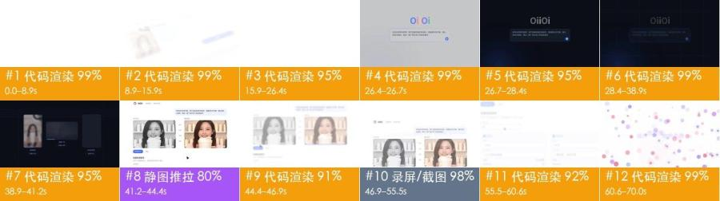

## 核心看点

- **开头怎么抓人**：0–4 秒白底只有一行淡紫色「OiiOi 视频复刻 现已上线」逐词浮现，4.4 秒软件界面斜着滑进来，光标立刻选中「视频复刻」、移向「开始复刻」：开场先报产品名，马上进入操作。
- 19–26 秒在输入框里逐字打出完整提示词「参考这条带货视频，把产品换成我的保温杯……」：观众看完就知道只要说一句话，不用学软件
- 35–37 秒把这句话变成一段“复刻脚本”代码（shot_01…shot_05、generate、variants），38.9–41 秒三张卡片的进度数字跳到「✓ 已完成」：把看不见的 AI 过程做成看得见的步骤和结果
- 41–44 秒参考视频（黑白）和复刻成片（彩色）并排，中间标「钩子 / 卖点 / 证明 / 促单」：去色对比一眼看出哪个是原片，标签说明结构被原样保留
- 47–55 秒批量投放表单里填出版本A / B 的时长、卖点、画幅和预计完播率 31% / 38%：直接说投放人员关心的指标，而不是只讲“能生成”

## 一眼看懂：画面、包装、声音三层

短视频都可以拆成三层：底下是画面本身，上面叠字幕、花字、贴纸，再配上声音。复刻时一层一层做。

| 层 | 这条视频里是什么 | 怎么做 | 细节 |
|---|---|---|---|
| **画面**（底层） | 代码/模板渲染 9 镜 | 录屏 / 代码做动效 | 「自己复刻」 |
| **包装**（叠在画面上） | 没有 | — | 「剪辑包装层」 |
| **声音** | 背景音乐（112 BPM、待确认）、音效 1 处 | 配乐：按节奏和情绪找同类曲；音效：按时间点从音效库加 | 「声音」 |

## 内容与结构

- 下面的叙事线来自逐镜看图；台词没有单独整理，字幕原文见「剪辑包装层」

**叙事线**

复刻时保留这条线：每一步的顺序和作用照搬，讲的那一点换成自己的案例、数据和素材，就不只是换个主角。

| 时间 | 镜头 | 作用 | 在讲什么 |
|---|---|---|---|
| 0.0–8.8s | #1 | 抓注意 | 先亮出产品名和“已上线”，紧接着演示第一步操作，让人知道这是个可以马上用的工具 |
| 8.8–26.6s | #2 | 补信息 | 讲清工具怎么工作：先把参考视频逐镜拆开，再用一句话说出要怎么改 |
| 26.6–28.4s | #3 | 转折 | 用亮转暗的换场表示指令已经发出，从“输入”转到“生成” |
| 28.4–38.9s | #4 | 补信息 | 把一句指令翻译成看得见的“复刻脚本”，说明工具会按原片结构逐镜生成，并能一次出多个版本 |
| 38.9–44.5s | #5、#6 | 给证据 | 一条输入同时产出三种用途的成片，用进度数字跳到“已完成”给出结果 → 原片和复刻片并排放，中间标出钩子、卖点、证明、促单，证明保留了原片的结构 |
| 44.5–55.5s | #7、#8 | 补信息 | 用一句承接语引出下一个能力：批量出投放版本 → 展示可以按时长、卖点、画幅批量配出多个投放版本，并给出预计完播率 |
| 55.5–70.0s | #9 | 给结论 | 用一句“更简单”收束卖点，彩点聚成播放键再落回产品界面，最后停在品牌标识上 |

## 分镜表

「画面」「运镜」「叠加层」是画面里看得到的；「制作方式」「素材来源」是工具推断的，依据见附录逐镜取证。

| # | 截图 | 时间 | 时长 | 在讲什么 | 画面 | 运镜 | 叠加层 | 制作方式（推断） | 素材来源（推断） | 复刻 |
|---|---|---|---|---|---|---|---|---|---|---|
| 1 |  | 0:00.0 | 8.8s | 抓注意：先亮出产品名和“已上线”，紧接着演示第一步操作，让人知道这是个可以马上用的工具 | 白底；1–4 秒中间一行淡紫色文字「OiiOi 视频复刻 现已上线」逐词淡入后淡… | 平滑运镜 | — | 代码/模板渲染 90% | 制作方渲染 | 代码渲染 · 段1 |
| 2 | 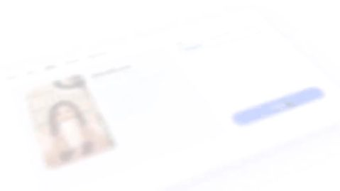 | 0:08.8 | 17.8s | 补信息：讲清工具怎么工作：先把参考视频逐镜拆开，再用一句话说出要怎么改 | 四段叠化接在一起的代码动效：①白底标语「开启 一种 复刻爆款 的新方式」逐词淡入… | 固定 | — | 代码/模板渲染 92% | Logo/品牌标识 | 代码渲染 · 段1 |
| 3 | 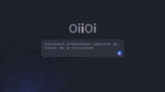 | 0:26.6 | 1.8s | 转折：用亮转暗的换场表示指令已经发出，从“输入”转到“生成” | 深蓝近黑背景加细网格线；正中灰白「OiiOi」字标，下方圆角输入框里是完整的提示… | 固定 | — | 代码/模板渲染 94% | 制作方渲染 | 代码渲染 · 段1 |
| 4 | 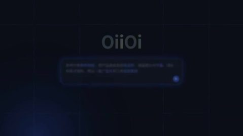 | 0:28.4 | 10.5s | 补信息：把一句指令翻译成看得见的“复刻脚本”，说明工具会按原片结构逐镜生成，并能一次出多个版本 | 深蓝近黑背景加细网格线；28.4–30 秒几十个淡紫色小字从画面四周飞向中间，拼… | 固定 | — | 代码/模板渲染 94% | 制作方渲染 | 代码渲染 · 段1 |
| 5 | 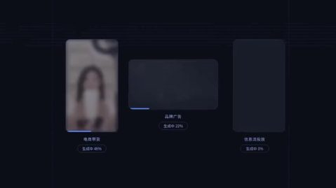 | 0:38.9 | 2.3s | 给证据：一条输入同时产出三种用途的成片，用进度数字跳到“已完成”给出结果 | 深蓝网格背景上三张卡片横排：左边竖版卡片「电商带货」是举保温杯的女主播，中间横版… | 固定 | — | 代码/模板渲染 85% | 制作方渲染；待确认是否真实：嵌入视频片段 | 代码渲染 · 段1 |
| 6 |  | 0:41.2 | 3.3s | 给证据：原片和复刻片并排放，中间标出钩子、卖点、证明、促单，证明保留了原片的结构 | 白底界面：左上「OiiOi 视频复刻 · 保温杯带货」，右上浅紫气泡里是用户提示… | 整图推拉/平移 | — | 代码/模板渲染 55% | 制作方渲染 | 代码渲染 · 段1 |
| 7 |  | 0:44.5 | 2.4s | 补信息：用一句承接语引出下一个能力：批量出投放版本 | 纯白背景，正中一行淡紫色文字「以及 按需 批量生成的 投放版本」，从左到右逐词淡… | 固定 | — | 代码/模板渲染 90% | 制作方渲染 | 代码渲染 · 段1 |
| 8 |  | 0:46.9 | 8.6s | 补信息：展示可以按时长、卖点、画幅批量配出多个投放版本，并给出预计完播率 | 白底界面，先是参考视频 / 复刻成片对比页，随后整页上滚：顶部「批量投放版本」标… | 固定 | — | 代码/模板渲染 79% | 制作方渲染 | 代码渲染 · 段1 |
| 9 |  | 0:55.5 | 14.5s | 给结论：用一句“更简单”收束卖点，彩点聚成播放键再落回产品界面，最后停在品牌标识上 | 纯白背景；55.5–58 秒淡紫色文字「现在， 复刻任何爆款 都更简单」逐词出现… | 平滑运镜 | — | 代码/模板渲染 94% | Logo/品牌标识 | 代码渲染 · 段1 |

## 自己复刻：按这个顺序做

复刻的是做法和节奏，不是照抄画面。

1. **定内容**：照「内容与结构」的叙事线写自己的脚本
2. **备素材**：见下方「要准备的素材」
3. **录屏和动效**：见下方「代码合成」
4. **剪辑**：见下方「剪辑」
5. **声音**：见「声音」，每处音效都能先试听
6. **对照检查**：成片和原片并排看一遍：镜头长短、字幕位置、音乐起落对不对得上

### 要准备的素材

- 画面里直接用的真实文件（截图、照片、录屏，要拿到原文件）：
  - **Logo/品牌标识**（画面局部），彩色「OiiOi」字标（每个字母不同颜色）：镜头 #2，共 17.8s
  - **Logo/品牌标识**（画面局部），片尾 OiiOi 彩色渐变圆环 Logo 与「OiiOi 视频复刻」字标：镜头 #9，共 14.5s

### 代码合成

一个 Remotion/HTML 工程，按文字轨和版式重建（文字、界面 100% 可控，改文案只改数据）；可以让 LLM 直接写这个工程。

- 段1：镜头 #1–#9（0.0–70.0s）

复刻资产（都在报告目录里，复刻时和下面的数据一起交给写代码的人或 LLM）：
- `shots/shot_XXX_first.jpg` / `_last.jpg`：每镜首尾帧原分辨率，对版式、字号、留白
- `shots/shot_XXX_strip.jpg`：约每 0.5 秒一张的关键帧条，看动画过程
- `shots/shot_XXX_elements.jpg` 和 `_el_NN.jpg` / `_st_NN.jpg` / `_ly_NN.jpg`：每个元素停稳后的原分辨率截图，编号对应动效时间轴；图形照着重画，图标、Logo、插画这类画不出来的可以直接抠图用
- `packaging/overlays.ass`、`packaging/timeline.json`：文字的时间、位置、颜色

画面做法（按工具测得的画面类型）：
- 数据图表：SVG/D3 比例尺画坐标和图形，数字用 interpolate() 逐帧计数，柱/线按 spring() 生长
- 线稿/点阵：SVG 路径用 stroke-dashoffset 逐帧描线，或 Canvas 按噪声场画流线 / 按目标形状排点；线宽、颜色、密度按画面量
- 粒子/点云：Three.js 粒子系统（点按目标形状采样，形状间插值变形，加辉光后期），用 @remotion/three 逐帧渲染
- 矢量图形：SVG 图形 + interpolate()/spring() 关键帧，按画面量出位置和节奏

粒子类镜头：每一镜粒子拼成什么形状、怎么动是复刻好坏的关键，章节牌、标注、数字等 HUD 文字用 HTML 层叠在上面，按下表逐镜做，不要所有镜头共用一个背景。

| 镜头 | 时间 | 做法 | 画面 | 运镜 | 主色 | 画面文字 |
|---|---|---|---|---|---|---|
| #1 | 0.0–8.8s | 数据图表 | 白底；1–4 秒中间一行淡紫色文字「OiiOi 视频复刻 现已上线」逐词淡入后淡出；4.4 秒一张斜放的软件界面（左侧图标栏、顶部「创作 / 模板 / 复刻 / 素材库 / 我的作品」标签、中间「参考视频.mp4」卡片带女主播缩略图、右侧「模式」下拉框和蓝色「开始复刻」按钮）从右下向上滑入，虚拟镜头缓慢推近并向左平移；6.5 秒光标点开下拉框，菜单展开三项，选中「视频复刻」；8 秒光标移到「开始复刻」按钮，画面叠化到下一镜。 | 推近 2%/s，画面向左移 | 底 #fbfcfd · #f1f4f9 #e3cec5 #caa290 #4171fc | 00:15 |
| #2 | 8.8–26.6s | 线稿/点阵 | 四段叠化接在一起的代码动效：①白底标语「开启 一种 复刻爆款 的新方式」逐词淡入；②斜放的拉片分析界面：上排 5 张女主播缩略图，下面是分镜表（镜头01 0.0–2.1s 特写「开场钩子·主播举杯」、镜头02 2.1–4.8s 中景「卖点·倒入热水」、镜头03 近景「证明·12小时仍冒热气」、镜头04 全景「场景·通勤与办公」），画面缓慢平移；③白底标语「逐帧拉片，读懂 每一个 爆款结构」；④白底正中彩色字标「OiiOi」，下方圆角输入框（紫蓝渐变描边）显示「问问OiiOi，想复刻什么？」，随后逐字打出提示词「参考这条带货视频，把产品换成我的保温杯，保留原片的节奏、镜头和卖点结构，再出一版广告片和三条投放素材」，右下角蓝色发送按钮；结尾整屏变灰压暗。 | 固定 | 底 #f9fcfd · #f4f3f8 #d9dee3 #bfc7c9 | — |
| #3 | 26.6–28.4s | 粒子/点云 | 深蓝近黑背景加细网格线；正中灰白「OiiOi」字标，下方圆角输入框里是完整的提示词，边框从灰变成发光的蓝色描边，右下角蓝色发送按钮；左下角一团蓝色径向渐变光晕缓慢明暗呼吸；画面固定，1.8 秒后叠化进入暗场段落。 | 固定 | 底 #070d15 · #060f1d #0a132a #101724 #101d37 | Oiioi |
| #4 | 28.4–38.9s | 粒子/点云 | 深蓝近黑背景加细网格线；28.4–30 秒几十个淡紫色小字从画面四周飞向中间，拼成一行「解锁 电商带货 · 广告片 · 投放视频」（关键词蓝紫色）；31.9 秒标语淡出，32.9 秒「实时生成 分镜 与 素材」逐词出现，下方一条细线从左向右扫过；35 秒左下角出现等宽字体代码块，逐行打出「# 复刻脚本 · 保温杯带货 · 9:16 / ref = 拉片(“参考视频.mp4”) 5 镜头·快-慢-快 / shot_01…shot_05 = Shot(t=…, 景别=…, 内容=…) / generate(ref.结构, 产品=my_cup, 节奏=ref.节奏) / variants([“电商带货”, “品牌广告”, “信息流投放”])」，左下角蓝色光晕呼吸；37.6 秒代码块上移淡出，三张圆角卡片线框从下往上展开。 | 固定 | 底 #070d15 · #161b28 #0f1723 #061018 #070e1a | 复刻脚本·保温杯带货·9：16 |
| #5 | 38.9–41.2s | 数据图表 | 深蓝网格背景上三张卡片横排：左边竖版卡片「电商带货」是举保温杯的女主播，中间横版卡片「品牌广告」是雾气水面上的玻璃香水瓶，右边竖版卡片「信息流投放」是逆光街道上看智能手表的跑步男生；38.9 秒三张卡片内容都是模糊状态，下方显示「生成中 xx%」和蓝色进度条，左卡最先变清晰并切成「✓ 已完成」胶囊按钮，中卡、右卡依次跟上，41 秒三张全部完成；画面固定。 | 固定 | 底 #070d15 · #cdbbac #f1e4d7 #a79384 #2d2b36 | 生成数量 / 钩子 / 卖点 / 证明 / oiioi / 视频复刻·保温杯带货 |
| #6 | 41.2–44.5s | 矢量图形 | 白底界面：左上「OiiOi 视频复刻 · 保温杯带货」，右上浅紫气泡里是用户提示词；中间左右两个视频框，左「参考视频」（黑白）、右「复刻成片」（彩色），都是举保温杯微笑的女主播，中间竖排四个蓝紫小标签「钩子 / 卖点 / 证明 / 促单」把两边结构一一对应；左下蓝色「▶ 播放对比」按钮和「导出」按钮，下方露出「批量投放版本」表单开头；光标移到「播放对比」点击，右框下方进度条向右走；整页缓慢推近；44 秒画面模糊淡出。 | 固定机位，画面内元素在动 | 底 #fbfcfd · #ededed #e1ddda #d6cec8 #918a88 | 生成数量 / 促单 / oiioi / 视频复刻·保温杯带货 / 参考这条带货视频，把产品换成我的保温杯，保留原片的节奏、镜头和卖 / 点结构，再出一版广告片和三条投放素材 |
| #7 | 44.5–46.9s | 矢量图形 | 纯白背景，正中一行淡紫色文字「以及 按需 批量生成的 投放版本」，从左到右逐词淡入，关键词颜色稍深；2.4 秒后叠化进入下一镜界面。 | 固定 | 底 #fbfcfd ·  | — |
| #8 | 46.9–55.5s | 线稿/点阵 | 白底界面，先是参考视频 / 复刻成片对比页，随后整页上滚：顶部「批量投放版本」标题和说明「在同一套爆款结构上，按投放需求生成多个版本」，下面「生成数量」输入框，光标点进去把数字改成 3、再改成 12；下方出现两列版本卡片「版本A / 版本B …」，每张卡片有蓝色小方块标题和字段：时长 15秒 / 30秒、主打卖点「12小时长效保温」「一键开盖·单手可喝」、画幅 9:16竖屏 / 1:1方屏、素材条数 2 / 6、预计完播率 31% / 38%；数字和文字逐项淡入填好；55 秒画面淡出变白。 | 固定 | 底 #f1f4f9 · #f9fcfd #dee2e9 #c8cdda | 参考这条带货视频，把产品换成我的保温杯，保留原片的节奏、镜头和卖 / 点结构，再出一版广告片和三条投放素材 / 参考视频 / 复刻成片 / 促单 / 播放对比 |
| #9 | 55.5–70.0s | 线稿/点阵 | 纯白背景；55.5–58 秒淡紫色文字「现在， 复刻任何爆款 都更简单」逐词出现后淡出，58.5 秒「成片 也更懂 你的品牌」同样出现；60.3 秒数百个红、粉、紫、蓝彩色圆点（带柔光）从中心向四周爆开铺满画面，61.5 秒往回收拢，62.7 秒聚成一个由细小彩点围成的圆环，中间一个蓝色三角播放键；63.9 秒镜头拉远，圆环落在一张斜放的界面上（顶部「复刻成片 · 品牌动效」，左侧图标栏，若干灰色占位文字行），界面缓慢平移；67.5 秒界面淡出，68.5 秒白底正中出现 OiiOi 彩色渐变圆环 Logo + 黑色「OiiOi」+ 灰色「视频复刻」，定格到结束。 | 固定机位，画面内元素在动 | 底 #fbfcfd · #e4e6ea | — |

逐镜动效时间轴（工具测量：位置是占画面宽高的百分比，颜色是元素稳定后的取色；配合关键帧条看）

动效 #1 0.0–8.8s · 9 个

- 背景 #fbfcfd；其他主色 #f1f4f9 #e3cec5 #caa290 #4171fc
元素截图（编号对应下面的动效；L 是持续运动层的镜头中段和结尾，S 是整镜不动的元素），原分辨率单张在 `shots/` 里：

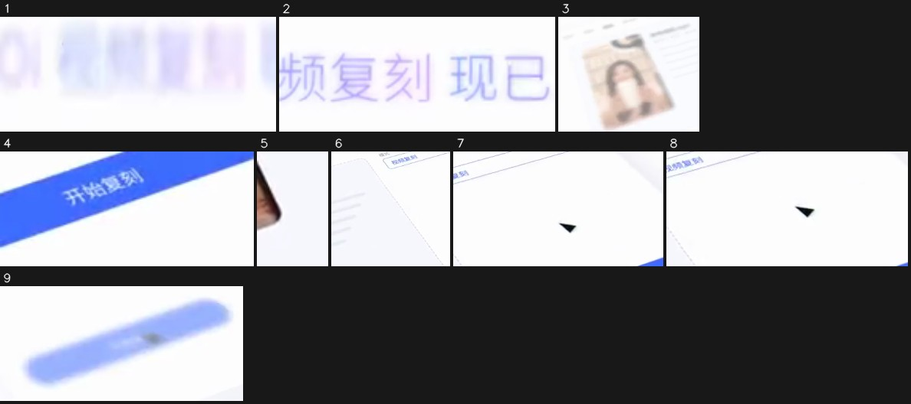

1. 1.13–4.13s · 中（x 36%–56%，y 48%–56%） · 出现，向右移入，先快后慢 · #e7e5fd · 文字「OiiOi 视频复刻 / OiiOi 视频复刻现已上线」 · [截图](shots/shot_001_el_01.jpg)
2. 4.13–5.13s · 中（x 44%–62%，y 44%–56%） · 消失，先快后慢 · #dad8fb · 文字「OiiOi 视频复刻现已上线」 · [截图](shots/shot_001_el_02.jpg)
3. 4.53–8.73s · 中左（x 2%–40%，y 32%–88%） · 出现，向上移入，匀速 · #e6d7cf · 文字「Oiioi / OiiOi 视频复刻 / 我的作品」 · [截图](shots/shot_001_el_03.jpg)
4. 4.53–5.13s · 中右（x 80%–96%，y 52%–64%） · 出现，匀速 · #486ffd · 文字「开始复刻」 · [截图](shots/shot_001_el_04.jpg)
5. 4.53–5.53s · 下（x 40%–42%，y 68%–80%） · 出现，向上移入，匀速 · #d8d7de · [截图](shots/shot_001_el_05.jpg)
6. 4.60–7.73s · 中（x 44%–67%，y 24%–64%） · 变化，向上移动，先快后慢 · #ecedf6 · 文字「OiiOi 视频复刻现已上线 / 视频生成 / 上传」 · [截图](shots/shot_001_el_06.jpg)
7. 6.47–7.87s · 中右（x 60%–89%，y 20%–48%） · 变化，向右移动，缓入缓出 · #efeef7 · 文字「视频生成 / 图片生成 / 视频复刻」 · [截图](shots/shot_001_el_07.jpg)
8. 6.93–7.73s · 中右（x 58%–87%，y 24%–48%） · 变化，向下移动，缓入缓出 · #fdfdfd · 文字「视频生成 / 图片生成 / 视频复刻」 · [截图](shots/shot_001_el_08.jpg)
9. 8.13–8.73s · 中右（x 67%–96%，y 44%–68%） · 变化，向上移动，先慢后快 · #a7bafd · 文字「开始复刻」 · [截图](shots/shot_001_el_09.jpg)

动效 #2 8.8–26.6s（叠化切入） · 0 个

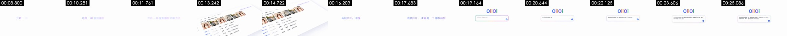

- 背景 #f9fcfd；其他主色 #f4f3f8 #d9dee3 #bfc7c9
- 没有测到元素运动（静止画面或只有细微变化）

动效 #3 26.6–28.4s · 1 个

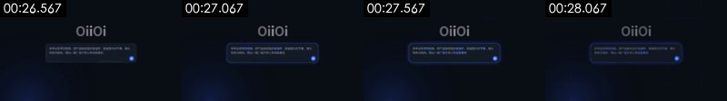

- 背景 #070d15；其他主色 #060f1d #0a132a #101724 #101d37
元素截图（编号对应下面的动效；L 是持续运动层的镜头中段和结尾，S 是整镜不动的元素），原分辨率单张在 `shots/` 里：

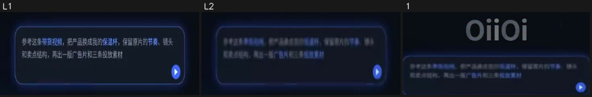

- [截图 L1](shots/shot_003_ly_01.jpg) [截图 L2](shots/shot_003_ly_02.jpg) · 持续运动层：6% 的画面整镜都在动（x 22%–78%，y 40%–64%），如漂移的渐变、粒子流、辉光呼吸
1. 28.23–28.30s · 中（x 27%–73%，y 24%–60%） · 变化，瞬间 · #2f3648 · 文字「Oiioi / 参考这条带货视频，把产品换成我的保温杯，保留原片的节奏、镜头 / 和卖点结构，再出一版广告片和三条投放素材」 · [截图](shots/shot_003_el_01.jpg)

动效 #4 28.4–38.9s（叠化切入） · 10 个

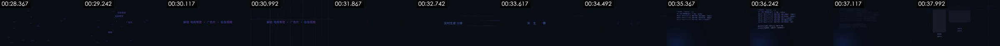

- 背景 #070d15；其他主色 #161b28 #0f1723 #061018 #070e1a
元素截图（编号对应下面的动效；L 是持续运动层的镜头中段和结尾，S 是整镜不动的元素），原分辨率单张在 `shots/` 里：

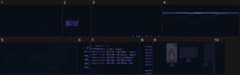

1. 28.43–28.50s · 下（x 29%–71%，y 60%–100%） · 变化，瞬间 · #090d14 · 文字「解锁 / 海出 / 品牌广告」 · [截图](shots/shot_004_el_01.jpg)
2. 29.37–31.30s · 下（x 38%–42%，y 80%–92%） · 消失，向上移动，先快后慢 · #171530 · 文字「解锁」 · [截图](shots/shot_004_el_02.jpg)
3. 29.70–29.90s · 中（x 56%–71%，y 32%–44%） · 变化，向右移动，匀速 · #090d14 · 文字「投放视频」 · [截图](shots/shot_004_el_03.jpg)
4. 32.83–32.90s · 中右（x 67%–87%，y 44%–48%） · 出现，瞬间 · #1b1e31 · 文字「保留」 · [截图](shots/shot_004_el_04.jpg)
5. 35.23–37.43s · 中（x 38%–53%，y 32%–40%） · 变化，向右移动，匀速 · #111422 · 文字「电商带货」 · [截图](shots/shot_004_el_05.jpg)
6. 36.03–37.97s · 中左（x 9%–13%，y 20%–52%） · 消失，向上移动，缓入缓出 · #1e253e · [截图](shots/shot_004_el_06.jpg)
7. 36.23–37.43s · 中（x 18%–56%，y 20%–64%） · 消失，向左移动，匀速 · #202842 · 文字「电商带货 / 广告片 / 解锁」 · [截图](shots/shot_004_el_07.jpg)
8. 36.83–37.43s · 中左（x 7%–13%，y 16%–60%） · 消失，向下移动，缓入缓出 · #20283e · [截图](shots/shot_004_el_08.jpg)
9. 37.63–38.83s · 中（x 0%–84%，y 20%–100%） · 出现，向上展开（描线/生长/擦除），缓入缓出 · #171b28 · 文字「电商带货 / 保留 / 解锁」 · [截图](shots/shot_004_el_09.jpg)
10. 38.70–38.77s · 中右（x 89%–96%，y 24%–68%） · 变化，瞬间 · #090d14 · [截图](shots/shot_004_el_10.jpg)

动效 #5 38.9–41.2s（叠化切入） · 3 个

- 背景 #070d15；其他主色 #cdbbac #f1e4d7 #a79384 #2d2b36
元素截图（编号对应下面的动效；L 是持续运动层的镜头中段和结尾，S 是整镜不动的元素），原分辨率单张在 `shots/` 里：

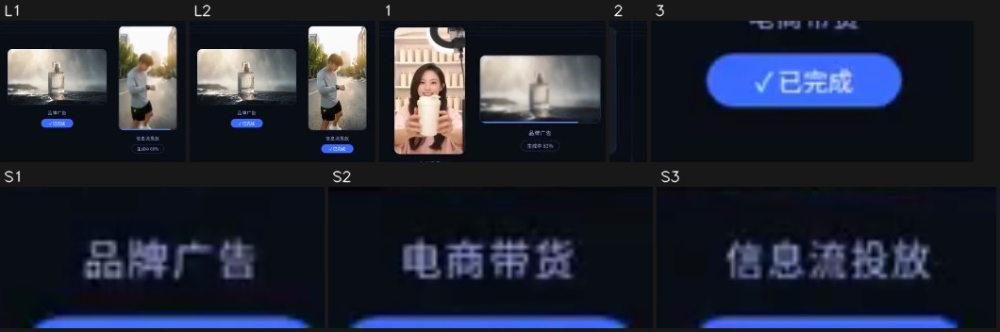

- S1. 整镜不动：图形/文字块 · x 48%–54%，y 60%–64% · #3f455b · 文字「品牌广告 / 促单」 · [截图](shots/shot_005_st_01.jpg)
- S2. 整镜不动：图形/文字块 · x 24%–30%，y 72%–76% · #4b4d67 · 文字「电商带货」 · [截图](shots/shot_005_st_02.jpg)
- S3. 整镜不动：图形/文字块 · x 72%–79%，y 72%–76% · #454865 · 文字「信息流投放」 · [截图](shots/shot_005_st_03.jpg)
- [截图 L1](shots/shot_005_ly_01.jpg) [截图 L2](shots/shot_005_ly_02.jpg) · 持续运动层：15% 的画面整镜都在动（x 38%–84%，y 20%–84%），如漂移的渐变、粒子流、辉光呼吸
1. 38.93–39.60s · 中（x 18%–64%，y 20%–72%） · 出现，向下移入，先快后慢 · #b99f96 · 文字「品牌广告 / 生成中46% / 生成中86%」 · [截图](shots/shot_005_el_01.jpg)
2. 38.93–39.00s · 中右（x 84%–87%，y 20%–72%） · 变化，瞬间 · #090d14 · [截图](shots/shot_005_el_02.jpg)
3. 39.40–39.60s · 下左（x 22%–33%，y 76%–84%） · 出现，先慢后快 · #3c69f2 · 文字「电商带货 / 生成中73% / √已完成」 · [截图](shots/shot_005_el_03.jpg)

动效 #6 41.2–44.5s · 6 个

- 背景 #fbfcfd；其他主色 #ededed #e1ddda #d6cec8 #918a88
元素截图（编号对应下面的动效；L 是持续运动层的镜头中段和结尾，S 是整镜不动的元素），原分辨率单张在 `shots/` 里：

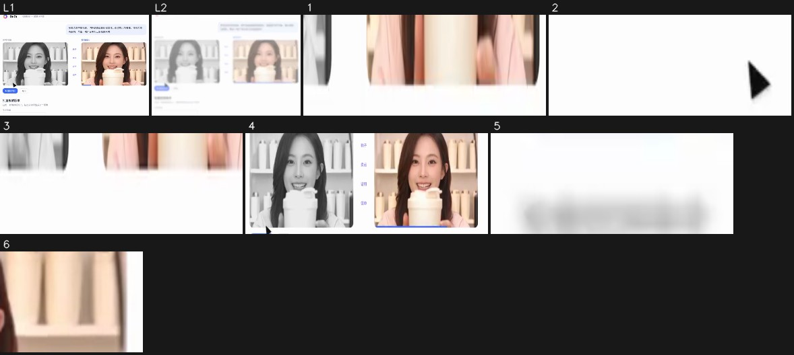

- [截图 L1](shots/shot_006_ly_01.jpg) [截图 L2](shots/shot_006_ly_02.jpg) · 持续运动层：31% 的画面整镜都在动（x 11%–89%，y 0%–96%），如漂移的渐变、粒子流、辉光呼吸
1. 41.27–43.13s · 下（x 42%–89%，y 68%–72%） · 消失，向右移动，匀速 · #edd2c8 · [截图](shots/shot_006_el_01.jpg)
2. 41.47–41.87s · 下（x 40%–58%，y 80%–88%） · 消失，向左移动，匀速 · #7b7b7b · [截图](shots/shot_006_el_02.jpg)
3. 42.67–43.13s · 下（x 33%–82%，y 68%–72%） · 消失，向右移动，匀速 · #e1cbc1 · [截图](shots/shot_006_el_03.jpg)
4. 44.00–44.47s · 中（x 11%–91%，y 28%–68%） · 消失，向左移动，先慢后快 · #c4b3a8 · 文字「参考视频 / 复刻成片 / 钩子」 · [截图](shots/shot_006_el_04.jpg)
5. 44.00–44.47s · 下左（x 11%–20%，y 76%–80%） · 出现，缓入缓出 · #e5e5e7 · 文字「播放对比 / 批量投放版本」 · [截图](shots/shot_006_el_05.jpg)
6. 44.20–44.47s · 中右（x 80%–89%，y 32%–44%） · 消失，向上移动，缓入缓出 · #edcfb5 · [截图](shots/shot_006_el_06.jpg)

动效 #7 44.5–46.9s（叠化切入） · 5 个

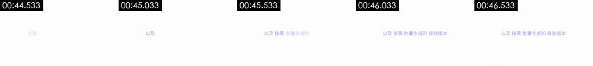

- 背景 #fbfcfd；其他主色 —
元素截图（编号对应下面的动效；L 是持续运动层的镜头中段和结尾，S 是整镜不动的元素），原分辨率单张在 `shots/` 里：

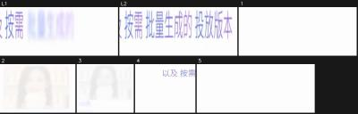

- [截图 L1](shots/shot_007_ly_01.jpg) [截图 L2](shots/shot_007_ly_02.jpg) · 持续运动层：3% 的画面整镜都在动（x 31%–78%，y 48%–56%），如漂移的渐变、粒子流、辉光呼吸
1. 44.60–44.67s · 上（x 47%–87%，y 8%–16%） · 变化，瞬间 · #fdfdfd · [截图](shots/shot_007_el_01.jpg)
2. 44.60–44.67s · 中右（x 53%–91%，y 24%–68%） · 消失，瞬间 · #f3ede8 · [截图](shots/shot_007_el_02.jpg)
3. 44.60–44.67s · 中左（x 11%–47%，y 24%–80%） · 消失，瞬间 · #e8e8e9 · 文字「以及 / 以及按需」 · [截图](shots/shot_007_el_03.jpg)
4. 46.87–46.93s · 中左（x 11%–38%，y 44%–84%） · 变化，瞬间 · #e7e5f5 · 文字「以及 / 以及按需」 · [截图](shots/shot_007_el_04.jpg)
5. 46.87–46.93s · 下（x 47%–87%，y 88%–100%） · 出现，瞬间 · #ededef · [截图](shots/shot_007_el_05.jpg)

动效 #8 46.9–55.5s（淡入切入） · 8 个

- 背景 #f1f4f9；其他主色 #f9fcfd #dee2e9 #c8cdda
元素截图（编号对应下面的动效；L 是持续运动层的镜头中段和结尾，S 是整镜不动的元素），原分辨率单张在 `shots/` 里：

1. 47.00–49.13s · 中（x 24%–91%，y 0%–100%） · 出现，向上展开（描线/生长/擦除），瞬间 · #fae9db · 文字「证明 / 促单 / 版本B」 · [截图](shots/shot_008_el_01.jpg)
2. 47.00–52.00s · 下左（x 22%–42%，y 64%–76%） · 变化，向下移动，先快后慢 · #efeff4 · 文字「导出 / 在同一套爆款结构上，按投放需求生成多个版本」 · [截图](shots/shot_008_el_02.jpg)
3. 47.53–48.80s · 下（x 13%–89%，y 44%–100%） · 消失，向下移动，先慢后快 · #d6c5be · 文字「证明 / 促单 / 播放对比」 · [截图](shots/shot_008_el_03.jpg)
4. 47.60–51.87s · 上（x 24%–91%，y 0%–24%） · 消失，向右移动，先快后慢 · #eceffb · 文字「参考这条带货视频，把产品换成我的保温杯，保留原片的节奏、镜头和卖 / 点结构，再出一版广告片和三条投放素材 / 复刻成片」 · [截图](shots/shot_008_el_04.jpg)
5. 51.53–52.00s · 中右（x 91%–100%，y 0%–96%） · 变化，向下移动，缓入缓出 · #f0f6f9 · [截图](shots/shot_008_el_05.jpg)
6. 55.20–55.47s · 上左（x 0%–36%，y 16%–44%） · 消失，向上移动，缓入缓出 · #d3dbe2 · 文字「参考视频 / 播放对比 / 导出」 · [截图](shots/shot_008_el_06.jpg)
7. 55.27–55.47s · 上左（x 0%–18%，y 0%–12%） · 消失，匀速 · #5277fc · 文字「参考视频 / 播放对比」 · [截图](shots/shot_008_el_07.jpg)
8. 55.27–55.47s · 下（x 2%–80%，y 40%–96%） · 消失，向上移动，匀速 · #c6c9d9 · 文字「卖点 / 证明 / 促单」 · [截图](shots/shot_008_el_08.jpg)

动效 #9 55.5–70.0s（叠化切入） · 13 个

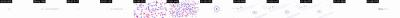

- 背景 #fbfcfd；其他主色 #e4e6ea
元素截图（编号对应下面的动效；L 是持续运动层的镜头中段和结尾，S 是整镜不动的元素），原分辨率单张在 `shots/` 里：

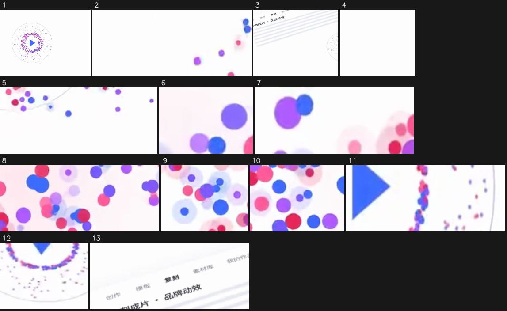

- 持续运动层：2% 的画面整镜都在动（x 24%–64%，y 48%–56%），如漂移的渐变、粒子流、辉光呼吸
1. 60.57–62.57s · 中（x 24%–100%，y 0%–100%） · 出现，向左移入，匀速 · #e9d8f0 · 文字「现在， / 现在，复刻任何爆款都更简单 / 成片」 · [截图](shots/shot_009_el_01.jpg)
2. 60.57–62.23s · 上左（x 0%–27%，y 16%–32%） · 变化，向右移动，匀速 · #e7d2ec · 文字「复刻 / 我的作」 · [截图](shots/shot_009_el_02.jpg)
3. 60.57–64.03s · 下（x 13%–58%，y 36%–100%） · 变化，向上移动，先快后慢 · #ededf2 · 文字「现在， / 现在，复刻任何爆款都更简单 / 成片」 · [截图](shots/shot_009_el_03.jpg)
4. 60.57–62.23s · 下左（x 2%–16%，y 76%–100%） · 变化，向上移动，匀速 · #fdfdfd · [截图](shots/shot_009_el_04.jpg)
5. 60.57–62.23s · 下（x 49%–80%，y 76%–100%） · 出现，向上移入，缓入缓出 · #decdf2 · [截图](shots/shot_009_el_05.jpg)
6. 60.90–63.83s · 中（x 51%–60%，y 44%–56%） · 消失，向上移动，匀速 · #f6ebfc · 文字「现在，复刻任何爆款都更简单 / 成片也更懂你的品牌 / Oiioi视频复刻」 · [截图](shots/shot_009_el_06.jpg)
7. 61.17–62.17s · 上左（x 0%–20%，y 0%–12%） · 消失，向右移动，缓入缓出 · #e9b3f5 · [截图](shots/shot_009_el_07.jpg)
8. 61.57–62.37s · 下（x 47%–80%，y 76%–100%） · 消失，向右移动，匀速 · #f5d8f3 · [截图](shots/shot_009_el_08.jpg)
9. 61.63–62.23s · 上左（x 0%–16%，y 16%–36%） · 消失，向右移动，匀速 · #e1dafa · 文字「模板 / 复刻 / 刻成片·品牌动效」 · [截图](shots/shot_009_el_09.jpg)
10. 61.77–62.23s · 下左（x 4%–20%，y 76%–96%） · 消失，向下移动，匀速 · #e5a7ef · [截图](shots/shot_009_el_10.jpg)
11. 63.17–63.77s · 中（x 49%–67%，y 48%–56%） · 消失，向左移动，缓入缓出 · #b6acf7 · 文字「现在，复刻任何爆款都更简单 / 成片也更懂你的品牌 / Oiioi视频复刻」 · [截图](shots/shot_009_el_11.jpg)
12. 64.03–66.03s · 下（x 60%–71%，y 72%–88%） · 消失，向上移动，先快后慢 · #ebdff2 · [截图](shots/shot_009_el_12.jpg)
13. 65.57–67.23s · 中左（x 2%–33%，y 24%–44%） · 消失，向左移动，匀速 · #ededf2 · 文字「紫材库 / 复刻 / 模板」 · [截图](shots/shot_009_el_13.jpg)

### 剪辑

- 按「分镜表」的顺序和时长剪
- 手法：标语卡和界面演示交替，镜头之间以叠化为主；换场点贴着音乐段落（约 19.5、38.5、55.5 秒）
- 节奏：每分钟 6.9 刀，平均镜头 7.78s；没有实拍镜头；转场 硬切×2、叠化×5、淡入淡出×1

## 角色、场景与道具

| 编号 | 称呼 | 类型 | 外观 | 作用 | 声音 | 出场 |
|---|---|---|---|---|---|---|
| A | 带货女主播 | 真人 | 二十多岁亚洲女性，深棕色长卷发，粉色短袖上衣，露齿微笑，双手捧一个白色带提手盖的保温杯举到镜头前；背景是摆满白色杯子的浅色货架，左上角有环形补光灯 | 界面里被复刻的“参考视频”和“复刻成片”主角 | 无（不出声） | #1、#2、#5、#6、#8 |
| B | 跑步男生 | 真人 | 年轻亚洲男性，短发，浅灰长袖运动上衣、黑色运动短裤、白色跑鞋，左手腕戴黑色智能手表低头查看；晨光逆光的城市街道，两侧树和高楼 | 「信息流投放」版本的示例画面 | 无 | #5 |

**场景**

| 场景 | 地点 | 时间 | 布景 / 光线 | 镜头 |
|---|---|---|---|---|
| S1 | 白色背景上的 OiiOi 软件界面和标语卡 | 不适用 | 纯白 / 极浅灰底，淡紫色文字，蓝色按钮，界面常斜放带柔和投影 | #1、#2、#6–#9 |
| S2 | 深蓝暗场网格背景 | 不适用 | 近黑深蓝底加细网格线，左下角蓝色光晕，淡紫蓝发光文字和代码块 | #3–#5 |

**道具 / 商品 / Logo**

- 白色保温杯（镜头 #1、#2、#5、#6、#8）：带提手翻盖的白色保温杯，是被复刻视频里换上的“我的产品”
- 玻璃香水瓶（镜头 #5）：「品牌广告」示例画面里的方形透明香水瓶，立在雾气水面上
- OiiOi Logo（镜头 #2、#3、#9）：彩色字母字标和红紫蓝渐变圆环图标，开头输入框上方和片尾出现

## 拍法与打光

- 视觉风格：白底 + 淡紫蓝强调色的极简 SaaS 界面风格，中段切深蓝网格暗场，文字用细体无衬线字，关键词变色；界面多用 CSS 3D 斜放透视
- 打光：不适用（平面图形）；白底段落干净无阴影，暗场段落靠左下角蓝色径向光晕制造氛围（看图判断；像素测量见下方折叠）

- 说明：光比、软硬、色温、景别由主体像素测得（有人脸用人脸，没有用画面清晰区域，后者是估算）；平台转码会压暗部，软硬和补光偏保守；机位角度、光源种类、眼神光、轮廓光以看图结果为准。测量和看图不一致时两者都列出。

## 剪辑包装层（字幕 / 花字 / 贴纸 / 音效卡点）

- 没有检出后期叠加的文字或贴纸
- 导出：`packaging/timeline.json`（SRT 是字幕时间轴；ASS 带颜色、描边、位置和入场动画，字体需要换成原片字体；timeline.json 是完整时间轴）

复刻：字幕和花字用 `packaging/overlays.ass` 直接压制（ffmpeg -vf ass=overlays.ass），或按 timeline.json 在剪映 / Remotion 里重建；贴纸和动图要找同款素材（表情包库 / GIF 库），截图在 packaging/ 下。

## 声音

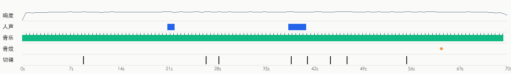

- 响度 -17.4 dBFS，峰值 -0.8 dBFS；声音跨切点连续，是后期整体铺的（切点处背景声变化 4.2dB，镜头内 2.9dB）
- 来源判断：视频类型：纯配乐（无人声） → 音乐现成曲库配乐（倾向，待确认）；音效音效库/剪辑软件后期添加（倾向，待确认）

**人声**

- 无 / 很少

**背景音乐**

- 节奏：112.3 BPM（也可能是 56.2/224.7）；调性 B minor（置信 0.52）；占 99% 时长（0.0–69.5s）；段落变化点 4.0s, 19.5s, 38.5s, 55.5s, 65.5s；片尾ends_with_video
- 剪辑与节拍：25% 的切点落在节拍上（随机约 26%）
- 来源：待确认（现成曲库配乐 52%，AI 生成音乐 30%，现成知名歌曲 17%）
  - 音乐是给画面垫底的配乐：普通视频的配乐大概率来自现成曲库（先验）
  - 音乐与视频同时收尾：按片长剪辑或定制过（两种来源都可能，弱证据）
  - 除了视频形式的先验和片尾形状这类弱证据，没有关于这段音乐本身的证据（没听出来源、没有平台音乐信息）：来源待确认，AI 生成的配乐在这里和曲库配乐分不开
  - 确认方法：在抖音/小红书原视频页面看音乐标签：显示歌名 → 现成曲目；显示「@作者创作的原声」→ 作者自己上传（MV 类多为 AI 歌）
  - 确认方法：用汽水音乐/QQ 音乐「听歌识曲」或 ACRCloud 识别：识别得到就是现成歌曲
- 复刻：原曲倾向现成曲库配乐：按 BPM/情绪/调性在曲库检索同类曲，或用 AI 生成相近风格的免版权曲

**音效**（1）

| 声音 | 试听 | 类型 | 次数 | 出现在 | 对应画面 |
|---|---|---|---|---|---|
| F1 | [试听](sfx/sfx_01.wav) | pop | 1 | 60.6s | — |

- 复刻：每种声音先点「试听」听一下（已单独分离出来，听不到人声和配乐），到剪辑软件的音效库里找一个同类的，按「出现在」的时间点放到每一处

- 分离出的音轨：`stems/original.wav`（原声）、`stems/vocals.wav`（人声干声）、`stems/music.wav`（配乐 + 环境声）、`stems/effects.wav`（音效轨）
<!--stems-->

## 不确定点

- 镜头 #5（38.9–41.2s）：嵌入视频片段 是真实素材还是生成的，待确认
- 镜头 #6（41.2–44.5s）：代码/模板渲染 只有 55% 置信，次选 code_render
- 声音没有 AI 听过（复核只看了画面）：人声是真人还是 TTS 是按波形推断的；音效是从单独分离出的音效轨里找的，类型是按声音特征估的。可以在「声音」里试听分轨和每处音效核对
- 背景音乐来源待确认：更像现成曲库配乐（52%），确认方法见「声音」

## 附录

### 逐镜取证

每个镜头分两块：画面里看得到的，和工具推断的制作方式（附判断依据）；最后是复刻提示词。默认折叠，点开看。

#1 00:00.000–00:08.800 · 代码/模板渲染

**画面里看得到的**（可以对照截图核实）
- 画面：白底；1–4 秒中间一行淡紫色文字「OiiOi 视频复刻 现已上线」逐词淡入后淡出；4.4 秒一张斜放的软件界面（左侧图标栏、顶部「创作 / 模板 / 复刻 / 素材库 / 我的作品」标签、中间「参考视频.mp4」卡片带女主播缩略图、右侧「模式」下拉框和蓝色「开始复刻」按钮）从右下向上滑入，虚拟镜头缓慢推近并向左平移；6.5 秒光标点开下拉框，菜单展开三项，选中「视频复刻」；8 秒光标移到「开始复刻」按钮，画面叠化到下一镜。
- 文字轨（画面内容文字/middle）：Oiioi / OiiOi 视频复刻 / OiiOi 视频复刻现已上线 / 开始复刻
- 文字轨（画面内容文字/middle）：d
- 文字轨（画面内容文字/middle）：视频生成 / 我的作品 / 图片生成 / 视频复到
- 文字轨（画面内容文字/middle）：复刻 / 模板 / 创作 / 参考视频.mp4
- 镜头内动效节拍：4.53s
- [AI 助手 看图] 0–4.4 秒纯白底，只有一行淡紫色标语逐词淡入淡出，没有任何其他元素
- [AI 助手 看图] 4.4 秒起整块软件界面带透视倾斜滑入，边缘锐利、阴影是均匀的柔和投影，没有材质纹理，是 CSS 3D 透视变换的平面界面
- [AI 助手 看图] 光标是匀速直线移动的矢量箭头，下拉菜单「图片生成 / 视频生成 / 视频复刻」按缓动展开、选中项高亮
- [AI 助手 看图] 左侧缩略图里的女主播全程同一姿势不动，是贴进界面的静帧，不是在播放的视频

**工具推断的制作方式**（是推断，不是看到的）
- 推断：代码/模板渲染 80%，3D 渲染 7%，屏幕录制/截图 4%（fused_agent）
- 素材来源：制作方渲染
- 判断依据（工具测量，肉眼不一定看得出）：
  - 50% 的相邻帧完全重复，只有局部元素在动（典型的模板/MG 动画或定格后局部动效）
  - 纹理呈渲染特征：平坦色块 82%、95% 像素仅用 5 种颜色、横竖直边 9%
  - 背景 97% 像素逐帧完全不变、只有局部元素在动：2D 合成/代码动效特征

- 复刻：代码渲染：用 Remotion/HTML 按文字轨与版式重建，100% 可控，不需要生成模型

#2 00:08.800–00:26.567 · 代码/模板渲染；引入真实素材（Logo/品牌标识）

**画面里看得到的**（可以对照截图核实）
- 画面：四段叠化接在一起的代码动效：①白底标语「开启 一种 复刻爆款 的新方式」逐词淡入；②斜放的拉片分析界面：上排 5 张女主播缩略图，下面是分镜表（镜头01 0.0–2.1s 特写「开场钩子·主播举杯」、镜头02 2.1–4.8s 中景「卖点·倒入热水」、镜头03 近景「证明·12小时仍冒热气」、镜头04 全景「场景·通勤与办公」），画面缓慢平移；③白底标语「逐帧拉片，读懂 每一个 爆款结构」；④白底正中彩色字标「OiiOi」，下方圆角输入框（紫蓝渐变描边）显示「问问OiiOi，想复刻什么？」，随后逐字打出提示词「参考这条带货视频，把产品换成我的保温杯，保留原片的节奏、镜头和卖点结构，再出一版广告片和三条投放素材」，右下角蓝色发送按钮；结尾整屏变灰压暗。
- 文字轨（画面内容文字/bottom）：开场钩子·主播举杯 / 特写 / 卖点·倒入热水 / 证明·12小时仍冒热气
- 文字轨（画面内容文字/bottom）：特写 / 卖点·倒入热水 / 中景 / 证明·12小时仍冒热气
- 文字轨（画面内容文字/bottom）：0.0-2.1s / 近景 / 场景·通勤与办公 / 镜头01
- 文字轨（画面内容文字/bottom）：镜头01 / 2.1-4.8s / ·限时价格 / 02
- [AI 助手 看图] 9–12 秒白底只有逐词出现的标语「开启 一种 复刻爆款 的新方式」，关键词变色
- [AI 助手 看图] 12.9–15.1 秒斜放的「拉片分析」表格整块平移，表格行（镜头01–04、时间段、景别、内容）一次性排好，没有真实滚动和加载
- [AI 助手 看图] 16.2–18.8 秒又是白底标语「逐帧拉片，读懂 每一个 爆款结构」
- [AI 助手 看图] 19 秒起彩色 OiiOi 字标下方的输入框边框是彩色渐变描边，提示词逐字打出，速度均匀，像打字机动画

**工具推断的制作方式**（是推断，不是看到的）
- 推断：代码/模板渲染 88%，屏幕录制/截图 4%，2D 动画 2%（fused_agent）
- 素材来源：混合（含真实素材）：Logo/品牌标识
- 判断依据（工具测量，肉眼不一定看得出）：
  - 76% 的相邻帧完全重复，只有局部元素在动（典型的模板/MG 动画或定格后局部动效）
  - 浅色底上的深色部分几乎全是细线/细点（平滑过渡只占 17%）：线稿、生成式线条或点阵图形，不是有明暗的实拍或 3D 表面
  - 纹理呈渲染特征：平坦色块 89%、95% 像素仅用 1 种颜色、横竖直边 25%
  - 背景 99% 像素逐帧完全不变、只有局部元素在动：2D 合成/代码动效特征

- 复刻：代码渲染：用 Remotion/HTML 按文字轨与版式重建，100% 可控，不需要生成模型；需要用户提供真实素材：Logo/品牌标识（画面局部）

#3 00:26.567–00:28.367 · 代码/模板渲染

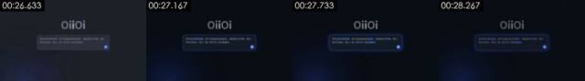

**画面里看得到的**（可以对照截图核实）
- 画面：深蓝近黑背景加细网格线；正中灰白「OiiOi」字标，下方圆角输入框里是完整的提示词，边框从灰变成发光的蓝色描边，右下角蓝色发送按钮；左下角一团蓝色径向渐变光晕缓慢明暗呼吸；画面固定，1.8 秒后叠化进入暗场段落。
- 文字轨（画面内容文字/middle）：Oiioi
- 文字轨（画面内容文字/middle）：参考这条带货视频，把产品换成我的保温杯，保留原片的节奏、镜头 / 和卖点结构，再出一版广告片和三条投放素材
- [AI 助手 看图] 上一镜的白底输入框整体换成深蓝暗场版本，排版完全不变，只有配色和辉光在变
- [AI 助手 看图] 左下角一团蓝色径向渐变光晕缓慢呼吸，背景是细网格线，没有任何表面材质
- [AI 助手 看图] 输入框边框蓝色发光由暗变亮，像按下发送后的状态切换

**工具推断的制作方式**（是推断，不是看到的）
- 推断：代码/模板渲染 86%，3D 渲染 6%，2D 动画 2%（fused_agent）
- 素材来源：制作方渲染
- 判断依据（工具测量，肉眼不一定看得出）：
  - 90% 的相邻帧完全重复，只有局部元素在动（典型的模板/MG 动画或定格后局部动效）
  - 暗底上的亮部几乎全是细碎亮点/细线（亮部平滑过渡只占 23%，每百个亮像素 21 个亮峰）：粒子/点云/线框类图形，不是有明暗过渡的实拍、3D 表面或 AI 画面
  - 纹理呈渲染特征：平坦色块 82%、95% 像素仅用 5 种颜色、横竖直边 34%
  - 背景 99% 像素逐帧完全不变、只有局部元素在动：2D 合成/代码动效特征

- 复刻：代码渲染：用 Remotion/HTML 按文字轨与版式重建，100% 可控，不需要生成模型

#4 00:28.367–00:38.867 · 代码/模板渲染

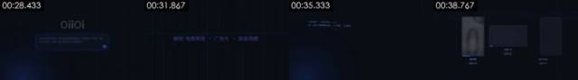

**画面里看得到的**（可以对照截图核实）
- 画面：深蓝近黑背景加细网格线；28.4–30 秒几十个淡紫色小字从画面四周飞向中间，拼成一行「解锁 电商带货 · 广告片 · 投放视频」（关键词蓝紫色）；31.9 秒标语淡出，32.9 秒「实时生成 分镜 与 素材」逐词出现，下方一条细线从左向右扫过；35 秒左下角出现等宽字体代码块，逐行打出「# 复刻脚本 · 保温杯带货 · 9:16 / ref = 拉片(“参考视频.mp4”) 5 镜头·快-慢-快 / shot_01…shot_05 = Shot(t=…, 景别=…, 内容=…) / generate(ref.结构, 产品=my_cup, 节奏=ref.节奏) / variants([“电商带货”, “品牌广告”, “信息流投放”])」，左下角蓝色光晕呼吸；37.6 秒代码块上移淡出，三张圆角卡片线框从下往上展开。
- 文字轨（画面内容文字/bottom）：解锁 / 海出 / 地产品
- 文字轨（画面内容文字/bottom）：电商带货 / 生成中0% / 信息流投放 / 生成中33%
- 文字轨（画面内容文字/middle）：电商带货 / 复刻脚本·保温杯带货·9:16 / 复刻脚本·保温杯带货·9：16 / ref=拉片（“参考视频.mp4"）5镜头·快-慢-快
- 文字轨（画面内容文字/middle）：保留 / 电商带货 / 广告片 / 解锁电商带货·广告片·投放视频
- [AI 助手 看图] 深蓝网格背景上散落的小字（电商带货、广告片、投放视频、解锁…）从四周飞向中间排成一行，字形始终清晰，是文字层位移动画
- [AI 助手 看图] 33 秒「实时生成 分镜 与 素材」逐词出现，配一条横向扫光线
- [AI 助手 看图] 35 秒起左下出现等宽字体的代码块（复刻脚本·保温杯带货·9:16、shot_01=Shot(...)、generate(...)、variants([...])）逐行打出
- [AI 助手 看图] 38 秒三张空卡片的线框从下方展开，为下一镜的生成卡片做准备

**工具推断的制作方式**（是推断，不是看到的）
- 推断：代码/模板渲染 87%，3D 渲染 5%，2D 动画 2%（fused_agent）
- 素材来源：制作方渲染
- 判断依据（工具测量，肉眼不一定看得出）：
  - 暗底上的亮部几乎全是细碎亮点/细线（亮部平滑过渡只占 9%，每百个亮像素 24 个亮峰）：粒子/点云/线框类图形，不是有明暗过渡的实拍、3D 表面或 AI 画面
  - 纹理呈渲染特征：平坦色块 86%、95% 像素仅用 2 种颜色、横竖直边 19%
  - 背景 97% 像素逐帧完全不变、只有局部元素在动：2D 合成/代码动效特征
  - 逐帧清晰度呈周期性起伏（周期 None 帧，相关 0.00），但没有重复帧：可能是插帧/帧率转换，也可能只是重新压缩留下的节奏（去掉了平台标记的转码文件也会这样），单凭这一条不能定 AI

- 复刻：代码渲染：用 Remotion/HTML 按文字轨与版式重建，100% 可控，不需要生成模型

#5 00:38.867–00:41.200 · 代码/模板渲染

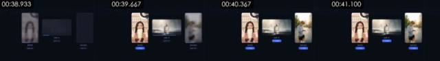

**画面里看得到的**（可以对照截图核实）
- 画面：深蓝网格背景上三张卡片横排：左边竖版卡片「电商带货」是举保温杯的女主播，中间横版卡片「品牌广告」是雾气水面上的玻璃香水瓶，右边竖版卡片「信息流投放」是逆光街道上看智能手表的跑步男生；38.9 秒三张卡片内容都是模糊状态，下方显示「生成中 xx%」和蓝色进度条，左卡最先变清晰并切成「✓ 已完成」胶囊按钮，中卡、右卡依次跟上，41 秒三张全部完成；画面固定。
- 文字轨（画面内容文字/bottom）：电商带货 / 信息流投放 / 生成中73% / 生成中19%
- 文字轨（画面内容文字/bottom）：批量投放版本 / 在同一套爆款结构上，按投放需求生成多个版本
- 文字轨（画面内容文字/bottom）：生成数量
- 文字轨（画面内容文字/middle）：品牌广告 / 生成中46% / 生成中86% / 促单
- [AI 助手 看图] 三张圆角卡片排在同一深蓝网格背景上，卡片下方的「生成中 0% → 33% → 83%」数字跳动、蓝色进度条增长，随后切成蓝色胶囊「✓ 已完成」，是界面动效
- [AI 助手 看图] 卡片里的画面先模糊后变清晰（模糊淡入），清晰后人物姿势不再变化：是贴进卡片的静帧，不是在播放的视频
- [AI 助手 看图] 卡片内画面是 AI 生成风格：女主播与前后镜头同一张脸、香水瓶立在水面雾气中、跑步男生在逆光街道看手表，光线过于均匀完美
- [AI 助手 看图] 卡片本身没有厚度和材质，只有平面阴影，不是 3D 渲染

**工具推断的制作方式**（是推断，不是看到的）
- 推断：代码/模板渲染 58%，3D 渲染 23%，AI 生成视频 9%（fused_agent）
- 素材来源：制作方渲染；待确认是否真实：嵌入视频片段
- 判断依据（工具测量，肉眼不一定看得出）：
  - 纹理呈渲染特征：平坦色块 54%、95% 像素仅用 92 种颜色、横竖直边 35%

- 复刻：代码渲染：用 Remotion/HTML 按文字轨与版式重建，100% 可控，不需要生成模型

#6 00:41.200–00:44.533 · 代码/模板渲染

**画面里看得到的**（可以对照截图核实）
- 画面：白底界面：左上「OiiOi 视频复刻 · 保温杯带货」，右上浅紫气泡里是用户提示词；中间左右两个视频框，左「参考视频」（黑白）、右「复刻成片」（彩色），都是举保温杯微笑的女主播，中间竖排四个蓝紫小标签「钩子 / 卖点 / 证明 / 促单」把两边结构一一对应；左下蓝色「▶ 播放对比」按钮和「导出」按钮，下方露出「批量投放版本」表单开头；光标移到「播放对比」点击，右框下方进度条向右走；整页缓慢推近；44 秒画面模糊淡出。
- 文字轨（画面内容文字/bottom）：播放对比 / 批量投放版本
- 文字轨（画面内容文字/bottom）：批量投放版本 / 在同一套爆款结构上，按投放需求生成多个版本 / 生成数量
- 文字轨（画面内容文字/bottom）：生成数量
- 文字轨（画面内容文字/middle）：参考视频 / 复刻成片 / 钩子
- [AI 助手 看图] 整页界面整体缓慢放大，同时光标在 41.2–41.7 秒之间移动到「播放对比」按钮：画面里有独立运动的元素，不只是一张图推拉
- [AI 助手 看图] 「复刻成片」下方的蓝色进度条在镜头内持续增长
- [AI 助手 看图] 左右两个视频框里的女主播表情和姿势三秒内完全不变，是静帧缩略图；左边做了去色处理当作“原片”
- [AI 助手 看图] 界面版式、字体、配色与镜头 #1、#8 完全一致，是同一套代码画的界面，不是录屏

**工具推断的制作方式**（是推断，不是看到的）
- 推断：静态图 + 推拉动效 32%，代码/模板渲染 31%，2D 动画 16%（fused_agent）
- 素材来源：制作方渲染
- 判断依据（工具测量，肉眼不一定看得出）：
  - 整帧按单一刚体变换运动（拟合内点 100%，残差 0.08px，无局部运动）→ 静态图推拉：缩放 -0.1%/s，平移 3px/s
  - 纹理呈渲染特征：平坦色块 52%、95% 像素仅用 53 种颜色、横竖直边 33%

- 复刻：代码渲染：用 Remotion/HTML 按文字轨与版式重建，100% 可控，不需要生成模型

#7 00:44.533–00:46.933 · 代码/模板渲染

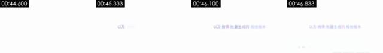

**画面里看得到的**（可以对照截图核实）
- 画面：纯白背景，正中一行淡紫色文字「以及 按需 批量生成的 投放版本」，从左到右逐词淡入，关键词颜色稍深；2.4 秒后叠化进入下一镜界面。
- 文字轨（画面内容文字/middle）：以及 / 以及按需 / 以及按需批量生成的投放版本
- [AI 助手 看图] 纯白底只有一行淡紫色文字，关键词逐个淡入
- [AI 助手 看图] 没有任何其他图形，结尾右下角露出下一镜界面的淡影

**工具推断的制作方式**（是推断，不是看到的）
- 推断：代码/模板渲染 90%，静帧停留 7%，屏幕录制/截图 3%（fused_agent）
- 素材来源：制作方渲染
- 判断依据（工具测量，肉眼不一定看得出）：
  - 画面几乎完全静止：96% 的相邻帧逐像素重复，首尾帧差 0.81
  - 纹理呈渲染特征：平坦色块 96%、95% 像素仅用 1 种颜色、横竖直边 17%

- 复刻：代码渲染：用 Remotion/HTML 按文字轨与版式重建，100% 可控，不需要生成模型

#8 00:46.933–00:55.500 · 代码/模板渲染

**画面里看得到的**（可以对照截图核实）
- 画面：白底界面，先是参考视频 / 复刻成片对比页，随后整页上滚：顶部「批量投放版本」标题和说明「在同一套爆款结构上，按投放需求生成多个版本」，下面「生成数量」输入框，光标点进去把数字改成 3、再改成 12；下方出现两列版本卡片「版本A / 版本B …」，每张卡片有蓝色小方块标题和字段：时长 15秒 / 30秒、主打卖点「12小时长效保温」「一键开盖·单手可喝」、画幅 9:16竖屏 / 1:1方屏、素材条数 2 / 6、预计完播率 31% / 38%；数字和文字逐项淡入填好；55 秒画面淡出变白。
- 文字轨（画面内容文字/bottom）：播放对比 / 导出 / 生成数量 / 主打卖点
- 文字轨（画面内容文字/bottom）：批量投放版本 / 在同一套爆款结构上，按投放需求生成多个版本 / 3 / 9:16竖屏
- 文字轨（画面内容文字/bottom）：生成数量 / 3 / 版本A / 版本B
- 文字轨（画面内容文字/bottom）：15秒 / 30秒
- 镜头内动效节拍：51.33s
- [AI 助手 看图] 开头是镜头 #6 同一页面，随后整页平滑上滚到「批量投放版本」表单，滚动是缓入缓出曲线，没有真实浏览器的滚动条和逐级跳动
- [AI 助手 看图] 光标在「生成数量」输入框里，数字从 3 变到 12，版本卡片里的字段（时长、主打卖点、画幅、素材条数、预计完播率）随之逐项填入
- [AI 助手 看图] 两侧缩略图中的女主播静止不动
- [AI 助手 看图] 所有文字边缘干净、没有屏幕摩尔纹或压缩块，界面风格与前面代码渲染的页面一致

**工具推断的制作方式**（是推断，不是看到的）
- 推断：代码/模板渲染 75%，屏幕录制/截图 16%，2D 动画 2%（fused_agent）
- 素材来源：制作方渲染
- 判断依据（工具测量，肉眼不一定看得出）：
  - 58% 的相邻帧完全重复，只有局部元素在动（典型的模板/MG 动画或定格后局部动效）
  - 浅色底上的深色部分几乎全是细线/细点（平滑过渡只占 17%）：线稿、生成式线条或点阵图形，不是有明暗的实拍或 3D 表面
  - 纹理呈渲染特征：平坦色块 65%、95% 像素仅用 6 种颜色、横竖直边 32%
  - 背景 98% 像素逐帧完全不变、只有局部元素在动：2D 合成/代码动效特征

- 复刻：代码渲染：用 Remotion/HTML 按文字轨与版式重建，100% 可控，不需要生成模型

#9 00:55.500–01:10.000 · 代码/模板渲染；引入真实素材（Logo/品牌标识）

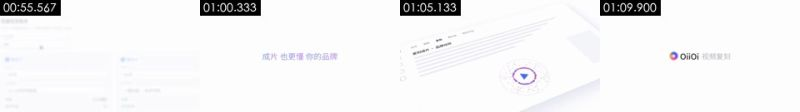

**画面里看得到的**（可以对照截图核实）
- 画面：纯白背景；55.5–58 秒淡紫色文字「现在， 复刻任何爆款 都更简单」逐词出现后淡出，58.5 秒「成片 也更懂 你的品牌」同样出现；60.3 秒数百个红、粉、紫、蓝彩色圆点（带柔光）从中心向四周爆开铺满画面，61.5 秒往回收拢，62.7 秒聚成一个由细小彩点围成的圆环，中间一个蓝色三角播放键；63.9 秒镜头拉远，圆环落在一张斜放的界面上（顶部「复刻成片 · 品牌动效」，左侧图标栏，若干灰色占位文字行），界面缓慢平移；67.5 秒界面淡出，68.5 秒白底正中出现 OiiOi 彩色渐变圆环 Logo + 黑色「OiiOi」+ 灰色「视频复刻」，定格到结束。
- 文字轨（画面内容文字/middle）：现在， / 现在，复刻任何爆款都更简单 / 成片 / 成片也更懂
- 文字轨（画面内容文字/middle）：我的作品 / 紫材库 / 复刻 / 模板
- 文字轨（画面内容文字/middle）：复刻 / 模板 / 创作 / 复刻成片·品牌动效
- 文字轨（画面内容文字/middle）：我的作品 / 我的作
- [AI 助手 看图] 白底淡紫标语逐词出现再淡出
- [AI 助手 看图] 60.3–62 秒几百个红、粉、紫、蓝圆点从中心爆开铺满画面，再收拢成一个由小点组成的圆环，圆点是纯色圆形带柔光，没有体积和光影：是粒子动效
- [AI 助手 看图] 圆环中间是蓝色三角播放键，随后缩进一张斜放的界面「复刻成片 · 品牌动效」，界面同镜头 #1 的透视样式
- [AI 助手 看图] 结尾 OiiOi 渐变圆环 Logo 和灰色「视频复刻」字样逐个淡入

**工具推断的制作方式**（是推断，不是看到的）
- 推断：代码/模板渲染 88%，3D 渲染 4%，2D 动画 2%（fused_agent）
- 素材来源：混合（含真实素材）：Logo/品牌标识
- 判断依据（工具测量，肉眼不一定看得出）：
  - 浅色底上的深色部分几乎全是细线/细点（平滑过渡只占 14%）：线稿、生成式线条或点阵图形，不是有明暗的实拍或 3D 表面
  - 纹理呈渲染特征：平坦色块 90%、95% 像素仅用 1 种颜色、横竖直边 10%
  - 逐帧清晰度呈周期性起伏（周期 2 帧，相关 0.24），但没有重复帧：可能是插帧/帧率转换，也可能只是重新压缩留下的节奏（去掉了平台标记的转码文件也会这样），单凭这一条不能定 AI
  - 画面几乎无彩色（饱和度 0.01）、只用 1 种颜色：界面/文档类平面画面，不是有光影的 3D 渲染

- 复刻：代码渲染：用 Remotion/HTML 按文字轨与版式重建，100% 可控，不需要生成模型；需要用户提供真实素材：Logo/品牌标识（画面局部）

### 元数据线索

- 编码器：`Lavf61.7.100`

### 说明

- 确定性取证对「是否在动、是否整图推拉、是否渲染纹理、是否 24→30 帧率转换」很可靠；对实拍 / AI / 3D 的区分要靠看图（看图模型或 AI 助手复核），最好再自己对照截图看一眼。
- 元数据经平台转码常被清除，缺失不代表没有。
- 完整数据在 `breakdown.json`；给模型读的拆片包从 `VIDEO.md` 开始。
