# How this video was made: v10_oiioii_gen_coding_first.mp4

**In one line**: Launch promo for OiiOi's Video Remake feature: no voice-over, just one set of code-built UI animations that walks through "upload a hit → rewrite it in one sentence → batch out videos".
**How it was made**: code / template render 100%

- 1:10 · horizontal 16:9 · 9 shots, 7.8s each on average
- Confidence 89%, based on: tool measurements + AI assistant reviewed 9 shots
- ⚠️ 4 points are uncertain, see “Open questions”

<!--mix-->

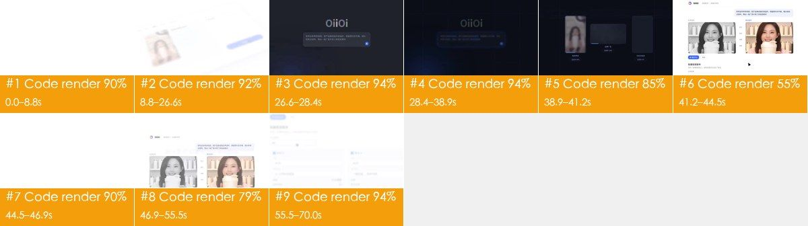

## What makes it work

- **The hook**: 0–4 s: a white screen with only the pale-purple line "OiiOi 视频复刻 现已上线" surfacing word by word; at 4.4 s the app UI slides in at an angle and the cursor immediately picks "视频复刻" and heads for "开始复刻": t
- 19–26 s the full prompt types out letter by letter in the input box ("参考这条带货视频，把产品换成我的保温杯……"): viewers learn that one sentence is all it takes, no software to learn
- 35–37 s that sentence becomes a "remake script" in code (shot_01…shot_05, generate, variants), and 38.9–41 s the progress numbers on three cards jump to "✓ 已完成": the invisible AI process becomes visib
- 41–44 s the reference (black-and-white) and the remake (color) sit side by side with "钩子 / 卖点 / 证明 / 促单" between them: desaturation tells you at a glance which is the original, and the tags show the s
- 47–55 s the batch form fills in versions A / B with length, selling point, aspect ratio and predicted completion rates of 31% / 38%: it speaks the metrics media buyers care about instead of just sayin

## At a glance: picture, packaging, sound

Any short video splits into three layers: the picture, what is laid on top of it (subtitles, styled text, stickers), and the sound. Remake it one layer at a time.

| Layer | In this video | How to make it | Detail |
|---|---|---|---|
| **Picture** (base) | code / template render 9 shots | screen recording / motion graphics in code | “Remake it yourself” |
| **Packaging** (on top) | none | — | “Packaging layer” |
| **Sound** | music (112 BPM, to confirm), 1 sound effects | music: find a track with the same tempo and mood; effects: add from a library at the listed times | “Sound” |

## Content and structure

- The narrative line below comes from reading each shot; the lines were not transcribed separately, subtitle text is under “Packaging layer”

**Narrative line**

Keep this line in a remake: same order, same job at each step, with the point refilled from your own cases, numbers and material, so it is more than a change of subject.

| Time | Shots | Job | What it says |
|---|---|---|---|
| 0.0–8.8s | #1 | grab attention | Show the product name and "now live" first, then the first click right away, so viewers see a tool they can use today |
| 8.8–26.6s | #2 | add information | Explain how the tool works: break the reference video down shot by shot, then say in one sentence what to change |
| 26.6–28.4s | #3 | turn | A light-to-dark change of scene signals the instruction has been sent: from "input" to "generating" |
| 28.4–38.9s | #4 | add information | Turn the one-line instruction into a visible "remake script", showing the tool rebuilds the original's structure shot by shot and can output several versions at once |
| 38.9–44.5s | #5, #6 | show evidence | One input yields finished videos for three different uses, and progress numbers jumping to "done" deliver the result → Put the original and the remake side by side with hook, selling point, proof and close marked between them, proving the structure was kept |
| 44.5–55.5s | #7, #8 | add information | A bridging line introduces the next capability: batch-producing ad versions → Show that versions can be configured in batches by length, selling point and aspect ratio, with a predicted completion rate |
| 55.5–70.0s | #9 | deliver the conclusion | Close the pitch with "easier", turn colored dots into a play button that lands back on the product UI, and end on the brand mark |

## Shot list

Picture, Camera and Overlays are what is visible on screen; Made with and Material are the tools' inference, with the basis in the shot-by-shot appendix.

| # | Frames | Time | Length | What it says | Picture | Camera | Overlays | Made with (inferred) | Material (inferred) | Remake |
|---|---|---|---|---|---|---|---|---|---|---|
| 1 |  | 0:00.0 | 8.8s | grab attention: Show the product name and "now l… | White background; 1–4 s a pale-purple li… | smooth move | — | code / template render 90% | rendered by the creator | code render · Part 1 |
| 2 | 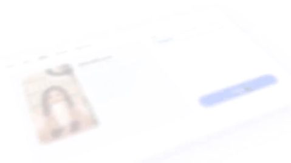 | 0:08.8 | 17.8s | add information: Explain how the tool works: bre… | Four code-animated segments joined by di… | static | — | code / template render 92% | logo / brand mark | code render · Part 1 |
| 3 | 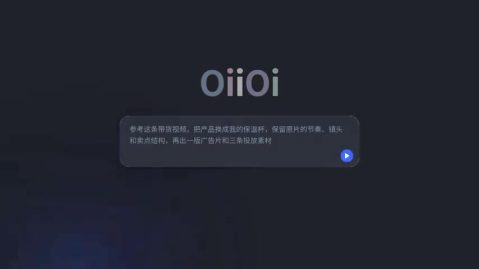 | 0:26.6 | 1.8s | turn: A light-to-dark change of scene signals th… | Navy-black background with fine grid lin… | static | — | code / template render 94% | rendered by the creator | code render · Part 1 |
| 4 | 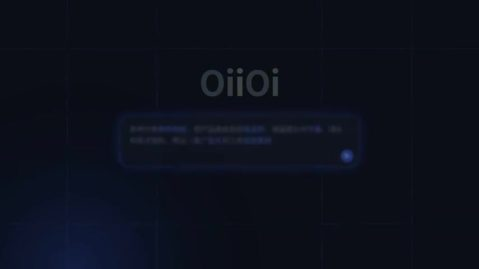 | 0:28.4 | 10.5s | add information: Turn the one-line instruction i… | Navy-black background with fine grid lin… | static | — | code / template render 94% | rendered by the creator | code render · Part 1 |
| 5 | 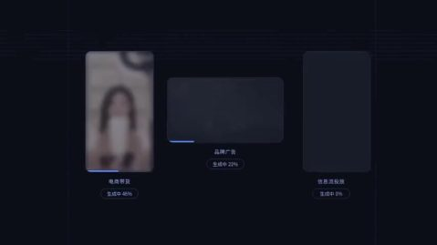 | 0:38.9 | 2.3s | show evidence: One input yields finished videos … | Three cards in a row on the navy grid: a… | static | — | code / template render 85% | rendered by the creator; real or not, to confirm: embedded video clip | code render · Part 1 |
| 6 |  | 0:41.2 | 3.3s | show evidence: Put the original and the remake s… | White UI: "OiiOi 视频复刻 · 保温杯带货" top left,… | whole-frame zoom / pan | — | code / template render 55% | rendered by the creator | code render · Part 1 |
| 7 |  | 0:44.5 | 2.4s | add information: A bridging line introduces the … | Plain white background; one pale-purple … | static | — | code / template render 90% | rendered by the creator | code render · Part 1 |
| 8 |  | 0:46.9 | 8.6s | add information: Show that versions can be confi… | White UI, first the reference / remake c… | static | — | code / template render 79% | rendered by the creator | code render · Part 1 |
| 9 |  | 0:55.5 | 14.5s | deliver the conclusion: Close the pitch with "ea… | Plain white background; 55.5–58 s the pa… | smooth move | — | code / template render 94% | logo / brand mark | code render · Part 1 |

## Remake it yourself: do it in this order

Copy the method and the rhythm, not the pictures.

1. **Plan the content**: write your script on the narrative line under “Content and structure”
2. **Collect material**: see “What to prepare” below
3. **Screen and motion graphics**: see “Code build” below
4. **Edit**: see “Edit” below
5. **Sound**: see “Sound”; every effect can be played first
6. **Compare**: watch yours next to the original: shot lengths, subtitle positions, where the music comes in and drops

### What to prepare

- Real files shown in the picture (screenshots, photos, recordings; get the originals):
  - **logo / brand mark** (part of the frame), Colorful "OiiOi" wordmark (each letter a different color): shots #2, 17.8s in all
  - **logo / brand mark** (part of the frame), Closing OiiOi gradient-ring logo with the "OiiOi 视频复刻" wordmark: shots #9, 14.5s in all

### Code build

One Remotion / HTML project rebuilt from the text tracks and layout (text and UI are 100% controllable; changing copy is a data change). An LLM can write this project directly.

- Part 1: shots #1–#9 (0.0–70.0s)

Remake assets (all in the report folder; hand them over together with the data below to whoever writes the code, or to an LLM):
- `shots/shot_XXX_first.jpg` / `_last.jpg`: first / last frame of each shot at full size, for layout, type size and margins
- `shots/shot_XXX_strip.jpg`: key frames about every 0.5 s, to follow the animation
- `shots/shot_XXX_elements.jpg` and `_el_NN.jpg` / `_st_NN.jpg` / `_ly_NN.jpg`: full-size crop of every element once settled, numbered as in the motion timeline; redraw shapes from them, cut out icons, logos and illustrations that cannot be redrawn
- `packaging/overlays.ass`, `packaging/timeline.json`: timing, position and colour of the text

How to build the pictures (by the measured picture type):
- data chart: SVG / D3 scales for axes and marks, numbers counted up with interpolate(), bars / lines grown with spring()
- line art / dots: SVG paths drawn on with stroke-dashoffset, or Canvas flow lines from a noise field / dots placed on a target shape; match stroke width, colour and density from the frame
- particles / point cloud: Three.js particle system (points sampled on the target shape, morph between shapes, bloom), rendered frame by frame with @remotion/three
- vector shapes: SVG shapes + interpolate() / spring() keyframes, positions and timing measured from the frame

Particle shots: what shape the particles form in each shot and how it moves decides whether the remake works; chapter cards, labels and counters go in an HTML layer on top. Build shot by shot from the table below, not one shared background.

| Shot | Time | Build | Picture | Camera | Colours | On-screen text |
|---|---|---|---|---|---|---|
| #1 | 0.0–8.8s | data chart | White background; 1–4 s a pale-purple line "OiiOi 视频复刻 现已上线" (OiiOi Video Remake, now live) fades in word by word and fades out; at 4.4 s a tilted app window (icon rail on the left, tabs "创作 / 模板 / 复刻 / 素材库 / 我的作品" on top, a "参考视频.mp4" card with the host thumbnail in the middle, a "模式" dropdown and a blue "开始复刻" button on the right) slides up from the lower right while the virtual camera slowly pushes in and pans left; at 6.5 s the cursor opens the dropdown, three items unfold and "视频复刻" is picked; at 8 s the cursor moves to "开始复刻" and the shot dissolves to the next. | push in 2%/s, picture drifts left | ground #fbfcfd · #f1f4f9 #e3cec5 #caa290 #4171fc | 00:15 |
| #2 | 8.8–26.6s | line art / dots | Four code-animated segments joined by dissolves: (1) white tagline "开启 一种 复刻爆款 的新方式" (a new way to remake hit videos) fading in word by word; (2) a tilted shot-breakdown UI: five host thumbnails on top, a shot table below (shot 01 0.0–2.1s close-up "开场钩子·主播举杯", shot 02 2.1–4.8s medium "卖点·倒入热水", shot 03 close "证明·12小时仍冒热气", shot 04 wide "场景·通勤与办公"), slowly panning; (3) white tagline "逐帧拉片，读懂 每一个 爆款结构" (frame-by-frame breakdown, understand every hit's structure); (4) the colorful "OiiOi" wordmark centered on white, a rounded input box (purple-blue gradient outline) reading "问问OiiOi，想复刻什么？", then the prompt types out letter by letter: "参考这条带货视频，把产品换成我的保温杯，保留原片的节奏、镜头和卖点结构，再出一版广告片和三条投放素材" (use this sales video, swap in my insulated cup, keep the pacing, shots and selling-point structure, and also make a brand ad and three paid-media cuts), blue send button bottom right; at the end the whole screen dims to grey. | static | ground #f9fcfd · #f4f3f8 #d9dee3 #bfc7c9 | — |
| #3 | 26.6–28.4s | particles / point cloud | Navy-black background with fine grid lines; a grey-white "OiiOi" wordmark in the center and a rounded input box holding the full prompt below it; the outline turns from grey to a glowing blue stroke, blue send button bottom right; a blue radial-gradient glow in the lower left slowly pulses; static frame, dissolving into the dark section after 1.8 s. | static | ground #070d15 · #060f1d #0a132a #101724 #101d37 | Oiioi |
| #4 | 28.4–38.9s | particles / point cloud | Navy-black background with fine grid lines; 28.4–30 s dozens of small pale-purple words fly in from the edges and assemble into one line "解锁 电商带货 · 广告片 · 投放视频" (unlock live-commerce · brand ads · paid-media videos), key words in blue-violet; 31.9 s the line fades out and at 32.9 s "实时生成 分镜 与 素材" (storyboards and assets generated live) appears word by word, a thin line sweeping left to right beneath it; at 35 s a monospaced code block types out line by line in the lower left: "# 复刻脚本 · 保温杯带货 · 9:16 / ref = 拉片(“参考视频.mp4”) 5 镜头·快-慢-快 / shot_01…shot_05 = Shot(t=…, 景别=…, 内容=…) / generate(ref.结构, 产品=my_cup, 节奏=ref.节奏) / variants([“电商带货”, “品牌广告”, “信息流投放”])", with the blue glow breathing in the lower left; at 37.6 s the code block slides up and fades, and three rounded card outlines unfold from the bottom. | static | ground #070d15 · #161b28 #0f1723 #061018 #070e1a | 复刻脚本·保温杯带货·9：16 |
| #5 | 38.9–41.2s | data chart | Three cards in a row on the navy grid: a portrait card "电商带货" (live commerce) with the host holding the insulated cup on the left, a landscape card "品牌广告" (brand ad) with a glass perfume bottle on misty water in the middle, a portrait card "信息流投放" (feed ads) with a runner checking a smartwatch on a backlit street on the right; at 38.9 s all three pictures are blurred with "生成中 xx%" and a blue progress bar beneath; the left card sharpens first and turns into a "✓ 已完成" pill, the middle and right follow, and by 41 s all three are done; static frame. | static | ground #070d15 · #cdbbac #f1e4d7 #a79384 #2d2b36 | 生成数量 / 钩子 / 卖点 / 证明 / oiioi / 视频复刻·保温杯带货 |
| #6 | 41.2–44.5s | vector shapes | White UI: "OiiOi 视频复刻 · 保温杯带货" top left, the user's prompt in a pale-purple bubble top right; two video boxes side by side, "参考视频" (reference, black-and-white) on the left and "复刻成片" (remake, color) on the right, both the smiling host holding the insulated cup; between them four small blue-violet tags "钩子 / 卖点 / 证明 / 促单" (hook / selling point / proof / close) map the two structures one to one; a blue "▶ 播放对比" button and an "导出" (export) button bottom left, with the top of the "批量投放版本" form peeking in below; the cursor moves to "播放对比" and clicks, the progress bar under the right box advances; the page slowly pushes in; at 44 s it blurs out. | static frame, elements move inside it | ground #fbfcfd · #ededed #e1ddda #d6cec8 #918a88 | 生成数量 / 促单 / oiioi / 视频复刻·保温杯带货 / 参考这条带货视频，把产品换成我的保温杯，保留原片的节奏、镜头和卖 / 点结构，再出一版广告片和三条投放素材 |
| #7 | 44.5–46.9s | vector shapes | Plain white background; one pale-purple line centered, "以及 按需 批量生成的 投放版本" (plus paid-media versions batch-generated on demand), fading in word by word from left to right with key words slightly darker; dissolves into the next UI after 2.4 s. | static | ground #fbfcfd ·  | — |
| #8 | 46.9–55.5s | line art / dots | White UI, first the reference / remake comparison page, then the whole page scrolls up: the "批量投放版本" (batch ad versions) title and the line "在同一套爆款结构上，按投放需求生成多个版本" (several versions on the same hit structure, per your media needs), a "生成数量" field below where the cursor clicks in and changes the number to 3, then 12; two columns of version cards "版本A / 版本B …" appear below, each with a small blue square title and fields: length 15秒 / 30秒, main selling point "12小时长效保温" / "一键开盖·单手可喝", aspect 9:16竖屏 / 1:1方屏, asset count 2 / 6, predicted completion rate 31% / 38%; numbers and text fade in field by field; at 55 s the frame fades to white. | static | ground #f1f4f9 · #f9fcfd #dee2e9 #c8cdda | 参考这条带货视频，把产品换成我的保温杯，保留原片的节奏、镜头和卖 / 点结构，再出一版广告片和三条投放素材 / 参考视频 / 复刻成片 / 促单 / 播放对比 |
| #9 | 55.5–70.0s | line art / dots | Plain white background; 55.5–58 s the pale-purple line "现在， 复刻任何爆款 都更简单" (now remaking any hit is easier) appears word by word and fades, then at 58.5 s "成片 也更懂 你的品牌" (and the result understands your brand better) does the same; at 60.3 s hundreds of red, pink, purple and blue glowing dots burst from the center to fill the frame, pull back at 61.5 s and at 62.7 s gather into a ring of tiny colored dots with a blue triangular play icon in the middle; at 63.9 s the camera pulls back and the ring lands on a tilted UI ("复刻成片 · 品牌动效" on top, icon rail on the left, a few grey placeholder text lines) that slowly pans; at 67.5 s the UI fades out and at 68.5 s the OiiOi gradient-ring logo + black "OiiOi" + grey "视频复刻" appear centered on white and hold to the end. | static frame, elements move inside it | ground #fbfcfd · #e4e6ea | — |

Per-shot motion timeline (measured: positions in % of frame width / height, colours sampled once the element settles; read together with the key-frame strip)

Motion #1 0.0–8.8s · 9 events

- Ground #fbfcfd; other main colours #f1f4f9 #e3cec5 #caa290 #4171fc
Element crops (numbers match the motion list below; L = the continuously moving layer mid-shot and at the end, S = elements that never move), full-size files in `shots/`:

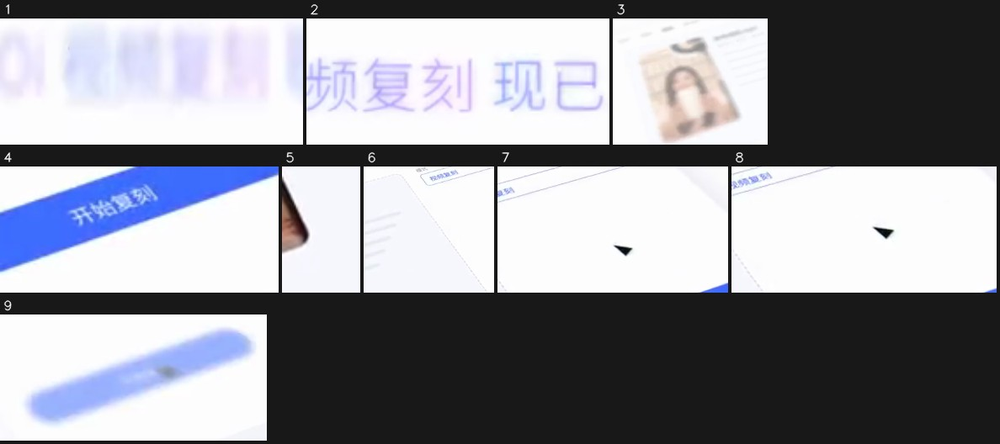

1. 1.13–4.13s · middle (x 36%–56%, y 48%–56%) · appears, slides rightward, ease-out · #e7e5fd · text “OiiOi 视频复刻 / OiiOi 视频复刻现已上线” · [crop](shots/shot_001_el_01.jpg)
2. 4.13–5.13s · middle (x 44%–62%, y 44%–56%) · disappears, ease-out · #dad8fb · text “OiiOi 视频复刻现已上线” · [crop](shots/shot_001_el_02.jpg)
3. 4.53–8.73s · middle left (x 2%–40%, y 32%–88%) · appears, slides upward, linear · #e6d7cf · text “Oiioi / OiiOi 视频复刻 / 我的作品” · [crop](shots/shot_001_el_03.jpg)
4. 4.53–5.13s · middle right (x 80%–96%, y 52%–64%) · appears, linear · #486ffd · text “开始复刻” · [crop](shots/shot_001_el_04.jpg)
5. 4.53–5.53s · bottom (x 40%–42%, y 68%–80%) · appears, slides upward, linear · #d8d7de · [crop](shots/shot_001_el_05.jpg)
6. 4.60–7.73s · middle (x 44%–67%, y 24%–64%) · changes, moves upward, ease-out · #ecedf6 · text “OiiOi 视频复刻现已上线 / 视频生成 / 上传” · [crop](shots/shot_001_el_06.jpg)
7. 6.47–7.87s · middle right (x 60%–89%, y 20%–48%) · changes, moves rightward, ease-in-out · #efeef7 · text “视频生成 / 图片生成 / 视频复刻” · [crop](shots/shot_001_el_07.jpg)
8. 6.93–7.73s · middle right (x 58%–87%, y 24%–48%) · changes, moves downward, ease-in-out · #fdfdfd · text “视频生成 / 图片生成 / 视频复刻” · [crop](shots/shot_001_el_08.jpg)
9. 8.13–8.73s · middle right (x 67%–96%, y 44%–68%) · changes, moves upward, ease-in · #a7bafd · text “开始复刻” · [crop](shots/shot_001_el_09.jpg)

Motion #2 8.8–26.6s (dissolve in) · 0 events

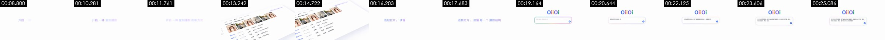

- Ground #f9fcfd; other main colours #f4f3f8 #d9dee3 #bfc7c9
- No element motion measured (still picture or only slight changes)

Motion #3 26.6–28.4s · 1 events

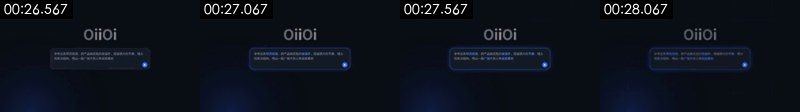

- Ground #070d15; other main colours #060f1d #0a132a #101724 #101d37
Element crops (numbers match the motion list below; L = the continuously moving layer mid-shot and at the end, S = elements that never move), full-size files in `shots/`:

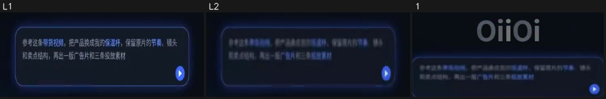

- [crop L1](shots/shot_003_ly_01.jpg) [crop L2](shots/shot_003_ly_02.jpg) · Continuous layer: 6% of the frame moves through the whole shot (x 22%–78%, y 40%–64%), e.g. drifting gradients, particle flow, breathing glow
1. 28.23–28.30s · middle (x 27%–73%, y 24%–60%) · changes, instant · #2f3648 · text “Oiioi / 参考这条带货视频，把产品换成我的保温杯，保留原片的节奏、镜头 / 和卖点结构，再出一版广告片和三条投放素材” · [crop](shots/shot_003_el_01.jpg)

Motion #4 28.4–38.9s (dissolve in) · 10 events

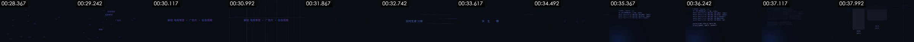

- Ground #070d15; other main colours #161b28 #0f1723 #061018 #070e1a
Element crops (numbers match the motion list below; L = the continuously moving layer mid-shot and at the end, S = elements that never move), full-size files in `shots/`:

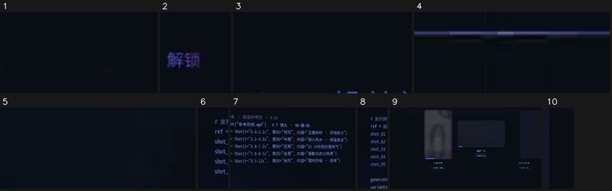

1. 28.43–28.50s · bottom (x 29%–71%, y 60%–100%) · changes, instant · #090d14 · text “解锁 / 海出 / 品牌广告” · [crop](shots/shot_004_el_01.jpg)
2. 29.37–31.30s · bottom (x 38%–42%, y 80%–92%) · disappears, moves upward, ease-out · #171530 · text “解锁” · [crop](shots/shot_004_el_02.jpg)
3. 29.70–29.90s · middle (x 56%–71%, y 32%–44%) · changes, moves rightward, linear · #090d14 · text “投放视频” · [crop](shots/shot_004_el_03.jpg)
4. 32.83–32.90s · middle right (x 67%–87%, y 44%–48%) · appears, instant · #1b1e31 · text “保留” · [crop](shots/shot_004_el_04.jpg)
5. 35.23–37.43s · middle (x 38%–53%, y 32%–40%) · changes, moves rightward, linear · #111422 · text “电商带货” · [crop](shots/shot_004_el_05.jpg)
6. 36.03–37.97s · middle left (x 9%–13%, y 20%–52%) · disappears, moves upward, ease-in-out · #1e253e · [crop](shots/shot_004_el_06.jpg)
7. 36.23–37.43s · middle (x 18%–56%, y 20%–64%) · disappears, moves leftward, linear · #202842 · text “电商带货 / 广告片 / 解锁” · [crop](shots/shot_004_el_07.jpg)
8. 36.83–37.43s · middle left (x 7%–13%, y 16%–60%) · disappears, moves downward, ease-in-out · #20283e · [crop](shots/shot_004_el_08.jpg)
9. 37.63–38.83s · middle (x 0%–84%, y 20%–100%) · appears, unfolds upward (draw-on / grow / wipe), ease-in-out · #171b28 · text “电商带货 / 保留 / 解锁” · [crop](shots/shot_004_el_09.jpg)
10. 38.70–38.77s · middle right (x 89%–96%, y 24%–68%) · changes, instant · #090d14 · [crop](shots/shot_004_el_10.jpg)

Motion #5 38.9–41.2s (dissolve in) · 3 events

- Ground #070d15; other main colours #cdbbac #f1e4d7 #a79384 #2d2b36
Element crops (numbers match the motion list below; L = the continuously moving layer mid-shot and at the end, S = elements that never move), full-size files in `shots/`:

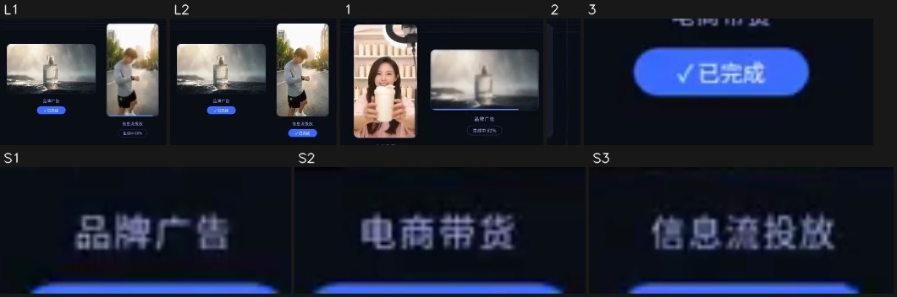

- S1. never moves: shape / text block · x 48%–54%, y 60%–64% · #3f455b · text “品牌广告 / 促单” · [crop](shots/shot_005_st_01.jpg)
- S2. never moves: shape / text block · x 24%–30%, y 72%–76% · #4b4d67 · text “电商带货” · [crop](shots/shot_005_st_02.jpg)
- S3. never moves: shape / text block · x 72%–79%, y 72%–76% · #454865 · text “信息流投放” · [crop](shots/shot_005_st_03.jpg)
- [crop L1](shots/shot_005_ly_01.jpg) [crop L2](shots/shot_005_ly_02.jpg) · Continuous layer: 15% of the frame moves through the whole shot (x 38%–84%, y 20%–84%), e.g. drifting gradients, particle flow, breathing glow
1. 38.93–39.60s · middle (x 18%–64%, y 20%–72%) · appears, slides downward, ease-out · #b99f96 · text “品牌广告 / 生成中46% / 生成中86%” · [crop](shots/shot_005_el_01.jpg)
2. 38.93–39.00s · middle right (x 84%–87%, y 20%–72%) · changes, instant · #090d14 · [crop](shots/shot_005_el_02.jpg)
3. 39.40–39.60s · bottom left (x 22%–33%, y 76%–84%) · appears, ease-in · #3c69f2 · text “电商带货 / 生成中73% / √已完成” · [crop](shots/shot_005_el_03.jpg)

Motion #6 41.2–44.5s · 6 events

- Ground #fbfcfd; other main colours #ededed #e1ddda #d6cec8 #918a88
Element crops (numbers match the motion list below; L = the continuously moving layer mid-shot and at the end, S = elements that never move), full-size files in `shots/`:

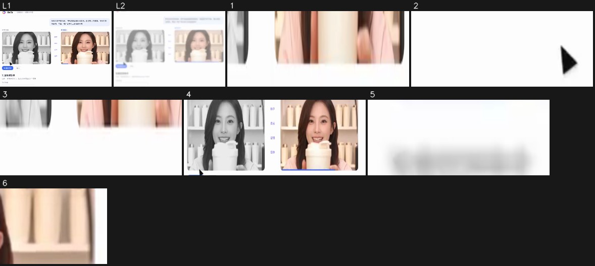

- [crop L1](shots/shot_006_ly_01.jpg) [crop L2](shots/shot_006_ly_02.jpg) · Continuous layer: 31% of the frame moves through the whole shot (x 11%–89%, y 0%–96%), e.g. drifting gradients, particle flow, breathing glow
1. 41.27–43.13s · bottom (x 42%–89%, y 68%–72%) · disappears, moves rightward, linear · #edd2c8 · [crop](shots/shot_006_el_01.jpg)
2. 41.47–41.87s · bottom (x 40%–58%, y 80%–88%) · disappears, moves leftward, linear · #7b7b7b · [crop](shots/shot_006_el_02.jpg)
3. 42.67–43.13s · bottom (x 33%–82%, y 68%–72%) · disappears, moves rightward, linear · #e1cbc1 · [crop](shots/shot_006_el_03.jpg)
4. 44.00–44.47s · middle (x 11%–91%, y 28%–68%) · disappears, moves leftward, ease-in · #c4b3a8 · text “参考视频 / 复刻成片 / 钩子” · [crop](shots/shot_006_el_04.jpg)
5. 44.00–44.47s · bottom left (x 11%–20%, y 76%–80%) · appears, ease-in-out · #e5e5e7 · text “播放对比 / 批量投放版本” · [crop](shots/shot_006_el_05.jpg)
6. 44.20–44.47s · middle right (x 80%–89%, y 32%–44%) · disappears, moves upward, ease-in-out · #edcfb5 · [crop](shots/shot_006_el_06.jpg)

Motion #7 44.5–46.9s (dissolve in) · 5 events

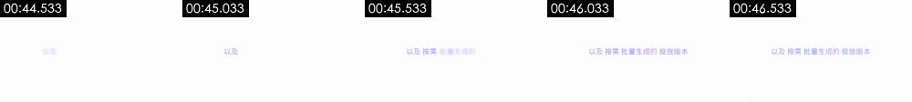

- Ground #fbfcfd; other main colours —
Element crops (numbers match the motion list below; L = the continuously moving layer mid-shot and at the end, S = elements that never move), full-size files in `shots/`:

- [crop L1](shots/shot_007_ly_01.jpg) [crop L2](shots/shot_007_ly_02.jpg) · Continuous layer: 3% of the frame moves through the whole shot (x 31%–78%, y 48%–56%), e.g. drifting gradients, particle flow, breathing glow
1. 44.60–44.67s · top (x 47%–87%, y 8%–16%) · changes, instant · #fdfdfd · [crop](shots/shot_007_el_01.jpg)
2. 44.60–44.67s · middle right (x 53%–91%, y 24%–68%) · disappears, instant · #f3ede8 · [crop](shots/shot_007_el_02.jpg)
3. 44.60–44.67s · middle left (x 11%–47%, y 24%–80%) · disappears, instant · #e8e8e9 · text “以及 / 以及按需” · [crop](shots/shot_007_el_03.jpg)
4. 46.87–46.93s · middle left (x 11%–38%, y 44%–84%) · changes, instant · #e7e5f5 · text “以及 / 以及按需” · [crop](shots/shot_007_el_04.jpg)
5. 46.87–46.93s · bottom (x 47%–87%, y 88%–100%) · appears, instant · #ededef · [crop](shots/shot_007_el_05.jpg)

Motion #8 46.9–55.5s (fade in) · 8 events

- Ground #f1f4f9; other main colours #f9fcfd #dee2e9 #c8cdda
Element crops (numbers match the motion list below; L = the continuously moving layer mid-shot and at the end, S = elements that never move), full-size files in `shots/`:

1. 47.00–49.13s · middle (x 24%–91%, y 0%–100%) · appears, unfolds upward (draw-on / grow / wipe), instant · #fae9db · text “证明 / 促单 / 版本B” · [crop](shots/shot_008_el_01.jpg)
2. 47.00–52.00s · bottom left (x 22%–42%, y 64%–76%) · changes, moves downward, ease-out · #efeff4 · text “导出 / 在同一套爆款结构上，按投放需求生成多个版本” · [crop](shots/shot_008_el_02.jpg)
3. 47.53–48.80s · bottom (x 13%–89%, y 44%–100%) · disappears, moves downward, ease-in · #d6c5be · text “证明 / 促单 / 播放对比” · [crop](shots/shot_008_el_03.jpg)
4. 47.60–51.87s · top (x 24%–91%, y 0%–24%) · disappears, moves rightward, ease-out · #eceffb · text “参考这条带货视频，把产品换成我的保温杯，保留原片的节奏、镜头和卖 / 点结构，再出一版广告片和三条投放素材 / 复刻成片” · [crop](shots/shot_008_el_04.jpg)
5. 51.53–52.00s · middle right (x 91%–100%, y 0%–96%) · changes, moves downward, ease-in-out · #f0f6f9 · [crop](shots/shot_008_el_05.jpg)
6. 55.20–55.47s · top left (x 0%–36%, y 16%–44%) · disappears, moves upward, ease-in-out · #d3dbe2 · text “参考视频 / 播放对比 / 导出” · [crop](shots/shot_008_el_06.jpg)
7. 55.27–55.47s · top left (x 0%–18%, y 0%–12%) · disappears, linear · #5277fc · text “参考视频 / 播放对比” · [crop](shots/shot_008_el_07.jpg)
8. 55.27–55.47s · bottom (x 2%–80%, y 40%–96%) · disappears, moves upward, linear · #c6c9d9 · text “卖点 / 证明 / 促单” · [crop](shots/shot_008_el_08.jpg)

Motion #9 55.5–70.0s (dissolve in) · 13 events

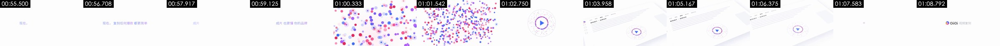

- Ground #fbfcfd; other main colours #e4e6ea
Element crops (numbers match the motion list below; L = the continuously moving layer mid-shot and at the end, S = elements that never move), full-size files in `shots/`:

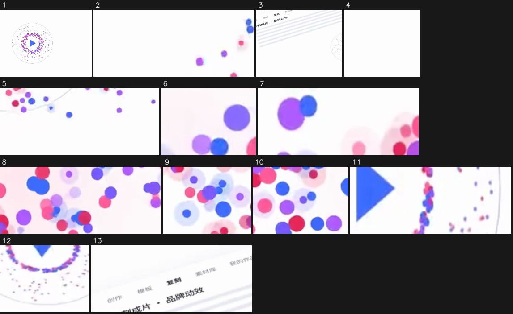

- Continuous layer: 2% of the frame moves through the whole shot (x 24%–64%, y 48%–56%), e.g. drifting gradients, particle flow, breathing glow
1. 60.57–62.57s · middle (x 24%–100%, y 0%–100%) · appears, slides leftward, linear · #e9d8f0 · text “现在， / 现在，复刻任何爆款都更简单 / 成片” · [crop](shots/shot_009_el_01.jpg)
2. 60.57–62.23s · top left (x 0%–27%, y 16%–32%) · changes, moves rightward, linear · #e7d2ec · text “复刻 / 我的作” · [crop](shots/shot_009_el_02.jpg)
3. 60.57–64.03s · bottom (x 13%–58%, y 36%–100%) · changes, moves upward, ease-out · #ededf2 · text “现在， / 现在，复刻任何爆款都更简单 / 成片” · [crop](shots/shot_009_el_03.jpg)
4. 60.57–62.23s · bottom left (x 2%–16%, y 76%–100%) · changes, moves upward, linear · #fdfdfd · [crop](shots/shot_009_el_04.jpg)
5. 60.57–62.23s · bottom (x 49%–80%, y 76%–100%) · appears, slides upward, ease-in-out · #decdf2 · [crop](shots/shot_009_el_05.jpg)
6. 60.90–63.83s · middle (x 51%–60%, y 44%–56%) · disappears, moves upward, linear · #f6ebfc · text “现在，复刻任何爆款都更简单 / 成片也更懂你的品牌 / Oiioi视频复刻” · [crop](shots/shot_009_el_06.jpg)
7. 61.17–62.17s · top left (x 0%–20%, y 0%–12%) · disappears, moves rightward, ease-in-out · #e9b3f5 · [crop](shots/shot_009_el_07.jpg)
8. 61.57–62.37s · bottom (x 47%–80%, y 76%–100%) · disappears, moves rightward, linear · #f5d8f3 · [crop](shots/shot_009_el_08.jpg)
9. 61.63–62.23s · top left (x 0%–16%, y 16%–36%) · disappears, moves rightward, linear · #e1dafa · text “模板 / 复刻 / 刻成片·品牌动效” · [crop](shots/shot_009_el_09.jpg)
10. 61.77–62.23s · bottom left (x 4%–20%, y 76%–96%) · disappears, moves downward, linear · #e5a7ef · [crop](shots/shot_009_el_10.jpg)
11. 63.17–63.77s · middle (x 49%–67%, y 48%–56%) · disappears, moves leftward, ease-in-out · #b6acf7 · text “现在，复刻任何爆款都更简单 / 成片也更懂你的品牌 / Oiioi视频复刻” · [crop](shots/shot_009_el_11.jpg)
12. 64.03–66.03s · bottom (x 60%–71%, y 72%–88%) · disappears, moves upward, ease-out · #ebdff2 · [crop](shots/shot_009_el_12.jpg)
13. 65.57–67.23s · middle left (x 2%–33%, y 24%–44%) · disappears, moves leftward, linear · #ededf2 · text “紫材库 / 复刻 / 模板” · [crop](shots/shot_009_el_13.jpg)

### Edit

- Cut in the order and lengths of the shot list
- Approach: Tagline cards alternate with UI demos, mostly joined by dissolves; scene changes follow the music sections (about 19.5, 38.5 and 55.5 s)
- Rhythm: 6.9 cuts per minute, 7.78s average shot; no live-action shots; transitions cut×2, dissolve×5, fade×1

## Cast, scenes and props

| Id | Name | Kind | Look | Role | Voice | Shots |
|---|---|---|---|---|---|---|
| A | Live-commerce host | person | Asian woman in her twenties, long dark-brown wavy hair, pink short-sleeve top, toothy smile, holding a white insulated cup with a handle lid up to the camera with both hands; light shelves full of white cups behind her and a ring light top left | Star of the "reference video" and the "remake" shown inside the UI | None (silent) | #1, #2, #5, #6, #8 |
| B | Runner | person | Young Asian man, short hair, light-grey long-sleeve sports top, black running shorts, white sneakers, looking down at a black smartwatch on his left wrist; city street backlit by morning sun, trees and tall buildings on both sides | Sample picture for the "feed ads" version | None | #5 |

**Scenes**

| Scene | Where | When | Set / light | Shots |
|---|---|---|---|---|
| S1 | OiiOi app UI and tagline cards on white | Not applicable | Pure white / very light grey background, pale-purple text, blue buttons, UI often tilted with a soft drop shadow | #1, #2, #6–#9 |
| S2 | Navy dark grid background | Not applicable | Near-black navy with fine grid lines, a blue glow in the lower left, pale purple-blue glowing text and a code block | #3–#5 |

**Props / products / logos**

- White insulated cup (shots #1, #2, #5, #6, #8): White insulated cup with a flip handle lid: "my product" swapped into the remade video
- Glass perfume bottle (shots #5): Square clear perfume bottle standing on misty water in the "brand ad" sample
- OiiOi logo (shots #2, #3, #9): Multicolor letter wordmark and red-purple-blue gradient ring icon, above the input box early on and at the end

## Camera and lighting

- Visual style: Minimal SaaS UI look on white with pale purple-blue accents, switching to a navy grid dark section mid-way; thin sans-serif type with colored key words; UI often tilted in CSS 3D perspective
- Lighting: Not applicable (flat graphics); the white sections are clean and shadowless, the dark sections get their mood from a blue radial glow in the lower left (image reading; pixel measurements in the fold below)

- Note: lighting ratio, soft / hard, colour temperature and shot size are measured on the subject's pixels (the face when there is one, otherwise the in-focus region, which is an estimate); platform transcodes crush the shadows, so hardness and fill read conservative; camera angle, light source, catchlight and rim light follow the image readers. Where measurement and readers disagree, both are listed.

## Packaging layer (subtitles / styled text / stickers / sound-effect hits)

- No overlaid text or stickers detected
- Exports: `packaging/timeline.json` (SRT is the subtitle timeline; ASS carries colour, outline, position and entrance animation, swap in the original font; timeline.json is the full timeline)

Remake: burn subtitles and styled text in with `packaging/overlays.ass` (ffmpeg -vf ass=overlays.ass), or rebuild them from timeline.json in CapCut / Remotion; stickers and GIFs need matching assets (meme / GIF libraries), crops are under packaging/.

## Sound

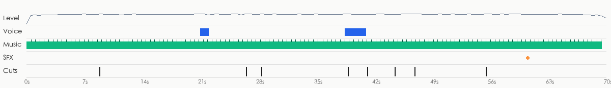

- loudness -17.4 dBFS, peak -0.8 dBFS; sound runs across cuts, laid in post as one bed (background changes 4.2dB at cuts vs 2.9dB within shots)
- Sources: Video type: music bed only (no voice) → music: stock library music (leaning, to confirm); SFX: added in post from an SFX library / editor (leaning, to confirm)

**Voice**

- None / very little

**Music**

- Tempo: 112.3 BPM (or 56.2/224.7); key B minor (confidence 0.52); 99% of the duration (0.0–69.5s); section changes at 4.0s, 19.5s, 38.5s, 55.5s, 65.5s; ending: ends_with_video
- Cuts vs beat: 25% of cuts land on a beat (chance: about 26%)
- Source: to confirm (stock library music 52%, AI-generated music 30%, well-known song 17%)
  - The music is a bed under the picture: in a regular video the bed usually comes from a stock library (prior)
  - Music and video end together: edited to length or custom-made (either source possible, weak evidence)
  - Nothing about this track beyond the format prior and weak cues like the ending (no source heard, no platform music tag): source to confirm; an AI-generated bed cannot be told from a library bed here
  - How to confirm: Check the music tag on the original Douyin / Xiaohongshu / TikTok post: a song title → existing track; "original sound - @creator" → uploaded by the creator (for music videos, usually an AI song)
  - How to confirm: Run it through Shazam / ACRCloud or another song-ID service: a hit means an existing song
- Remake: The original track leans stock library music: search a library by BPM / mood / key for a similar track, or generate a royalty-free track in a similar style with AI

**Sound effects** (1)

| Sound | Listen | Type | Times used | At | On screen |
|---|---|---|---|---|---|
| F1 | [listen](sfx/sfx_01.wav) | pop | 1 | 60.6s | — |

- Remake: play each sound first (separated out, without voice or music), find one similar effect in the editor's library, and place it at every time listed under “At”

- Separated stems: `stems/original.wav` (original), `stems/vocals.wav` (dry voice), `stems/music.wav` (music + ambience), `stems/effects.wav` (effects track)
<!--stems-->

## Open questions

- Shot #5 (38.9–41.2s): embedded video clip: real material or generated, to confirm
- Shot #6 (41.2–44.5s): code / template render at only 55% confidence, runner-up code_render
- No AI listened to the soundtrack (the review covered the picture only): real voice versus TTS is inferred from the waveform; the effects were found on the separated effects track and their types are estimated from the sound. Play the stems and each effect under “Sound” to check
- music source to confirm: most likely stock library music (52%); how to check is under “Sound”

## Appendix

### Shot by shot

Each shot has two parts: what is visible on screen, and how the tools infer it was made (with the basis); remake prompts last. Folded by default.

#1 00:00.000–00:08.800 · code / template render

**Visible on screen** (check against the frames)
- Picture: White background; 1–4 s a pale-purple line "OiiOi 视频复刻 现已上线" (OiiOi Video Remake, now live) fades in word by word and fades out; at 4.4 s a tilted app window (icon rail on the left, tabs "创作 / 模板 / 复刻 / 素材库 / 我的作品" on top, a "参考视频.mp4" card with the host thumbnail in the middle, a "模式" dropdown and a blue "开始复刻" button on the right) slides up from the lower right while the virtual camera slowly pushes in and pans left; at 6.5 s the cursor opens the dropdown, three items unfold and "视频复刻" is picked; at 8 s the cursor moves to "开始复刻" and the shot dissolves to the next.
- Text track (text in the picture/middle): Oiioi / OiiOi 视频复刻 / OiiOi 视频复刻现已上线 / 开始复刻
- Text track (text in the picture/middle): d
- Text track (text in the picture/middle): 视频生成 / 我的作品 / 图片生成 / 视频复到
- Text track (text in the picture/middle): 复刻 / 模板 / 创作 / 参考视频.mp4
- Motion beats within the shot: 4.53s
- [AI assistant review] 0–4.4 s: plain white background with only one line of pale-purple tagline fading in word by word and out, nothing else
- [AI assistant review] From 4.4 s the whole app UI slides in tilted in perspective: crisp edges, an even soft drop shadow, no material texture — a flat UI under a CSS 3D perspective transform
- [AI assistant review] The cursor is a vector arrow moving in straight lines at constant speed; the dropdown (Image / Video / Video remake) opens with easing and the chosen item highlights
- [AI assistant review] The host in the thumbnail on the left keeps the same pose throughout: a still pasted into the UI, not a playing video

**How it was made, as inferred by the tools** (inferred, not seen)
- Inference: code / template render 80%, 3D render 7%, screen recording / screenshot 4% (fused_agent)
- Material: rendered by the creator
- Basis (tool measurements, not necessarily visible to the eye):
  - 50% of adjacent frames are exact duplicates, only local elements move (typical of template / motion-graphics animation, or a hold with local motion)
  - Rendered texture: 82% flat colour blocks, 95% of pixels use only 5 colours, 9% axis-aligned edges
  - 97% of background pixels never change frame to frame while local elements move: 2D compositing / code-driven motion graphics

- Remake: Code render: rebuild in Remotion / HTML from the text tracks and layout, 100% controllable, no generative model needed

#2 00:08.800–00:26.567 · code / template render; brings in real material (logo / brand mark)

**Visible on screen** (check against the frames)
- Picture: Four code-animated segments joined by dissolves: (1) white tagline "开启 一种 复刻爆款 的新方式" (a new way to remake hit videos) fading in word by word; (2) a tilted shot-breakdown UI: five host thumbnails on top, a shot table below (shot 01 0.0–2.1s close-up "开场钩子·主播举杯", shot 02 2.1–4.8s medium "卖点·倒入热水", shot 03 close "证明·12小时仍冒热气", shot 04 wide "场景·通勤与办公"), slowly panning; (3) white tagline "逐帧拉片，读懂 每一个 爆款结构" (frame-by-frame breakdown, understand every hit's structure); (4) the colorful "OiiOi" wordmark centered on white, a rounded input box (purple-blue gradient outline) reading "问问OiiOi，想复刻什么？", then the prompt types out letter by letter: "参考这条带货视频，把产品换成我的保温杯，保留原片的节奏、镜头和卖点结构，再出一版广告片和三条投放素材" (use this sales video, swap in my insulated cup, keep the pacing, shots and selling-point structure, and also make a brand ad and three paid-media cuts), blue send button bottom right; at the end the whole screen dims to grey.
- Text track (text in the picture/bottom): 开场钩子·主播举杯 / 特写 / 卖点·倒入热水 / 证明·12小时仍冒热气
- Text track (text in the picture/bottom): 特写 / 卖点·倒入热水 / 中景 / 证明·12小时仍冒热气
- Text track (text in the picture/bottom): 0.0-2.1s / 近景 / 场景·通勤与办公 / 镜头01
- Text track (text in the picture/bottom): 镜头01 / 2.1-4.8s / ·限时价格 / 02
- [AI assistant review] 9–12 s: white background with only the tagline "开启 一种 复刻爆款 的新方式" appearing word by word, key words in a different color
- [AI assistant review] 12.9–15.1 s: the tilted "拉片分析" (shot breakdown) table moves as one block; its rows (shot 01–04, time ranges, shot sizes, content) are laid out at once, with no real scrolling or loading
- [AI assistant review] 16.2–18.8 s: another white tagline card "逐帧拉片，读懂 每一个 爆款结构"
- [AI assistant review] From 19 s the input box under the colorful OiiOi wordmark has a gradient outline and the prompt types out at an even speed, like a typewriter animation

**How it was made, as inferred by the tools** (inferred, not seen)
- Inference: code / template render 88%, screen recording / screenshot 4%, 2D animation 2% (fused_agent)
- Material: mixed (includes real material): logo / brand mark
- Basis (tool measurements, not necessarily visible to the eye):
  - 76% of adjacent frames are exact duplicates, only local elements move (typical of template / motion-graphics animation, or a hold with local motion)
  - On a light ground the dark part is almost all thin lines / dots (only 17% shade gently): line art, generative strokes or dot graphics, not a shaded photo or 3D surface
  - Rendered texture: 89% flat colour blocks, 95% of pixels use only 1 colours, 25% axis-aligned edges
  - 99% of background pixels never change frame to frame while local elements move: 2D compositing / code-driven motion graphics

- Remake: Code render: rebuild in Remotion / HTML from the text tracks and layout, 100% controllable, no generative model needed; real material the user must supply: logo / brand mark (part of the frame)

#3 00:26.567–00:28.367 · code / template render

**Visible on screen** (check against the frames)
- Picture: Navy-black background with fine grid lines; a grey-white "OiiOi" wordmark in the center and a rounded input box holding the full prompt below it; the outline turns from grey to a glowing blue stroke, blue send button bottom right; a blue radial-gradient glow in the lower left slowly pulses; static frame, dissolving into the dark section after 1.8 s.
- Text track (text in the picture/middle): Oiioi
- Text track (text in the picture/middle): 参考这条带货视频，把产品换成我的保温杯，保留原片的节奏、镜头 / 和卖点结构，再出一版广告片和三条投放素材
- [AI assistant review] The white input-box screen from the previous shot becomes a dark navy version with the exact same layout; only colors and glow change
- [AI assistant review] A blue radial-gradient glow in the lower left slowly breathes over a fine grid background, with no surface material anywhere
- [AI assistant review] The input box outline goes from dim to glowing blue, like the state change after pressing send

**How it was made, as inferred by the tools** (inferred, not seen)
- Inference: code / template render 86%, 3D render 6%, 2D animation 2% (fused_agent)
- Material: rendered by the creator
- Basis (tool measurements, not necessarily visible to the eye):
  - 90% of adjacent frames are exact duplicates, only local elements move (typical of template / motion-graphics animation, or a hold with local motion)
  - On a dark ground the lit part is almost all fine dots / thin lines (only 23% of lit pixels shade gently, 21 bright peaks per 100 lit pixels): particle / point-cloud / wireframe graphics, not a shaded photo, 3D surface or AI picture
  - Rendered texture: 82% flat colour blocks, 95% of pixels use only 5 colours, 34% axis-aligned edges
  - 99% of background pixels never change frame to frame while local elements move: 2D compositing / code-driven motion graphics

- Remake: Code render: rebuild in Remotion / HTML from the text tracks and layout, 100% controllable, no generative model needed

#4 00:28.367–00:38.867 · code / template render

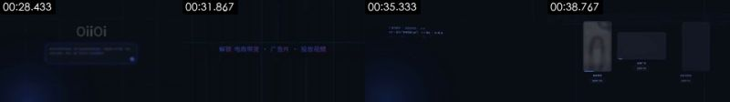

**Visible on screen** (check against the frames)
- Picture: Navy-black background with fine grid lines; 28.4–30 s dozens of small pale-purple words fly in from the edges and assemble into one line "解锁 电商带货 · 广告片 · 投放视频" (unlock live-commerce · brand ads · paid-media videos), key words in blue-violet; 31.9 s the line fades out and at 32.9 s "实时生成 分镜 与 素材" (storyboards and assets generated live) appears word by word, a thin line sweeping left to right beneath it; at 35 s a monospaced code block types out line by line in the lower left: "# 复刻脚本 · 保温杯带货 · 9:16 / ref = 拉片(“参考视频.mp4”) 5 镜头·快-慢-快 / shot_01…shot_05 = Shot(t=…, 景别=…, 内容=…) / generate(ref.结构, 产品=my_cup, 节奏=ref.节奏) / variants([“电商带货”, “品牌广告”, “信息流投放”])", with the blue glow breathing in the lower left; at 37.6 s the code block slides up and fades, and three rounded card outlines unfold from the bottom.
- Text track (text in the picture/bottom): 解锁 / 海出 / 地产品
- Text track (text in the picture/bottom): 电商带货 / 生成中0% / 信息流投放 / 生成中33%
- Text track (text in the picture/middle): 电商带货 / 复刻脚本·保温杯带货·9:16 / 复刻脚本·保温杯带货·9：16 / ref=拉片（“参考视频.mp4"）5镜头·快-慢-快
- Text track (text in the picture/middle): 保留 / 电商带货 / 广告片 / 解锁电商带货·广告片·投放视频
- [AI assistant review] Small scattered words on the navy grid (电商带货, 广告片, 投放视频, 解锁 …) fly in from all sides and line up in the middle; the glyphs stay sharp throughout — animated text layers
- [AI assistant review] At 33 s "实时生成 分镜 与 素材" appears word by word with a horizontal light sweep
- [AI assistant review] From 35 s a monospaced code block (复刻脚本·保温杯带货·9:16, shot_01=Shot(...), generate(...), variants([...])) types out line by line in the lower left
- [AI assistant review] At 38 s the outlines of three empty cards unfold from the bottom, setting up the generation cards of the next shot

**How it was made, as inferred by the tools** (inferred, not seen)
- Inference: code / template render 87%, 3D render 5%, 2D animation 2% (fused_agent)
- Material: rendered by the creator
- Basis (tool measurements, not necessarily visible to the eye):
  - On a dark ground the lit part is almost all fine dots / thin lines (only 9% of lit pixels shade gently, 24 bright peaks per 100 lit pixels): particle / point-cloud / wireframe graphics, not a shaded photo, 3D surface or AI picture
  - Rendered texture: 86% flat colour blocks, 95% of pixels use only 2 colours, 19% axis-aligned edges
  - 97% of background pixels never change frame to frame while local elements move: 2D compositing / code-driven motion graphics
  - Per-frame sharpness oscillates periodically (period None frames, correlation 0.00) with no duplicate frames: frame interpolation / rate conversion, or just the rhythm of a re-encode (transcodes whose platform tags were stripped show it too); not enough on its own to call AI

- Remake: Code render: rebuild in Remotion / HTML from the text tracks and layout, 100% controllable, no generative model needed

#5 00:38.867–00:41.200 · code / template render

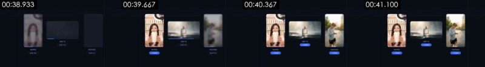

**Visible on screen** (check against the frames)
- Picture: Three cards in a row on the navy grid: a portrait card "电商带货" (live commerce) with the host holding the insulated cup on the left, a landscape card "品牌广告" (brand ad) with a glass perfume bottle on misty water in the middle, a portrait card "信息流投放" (feed ads) with a runner checking a smartwatch on a backlit street on the right; at 38.9 s all three pictures are blurred with "生成中 xx%" and a blue progress bar beneath; the left card sharpens first and turns into a "✓ 已完成" pill, the middle and right follow, and by 41 s all three are done; static frame.
- Text track (text in the picture/bottom): 电商带货 / 信息流投放 / 生成中73% / 生成中19%
- Text track (text in the picture/bottom): 批量投放版本 / 在同一套爆款结构上，按投放需求生成多个版本
- Text track (text in the picture/bottom): 生成数量
- Text track (text in the picture/middle): 品牌广告 / 生成中46% / 生成中86% / 促单
- [AI assistant review] Three rounded cards on the same navy grid; the "生成中 0% → 33% → 83%" numbers under each card count up, a blue progress bar grows, then it switches to a blue "✓ 已完成" (done) pill — UI animation
- [AI assistant review] The pictures inside the cards go from blurred to sharp (blur fade-in) and then stop changing pose: stills placed in the cards, not playing videos
- [AI assistant review] The card pictures look AI-generated: the host has the same face as in the other shots, the perfume bottle stands on water in mist, the runner checks his watch on a backlit street, all with unnaturally even, perfect light
- [AI assistant review] The cards themselves have no thickness or material, only flat shadows — not a 3D render

**How it was made, as inferred by the tools** (inferred, not seen)
- Inference: code / template render 58%, 3D render 23%, AI-generated video 9% (fused_agent)
- Material: rendered by the creator; real or not, to confirm: embedded video clip
- Basis (tool measurements, not necessarily visible to the eye):
  - Rendered texture: 54% flat colour blocks, 95% of pixels use only 92 colours, 35% axis-aligned edges

- Remake: Code render: rebuild in Remotion / HTML from the text tracks and layout, 100% controllable, no generative model needed

#6 00:41.200–00:44.533 · code / template render

**Visible on screen** (check against the frames)
- Picture: White UI: "OiiOi 视频复刻 · 保温杯带货" top left, the user's prompt in a pale-purple bubble top right; two video boxes side by side, "参考视频" (reference, black-and-white) on the left and "复刻成片" (remake, color) on the right, both the smiling host holding the insulated cup; between them four small blue-violet tags "钩子 / 卖点 / 证明 / 促单" (hook / selling point / proof / close) map the two structures one to one; a blue "▶ 播放对比" button and an "导出" (export) button bottom left, with the top of the "批量投放版本" form peeking in below; the cursor moves to "播放对比" and clicks, the progress bar under the right box advances; the page slowly pushes in; at 44 s it blurs out.
- Text track (text in the picture/bottom): 播放对比 / 批量投放版本
- Text track (text in the picture/bottom): 批量投放版本 / 在同一套爆款结构上，按投放需求生成多个版本 / 生成数量
- Text track (text in the picture/bottom): 生成数量
- Text track (text in the picture/middle): 参考视频 / 复刻成片 / 钩子
- [AI assistant review] The whole page scales up slowly while the cursor moves to the "播放对比" (play comparison) button between 41.2 and 41.7 s: there is independently moving content, not just one image being pushed in
- [AI assistant review] The blue progress bar under "复刻成片" keeps growing within the shot
- [AI assistant review] The host's expression and pose in both video boxes stay identical for three seconds: still thumbnails; the left one is desaturated to stand for the "original"
- [AI assistant review] Layout, fonts and colors match shots #1 and #8 exactly: the same code-drawn UI, not a screen recording

**How it was made, as inferred by the tools** (inferred, not seen)
- Inference: still image + pan/zoom 32%, code / template render 31%, 2D animation 16% (fused_agent)
- Material: rendered by the creator
- Basis (tool measurements, not necessarily visible to the eye):
  - Whole frame moves as one rigid transform (100% inliers, 0.08px residual, no local motion) → pan/zoom on a still image: zoom -0.1%/s, pan 3px/s
  - Rendered texture: 52% flat colour blocks, 95% of pixels use only 53 colours, 33% axis-aligned edges

- Remake: Code render: rebuild in Remotion / HTML from the text tracks and layout, 100% controllable, no generative model needed

#7 00:44.533–00:46.933 · code / template render

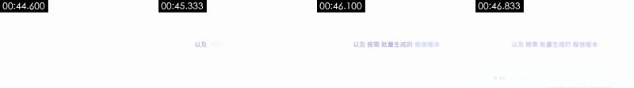

**Visible on screen** (check against the frames)
- Picture: Plain white background; one pale-purple line centered, "以及 按需 批量生成的 投放版本" (plus paid-media versions batch-generated on demand), fading in word by word from left to right with key words slightly darker; dissolves into the next UI after 2.4 s.
- Text track (text in the picture/middle): 以及 / 以及按需 / 以及按需批量生成的投放版本
- [AI assistant review] Plain white background with only one pale-purple line, key words fading in one by one
- [AI assistant review] No other graphics; at the end a faint ghost of the next shot's UI shows in the lower right

**How it was made, as inferred by the tools** (inferred, not seen)
- Inference: code / template render 90%, static hold 7%, screen recording / screenshot 3% (fused_agent)
- Material: rendered by the creator
- Basis (tool measurements, not necessarily visible to the eye):
  - Picture is almost entirely still: 96% of adjacent frames are pixel-identical, first-to-last frame difference 0.81
  - Rendered texture: 96% flat colour blocks, 95% of pixels use only 1 colours, 17% axis-aligned edges

- Remake: Code render: rebuild in Remotion / HTML from the text tracks and layout, 100% controllable, no generative model needed

#8 00:46.933–00:55.500 · code / template render

**Visible on screen** (check against the frames)
- Picture: White UI, first the reference / remake comparison page, then the whole page scrolls up: the "批量投放版本" (batch ad versions) title and the line "在同一套爆款结构上，按投放需求生成多个版本" (several versions on the same hit structure, per your media needs), a "生成数量" field below where the cursor clicks in and changes the number to 3, then 12; two columns of version cards "版本A / 版本B …" appear below, each with a small blue square title and fields: length 15秒 / 30秒, main selling point "12小时长效保温" / "一键开盖·单手可喝", aspect 9:16竖屏 / 1:1方屏, asset count 2 / 6, predicted completion rate 31% / 38%; numbers and text fade in field by field; at 55 s the frame fades to white.
- Text track (text in the picture/bottom): 播放对比 / 导出 / 生成数量 / 主打卖点
- Text track (text in the picture/bottom): 批量投放版本 / 在同一套爆款结构上，按投放需求生成多个版本 / 3 / 9:16竖屏
- Text track (text in the picture/bottom): 生成数量 / 3 / 版本A / 版本B
- Text track (text in the picture/bottom): 15秒 / 30秒
- Motion beats within the shot: 51.33s
- [AI assistant review] It opens on the same page as shot #6, then the whole page scrolls smoothly to the "批量投放版本" form with an ease-in-out curve, with no browser scrollbar or stepped scrolling
- [AI assistant review] The cursor is in the "生成数量" (quantity) field and the number changes from 3 to 12; the fields in the version cards (length, main selling point, aspect, asset count, predicted completion rate) fill in one by one
- [AI assistant review] The host thumbnails at the top stay still
- [AI assistant review] All text edges are clean with no screen moiré or compression blocks, and the UI style matches the earlier code-rendered pages

**How it was made, as inferred by the tools** (inferred, not seen)
- Inference: code / template render 75%, screen recording / screenshot 16%, 2D animation 2% (fused_agent)
- Material: rendered by the creator
- Basis (tool measurements, not necessarily visible to the eye):
  - 58% of adjacent frames are exact duplicates, only local elements move (typical of template / motion-graphics animation, or a hold with local motion)
  - On a light ground the dark part is almost all thin lines / dots (only 17% shade gently): line art, generative strokes or dot graphics, not a shaded photo or 3D surface
  - Rendered texture: 65% flat colour blocks, 95% of pixels use only 6 colours, 32% axis-aligned edges
  - 98% of background pixels never change frame to frame while local elements move: 2D compositing / code-driven motion graphics

- Remake: Code render: rebuild in Remotion / HTML from the text tracks and layout, 100% controllable, no generative model needed

#9 00:55.500–01:10.000 · code / template render; brings in real material (logo / brand mark)

**Visible on screen** (check against the frames)
- Picture: Plain white background; 55.5–58 s the pale-purple line "现在， 复刻任何爆款 都更简单" (now remaking any hit is easier) appears word by word and fades, then at 58.5 s "成片 也更懂 你的品牌" (and the result understands your brand better) does the same; at 60.3 s hundreds of red, pink, purple and blue glowing dots burst from the center to fill the frame, pull back at 61.5 s and at 62.7 s gather into a ring of tiny colored dots with a blue triangular play icon in the middle; at 63.9 s the camera pulls back and the ring lands on a tilted UI ("复刻成片 · 品牌动效" on top, icon rail on the left, a few grey placeholder text lines) that slowly pans; at 67.5 s the UI fades out and at 68.5 s the OiiOi gradient-ring logo + black "OiiOi" + grey "视频复刻" appear centered on white and hold to the end.
- Text track (text in the picture/middle): 现在， / 现在，复刻任何爆款都更简单 / 成片 / 成片也更懂
- Text track (text in the picture/middle): 我的作品 / 紫材库 / 复刻 / 模板
- Text track (text in the picture/middle): 复刻 / 模板 / 创作 / 复刻成片·品牌动效
- Text track (text in the picture/middle): 我的作品 / 我的作
- [AI assistant review] Pale-purple taglines on white appear word by word and fade out
- [AI assistant review] 60.3–62 s: hundreds of red, pink, purple and blue dots burst out from the center and fill the frame, then gather into a ring of small dots; the dots are flat circles with a soft glow, no volume or shading — a particle animation
- [AI assistant review] A blue triangular play icon sits in the ring, which then shrinks into a tilted UI "复刻成片 · 品牌动效" drawn in the same perspective style as shot #1
- [AI assistant review] At the end the OiiOi gradient-ring logo and the grey "视频复刻" wordmark fade in one after the other

**How it was made, as inferred by the tools** (inferred, not seen)
- Inference: code / template render 88%, 3D render 4%, 2D animation 2% (fused_agent)
- Material: mixed (includes real material): logo / brand mark
- Basis (tool measurements, not necessarily visible to the eye):
  - On a light ground the dark part is almost all thin lines / dots (only 14% shade gently): line art, generative strokes or dot graphics, not a shaded photo or 3D surface
  - Rendered texture: 90% flat colour blocks, 95% of pixels use only 1 colours, 10% axis-aligned edges
  - Per-frame sharpness oscillates periodically (period 2 frames, correlation 0.24) with no duplicate frames: frame interpolation / rate conversion, or just the rhythm of a re-encode (transcodes whose platform tags were stripped show it too); not enough on its own to call AI
  - Nearly colourless frame (saturation 0.01) with only 1 colours: a flat UI / document picture, not a shaded 3D render

- Remake: Code render: rebuild in Remotion / HTML from the text tracks and layout, 100% controllable, no generative model needed; real material the user must supply: logo / brand mark (part of the frame)

### Metadata clues

- Encoder: `Lavf61.7.100`

### Notes

- Deterministic forensics is reliable on motion, whole-frame pan/zoom, rendered texture and 24→30 fps conversion; telling live action from AI from 3D needs image reading (a VLM or an AI assistant's review), and a look at the frames yourself.
- Platform transcoding usually strips metadata; missing metadata proves nothing.
- The full data is in `breakdown.json`; the package for models starts at `REEL.md`.
