# この動画はどう作られたか：v10_oiioii_gen_coding_first.mp4

> [report.md](report.md)（rea-video がこの動画について生成した Markdown レポート）の日本語訳です。セクションの順序と内容はツールの出力に従います。画面に映っているテキスト（「テキストトラック」の行や「」で引用した画面上の文字）は、原文の中国語のままにしています。

**ひとことで**：OiiOi「视频复刻」機能のローンチ告知動画。ナレーションに頼らず、コードで作った UI アニメーションで「バズ動画をアップロード → 一文で書き換え → 一括で動画を出力」という流れを一通り実演している。
**作り方**：コード／テンプレートレンダリング 100%

- 1:10 · 横長 16:9 · 9 ショット、1 ショット平均 7.8 秒
- 判定の信頼度 89%、根拠：ツールによる計測 + AI アシスタントによる画像確認 9 ショット
- ⚠️ 判断しきれない箇所が 4 つあり、「不確定な点」を参照

<!--mix-->

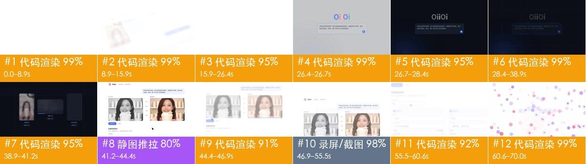

## 見どころ

- **冒頭でどう注意を引くか**：0–4 秒は白背景に淡い紫の「OiiOi 视频复刻 现已上线」が一行だけ単語ごとに浮かび上がり、4.4 秒でソフトの画面が斜めにスライドイン、カーソルがすぐに「视频复刻」を選んで「开始复刻」へ移動する。冒頭でまず製品名を示し、すぐに操作に入る。
- 19–26 秒、入力欄にプロンプト全文「参考这条带货视频，把产品换成我的保温杯……」を一文字ずつ入力する。見終わった視聴者は、一文で伝えるだけでよく、ソフトの使い方を覚える必要はないと分かる
- 35–37 秒でこの一文を「再現スクリプト」のコード（shot_01…shot_05、generate、variants）に変え、38.9–41 秒で 3 枚のカードの進捗数値が「✓ 已完成」に切り替わる。目に見えない AI の処理を、目に見えるステップと結果として見せている
- 41–44 秒、参考動画（モノクロ）と再現した完成動画（カラー）を左右に並べ、中央に「钩子 / 卖点 / 证明 / 促单」を表示する。色を抜いた対比でどちらが元動画か一目で分かり、ラベルで構成がそのまま保たれていることを示す
- 47–55 秒、一括出稿フォームにバージョン A / B の尺、訴求ポイント、画角、予測完全視聴率 31% / 38% が入力されていく。「生成できる」とだけ言うのではなく、運用担当者が気にする指標を直接見せている

## ひと目で分かる：映像・パッケージ・音声の 3 層

ショート動画はどれも 3 層に分解できる。土台が映像そのもので、その上に字幕・装飾テキスト・ステッカーを重ね、さらに音声を付ける。再現するときは 1 層ずつ作る。

| 層 | この動画では何か | 作り方 | 詳細 |
|---|---|---|---|
| **映像**（土台） | コード／テンプレートレンダリング 9 ショット | 画面録画／コードでモーション作成 | 「自分で再現」 |
| **パッケージ**（映像の上に重ねる） | なし | — | 「編集パッケージ層」 |
| **音声** | BGM（112 BPM、要確認）、効果音 1 か所 | BGM：テンポとムードで似た曲を探す；効果音：タイミングに合わせて効果音ライブラリから追加する | 「音声」 |

## 内容と構成

- 以下のストーリーラインはショットごとの画像確認によるもの。セリフは別途まとめておらず、字幕の原文は「編集パッケージ層」を参照

**ストーリーライン**

再現するときはこの流れを残す。各ステップの順序と役割はそのまま踏襲し、語る中身を自分の事例・データ・素材に置き換えれば、単に主役を差し替えただけにはならない。

| 時間 | ショット | 役割 | 何を伝えているか |
|---|---|---|---|
| 0.0–8.8s | #1 | 注意を引く | まず製品名と「リリース済み」を見せ、すぐに最初の操作を実演して、今すぐ使えるツールだと伝える |
| 8.8–26.6s | #2 | 情報補足 | ツールの仕組みを説明する：まず参考動画をショットごとに分解し、次にどう変えたいかを一文で伝える |
| 26.6–28.4s | #3 | 転換 | 明から暗への場面転換で指示が送信されたことを表し、「入力」から「生成」へ移る |
| 28.4–38.9s | #4 | 情報補足 | 一文の指示を目に見える「再現スクリプト」に翻訳し、ツールが元動画の構成どおりにショットごとに生成し、複数バージョンを一度に出せることを示す |
| 38.9–44.5s | #5、#6 | 根拠提示 | 1 つの入力から用途の異なる 3 本の完成動画が同時に生まれ、進捗数値が「完了」に変わることで結果を示す → 元動画と再現動画を並べ、中央にフック・訴求ポイント・証明・購入後押しを表示して、元動画の構成が保たれていることを証明する |
| 44.5–55.5s | #7、#8 | 情報補足 | つなぎの一文で次の機能、一括での出稿用バージョン出力を導入する → 尺・訴求ポイント・画角ごとに複数の出稿用バージョンを一括で作れることを見せ、予測完全視聴率も示す |
| 55.5–70.0s | #9 | 結論 | 「もっと簡単に」の一文で訴求をまとめ、カラフルなドットが再生ボタンに集まってから製品画面に戻り、最後はブランドマークで止まる |

## ショット表

「映像」「カメラワーク」「オーバーレイ」は画面上で確認できる内容、「制作方法」「素材の出所」はツールによる推定で、根拠は付録のショット別の根拠を参照。

| # | スクリーンショット | 時間 | 尺 | 何を伝えているか | 映像 | カメラワーク | オーバーレイ | 制作方法（推定） | 素材の出所（推定） | 再現 |
|---|---|---|---|---|---|---|---|---|---|---|
| 1 |  | 0:00.0 | 8.8s | 注意を引く：まず製品名と「リリース済み」を見せ、すぐに最初の操作を実演して、今すぐ使えるツールだと伝える | 白背景。1–4 秒、中央に淡い紫の一行テキスト「OiiOi 视频复刻 现已上线」が単語ごとにフェードインした後フェード… | スムーズなカメラワーク | — | コード／テンプレートレンダリング 90% | 制作側でレンダリング | コードレンダリング · セグメント1 |
| 2 | 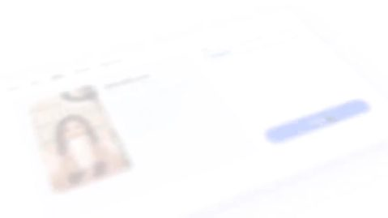 | 0:08.8 | 17.8s | 情報補足：ツールの仕組みを説明する：まず参考動画をショットごとに分解し、次にどう変えたいかを一文で伝える | 4 つのパートをディゾルブでつないだコードモーション：①白背景のキャッチコピー「开启 一种 复刻爆款 的新方式」が単語ごとにフェードイン… | 固定 | — | コード／テンプレートレンダリング 92% | ロゴ／ブランドマーク | コードレンダリング · セグメント1 |
| 3 | 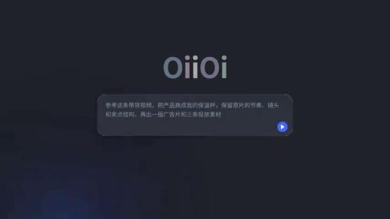 | 0:26.6 | 1.8s | 転換：明から暗への場面転換で指示が送信されたことを表し、「入力」から「生成」へ移る | 黒に近い濃紺の背景に細いグリッド線。中央にグレーがかった白の「OiiOi」ロゴタイプ、その下の角丸入力欄にはプロンプト全文… | 固定 | — | コード／テンプレートレンダリング 94% | 制作側でレンダリング | コードレンダリング · セグメント1 |
| 4 | 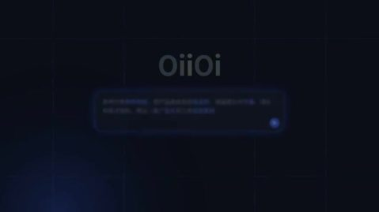 | 0:28.4 | 10.5s | 情報補足：一文の指示を目に見える「再現スクリプト」に翻訳し、ツールが元動画の構成どおりにショットごとに生成し、複数バージョンを一度に出せることを示す | 黒に近い濃紺の背景に細いグリッド線。28.4–30 秒、数十個の淡い紫の小さな文字が画面の四方から中央へ飛んできて組み… | 固定 | — | コード／テンプレートレンダリング 94% | 制作側でレンダリング | コードレンダリング · セグメント1 |
| 5 | 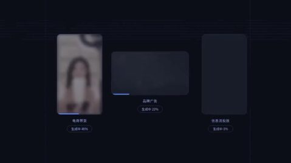 | 0:38.9 | 2.3s | 根拠提示：1 つの入力から用途の異なる 3 本の完成動画が同時に生まれ、進捗数値が「完了」に変わることで結果を示す | 濃紺のグリッド背景に 3 枚のカードが横並び：左の縦型カード「电商带货」は保温ボトルを掲げる女性配信者、中央の横型… | 固定 | — | コード／テンプレートレンダリング 85% | 制作側でレンダリング；実素材か要確認：埋め込み動画クリップ | コードレンダリング · セグメント1 |
| 6 |  | 0:41.2 | 3.3s | 根拠提示：元動画と再現動画を並べ、中央にフック・訴求ポイント・証明・購入後押しを表示して、元動画の構成が保たれていることを証明する | 白背景の UI：左上に「OiiOi 视频复刻 · 保温杯带货」、右上の薄紫の吹き出しにはユーザーのプロンプト… | 画面全体のズーム／パン | — | コード／テンプレートレンダリング 55% | 制作側でレンダリング | コードレンダリング · セグメント1 |
| 7 |  | 0:44.5 | 2.4s | 情報補足：つなぎの一文で次の機能、一括での出稿用バージョン出力を導入する | 真っ白な背景の中央に淡い紫の一行テキスト「以及 按需 批量生成的 投放版本」が左から右へ単語ごとにフェード… | 固定 | — | コード／テンプレートレンダリング 90% | 制作側でレンダリング | コードレンダリング · セグメント1 |
| 8 |  | 0:46.9 | 8.6s | 情報補足：尺・訴求ポイント・画角ごとに複数の出稿用バージョンを一括で作れることを見せ、予測完全視聴率も示す | 白背景の UI。まず参考動画 / 再現動画の比較ページ、続いてページ全体が上にスクロール：上部に「批量投放版本」の見出し… | 固定 | — | コード／テンプレートレンダリング 79% | 制作側でレンダリング | コードレンダリング · セグメント1 |
| 9 |  | 0:55.5 | 14.5s | 結論：「もっと簡単に」の一文で訴求をまとめ、カラフルなドットが再生ボタンに集まってから製品画面に戻り、最後はブランドマークで止まる | 真っ白な背景。55.5–58 秒、淡い紫のテキスト「现在， 复刻任何爆款 都更简单」が単語ごとに現れ… | スムーズなカメラワーク | — | コード／テンプレートレンダリング 94% | ロゴ／ブランドマーク | コードレンダリング · セグメント1 |

## 自分で再現：この順番で作る

再現するのは作り方とテンポであって、画面をそのまま写すことではない。

1. **内容を決める**：「内容と構成」のストーリーラインに沿って自分の台本を書く
2. **素材を用意する**：下の「用意する素材」を参照
3. **画面録画とモーション**：下の「コード合成」を参照
4. **編集**：下の「編集」を参照
5. **音声**：「音声」を参照。効果音はどれも先に試聴できる
6. **見比べてチェック**：完成動画と元動画を並べて一通り見て、ショットの長さ、字幕の位置、音楽の盛り上がりと引きが合っているか確認する

### 用意する素材

- 画面内でそのまま使われている実ファイル（スクリーンショット、写真、画面録画。元ファイルを入手すること）：
  - **ロゴ／ブランドマーク**（画面の一部）、カラーの「OiiOi」ロゴタイプ（文字ごとに色が異なる）：ショット #2、計 17.8s
  - **ロゴ／ブランドマーク**（画面の一部）、エンディングの OiiOi カラーグラデーションのリング型ロゴと「OiiOi 视频复刻」ロゴタイプ：ショット #9、計 14.5s

### コード合成

Remotion/HTML のプロジェクトを 1 つ作り、テキストトラックとレイアウトに沿って再構築する（テキストも UI も 100% 制御でき、文言の変更はデータを変えるだけ）。このプロジェクトは LLM にそのまま書かせてもよい。

- セグメント1：ショット #1–#9（0.0–70.0s）

再現用アセット（すべてレポートのディレクトリ内にある。再現時は下のデータと一緒に、コードを書く人または LLM に渡す）：
- `shots/shot_XXX_first.jpg` / `_last.jpg`：各ショットの最初と最後のフレーム（原解像度）。レイアウト、文字サイズ、余白の確認用
- `shots/shot_XXX_strip.jpg`：約 0.5 秒ごとに 1 枚のキーフレームストリップ。アニメーションの過程を見る用
- `shots/shot_XXX_elements.jpg` と `_el_NN.jpg` / `_st_NN.jpg` / `_ly_NN.jpg`：各要素が静止した後の原解像度スクリーンショット。番号はモーションタイムラインに対応。図形はこれを見て描き直し、アイコン・ロゴ・イラストなど描き起こせないものはそのまま切り抜いて使ってよい
- `packaging/overlays.ass`、`packaging/timeline.json`：テキストのタイミング・位置・色

映像の作り方（ツールが計測した映像タイプ別）：
- データチャート：SVG/D3 のスケールで座標と図形を描き、数値は interpolate() でフレームごとにカウントアップ、棒／線は spring() で伸ばす
- 線画／ドット：SVG パスを stroke-dashoffset でフレームごとに描線するか、Canvas でノイズ場に沿って流線を描く／目標形状に沿ってドットを並べる。線幅・色・密度は画面から測る
- パーティクル／点群：Three.js のパーティクルシステム（ドットを目標形状からサンプリングし、形状間を補間して変形、グローのポストエフェクトを加える）を @remotion/three でフレームごとにレンダリング
- ベクター図形：SVG 図形 + interpolate()/spring() のキーフレーム。位置とテンポは画面から測る

パーティクル系のショット：各ショットでパーティクルがどんな形を作り、どう動くかが再現の出来を左右する。章タイトル、注記、数値などの HUD テキストは HTML レイヤーとして上に重ね、下の表に沿ってショットごとに作ること。すべてのショットで背景を使い回さない。

| ショット | 時間 | 作り方 | 映像 | カメラワーク | 主要色 | 画面文字 |
|---|---|---|---|---|---|---|
| #1 | 0.0–8.8s | データチャート | 白背景。1–4 秒、中央に淡い紫の一行テキスト「OiiOi 视频复刻 现已上线」が単語ごとにフェードインした後フェードアウト。4.4 秒、斜めに置かれたソフトの画面（左側にアイコンバー、上部に「创作 / 模板 / 复刻 / 素材库 / 我的作品」タブ、中央に女性配信者のサムネイル付き「参考视频.mp4」カード、右側に「模式」ドロップダウンと青い「开始复刻」ボタン）が右下から上へスライドインし、仮想カメラがゆっくりズームインしながら左へパン。6.5 秒、カーソルがドロップダウンを開き、メニューに 3 項目が展開され「视频复刻」を選択。8 秒、カーソルが「开始复刻」ボタンへ移動し、画面は次のショットへディゾルブ。 | ズームイン 2%/s、画面は左へ移動 | 背景 #fbfcfd · #f1f4f9 #e3cec5 #caa290 #4171fc | 00:15 |
| #2 | 8.8–26.6s | 線画／ドット | 4 つのパートをディゾルブでつないだコードモーション：①白背景のキャッチコピー「开启 一种 复刻爆款 的新方式」が単語ごとにフェードイン。②斜めに置かれたショット分析画面：上段に女性配信者のサムネイル 5 枚、その下にショット表（镜头01 0.0–2.1s クローズアップ「开场钩子·主播举杯」、镜头02 2.1–4.8s ミディアムショット「卖点·倒入热水」、镜头03 ミディアムクローズアップ「证明·12小时仍冒热气」、镜头04 ロングショット「场景·通勤与办公」）、画面はゆっくりパン。③白背景のキャッチコピー「逐帧拉片，读懂 每一个 爆款结构」。④白背景の中央にカラーのロゴタイプ「OiiOi」、その下の角丸入力欄（紫〜青のグラデーション枠）に「问问OiiOi，想复刻什么？」と表示され、続いてプロンプト「参考这条带货视频，把产品换成我的保温杯，保留原片的节奏、镜头和卖点结构，再出一版广告片和三条投放素材」が一文字ずつ入力される。右下に青い送信ボタン。最後に画面全体がグレーになって暗くなる。 | 固定 | 背景 #f9fcfd · #f4f3f8 #d9dee3 #bfc7c9 | — |
| #3 | 26.6–28.4s | パーティクル／点群 | 黒に近い濃紺の背景に細いグリッド線。中央にグレーがかった白の「OiiOi」ロゴタイプ、その下の角丸入力欄にはプロンプト全文が入り、枠線がグレーから発光する青に変わる。右下に青い送信ボタン。左下では青い放射グラデーションの光がゆっくり明滅している。画面は固定で、1.8 秒後にディゾルブして暗いパートへ入る。 | 固定 | 背景 #070d15 · #060f1d #0a132a #101724 #101d37 | Oiioi |
| #4 | 28.4–38.9s | パーティクル／点群 | 黒に近い濃紺の背景に細いグリッド線。28.4–30 秒、数十個の淡い紫の小さな文字が画面の四方から中央へ飛んできて、一行の「解锁 电商带货 · 广告片 · 投放视频」（キーワードは青紫）を形作る。31.9 秒にキャッチコピーがフェードアウトし、32.9 秒に「实时生成 分镜 与 素材」が単語ごとに現れ、その下を細い線が左から右へ走る。35 秒、左下に等幅フォントのコードブロックが現れ、「# 复刻脚本 · 保温杯带货 · 9:16 / ref = 拉片(“参考视频.mp4”) 5 镜头·快-慢-快 / shot_01…shot_05 = Shot(t=…, 景别=…, 内容=…) / generate(ref.结构, 产品=my_cup, 节奏=ref.节奏) / variants([“电商带货”, “品牌广告”, “信息流投放”])」が一行ずつ打ち出される。左下では青い光が明滅。37.6 秒、コードブロックが上へ移動しながらフェードアウトし、角丸カード 3 枚のワイヤーフレームが下から上へ展開する。 | 固定 | 背景 #070d15 · #161b28 #0f1723 #061018 #070e1a | 复刻脚本·保温杯带货·9：16 |
| #5 | 38.9–41.2s | データチャート | 濃紺のグリッド背景に 3 枚のカードが横並び：左の縦型カード「电商带货」は保温ボトルを掲げる女性配信者、中央の横型カード「品牌广告」は霧の立つ水面に置かれたガラスの香水瓶、右の縦型カード「信息流投放」は逆光の街路でスマートウォッチを見るランニング中の男性。38.9 秒の時点では 3 枚ともぼやけた状態で、下に「生成中 xx%」と青い進捗バーが表示される。左のカードが最初に鮮明になって「✓ 已完成」のピル型ボタンに切り替わり、中央、右のカードが順に続いて、41 秒で 3 枚とも完了。画面は固定。 | 固定 | 背景 #070d15 · #cdbbac #f1e4d7 #a79384 #2d2b36 | 生成数量 / 钩子 / 卖点 / 证明 / oiioi / 视频复刻·保温杯带货 |
| #6 | 41.2–44.5s | ベクター図形 | 白背景の UI：左上に「OiiOi 视频复刻 · 保温杯带货」、右上の薄紫の吹き出しにはユーザーのプロンプト。中央に左右 2 つの動画枠があり、左が「参考视频」（モノクロ）、右が「复刻成片」（カラー）で、どちらも保温ボトルを掲げて微笑む女性配信者。中央には縦に並んだ青紫の小さなラベル 4 つ「钩子 / 卖点 / 证明 / 促单」が左右の構成を一つずつ対応付けている。左下に青い「▶ 播放对比」ボタンと「导出」ボタン、その下に「批量投放版本」フォームの冒頭がのぞく。カーソルが「播放对比」へ移動してクリックし、右の枠の下の進捗バーが右へ進む。ページ全体がゆっくりズームイン。44 秒で画面がぼやけてフェードアウト。 | カメラ固定、画面内の要素が動く | 背景 #fbfcfd · #ededed #e1ddda #d6cec8 #918a88 | 生成数量 / 促单 / oiioi / 视频复刻·保温杯带货 / 参考这条带货视频，把产品换成我的保温杯，保留原片的节奏、镜头和卖 / 点结构，再出一版广告片和三条投放素材 |
| #7 | 44.5–46.9s | ベクター図形 | 真っ白な背景の中央に淡い紫の一行テキスト「以及 按需 批量生成的 投放版本」が左から右へ単語ごとにフェードインし、キーワードはやや濃い色。2.4 秒後にディゾルブして次のショットの UI へ。 | 固定 | 背景 #fbfcfd ·  | — |
| #8 | 46.9–55.5s | 線画／ドット | 白背景の UI。まず参考動画 / 再現動画の比較ページ、続いてページ全体が上にスクロール：上部に「批量投放版本」の見出しと説明「在同一套爆款结构上，按投放需求生成多个版本」、その下に「生成数量」入力欄があり、カーソルがクリックして数字を 3 に、さらに 12 に変更する。下に 2 列のバージョンカード「版本A / 版本B …」が現れ、各カードには青い小さな四角付きの見出しと項目がある：尺 15秒 / 30秒、主な訴求ポイント「12小时长效保温」「一键开盖·单手可喝」、画角 9:16竖屏 / 1:1方屏、素材本数 2 / 6、予測完全視聴率 31% / 38%。数値とテキストが項目ごとにフェードインして埋まっていく。55 秒、画面がフェードアウトして白になる。 | 固定 | 背景 #f1f4f9 · #f9fcfd #dee2e9 #c8cdda | 参考这条带货视频，把产品换成我的保温杯，保留原片的节奏、镜头和卖 / 点结构，再出一版广告片和三条投放素材 / 参考视频 / 复刻成片 / 促单 / 播放对比 |
| #9 | 55.5–70.0s | 線画／ドット | 真っ白な背景。55.5–58 秒、淡い紫のテキスト「现在， 复刻任何爆款 都更简单」が単語ごとに現れてからフェードアウトし、58.5 秒に「成片 也更懂 你的品牌」が同様に現れる。60.3 秒、赤・ピンク・紫・青の数百個のカラフルなドット（ソフトグロー付き）が中心から四方へはじけて画面を埋め、61.5 秒に引き戻され、62.7 秒に細かなカラードットで囲まれたリングにまとまり、中央に青い三角の再生ボタン。63.9 秒にカメラが引き、リングが斜めに置かれた UI（上部に「复刻成片 · 品牌动效」、左側にアイコンバー、グレーのダミーテキスト行がいくつか）の上に収まり、UI はゆっくりパン。67.5 秒に UI がフェードアウトし、68.5 秒に白背景の中央へ OiiOi カラーグラデーションのリング型ロゴ + 黒の「OiiOi」+ グレーの「视频复刻」が現れ、最後まで静止。 | カメラ固定、画面内の要素が動く | 背景 #fbfcfd · #e4e6ea | — |

ショット別モーションタイムライン（ツール計測：位置は画面の幅・高さに対する割合、色は要素が静止した後に取得した色。キーフレームストリップと合わせて見ること）

モーション #1 0.0–8.8s · 9 件

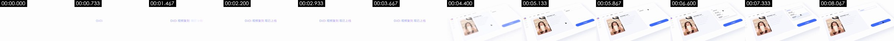

- 背景 #fbfcfd；その他の主要色 #f1f4f9 #e3cec5 #caa290 #4171fc
要素スクリーンショット（番号は下のモーションに対応。L は常時動くレイヤーのショット中盤と終盤、S はショット全体で静止している要素）。原解像度の個別画像は `shots/` にあります：

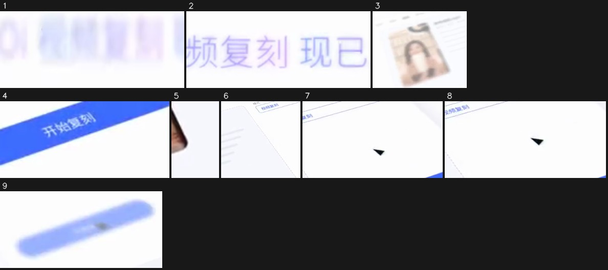

1. 1.13–4.13s · 中央（x 36%–56%，y 48%–56%） · 出現、右方向へスライドイン、イーズアウト · #e7e5fd · テキスト「OiiOi 视频复刻 / OiiOi 视频复刻现已上线」 · [スクリーンショット](shots/shot_001_el_01.jpg)
2. 4.13–5.13s · 中央（x 44%–62%，y 44%–56%） · 消失、イーズアウト · #dad8fb · テキスト「OiiOi 视频复刻现已上线」 · [スクリーンショット](shots/shot_001_el_02.jpg)
3. 4.53–8.73s · 中央左（x 2%–40%，y 32%–88%） · 出現、上方向へスライドイン、等速 · #e6d7cf · テキスト「Oiioi / OiiOi 视频复刻 / 我的作品」 · [スクリーンショット](shots/shot_001_el_03.jpg)
4. 4.53–5.13s · 中央右（x 80%–96%，y 52%–64%） · 出現、等速 · #486ffd · テキスト「开始复刻」 · [スクリーンショット](shots/shot_001_el_04.jpg)
5. 4.53–5.53s · 下（x 40%–42%，y 68%–80%） · 出現、上方向へスライドイン、等速 · #d8d7de · [スクリーンショット](shots/shot_001_el_05.jpg)
6. 4.60–7.73s · 中央（x 44%–67%，y 24%–64%） · 変化、上方向へ移動、イーズアウト · #ecedf6 · テキスト「OiiOi 视频复刻现已上线 / 视频生成 / 上传」 · [スクリーンショット](shots/shot_001_el_06.jpg)
7. 6.47–7.87s · 中央右（x 60%–89%，y 20%–48%） · 変化、右方向へ移動、イーズインアウト · #efeef7 · テキスト「视频生成 / 图片生成 / 视频复刻」 · [スクリーンショット](shots/shot_001_el_07.jpg)
8. 6.93–7.73s · 中央右（x 58%–87%，y 24%–48%） · 変化、下方向へ移動、イーズインアウト · #fdfdfd · テキスト「视频生成 / 图片生成 / 视频复刻」 · [スクリーンショット](shots/shot_001_el_08.jpg)
9. 8.13–8.73s · 中央右（x 67%–96%，y 44%–68%） · 変化、上方向へ移動、イーズイン · #a7bafd · テキスト「开始复刻」 · [スクリーンショット](shots/shot_001_el_09.jpg)

モーション #2 8.8–26.6s（ディゾルブで切り替え） · 0 件

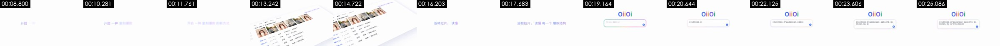

- 背景 #f9fcfd；その他の主要色 #f4f3f8 #d9dee3 #bfc7c9
- 要素の動きは検出されず（静止画面、またはごくわずかな変化のみ）

モーション #3 26.6–28.4s · 1 件

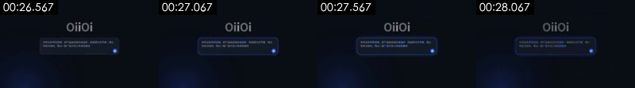

- 背景 #070d15；その他の主要色 #060f1d #0a132a #101724 #101d37
要素スクリーンショット（番号は下のモーションに対応。L は常時動くレイヤーのショット中盤と終盤、S はショット全体で静止している要素）。原解像度の個別画像は `shots/` にあります：

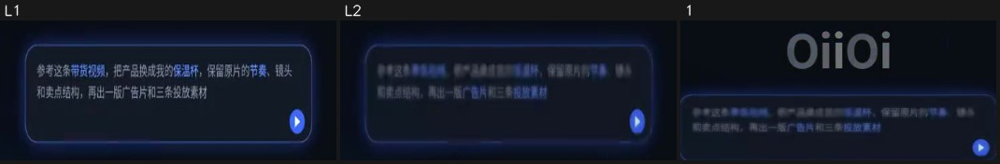

- [スクリーンショット L1](shots/shot_003_ly_01.jpg) [スクリーンショット L2](shots/shot_003_ly_02.jpg) · 常時動くレイヤー：画面の 6% がショット全体を通して動いている（x 22%–78%，y 40%–64%）。漂うグラデーション、パーティクルの流れ、グローの明滅など
1. 28.23–28.30s · 中央（x 27%–73%，y 24%–60%） · 変化、瞬時 · #2f3648 · テキスト「Oiioi / 参考这条带货视频，把产品换成我的保温杯，保留原片的节奏、镜头 / 和卖点结构，再出一版广告片和三条投放素材」 · [スクリーンショット](shots/shot_003_el_01.jpg)

モーション #4 28.4–38.9s（ディゾルブで切り替え） · 10 件

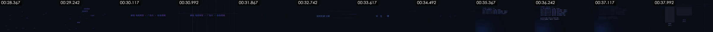

- 背景 #070d15；その他の主要色 #161b28 #0f1723 #061018 #070e1a
要素スクリーンショット（番号は下のモーションに対応。L は常時動くレイヤーのショット中盤と終盤、S はショット全体で静止している要素）。原解像度の個別画像は `shots/` にあります：

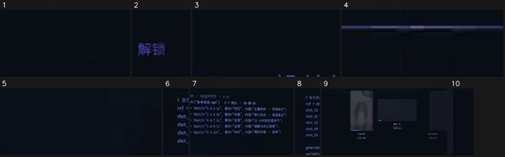

1. 28.43–28.50s · 下（x 29%–71%，y 60%–100%） · 変化、瞬時 · #090d14 · テキスト「解锁 / 海出 / 品牌广告」 · [スクリーンショット](shots/shot_004_el_01.jpg)
2. 29.37–31.30s · 下（x 38%–42%，y 80%–92%） · 消失、上方向へ移動、イーズアウト · #171530 · テキスト「解锁」 · [スクリーンショット](shots/shot_004_el_02.jpg)
3. 29.70–29.90s · 中央（x 56%–71%，y 32%–44%） · 変化、右方向へ移動、等速 · #090d14 · テキスト「投放视频」 · [スクリーンショット](shots/shot_004_el_03.jpg)
4. 32.83–32.90s · 中央右（x 67%–87%，y 44%–48%） · 出現、瞬時 · #1b1e31 · テキスト「保留」 · [スクリーンショット](shots/shot_004_el_04.jpg)
5. 35.23–37.43s · 中央（x 38%–53%，y 32%–40%） · 変化、右方向へ移動、等速 · #111422 · テキスト「电商带货」 · [スクリーンショット](shots/shot_004_el_05.jpg)
6. 36.03–37.97s · 中央左（x 9%–13%，y 20%–52%） · 消失、上方向へ移動、イーズインアウト · #1e253e · [スクリーンショット](shots/shot_004_el_06.jpg)
7. 36.23–37.43s · 中央（x 18%–56%，y 20%–64%） · 消失、左方向へ移動、等速 · #202842 · テキスト「电商带货 / 广告片 / 解锁」 · [スクリーンショット](shots/shot_004_el_07.jpg)
8. 36.83–37.43s · 中央左（x 7%–13%，y 16%–60%） · 消失、下方向へ移動、イーズインアウト · #20283e · [スクリーンショット](shots/shot_004_el_08.jpg)
9. 37.63–38.83s · 中央（x 0%–84%，y 20%–100%） · 出現、上方向へ展開（描線／伸長／ワイプ）、イーズインアウト · #171b28 · テキスト「电商带货 / 保留 / 解锁」 · [スクリーンショット](shots/shot_004_el_09.jpg)
10. 38.70–38.77s · 中央右（x 89%–96%，y 24%–68%） · 変化、瞬時 · #090d14 · [スクリーンショット](shots/shot_004_el_10.jpg)

モーション #5 38.9–41.2s（ディゾルブで切り替え） · 3 件

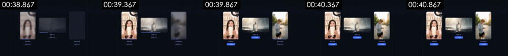

- 背景 #070d15；その他の主要色 #cdbbac #f1e4d7 #a79384 #2d2b36
要素スクリーンショット（番号は下のモーションに対応。L は常時動くレイヤーのショット中盤と終盤、S はショット全体で静止している要素）。原解像度の個別画像は `shots/` にあります：

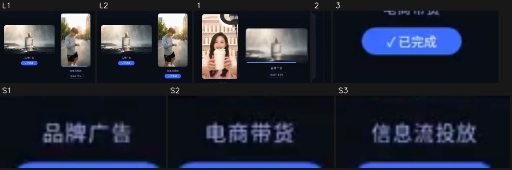

- S1. ショット全体で静止：図形／テキストブロック · x 48%–54%，y 60%–64% · #3f455b · テキスト「品牌广告 / 促单」 · [スクリーンショット](shots/shot_005_st_01.jpg)
- S2. ショット全体で静止：図形／テキストブロック · x 24%–30%，y 72%–76% · #4b4d67 · テキスト「电商带货」 · [スクリーンショット](shots/shot_005_st_02.jpg)
- S3. ショット全体で静止：図形／テキストブロック · x 72%–79%，y 72%–76% · #454865 · テキスト「信息流投放」 · [スクリーンショット](shots/shot_005_st_03.jpg)
- [スクリーンショット L1](shots/shot_005_ly_01.jpg) [スクリーンショット L2](shots/shot_005_ly_02.jpg) · 常時動くレイヤー：画面の 15% がショット全体を通して動いている（x 38%–84%，y 20%–84%）。漂うグラデーション、パーティクルの流れ、グローの明滅など
1. 38.93–39.60s · 中央（x 18%–64%，y 20%–72%） · 出現、下方向へスライドイン、イーズアウト · #b99f96 · テキスト「品牌广告 / 生成中46% / 生成中86%」 · [スクリーンショット](shots/shot_005_el_01.jpg)
2. 38.93–39.00s · 中央右（x 84%–87%，y 20%–72%） · 変化、瞬時 · #090d14 · [スクリーンショット](shots/shot_005_el_02.jpg)
3. 39.40–39.60s · 左下（x 22%–33%，y 76%–84%） · 出現、イーズイン · #3c69f2 · テキスト「电商带货 / 生成中73% / √已完成」 · [スクリーンショット](shots/shot_005_el_03.jpg)

モーション #6 41.2–44.5s · 6 件

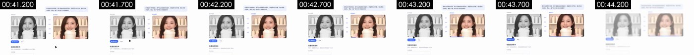

- 背景 #fbfcfd；その他の主要色 #ededed #e1ddda #d6cec8 #918a88
要素スクリーンショット（番号は下のモーションに対応。L は常時動くレイヤーのショット中盤と終盤、S はショット全体で静止している要素）。原解像度の個別画像は `shots/` にあります：

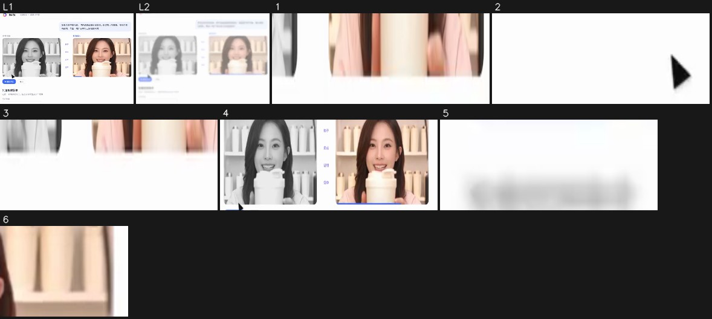

- [スクリーンショット L1](shots/shot_006_ly_01.jpg) [スクリーンショット L2](shots/shot_006_ly_02.jpg) · 常時動くレイヤー：画面の 31% がショット全体を通して動いている（x 11%–89%，y 0%–96%）。漂うグラデーション、パーティクルの流れ、グローの明滅など
1. 41.27–43.13s · 下（x 42%–89%，y 68%–72%） · 消失、右方向へ移動、等速 · #edd2c8 · [スクリーンショット](shots/shot_006_el_01.jpg)
2. 41.47–41.87s · 下（x 40%–58%，y 80%–88%） · 消失、左方向へ移動、等速 · #7b7b7b · [スクリーンショット](shots/shot_006_el_02.jpg)
3. 42.67–43.13s · 下（x 33%–82%，y 68%–72%） · 消失、右方向へ移動、等速 · #e1cbc1 · [スクリーンショット](shots/shot_006_el_03.jpg)
4. 44.00–44.47s · 中央（x 11%–91%，y 28%–68%） · 消失、左方向へ移動、イーズイン · #c4b3a8 · テキスト「参考视频 / 复刻成片 / 钩子」 · [スクリーンショット](shots/shot_006_el_04.jpg)
5. 44.00–44.47s · 左下（x 11%–20%，y 76%–80%） · 出現、イーズインアウト · #e5e5e7 · テキスト「播放对比 / 批量投放版本」 · [スクリーンショット](shots/shot_006_el_05.jpg)
6. 44.20–44.47s · 中央右（x 80%–89%，y 32%–44%） · 消失、上方向へ移動、イーズインアウト · #edcfb5 · [スクリーンショット](shots/shot_006_el_06.jpg)

モーション #7 44.5–46.9s（ディゾルブで切り替え） · 5 件

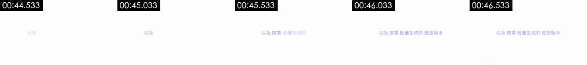

- 背景 #fbfcfd；その他の主要色 —
要素スクリーンショット（番号は下のモーションに対応。L は常時動くレイヤーのショット中盤と終盤、S はショット全体で静止している要素）。原解像度の個別画像は `shots/` にあります：

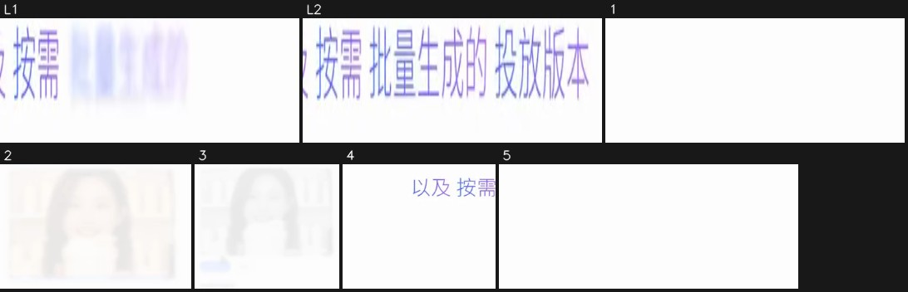

- [スクリーンショット L1](shots/shot_007_ly_01.jpg) [スクリーンショット L2](shots/shot_007_ly_02.jpg) · 常時動くレイヤー：画面の 3% がショット全体を通して動いている（x 31%–78%，y 48%–56%）。漂うグラデーション、パーティクルの流れ、グローの明滅など
1. 44.60–44.67s · 上（x 47%–87%，y 8%–16%） · 変化、瞬時 · #fdfdfd · [スクリーンショット](shots/shot_007_el_01.jpg)
2. 44.60–44.67s · 中央右（x 53%–91%，y 24%–68%） · 消失、瞬時 · #f3ede8 · [スクリーンショット](shots/shot_007_el_02.jpg)
3. 44.60–44.67s · 中央左（x 11%–47%，y 24%–80%） · 消失、瞬時 · #e8e8e9 · テキスト「以及 / 以及按需」 · [スクリーンショット](shots/shot_007_el_03.jpg)
4. 46.87–46.93s · 中央左（x 11%–38%，y 44%–84%） · 変化、瞬時 · #e7e5f5 · テキスト「以及 / 以及按需」 · [スクリーンショット](shots/shot_007_el_04.jpg)
5. 46.87–46.93s · 下（x 47%–87%，y 88%–100%） · 出現、瞬時 · #ededef · [スクリーンショット](shots/shot_007_el_05.jpg)

モーション #8 46.9–55.5s（フェードで切り替え） · 8 件

- 背景 #f1f4f9；その他の主要色 #f9fcfd #dee2e9 #c8cdda
要素スクリーンショット（番号は下のモーションに対応。L は常時動くレイヤーのショット中盤と終盤、S はショット全体で静止している要素）。原解像度の個別画像は `shots/` にあります：

1. 47.00–49.13s · 中央（x 24%–91%，y 0%–100%） · 出現、上方向へ展開（描線／伸長／ワイプ）、瞬時 · #fae9db · テキスト「证明 / 促单 / 版本B」 · [スクリーンショット](shots/shot_008_el_01.jpg)
2. 47.00–52.00s · 左下（x 22%–42%，y 64%–76%） · 変化、下方向へ移動、イーズアウト · #efeff4 · テキスト「导出 / 在同一套爆款结构上，按投放需求生成多个版本」 · [スクリーンショット](shots/shot_008_el_02.jpg)
3. 47.53–48.80s · 下（x 13%–89%，y 44%–100%） · 消失、下方向へ移動、イーズイン · #d6c5be · テキスト「证明 / 促单 / 播放对比」 · [スクリーンショット](shots/shot_008_el_03.jpg)
4. 47.60–51.87s · 上（x 24%–91%，y 0%–24%） · 消失、右方向へ移動、イーズアウト · #eceffb · テキスト「参考这条带货视频，把产品换成我的保温杯，保留原片的节奏、镜头和卖 / 点结构，再出一版广告片和三条投放素材 / 复刻成片」 · [スクリーンショット](shots/shot_008_el_04.jpg)
5. 51.53–52.00s · 中央右（x 91%–100%，y 0%–96%） · 変化、下方向へ移動、イーズインアウト · #f0f6f9 · [スクリーンショット](shots/shot_008_el_05.jpg)
6. 55.20–55.47s · 左上（x 0%–36%，y 16%–44%） · 消失、上方向へ移動、イーズインアウト · #d3dbe2 · テキスト「参考视频 / 播放对比 / 导出」 · [スクリーンショット](shots/shot_008_el_06.jpg)
7. 55.27–55.47s · 左上（x 0%–18%，y 0%–12%） · 消失、等速 · #5277fc · テキスト「参考视频 / 播放对比」 · [スクリーンショット](shots/shot_008_el_07.jpg)
8. 55.27–55.47s · 下（x 2%–80%，y 40%–96%） · 消失、上方向へ移動、等速 · #c6c9d9 · テキスト「卖点 / 证明 / 促单」 · [スクリーンショット](shots/shot_008_el_08.jpg)

モーション #9 55.5–70.0s（ディゾルブで切り替え） · 13 件

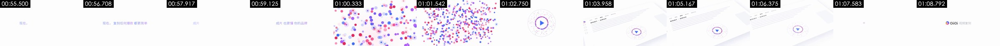

- 背景 #fbfcfd；その他の主要色 #e4e6ea
要素スクリーンショット（番号は下のモーションに対応。L は常時動くレイヤーのショット中盤と終盤、S はショット全体で静止している要素）。原解像度の個別画像は `shots/` にあります：

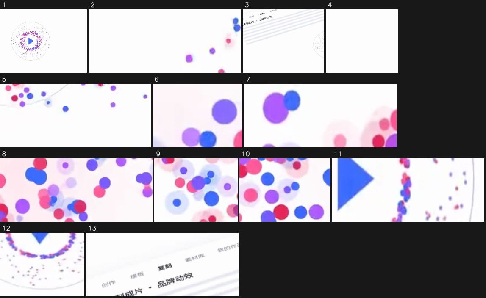

- 常時動くレイヤー：画面の 2% がショット全体を通して動いている（x 24%–64%，y 48%–56%）。漂うグラデーション、パーティクルの流れ、グローの明滅など
1. 60.57–62.57s · 中央（x 24%–100%，y 0%–100%） · 出現、左方向へスライドイン、等速 · #e9d8f0 · テキスト「现在， / 现在，复刻任何爆款都更简单 / 成片」 · [スクリーンショット](shots/shot_009_el_01.jpg)
2. 60.57–62.23s · 左上（x 0%–27%，y 16%–32%） · 変化、右方向へ移動、等速 · #e7d2ec · テキスト「复刻 / 我的作」 · [スクリーンショット](shots/shot_009_el_02.jpg)
3. 60.57–64.03s · 下（x 13%–58%，y 36%–100%） · 変化、上方向へ移動、イーズアウト · #ededf2 · テキスト「现在， / 现在，复刻任何爆款都更简单 / 成片」 · [スクリーンショット](shots/shot_009_el_03.jpg)
4. 60.57–62.23s · 左下（x 2%–16%，y 76%–100%） · 変化、上方向へ移動、等速 · #fdfdfd · [スクリーンショット](shots/shot_009_el_04.jpg)
5. 60.57–62.23s · 下（x 49%–80%，y 76%–100%） · 出現、上方向へスライドイン、イーズインアウト · #decdf2 · [スクリーンショット](shots/shot_009_el_05.jpg)
6. 60.90–63.83s · 中央（x 51%–60%，y 44%–56%） · 消失、上方向へ移動、等速 · #f6ebfc · テキスト「现在，复刻任何爆款都更简单 / 成片也更懂你的品牌 / Oiioi视频复刻」 · [スクリーンショット](shots/shot_009_el_06.jpg)
7. 61.17–62.17s · 左上（x 0%–20%，y 0%–12%） · 消失、右方向へ移動、イーズインアウト · #e9b3f5 · [スクリーンショット](shots/shot_009_el_07.jpg)
8. 61.57–62.37s · 下（x 47%–80%，y 76%–100%） · 消失、右方向へ移動、等速 · #f5d8f3 · [スクリーンショット](shots/shot_009_el_08.jpg)
9. 61.63–62.23s · 左上（x 0%–16%，y 16%–36%） · 消失、右方向へ移動、等速 · #e1dafa · テキスト「模板 / 复刻 / 刻成片·品牌动效」 · [スクリーンショット](shots/shot_009_el_09.jpg)
10. 61.77–62.23s · 左下（x 4%–20%，y 76%–96%） · 消失、下方向へ移動、等速 · #e5a7ef · [スクリーンショット](shots/shot_009_el_10.jpg)
11. 63.17–63.77s · 中央（x 49%–67%，y 48%–56%） · 消失、左方向へ移動、イーズインアウト · #b6acf7 · テキスト「现在，复刻任何爆款都更简单 / 成片也更懂你的品牌 / Oiioi视频复刻」 · [スクリーンショット](shots/shot_009_el_11.jpg)
12. 64.03–66.03s · 下（x 60%–71%，y 72%–88%） · 消失、上方向へ移動、イーズアウト · #ebdff2 · [スクリーンショット](shots/shot_009_el_12.jpg)
13. 65.57–67.23s · 中央左（x 2%–33%，y 24%–44%） · 消失、左方向へ移動、等速 · #ededf2 · テキスト「紫材库 / 复刻 / 模板」 · [スクリーンショット](shots/shot_009_el_13.jpg)

### 編集

- 「ショット表」の順序と尺どおりに編集する
- 手法：スローガンカードと UI デモを交互に見せ、ショット間は主にディゾルブでつなぐ。場面転換は音楽の展開（約 19.5、38.5、55.5 秒）に合わせている
- リズム：1 分あたり 6.9 カット、平均ショット長 7.78s；実写ショットなし；トランジションはカット×2、ディゾルブ×5、フェード×1

## キャラクター・シーン・小道具

| 番号 | 呼び名 | 種類 | 外見 | 役割 | 声 | 登場 |
|---|---|---|---|---|---|---|
| A | ライブコマースの女性配信者 | 実在の人物 | 20代のアジア系女性。ダークブラウンのロングカールヘア、ピンクの半袖トップス、歯を見せて笑い、取っ手付きフタの白い保温ボトルを両手でカメラの前に掲げている；背景は白いカップが並ぶ明るい色の棚、左上にリングライト | UI の中で再現される“参考视频”と“复刻成片”の主役 | なし（声は出さない） | #1、#2、#5、#6、#8 |
| B | ランニングする男性 | 実在の人物 | 若いアジア系男性。短髪、ライトグレーの長袖スポーツトップス、黒のスポーツショーツ、白のランニングシューズ、うつむいて左手首の黒いスマートウォッチを確認している；朝日の逆光に包まれた街の通り、両側に木と高層ビル | 「信息流投放」バージョンのサンプル映像 | なし | #5 |

**シーン**

| シーン | 場所 | 時間帯 | セット / 光 | ショット |
|---|---|---|---|---|
| S1 | 白背景上の OiiOi ソフトウェア UI とスローガンカード | 該当なし | 純白／ごく薄いグレーの背景、淡い紫の文字、青いボタン。UI は斜めに置かれることが多く、柔らかいドロップシャドウ付き | #1、#2、#6–#9 |
| S2 | ダークネイビーの暗いグリッド背景 | 該当なし | 黒に近いダークネイビーの背景に細いグリッド線、左下に青いグロー、淡い紫青に光る文字とコードブロック | #3–#5 |

**小道具 / 商品 / ロゴ**

- 白い保温ボトル（ショット #1、#2、#5、#6、#8）：取っ手付きフリップフタの白い保温ボトル。再現された動画で「自分の商品」として差し替えられたもの
- ガラスの香水瓶（ショット #5）：「品牌广告」のサンプル映像に出てくる四角い透明な香水瓶。霧のかかった水面に立っている
- OiiOi ロゴ（ショット #2、#3、#9）：カラフルな文字のワードマークと、赤・紫・青のグラデーションのリング状アイコン。冒頭の入力欄の上とエンディングに登場

## 撮影と照明

- ビジュアルスタイル：白背景 + 淡い紫青のアクセントカラーによるミニマルな SaaS UI スタイル。中盤でダークネイビーのグリッドの暗いシーンに切り替わる。文字は細身のサンセリフ体で、キーワードは色を変えている；UI は CSS 3D の斜め配置によるパースを多用
- 照明：該当なし（平面グラフィック）；白背景のパートはクリーンで影がなく、暗いパートは左下の青い放射状グローで雰囲気を出している（目視確認による判断；ピクセル測定は下の折りたたみを参照）

- 補足：ライティング比、光の硬さ、色温度、ショットサイズは被写体のピクセルから測定（顔があれば顔、なければ画面の鮮明な領域を使い、後者は推定値）；プラットフォームのトランスコードで暗部が潰れるため、光の硬さと補助光の判定は控えめになる；カメラアングル、光源の種類、キャッチライト、輪郭光は目視確認の結果を優先。測定と目視確認が食い違う場合は両方を記載する。

## 編集パッケージ層（字幕 / 装飾テキスト / ステッカー / 効果音のタイミング合わせ）

- ポストプロダクションで重ねた文字やステッカーは検出されなかった
- 書き出し：`packaging/timeline.json`（SRT は字幕のタイムライン；ASS は色、縁取り、位置、登場アニメーション付きで、フォントは元動画のフォントに差し替える必要がある；timeline.json は完全なタイムライン）

再現：字幕と装飾テキストは `packaging/overlays.ass` でそのまま焼き込む（ffmpeg -vf ass=overlays.ass）か、timeline.json をもとに 剪映 / Remotion で再構築する；ステッカーや GIF は同じ素材を探す（スタンプ素材集 / GIF ライブラリ）。切り抜きは packaging/ にある。

## 音声

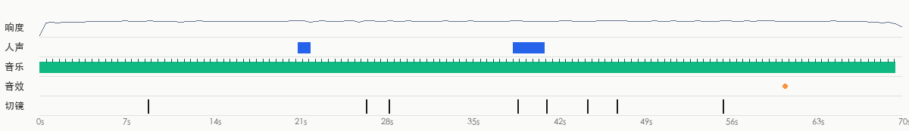

- ラウドネス -17.4 dBFS、ピーク -0.8 dBFS；音はカット点をまたいで連続しており、ポストプロダクションで全体に敷いたもの（カット点での背景音の変化 4.2dB、ショット内 2.9dB）
- 出所の判断：動画タイプ：BGM のみ（人の声なし） → 音楽は既存ライブラリ音楽（可能性が高い、要確認）；効果音は効果音ライブラリ／編集ソフトでポストプロダクション時に追加（可能性が高い、要確認）

**人の声**

- なし / ごくわずか

**BGM**

- テンポ：112.3 BPM（56.2/224.7 の可能性もあり）；キー B minor（信頼度 0.52）；尺の 99% を占める（0.0–69.5s）；展開の変化点 4.0s, 19.5s, 38.5s, 55.5s, 65.5s；終わり方 ends_with_video
- 編集とビート：カット点の 25% がビート上にある（ランダムなら約 26%）
- 出所：要確認（既存ライブラリ音楽 52%、AI 生成音楽 30%、既存の有名曲 17%）
  - 音楽は映像を下支えする BGM：一般的な動画の BGM は既存ライブラリから取られている可能性が高い（事前分布）
  - 音楽と動画が同時に終わる：尺に合わせて編集したかカスタム制作（どちらの出所もありうる、弱い根拠）
  - 動画形式の事前分布やエンディングの形といった弱い根拠のほかに、この音楽そのものに関する根拠はない（聴いて出所を特定できず、プラットフォームの音楽情報もない）：出所は要確認で、ここでは AI 生成の BGM とライブラリ音楽を区別できない
  - 確認方法：抖音／小紅書の元動画ページで音楽タグを見る：曲名が表示されれば既存曲；「@作者创作的原声」と表示されれば投稿者自身のアップロード（MV 系は AI 楽曲が多い）
  - 確認方法：汽水音乐／QQ 音乐の「听歌识曲」または ACRCloud で識別する：識別できれば既存曲
- 再現：元の曲は既存ライブラリ音楽の可能性が高い：BPM／ムード／キーでライブラリから類似曲を探すか、AI で近いスタイルのロイヤリティフリー曲を生成する

**効果音**（1）

| 音 | 試聴 | 種類 | 回数 | 出現位置 | 対応する映像 |
|---|---|---|---|---|---|
| F1 | [試聴](sfx/sfx_01.wav) | pop | 1 | 60.6s | — |

- 再現：まずそれぞれの音の「試聴」をクリックして聴く（単独で分離済みなので、人の声や BGM は聞こえない）。編集ソフトの効果音ライブラリで同じ種類の音を探し、「出現位置」のタイミングに合わせて各箇所に置く

- 分離した音声トラック：`stems/original.wav`（元の音声）、`stems/vocals.wav`（人の声のドライ音）、`stems/music.wav`（BGM + 環境音）、`stems/effects.wav`（効果音トラック）
<!--stems-->

## 不確定な点

- ショット #5（38.9–41.2s）：埋め込まれた動画クリップが実素材か生成されたものかは要確認
- ショット #6（41.2–44.5s）：コード／テンプレートレンダリングの信頼度は 55% にとどまり、次点は code_render
- 音声は AI が聴いていない（レビューは映像のみ）：人の声が実在の人か TTS かは波形から推定；効果音は単独で分離した効果音トラックから探したもので、種類は音の特徴から推定。「音声」で分離トラックと各効果音を試聴して確認できる
- BGM の出所は要確認：既存ライブラリ音楽の可能性が高い（52%）。確認方法は「音声」を参照

## 付録

### ショット別の根拠

各ショットは 2 つのブロックに分かれる：画面で見えるものと、ツールが推定した制作方法（判断根拠付き）；最後に再現用プロンプト。デフォルトでは折りたたまれているので、開いて確認してください。

#1 00:00.000–00:08.800 · コード／テンプレートレンダリング

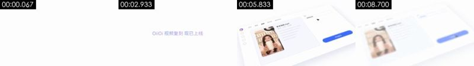

**画面で見えるもの**（画像と照らし合わせて確認できる）
- 映像：白背景；1–4 秒は中央に淡い紫の一行テキスト「OiiOi 视频复刻 现已上线」が単語ごとにフェードインしてからフェードアウト；4.4 秒に斜めに置かれたソフトウェア UI（左側のアイコンバー、上部の「创作 / 模板 / 复刻 / 素材库 / 我的作品」タブ、中央の女性配信者のサムネイル付き「参考视频.mp4」カード、右側の「模式」ドロップダウンと青い「开始复刻」ボタン）が右下から上へスライドインし、バーチャルカメラがゆっくりズームインしながら左へパン；6.5 秒にカーソルがドロップダウンを開き、メニューが 3 項目展開して「视频复刻」を選択；8 秒にカーソルが「开始复刻」ボタンへ移動し、次のショットへディゾルブ。
- テキストトラック（画面内のテキスト/middle）：Oiioi / OiiOi 视频复刻 / OiiOi 视频复刻现已上线 / 开始复刻
- テキストトラック（画面内のテキスト/middle）：d
- テキストトラック（画面内のテキスト/middle）：视频生成 / 我的作品 / 图片生成 / 视频复到
- テキストトラック（画面内のテキスト/middle）：复刻 / 模板 / 创作 / 参考视频.mp4
- ショット内のモーションの拍：4.53s
- [AI アシスタント 目視確認] 0–4.4 秒は純白の背景に淡い紫のスローガン一行が単語ごとにフェードイン・アウトするだけで、ほかの要素は一切ない
- [AI アシスタント 目視確認] 4.4 秒から UI 全体がパースの傾きを付けてスライドインする。エッジはシャープで、影は均一な柔らかいドロップシャドウ、質感のテクスチャはなく、CSS 3D パース変換をかけた平面 UI
- [AI アシスタント 目視確認] カーソルは等速で直線移動するベクターの矢印で、ドロップダウンメニュー「图片生成 / 视频生成 / 视频复刻」はイージング付きで展開し、選択項目がハイライトされる
- [AI アシスタント 目視確認] 左側のサムネイルの女性配信者は終始同じポーズで動かず、UI に貼り込んだ静止フレームであり、再生中の動画ではない

**ツールが推定した制作方法**（推定であり、目で見たものではない）
- 推定：コード／テンプレートレンダリング 80%、3D レンダリング 7%、画面録画／スクリーンショット 4%（fused_agent）
- 素材の出所：制作側でレンダリング
- 判断根拠（ツールによる測定。肉眼では分からないこともある）：
  - 隣接フレームの 50% が完全に同一で、局所的な要素だけが動いている（典型的なテンプレート／MG アニメーション、または静止後の局所的なモーション）
  - テクスチャはレンダリングの特徴を示す：フラットな色面 82%、ピクセルの 95% がわずか 5 色、水平・垂直の直線エッジ 9%
  - 背景のピクセルの 97% がフレーム間で完全に不変で、局所的な要素だけが動いている：2D 合成／コードモーションの特徴

- 再現：コードレンダリング：Remotion/HTML でテキストトラックとレイアウトに沿って再構築する。100% 制御可能で、生成モデルは不要

#2 00:08.800–00:26.567 · コード／テンプレートレンダリング；実素材を使用（ロゴ／ブランドマーク）

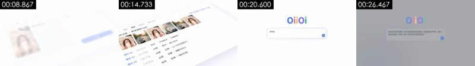

**画面で見えるもの**（画像と照らし合わせて確認できる）
- 映像：4 つのパートをディゾルブでつないだコードモーション：①白背景のスローガン「开启 一种 复刻爆款 的新方式」が単語ごとにフェードイン；②斜めに置かれた拉片分析 UI：上段に女性配信者のサムネイル 5 枚、その下にショット表（镜头01 0.0–2.1s 特写「开场钩子·主播举杯」、镜头02 2.1–4.8s 中景「卖点·倒入热水」、镜头03 近景「证明·12小时仍冒热气」、镜头04 全景「场景·通勤与办公」）、画面はゆっくりパン；③白背景のスローガン「逐帧拉片，读懂 每一个 爆款结构」；④白背景の中央にカラフルなワードマーク「OiiOi」、その下の角丸入力欄（紫青グラデーションの縁取り）に「问问OiiOi，想复刻什么？」と表示され、続いてプロンプト「参考这条带货视频，把产品换成我的保温杯，保留原片的节奏、镜头和卖点结构，再出一版广告片和三条投放素材」が一文字ずつ打ち込まれる。右下に青い送信ボタン；最後は画面全体がグレーに暗くなる。
- テキストトラック（画面内のテキスト/bottom）：开场钩子·主播举杯 / 特写 / 卖点·倒入热水 / 证明·12小时仍冒热气
- テキストトラック（画面内のテキスト/bottom）：特写 / 卖点·倒入热水 / 中景 / 证明·12小时仍冒热气
- テキストトラック（画面内のテキスト/bottom）：0.0-2.1s / 近景 / 场景·通勤与办公 / 镜头01
- テキストトラック（画面内のテキスト/bottom）：镜头01 / 2.1-4.8s / ·限时价格 / 02
- [AI アシスタント 目視確認] 9–12 秒は白背景に単語ごとに現れるスローガン「开启 一种 复刻爆款 的新方式」だけで、キーワードの色が変わる
- [AI アシスタント 目視確認] 12.9–15.1 秒は斜めに置かれた「拉片分析」の表が丸ごとパンする。表の行（镜头01–04、時間帯、ショットサイズ、内容）は最初からすべて並んでおり、実際のスクロールや読み込みはない
- [AI アシスタント 目視確認] 16.2–18.8 秒は再び白背景のスローガン「逐帧拉片，读懂 每一个 爆款结构」
- [AI アシスタント 目視確認] 19 秒からはカラフルな OiiOi ワードマークの下にある入力欄の枠がカラフルなグラデーションの縁取りで、プロンプトが均一な速度で一文字ずつ打ち込まれる。タイプライターアニメーションのよう

**ツールが推定した制作方法**（推定であり、目で見たものではない）
- 推定：コード／テンプレートレンダリング 88%、画面録画／スクリーンショット 4%、2D アニメーション 2%（fused_agent）
- 素材の出所：混合（実素材を含む）：ロゴ／ブランドマーク
- 判断根拠（ツールによる測定。肉眼では分からないこともある）：
  - 隣接フレームの 76% が完全に同一で、局所的な要素だけが動いている（典型的なテンプレート／MG アニメーション、または静止後の局所的なモーション）
  - 明るい背景上の暗い部分はほぼすべて細線／細かい点（滑らかなグラデーションは 17% のみ）：線画、生成的なライン、またはドット状のグラフィックで、陰影のある実写や 3D の表面ではない
  - テクスチャはレンダリングの特徴を示す：フラットな色面 89%、ピクセルの 95% がわずか 1 色、水平・垂直の直線エッジ 25%
  - 背景のピクセルの 99% がフレーム間で完全に不変で、局所的な要素だけが動いている：2D 合成／コードモーションの特徴

- 再現：コードレンダリング：Remotion/HTML でテキストトラックとレイアウトに沿って再構築する。100% 制御可能で、生成モデルは不要；ユーザーから実素材の提供が必要：ロゴ／ブランドマーク（画面の一部）

#3 00:26.567–00:28.367 · コード／テンプレートレンダリング

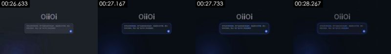

**画面で見えるもの**（画像と照らし合わせて確認できる）
- 映像：黒に近いダークネイビーの背景に細いグリッド線；中央にグレーがかった白の「OiiOi」ワードマーク、その下の角丸入力欄には完成したプロンプトが入っており、枠はグレーから光る青い縁取りに変わる。右下に青い送信ボタン；左下の青い放射状グラデーションのグローがゆっくり明滅；画面は固定で、1.8 秒後にディゾルブで暗いパートへ入る。
- テキストトラック（画面内のテキスト/middle）：Oiioi
- テキストトラック（画面内のテキスト/middle）：参考这条带货视频，把产品换成我的保温杯，保留原片的节奏、镜头 / 和卖点结构，再出一版广告片和三条投放素材
- [AI アシスタント 目視確認] 前のショットの白背景の入力欄がまるごとダークネイビーの暗いバージョンに置き換わり、レイアウトはまったく同じで、配色とグローだけが変わっている
- [AI アシスタント 目視確認] 左下の青い放射状グラデーションのグローがゆっくり明滅し、背景は細いグリッド線で、表面の質感は一切ない
- [AI アシスタント 目視確認] 入力欄の枠の青い発光が暗から明へ変化し、送信ボタンを押した後の状態切り替えのように見える

**ツールが推定した制作方法**（推定であり、目で見たものではない）
- 推定：コード／テンプレートレンダリング 86%、3D レンダリング 6%、2D アニメーション 2%（fused_agent）
- 素材の出所：制作側でレンダリング
- 判断根拠（ツールによる測定。肉眼では分からないこともある）：
  - 隣接フレームの 90% が完全に同一で、局所的な要素だけが動いている（典型的なテンプレート／MG アニメーション、または静止後の局所的なモーション）
  - 暗い背景上の明部はほぼすべて細かい輝点／細線（明部の滑らかなグラデーションは 23% のみ、明るいピクセル 100 個あたり輝度ピーク 21 個）：パーティクル／点群／ワイヤーフレーム系のグラフィックで、陰影のグラデーションがある実写、3D の表面、AI 映像ではない
  - テクスチャはレンダリングの特徴を示す：フラットな色面 82%、ピクセルの 95% がわずか 5 色、水平・垂直の直線エッジ 34%
  - 背景のピクセルの 99% がフレーム間で完全に不変で、局所的な要素だけが動いている：2D 合成／コードモーションの特徴

- 再現：コードレンダリング：Remotion/HTML でテキストトラックとレイアウトに沿って再構築する。100% 制御可能で、生成モデルは不要

#4 00:28.367–00:38.867 · コード／テンプレートレンダリング

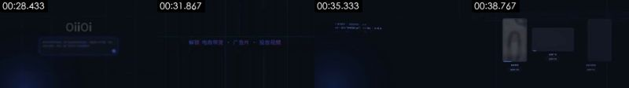

**画面で見えるもの**（画像と照らし合わせて確認できる）
- 映像：黒に近いダークネイビーの背景に細いグリッド線；28.4–30 秒に数十個の淡い紫の小さな文字が画面の四方から中央へ飛んできて、一行の「解锁 电商带货 · 广告片 · 投放视频」を形作る（キーワードは青紫）；31.9 秒にスローガンがフェードアウトし、32.9 秒に「实时生成 分镜 与 素材」が単語ごとに現れ、その下を細い線が左から右へ走る；35 秒に左下に等幅フォントのコードブロックが現れ、「# 复刻脚本 · 保温杯带货 · 9:16 / ref = 拉片(“参考视频.mp4”) 5 镜头·快-慢-快 / shot_01…shot_05 = Shot(t=…, 景别=…, 内容=…) / generate(ref.结构, 产品=my_cup, 节奏=ref.节奏) / variants([“电商带货”, “品牌广告”, “信息流投放”])」が一行ずつ打ち込まれ、左下の青いグローが明滅する；37.6 秒にコードブロックが上へ移動しながらフェードアウトし、角丸カード 3 枚のワイヤーフレームが下から上へ展開する。
- テキストトラック（画面内のテキスト/bottom）：解锁 / 海出 / 地产品
- テキストトラック（画面内のテキスト/bottom）：电商带货 / 生成中0% / 信息流投放 / 生成中33%
- テキストトラック（画面内のテキスト/middle）：电商带货 / 复刻脚本·保温杯带货·9:16 / 复刻脚本·保温杯带货·9：16 / ref=拉片（“参考视频.mp4"）5镜头·快-慢-快
- テキストトラック（画面内のテキスト/middle）：保留 / 电商带货 / 广告片 / 解锁电商带货·广告片·投放视频
- [AI アシスタント 目視確認] ダークネイビーのグリッド背景に散らばった小さな文字（电商带货、广告片、投放视频、解锁…）が四方から中央へ飛んで一行に並ぶ。字形は終始くっきりしており、テキストレイヤーの移動アニメーション
- [AI アシスタント 目視確認] 33 秒に「实时生成 分镜 与 素材」が単語ごとに現れ、横方向に走る光のラインが付く
- [AI アシスタント 目視確認] 35 秒から左下に等幅フォントのコードブロック（复刻脚本·保温杯带货·9:16、shot_01=Shot(...)、generate(...)、variants([...])）が一行ずつ打ち込まれる
- [AI アシスタント 目視確認] 38 秒に空のカード 3 枚のワイヤーフレームが下から展開し、次のショットの生成カードへの準備になっている

**ツールが推定した制作方法**（推定であり、目で見たものではない）
- 推定：コード／テンプレートレンダリング 87%、3D レンダリング 5%、2D アニメーション 2%（fused_agent）
- 素材の出所：制作側でレンダリング
- 判断根拠（ツールによる測定。肉眼では分からないこともある）：
  - 暗い背景上の明部はほぼすべて細かい輝点／細線（明部の滑らかなグラデーションは 9% のみ、明るいピクセル 100 個あたり輝度ピーク 24 個）：パーティクル／点群／ワイヤーフレーム系のグラフィックで、陰影のグラデーションがある実写、3D の表面、AI 映像ではない
  - テクスチャはレンダリングの特徴を示す：フラットな色面 86%、ピクセルの 95% がわずか 2 色、水平・垂直の直線エッジ 19%
  - 背景のピクセルの 97% がフレーム間で完全に不変で、局所的な要素だけが動いている：2D 合成／コードモーションの特徴
  - フレームごとの鮮明度が周期的に上下する（周期 None フレーム、相関 0.00）が、重複フレームはない：フレーム補間／フレームレート変換の可能性もあれば、単に再圧縮で残ったリズムの可能性もある（プラットフォームの透かしを取り除いたトランスコードファイルも同様になる）。この一点だけでは AI とは断定できない

- 再現：コードレンダリング：Remotion/HTML でテキストトラックとレイアウトに沿って再構築する。100% 制御可能で、生成モデルは不要

#5 00:38.867–00:41.200 · コード／テンプレートレンダリング

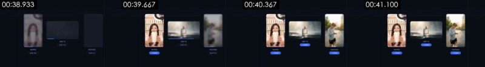

**画面で見えるもの**（画像と照らし合わせて確認できる）
- 映像：濃紺のグリッド背景に3枚のカードが横並び。左の縦長カード「电商带货」は保温ボトルを掲げる女性配信者、中央の横長カード「品牌广告」は霧の立つ水面に置かれたガラスの香水瓶、右の縦長カード「信息流投放」は逆光の街路でスマートウォッチを見るランニング中の男性。38.9 秒の時点では3枚ともぼやけており、下に「生成中 xx%」と青い進捗バーが表示される。左のカードが最初に鮮明になって「✓ 已完成」のピル型ボタンに切り替わり、中央、右の順に続いて、41 秒で3枚すべてが完了する。画面は固定。
- テキストトラック（画面内のテキスト/bottom）：电商带货 / 信息流投放 / 生成中73% / 生成中19%
- テキストトラック（画面内のテキスト/bottom）：批量投放版本 / 在同一套爆款结构上，按投放需求生成多个版本
- テキストトラック（画面内のテキスト/bottom）：生成数量
- テキストトラック（画面内のテキスト/middle）：品牌广告 / 生成中46% / 生成中86% / 促单
- [AI アシスタント 目視確認] 角丸のカード3枚が同じ濃紺のグリッド背景に並び、カード下の「生成中 0% → 33% → 83%」の数字が進み、青い進捗バーが伸びたあと、青いピル型の「✓ 已完成」に切り替わる。UI のモーション
- [AI アシスタント 目視確認] カード内の映像はぼやけた状態から鮮明になり（ぼかしフェードイン）、鮮明になった後は人物のポーズが変わらない。カードに貼り込んだ静止フレームで、再生中の動画ではない
- [AI アシスタント 目視確認] カード内の映像は AI 生成らしい作風：女性配信者は前後のショットと同じ顔、香水瓶は水面の霧の中に立ち、ランニング中の男性は逆光の街路で時計を見ている。光が均一すぎて完璧すぎる
- [AI アシスタント 目視確認] カード自体に厚みや質感がなく、平面的な影があるだけで、3D レンダリングではない

**ツールが推定した制作方法**（推定であり、目で見たものではない）
- 推定：コード／テンプレートレンダリング 58%、3D レンダリング 23%、AI 生成動画 9%（fused_agent）
- 素材の出所：制作側でレンダリング；実素材かどうか要確認：埋め込み動画クリップ
- 判断根拠（ツールによる測定。肉眼では分からないこともある）：
  - テクスチャはレンダリングの特徴を示す：フラットな色面 54%、ピクセルの 95% がわずか 92 色、水平・垂直の直線エッジ 35%

- 再現：コードレンダリング：Remotion/HTML でテキストトラックとレイアウトに沿って再構築する。100% 制御可能で、生成モデルは不要

#6 00:41.200–00:44.533 · コード／テンプレートレンダリング

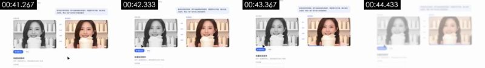

**画面で見えるもの**（画像と照らし合わせて確認できる）
- 映像：白背景の UI。左上に「OiiOi 视频复刻 · 保温杯带货」、右上の薄紫の吹き出しにユーザーのプロンプト。中央に左右2つの動画枠があり、左が「参考视频」（モノクロ）、右が「复刻成片」（カラー）で、どちらも保温ボトルを掲げて微笑む女性配信者。中央には青紫の小さなラベル「钩子 / 卖点 / 证明 / 促单」が縦に4つ並び、左右の構成を一対一で対応づけている。左下に青い「▶ 播放对比」ボタンと「导出」ボタン、その下に「批量投放版本」フォームの冒頭がのぞく。カーソルが「播放对比」に移動してクリックし、右枠の下の進捗バーが右へ進む。ページ全体がゆっくりズームイン。44 秒で画面がぼやけてフェードアウトする。
- テキストトラック（画面内のテキスト/bottom）：播放对比 / 批量投放版本
- テキストトラック（画面内のテキスト/bottom）：批量投放版本 / 在同一套爆款结构上，按投放需求生成多个版本 / 生成数量
- テキストトラック（画面内のテキスト/bottom）：生成数量
- テキストトラック（画面内のテキスト/middle）：参考视频 / 复刻成片 / 钩子
- [AI アシスタント 目視確認] UI のページ全体がゆっくり拡大すると同時に、41.2–41.7 秒にカーソルが「播放对比」ボタンへ移動する。画面内に独立して動く要素があり、1枚の画像をズーム・パンしているだけではない
- [AI アシスタント 目視確認] 「复刻成片」の下の青い進捗バーがショット内で伸び続ける
- [AI アシスタント 目視確認] 左右の動画枠内の女性配信者は3秒間、表情もポーズもまったく変わらず、静止フレームのサムネイル。左側は「元動画」に見せるため彩度を落としている
- [AI アシスタント 目視確認] UI のレイアウト、フォント、配色がショット #1、#8 と完全に一致しており、同じコードで描いた UI で、画面録画ではない

**ツールが推定した制作方法**（推定であり、目で見たものではない）
- 推定：静止画 + ズーム・パン 32%、コード／テンプレートレンダリング 31%、2D アニメーション 16%（fused_agent）
- 素材の出所：制作側でレンダリング
- 判断根拠（ツールによる測定。肉眼では分からないこともある）：
  - フレーム全体が単一の剛体変換で動く（フィッティングのインライア 100%、残差 0.08px、局所的な動きなし）→ 静止画のズーム・パン：拡大縮小 -0.1%/s、平行移動 3px/s
  - テクスチャはレンダリングの特徴を示す：フラットな色面 52%、ピクセルの 95% がわずか 53 色、水平・垂直の直線エッジ 33%

- 再現：コードレンダリング：Remotion/HTML でテキストトラックとレイアウトに沿って再構築する。100% 制御可能で、生成モデルは不要

#7 00:44.533–00:46.933 · コード／テンプレートレンダリング

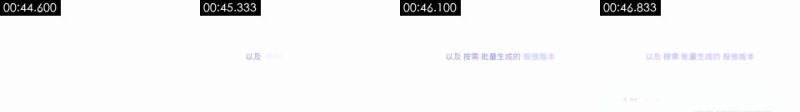

**画面で見えるもの**（画像と照らし合わせて確認できる）
- 映像：真っ白な背景の中央に淡い紫の文字が1行「以及 按需 批量生成的 投放版本」。左から右へ単語ごとにフェードインし、キーワードはやや濃い色。2.4 秒後にディゾルブで次のショットの UI へ移る。
- テキストトラック（画面内のテキスト/middle）：以及 / 以及按需 / 以及按需批量生成的投放版本
- [AI アシスタント 目視確認] 真っ白な背景に淡い紫の文字が1行あるだけで、キーワードが1つずつフェードインする
- [AI アシスタント 目視確認] ほかの図形は一切なく、終わりに右下へ次のショットの UI がうっすら現れる

**ツールが推定した制作方法**（推定であり、目で見たものではない）
- 推定：コード／テンプレートレンダリング 90%、静止フレームの保持 7%、画面録画／スクリーンショット 3%（fused_agent）
- 素材の出所：制作側でレンダリング
- 判断根拠（ツールによる測定。肉眼では分からないこともある）：
  - 画面はほぼ完全に静止：隣接フレームの 96% がピクセル単位で同一、最初と最後のフレームの差は 0.81
  - テクスチャはレンダリングの特徴を示す：フラットな色面 96%、ピクセルの 95% がわずか 1 色、水平・垂直の直線エッジ 17%

- 再現：コードレンダリング：Remotion/HTML でテキストトラックとレイアウトに沿って再構築する。100% 制御可能で、生成モデルは不要

#8 00:46.933–00:55.500 · コード／テンプレートレンダリング

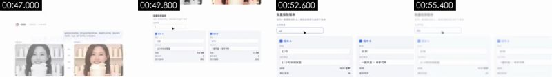

**画面で見えるもの**（画像と照らし合わせて確認できる）
- 映像：白背景の UI。最初は参考视频 / 复刻成片の比較ページで、続いてページ全体が上へスクロールする。上部に「批量投放版本」の見出しと説明文「在同一套爆款结构上，按投放需求生成多个版本」、その下に「生成数量」の入力欄があり、カーソルがクリックして数字を 3、さらに 12 に変更する。下に2列のバージョンカード「版本A / 版本B …」が現れ、各カードには青い小さな四角付きの見出しと項目がある：尺 15秒 / 30秒、主な訴求ポイント「12小时长效保温」「一键开盖·单手可喝」、画角 9:16竖屏 / 1:1方屏、素材本数 2 / 6、予測完全視聴率 31% / 38%。数字と文字が項目ごとにフェードインして埋まっていく。55 秒で画面がフェードアウトして白くなる。
- テキストトラック（画面内のテキスト/bottom）：播放对比 / 导出 / 生成数量 / 主打卖点
- テキストトラック（画面内のテキスト/bottom）：批量投放版本 / 在同一套爆款结构上，按投放需求生成多个版本 / 3 / 9:16竖屏
- テキストトラック（画面内のテキスト/bottom）：生成数量 / 3 / 版本A / 版本B
- テキストトラック（画面内のテキスト/bottom）：15秒 / 30秒
- ショット内のモーションの拍：51.33s
- [AI アシスタント 目視確認] 冒頭はショット #6 と同じページで、その後ページ全体が「批量投放版本」フォームまで滑らかに上スクロールする。スクロールはイーズイン・イーズアウトのカーブで、実際のブラウザのようなスクロールバーや段階的なカクつきはない
- [AI アシスタント 目視確認] カーソルは「生成数量」入力欄にあり、数字が 3 から 12 に変わると、バージョンカードの項目（尺、主な訴求ポイント、画角、素材本数、予測完全視聴率）が順に埋まっていく
- [AI アシスタント 目視確認] 両側のサムネイルの女性配信者は静止したまま
- [AI アシスタント 目視確認] すべての文字のエッジがきれいで、画面のモアレや圧縮ブロックがなく、UI のスタイルは前のコードレンダリングのページと一致している

**ツールが推定した制作方法**（推定であり、目で見たものではない）
- 推定：コード／テンプレートレンダリング 75%、画面録画／スクリーンショット 16%、2D アニメーション 2%（fused_agent）
- 素材の出所：制作側でレンダリング
- 判断根拠（ツールによる測定。肉眼では分からないこともある）：
  - 隣接フレームの 58% が完全に同一で、局所的な要素だけが動いている（典型的なテンプレート／MG アニメーション、または静止後の局所的なモーション）
  - 明るい背景上の暗い部分はほぼすべて細線／細かい点（滑らかなグラデーションは 17% のみ）：線画、生成的なライン、またはドット状のグラフィックで、陰影のある実写や 3D の表面ではない
  - テクスチャはレンダリングの特徴を示す：フラットな色面 65%、ピクセルの 95% がわずか 6 色、水平・垂直の直線エッジ 32%
  - 背景のピクセルの 98% がフレーム間で完全に不変で、局所的な要素だけが動いている：2D 合成／コードモーションの特徴

- 再現：コードレンダリング：Remotion/HTML でテキストトラックとレイアウトに沿って再構築する。100% 制御可能で、生成モデルは不要

#9 00:55.500–01:10.000 · コード／テンプレートレンダリング；実素材を使用（ロゴ／ブランドマーク）

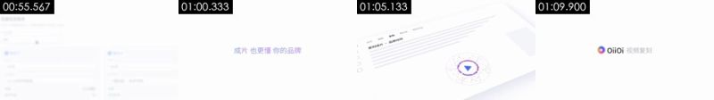

**画面で見えるもの**（画像と照らし合わせて確認できる）
- 映像：真っ白な背景。55.5–58 秒に淡い紫の文字「现在， 复刻任何爆款 都更简单」が単語ごとに現れてからフェードアウトし、58.5 秒に「成片 也更懂 你的品牌」が同じように現れる。60.3 秒に赤・ピンク・紫・青の色とりどりの点（ソフトな光をまとう）が数百個、中心から四方へ弾けて画面を埋め尽くし、61.5 秒に引き戻されて集まり、62.7 秒に細かな色点で縁取られたリングにまとまる。中央には青い三角の再生ボタン。63.9 秒にカメラが引き、リングは斜めに置かれた UI の上に収まる（上部に「复刻成片 · 品牌动效」、左側にアイコンバー、グレーのプレースホルダーの文字行がいくつか）。UI はゆっくり横へ流れる。67.5 秒に UI がフェードアウトし、68.5 秒に白背景の中央へ OiiOi のカラフルなグラデーションリングのロゴ + 黒の「OiiOi」+ グレーの「视频复刻」が現れ、最後まで静止する。
- テキストトラック（画面内のテキスト/middle）：现在， / 现在，复刻任何爆款都更简单 / 成片 / 成片也更懂
- テキストトラック（画面内のテキスト/middle）：我的作品 / 紫材库 / 复刻 / 模板
- テキストトラック（画面内のテキスト/middle）：复刻 / 模板 / 创作 / 复刻成片·品牌动效
- テキストトラック（画面内のテキスト/middle）：我的作品 / 我的作
- [AI アシスタント 目視確認] 白背景に淡い紫のキャッチコピーが単語ごとに現れ、フェードアウトする
- [AI アシスタント 目視確認] 60.3–62 秒に赤・ピンク・紫・青の点が数百個、中心から弾けて画面を埋め尽くし、小さな点でできたリングへ収束する。点はソフトな光をまとった単色の円で、立体感も陰影もない。パーティクルのモーション
- [AI アシスタント 目視確認] リングの中央に青い三角の再生ボタンがあり、その後斜めに置かれた UI「复刻成片 · 品牌动效」の中へ縮小していく。UI はショット #1 と同じパースのスタイル
- [AI アシスタント 目視確認] 終わりに OiiOi のグラデーションリングのロゴとグレーの「视频复刻」の文字が順にフェードインする

**ツールが推定した制作方法**（推定であり、目で見たものではない）
- 推定：コード／テンプレートレンダリング 88%、3D レンダリング 4%、2D アニメーション 2%（fused_agent）
- 素材の出所：混合（実素材を含む）：ロゴ／ブランドマーク
- 判断根拠（ツールによる測定。肉眼では分からないこともある）：
  - 明るい背景上の暗い部分はほぼすべて細線／細かい点（滑らかなグラデーションは 14% のみ）：線画、生成的なライン、またはドット状のグラフィックで、陰影のある実写や 3D の表面ではない
  - テクスチャはレンダリングの特徴を示す：フラットな色面 90%、ピクセルの 95% がわずか 1 色、水平・垂直の直線エッジ 10%
  - フレームごとの鮮明度が周期的に上下する（周期 2 フレーム、相関 0.24）が、重複フレームはない：フレーム補間／フレームレート変換の可能性もあれば、単に再圧縮で残ったリズムの可能性もある（プラットフォームの透かしを取り除いたトランスコードファイルも同様になる）。この一点だけでは AI とは断定できない
  - 画面にほぼ色がなく（彩度 0.01）、1 色しか使っていない：UI／ドキュメント系の平面的な画面で、陰影のある 3D レンダリングではない

- 再現：コードレンダリング：Remotion/HTML でテキストトラックとレイアウトに沿って再構築する。100% 制御可能で、生成モデルは不要；ユーザーから実素材の提供が必要：ロゴ／ブランドマーク（画面の一部）

### メタデータの手がかり

- エンコーダー：`Lavf61.7.100`

### 注記

- 決定論的な検証は「動いているか、画像全体のズーム・パンか、レンダリングのテクスチャか、24→30 のフレームレート変換か」については信頼性が高い一方、実写 / AI / 3D の区別は目視（画像を読めるモデルや AI アシスタントによる確認）に頼るため、できればご自身でもスクリーンショットと照らし合わせて確認してください。
- メタデータはプラットフォームでのトランスコード時に消されることが多く、欠けていても存在しなかったとは限りません。
- 完全なデータは `breakdown.json` にあります。モデルに読ませるための分解パッケージは `REEL.md` から始まります。
