# 这条视频是怎么做的：v11_tiktok_original.mp4

**一句话**：一条 20 秒的手机第一人称实拍，用便携榨汁杯现场做一杯蛋白奶昔，靠「先下结论、再一步一刀演示到能喝」把卖点讲完。
**怎么做的**：混合制作：实拍 100%

- 0:20 · 竖屏 9:16 · 14 个镜头，平均 1.5 秒一个
- 判断可靠度 76%，依据：工具测量 + AI 助手看图复核 14 镜
- ⚠️ 有 1 处拿不准，见「不确定点」

<!--mix-->

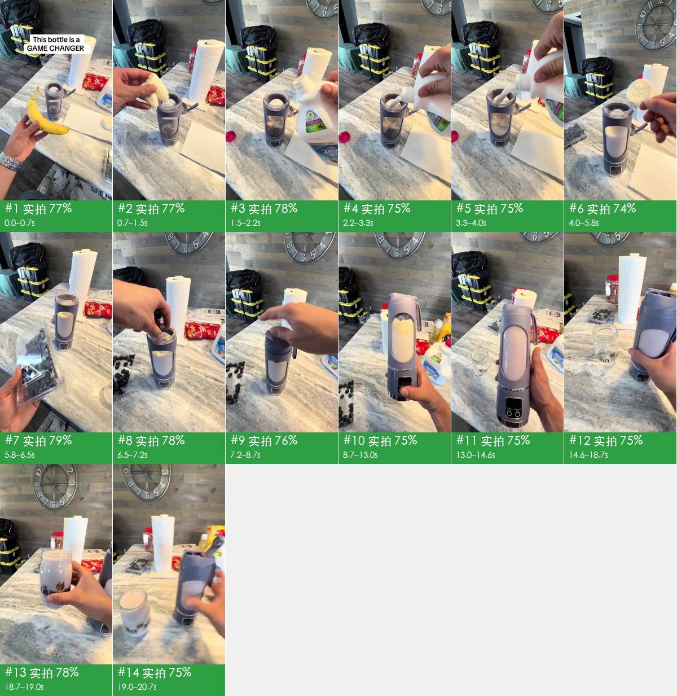

## 核心看点

- **开头怎么抓人**：0–0.7 秒：画面一出来就是手里的香蕉和台面上的榨汁杯，顶部标题直接下结论「This bottle is a GAME CHANGER」，观众先知道要看的是什么、再想知道凭什么。
- 0.7–8.7 秒每加一样食材就切一刀（香蕉、杏仁奶、蛋白粉、蓝莓、盖盖子），每刀不到 2 秒、口播只报食材名，8 秒交代完配方，观众不会走神。
- 8.7–13 秒把杯子拿在手里正对镜头启动，底座屏幕从 45 倒数、液体由白变紫：卖点（无线、能打碎水果）直接拍出来，不靠嘴说。
- 14.6–20.7 秒给两种喝法：先倒进玻璃罐，再拨开饮嘴直接对瓶喝，最后落在「做完就能带走」的便携卖点上。

## 一眼看懂：画面、包装、声音三层

短视频都可以拆成三层：底下是画面本身，上面叠字幕、花字、贴纸，再配上声音。复刻时一层一层做。

| 层 | 这条视频里是什么 | 怎么做 | 细节 |
|---|---|---|---|
| **画面**（底层） | 实拍 14 镜 | 分 1 个场景拍 | 「自己复刻」 |
| **包装**（叠在画面上） | 文字、标题 | 剪辑软件里加：字幕、花字、贴纸照时间轴摆 | 「剪辑包装层」 |
| **声音** | 人声（真人录音） | 人声：自己录 | 「声音」 |

## 内容与结构

- 下面的叙事线来自逐镜看图；台词没有单独整理，字幕原文见「剪辑包装层」

**叙事线**

复刻时保留这条线：每一步的顺序和作用照搬，讲的那一点换成自己的案例、数据和素材，就不只是换个主角。

| 时间 | 镜头 | 作用 | 在讲什么 |
|---|---|---|---|
| 0.0–0.7s | #1 | 抓注意 | 开头直接亮出产品并下结论式标题，先给评价再演示 |
| 0.7–8.7s | #2–#9 | 补信息 | 第一步放主料，一个动作交代一种食材 → 第二步加液体，拿起来就倒 → 倒奶过程，用跳切压缩等待 → 倒奶收尾，跳切到下一步 → 第三步加蛋白粉，点出这是健身奶昔 →（共 8 点，逐镜见「分镜表」） |
| 8.7–13.0s | #10 | 给证据 | 在手里直接启动，让观众看到屏幕倒计时和液体变色，证明真能打 |
| 13.0–14.6s | #11 | 给结论 | 揭晓结果：几十秒就是一杯成品 |
| 14.6–18.7s | #12 | 补信息 | 喝法一：倒进杯子 |
| 18.7–19.0s | #13 | 给证据 | 展示倒出来的成品，满满一杯 |
| 19.0–20.7s | #14 | 给结论 | 喝法二：直接对瓶喝，落在便携这个卖点上 |

## 分镜表

「画面」「运镜」「叠加层」是画面里看得到的；「制作方式」「素材来源」是工具推断的，依据见附录逐镜取证。

| # | 截图 | 时间 | 时长 | 在讲什么 | 画面 | 运镜 | 叠加层 | 制作方式（推断） | 素材来源（推断） | 复刻 |
|---|---|---|---|---|---|---|---|---|---|---|
| 1 | 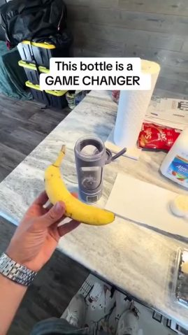 | 0:00.0 | 0.7s | 抓注意：开头直接亮出产品并下结论式标题，先给评价再演示 | 第一人称略俯拍：右手举着一根香蕉，前方大理石台面上立着灰紫色便携榨汁杯、纸巾卷、… | 平滑运镜 | 文字、标题 | 实拍 77% | 实拍视频素材 | 实拍 · S1 |
| 2 | 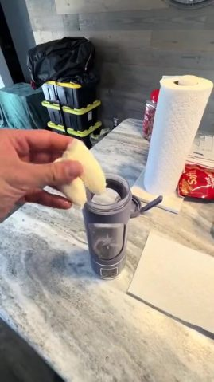 | 0:00.7 | 0.8s | 补信息：第一步放主料，一个动作交代一种食材 | 第一人称略俯拍：手把掰开的香蕉块丢进榨汁杯后向左移出画面，杯子立在大理石台面上，… | 平滑运镜 | — | 实拍 77% | 实拍视频素材 | 实拍 · S1 |
| 3 | 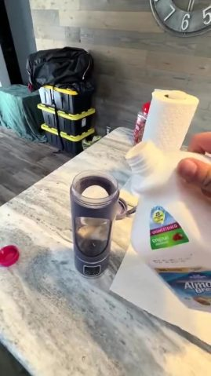 | 0:01.5 | 0.7s | 补信息：第二步加液体，拿起来就倒 | 第一人称略俯拍：右手从画面右侧拿起一瓶 Almond Breeze 杏仁奶，倾斜… | 平滑运镜 | — | 实拍 78% | 实拍视频素材 | 实拍 · S1 |
| 4 | 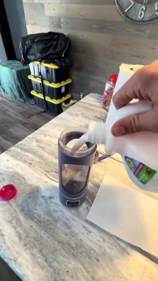 | 0:02.2 | 1.1s | 补信息：倒奶过程，用跳切压缩等待 | 同一角度继续：杏仁奶从瓶口连续倒进榨汁杯，杯内液面上升，手扶瓶身，手机轻晃。 | 平滑运镜 | — | 实拍 75% | 实拍视频素材 | 实拍 · S1 |
| 5 | 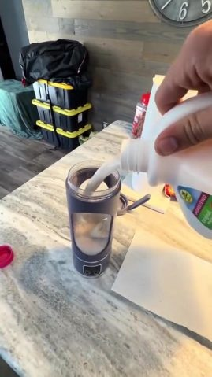 | 0:03.3 | 0.8s | 补信息：倒奶收尾，跳切到下一步 | 倒奶的最后一段：奶流变细，杯子接近半满，机位基本不变。 | 平滑运镜 | — | 实拍 75% | 实拍视频素材 | 实拍 · S1 |
| 6 | 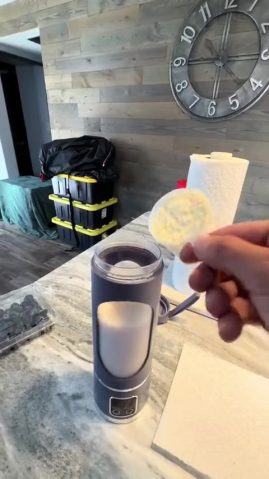 | 0:04.0 | 1.7s | 补信息：第三步加蛋白粉，点出这是健身奶昔 | 机位后退、视角更平：右手拿量勺把白色蛋白粉倒进榨汁杯，背景木纹墙上的大挂钟完整入… | 平滑运镜 | — | 实拍 74% | 实拍视频素材 | 实拍 · S1 |
| 7 | 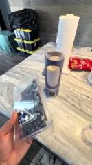 | 0:05.8 | 0.8s | 补信息：第四步加水果，先亮出食材 | 第一人称略俯拍：左手举起一盒蓝莓在镜头前转动展示，背景是装着奶和蛋白粉的榨汁杯、… | 平滑运镜 | — | 实拍 79% | 实拍视频素材 | 实拍 · S1 |
| 8 | 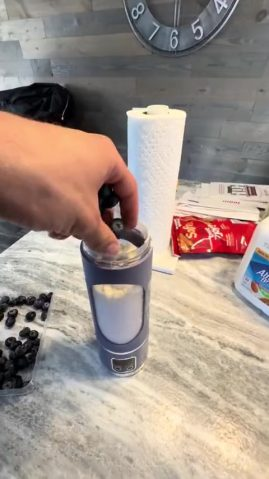 | 0:06.5 | 0.7s | 补信息：把水果放进去，最后一样食材 | 第一人称略俯拍：右手从上方把一小把蓝莓放进榨汁杯，台面左侧是倒出来的蓝莓，右侧露… | 平滑运镜 | — | 实拍 78% | 实拍视频素材 | 实拍 · S1 |
| 9 | 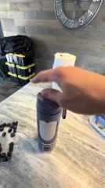 | 0:07.2 | 1.5s | 补信息：盖盖子，准备进入核心演示 | 第一人称略俯拍：右手把翻盖式杯盖盖上并按紧，掀开的饮嘴翻下扣好，左侧是蓝莓，右侧… | 平滑运镜 | — | 实拍 76% | 实拍视频素材 | 实拍 · S1 |
| 10 | 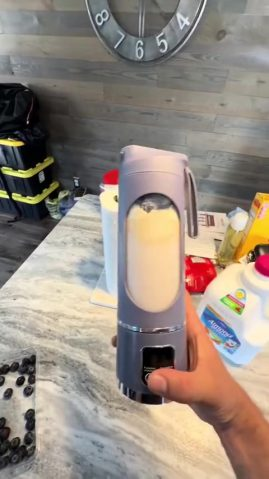 | 0:08.7 | 4.2s | 给证据：在手里直接启动，让观众看到屏幕倒计时和液体变色，证明真能打 | 第一人称：右手把榨汁杯拿起来正对镜头，拇指按下底座开关，杯内高速搅拌，LED 屏… | 平滑运镜 | — | 实拍 75% | 实拍视频素材 | 实拍 · S1 |
| 11 | 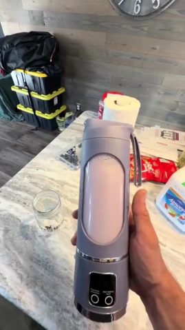 | 0:13.0 | 1.6s | 给结论：揭晓结果：几十秒就是一杯成品 | 第一人称：右手举着搅拌好的榨汁杯展示成品颜色，台面上放着一个空玻璃罐等着倒。 | 固定（主体在动） | — | 实拍 75% | 实拍视频素材 | 实拍 · S1 |
| 12 | 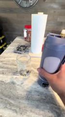 | 0:14.6 | 4.1s | 补信息：喝法一：倒进杯子 | 第一人称略俯拍：右手把榨汁杯翻过来，把浅紫色奶昔倒进台面上印 logo 的梅森玻… | 平滑运镜 | — | 实拍 75% | 实拍视频素材 | 实拍 · S1 |
| 13 | 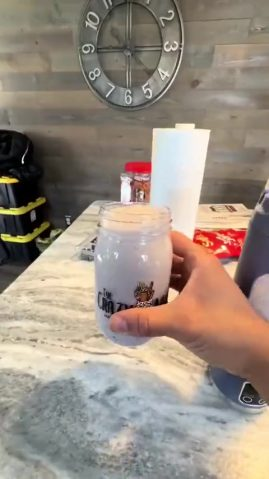 | 0:18.7 | 0.4s | 给证据：展示倒出来的成品，满满一杯 | 短镜：手把装满奶昔的玻璃罐拿起来晃一下展示，再放回台面，榨汁杯在右侧。 | 平滑运镜 | — | 实拍 78% | 实拍视频素材 | 实拍 · S1 |
| 14 | 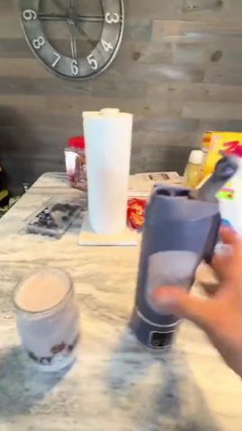 | 0:19.0 | 1.7s | 给结论：喝法二：直接对瓶喝，落在便携这个卖点上 | 第一人称：右手拿起榨汁杯凑近镜头，拇指拨开顶部饮嘴，展示可以直接对嘴喝；背景是挂… | 平滑运镜 | — | 实拍 75% | 实拍视频素材 | 实拍 · S1 |

## 自己复刻：按这个顺序做

复刻的是做法和节奏，不是照抄画面。

1. **定内容**：照「内容与结构」的叙事线写自己的脚本
2. **拍摄**：1 个场景、2 个机位，见下方「拍摄」
3. **剪辑**：见下方「剪辑」
4. **包装**：字幕文件 `packaging/overlays.ass` 可以直接导入剪辑软件；样式和时间轴见「剪辑包装层」
5. **声音**：见「声音」，每处音效都能先试听
6. **对照检查**：成片和原片并排看一遍：镜头长短、字幕位置、音乐起落对不对得上

### 拍摄

同一场景的镜头集中拍完再换场景；场景内先拍大景别再拍特写，不用重新布光。每条前后多留约 1s 余量。

**S1**：镜头 #1–#14（成片 20.7s）；家庭厨房岛台，浅灰大理石纹台面，背后灰色木纹墙挂着大号金属罗马数字风挂钟，墙角堆着黄黑收纳箱，台面上有纸巾卷、红色零食袋、Almond Breeze 杏仁奶
- 布光：不布灯：白天窗光 + 室内顶灯，台面反光做补光
- 机位 近景 · 移动机位（稳定器/手持平移） · 固定/拉/推/摇/移：镜头 #1–#10、#12–#14，成片 19.07s，建议拍 45.1s
- 机位 近景 · 固定机位（三脚架/支架/放在桌上） · 固定：镜头 #11，成片 1.63s，建议拍 3.6s

### 剪辑

- 按「分镜表」的顺序和时长剪
- 手法：按步骤跳切：每加一样食材一刀，只留动作最关键的不到 2 秒；倒奶一段切成三刀压缩时长；搅拌和倒杯给 4 秒长镜头
- 节奏：每分钟 37.7 刀，实拍镜头平均 1.48s；机位/场景 6 个；同机位跳切 1 处、推近切 1 处；插入画面（截图/录屏/卡片/素材）占 0%；62% 的切点落在说话停顿处（剪气口）；转场 硬切×11、跳剪×2

## 角色、场景与道具

| 编号 | 称呼 | 类型 | 外观 | 作用 | 声音 | 出场 |
|---|---|---|---|---|---|---|
| A | 拍摄者（只露手） | 真人 | 成年男性的手和小臂，肤色偏深，左手腕戴银色金属表带手表；全程不露脸 | 边做边口播的演示者 | 青年男声，随口报步骤，语速快 | #1–#14 |
| B | 便携榨汁杯 | 商品 | 灰紫色圆柱形无线便携榨汁杯，杯身中部有长条透明视窗，底座黑色 LED 数字屏和两个圆按钮，顶部翻盖带提手和饮嘴 | 主推商品 | — | #1–#14 |

**场景**

| 场景 | 地点 | 时间 | 布景 / 光线 | 镜头 |
|---|---|---|---|---|
| S1 | 家庭厨房岛台 | 白天 | 浅灰大理石纹台面，背后灰色木纹墙挂着大号金属罗马数字风挂钟，墙角堆着黄黑收纳箱，台面上有纸巾卷、红色零食袋、Almond Breeze 杏仁奶 | #1–#14 |

**道具 / 商品 / Logo**

- 香蕉（镜头 #1、#2）：第一样食材
- Almond Breeze 无糖杏仁奶（镜头 #3–#5、#10）：白色大瓶，倒进杯里做液体
- 蛋白粉和量勺（镜头 #6）：白色粉末
- 盒装蓝莓（镜头 #7–#9）：透明塑料盒
- 梅森玻璃罐（镜头 #11–#14）：印「The CRAZY milkshake bar」logo，用来装倒出来的奶昔

## 拍法与打光

- 视觉风格：手机第一人称实拍，白天家庭厨房，自然窗光，手机直出无调色，UGC 质感
- 取景：景别 近景 100%；机位角度 略俯拍；主体是画面清晰区域（没有人脸，景别为估算）
- 机位：移动机位（稳定器/手持平移） 92%、固定机位（三脚架/支架/放在桌上） 8%；常见运镜 摇/移
- 打光：白天窗光 + 室内顶灯，不布灯；浅色大理石台面反光补暗部，整体柔和偏冷（看图判断；像素测量见下方折叠）
- 调色：自然（接近原色）；低饱和、对比正常、黑位正常、整体中性
- 形式：桌面/物品拍摄（桌拍）（人脸为主体 0%、物品/手为主体 100%、手持 92%）；看图判断：第一人称商品演示（UGC 带货），边做边口播步骤

逐项测量与看图结果（22 项）

| 维度 | 项目 | 结论 | 来源 |
|---|---|---|---|
| 取景 | 景别 | 近景 | 测量；看图 |
| 取景 | 机位角度 | 略俯拍 | 看图 |
| 取景 | 构图 | 杯子竖在画面中央占大半高度，竖屏 | 看图 |
| 机位 | 拍摄方式 | 第一人称手持（拍摄者一手拿手机用后置镜头，另一手出镜操作） | 测量：移动机位（稳定器/手持平移）；看图 |
| 机位 | 镜头 | 手机后置主摄（边缘轻微广角透视） | 看图 |
| 机位 | 速度 | 正常（倒奶、手部动作速度正常） | 看图 |
| 机位 | 机位/场景 | 一个场景（家庭厨房岛台），一个第一人称手持机位，只在推近/后退之间变化 | 看图 |
| 机位 | 推测设备 | 手机后置主摄单手手持，没有稳定器；人声是拍摄者边做边说的现场收音（手机自带麦克风） | 看图 |
| 打光 | 场景 | 室内；白天；家庭厨房岛台（大理石台面、木纹墙、挂钟） | 看图 |
| 打光 | 主光 | 窗户日光为主，从画面后方/侧上方漫射进来，台面左下有一块亮斑；室内顶灯补底 | 看图 |
| 打光 | 软硬 | 柔光（明暗过渡宽） | 测量；看图：柔光（杯身和手的阴影边缘很软） |
| 打光 | 补光 | 无专门补光，靠浅色大理石台面和白墙反光，暗部不死黑 | 看图 |
| 打光 | 轮廓光 | 无 | 看图 |
| 打光 | 眼神光 | 不适用（无人脸） | 看图 |
| 打光 | 可见光源 | 无 | 看图 |
| 打光 | 色温 | 中性（约 5000K） | 测量；看图：中性偏冷（日光） |
| 打光 | 布光方案 | 不布灯：白天窗光 + 室内顶灯，台面反光做补光 | 看图 |
| 打光 | 整体布光 | 白天窗光 + 室内顶灯，不布灯；浅色大理石台面反光补暗部，整体柔和偏冷 | 看图 |
| 调色 | 调色风格 | 自然（接近原色） | 测量；看图：自然（手机直出，饱和偏低、黑位正常，无风格化调色） |
| 调色 | 整体调色 | 手机直出，没有调色 | 看图 |
| 剪辑 | 剪辑手法 | 按步骤跳切：每加一样食材一刀，只留动作最关键的不到 2 秒；倒奶一段切成三刀压缩时长；搅拌和倒杯给 4 秒长镜头 | 看图 |
| 形式 | 视频形式 | 第一人称商品演示（UGC 带货），边做边口播步骤 | 测量：桌面/物品拍摄（桌拍）；看图 |

- 说明：光比、软硬、色温、景别由主体像素测得（有人脸用人脸，没有用画面清晰区域，后者是估算）；平台转码会压暗部，软硬和补光偏保守；机位角度、光源种类、眼神光、轮廓光以看图结果为准。测量和看图不一致时两者都列出。

## 剪辑包装层（字幕 / 花字 / 贴纸 / 音效卡点）

- 标题 2 处：「Thisbottle is 」、「GAMECHANGER」
- 导出：`packaging/overlays.ass`、`packaging/timeline.json`（SRT 是字幕时间轴；ASS 带颜色、描边、位置和入场动画，字体需要换成原片字体；timeline.json 是完整时间轴）

| 时间 | 类型 | 文字 | 样式 | 入场 / 出场 | 音效 |
|---|---|---|---|---|---|
| 0.00–0.70s | 标题 | Thisbottle is a | 白字、黑描边、字高 3.6%（约 31px） | 直接消失 | — |
| 0.00–0.70s | 标题 | GAMECHANGER | 黑字、字高 3.0%（约 26px） | 直接消失 | — |

复刻：字幕和花字用 `packaging/overlays.ass` 直接压制（ffmpeg -vf ass=overlays.ass），或按 timeline.json 在剪映 / Remotion 里重建；贴纸和动图要找同款素材（表情包库 / GIF 库），截图在 packaging/ 下。

## 声音

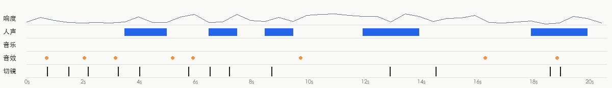

- 响度 -33.3 dBFS，峰值 -10.5 dBFS；声音跨切点连续，是后期整体铺的（切点处背景声变化 4.8dB，镜头内 4.0dB）
- 来源判断：视频类型：实拍（同期声 + 后期配乐） → 人声真人录音；音效实拍同期声

**人声**

- 占 36% 时长；基频约 107.3Hz（偏男声）
- 来源：真人录音（真人录音 73%，TTS 配音 20%，AI 视频原生对白（随画面生成） 7%）
  - 100% 的画面是实拍：人声多为同期录音或真人配音
- 复刻：自己录：手机或领夹麦贴近嘴，安静房间里录；台词照「内容与结构」的脚本表改写

**背景音乐**

- 未检测到持续的音乐床

**音效**（0）

- 没有找到后期加的音效

- 分离出的音轨：`stems/original.wav`（原声）、`stems/vocals.wav`（人声干声）、`stems/music.wav`（配乐 + 环境声）、`stems/effects.wav`（音效轨）
<!--stems-->

## 不确定点

- 声音没有 AI 听过（复核只看了画面）：人声是真人还是 TTS 是按波形推断的；音效是从单独分离出的音效轨里找的，类型是按声音特征估的。可以在「声音」里试听分轨和每处音效核对

## 附录

### 逐镜取证

每个镜头分两块：画面里看得到的，和工具推断的制作方式（附判断依据）；最后是复刻提示词。默认折叠，点开看。

#1 00:00.000–00:00.733 · 实拍 + 代码/剪辑叠加（文字标注、标题）；引入真实素材（实拍视频素材）

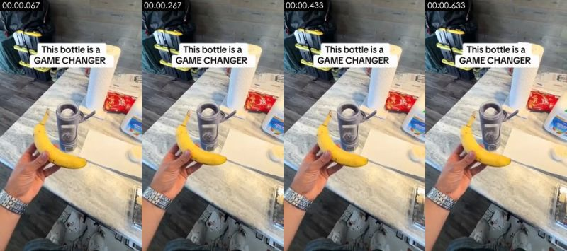

**画面里看得到的**（可以对照截图核实）
- 画面：第一人称略俯拍：右手举着一根香蕉，前方大理石台面上立着灰紫色便携榨汁杯、纸巾卷、零食袋和杏仁奶；顶部叠白底标题字幕。手持轻晃。
- 拍法/打光：近景；略俯拍；第一人称手持（拍摄者一手拿手机用后置镜头，另一手出镜操作）；逆光/背景比主体亮；主光画面右侧偏前方；光比约 2.1:1（相差 1.0 档）；中等柔度
- 文字轨（文字/middle）：GAMECHANGER
- 文字轨（标题/top）：Thisbottle is a
- [AI 助手 看图] 顶部白底黑字标题「This bottle is a GAME CHANGER」是后期加的
- [AI 助手 看图] 台面上的杏仁奶瓶、零食袋文字正常可读
- [AI 助手 看图] 真手：皮肤纹理、指节和腕表金属反光自然，跨帧形状稳定
- [AI 助手 看图] 背景杂物（黄黑收纳箱、纸巾卷、红色零食袋、挂钟）在所有镜头里位置一致，是同一现场
- [AI 助手 看图] 手机手持的小幅晃动和广角边缘透视，没有 AI 常见的形变或纹理闪烁

**工具推断的制作方式**（是推断，不是看到的）
- 推断：实拍 70%，AI 生成视频 12%，影视片段 5%（fused_agent）
- 素材来源：用户真实素材：实拍视频素材
- 判断依据（工具测量，肉眼不一定看得出）：
  - 纹理呈照片/视频特征：噪声 σ=0.52、用色 266 种、平坦块 4%

- 复刻：原片为实拍：按拍摄方案（景别/机位/打光）重新拍摄；没有拍摄条件时才用 AI 图生视频近似（以首帧为参考）；需要用户提供真实素材：实拍视频素材（整个画面）
  - 首帧图像提示词：香蕉在左下、榨汁杯居中，上方留给标题字幕。竖屏第一人称略俯拍，近景，画面左下一只手拿着黄色香蕉，后方大理石厨房台面中央立着灰紫色便携榨汁杯，旁边有纸巾卷、红色零食袋和杏仁奶瓶，白天室内柔和窗光，手机实拍质感
  - 视频提示词：香蕉在左下、榨汁杯居中，上方留给标题字幕，镜头拉。竖屏第一人称略俯拍，近景，手拿香蕉停在榨汁杯前，手机轻微晃动，0.7 秒后切走

#2 00:00.733–00:01.500 · 实拍；引入真实素材（实拍视频素材）

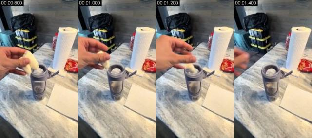

**画面里看得到的**（可以对照截图核实）
- 画面：第一人称略俯拍：手把掰开的香蕉块丢进榨汁杯后向左移出画面，杯子立在大理石台面上，旁边是纸巾卷和一张白纸巾。
- 拍法/打光：近景；略俯拍；第一人称手持（拍摄者一手拿手机用后置镜头，另一手出镜操作）；侧前方主光 + 补光（标准布光）；主光画面右侧偏前方；光比约 1.4:1（相差 0.5 档）；柔光（明暗过渡宽）
- [AI 助手 看图] 香蕉块被手放进杯口、手移出画面，动作和受力自然
- [AI 助手 看图] 真手：皮肤纹理、指节和腕表金属反光自然，跨帧形状稳定
- [AI 助手 看图] 背景杂物（黄黑收纳箱、纸巾卷、红色零食袋、挂钟）在所有镜头里位置一致，是同一现场
- [AI 助手 看图] 手机手持的小幅晃动和广角边缘透视，没有 AI 常见的形变或纹理闪烁

**工具推断的制作方式**（是推断，不是看到的）
- 推断：实拍 69%，AI 生成视频 12%，影视片段 5%（fused_agent）
- 素材来源：用户真实素材：实拍视频素材
- 判断依据（工具测量，肉眼不一定看得出）：
  - 纹理呈照片/视频特征：噪声 σ=0.50、用色 214 种、平坦块 3%

- 复刻：原片为实拍：按拍摄方案（景别/机位/打光）重新拍摄；没有拍摄条件时才用 AI 图生视频近似（以首帧为参考）；需要用户提供真实素材：实拍视频素材（整个画面）
  - 首帧图像提示词：榨汁杯居中偏左，手从左上入画。竖屏第一人称略俯拍，近景，大理石台面中央立着灰紫色便携榨汁杯，画面左上一只手拿着一块剥好的香蕉在杯口上方，后方纸巾卷和收纳箱，白天柔和窗光
  - 视频提示词：榨汁杯居中偏左，手从左上入画，镜头推。竖屏第一人称略俯拍，近景，手把香蕉块丢进榨汁杯，随后手向左移出画面，手机轻微晃动

#3 00:01.500–00:02.200 · 实拍；引入真实素材（实拍视频素材）

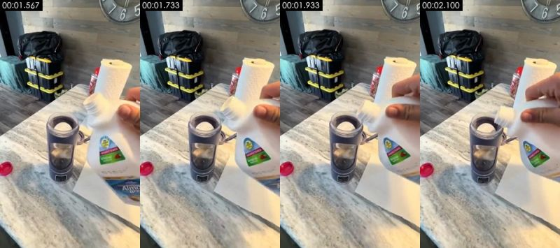

**画面里看得到的**（可以对照截图核实）
- 画面：第一人称略俯拍：右手从画面右侧拿起一瓶 Almond Breeze 杏仁奶，倾斜瓶身对准榨汁杯口，红色瓶盖放在台面左侧，背景挂钟露出下半部。
- 拍法/打光：近景；略俯拍；第一人称手持（拍摄者一手拿手机用后置镜头，另一手出镜操作）；逆光/背景比主体亮；主光正面（光从镜头方向来，主体两侧亮度接近）；光比约 1.1:1（相差 0.1 档）；柔光（几乎没有明暗分界）
- [AI 助手 看图] Almond Breeze 杏仁奶瓶标签（UNSWEETENED / original）文字清晰正确
- [AI 助手 看图] 瓶身倾斜、瓶盖已拧开放在台面左侧，物理关系一致
- [AI 助手 看图] 真手：皮肤纹理、指节和腕表金属反光自然，跨帧形状稳定
- [AI 助手 看图] 背景杂物（黄黑收纳箱、纸巾卷、红色零食袋、挂钟）在所有镜头里位置一致，是同一现场
- [AI 助手 看图] 手机手持的小幅晃动和广角边缘透视，没有 AI 常见的形变或纹理闪烁

**工具推断的制作方式**（是推断，不是看到的）
- 推断：实拍 70%，AI 生成视频 12%，影视片段 5%（fused_agent）
- 素材来源：用户真实素材：实拍视频素材
- 判断依据（工具测量，肉眼不一定看得出）：
  - 纹理呈照片/视频特征：噪声 σ=0.46、用色 226 种、平坦块 3%

- 复刻：原片为实拍：按拍摄方案（景别/机位/打光）重新拍摄；没有拍摄条件时才用 AI 图生视频近似（以首帧为参考）；需要用户提供真实素材：实拍视频素材（整个画面）
  - 首帧图像提示词：杯子在左、奶瓶从右侧入画。竖屏第一人称略俯拍，近景，大理石台面左侧立着灰紫色便携榨汁杯，画面右侧一只手握着白色大瓶杏仁奶正往杯口倾斜，台面上放着红色瓶盖，背景木纹墙和挂钟下半部，白天柔和窗光
  - 视频提示词：杯子在左、奶瓶从右侧入画，镜头推。竖屏第一人称略俯拍，近景，手把杏仁奶瓶倾斜到榨汁杯口上方，准备倒奶，手机轻微晃动

#4 00:02.200–00:03.267 · 实拍；引入真实素材（实拍视频素材）

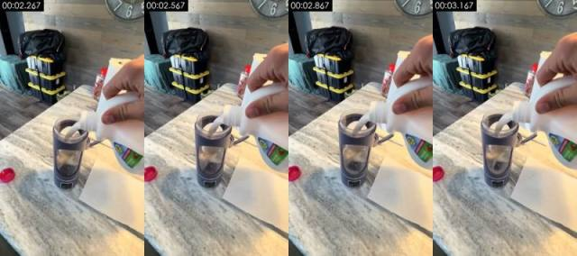

**画面里看得到的**（可以对照截图核实）
- 画面：同一角度继续：杏仁奶从瓶口连续倒进榨汁杯，杯内液面上升，手扶瓶身，手机轻晃。
- 拍法/打光：近景；略俯拍；第一人称手持（拍摄者一手拿手机用后置镜头，另一手出镜操作）；逆光/背景比主体亮；主光正面（光从镜头方向来，主体两侧亮度接近）；光比约 1.1:1（相差 0.1 档）；柔光（几乎没有明暗分界）
- [AI 助手 看图] 白色奶液连续流入杯中，流线和液面上升自然
- [AI 助手 看图] 和上一镜同一机位同一动作，像同一条素材里剪掉了一小段（跳切）
- [AI 助手 看图] 真手：皮肤纹理、指节和腕表金属反光自然，跨帧形状稳定
- [AI 助手 看图] 背景杂物（黄黑收纳箱、纸巾卷、红色零食袋、挂钟）在所有镜头里位置一致，是同一现场
- [AI 助手 看图] 手机手持的小幅晃动和广角边缘透视，没有 AI 常见的形变或纹理闪烁

**工具推断的制作方式**（是推断，不是看到的）
- 推断：实拍 67%，AI 生成视频 14%，影视片段 5%（fused_agent）
- 素材来源：用户真实素材：实拍视频素材
- 判断依据（工具测量，肉眼不一定看得出）：
  - 纹理呈照片/视频特征：噪声 σ=0.49、用色 215 种、平坦块 2%
  - 逐帧清晰度呈周期性起伏（周期 4 帧，相关 0.79），但没有重复帧：可能是插帧/帧率转换，也可能只是重新压缩留下的节奏（去掉了平台标记的转码文件也会这样），单凭这一条不能定 AI

- 复刻：原片为实拍：按拍摄方案（景别/机位/打光）重新拍摄；没有拍摄条件时才用 AI 图生视频近似（以首帧为参考）；需要用户提供真实素材：实拍视频素材（整个画面）
  - 首帧图像提示词：杯子在左、奶瓶在右上。竖屏第一人称略俯拍，近景，画面右侧一只手握白色杏仁奶瓶，白色奶液正流入大理石台面上的灰紫色便携榨汁杯，红色瓶盖在左侧台面上，白天柔和窗光
  - 视频提示词：杯子在左、奶瓶在右上，镜头摇/移。竖屏第一人称略俯拍，近景，杏仁奶持续倒入榨汁杯，液面上升，手机轻微晃动

#5 00:03.267–00:04.033 · 实拍；引入真实素材（实拍视频素材）

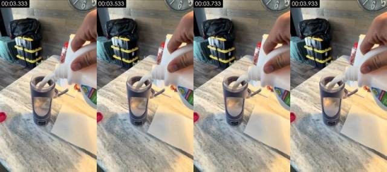

**画面里看得到的**（可以对照截图核实）
- 画面：倒奶的最后一段：奶流变细，杯子接近半满，机位基本不变。
- 拍法/打光：近景；略俯拍；第一人称手持（拍摄者一手拿手机用后置镜头，另一手出镜操作）；逆光/背景比主体亮；主光正面（光从镜头方向来，主体两侧亮度接近）；光比约 1.2:1（相差 0.2 档）；柔光（几乎没有明暗分界）
- 画面里物体上的字（不是后期字幕）：6
- [AI 助手 看图] 奶流和液面与上一镜衔接，瓶身标签同上
- [AI 助手 看图] 真手：皮肤纹理、指节和腕表金属反光自然，跨帧形状稳定
- [AI 助手 看图] 背景杂物（黄黑收纳箱、纸巾卷、红色零食袋、挂钟）在所有镜头里位置一致，是同一现场
- [AI 助手 看图] 手机手持的小幅晃动和广角边缘透视，没有 AI 常见的形变或纹理闪烁

**工具推断的制作方式**（是推断，不是看到的）
- 推断：实拍 67%，AI 生成视频 14%，影视片段 5%（fused_agent）
- 素材来源：用户真实素材：实拍视频素材
- 判断依据（工具测量，肉眼不一定看得出）：
  - 纹理呈照片/视频特征：噪声 σ=0.50、用色 213 种、平坦块 2%

- 复刻：原片为实拍：按拍摄方案（景别/机位/打光）重新拍摄；没有拍摄条件时才用 AI 图生视频近似（以首帧为参考）；需要用户提供真实素材：实拍视频素材（整个画面）
  - 首帧图像提示词：杯子在左、奶瓶在右上。竖屏第一人称略俯拍，近景，白色杏仁奶从画面右上瓶口流入大理石台面上的灰紫色便携榨汁杯，杯子接近半满，白天柔和窗光
  - 视频提示词：杯子在左、奶瓶在右上。竖屏第一人称略俯拍，近景，奶流变细，杯子倒到半满，手机轻微晃动

#6 00:04.033–00:05.767 · 实拍；引入真实素材（实拍视频素材）

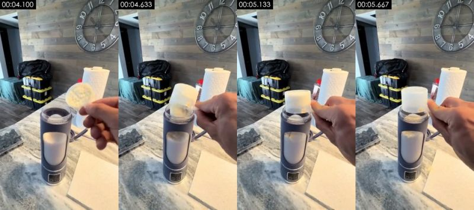

**画面里看得到的**（可以对照截图核实）
- 画面：机位后退、视角更平：右手拿量勺把白色蛋白粉倒进榨汁杯，背景木纹墙上的大挂钟完整入画，左侧是蓝莓盒。
- 拍法/打光：近景；略俯拍；第一人称手持（拍摄者一手拿手机用后置镜头，另一手出镜操作）；逆光/背景比主体亮；主光正面（光从镜头方向来，主体两侧亮度接近）；光比约 1.1:1（相差 0.2 档）；柔光（几乎没有明暗分界）
- 画面里物体上的字（不是后期字幕）：9、5
- [AI 助手 看图] 挂钟 1–12 数字和指针结构正常
- [AI 助手 看图] 量勺里白色粉末倒进杯口，杯内粉末堆积可见
- [AI 助手 看图] 真手：皮肤纹理、指节和腕表金属反光自然，跨帧形状稳定
- [AI 助手 看图] 背景杂物（黄黑收纳箱、纸巾卷、红色零食袋、挂钟）在所有镜头里位置一致，是同一现场
- [AI 助手 看图] 手机手持的小幅晃动和广角边缘透视，没有 AI 常见的形变或纹理闪烁

**工具推断的制作方式**（是推断，不是看到的）
- 推断：实拍 66%，AI 生成视频 14%，影视片段 5%（fused_agent）
- 素材来源：用户真实素材：实拍视频素材
- 判断依据（工具测量，肉眼不一定看得出）：
  - 纹理呈照片/视频特征：噪声 σ=0.49、用色 184 种、平坦块 2%
  - 逐帧清晰度呈周期性起伏（周期 4 帧，相关 0.83），但没有重复帧：可能是插帧/帧率转换，也可能只是重新压缩留下的节奏（去掉了平台标记的转码文件也会这样），单凭这一条不能定 AI

- 复刻：原片为实拍：按拍摄方案（景别/机位/打光）重新拍摄；没有拍摄条件时才用 AI 图生视频近似（以首帧为参考）；需要用户提供真实素材：实拍视频素材（整个画面）
  - 首帧图像提示词：杯子居中，挂钟在上方。竖屏第一人称略俯拍，中近景，大理石台面上立着灰紫色便携榨汁杯，画面右侧一只手拿着装满白色蛋白粉的量勺在杯口上方，背景木纹墙中央一只大号金属挂钟，左侧台面有蓝莓盒和纸巾卷，白天柔和窗光
  - 视频提示词：杯子居中，挂钟在上方，镜头摇/移。竖屏第一人称略俯拍，中近景，手把量勺里的蛋白粉倒进榨汁杯，手机轻微晃动

#7 00:05.767–00:06.533 · 实拍；引入真实素材（实拍视频素材）

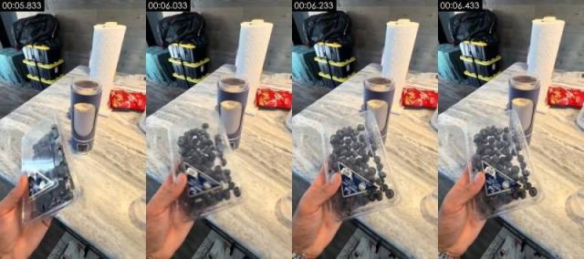

**画面里看得到的**（可以对照截图核实）
- 画面：第一人称略俯拍：左手举起一盒蓝莓在镜头前转动展示，背景是装着奶和蛋白粉的榨汁杯、纸巾卷和零食袋。
- 拍法/打光：近景；略俯拍；第一人称手持（拍摄者一手拿手机用后置镜头，另一手出镜操作）；侧前方主光 + 补光（标准布光）；主光画面右侧偏前方；光比约 1.5:1（相差 0.6 档）；柔光（明暗过渡宽）
- [AI 助手 看图] 透明塑料盒里的蓝莓颗粒和盒上标签真实，盒子转动时反光变化自然
- [AI 助手 看图] 真手：皮肤纹理、指节和腕表金属反光自然，跨帧形状稳定
- [AI 助手 看图] 背景杂物（黄黑收纳箱、纸巾卷、红色零食袋、挂钟）在所有镜头里位置一致，是同一现场
- [AI 助手 看图] 手机手持的小幅晃动和广角边缘透视，没有 AI 常见的形变或纹理闪烁

**工具推断的制作方式**（是推断，不是看到的）
- 推断：实拍 71%，AI 生成视频 11%，影视片段 5%（fused_agent）
- 素材来源：用户真实素材：实拍视频素材
- 判断依据（工具测量，肉眼不一定看得出）：
  - 纹理呈照片/视频特征：噪声 σ=0.56、用色 230 种、平坦块 1%

- 复刻：原片为实拍：按拍摄方案（景别/机位/打光）重新拍摄；没有拍摄条件时才用 AI 图生视频近似（以首帧为参考）；需要用户提供真实素材：实拍视频素材（整个画面）
  - 首帧图像提示词：蓝莓盒占左下大半画面，杯子在中上。竖屏第一人称略俯拍，近景，画面左下一只手托着一盒透明塑料盒装的新鲜蓝莓，后方大理石台面上立着灰紫色便携榨汁杯和纸巾卷，红色零食袋，白天柔和窗光
  - 视频提示词：蓝莓盒占左下大半画面，杯子在中上，镜头摇/移。竖屏第一人称略俯拍，近景，手把蓝莓盒举到镜头前并转动角度展示，手机轻微晃动

#8 00:06.533–00:07.233 · 实拍；引入真实素材（实拍视频素材）

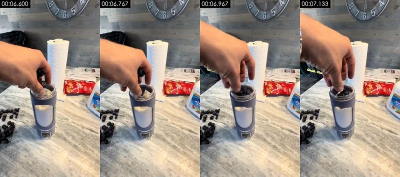

**画面里看得到的**（可以对照截图核实）
- 画面：第一人称略俯拍：右手从上方把一小把蓝莓放进榨汁杯，台面左侧是倒出来的蓝莓，右侧露出杏仁奶瓶。
- 拍法/打光：近景；略俯拍；第一人称手持（拍摄者一手拿手机用后置镜头，另一手出镜操作）；正面柔光（平光）；主光正面（光从镜头方向来，主体两侧亮度接近）；光比约 1.1:1（相差 0.2 档）；柔光（几乎没有明暗分界）
- [AI 助手 看图] 手指捏着蓝莓放进杯口，手部关节动作自然
- [AI 助手 看图] 真手：皮肤纹理、指节和腕表金属反光自然，跨帧形状稳定
- [AI 助手 看图] 背景杂物（黄黑收纳箱、纸巾卷、红色零食袋、挂钟）在所有镜头里位置一致，是同一现场
- [AI 助手 看图] 手机手持的小幅晃动和广角边缘透视，没有 AI 常见的形变或纹理闪烁

**工具推断的制作方式**（是推断，不是看到的）
- 推断：实拍 70%，AI 生成视频 12%，影视片段 5%（fused_agent）
- 素材来源：用户真实素材：实拍视频素材
- 判断依据（工具测量，肉眼不一定看得出）：
  - 纹理呈照片/视频特征：噪声 σ=0.51、用色 187 种、平坦块 1%

- 复刻：原片为实拍：按拍摄方案（景别/机位/打光）重新拍摄；没有拍摄条件时才用 AI 图生视频近似（以首帧为参考）；需要用户提供真实素材：实拍视频素材（整个画面）
  - 首帧图像提示词：杯子居中，手从左上入画。竖屏第一人称略俯拍，近景，大理石台面中央灰紫色便携榨汁杯，一只手从画面左上伸到杯口放入蓝莓，左侧台面散着蓝莓，右侧露出杏仁奶瓶，白天柔和窗光
  - 视频提示词：杯子居中，手从左上入画，镜头拉。竖屏第一人称略俯拍，近景，手把蓝莓放进榨汁杯，手指在杯口停留后抽出，手机轻微晃动

#9 00:07.233–00:08.733 · 实拍；引入真实素材（实拍视频素材）

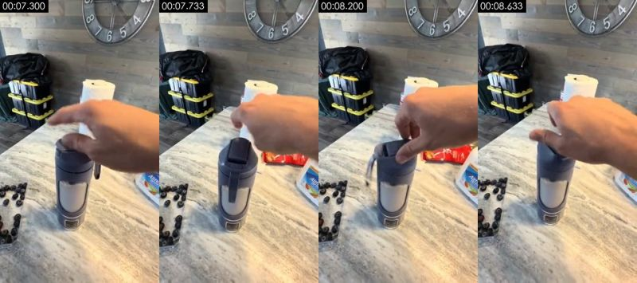

**画面里看得到的**（可以对照截图核实）
- 画面：第一人称略俯拍：右手把翻盖式杯盖盖上并按紧，掀开的饮嘴翻下扣好，左侧是蓝莓，右侧杏仁奶瓶。
- 拍法/打光：近景；略俯拍；第一人称手持（拍摄者一手拿手机用后置镜头，另一手出镜操作）；逆光/背景比主体亮；主光正面（光从镜头方向来，主体两侧亮度接近）；光比约 1.2:1（相差 0.3 档）；柔光（几乎没有明暗分界）
- [AI 助手 看图] 杯盖翻盖结构和按压时的位移符合真实塑料件
- [AI 助手 看图] 真手：皮肤纹理、指节和腕表金属反光自然，跨帧形状稳定
- [AI 助手 看图] 背景杂物（黄黑收纳箱、纸巾卷、红色零食袋、挂钟）在所有镜头里位置一致，是同一现场
- [AI 助手 看图] 手机手持的小幅晃动和广角边缘透视，没有 AI 常见的形变或纹理闪烁

**工具推断的制作方式**（是推断，不是看到的）
- 推断：实拍 68%，AI 生成视频 13%，影视片段 5%（fused_agent）
- 素材来源：用户真实素材：实拍视频素材
- 判断依据（工具测量，肉眼不一定看得出）：
  - 纹理呈照片/视频特征：噪声 σ=0.50、用色 172 种、平坦块 1%
  - 逐帧清晰度呈周期性起伏（周期 4 帧，相关 0.56），但没有重复帧：可能是插帧/帧率转换，也可能只是重新压缩留下的节奏（去掉了平台标记的转码文件也会这样），单凭这一条不能定 AI

- 复刻：原片为实拍：按拍摄方案（景别/机位/打光）重新拍摄；没有拍摄条件时才用 AI 图生视频近似（以首帧为参考）；需要用户提供真实素材：实拍视频素材（整个画面）
  - 首帧图像提示词：杯子居中偏左，手从右侧入画。竖屏第一人称略俯拍，近景，大理石台面上的灰紫色便携榨汁杯，一只手从右侧伸来按住杯顶翻盖，左侧散着蓝莓，背景挂钟和收纳箱，白天柔和窗光
  - 视频提示词：杯子居中偏左，手从右侧入画，镜头摇/移。竖屏第一人称略俯拍，近景，手把翻盖杯盖盖上、按紧扣好，手机轻微晃动

#10 00:08.733–00:12.967 · 实拍；引入真实素材（实拍视频素材）

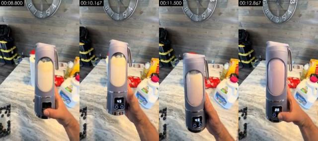

**画面里看得到的**（可以对照截图核实）
- 画面：第一人称：右手把榨汁杯拿起来正对镜头，拇指按下底座开关，杯内高速搅拌，LED 屏倒计时 45→36，液体由米白变成浅紫。背景是台面上的杏仁奶、零食和挂钟。
- 拍法/打光：近景；平视略俯；第一人称手持（拍摄者一手拿手机用后置镜头，另一手出镜操作）；正面柔光（平光）；主光正面（光从镜头方向来，主体两侧亮度接近）；光比约 1.1:1（相差 0.2 档）；柔光（明暗过渡宽）
- 画面里物体上的字（不是后期字幕）：Sh、97、2h、40、Alnong、Aumone
- [AI 助手 看图] 底座 LED 屏数字从 45 往下倒数到 36，显示稳定无乱码
- [AI 助手 看图] 杯内液体在搅拌中翻滚，颜色从米白逐渐变紫
- [AI 助手 看图] Almond Breeze 奶瓶标签清晰
- [AI 助手 看图] 真手：皮肤纹理、指节和腕表金属反光自然，跨帧形状稳定
- [AI 助手 看图] 背景杂物（黄黑收纳箱、纸巾卷、红色零食袋、挂钟）在所有镜头里位置一致，是同一现场
- [AI 助手 看图] 手机手持的小幅晃动和广角边缘透视，没有 AI 常见的形变或纹理闪烁

**工具推断的制作方式**（是推断，不是看到的）
- 推断：实拍 67%，AI 生成视频 14%，影视片段 5%（fused_agent）
- 素材来源：用户真实素材：实拍视频素材
- 判断依据（工具测量，肉眼不一定看得出）：
  - 纹理呈照片/视频特征：噪声 σ=0.48、用色 279 种、平坦块 1%
  - 逐帧清晰度呈周期性起伏（周期 4 帧，相关 0.42），但没有重复帧：可能是插帧/帧率转换，也可能只是重新压缩留下的节奏（去掉了平台标记的转码文件也会这样），单凭这一条不能定 AI

- 复刻：原片为实拍：按拍摄方案（景别/机位/打光）重新拍摄；没有拍摄条件时才用 AI 图生视频近似（以首帧为参考）；需要用户提供真实素材：实拍视频素材（整个画面）
  - 首帧图像提示词：杯子竖在画面中央占大半高度。竖屏第一人称平视略俯，近景，一只手握着灰紫色便携榨汁杯竖在画面中央，底座黑色 LED 屏亮着数字 45，杯内米白色液体，背景大理石台面上有杏仁奶瓶、零食盒和木纹墙挂钟，白天柔和窗光
  - 视频提示词：平视略俯，杯子竖在画面中央占大半高度，镜头摇/移。竖屏第一人称近景，手握榨汁杯正对镜头，拇指按下底座开关，杯内液体高速旋转搅拌，LED 屏从 45 倒数到 36，液体由米白变成浅紫，手机轻微晃动

#11 00:12.967–00:14.600 · 实拍；引入真实素材（实拍视频素材）

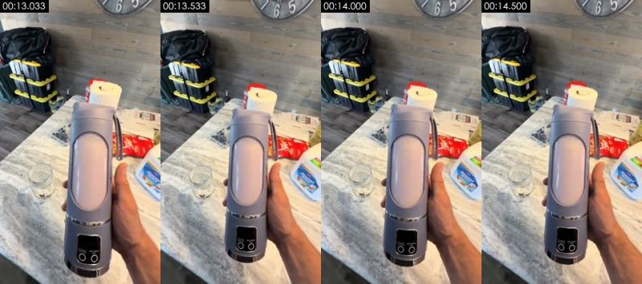

**画面里看得到的**（可以对照截图核实）
- 画面：第一人称：右手举着搅拌好的榨汁杯展示成品颜色，台面上放着一个空玻璃罐等着倒。
- 拍法/打光：近景；略俯拍；第一人称手持（拍摄者一手拿手机用后置镜头，另一手出镜操作）；逆光/背景比主体亮；主光正面（光从镜头方向来，主体两侧亮度接近）；光比约 1.3:1（相差 0.3 档）；柔光（几乎没有明暗分界）
- 画面里物体上的字（不是后期字幕）：Alpond、Alpiond、Algiond
- [AI 助手 看图] 杯身视窗里浅紫色奶昔静止，LED 屏熄灭，和上一镜搅拌结束衔接
- [AI 助手 看图] 台面左侧空玻璃罐和后续镜头一致
- [AI 助手 看图] 真手：皮肤纹理、指节和腕表金属反光自然，跨帧形状稳定
- [AI 助手 看图] 背景杂物（黄黑收纳箱、纸巾卷、红色零食袋、挂钟）在所有镜头里位置一致，是同一现场
- [AI 助手 看图] 手机手持的小幅晃动和广角边缘透视，没有 AI 常见的形变或纹理闪烁

**工具推断的制作方式**（是推断，不是看到的）
- 推断：实拍 67%，AI 生成视频 14%，影视片段 5%（fused_agent）
- 素材来源：用户真实素材：实拍视频素材
- 判断依据（工具测量，肉眼不一定看得出）：
  - 纹理呈照片/视频特征：噪声 σ=0.48、用色 247 种、平坦块 1%
  - 逐帧清晰度呈周期性起伏（周期 4 帧，相关 0.55），但没有重复帧：可能是插帧/帧率转换，也可能只是重新压缩留下的节奏（去掉了平台标记的转码文件也会这样），单凭这一条不能定 AI

- 复刻：原片为实拍：按拍摄方案（景别/机位/打光）重新拍摄；没有拍摄条件时才用 AI 图生视频近似（以首帧为参考）；需要用户提供真实素材：实拍视频素材（整个画面）
  - 首帧图像提示词：杯子居中，空玻璃罐在左后方。竖屏第一人称略俯拍，近景，一只手握着灰紫色便携榨汁杯竖在画面中央，杯身视窗里是浅紫色奶昔，左后方大理石台面上放着一个空玻璃罐，背景收纳箱和纸巾卷，白天柔和窗光
  - 视频提示词：杯子居中，空玻璃罐在左后方。竖屏第一人称略俯拍，近景，手握装满浅紫色奶昔的榨汁杯举在镜头前停住展示，手机轻微晃动

#12 00:14.600–00:18.667 · 实拍；引入真实素材（实拍视频素材）

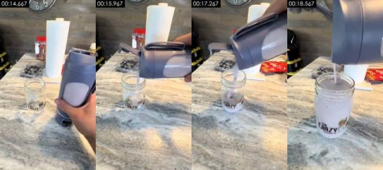

**画面里看得到的**（可以对照截图核实）
- 画面：第一人称略俯拍：右手把榨汁杯翻过来，把浅紫色奶昔倒进台面上印 logo 的梅森玻璃罐，罐子逐渐装满；手机跟着往前凑近。
- 拍法/打光：近景；略俯拍；第一人称手持（拍摄者一手拿手机用后置镜头，另一手出镜操作）；正面柔光（平光）；主光正面（光从镜头方向来，主体两侧亮度接近）；光比约 1.1:1（相差 0.1 档）；柔光（几乎没有明暗分界）
- 画面里物体上的字（不是后期字幕）：CRNZY、RAZY、CRAZY、CRnZY、3
- [AI 助手 看图] 梅森玻璃罐上印着「The CRAZY milkshake bar」logo，文字可读
- [AI 助手 看图] 奶昔从杯口连续流入罐中、液面上升，稠度和流速自然
- [AI 助手 看图] 真手：皮肤纹理、指节和腕表金属反光自然，跨帧形状稳定
- [AI 助手 看图] 背景杂物（黄黑收纳箱、纸巾卷、红色零食袋、挂钟）在所有镜头里位置一致，是同一现场
- [AI 助手 看图] 手机手持的小幅晃动和广角边缘透视，没有 AI 常见的形变或纹理闪烁

**工具推断的制作方式**（是推断，不是看到的）
- 推断：实拍 67%，AI 生成视频 13%，影视片段 5%（fused_agent）
- 素材来源：用户真实素材：实拍视频素材
- 判断依据（工具测量，肉眼不一定看得出）：
  - 纹理呈照片/视频特征：噪声 σ=0.42、用色 135 种、平坦块 2%
  - 逐帧清晰度呈周期性起伏（周期 4 帧，相关 0.11），但没有重复帧：可能是插帧/帧率转换，也可能只是重新压缩留下的节奏（去掉了平台标记的转码文件也会这样），单凭这一条不能定 AI

- 复刻：原片为实拍：按拍摄方案（景别/机位/打光）重新拍摄；没有拍摄条件时才用 AI 图生视频近似（以首帧为参考）；需要用户提供真实素材：实拍视频素材（整个画面）
  - 首帧图像提示词：玻璃罐在中下，榨汁杯从右上入画。竖屏第一人称略俯拍，近景，大理石台面上一个印有 logo 的空梅森玻璃罐，画面右侧一只手握着灰紫色便携榨汁杯正翻转过来对准罐口，后方纸巾卷，台面上有一块窗光亮斑，白天柔和窗光
  - 视频提示词：玻璃罐在中下，榨汁杯从右上入画，镜头摇/移。竖屏第一人称略俯拍，近景，手把榨汁杯倒过来，浅紫色奶昔连续流进玻璃罐，罐子装满，镜头慢慢往前凑近

#13 00:18.667–00:19.033 · 实拍；引入真实素材（实拍视频素材）

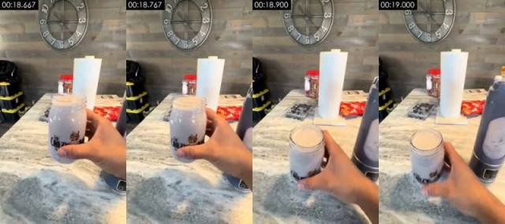

**画面里看得到的**（可以对照截图核实）
- 画面：短镜：手把装满奶昔的玻璃罐拿起来晃一下展示，再放回台面，榨汁杯在右侧。
- 拍法/打光：近景；略俯拍；第一人称手持（拍摄者一手拿手机用后置镜头，另一手出镜操作）；正面柔光（平光）；主光正面（光从镜头方向来，主体两侧亮度接近）；光比约 1.3:1（相差 0.3 档）；柔光（几乎没有明暗分界）
- 画面里物体上的字（不是后期字幕）：W
- [AI 助手 看图] 手指握住装满奶昔的玻璃罐，罐身 logo 与上一镜一致
- [AI 助手 看图] 真手：皮肤纹理、指节和腕表金属反光自然，跨帧形状稳定
- [AI 助手 看图] 背景杂物（黄黑收纳箱、纸巾卷、红色零食袋、挂钟）在所有镜头里位置一致，是同一现场
- [AI 助手 看图] 手机手持的小幅晃动和广角边缘透视，没有 AI 常见的形变或纹理闪烁

**工具推断的制作方式**（是推断，不是看到的）
- 推断：实拍 70%，AI 生成视频 12%，影视片段 5%（fused_agent）
- 素材来源：用户真实素材：实拍视频素材
- 判断依据（工具测量，肉眼不一定看得出）：
  - 纹理呈照片/视频特征：噪声 σ=0.36、用色 183 种、平坦块 2%

- 复刻：原片为实拍：按拍摄方案（景别/机位/打光）重新拍摄；没有拍摄条件时才用 AI 图生视频近似（以首帧为参考）；需要用户提供真实素材：实拍视频素材（整个画面）
  - 首帧图像提示词：玻璃罐在左中。竖屏第一人称略俯拍，近景，一只手握着装满浅紫色奶昔的梅森玻璃罐，背景木纹墙挂钟、纸巾卷，右侧露出灰紫色榨汁杯，白天柔和窗光
  - 视频提示词：玻璃罐在左中，镜头推。竖屏第一人称略俯拍，近景，手拿起装满奶昔的玻璃罐展示一下再放回台面，手机轻微晃动

#14 00:19.033–00:20.700 · 实拍；引入真实素材（实拍视频素材）

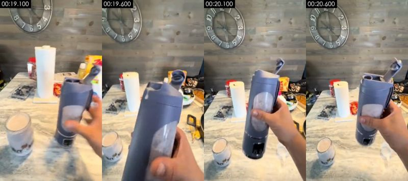

**画面里看得到的**（可以对照截图核实）
- 画面：第一人称：右手拿起榨汁杯凑近镜头，拇指拨开顶部饮嘴，展示可以直接对嘴喝；背景是挂钟、纸巾卷和装好的玻璃罐。
- 拍法/打光：近景；略俯拍；第一人称手持（拍摄者一手拿手机用后置镜头，另一手出镜操作）；侧前方主光 + 补光（标准布光）；主光画面右侧偏前方；光比约 1.4:1（相差 0.5 档）；柔光（明暗过渡宽）
- 画面里物体上的字（不是后期字幕）：5、0、9
- [AI 助手 看图] 翻开饮嘴的卡扣结构和手指拨动动作真实
- [AI 助手 看图] 快速晃动时有自然的运动模糊
- [AI 助手 看图] 真手：皮肤纹理、指节和腕表金属反光自然，跨帧形状稳定
- [AI 助手 看图] 背景杂物（黄黑收纳箱、纸巾卷、红色零食袋、挂钟）在所有镜头里位置一致，是同一现场
- [AI 助手 看图] 手机手持的小幅晃动和广角边缘透视，没有 AI 常见的形变或纹理闪烁

**工具推断的制作方式**（是推断，不是看到的）
- 推断：实拍 67%，AI 生成视频 14%，影视片段 5%（fused_agent）
- 素材来源：用户真实素材：实拍视频素材
- 判断依据（工具测量，肉眼不一定看得出）：
  - 纹理呈照片/视频特征：噪声 σ=0.35、用色 215 种、平坦块 2%
  - 逐帧清晰度呈周期性起伏（周期 6 帧，相关 0.47），但没有重复帧：可能是插帧/帧率转换，也可能只是重新压缩留下的节奏（去掉了平台标记的转码文件也会这样），单凭这一条不能定 AI

- 复刻：原片为实拍：按拍摄方案（景别/机位/打光）重新拍摄；没有拍摄条件时才用 AI 图生视频近似（以首帧为参考）；需要用户提供真实素材：实拍视频素材（整个画面）
  - 首帧图像提示词：杯子在中右，玻璃罐在左下。竖屏第一人称略俯拍，近景，一只手握着灰紫色便携榨汁杯斜对镜头，顶部饮嘴翻开，左下台面上放着装满奶昔的玻璃罐，背景木纹墙和挂钟，白天柔和窗光
  - 视频提示词：略俯拍，杯子在中右，玻璃罐在左下，镜头摇/移。竖屏第一人称近景，手把榨汁杯拿到镜头前，拇指拨开顶部饮嘴，杯子转向展示可直接喝，手机跟着轻晃

### 元数据线索

- 编码器：`Lavf61.7.100`

### 说明

- 确定性取证对「是否在动、是否整图推拉、是否渲染纹理、是否 24→30 帧率转换」很可靠；对实拍 / AI / 3D 的区分要靠看图（看图模型或 AI 助手复核），最好再自己对照截图看一眼。
- 元数据经平台转码常被清除，缺失不代表没有。
- 完整数据在 `breakdown.json`；给模型读的拆片包从 `VIDEO.md` 开始。
