# 这条视频是怎么做的：v12_oiioii_juicer_remake.mp4

**一句话**：一条 21 秒的便携榨汁杯种草短片（整条由 AI 生成，复刻了一条实拍原片），靠「放料 → 合盖 → 拿在手里打 → 倒杯」一镜一步的完整制作过程，让观众 20 秒内看到整块水果变成一杯奶昔。
**怎么做的**：混合制作：AI 生成视频 100%

- 0:21 · 竖屏 9:16 · 8 个镜头，平均 2.6 秒一个
- 判断可靠度 82%，依据：工具测量 + AI 助手看图复核 8 镜
- ⚠️ 有 1 处拿不准，见「不确定点」

<!--mix-->

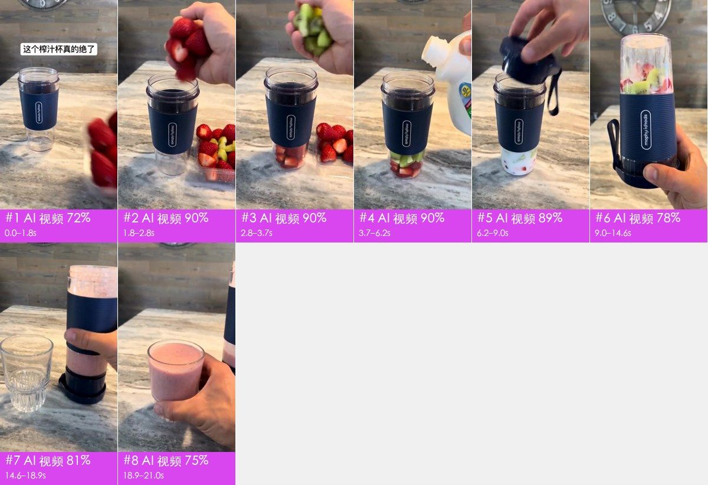

## 核心看点

- **开头怎么抓人**：0–1.8 秒：画面一开始就是榨汁杯立在台面上，上方白底黑字标题「这个榨汁杯真的绝了」先下结论；同时一只手把一整盒红草莓推进画面放在杯旁，产品和鲜艳的食材同框，观众马上知道接下来要做什么。
- 1.8–6.2 秒：三个 1–2.5 秒的短镜头依次放草莓、猕猴桃、倒牛奶，机位不动、只换食材，配方一眼看清，又不拖时间。
- 6.2–9.0 秒：合盖后单手把杯子整个倒过来握在手里，直接把「不用底座、拿着就能打」的卖点演出来，比口头讲更有说服力。
- 9.0–14.6 秒：全片唯一的长镜头（5.5 秒）对着手里的杯子，水果在一秒内打成粉色奶昔，配电机声，用前后对比当效果证据。
- 14.6–21.0 秒：倒进玻璃杯再端到镜头前看泡沫和厚度，结尾停在成品上，观众最后记住的是「做好了马上能喝」。

## 一眼看懂：画面、包装、声音三层

短视频都可以拆成三层：底下是画面本身，上面叠字幕、花字、贴纸，再配上声音。复刻时一层一层做。

| 层 | 这条视频里是什么 | 怎么做 | 细节 |
|---|---|---|---|
| **画面**（底层） | AI 生成视频 8 镜 | AI 分 3 次生成 | 「自己复刻」 |
| **包装**（叠在画面上） | 文字 | 剪辑软件里加：字幕、花字、贴纸照时间轴摆 | 「剪辑包装层」 |
| **声音** | 人声（TTS 配音） | 人声：TTS 配音 | 「声音」 |

## 内容与结构

- 下面的叙事线来自逐镜看图；台词没有单独整理，字幕原文见「剪辑包装层」

**叙事线**

复刻时保留这条线：每一步的顺序和作用照搬，讲的那一点换成自己的案例、数据和素材，就不只是换个主角。

| 时间 | 镜头 | 作用 | 在讲什么 |
|---|---|---|---|
| 0.0–1.8s | #1 | 抓注意 | 开场用一句下结论的标题配产品和鲜艳食材同框 |
| 1.8–9.0s | #2–#5 | 补信息 | 第一步放主料，一个动作一个镜头 → 第二步加配料，同机位只换食材 → 第三步加液体，配方三步讲完 → 合盖后单手倒置，演示不用底座、拿在手里就能打 |
| 9.0–14.6s | #6 | 给证据 | 拿在手里直接打出成品，用前后对比证明效果 |
| 14.6–21.0s | #7、#8 | 给结论 | 把成品倒出来，结果揭晓 → 成品凑近镜头展示质感收尾 |

## 分镜表

「画面」「运镜」「叠加层」是画面里看得到的；「制作方式」「素材来源」是工具推断的，依据见附录逐镜取证。

| # | 截图 | 时间 | 时长 | 在讲什么 | 画面 | 运镜 | 叠加层 | 制作方式（推断） | 素材来源（推断） | 复刻 |
|---|---|---|---|---|---|---|---|---|---|---|
| 1 | 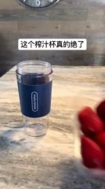 | 0:00.0 | 1.8s | 抓注意：开场用一句下结论的标题配产品和鲜艳食材同框 | 近景略俯拍台面：深蓝色硅胶套便携榨汁杯立在大理石台面左侧，一只手把一整盒红草莓从… | 手持晃动 | 文字 | AI 生成视频 72% | AI 生成 | AI 生成 · G1 |
| 2 | 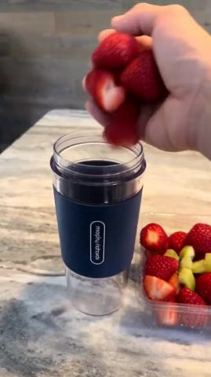 | 0:01.8 | 1.0s | 补信息：第一步放主料，一个动作一个镜头 | 近景略俯拍：一只手握着切块草莓悬在榨汁杯口上方松开，草莓块落进杯底；右侧盒里是切… | 平滑运镜 | — | AI 生成视频 90% | AI 生成 | AI 生成 · G1 |
| 3 | 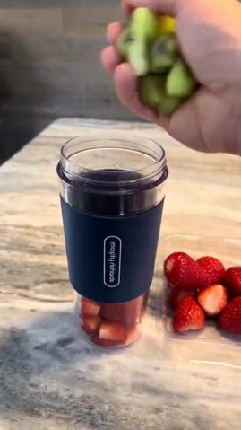 | 0:02.8 | 0.9s | 补信息：第二步加配料，同机位只换食材 | 同机位近景：手抓一把切块猕猴桃在杯口松开，猕猴桃落在草莓上面，手移出画面。 | 平滑运镜 | — | AI 生成视频 90% | AI 生成 | AI 生成 · G1 |
| 4 | 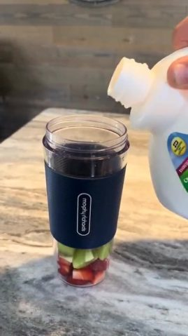 | 0:03.7 | 2.5s | 补信息：第三步加液体，配方三步讲完 | 同机位近景：手从画面右上方拿白色塑料牛奶壶，往杯里倒牛奶，杯底的草莓猕猴桃被牛奶… | 平滑运镜 | — | AI 生成视频 90% | AI 生成 | AI 生成 · G1 |
| 5 | 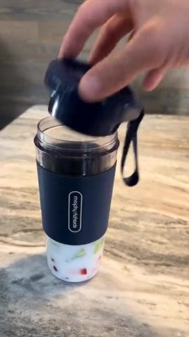 | 0:06.2 | 2.8s | 补信息：合盖后单手倒置，演示不用底座、拿在手里就能打 | 近景：手把带挂绳的深蓝色刀座盖扣到杯口并拧紧，然后单手拿起杯子整个倒过来，刀座朝… | 平滑运镜 | — | AI 生成视频 89% | AI 生成 | AI 生成 · G1 |
| 6 | 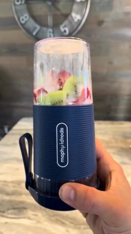 | 0:09.0 | 5.5s | 给证据：拿在手里直接打出成品，用前后对比证明效果 | 近景平视：一只手握着倒置的榨汁杯（刀座在下、挂绳垂在左侧）举在画面中央，杯里的水… | 手持晃动 | — | AI 生成视频 78% | AI 生成 | AI 生成 · G2 |
| 7 | 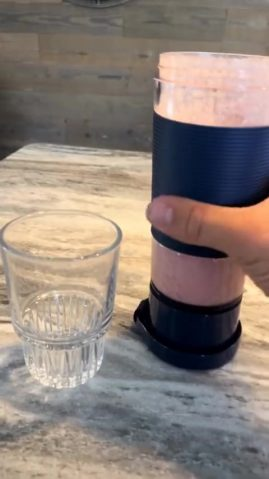 | 0:14.6 | 4.3s | 给结论：把成品倒出来，结果揭晓 | 近景略俯拍：台面左边放着一个底部带竖棱的空玻璃杯，手拿起右边装满粉色奶昔的榨汁杯… | 固定 | — | AI 生成视频 81% | AI 生成 | AI 生成 · G3 |
| 8 | 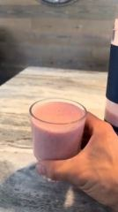 | 0:18.9 | 2.2s | 给结论：成品凑近镜头展示质感收尾 | 近景：手从台面拿起装满粉色奶昔的玻璃杯，举到镜头前微微倾斜，露出表面的细泡；背景… | 手持晃动 | — | AI 生成视频 75% | AI 生成 | AI 生成 · G3 |

## 自己复刻：按这个顺序做

复刻的是做法和节奏，不是照抄画面。

1. **定内容**：照「内容与结构」的叙事线写自己的脚本
2. **AI 生成**：3 次生成，见下方「AI 生成」
3. **剪辑**：见下方「剪辑」
4. **包装**：字幕文件 `packaging/overlays.ass` 可以直接导入剪辑软件；样式和时间轴见「剪辑包装层」
5. **声音**：见「声音」，每处音效都能先试听
6. **对照检查**：成片和原片并排看一遍：镜头长短、字幕位置、音乐起落对不对得上

### AI 生成

**AI 视频 8 镜 → 3 个生成单元、3 次 Seedance 2.0（含 Mini / Fast） 调用**

- 分组规则：同场景、硬切相连的 AI 镜头合并为一次生成；单次 ≤15s；单元内连续硬切尽量 ≤8s、最多 10s；在叠化/淡入淡出和换场景处切开
- 声音：模型可以同时生成动作音效和环境声；口播建议单独 TTS 再混进去，方便改文案和卡时间
- 包装层：生成单元镜头上的标题属于后期包装，不写进提示词；参考帧上带着的先擦掉，生成后按「剪辑包装层」的时间轴叠回

AI 视频模型能吃这几种输入，每个生成单元下面写了要喂哪些、从哪来：
- **文字提示词**：必需，描述画面、动作、运镜
- **首帧图**：锁住第一帧的构图和主体。不给就是纯文生，构图每次都不一样
- **尾帧图**：再锁住最后一帧，模型只补中间过程。适合单个有运镜或动作的镜头
- **参考图**：商品、人物的样子，让多个镜头里长得一样（提示词里用 `@图片1` 指代）
- **参考视频**：照着学动作、运镜和节奏，不复制画面（`@视频1`）；不是每个模型都支持

每个单元一次生成。表里是要喂给模型的东西，展开单元看来源和提示词。

| 单元 | 镜头 | 时间 | 时长 | 方式 | 要喂的 | 衔接 |
|---|---|---|---|---|---|---|
| G1 | #1–#5 | 0.0–9.0s | 9.0s | 一次多镜头 | 首帧图 | — |
| G2 | #6 | 9.0–14.6s | 5.5s | 单镜 | 首帧图 + 尾帧图 | 首帧用 G1 的尾帧，接上动作 |
| G3 | #7–#8 | 14.6–21.0s | 6.5s | 一次多镜头 | 首帧图 | 首帧用 G2 的尾帧，接上动作 |

<details><summary>G1 · 镜头 #1–#5 · 9.0s · 首帧图生视频</summary>

| 输入 | 要不要 | 从哪来 | 为什么 |
|---|---|---|---|
| 文字提示词 | 要 | 见下面的提示词 | 描述画面、动作和运镜；其他输入都只是约束它 |
| 首帧图 | 要 | 原片 `shots/shot_001_first.jpg`（换产品、人物或画风时，用图像模型照下面的首帧提示词重画） | 构图、景别、主体位置一次锁定；只给文字，每次生成的构图都不一样 |
| 尾帧图 | 不用 | — | 一次出多个镜头，尾帧只能约束最后一镜，不用 |
| 参考视频 | 不用 | — | 这一单元用首尾帧锁构图，这个模型在首尾帧模式下不收参考视频，动作和运镜写进提示词 |

- 首帧图像提示词：竖屏 9:16，近景略俯拍，灰白大理石纹台面，画面左侧偏中立着一个空的便携榨汁杯：透明杯身、深蓝色横纹硅胶杯套、杯套上白色椭圆框竖排品牌字，背景是灰棕木纹墙板和一只银灰色复古挂钟的下半部分，室内白天柔和光，写实手机实拍质感

```text
竖屏 9:16；正面柔光（平光），柔光（明暗过渡宽），中性（约 5000K），背景明显虚化（浅景深/人像模式）。镜头之间硬切。
镜头1（0.0–1.8s）：近景略俯拍，榨汁杯立在画面左侧，一只手把一透明塑料盒整颗红草莓从画面右侧推进来放在杯子右边，手随后抽出画面，草莓盒停稳，机位固定
镜头2（1.8–2.8s）：近景略俯拍，榨汁杯居中，手在杯口上方松开，草莓块落进杯底，手抬起移出画面，机位固定
镜头3（2.8–3.7s）：近景略俯拍，榨汁杯居中，手在杯口松开一把猕猴桃块，猕猴桃落在杯底草莓上，手移出画面，机位固定
镜头4（3.7–6.2s）：近景略俯拍，榨汁杯居中，右上方的手倾斜白色牛奶壶，牛奶连续倒进杯里，液面没过水果一半，机位固定
镜头5（6.2–9.0s）：近景略俯拍，手把深蓝色刀座盖扣到杯口拧紧，随后单手拿起杯子倒过来，刀座朝下握在画面中央，镜头跟着手轻微移动
```

英文提示词：

```text
Shot 1 (0.0-1.8s): Close shot, slightly high angle. The portable blender cup stands on the left. A hand slides a clear plastic box of whole red strawberries in from the right, sets it next to the cup and pulls out of frame. Static camera.
Shot 2 (1.8-2.8s): Close shot, slightly high angle, cup centered. A hand above the open cup releases strawberry chunks that drop to the bottom, then lifts out of frame. Static camera.
Shot 3 (2.8-3.7s): Close shot, slightly high angle, cup centered. A hand releases a handful of kiwi chunks into the cup on top of the strawberries, then leaves the frame. Static camera.
Shot 4 (3.7-6.2s): Close shot, slightly high angle, cup centered. A hand at upper right tilts a white plastic milk jug and pours a steady stream of milk into the cup until it covers half the fruit. Static camera.
Shot 5 (6.2-9.0s): Close shot, slightly high angle. A hand screws the dark blue blade lid onto the cup, then lifts the cup and flips it upside down, holding it lid-down in the center of the frame. Camera follows the hand slightly.
```

</details>

<details><summary>G2 · 镜头 #6 · 5.5s · 首尾帧生视频</summary>

| 输入 | 要不要 | 从哪来 | 为什么 |
|---|---|---|---|
| 文字提示词 | 要 | 见下面的提示词 | 描述画面、动作和运镜；其他输入都只是约束它 |
| 首帧图 | 要 | G1 生成结果的最后一帧 | 和上一段硬切相连，同一场景，首帧接上才不会跳 |
| 尾帧图 | 建议 | 原片 `shots/shot_006_last.jpg`，处理方式同首帧 | 镜头有运镜或动作，给定终点画面，模型只补中间过程，动作和落幅更接近原片 |
| 参考视频 | 不用 | — | 这一单元用首尾帧锁构图，这个模型在首尾帧模式下不收参考视频，动作和运镜写进提示词 |

- 首帧图像提示词：竖屏 9:16，近景平视，一只手握着倒置的便携榨汁杯举在画面中央：深蓝色横纹硅胶杯套、白色椭圆框竖排品牌字，刀座底盖朝下带黑色挂绳，透明杯里是泡在牛奶里的草莓块和猕猴桃片，背景是虚化的木纹墙和银灰色复古挂钟，室内柔和光，写实

```text
竖屏 9:16；正面柔光（平光），柔光（明暗过渡宽），中性（约 5000K），背景明显虚化（浅景深/人像模式）。
近景平视，手握倒置的榨汁杯在画面中央，杯里的草莓和猕猴桃被快速搅打，翻滚成均匀细腻的粉色奶昔，表面有细小气泡，之后杯子静止展示，手持轻微晃动
```

英文提示词：

```text
Close shot at eye level. A hand holds the inverted blender cup in the center. The strawberries and kiwi inside are blended rapidly, churning into a smooth pink smoothie with fine bubbles, then the cup is held still for display. Slight handheld sway.
```

</details>

<details><summary>G3 · 镜头 #7、#8 · 6.5s · 首帧图生视频</summary>

| 输入 | 要不要 | 从哪来 | 为什么 |
|---|---|---|---|
| 文字提示词 | 要 | 见下面的提示词 | 描述画面、动作和运镜；其他输入都只是约束它 |
| 首帧图 | 要 | G2 生成结果的最后一帧 | 和上一段硬切相连，同一场景，首帧接上才不会跳 |
| 尾帧图 | 不用 | — | 一次出多个镜头，尾帧只能约束最后一镜，不用 |
| 参考视频 | 不用 | — | 这一单元用首尾帧锁构图，这个模型在首尾帧模式下不收参考视频，动作和运镜写进提示词 |

- 首帧图像提示词：竖屏 9:16，近景略俯拍，大理石台面左侧是一个底部带竖棱的空玻璃杯，右侧一只手握着装满粉色奶昔的便携榨汁杯，木纹墙背景，室内柔和光，写实

```text
竖屏 9:16；正面柔光（平光），柔光（明暗过渡宽），中性（约 5000K），背景明显虚化（浅景深/人像模式）。镜头之间硬切。
镜头1（0.0–4.3s）：近景略俯拍，手拿起装满粉色奶昔的榨汁杯，倾斜着把浓稠奶昔倒进左侧玻璃杯，奶昔慢慢倒到快满，机位固定
镜头2（4.3–6.5s）：近景，手从台面拿起装满粉色奶昔的玻璃杯，举到镜头前微微倾斜，露出奶昔表面的细小泡沫，手持轻微晃动
```

英文提示词：

```text
Shot 1 (0.0-4.3s): Close shot, slightly high angle. A hand lifts the blender cup full of pink smoothie and tilts it, pouring the thick smoothie into the ribbed glass on the left until it is nearly full. Static camera.
Shot 2 (4.3-6.5s): Close shot. A hand lifts the glass of pink smoothie off the counter and brings it toward the camera, tilting it slightly to show the fine foam on top. Slight handheld sway.
```

</details>

### 剪辑

- 按「分镜表」的顺序和时长剪
- 手法：8 个镜头全部硬切，一个动作一个镜头；前 9 秒 5 刀快切，搅打用 5.5 秒长镜头，最后两镜收在成品上
- 节奏：每分钟 20.0 刀，平均镜头 2.63s；没有实拍镜头；转场 硬切×6、跳剪×1

## 角色、场景与道具

| 编号 | 称呼 | 类型 | 外观 | 作用 | 声音 | 出场 |
|---|---|---|---|---|---|---|
| A | 操作的手 | 真人 | 成年男性的右手（有时左手），肤色偏白，指甲短，无饰品，只出现手和小臂 | 放料、合盖、搅打、倒杯的操作者 | 男声旁白，青年，语气轻快（未做语音识别，旁白内容待确认） | #1–#8 |
| B | 便携榨汁杯 | 商品 | 圆柱形透明杯身，中段套深蓝色横纹硅胶杯套，杯套上白色圆角椭圆框内竖排白色品牌字；深蓝色刀座底盖带黑色挂绳，倒置时刀座在下 | 主角商品 | — | #1–#8 |

**场景**

| 场景 | 地点 | 时间 | 布景 / 光线 | 镜头 |
|---|---|---|---|---|
| S1 | 厨房台面 | 白天室内 | 灰白大理石纹台面，背后灰棕色木纹墙板，墙上挂一只银灰色复古大挂钟（露出 8 7 6 5 4 的数字） | #1–#8 |

**道具 / 商品 / Logo**

- 透明塑料盒装草莓（镜头 #1–#3）：#1 是整颗草莓，#2 起盒里变成切块草莓和猕猴桃（前后不连贯）
- 切块猕猴桃（镜头 #2、#3）：绿色果肉带黑籽
- 白色塑料牛奶壶（镜头 #4）：带彩色标签（字不可读）
- 底部带竖棱的玻璃杯（镜头 #7、#8）：装粉色奶昔，#8 里杯形有变化
- 品牌 Logo（镜头 #1–#6）：杯套上的 morphy richards 字样在画面里是乱码，复刻要用真实 Logo 和产品图做参考

## 拍法与打光

- 视觉风格：写实手机实拍风格的厨房桌面，室内柔和自然光，原色调色，草莓红、奶昔粉和杯套深蓝撞色
- 取景：景别 近景 91%、中景 9%；机位角度 略俯拍；主体是画面清晰区域（没有人脸，景别为估算）
- 机位：手持 45%、移动机位（稳定器/手持平移） 34%、固定机位（三脚架/支架/放在桌上） 20%；常见运镜 拉
- 打光：室内白天柔和的顶光/窗光，正面平光，台面有轻微反光，无可见光源（AI 画面里的光影，用于写提示词）（看图判断；像素测量见下方折叠）
- 调色：自然（接近原色）；饱和度正常、对比正常、黑位正常、整体中性

<details class="ref"><summary>逐项测量与看图结果（19 项）</summary>

| 维度 | 项目 | 结论 | 来源 |
|---|---|---|---|
| 取景 | 景别 | 近景 | 测量；看图 |
| 取景 | 机位角度 | 略俯拍 | 看图 |
| 取景 | 构图 | 主体居中，竖屏 9:16 | 看图 |
| 机位 | 拍摄方式 | 他人手持 | 测量：混合：手持 45%、移动机位（稳定器/手持平移） 34%、固定机位（三脚架/支架/放在桌上） 20%；看图 |
| 机位 | 镜头 | 手机后置主摄 | 看图 |
| 机位 | 速度 | 正常 | 看图 |
| 机位 | 机位/场景 | 1 个场景（厨房大理石台面）、2 个机位：固定略俯拍台面（#1–#4、#7）和手持近景（#5、#6、#8） | 看图 |
| 机位 | 推测设备 | 画面是 AI 生成的；模仿的是手机后置主摄竖屏拍摄 | 看图 |
| 打光 | 场景 | 室内；白天；厨房台面 | 看图 |
| 打光 | 主光 | 正前上方室内柔光 | 看图 |
| 打光 | 软硬 | 柔光（明暗过渡宽） | 测量；看图：柔光 |
| 打光 | 补光 | 环境漫反射，暗部不深 | 看图 |
| 打光 | 轮廓光 | 无 | 看图 |
| 打光 | 可见光源 | 无 | 看图 |
| 打光 | 色温 | 中性（约 5000K） | 测量；看图：中性 |
| 打光 | 布光方案 | 室内自然光 + 顶光，正面平光 | 看图 |
| 打光 | 整体布光 | 室内白天柔和的顶光/窗光，正面平光，台面有轻微反光，无可见光源（AI 画面里的光影，用于写提示词） | 看图 |
| 调色 | 调色风格 | 自然（接近原色） | 测量；看图：自然（接近原色，饱和度正常） |
| 调色 | 整体调色 | 自然原色，饱和度正常，草莓红和杯套深蓝是主色 | 看图 |

</details>

- 说明：光比、软硬、色温、景别由主体像素测得（有人脸用人脸，没有用画面清晰区域，后者是估算）；平台转码会压暗部，软硬和补光偏保守；机位角度、光源种类、眼神光、轮廓光以看图结果为准。测量和看图不一致时两者都列出。

## 剪辑包装层（字幕 / 花字 / 贴纸 / 音效卡点）

- 标题 1 处：「这个榨汁杯真的绝了」
- 导出：`packaging/overlays.ass`、`packaging/timeline.json`（SRT 是字幕时间轴；ASS 带颜色、描边、位置和入场动画，字体需要换成原片字体；timeline.json 是完整时间轴）

| 时间 | 类型 | 文字 | 样式 | 入场 / 出场 | 音效 |
|---|---|---|---|---|---|
| 0.00–1.80s | 标题 | 这个榨汁杯真的绝了 | 黑字、白底框、字高 4.0%（约 34px） | 直接消失 | — |

复刻：字幕和花字用 `packaging/overlays.ass` 直接压制（ffmpeg -vf ass=overlays.ass），或按 timeline.json 在剪映 / Remotion 里重建；贴纸和动图要找同款素材（表情包库 / GIF 库），截图在 packaging/ 下。

## 声音

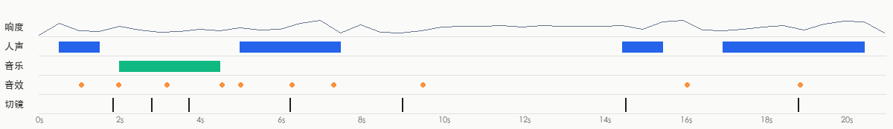

- 响度 -22.1 dBFS，峰值 -1.0 dBFS；声音跨切点连续，是后期整体铺的（切点处背景声变化 4.9dB，镜头内 5.7dB）
- 来源判断：视频类型：旁白/口播 + 配乐 → 人声TTS 配音；音效音效库/剪辑软件后期添加（倾向，待确认）

**人声**

- 占 38% 时长；基频约 115.4Hz（偏男声）
- 来源：TTS 配音（TTS 配音 64%，真人录音 27%，AI 视频原生对白（随画面生成） 9%）
  - 人声和背景声跨切点连续：整条旁白是后期单独配上去的（TTS 或真人配音）
- 复刻：TTS 配音：剪映「文本朗读」或其他配音工具，选相近的音色和语速

**背景音乐**

- 未检测到持续的音乐床

**音效**（0）

- 没有找到后期加的音效

- 分离出的音轨：`stems/original.wav`（原声）、`stems/vocals.wav`（人声干声）、`stems/music.wav`（配乐 + 环境声）、`stems/effects.wav`（音效轨）
<!--stems-->

## 不确定点

- 声音没有 AI 听过（复核只看了画面）：人声是真人还是 TTS 是按波形推断的；音效是从单独分离出的音效轨里找的，类型是按声音特征估的。可以在「声音」里试听分轨和每处音效核对

## 附录

### 逐镜取证

每个镜头分两块：画面里看得到的，和工具推断的制作方式（附判断依据）；最后是复刻提示词。默认折叠，点开看。

<details class="ref"><summary>#1 00:00.000–00:01.833 · AI 生成视频 + 代码/剪辑叠加（文字标注）</summary>

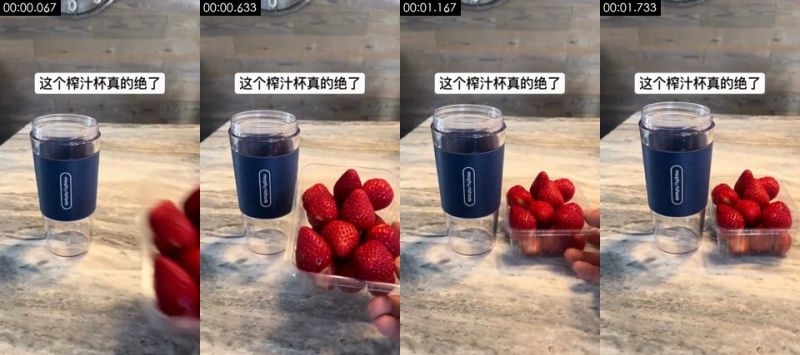

**画面里看得到的**（可以对照截图核实）
- 画面：近景略俯拍台面：深蓝色硅胶套便携榨汁杯立在大理石台面左侧，一只手把一整盒红草莓从右侧推进画面放在杯旁后抽走；画面上方有白底黑字标题。机位基本不动。
- 拍法/打光：近景；略俯拍；三脚架/支架固定；正面柔光（平光）；主光正面（光从镜头方向来，主体两侧亮度接近）；光比约 1.3:1（相差 0.4 档）；硬光（明暗分界清楚）
- 画面里物体上的字（不是后期字幕）：mophyrichods、mophyrohocis
- 文字轨（文字/middle）：这个榨汁杯真的绝了
- [AI 助手 看图] 杯套上的品牌字样不可读，是乱码字母（工具 OCR 读出 mophyrichods），不是真品牌 morphy richards
- [AI 助手 看图] 草莓盒从画面右侧滑入时草莓边缘糊成一片，放稳后手指从盒后抽出，指形不清
- [AI 助手 看图] 重复帧呈 24→30 规律，与同片其他 AI 镜头一致

**工具推断的制作方式**（是推断，不是看到的）
- 推断：AI 生成视频 72%，实拍 15%，3D 渲染 5%（fused_agent）
- 素材来源：AI 生成
- 判断依据（工具测量，肉眼不一定看得出）：
  - 纹理呈照片/视频特征：噪声 σ=0.43、用色 172 种、平坦块 2%
  - 重复帧呈 24→30 规律（14%，周期 5）：原始素材为 24/25fps 后转码，常见于 AI 生成视频、3D/动画渲染或电影素材

- 复刻：原片为 AI 生成：取原镜头首尾帧做首尾帧生成，可高度还原构图与动作；换主体时先用图像模型改首帧
  - 首帧图像提示词：主体居中。竖屏 9:16，近景略俯拍，灰白大理石纹台面，画面左侧偏中立着一个空的便携榨汁杯：透明杯身、深蓝色横纹硅胶杯套、杯套上白色椭圆框竖排品牌字，背景是灰棕木纹墙板和一只银灰色复古挂钟的下半部分，室内白天柔和光，写实手机实拍质感
  - 视频提示词：主体居中，竖屏 9:16。近景略俯拍，榨汁杯立在画面左侧，一只手把一透明塑料盒整颗红草莓从画面右侧推进来放在杯子右边，手随后抽出画面，草莓盒停稳，机位固定

</details>

<details class="ref"><summary>#2 00:01.833–00:02.800 · AI 生成视频</summary>

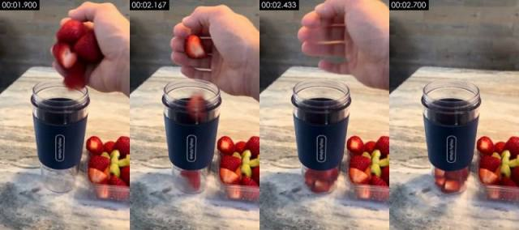

**画面里看得到的**（可以对照截图核实）
- 画面：近景略俯拍：一只手握着切块草莓悬在榨汁杯口上方松开，草莓块落进杯底；右侧盒里是切好的草莓和猕猴桃。机位固定。
- 拍法/打光：中景；移动机位（稳定器/手持平移）；正面柔光（平光）；主光正面（光从镜头方向来，主体两侧亮度接近）；光比约 1.2:1（相差 0.3 档）；硬光（明暗分界清楚）
- 画面里物体上的字（不是后期字幕）：mophyrichords、mophyriohods
- [AI 助手 看图] 杯套品牌字同样是乱码
- [AI 助手 看图] 松手时手指和下落的草莓块糊在一起，2.43s 帧里手指呈拉丝状
- [AI 助手 看图] 草莓盒里的内容从上一镜的整颗草莓变成了切块草莓加猕猴桃，前后不连贯
- [AI 助手 看图] 24→30 重复帧

**工具推断的制作方式**（是推断，不是看到的）
- 推断：AI 生成视频 90%，3D 渲染 2%，数字人口播 2%（fused_agent）
- 素材来源：AI 生成
- 判断依据（工具测量，肉眼不一定看得出）：
  - 纹理呈照片/视频特征：噪声 σ=0.36、用色 253 种、平坦块 2%
  - 重复帧呈 24→30 规律（21%，周期 5）：原始素材为 24/25fps 后转码，常见于 AI 生成视频、3D/动画渲染或电影素材

- 复刻：原片为 AI 生成：取原镜头首尾帧做首尾帧生成，可高度还原构图与动作；换主体时先用图像模型改首帧
  - 首帧图像提示词：中景，主体在画面正中。竖屏 9:16，近景略俯拍，大理石台面上的深蓝杯套便携榨汁杯居中，杯口敞开，一只手握着几块切好的红草莓悬在杯口上方，右下角是装着切块草莓和猕猴桃的透明盒，木纹墙背景，室内柔和光，写实
  - 视频提示词：中景，主体在画面正中。近景略俯拍，榨汁杯居中，手在杯口上方松开，草莓块落进杯底，手抬起移出画面，机位固定

</details>

<details class="ref"><summary>#3 00:02.800–00:03.733 · AI 生成视频</summary>

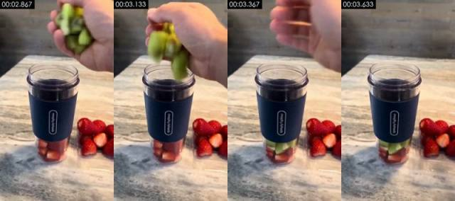

**画面里看得到的**（可以对照截图核实）
- 画面：同机位近景：手抓一把切块猕猴桃在杯口松开，猕猴桃落在草莓上面，手移出画面。
- 拍法/打光：中景；移动机位（稳定器/手持平移）；正面柔光（平光）；主光正面（光从镜头方向来，主体两侧亮度接近）；光比约 1.0:1（相差 0.1 档）；硬光（明暗分界清楚）
- 画面里物体上的字（不是后期字幕）：mophyrichods、mophyrichords
- [AI 助手 看图] 猕猴桃块下落时形状发糊，3.37s 时杯里突然出现一层猕猴桃，下落过程不连贯
- [AI 助手 看图] 手指边缘有拉丝模糊
- [AI 助手 看图] 杯套品牌字乱码
- [AI 助手 看图] 24→30 重复帧

**工具推断的制作方式**（是推断，不是看到的）
- 推断：AI 生成视频 90%，3D 渲染 2%，数字人口播 2%（fused_agent）
- 素材来源：AI 生成
- 判断依据（工具测量，肉眼不一定看得出）：
  - 纹理呈照片/视频特征：噪声 σ=0.37、用色 249 种、平坦块 2%
  - 重复帧呈 24→30 规律（17%，周期 5）：原始素材为 24/25fps 后转码，常见于 AI 生成视频、3D/动画渲染或电影素材

- 复刻：原片为 AI 生成：取原镜头首尾帧做首尾帧生成，可高度还原构图与动作；换主体时先用图像模型改首帧
  - 首帧图像提示词：中景，主体在画面正中。竖屏 9:16，近景略俯拍，大理石台面上的深蓝杯套便携榨汁杯居中，杯底有一层切块草莓，一只手抓着一把绿色猕猴桃块悬在杯口上方，右侧是一盒草莓，木纹墙背景，室内柔和光，写实
  - 视频提示词：中景，主体在画面正中，镜头推。近景略俯拍，榨汁杯居中，手在杯口松开一把猕猴桃块，猕猴桃落在杯底草莓上，手移出画面，机位固定

</details>

<details class="ref"><summary>#4 00:03.733–00:06.233 · AI 生成视频</summary>

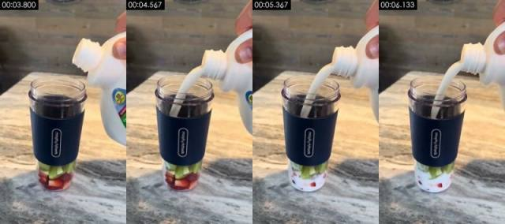

**画面里看得到的**（可以对照截图核实）
- 画面：同机位近景：手从画面右上方拿白色塑料牛奶壶，往杯里倒牛奶，杯底的草莓猕猴桃被牛奶没过一半。
- 拍法/打光：近景；移动机位（稳定器/手持平移）；正面柔光（平光）；主光正面（光从镜头方向来，主体两侧亮度接近）；光比约 1.1:1（相差 0.1 档）；柔光（几乎没有明暗分界）
- 画面里物体上的字（不是后期字幕）：mophyrichords、mophyrichoids、mophyrohads
- [AI 助手 看图] 牛奶壶标签图案和文字糊成色块，读不出
- [AI 助手 看图] 奶柱粗细均匀像一根管子，落进杯里几乎没有溅起
- [AI 助手 看图] 杯套品牌字乱码（mophyrichords 一类）
- [AI 助手 看图] 24→30 重复帧

**工具推断的制作方式**（是推断，不是看到的）
- 推断：AI 生成视频 90%，3D 渲染 2%，数字人口播 2%（fused_agent）
- 素材来源：AI 生成
- 判断依据（工具测量，肉眼不一定看得出）：
  - 纹理呈照片/视频特征：噪声 σ=0.40、用色 144 种、平坦块 2%
  - 重复帧呈 24→30 规律（14%，周期 5）：原始素材为 24/25fps 后转码，常见于 AI 生成视频、3D/动画渲染或电影素材

- 复刻：原片为 AI 生成：取原镜头首尾帧做首尾帧生成，可高度还原构图与动作；换主体时先用图像模型改首帧
  - 首帧图像提示词：主体在画面正中。竖屏 9:16，近景略俯拍，大理石台面上的深蓝杯套便携榨汁杯居中，杯底是草莓块和猕猴桃块，画面右上方一只手拿着白色塑料牛奶壶，壶口对准杯口，木纹墙背景，室内柔和光，写实
  - 视频提示词：主体在画面正中。近景略俯拍，榨汁杯居中，右上方的手倾斜白色牛奶壶，牛奶连续倒进杯里，液面没过水果一半，机位固定

</details>

<details class="ref"><summary>#5 00:06.233–00:09.033 · AI 生成视频</summary>

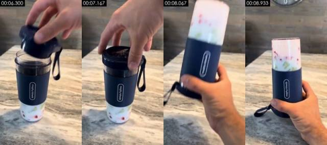

**画面里看得到的**（可以对照截图核实）
- 画面：近景：手把带挂绳的深蓝色刀座盖扣到杯口并拧紧，然后单手拿起杯子整个倒过来，刀座朝下握在手里。镜头随手轻微移动。
- 拍法/打光：近景；移动机位（稳定器/手持平移）；逆光/背景比主体亮；主光画面左侧偏前方；光比约 1.4:1（相差 0.5 档）；柔光（明暗过渡宽）
- 画面里物体上的字（不是后期字幕）：mophyriohoids、mophyidrods、mophyiclrods
- [AI 助手 看图] 8.07s 翻转时杯身和手明显拖影变形
- [AI 助手 看图] 杯套品牌字乱码
- [AI 助手 看图] 翻转后杯里的牛奶和水果几乎不晃动，重力反应不对
- [AI 助手 看图] 24→30 重复帧

**工具推断的制作方式**（是推断，不是看到的）
- 推断：AI 生成视频 89%，3D 渲染 3%，数字人口播 2%（fused_agent）
- 素材来源：AI 生成
- 判断依据（工具测量，肉眼不一定看得出）：
  - 纹理呈照片/视频特征：噪声 σ=0.35、用色 156 种、平坦块 3%
  - 重复帧呈 24→30 规律（19%，周期 5）：原始素材为 24/25fps 后转码，常见于 AI 生成视频、3D/动画渲染或电影素材

- 复刻：原片为 AI 生成：取原镜头首尾帧做首尾帧生成，可高度还原构图与动作；换主体时先用图像模型改首帧
  - 首帧图像提示词：主体在画面正中。竖屏 9:16，近景略俯拍，大理石台面上的便携榨汁杯，杯底是牛奶泡着的草莓和猕猴桃，一只手拿着带黑色挂绳的深蓝色刀座盖正要扣到杯口，木纹墙背景，室内柔和光，写实
  - 视频提示词：主体在画面正中，镜头拉。近景略俯拍，手把深蓝色刀座盖扣到杯口拧紧，随后单手拿起杯子倒过来，刀座朝下握在画面中央，镜头跟着手轻微移动

</details>

<details class="ref"><summary>#6 00:09.033–00:14.567 · AI 生成视频</summary>

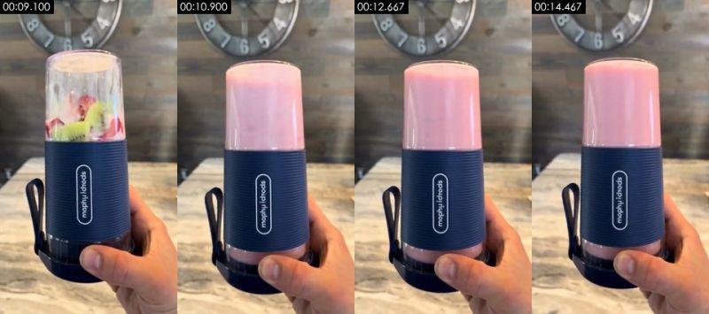

**画面里看得到的**（可以对照截图核实）
- 画面：近景平视：一只手握着倒置的榨汁杯（刀座在下、挂绳垂在左侧）举在画面中央，杯里的水果和牛奶很快变成粉色奶昔，之后杯子在手里轻微晃动；背后是木纹墙和银灰色复古挂钟。手持轻晃。
- 拍法/打光：近景；平视；他人手持；逆光/背景比主体亮；主光画面左侧偏前方；光比约 1.6:1（相差 0.7 档）；柔光（明暗过渡宽）
- 画面里物体上的字（不是后期字幕）：mophyiclrods、mophyichrods、mophy iclrods
- [AI 助手 看图] 9.6–10.1s 半秒内杯里整块的草莓猕猴桃直接变成均匀的粉色奶昔，没有刀片搅动和翻滚，物理不对
- [AI 助手 看图] 杯套品牌字乱码（mophy idrods）且在不同帧里笔画漂移
- [AI 助手 看图] 背景挂钟数字边缘发糊变形
- [AI 助手 看图] 这一镜没测到重复帧，制作方式主要靠画面破绽判定

**工具推断的制作方式**（是推断，不是看到的）
- 推断：AI 生成视频 76%，实拍 8%，3D 渲染 4%（fused_agent）
- 素材来源：AI 生成
- 判断依据（工具测量，肉眼不一定看得出）：
  - 纹理呈照片/视频特征：噪声 σ=0.37、用色 202 种、平坦块 2%

- 复刻：原片为 AI 生成：取原镜头首尾帧做首尾帧生成，可高度还原构图与动作；换主体时先用图像模型改首帧
  - 首帧图像提示词：主体居中。竖屏 9:16，近景平视，一只手握着倒置的便携榨汁杯举在画面中央：深蓝色横纹硅胶杯套、白色椭圆框竖排品牌字，刀座底盖朝下带黑色挂绳，透明杯里是泡在牛奶里的草莓块和猕猴桃片，背景是虚化的木纹墙和银灰色复古挂钟，室内柔和光，写实
  - 视频提示词：主体居中，竖屏 9:16。近景平视，手握倒置的榨汁杯在画面中央，杯里的草莓和猕猴桃被快速搅打，翻滚成均匀细腻的粉色奶昔，表面有细小气泡，之后杯子静止展示，手持轻微晃动

</details>

<details class="ref"><summary>#7 00:14.567–00:18.867 · AI 生成视频</summary>

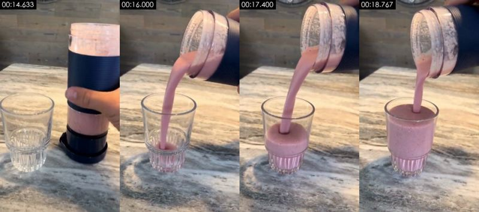

**画面里看得到的**（可以对照截图核实）
- 画面：近景略俯拍：台面左边放着一个底部带竖棱的空玻璃杯，手拿起右边装满粉色奶昔的榨汁杯（已拆下刀座），把奶昔倒进玻璃杯，倒到快满。机位固定。
- 拍法/打光：近景；略俯拍；三脚架/支架固定；正面柔光（平光）；主光正面（光从镜头方向来，主体两侧亮度接近）；光比约 1.2:1（相差 0.2 档）；柔光（明暗过渡宽）
- 画面里物体上的字（不是后期字幕）：AV
- [AI 助手 看图] 倒出的奶昔流柱粗细恒定、落进杯里不起波纹，像是黏稠的整体在滑动
- [AI 助手 看图] 杯口和流柱接合处有形变粘连
- [AI 助手 看图] 逐帧清晰度周期起伏，与同片 AI 镜头一致

**工具推断的制作方式**（是推断，不是看到的）
- 推断：AI 生成视频 79%，实拍 6%，3D 渲染 3%（fused_agent）
- 素材来源：AI 生成
- 判断依据（工具测量，肉眼不一定看得出）：
  - 纹理呈照片/视频特征：噪声 σ=0.46、用色 129 种、平坦块 1%
  - 逐帧清晰度呈周期性起伏（周期 6 帧，相关 0.17），但没有重复帧：可能是插帧/帧率转换，也可能只是重新压缩留下的节奏（去掉了平台标记的转码文件也会这样），单凭这一条不能定 AI

- 复刻：原片为 AI 生成：取原镜头首尾帧做首尾帧生成，可高度还原构图与动作；换主体时先用图像模型改首帧
  - 首帧图像提示词：主体居中。竖屏 9:16，近景略俯拍，大理石台面左侧是一个底部带竖棱的空玻璃杯，右侧一只手握着装满粉色奶昔的便携榨汁杯，木纹墙背景，室内柔和光，写实
  - 视频提示词：主体居中，竖屏 9:16。近景略俯拍，手拿起装满粉色奶昔的榨汁杯，倾斜着把浓稠奶昔倒进左侧玻璃杯，奶昔慢慢倒到快满，机位固定

</details>

<details class="ref"><summary>#8 00:18.867–00:21.033 · AI 生成视频</summary>

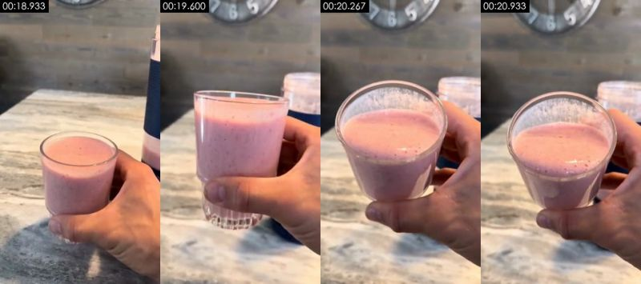

**画面里看得到的**（可以对照截图核实）
- 画面：近景：手从台面拿起装满粉色奶昔的玻璃杯，举到镜头前微微倾斜，露出表面的细泡；背景是木纹墙、挂钟和虚化的榨汁杯。手持轻晃。
- 拍法/打光：近景；略俯拍；他人手持；正面柔光（平光）；主光正面（光从镜头方向来，主体两侧亮度接近）；光比约 1.1:1（相差 0.2 档）；硬光（明暗分界清楚）
- [AI 助手 看图] 玻璃杯形状在 2 秒内变了几次：18.9s 是矮杯，19.5s 变成高杯且杯底有竖棱，20.1s 又变成无棱的碗形杯
- [AI 助手 看图] 杯里奶昔液面高度随杯形一起变
- [AI 助手 看图] 24→30 重复帧

**工具推断的制作方式**（是推断，不是看到的）
- 推断：AI 生成视频 75%，实拍 15%，3D 渲染 3%（fused_agent）
- 素材来源：AI 生成
- 判断依据（工具测量，肉眼不一定看得出）：
  - 纹理呈照片/视频特征：噪声 σ=0.31、用色 160 种、平坦块 3%
  - 重复帧呈 24→30 规律（13%，周期 5）：原始素材为 24/25fps 后转码，常见于 AI 生成视频、3D/动画渲染或电影素材

- 复刻：原片为 AI 生成：取原镜头首尾帧做首尾帧生成，可高度还原构图与动作；换主体时先用图像模型改首帧
  - 首帧图像提示词：主体居中。竖屏 9:16，近景略俯拍，一只手握着一杯粉色草莓奶昔的玻璃杯在画面中央偏下，背景是虚化的大理石台面、木纹墙、银灰色挂钟和装着奶昔的榨汁杯，室内柔和光，写实
  - 视频提示词：略俯拍，主体居中，竖屏 9:16，镜头拉。近景，手从台面拿起装满粉色奶昔的玻璃杯，举到镜头前微微倾斜，露出奶昔表面的细小泡沫，手持轻微晃动

</details>

### 元数据线索

- 编码器：`Lavf61.7.100`

### 说明

- 确定性取证对「是否在动、是否整图推拉、是否渲染纹理、是否 24→30 帧率转换」很可靠；对实拍 / AI / 3D 的区分要靠看图（看图模型或 AI 助手复核），最好再自己对照截图看一眼。
- 元数据经平台转码常被清除，缺失不代表没有。
- 完整数据在 `breakdown.json`；给模型读的拆片包从 `VIDEO.md` 开始。
